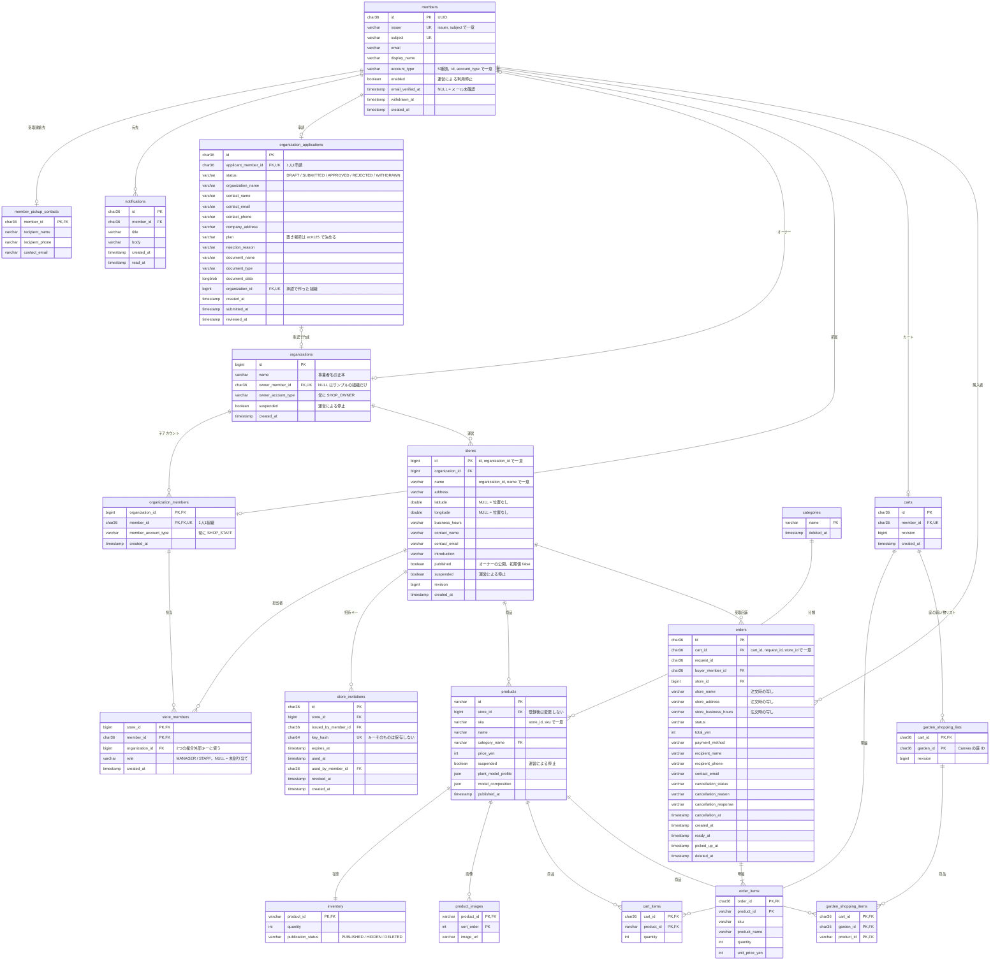

# 新しい DB の設計案（v3）

元の場所：kusakari-canvas の未追跡ファイル docs/discussions/db-v3-design.md（2026-11-16 に移動。Git の履歴はない）

2026-11-11 作成。`ec-db-v2.drawio` の図と、EC・Canvas の issue（ec#102〜#113、#119〜#122、#125、#79、#16、canvas#63〜#65）から設計方針だけを読み取って作った案です。

- 既存 DB との互換性は考えていません（初期化して作り直す前提。ec#102 決定事項2）
- issue に出てくる旧テーブル名・旧列名には合わせていません
- EC の DB の DDL は、使い捨ての MySQL 8.0.46（開発用とは別のポート）で作り、制約を79件確かめました（7章）。Canvas の DB の変更（4章）と、`products` の説明用の列は確かめていません

## 1. `ec-db-v2.drawio` の図への評価

骨格はそのまま使えます。組織・所属・店舗・担当・招待キーの関係と、アカウント種別の列は、issue の決定どおりです。

ただし、図は 2026-11-10 の途中の時点の内容で、その後に変わった決定が入っていません。直す点は次のとおりです。

| 図の内容 | 直し方 | 根拠 |
| --- | --- | --- |
| `products.organization_id`（商品は組織のもの） | `products.store_id` にする。商品は1つの店舗に属する | ec#104 改定：対応策4 |
| `inventory` の主キーが `(store_id, product_id)`、`organization_id` あり | 主キーを `product_id` だけにする。商品と1対1 | ec#122 |
| `products.active` | 削除する。出店者の操作は `inventory.publication_status`、運営の停止は `products.suspended` | ec#122 |
| `carts.selected_store_id`、`cart_items.pickup_store_id` | 削除する。受取店舗は商品の店舗で決まる | ec#104 対応策9、ec#119 |
| `cart_details`、`member_addresses`、`orders.shipping_fee_yen`、`order_details` の住所・配送日時 | 削除する。店舗受け取りだけにする | ec#104 対応策9 |
| `account_type` が4種類 | 申請中の `SHOP_OWNER_APPLICANT` を足して5種類にする | ec#109 |
| `store_applications` に店舗の住所がある | 会社の情報だけにし、下書き・取り下げの状態を足す | ec#109 |
| `stores.enabled` が1つ | 「オーナーの公開」と「運営の停止」の2つの列に分ける | ec#109（店舗は非公開で始まる） |

## 2. 設計の方針（issue から読み取ったもの）

1. 購入用のアカウントと店舗側のアカウントを分ける。種別は会員の列1つで決める
2. 店舗側は「組織 → 店舗 → 店舗ごとの担当者」。ロール（MANAGER / STAFF）は店舗の担当にだけ持つ
3. 組織のオーナーは組織に1人。所属や担当のテーブルには入れない
4. 「してはいけない組み合わせ」は、できるだけ DB の制約で拒否する（トリガーは使わない）
5. 商品は1つの店舗に属する。受取店舗は商品で決まり、購入者は店舗を選ばない
6. 発送はしない。発送用の列は残さない（将来は ec#120 で設計し直す）
7. 「出店者・オーナーが自分で行う公開／非公開」と「運営による停止」は、別の列で持つ
8. 同じ事実を2か所に持たない（事業者名、商品の店舗、公開状態など）

## 3. EC の DB

### 3.1 ER 図

`products` は主な列だけを書いています。説明・サイズ・育て方などの列は、v2 の図の列をそのまま持ちます（`organization_id` と `active` を除く）。`product_media`（画像の本体）と `material_products` は v2 の図のままです。

### 3.2 会員とアカウント種別

- テーブル名は `members` にします（v2 の図と同じ。互換性が不要なので `auth_members` を残す理由がなくなりました）
- 主キーは UUID のままにします。連番の ID を外に出さないためと、Canvas が庭の持ち主として使うためです
- `account_type` は次の5種類で、CHECK 制約で完全一致だけを許します

| 値 | 意味 | できること |
| --- | --- | --- |
| `USER` | 購入者 | 購入、Canvas |
| `SHOP_OWNER_APPLICANT` | 申請中の法人用アカウント | 会社情報の登録、申請、取り下げ、再申請だけ |
| `SHOP_OWNER` | 組織のオーナー | 自分の組織の全店舗と子アカウント |
| `SHOP_STAFF` | 子アカウント | 割り当てられた店舗を、店舗ごとのロールで |
| `ADMIN` | 運営 | 全組織・全店舗の閲覧と停止 |

- `(id, account_type)` に一意キーを作り、組織と所属の複合外部キーの参照先にします（3.3）
- `email_verified_at` と `created_at` を足します。「メール確認まで進まなかった法人用アカウントを14日で削除する」（ec#109）を判定するためです
- 認証基盤とのつながりは `(issuer, subject)` の一意キーだけにします。会員は登録した時点で作ります（ec#109、ec#111）

### 3.3 組織・店舗・担当（DB が拒否すること）

| 制約 | DB が拒否すること |
| --- | --- |
| `organizations(owner_member_id, owner_account_type)` → `members(id, account_type)`、`owner_account_type = 'SHOP_OWNER'` の CHECK | 購入者・申請中・子アカウント・運営をオーナーにする。オーナーである間の種別の変更 |
| `organizations.owner_member_id` の一意キー | 1人が2つの組織のオーナーになる |
| `organization_members(member_id, member_account_type)` → `members(id, account_type)`、`member_account_type = 'SHOP_STAFF'` の CHECK | 子アカウント以外を組織に所属させる。所属している間の種別の変更 |
| `organization_members.member_id` の一意キー | 1人が2つの組織に所属する |
| `store_members(store_id, organization_id)` → `stores(id, organization_id)` と、`store_members(organization_id, member_id)` → `organization_members(organization_id, member_id)`（`ON DELETE CASCADE`） | 別の組織の店舗に担当を割り当てる。オーナーを店舗の担当にする |
| `store_members.role` の CHECK（`MANAGER` / `STAFF` / NULL） | 上の2つ以外のロール |

- ロール未割り当ては `store_members.role = NULL` で表します。招待キーで登録した直後の行がこの状態です。状態の列や別テーブルを足さずに済みます
- `store_invitations` は `store_id` だけを持ちます。組織は店舗からたどれるので、v2 の図の `organization_id` は外しました
- 招待キーで登録するときは、1つのトランザクションで「会員（`SHOP_STAFF`）→ 所属 → 担当（ロールなし）→ キーを使用済みにする」を行います

### 3.4 店舗と組織の公開・停止

| 列 | 誰が変えるか | 意味 |
| --- | --- | --- |
| `stores.published` | オーナー | 初期値は false。必須の項目を入れて公開の操作をすると true |
| `stores.suspended` | 運営 | 店舗単位の停止 |
| `organizations.suspended` | 運営 | 組織単位の停止 |
| `inventory.publication_status` | 出店者 | 商品の公開・非公開・削除 |
| `products.suspended` | 運営 | 商品単位の停止 |

商品が購入者に見える条件は、「組織が停止されていない」「店舗が公開されていて停止されていない」「商品が停止されていない」「`publication_status = 'PUBLISHED'`」のすべてです。

v2 の図の `stores.enabled` 1つだと、運営が停止を解除したときに「オーナーがまだ公開していなかった店舗」まで公開されてしまうため、列を分けました。

### 3.5 出店申請

- テーブル名は `organization_applications` にします。申請の対象が店舗ではなく組織になったためです（ec#109）
- 1人につき1行（`applicant_member_id` を一意）にし、状態を次のように移します
  - `DRAFT`（会社情報を登録）→ `SUBMITTED`（審査中）→ `APPROVED` または `REJECTED`
  - `SUBMITTED` → `WITHDRAWN`（取り下げ。入力した内容は残す）
  - `REJECTED`・`WITHDRAWN` → 直して `SUBMITTED`（再申請）
- 承認は1つのトランザクションで「申請者の種別を `SHOP_OWNER` に変える → 組織を作る → 申請に `organization_id` を記録する」を行います。店舗は作りません
- 店舗の住所・営業時間などは持ちません。オーナーが店舗を作るときに `stores` に入れます

### 3.6 商品・在庫

- `products.store_id` は必須で、登録後は変えません。注文の店舗と商品の店舗が常に一致します
- `inventory` は主キーを `product_id` にし、在庫数と公開状態だけを持ちます。3D モデルの大きな JSON を持つ `products` と、在庫のロックの対象を分けるためです
- `sku` の一意は `(store_id, sku)` にします。同じ品種を店舗ごとに別の商品として登録するので、店舗が違えば同じ商品番号を使えるようにします

### 3.7 カート・注文

- カートは店舗を持ちません。明細は `(cart_id, product_id, quantity)` だけです
- 注文は受取店舗ごとに1行です。`(cart_id, request_id, store_id)` の一意キーで、同じ購入の操作から同じ店舗の注文が2つできないようにします
- 受取連絡先と支払方法は `orders` の列にしました（v2 の図の `order_details` は作りません）。残る列が4つだけで、注文と必ず1対1だからです
- 送料がないので、金額は `total_yen` だけです（`subtotal_yen`、`shipping_fee_yen` は作りません）
- 店舗名・住所・営業時間は注文時の写しを残します。店舗の情報が後で変わっても、注文の表示が変わらないようにするためです

## 4. Canvas の DB

Canvas の DB は、庭・配置・写真・履歴だけを持つ今の構成のままで足ります。変えるのは次の2点です。

| 対象 | 変更 | 理由 |
| --- | --- | --- |
| `gardens.owner_id`（`VARCHAR(128)`） | `gardens.owner_member_id`（`CHAR(36)`）にする | 入るのは EC の会員 ID（UUID）だけなので、型と名前を EC に合わせる |
| Alembic の `0001`〜`0008` | 新しい基準の1本にまとめ直す | EC が Flyway をまとめ直す（ec#104 対応策7）のと同じ理由。初期化は手動のスクリプト（canvas#63）だけが行い、起動時には何も消さない |

それ以外のテーブル（`assets`、`placed_objects`、`garden_thumbnails`、`garden_image_history`）は列を変えません。

- 配置（`placed_objects`）に店舗は持たせません。商品から店舗が決まるためです（canvas#65）
- EC と Canvas は別の DB なので、外部キーは張れません。つながりは次の3つの値だけです

| Canvas の値 | EC の値 |
| --- | --- |
| `gardens.owner_member_id` | `members.id` |
| `placed_objects.product_id` | `products.id` |
| `gardens.id` | `garden_shopping_lists.garden_id` |

- Canvas を使えるのは `USER` だけです。ほかの種別で開いたときは、購入者アカウントでの利用を案内して止めます（canvas#64）

## 5. issue の決定から、この案で変えたところ

互換性が不要という前提で、issue の決定より踏み込んだ箇所です。方針は変えていません。

| この案 | issue での決定 | 変えた理由 |
| --- | --- | --- |
| `members` | `auth_members` の名前を残す（ec#104 対応策1） | 残す理由は「書き換えが増える」だけだったため |
| `organization_applications` | `store_applications` に列を足す | 申請の対象が組織になったため |
| `stores.published` と `stores.suspended` | `stores.enabled` の初期値を非公開にする | 3.4 のとおり、1つの列では運営の停止解除で未公開の店舗が公開されるため |
| `organizations.suspended` | `organizations.enabled` | 店舗・商品と名前の向きをそろえるため |
| 受取連絡先と支払方法を `orders` に入れる | `order_details` を4列にして残す | 1対1で列が少ないため |
| 緯度経度を NULL にできる | 未決定（緯度0・経度0を「位置なし」の印にする案が残っている） | 位置なしを 0,0 で表すと、距離が約14,000 km と計算されるため |
| `(store_id, sku)` で一意 | `sku` で一意 | 商品が店舗ごとになったため |
| `members.email_verified_at`、`members.created_at` | 列の指定なし | 14日での削除（ec#109）の判定に必要なため |
| `store_invitations` から `organization_id` を外す | v2 の図にあり | 店舗からたどれるため |

## 6. まだ決まっていないこと

DB の形に影響するものだけを挙げます。

| 項目 | この案での仮の形 | 決める場所 |
| --- | --- | --- |
| 招待キーは1回限りか、期限内なら何人でも使えるか | 1回限り（`used_at`、`used_by_member_id`）。何人でも使える形にするなら、この2列を外し、`store_members` に「どのキーで入ったか」を持たせる | ec#105 |
| 料金プランを組織と店舗のどちらに持つか | 申請の行に `plan` を残したまま | ec#125 |
| 同じ品種の商品をジャンルでまとめて表示するか（`9.md` の案） | 入れていない。採用するなら、ジャンルのテーブルと `products` からの参照を足す | 未起票 |
| 店舗の閉鎖の状態 | 入れていない | ec#79 |
| 運営の警告の記録 | 入れていない | ec#16 |
| `material_products`（素材コードと商品の対応）を残すか | v2 の図のまま残している。Canvas は使わなくなる（ec#119） | ec#119 |
| 初期化後、認証基盤に残ったユーザーの扱い | DB には影響しない。User Pool のユーザーも一緒に消せば、初回ログインで会員を作り直す処理は要らない | ec#108 |

## 7. MySQL で確かめたこと（2026-11-11）

使い捨ての MySQL 8.0.46 を、開発用（3306）とは別のポート（33999）に一時的なデータフォルダーで立て、3章の DDL を作って79件を試しました。試験の後、この MySQL は停止しています。開発用・E2E 用の DB には接続していません。

- 結果：79件すべて期待どおり（拒否されるべき操作43件がすべて拒否され、通るべき操作36件がすべて通った）
- 使ったファイル：[db-v3-check/schema.sql](https://github.com/abeouga/kusakari-ec/blob/a9cbd69/docs/database-v3-check/schema.sql)（DDL）、[db-v3-check/cases.txt](https://github.com/abeouga/kusakari-ec/blob/a9cbd69/docs/database-v3-check/cases.txt)（試験の一覧）、[db-v3-check/run.sh](https://github.com/abeouga/kusakari-ec/blob/a9cbd69/docs/database-v3-check/run.sh)（実行）、[db-v3-check/result.txt](https://github.com/abeouga/kusakari-ec/blob/a9cbd69/docs/database-v3-check/result.txt)（結果）

**拒否されることを確かめた操作（43件）**

- 種別：小文字の種別、旧種別 `SHOP`
- オーナー：購入者・申請中・子アカウント・運営をオーナーにする、オーナーである間の種別の変更、2つ目の組織のオーナー
- 所属：購入者・運営・オーナーを所属させる、2つ目の組織への所属、所属している間の種別の変更
- 担当：別の組織の店舗への割り当て（組織の列を店舗側・所属側のどちらに合わせても）、オーナーの担当、所属していない人の担当、二重の割り当て、`MANAGER` / `STAFF` 以外のロール
- 申請：同じ人の2件目、知らない状態、組織のない承認済み、承認済みから組織を外す
- 店舗：同じ組織の同じ店舗名、緯度だけの入力、注文のある店舗の削除
- 招待キー：同じキー、使用日時だけの入力
- 商品・在庫：同じ店舗の同じ商品番号、店舗のない商品、存在しない店舗、在庫の2行目、負の在庫、知らない公開状態
- カート・注文：1人に2つ目のカート、数量0、一覧のない庭の商品、同じ購入操作から同じ店舗への2件目の注文、在庫を超える減算

**通ることを確かめた流れ（36件のうち主なもの）**

- 承認：種別の変更 → 組織の作成 → 申請への記録（1トランザクション）
- 申請の取り下げと再申請
- 招待キーでの登録：所属 → 担当（ロールなし）→ キーを使用済みにする（1トランザクション）
- 同じ人を A 店では `MANAGER`、B 店では `STAFF` にする
- 店舗が違えば同じ商品番号を使える
- 運営が店舗の停止を解除しても、オーナーが未公開の店舗は見えないまま
- 2店舗の商品を1回で購入すると、店舗ごとに注文ができ、それぞれの在庫が減る。キャンセルで在庫が戻る
- 組織から外すと担当も消え、その後は種別を変えられる
- オーナーの交代（ec#104 対応策3の4段階）

**確かめていないこと**

- アプリケーション（Spring Boot・FastAPI）からの動作。確かめたのは SQL だけ
- Flyway・Alembic のマイグレーションとしての適用
- Canvas の DB の変更（4章）
- `products` の説明・サイズ・育て方などの列（試験の DDL では省いた）、`product_media`、`material_products`
- 同時実行（2人が同時に同じ在庫を買う、同じ招待キーを同時に使う）
