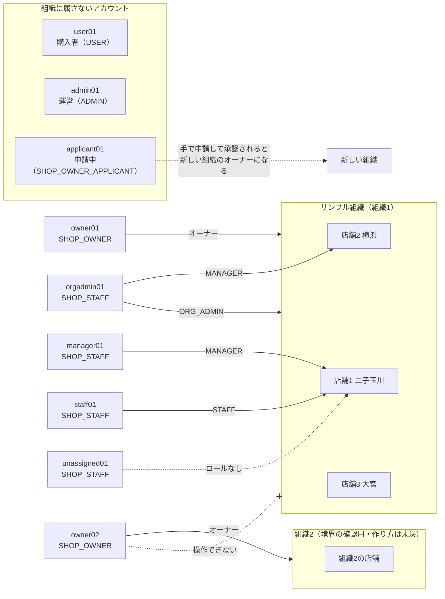
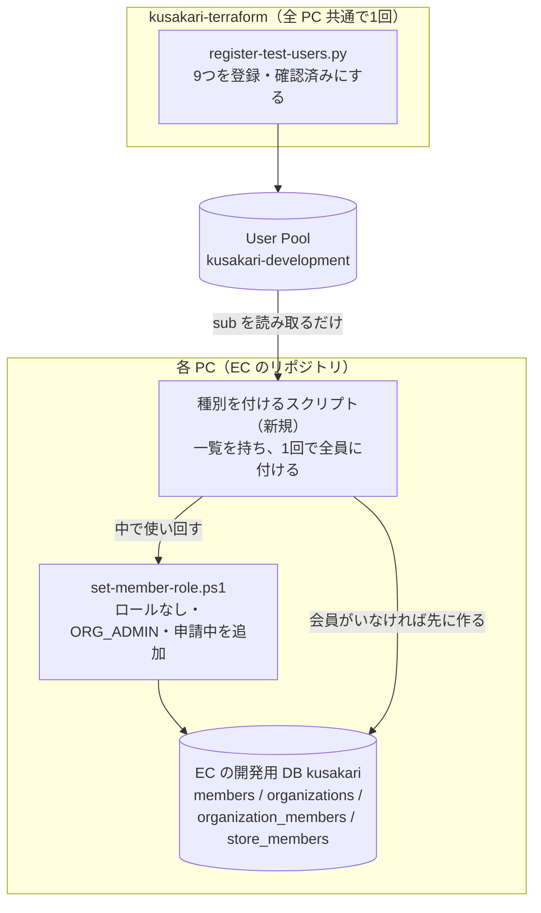
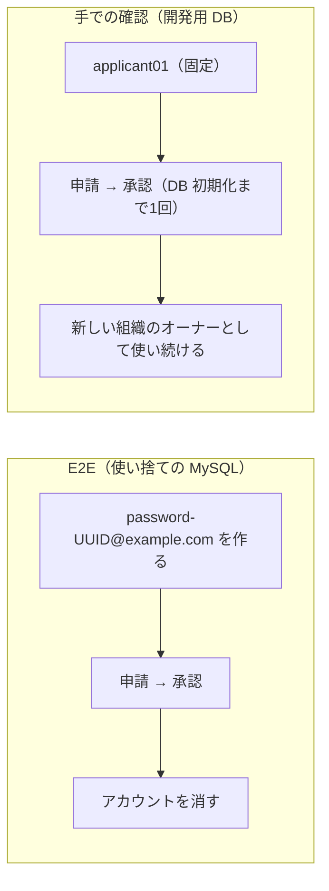
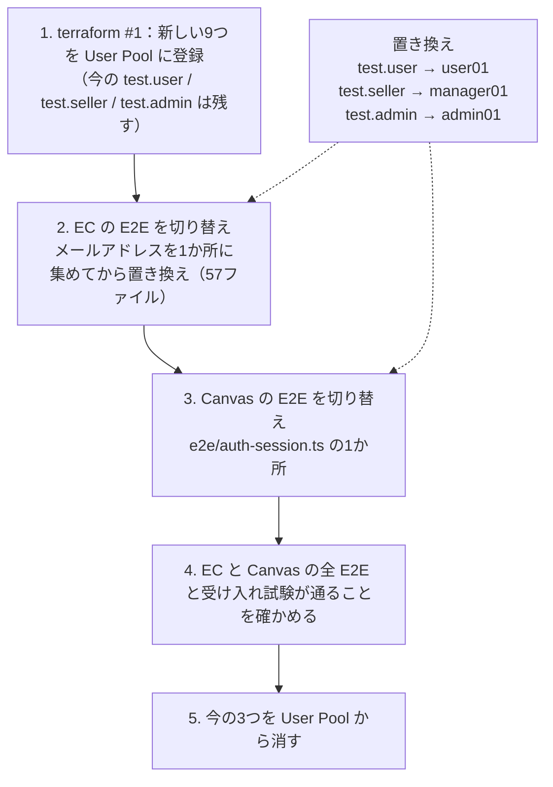

# EC #156 テスト用アカウントの案（2026-11-15 時点）

元の場所：kusakari-canvas の未追跡ファイル docs/discussions/156-test-accounts.md（2026-11-16 に移動。Git の履歴はない）

まだ issue・docs・コードには反映していない検討用の図です。

## 1. アカウントと組織・店舗の関係

## 2. 登録と種別の付け方（どこが何を書くか）

## 3. 申請中のアカウントの確かめ方

## 4. 切り替えの順番

## 未決のこと

- なし（組織2は種別を付けるスクリプトで作る。2026-11-15 に決定。正本は EC の docs/decisions/2026-11-15-test-accounts.md）
