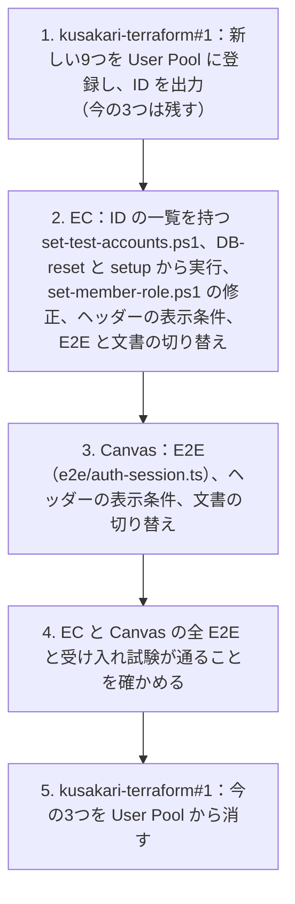

# テスト用アカウントの作り直しと、各 PC の DB への種別の付け方（#156）：E2E の切り替えの範囲と順番

元の場所：kusakari-ec/docs/decisions/2026-11-15-test-accounts.md（コミット a9cbd69 時点）

## 6. E2E の切り替えの範囲と順番

今のアカウントは次のように置き換える。E2E 用 DB で試験ごとに種別を付け替える作り（`e2e/business-helpers.js` の `prepareMember`）は残す。

| 今のアカウント | 新しいアカウント |
| --- | --- |
| test.user@example.com | user01@example.com |
| test.seller@example.com | manager01@example.com |
| test.admin@example.com | admin01@example.com |

今の3つを消すのは、EC と Canvas の E2E を切り替えて通した後にする。先に消すと、EC の E2E（51ファイル）と Canvas の E2E が動かなくなる。今のアカウントを書いているのは、EC が57ファイル（E2E の51ファイル、文書4つ、`frontend/src/App.jsx`、`packages/site-header/README.md`）、Canvas が5ファイル（`e2e/auth-session.ts`、`frontend/src/components/SiteHeader.jsx`、`README.md`、文書2つ）。

