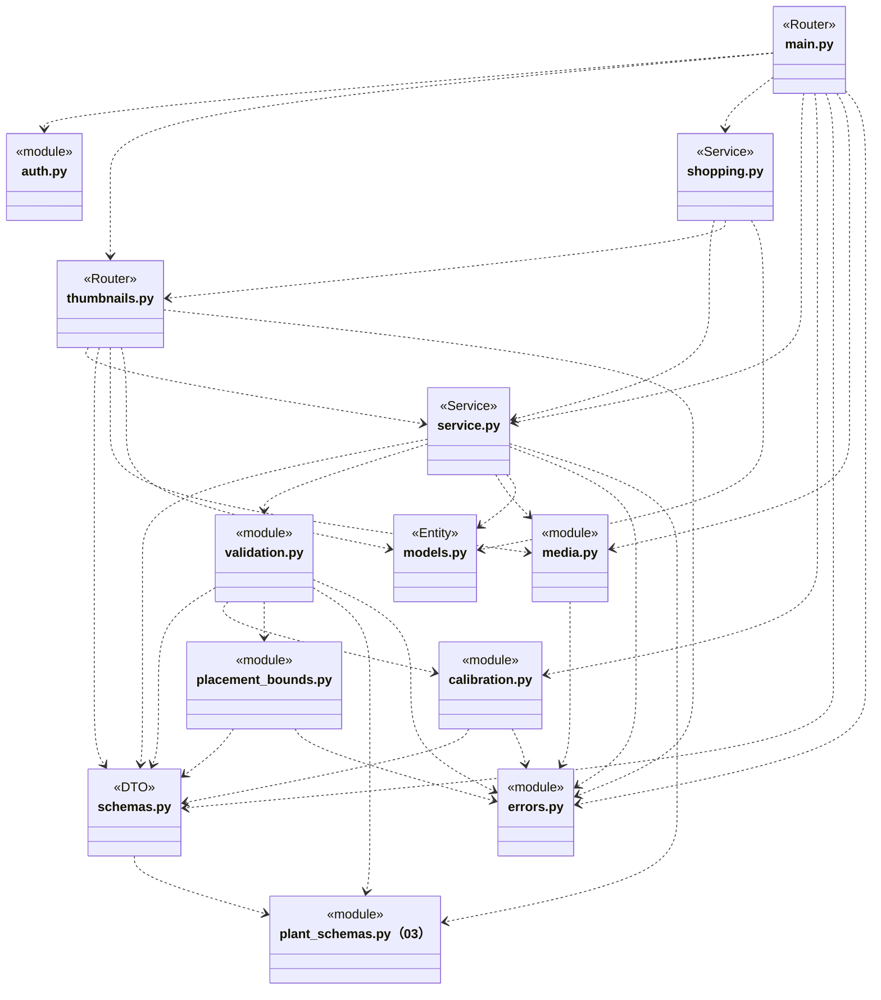
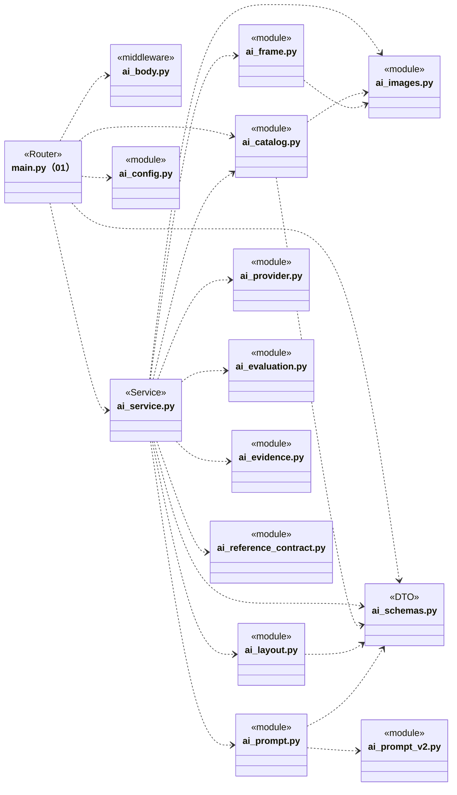
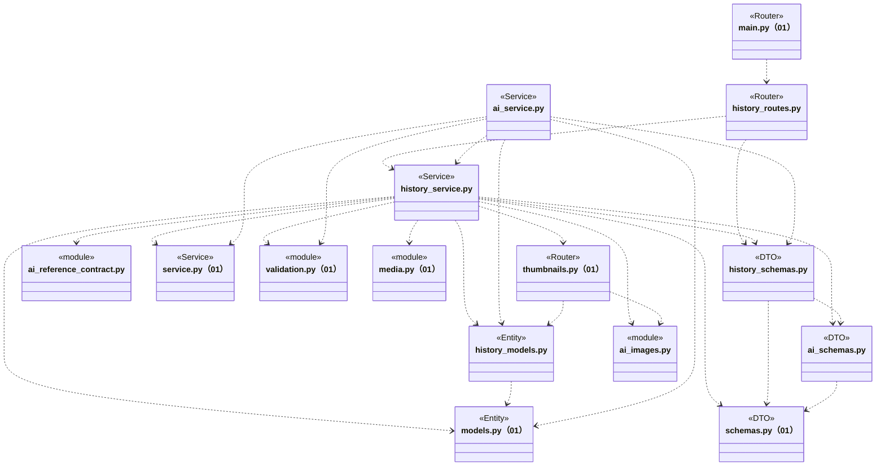
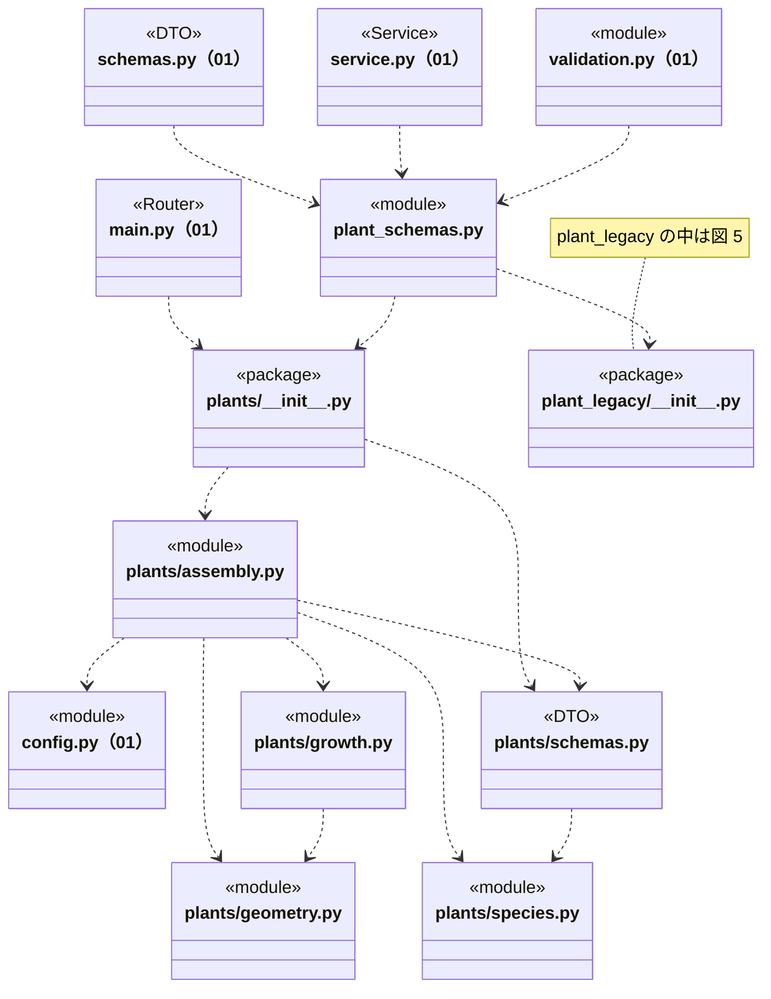
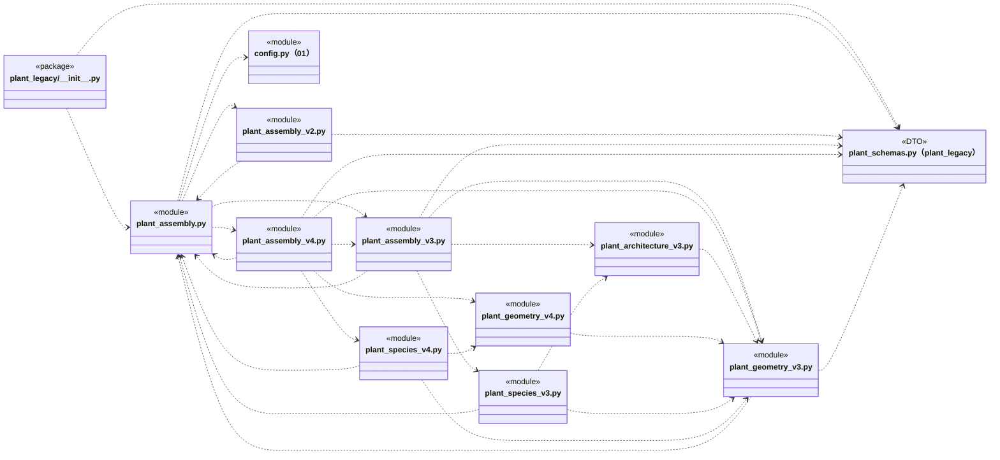
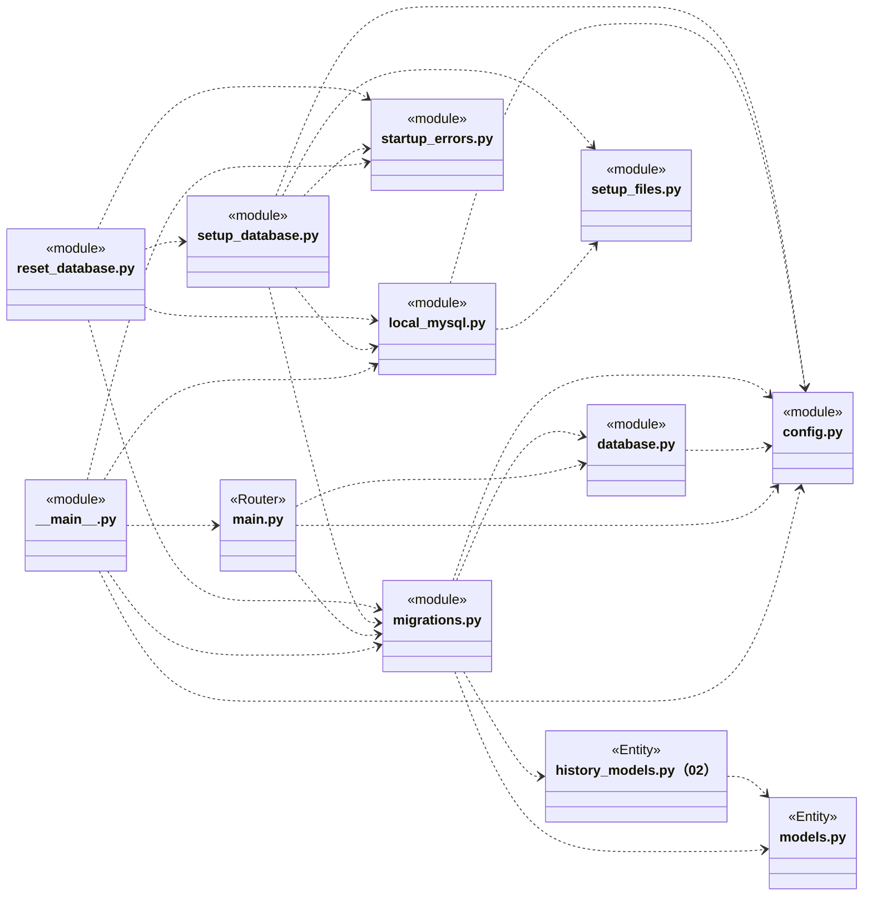
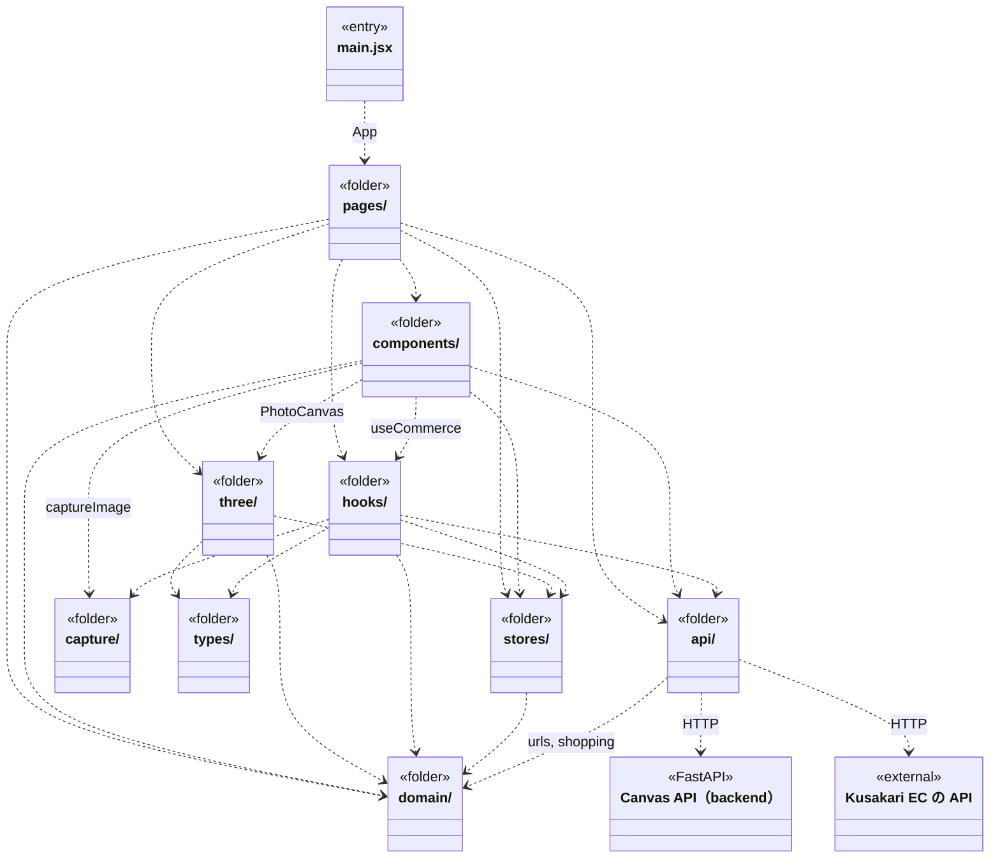

# Kusakari Canvas クラス図 00 モジュール構成

- 対象のコード: kusakari-canvas の main（c19d497、2026-11-20 時点）
- 対象のパッケージ: API は [backend/kusakari_canvas_api](https://github.com/abeouga/kusakari-canvas/blob/c19d497dfef15b119f9bce8ecb5c886a36da6b7d/backend/kusakari_canvas_api)（FastAPI、Pydantic、SQLAlchemy）、画面は [frontend/src](https://github.com/abeouga/kusakari-canvas/blob/c19d497dfef15b119f9bce8ecb5c886a36da6b7d/frontend/src)（React、JavaScript と JSX、React Three Fiber、Zustand、TanStack Query）です。
- 責務とデータ境界は [AGENTS.md](https://github.com/abeouga/kusakari-canvas/blob/c19d497dfef15b119f9bce8ecb5c886a36da6b7d/AGENTS.md)、技術の構成は [docs/architecture.md](https://github.com/abeouga/kusakari-canvas/blob/c19d497dfef15b119f9bce8ecb5c886a36da6b7d/docs/architecture.md) にあります。

このファイルは、Canvas のクラス図の入口です。モジュール（ファイル）とフォルダーの一覧、依存の向き、どのモジュールをどのファイルに載せたかを書きます。依存の矢印は、どれも `import` 文から確かめたものです。

## クラス図のファイル

| ファイル | 載せているもの |
|---|---|
| [00_モジュール構成](<00_モジュール構成.md>) | このファイル。backend のモジュールと frontend のフォルダーの一覧と依存 |
| [01_APIとデータの層](<01_APIとデータの層.md>) | アプリとルーター、認証、設定、DTO（schemas.py）、Service、ドメイン検証、Entity（models.py）、サムネイル、買い物リスト、起動とマイグレーション |
| [02_画像生成と履歴](<02_画像生成と履歴.md>) | 完成イメージの画像生成（`ai_*.py`）と生成履歴（`history_*.py`） |
| [03_植物モデル](<03_植物モデル.md>) | 植物モデルの組み立て（`plants/`、`plant_schemas.py`、凍結した v1〜v4 の `plant_legacy/`） |
| [04_GardenDocumentと画面の状態](<04_GardenDocumentと画面の状態.md>) | 画面の GardenDocument の型（`types/`）、編集中の状態（`stores/`）、編集ルール（`domain/`）、HTTP（`api/`）、サーバーデータ（`hooks/`） |

テーブルの詳細は [テーブル設計図](<../../テーブル設計図/kusakari-canvas/>)、処理の流れは [シーケンス図](<../../シーケンス図/kusakari-canvas/>) にあります。

## 対象にしたものと、対象外にしたもの

- `backend/kusakari_canvas_api/` の 58 ファイル（パッケージ直下 41、`plants/` 6、`plant_legacy/` 11）を対象にしました。
- `backend/verification/` は対象外です。検証用のスクリプト（30 ファイル）です。そのうち 25 ファイルが `kusakari_canvas_api` を import しますが、`kusakari_canvas_api` からは import されず、API の実行時には読み込みません。`docker/api.Dockerfile` もイメージに入れません。
- `backend/alembic/` は対象外です。`env.py` とマイグレーション（`versions/` の 0001〜0008 と、0001・0002 が読む `sql/` の V1・V2 の SQL）で、クラスはありません。`env.py` は `models.Base` と `history_models.HistoryEntity` を import して表の定義を読みます。テーブルの構成は [テーブル設計図](<../../テーブル設計図/kusakari-canvas/>) で扱います。マイグレーションを動かす `migrations.py` は 01 に載せました。
- `frontend/src` の CSS（直下の 14 ファイル）は対象外です。

## AGENTS.md の依存の向きと、コードの対応

AGENTS.md は、依存の向きを「UI/3D 操作 → 検証済み編集操作 → GardenDocument → API DTO → Service → Repository/MySQL」と決めています。コードでは次のとおりです。

| AGENTS.md の層 | コード | 載せたファイル |
|---|---|---|
| UI/3D 操作 | `frontend/src/pages/`、`components/`（通常の UI）、`three/`（R3F の描画と 3D の操作） | 00 |
| 検証済み編集操作 | `stores/editorStore.js` のアクション（`addAssetAt`、`transformObject`、`deleteSelected`、`resizeGarden` など）が、`domain/` の関数（`gardenEditing.js` の `addObject`、`changeObjectTransform` など）で確かめてから `document` を変える | 04 |
| GardenDocument | `editorStore` の `document`。型は `types/garden.d.ts` | 04 |
| API DTO | 画面は `api/gardens.js` の `saveGarden` が `PUT /api/gardens/{id}` に JSON を送る。API は `schemas.py` の `GardenDocumentRequest` で受け、`GardenDocument` で返す | 04、01 |
| Service | `service.py`（`update_garden` など）、`shopping.py`、`thumbnails.py`、`history_service.py` | 01、02 |
| Repository/MySQL | `models.py`・`history_models.py` の Entity と SQLAlchemy の `Session`。Repository のクラスはなく、Service が `select` などを直接書く | 01、02 |

次の点は、矢印の向きに沿っています。

- `domain/` は、ほかのフォルダーもパッケージも import しません（`domain/` の中どうしだけ）。Three.js も使いません。
- `stores/` が import するのは `domain/` と `zustand` だけです。
- `three/` は `stores/`、`domain/`、`types/` を import し、`api/` を import しません。保存は画面の側（`hooks/useGardenAutosave.js`）が行います。
- backend の `models.py` は、同じパッケージのどのモジュールも import しません。`schemas.py` が同じパッケージで import するのは `plant_schemas.py` だけです。

次の点は、AGENTS.md の書き方と形が少し違います。

- `components/` と `pages/` は、`hooks/` を通さずに `api/` を直接呼ぶものがあります（例: `components/PhotoCalibrationEditor.jsx` が `api/http.js` の `requestJson` で `POST /api/photo-calibration` を呼ぶ）。
- backend に Repository のクラスはありません（上の表）。

## 図 1 backend の API とデータの層（01）

01 のモジュールの依存です。02・03 のモジュールへの依存は図 2〜図 4 と、下の表にあります。この図からあとのステレオタイプは層を表します。Router は API の受け口を持つモジュール、DTO は Pydantic のモデル、Service は Session を受けてトランザクションを区切るモジュール、Entity は SQLAlchemy の Entity のモジュールです。

## 図 2 画像生成のモジュール（02）

`ai_*.py` から `ai_config.py`（14 の `ai_*.py` のうち 10 が import する）と `errors.py` への矢印は、多いので省きました。下の表にはあります。`ai_service.py` から履歴と 01 への依存は図 3 にあります。

## 図 3 生成履歴のモジュール（02）と 01 への依存

`history_service.py` と `ai_service.py` は、01 の `service.owned_garden` で所有者を確かめ、`validation.validate_document` で庭のスナップショットを確かめます。`ai_config.py` と `errors.py` への矢印は省きました。

## 図 4 植物モデルのモジュール（03）

今の規則（v5）は `plants/`、保存済みの v1〜v4 を確かめるための凍結した規則は `plant_legacy/` です。`kusakari_canvas_api` の中で `plant_legacy` を import するのは `plant_schemas.py` だけで、`plants/` は `plant_legacy` を import しません。

## 図 5 plant_legacy の中（03）

`plant_assembly.py` の `assemble(profile, version)` が、版の番号で v1 をその場で組み立てるか、`plant_assembly_v2.py`〜`plant_assembly_v4.py` を呼びます（v2〜v4 は関数の中で import します）。

## 図 6 起動・マイグレーション・ローカル DB の準備（01）

図の `#95;#95;main#95;#95;.py` は `__main__.py` です（Mermaid で下線を太字にしないための書き方）。`setup_database.py` と `reset_database.py` は、setup.bat と DB-reset.bat からだけ動きます。`local_mysql.py` と `setup_files.py` は、それらに加えて、container 以外で API を起動するときにも `__main__.py` の `ensure_for_settings` から使います。

## backend のモジュールの一覧

「import しているモジュール」は、同じパッケージ（`kusakari_canvas_api`）の中で import しているものです。関数の中の import も含めます。`plants/` と `plant_legacy/` の中どうしは、同じフォルダーのファイル名だけを書きます。

| モジュール | 役割 | import しているモジュール | 載せたファイル |
|---|---|---|---|
| `__init__.py` | パッケージの説明文だけ | なし | 01（図には載せない） |
| `__main__.py` | `serve` と `migrate` の入口 | config、local_mysql、main、migrations、startup_errors | 01 |
| `main.py` | FastAPI のアプリ、ルーター、例外ハンドラー、ミドルウェア | ai_body、ai_catalog、ai_config、ai_schemas、ai_service、auth、calibration、config、database、errors、history_routes、media、migrations、plants、schemas、service、shopping、thumbnails | 01 |
| `auth.py` | EC のセッションでログインを確かめ、所有者 ID を決める | なし | 01 |
| `config.py` | 環境変数と `.env` から設定（`Settings`）を読む | なし | 01 |
| `database.py` | SQLAlchemy の Engine を作る | config | 01 |
| `errors.py` | `ApiError` と、それを投げる関数 | なし | 01 |
| `media.py` | 画像の保存先（MySQL か S3）を切り替える `MediaStore` | errors | 01 |
| `schemas.py` | 庭・写真・アセットの Pydantic の DTO | plant_schemas | 01 |
| `service.py` | 庭の Service | errors、media、models、plant_schemas、schemas、validation | 01 |
| `validation.py` | 保存する庭のドメイン検証 | calibration、errors、placement_bounds、plant_schemas、schemas | 01 |
| `calibration.py` | 写真のカメラ校正の計算と検証 | errors、schemas | 01 |
| `placement_bounds.py` | 施工範囲を地面の座標に直し、配置基準点が中にあるかを調べる | errors、schemas | 01 |
| `models.py` | SQLAlchemy の Entity（assets、gardens、placed_objects、garden_thumbnails） | なし | 01 |
| `thumbnails.py` | 庭のサムネイルの読み書きと、そのルーター | ai_config、ai_images、errors、history_models、media、models、schemas、service | 01 |
| `shopping.py` | 保存済みの配置から買い物リストを作る | history_models、models、service、thumbnails | 01 |
| `migrations.py` | スキーマの照合、バックアップ、Alembic の実行 | config、database、history_models、models | 01 |
| `setup_database.py` | ローカルの MySQL のアカウント・設定・スキーマを用意する | config、local_mysql、migrations、setup_files、startup_errors | 01 |
| `setup_files.py` | 接続設定ファイルの書き込み、Windows による秘密の保護 | なし | 01 |
| `reset_database.py` | 開発用と E2E 用の DB を作り直す | local_mysql、migrations、setup_database、startup_errors | 01 |
| `local_mysql.py` | Canvas 専用のローカル MySQL の起動と管理（Windows） | config、setup_files | 01 |
| `startup_errors.py` | DB のエラーを、秘密を含まない文に直す | なし | 01 |
| `ai_body.py` | AI 画像・生成履歴・サムネイルの POST の本文の大きさを制限するミドルウェア | ai_config | 02 |
| `ai_catalog.py` | EC に商品と店舗を問い合わせ、参照画像を用意する | ai_config、ai_images、ai_schemas、errors | 02 |
| `ai_config.py` | 画像生成の設定（`AiSettings`）と上限の値 | errors | 02 |
| `ai_evaluation.py` | 評価の条件が変わっていないかを、有料の呼び出しの前に確かめる | ai_config、errors | 02 |
| `ai_evidence.py` | E2E の評価用の証跡を保存する（dev では使わない） | ai_config | 02 |
| `ai_frame.py` | 写真全体の座標の変換とマスク | ai_config、ai_images、errors | 02 |
| `ai_images.py` | 画像の読み込み、PNG への変換、マスク | ai_config、errors | 02 |
| `ai_layout.py` | 配置の座標を確かめ、プロンプト用の一覧を作る | ai_schemas、errors | 02 |
| `ai_prompt.py` | 生成のプロンプトを作る | ai_config、ai_prompt_v2、ai_schemas、errors | 02 |
| `ai_prompt_v2.py` | プロンプトの固定の文 | なし | 02 |
| `ai_provider.py` | OpenAI の画像編集 API を呼ぶ | ai_config、errors | 02 |
| `ai_reference_contract.py` | 参照画像の識別のキー | errors | 02 |
| `ai_schemas.py` | 画像生成の DTO | ai_config、schemas | 02 |
| `ai_service.py` | 画像生成の本体（`generate_image`） | ai_catalog、ai_config、ai_evaluation、ai_evidence、ai_frame、ai_images、ai_layout、ai_prompt、ai_provider、ai_reference_contract、ai_schemas、errors、history_models、history_schemas、history_service、models、service、validation | 02 |
| `history_models.py` | 生成履歴の Entity（garden_image_history） | models | 02 |
| `history_routes.py` | 生成履歴のルーター | history_schemas、history_service | 02 |
| `history_schemas.py` | 生成履歴の DTO | ai_config、ai_schemas、schemas | 02 |
| `history_service.py` | 生成履歴の Service | ai_config、ai_images、ai_reference_contract、ai_schemas、errors、history_models、history_schemas、media、models、schemas、service、thumbnails、validation | 02 |
| `plant_schemas.py` | 保存された植物の構成（v5 か v1〜v4）の型と、作り直しての照合 | plant_legacy、plants | 03 |
| `plants/__init__.py` | v5 の公開（`assemble`、`part_catalog`、`PlantComposition`、`PlantProfile`） | assembly、schemas | 03 |
| `plants/assembly.py` | 特徴（プロファイル）から部品の配置を組み立てる | config（パッケージ直下）、geometry、growth、schemas、species | 03 |
| `plants/geometry.py` | 配置の計算と部品の一覧（`Builder`） | なし | 03 |
| `plants/growth.py` | 植物の形ごとの成長の手順 | geometry | 03 |
| `plants/schemas.py` | v5 の特徴と構成の DTO | species | 03 |
| `plants/species.py` | 植物の種類と種のデータ | なし | 03 |
| `plant_legacy/__init__.py` | v1〜v4 の公開（`assemble_legacy`、`LegacyComposition`、`LegacyProfile`） | plant_assembly、plant_schemas | 03 |
| `plant_legacy/plant_assembly.py` | v1〜v4 の組み立て。版で v2〜v4 を呼び分ける | config（パッケージ直下）、plant_assembly_v2、plant_assembly_v3、plant_assembly_v4、plant_schemas | 03 |
| `plant_legacy/plant_assembly_v2.py` | v2 の組み立て | plant_assembly、plant_schemas | 03 |
| `plant_legacy/plant_assembly_v3.py` | v3 の組み立て | plant_architecture_v3、plant_assembly、plant_geometry_v3、plant_schemas、plant_species_v3 | 03 |
| `plant_legacy/plant_assembly_v4.py` | v4 の組み立て | plant_assembly、plant_assembly_v3、plant_geometry_v3、plant_geometry_v4、plant_schemas、plant_species_v4 | 03 |
| `plant_legacy/plant_architecture_v3.py` | v3 の汎用の成長形 | plant_geometry_v3 | 03 |
| `plant_legacy/plant_geometry_v3.py` | v3 の形状（`PlantBuilder`） | plant_assembly、plant_schemas | 03 |
| `plant_legacy/plant_geometry_v4.py` | v4 の形状（`NaturalBuilder`） | plant_geometry_v3 | 03 |
| `plant_legacy/plant_schemas.py` | v1〜v4 の特徴と構成の DTO | なし | 03 |
| `plant_legacy/plant_species_v3.py` | v3 の種ごとの形 | plant_architecture_v3、plant_assembly、plant_geometry_v3 | 03 |
| `plant_legacy/plant_species_v4.py` | v4 の種ごとの形 | plant_assembly、plant_geometry_v3、plant_geometry_v4 | 03 |

## 図 7 frontend のフォルダーと依存の向き

矢印は、フォルダーの中のどれかのファイルが、矢印の先のフォルダーのファイルを import していることを表します。`hooks/` から `types/` は JSDoc の型の import（`useUnavailablePlacements.js`）、`three/` から `types/` は型の宣言（`photoCamera.d.ts`）です。`api/` から先の 2 つは import ではなく HTTP です。

## frontend のフォルダーの一覧

AGENTS.md は、フロントを「通常 UI、編集ルール、Zustand の編集中状態、TanStack Query のサーバーデータ、HTTP、R3F 描画」に分けると決めています。表の「AGENTS.md の分け方」は、そのどれにあたるかです。TanStack Query の `useQuery` は、`hooks/` のほかに `pages/`（`EditorPage.jsx`、`GardenListPage.jsx`、`PlantPreviewPage.jsx`）と `components/`（`AiImageGeneration.jsx`、`GenerationHistory.jsx`）でも直接使います。

| フォルダー | 役割 | ファイル数 | AGENTS.md の分け方 | 載せたファイル |
|---|---|---|---|---|
| `main.jsx` | 入口。TanStack Query の `QueryClient` を作り、`pages/App.jsx` を描く | 1 | なし | 00 |
| `pages/` | 画面。`App.jsx` がパスで `GardenListPage`（庭一覧）、`EditorPage`（庭の編集）、`PlantPreviewPage`（植物モデルの確認）を選ぶ | 4 | 通常 UI | 00 |
| `components/` | React のコンポーネント。ダイアログ、ツールバー、写真の上の操作、商品の一覧、画像生成など | 32 | 通常 UI | 00 |
| `three/` | React Three Fiber の描画と 3D の操作（配置、回転、ドロップ、写真のカメラ、画面の取り込み） | 19 | R3F 描画 | 00 |
| `stores/` | 編集中の状態（`editorStore.js`）。`document` が編集中の GardenDocument | 1 | Zustand の編集中状態 | 04 |
| `domain/` | 編集ルールと計算（配置、施工範囲、写真の射影、辺の長さ、商品、URL）。Three.js も React も使わない | 15 | 編集ルール | 04 |
| `api/` | `http.js` の `requestJson` が Canvas API を、`commerce.js` が EC の API を呼ぶ。`auth.js` はログインと CSRF | 6 | HTTP | 04 |
| `hooks/` | 自動保存（`useGardenAutosave.js`）、サムネイルの保存、EC のカートと商品（`useCommerce.js`）、買えなくなった商品の配置を外す（`useUnavailablePlacements.js`） | 4 | TanStack Query のサーバーデータ | 04 |
| `capture/` | 写真と 3D の画面を画像にする（完成イメージ、サムネイル） | 2 | なし | 00 |
| `types/` | GardenDocument の型（`garden.d.ts`）。`garden.js` は空のモジュール | 2 | なし（GardenDocument の形） | 04 |
| 直下の CSS | 画面のスタイル | 14 | なし | 対象外 |

## 図に載せなかったクラス

このファイルの図はモジュールとフォルダーの単位で、クラスを載せていません。クラスは 01〜04 に載せています。
