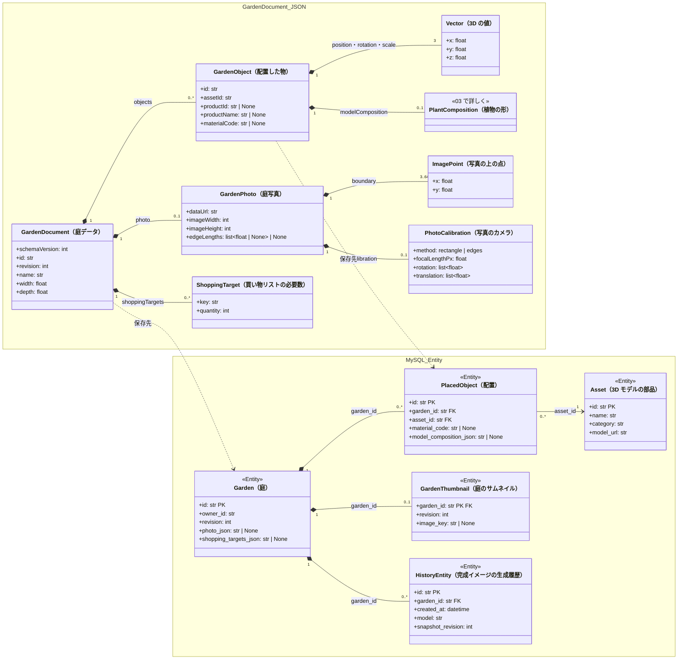
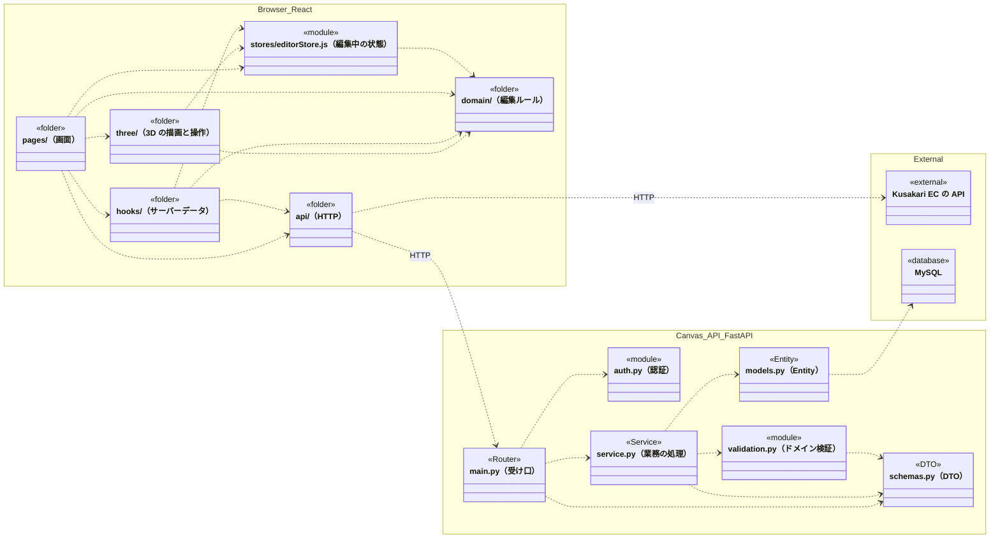

# Kusakari Canvas クラス図 00 全体図

- 対象のコード: kusakari-canvas の main（2c043a4、2026-11-24 時点）
- 詳細図: [00_モジュール構成](<00_モジュール構成.md>)、[01_APIとデータの層](<01_APIとデータの層.md>)、[02_画像生成と履歴](<02_画像生成と履歴.md>)、[03_植物モデル](<03_植物モデル.md>)、[04_GardenDocumentと画面の状態](<04_GardenDocumentと画面の状態.md>)

Canvas が何を扱い、どう分かれているかを 2 枚で見るための図です。図 1 はデータの構造、図 2 は層の構成です。呼び出しの順番は、シーケンス図に書いています。

## 図の読み方

- 箱の名前は「英語名（日本語名）」です。英語名はコードのクラス名・型名・ファイル名です。
- 線は 4 種類です。`*--`（黒い菱形）は、親が消えると一緒に消える持ち方（JSON の入れ子、`ondelete="CASCADE"` の外部キー）です。`-->` は関連、`..>` は依存（図 1 では「保存先」、図 2 では import か HTTP）です。継承の線は、この 2 枚にはありません。
- 線の両端の数字は多重度です。`0..1` は無いか 1 つ、`0..*` は 0 個以上です。
- 図 1 の GardenDocument の側は、API の DTO（`schemas.py`）を描きました。画面の型（`frontend/src/types/garden.d.ts`）も同じ形で、型の書き方だけが TypeScript になります。
- 関連の線で描いたフィールド（`objects`、`photo` など）は、箱の中に重ねて書いていません。

## 図 1 データの全体図

上の枠は、画面と API がやり取りする GardenDocument（JSON）の形です。下の枠は、MySQL に保存する Entity です。GardenDocument は 1 行の `Garden` と、配置ごとの `PlacedObject` に分けて保存します。写真と買い物リストの必要数は、`Garden` の JSON の列（`photo_json`、`shopping_targets_json`）に入れます。

多重度の上限は、図では `*` と書きました。コードの上限は次のとおりです。

| 関連 | 上限 | 根拠 |
|---|---|---|
| `GardenDocument.objects` | 200 | `GardenDocumentRequest.objects` の `max_length=200` |
| `GardenDocument.shoppingTargets` | 200 | `ShoppingTargets` の `max_length=200` |
| `GardenPhoto.boundary` | 3〜64 | `validation.py` の `validate_photo`（画面は `photoProjection.validBoundary`） |

## 図 2 層の全体図

AGENTS.md の依存の向き「UI/3D 操作 → 検証済み編集操作 → GardenDocument → API DTO → Service → Repository/MySQL」を、フォルダーとモジュールの単位で描きました。矢印はどれも、矢印の元が先を import していることを表します（`HTTP` と書いた 2 本と、`models.py` から MySQL への 1 本を除く）。

## クラスとコードの対応

| クラス | ファイル | 詳細図 |
|---|---|---|
| GardenDocument、GardenObject、Vector、GardenPhoto、ImagePoint、PhotoCalibration、ShoppingTarget | [schemas.py](https://github.com/abeouga/kusakari-canvas/blob/2c043a4/backend/kusakari_canvas_api/schemas.py)、[types/garden.d.ts](https://github.com/abeouga/kusakari-canvas/blob/2c043a4/frontend/src/types/garden.d.ts) | 01 図 4・図 5、04 図 1 |
| PlantComposition | [plant_schemas.py](https://github.com/abeouga/kusakari-canvas/blob/2c043a4/backend/kusakari_canvas_api/plant_schemas.py) | 03 図 2・図 5 |
| Garden、PlacedObject、Asset、GardenThumbnail | [models.py](https://github.com/abeouga/kusakari-canvas/blob/2c043a4/backend/kusakari_canvas_api/models.py) | 01 図 6 |
| HistoryEntity | [history_models.py](https://github.com/abeouga/kusakari-canvas/blob/2c043a4/backend/kusakari_canvas_api/history_models.py) | 02 図 7 |
| GardenDocument と Entity の詰め替え（図 1 の「保存先」） | [service.py](https://github.com/abeouga/kusakari-canvas/blob/2c043a4/backend/kusakari_canvas_api/service.py) の `update_garden`・`as_document`・`object_response` | 01 図 3 |
| 図 2 のフォルダーとモジュール | `frontend/src/`、`backend/kusakari_canvas_api/` | 00 図 1・図 7 |

## 載せなかったもの

| もの | 理由 | 載せた図 |
|---|---|---|
| GardenDocumentRequest、CreateGardenRequest、GardenSummary、AssetResponse などの DTO | GardenDocument と同じ形か、一覧用の要約で、扱うデータが増えないため | 01 図 4 |
| PhotoCalibration.points、GardenPhoto.corners と ImagePoint の線 | どれも ImagePoint の並びで、線を足すと図が読みにくくなるため | 01 図 5、04 図 1 |
| 画像生成の DTO（`ai_schemas.py`） | 保存しない一時のデータのため | 02 図 5 |
| 植物モデルの中（profile、parts など） | 植物の形の組み立ての話で、庭のデータの構造とは別のため | 03 |
| 図 2 の `components/`、`capture/`、`types/` | `pages/` と同じ向きの依存で、層の構成は変わらないため | 00 図 7 |
| 図 2 のサムネイル・買い物リスト・画像生成のモジュール | `service.py` と同じ層にあたるため | 00 図 1〜図 3 |

## 確かめられなかったこと

- GitHub と Obsidian での表示は確かめていません。PNG は mermaid-snap（Mermaid 11.4.1）で書き出したものです。
