# Kusakari Canvas クラス図 01 API とデータの層

- 対象のコード: kusakari-canvas の main（2c043a4、2026-11-24 時点）
- 対象のパッケージ: [backend/kusakari_canvas_api](https://github.com/abeouga/kusakari-canvas/blob/2c043a4/backend/kusakari_canvas_api) のうち、[02_画像生成と履歴](<02_画像生成と履歴.md>)（`ai_*.py`、`history_*.py`）と [03_植物モデル](<03_植物モデル.md>)（`plants/`、`plant_legacy/`、`plant_schemas.py`）に入らないモジュールです。
- 全体図: [00_全体図](<00_全体図.md>)。責務とデータ境界は [AGENTS.md](https://github.com/abeouga/kusakari-canvas/blob/2c043a4/AGENTS.md) に書かれています。

Canvas の API（FastAPI）の受け口、Service、DTO、Entity と、起動・マイグレーションの部品を 11 枚に分けて描きます。図 4・図 5・図 6・図 11 はデータの図（DTO と Entity）、ほかはモジュールの図です。呼び出しの順番は [シーケンス図](<../../シーケンス図/kusakari-canvas/>) に書いています。

## 図の読み方

- 箱の名前は「英語名（日本語名）」です。英語名はコードのクラス名・ファイル名・変数名です。ほかの詳細図で詳しく描いたものには、名前の後ろに（02）・（03）を付けるか、`<<図 5 で詳しく>>` のように書いています。
- ステレオタイプは、`<<Entity>>` が SQLAlchemy の Entity、`<<module>>` がクラスを持たない Python のモジュール、`<<Service>>` が Service のモジュール、`<<Router>>` が FastAPI の `APIRouter`、`<<FastAPI>>` がアプリ、`<<dataclass>>`・`<<exception>>`・`<<middleware>>` がそれぞれの種類のクラスです。DTO（Pydantic のモデル）には付けていません。
- モジュールの図では、モジュールの関数・定数をメソッド・属性として書きました。`create_app` の中で定義した関数は `app`・`router` の箱に書いています。
- 線は 4 種類です。`*--`（黒い菱形）は、親が消えると一緒に消える持ち方（JSON の入れ子、`ondelete="CASCADE"` の外部キー）です。`-->` は関連、`<|--` は継承、`..>` は依存（モジュールの図では import と呼び出し）です。
- 線の両端の数字は多重度です。`1` はちょうど 1 つ、`0..1` は無いか 1 つ、`0..*` は 0 個以上です。コードの上限は図では `*` と書き、各図の下の表に書きました。
- 線のラベルは関連の名前（フィールド名・外部キーの列名）です。依存の線にはラベルを付けず、使っている関数は各図の下の「線とコードの対応」に書きました。
- 関連の線で描いたフィールド（`objects`、`photo` など）は、箱の中に重ねて書いていません。
- `GardenDocument` などは、API の DTO（`schemas.py`）を描きました。画面の型（`frontend/src/types/garden.d.ts`）は [04_GardenDocumentと画面の状態](<04_GardenDocumentと画面の状態.md>) にあります。

## DTO・Service・Entity の分け方

AGENTS.md の「Pydantic Request/Response DTO、ドメイン検証、SQLAlchemy Entity を分けます。Entity を API へ直接返しません」は、次の形になっています。

- 受け口は `main.py` の `create_app` の中の `router`（図 2）と、`thumbnails.py` の `thumbnail_router` が作る `APIRouter`（図 7）です。引数で Pydantic の Request DTO を受け、`response_model` の Response DTO を返します。
- Request DTO と Response DTO は別のクラスです（図 4）。庭の保存は `GardenDocumentRequest`（`NamedRequest` を継承し、値の範囲の制約を持つ）、応答は `GardenDocument`（制約を持たない）です。作成は `CreateGardenRequest`、一覧は `GardenSummary` です。DTO は `ApiModel`（`extra="forbid"`、`allow_inf_nan=False`）を継承します。ただし `shopping.py` の 3 つの DTO は `BaseModel` を直接継承し、`thumbnails.py` の `ThumbnailRequest` は `schemas.py` の外にあります（図 11）。
- Service は `service.py`（図 3）、`shopping.py`（図 8）、`thumbnails.py` の `read_thumbnail`（図 7）と、02 の `history_service.py` です。どれも `Session` を引数で受け、`with session.begin()` でトランザクションを区切ります。`service.py` は、Entity を `as_document` と `object_response` で DTO に詰め替えてから返します。
- Repository のクラスはありません。Service が `select`、`session.add`、`delete` を直接書きます。AGENTS.md の「Repository/MySQL」にあたるのは `models.py` の Entity（図 6）と SQLAlchemy の `Session` です。
- ドメイン検証は `validation.py` の `validate_document` です（図 10）。`update_garden` の最初に呼びます（02 の `ai_service.py` と `history_service.py` も、送られた庭のスナップショットに使います）。
- 所有者は `AuthBoundary.owner` が返す `request.state.owner_id` です。ルーターは `Owner`（`Depends(auth.owner)`）として受け取り、Service は `owned_garden` で `owner_id` を条件に読みます。DTO に `ownerId` はありません。

## 図 1 アプリの組み立てと横断の部品

モジュールの図です。`create_app` が、設定・Engine・`MediaStore`・`AuthBoundary` を 1 つずつ作り、`app` と `router` に渡します。`app` の要素（ヘルスチェック、ミドルウェア、例外ハンドラー、lifespan）は `create_app` の中の関数です。

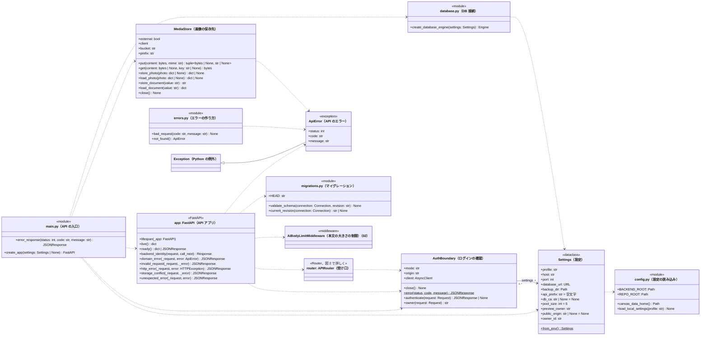

### 線とコードの対応

| 線 | コード |
|---|---|
| main.py → app、Settings、database.py、MediaStore、AuthBoundary | `create_app` が `Settings.from_env()`、`create_database_engine`、`MediaStore()`、`AuthBoundary(settings)`、`FastAPI(...)` で作る |
| app → router | `app.include_router(router)` |
| app → AiBodyLimitMiddleware | `app.add_middleware(AiBodyLimitMiddleware)` |
| app → AuthBoundary | `backend_identity` が `auth.authenticate` を呼ぶ。`lifespan` の終わりに `auth.close` |
| app → migrations.py | `lifespan` が `validate_schema` と `current_revision` で、スキーマが `HEAD` かを確かめる |
| app → ApiError | `domain_error` が `ApiError` を `status` と `code` の応答にする |
| router → AuthBoundary | `Owner = Annotated[str, Depends(auth.owner)]` |
| Settings → config.py | `from_env` が `load_local_settings` と `canvas_data_home` を使う |
| database.py → Settings | `create_database_engine` が `database_url`・`db_ca`・`pool_size` を読む |
| errors.py → ApiError | `bad_request` が投げ、`not_found` が返す |
| MediaStore → ApiError | `MEDIA_UNAVAILABLE`（503）、`MEDIA_MISSING`（500）を投げる |

### 部品の決まり

| 部品 | 決まり |
|---|---|
| `app` の受け口 | `live` は `GET /health/live`、`ready` は `GET /health/ready`（失敗は 503 `NOT_READY`）。`router` の前に付く `Settings.api_prefix` は付かない |
| `backend_identity` | http のミドルウェア。`public_origin` があるときは接続元を確かめ（違えば 403 `ORIGIN_REJECTED`）、`authenticate` を呼び、例外は 500 `INTERNAL_ERROR` にする。応答に `X-Kusakari-Canvas-Backend: fastapi` を付ける |
| 例外ハンドラー | `invalid_request` は `RequestValidationError` を 400 `INVALID_REQUEST`、`http_error` は `HTTPException` を 405 `METHOD_NOT_ALLOWED` か 404 `NOT_FOUND`、`storage_conflict` は `IntegrityError` を 409 `STORAGE_CONFLICT`、`unexpected_error` は `Exception` を 500 `INTERNAL_ERROR` にする |
| `AuthBoundary.mode` | `demo` か `cognito`。`demo` は `profile` が `e2e` で `KUSAKARI_TEST_AUTH` が `true` のときだけ |
| `AuthBoundary.authenticate` | EC の `GET /api/auth/me`（読む操作）か `POST /api/auth/verify`（書く操作、`X-CSRF-TOKEN` が必要）を呼ぶ。購入者（`USER`、`ADMIN`）は全 API、出店者（`SHOP_OWNER`、`SHOP_STAFF`、`SHOP_OWNER_APPLICANT`）は `POST /api/model-assemblies/resolve` だけ（ほかは 403 `BUYER_ACCOUNT_REQUIRED`）。`GET` の `/health/` 以下、`/api/assets`、`/api/model-parts`、`/api/auth/status` はログインを確かめない |
| `MediaStore` | `KUSAKARI_CANVAS_MEDIA_STORAGE` が `database`（既定）なら MySQL に、`s3` なら S3 に置く。`s3` のときの写真は `photo_json` の `dataUrl` の代わりに `imageKey` と `imageMime` を持つ |
| `AiBodyLimitMiddleware` | 02 の `ai_body.py` のクラス。`POST` の `ai-image`、`image-history`、`thumbnail` の本文の大きさを制限する（超えると 413 `AI_REQUEST_TOO_LARGE`） |

## 図 2 受け口（ルーター）と呼び先

モジュールの図です。`router` の関数の引数の `Db` は `get_session`（`create_app` の中の関数）が渡す `Session`、`Owner` は `AuthBoundary.owner` が返す所有者 ID（str）です。HTTP メソッドとパスは図の下の表にあります。

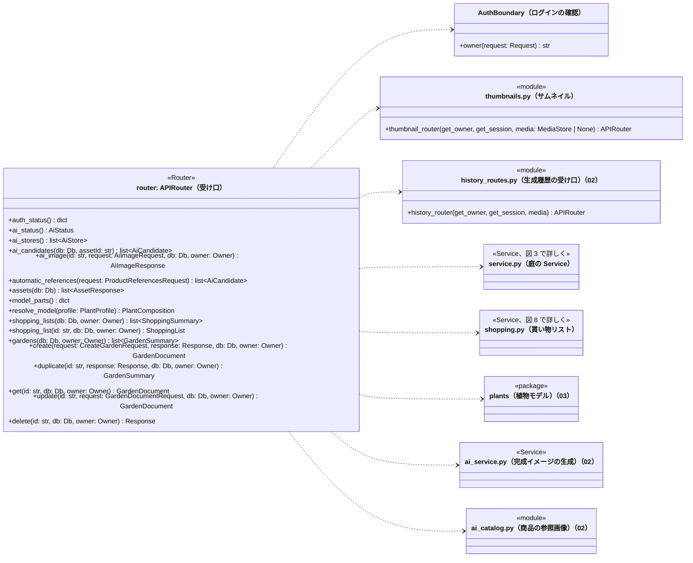

### API と受け口

`router` のパスの前には `Settings.api_prefix`（空か `/canvas`）が付きます。`/health/live` と `/health/ready` は `app` に直接あり（図 1）、前に何も付きません。

| HTTP | パス | 受け口 | Request DTO | Response DTO | 呼ぶ Service など |
|---|---|---|---|---|---|
| GET | `/health/live` | `app` の `live` | なし | dict | なし |
| GET | `/health/ready` | `app` の `ready` | なし | dict、失敗は 503 `NOT_READY` | `engine.connect` |
| GET | `/api/auth/status` | `auth_status` | なし | dict（`mode`） | `AuthBoundary.mode` |
| GET | `/api/ai/status` | `ai_status` | なし | `AiStatus` | 02 `ai_config` |
| GET | `/api/ai/stores` | `ai_stores` | なし | `list[AiStore]` | 02 `ai_catalog.stores` |
| GET | `/api/ai/candidates` | `ai_candidates` | クエリ `assetId`（1〜64 文字） | `list[AiCandidate]` | `service.require_asset`、02 `ai_catalog.material_code`・`candidates` |
| POST | `/api/gardens/{id}/ai-image` | `ai_image` | `AiImageRequest` | `AiImageResponse` | 02 `ai_service.generate_image` |
| POST | `/api/ai/product-references` | `automatic_references` | `ProductReferencesRequest` | `list[AiCandidate]` | 02 `ai_catalog.product_references` |
| GET | `/api/assets` | `assets` | なし | `list[AssetResponse]` | `service.list_assets` |
| GET | `/api/model-parts` | `model_parts` | なし | dict（`response_model` なし） | 03 `plants.part_catalog` |
| POST | `/api/model-assemblies/resolve` | `resolve_model` | `PlantProfile` | `PlantComposition`。組めないときは 400 `INCOMPATIBLE_PLANT_DIMENSIONS` | 03 `plants.assemble` |
| GET | `/api/shopping-lists` | `shopping_lists` | なし | `list[ShoppingSummary]` | `shopping.summaries` |
| GET | `/api/gardens/{id}/shopping-list` | `shopping_list` | なし | `ShoppingList` | `shopping.detail` |
| GET | `/api/gardens` | `gardens` | なし | `list[GardenSummary]` | `service.list_gardens` |
| POST | `/api/gardens` | `create` | `CreateGardenRequest` | `GardenDocument`（201、`Location` ヘッダー） | `service.create_garden` |
| POST | `/api/gardens/{id}/duplicate` | `duplicate` | なし | `GardenSummary`（201、`Location` ヘッダー） | `service.duplicate_garden` |
| GET | `/api/gardens/{id}` | `get` | なし | `GardenDocument` | `service.get_garden` |
| PUT | `/api/gardens/{id}` | `update` | `GardenDocumentRequest` | `GardenDocument` | `service.update_garden` |
| DELETE | `/api/gardens/{id}` | `delete` | なし | なし（204） | `service.delete_garden` |
| GET | `/api/gardens/{id}/thumbnail` | `thumbnail_router` の `get`（図 7） | なし | PNG | `thumbnails.read_thumbnail` |
| POST | `/api/gardens/{id}/thumbnail` | `thumbnail_router` の `save`（図 7） | `ThumbnailRequest` | なし（204） | `MediaStore.put` |
| GET・POST・DELETE | `/api/gardens/{id}/image-history` 以下 | 02 の `history_router` | 02 | 02 | 02 |

`/api/shopping-lists` と `/api/gardens/{id}/shopping-list` は、Canvas の画面ではなく EC のサーバー（`CanvasShoppingClient`）が呼びます。`/api/model-assemblies/resolve` は、Canvas の `PlantPreviewPage.jsx` と EC のサーバー（`CanvasModelClient`）が呼びます。

c19d497 にあった `POST /api/photo-calibration`（受け口 `calibrate`、`CalibrationRequest` を受けて `PhotoCalibration` を返す）は、2c043a4 で `main.py` から消えました。カメラの計算（`solve_calibration`）は、保存のときの検証（図 10）でだけ使います。

### 線とコードの対応

| 線 | コード |
|---|---|
| router → AuthBoundary | `Owner`（`Depends(auth.owner)`）を受ける関数すべて |
| router → thumbnails.py | `router.include_router(thumbnail_router(auth.owner, get_session, media))` |
| router → history_routes.py | `router.include_router(history_router(auth.owner, get_session, media))` |
| router → service.py | `assets`、`gardens`、`create`、`duplicate`、`get`、`update`、`delete`、`ai_candidates`（`require_asset`） |
| router → shopping.py | `shopping_lists`（`summaries`）、`shopping_list`（`detail`） |
| router → plants | `model_parts`（`part_catalog`）、`resolve_model`（`assemble`） |
| router → ai_service.py | `ai_image`（`generate_image`） |
| router → ai_catalog.py | `ai_stores`（`stores`）、`ai_candidates`（`material_code`、`candidates`）、`automatic_references`（`product_references`） |

処理の流れは、庭の作成が [UC-01](<../../シーケンス図/kusakari-canvas/UC-01_庭プロジェクトを新規作成する.md>)、読み込みが [UC-01-1](<../../シーケンス図/kusakari-canvas/UC-01-1_庭プロジェクトを開く.md>)、保存とサムネイルが [UC-07](<../../シーケンス図/kusakari-canvas/UC-07_庭プロジェクトを保存する.md>)、複製と削除が [UC-08](<../../シーケンス図/kusakari-canvas/UC-08_庭プロジェクトを管理する.md>)、実寸の定義が [UC-04](<../../シーケンス図/kusakari-canvas/UC-04_施工範囲の実寸を定義する.md>)、ログインの確認が [全ユースケース共通の代替フロー](<../../シーケンス図/kusakari-canvas/00_全ユースケース共通の代替フロー.md>)、買い物リストを EC から読む流れが [EC-B24](<../../シーケンス図/kusakari-ec/EC-B24_買い物リストを確認する(EC).md>) にあります。

## 図 3 Service と DTO・Entity の詰め替え（service.py）

モジュールの図です。`service.py` は Request DTO を受け、Entity を読み書きし、Response DTO を返します。DTO と Entity の箱は図 4・図 6 にあり、この図では `schemas.py`・`models.py` のモジュールとして置きました。どの関数がどの DTO・Entity を使うかは、図の下の表にあります。

庭の保存（`update_garden`）は、`validate_document` のあと、`with_for_update` で庭の行を固定して `revision` を比べ、一致したら `revision` を 1 増やします。配置は庭の全件を消してから入れ直します（全体スナップショット）。

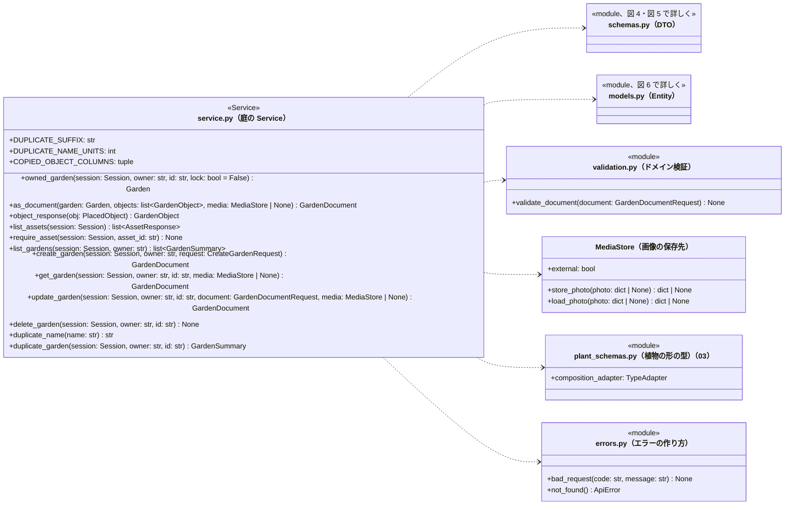

### 関数と DTO・Entity

| 関数 | 受ける DTO | 読む・書く Entity | 返す DTO |
|---|---|---|---|
| `list_assets` | なし | `Asset` を読む | `list[AssetResponse]`（`BaseDimensions` を作る） |
| `require_asset` | なし（`asset_id`） | `Asset` を読む | なし（無ければ 400 `UNKNOWN_ASSET`） |
| `list_gardens` | なし | `Garden` を読み、`PlacedObject` を数える | `list[GardenSummary]` |
| `create_garden` | `CreateGardenRequest` | `Garden` を書く（`revision` は 0） | `GardenDocument` |
| `get_garden` | なし | `Garden`、`PlacedObject` を読む | `GardenDocument` |
| `update_garden` | `GardenDocumentRequest` | `Garden` を更新し、`PlacedObject` を全件消して入れ直す。`Asset` で `assetId` を照合する | `GardenDocument` |
| `delete_garden` | なし | `Garden` を消す（`PlacedObject`・`GardenThumbnail`・`HistoryEntity` は CASCADE で消える） | なし |
| `duplicate_garden` | なし | `Garden`、`PlacedObject` を写す。`GardenThumbnail` は `revision` が庭と同じときだけ写す。生成履歴は写さない | `GardenSummary` |
| `owned_garden` | なし | `Garden` を `owner_id` で絞って読む（`lock=True` なら `with_for_update`） | なし（`Garden` を返す） |
| `as_document` | なし | `Garden` の `photo_json`・`shopping_targets_json` を JSON から戻す | `GardenDocument`（`GardenPhoto`、`ShoppingTarget` を作る） |
| `object_response` | なし | `PlacedObject` の列を `Vector` 3 つにまとめる | `GardenObject` |

### 線とコードの対応

| 線 | コード |
|---|---|
| service.py → schemas.py | 上の表の DTO を受ける・作る |
| service.py → models.py | 上の表の Entity を `select`・`session.add`・`delete` で読み書きする |
| service.py → validation.py | `update_garden` の最初に `validate_document` |
| service.py → MediaStore | `update_garden` が `store_photo`（`external` のとき）、`as_document` が `load_photo` |
| service.py → plant_schemas.py | `object_response` が `composition_adapter.validate_json` で `model_composition_json` を読む |
| service.py → errors.py | `owned_garden` が `not_found`、`require_asset`・`update_garden` が `bad_request` |

### エラー

| 状態 | コード | 起きるとき |
|---|---|---|
| 409 | `REVISION_CONFLICT` | 送られた `revision` が庭の `revision` と違う |
| 409 | `REVISION_EXHAUSTED` | `revision` が BIGINT の上限 |
| 400 | `GARDEN_ID_MISMATCH` | URL と本文の `id` が違う |
| 400 | `UNKNOWN_ASSET` | `assets` に無い `assetId` |
| 404 | `GARDEN_NOT_FOUND` | `owned_garden` が見つけられない（ほかの会員の庭を含む） |

## 図 4 DTO 庭と配置（schemas.py）

データの図です。`GardenDocumentRequest` が `PUT /api/gardens/{id}` の本文、`GardenDocument` がその応答と `GET /api/gardens/{id}` の応答です。座標の決まり（1 unit = 1 m、Y が上、地面 Y=0、庭の中心が原点、回転は Y 軸、拡縮は一様）は `GardenObject` の `position`・`rotation`・`scale` に当てはまり、`validation.py` が確かめます（図 10）。

継承の線は、`BaseModel` → `ApiModel` → `NamedRequest` → `CreateGardenRequest`・`GardenDocumentRequest` だけを描きました。この図のほかの DTO（`GardenDocument`、`GardenSummary`、`GardenObject`、`Vector`、`ShoppingTarget`、`AssetResponse`、`BaseDimensions`）は、どれも `ApiModel` を直接継承します。線を全部引くと図が読めなくなるため省きました。

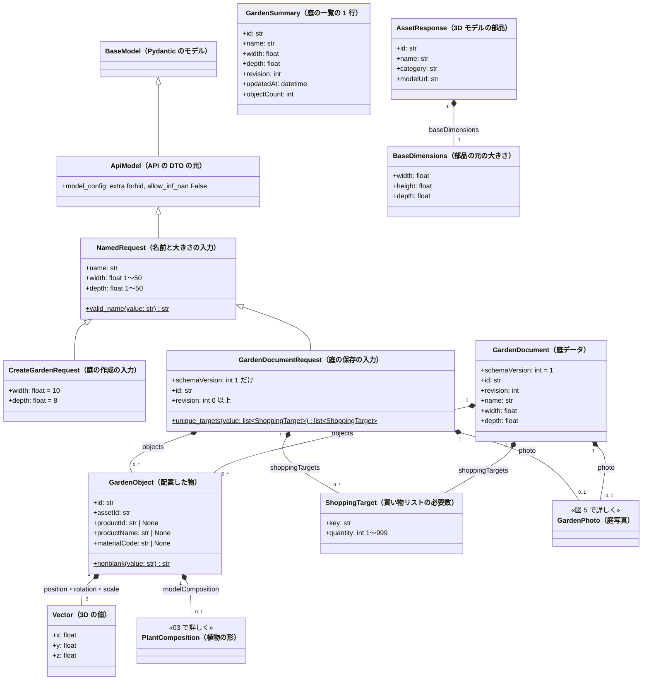

### 関連の上限

| 関連 | 上限 | 根拠 |
|---|---|---|
| `GardenDocumentRequest.objects` | 200 | `Field(max_length=200)` |
| `GardenDocumentRequest.shoppingTargets` | 200 | `ShoppingTargets`（`Annotated[list[ShoppingTarget], Field(max_length=200)]`）。`key` の重複は `unique_targets` が拒む（400 `INVALID_REQUEST`） |
| `GardenDocument.objects`、`GardenDocument.shoppingTargets` | 制約なし | 応答の DTO なので制約を持たない |

### 値の制約

箱に書ききれない制約です。

| フィールド | 制約 |
|---|---|
| `NamedRequest.name` | 1 文字以上、空白だけは不可、UTF-16 で 120 単位まで（`valid_name`） |
| `GardenDocumentRequest.revision` | 0〜9223372036854775807 |
| `GardenObject.id`、`assetId` | 1 文字以上、空白だけは不可（`nonblank`） |
| `GardenObject.productId` | 40 文字まで、`^[a-z0-9][a-z0-9-]*$`。`None` のときは JSON に出さない |
| `GardenObject.productName` | 1〜120 文字。`None` のときは JSON に出さない |
| `GardenObject.materialCode` | 80 文字まで。`None` のときは JSON に出さない |
| `GardenObject.modelComposition` | 03 の `plant_schemas.PlantComposition`（v5 の `plants.PlantComposition` か、v1〜v4 の `plant_legacy` の型）。`None` のときは JSON に出さない |
| `ShoppingTarget.key` | 80 文字まで、`product:` か `asset:` で始まる（`^(product|asset):[a-z0-9][a-z0-9_-]*$`） |

## 図 5 写真とカメラ校正の DTO（schemas.py）

データの図です。`GardenPhoto` は庭データの写真で、四隅（`corners`）、施工範囲の輪郭（`boundary`）、カメラ（`calibration`）、辺の長さ（`edgeLengths`）、四隅の実寸（`projectionSize`）を持ちます。これらを確かめるモジュールは図 10 にあります。この図の DTO（`GardenPhoto`、`ImagePoint`、`PhotoCalibration`、`PhotoProjectionSize`、`CalibrationRequest`）は、どれも `ApiModel`（図 4）を直接継承します。継承の線は図 4 と同じ理由で省きました。

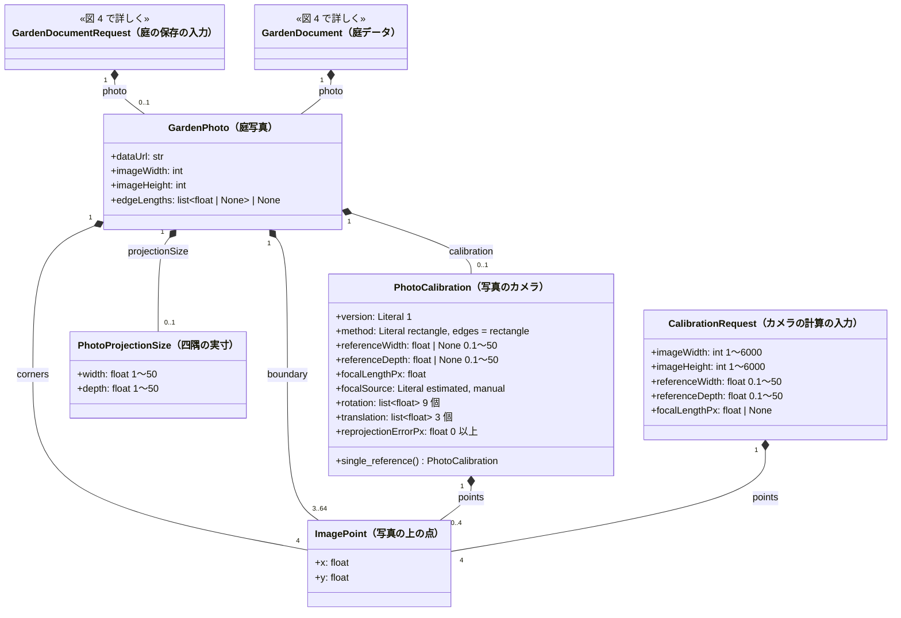

### 関連の多重度の根拠

| 関連 | 多重度 | 根拠 |
|---|---|---|
| `GardenPhoto.corners` | 4 | 型は `list[ImagePoint]`（上限なし）。`validation.validate_photo` が 4 個でなければ 400 `INVALID_PHOTO` |
| `GardenPhoto.boundary` | 3..64 | 型は `list[ImagePoint]`（上限なし）。`validate_photo` が 3〜64 個でなければ 400 `INVALID_PHOTO` |
| `PhotoCalibration.points` | 0..4 | `list[ImagePoint]`（4 個ちょうど）か `None`。`single_reference` が、`method` が `rectangle` なら 4 個、`edges` なら `None` を求める |
| `CalibrationRequest.points` | 4 | `Field(min_length=4, max_length=4)` |

### 値の制約

| フィールド | 制約 |
|---|---|
| `GardenPhoto.edgeLengths` | `None` か 3〜64 個。各要素は `None` か 0.01〜100（m）。個数は `boundary` と同じ（`validate_calibrated_photo`） |
| `GardenPhoto.dataUrl`、`imageWidth`、`imageHeight` | `validate_photo` が JPEG か PNG、5 MB まで、1〜6000 px、2500 万画素まで、画像の実際の大きさと一致を確かめる |
| `PhotoCalibration.focalLengthPx`、`CalibrationRequest.focalLengthPx` | 0 より大きく 100000 まで |
| `PhotoCalibration` の `points`・`referenceWidth`・`referenceDepth` | `None` のときは JSON に出さない。`method` が `rectangle` のときも JSON に出さない |

`CalibrationRequest` は、c19d497 では `POST /api/photo-calibration` の本文でした。2c043a4 では受け口が消え、`calibration.validate_calibrated_photo` が、保存された `PhotoCalibration` からこの DTO を作って `solve_calibration` に渡すためだけに使います（図 10）。

## 図 6 Entity（models.py）

データの図です。`models.py` には `relationship()` がありません。Entity どうしの関連は `ForeignKey` の列だけで、多重度はその列の NULL 可否と主キーから書いています。フィールドの型は `Mapped[...]` の Python の型です。

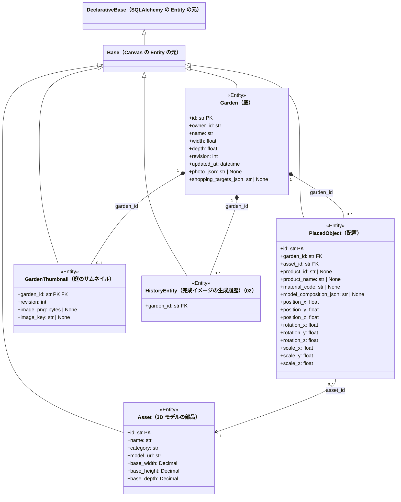

### Entity とテーブル

| Entity | テーブル | 列の補足 | 主な使い手 |
|---|---|---|---|
| `Asset` | `assets` | `base_*` は `DECIMAL(8, 3)` | `service.list_assets`、`service.update_garden`（`assetId` の照合）、`shopping.detail` |
| `Garden` | `gardens` | `owner_id` は EC の会員 ID（外部キーではない）。`photo_json` は `GardenPhoto` の JSON、`shopping_targets_json` は `ShoppingTarget` の配列の JSON。索引 `idx_gardens_owner_updated`（`owner_id`, `updated_at`） | `service.py` の全関数、`shopping.summaries` |
| `PlacedObject` | `placed_objects` | `model_composition_json` は `PlantComposition` の JSON。`position_*`・`rotation_*`・`scale_*` は `GardenObject` の `Vector` 3 つを列に分けたもの | `service.py`、`shopping.py`、`thumbnails.placement_plan` |
| `GardenThumbnail` | `garden_thumbnails` | `image_png` は `deferred=True`（必要なときだけ読む）。S3 のときは `image_key` を使う | `thumbnails.py`、`service.duplicate_garden`、`shopping.summaries` |
| `HistoryEntity`（02 の `history_models.py`） | `garden_image_history` | 列は 02 の図 7 | 02 の `history_service.py`、`thumbnails.read_thumbnail`、`shopping.summaries` |

### 関連と外部キー

| 関連 | 外部キーの名前 | 削除のとき | 多重度の根拠 |
|---|---|---|---|
| `Garden` 1 — 0..* `PlacedObject` | `fk_placed_objects_garden` | `ON DELETE CASCADE` | `garden_id` は NULL 不可、主キーではない |
| `PlacedObject` 0..* — 1 `Asset` | `fk_placed_objects_asset` | 指定なし（`Asset` は消さない） | `asset_id` は NULL 不可 |
| `Garden` 1 — 0..1 `GardenThumbnail` | `fk_thumbnail_garden` | `ON DELETE CASCADE` | `garden_id` が主キー |
| `Garden` 1 — 0..* `HistoryEntity` | `fk_image_history_garden` | `ON DELETE CASCADE` | `garden_id` は NULL 不可、主キーではない |

列の MySQL の型と制約は [テーブル設計図](<../../テーブル設計図/kusakari-canvas/>) を見てください。

## 図 7 サムネイル（thumbnails.py）

モジュールの図です。庭一覧のカードの画像です。読むときは、生成画像（`garden_image_history` の最新）、保存した画面の画像（`garden_thumbnails` の `revision` が庭と同じとき）、配置図（`placed_objects` から描く）の順に使います。保存は、送られた `revision` が庭の `revision` と同じときだけです。`ThumbnailRequest` の形は図 11 にあります。

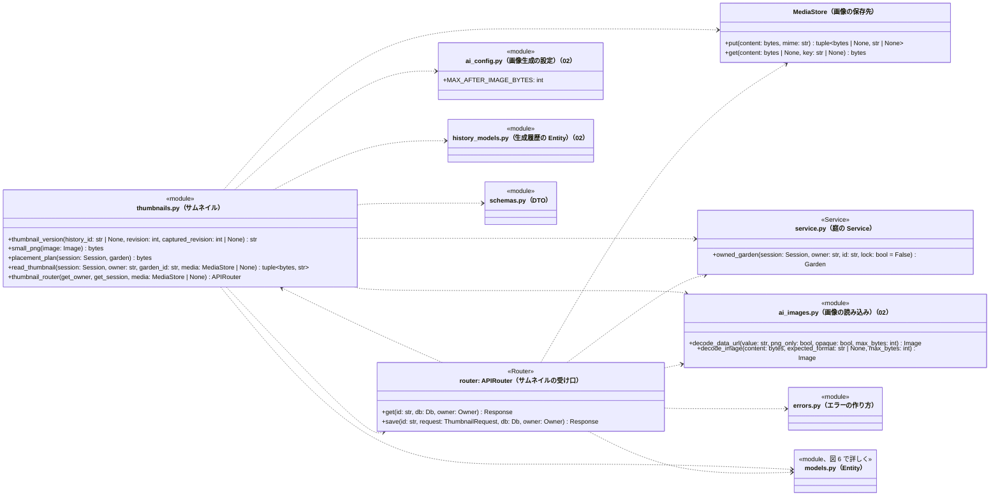

### 受け口

`thumbnail_router` の中で、前に `/api/gardens/{id}/thumbnail` を付けた `APIRouter` を作ります。図 2 の `router` に `include_router` で入るので、`Settings.api_prefix` も付きます。

| HTTP | パス | 受け口 | Request DTO | 応答 | エラー |
|---|---|---|---|---|---|
| GET | `/api/gardens/{id}/thumbnail` | `get` | なし | `image/png`。`X-Thumbnail-Source` ヘッダーは `generated`・`scene`・`layout` のどれか | 404 `GARDEN_NOT_FOUND` |
| POST | `/api/gardens/{id}/thumbnail` | `save` | `ThumbnailRequest` | なし（204） | 400 `THUMBNAIL_SIZE`（640×400 px を超える）、409 `THUMBNAIL_STALE`（`revision` が庭と違う） |

### 線とコードの対応

| 線 | コード |
|---|---|
| thumbnails.py → router | `thumbnail_router` が作って返す |
| router → thumbnails.py | `get` が `read_thumbnail`、`save` が `small_png` |
| router → MediaStore | `save` が `put` |
| router → ai_images.py | `save` が `decode_data_url`（PNG だけ、330000 バイトまで） |
| router → service.py | `save` が `owned_garden`（`revision` を比べる前と、`lock=True` で書く前の 2 回） |
| router → models.py | `save` が `GardenThumbnail` を作るか更新する |
| router → errors.py | `ApiError` で `THUMBNAIL_SIZE`、`THUMBNAIL_STALE` を投げる |
| thumbnails.py → schemas.py | `ThumbnailRequest` が `ApiModel` を継承する |
| thumbnails.py → service.py | `read_thumbnail` が `owned_garden` |
| thumbnails.py → MediaStore | `read_thumbnail` が `get` |
| thumbnails.py → ai_images.py | `read_thumbnail` が生成画像を `decode_image` で読む |
| thumbnails.py → ai_config.py | `decode_image` の上限に `MAX_AFTER_IMAGE_BYTES` |
| thumbnails.py → models.py | `read_thumbnail` が `GardenThumbnail` を読み、`placement_plan` が `PlacedObject` の `position_x`・`position_z`・`asset_id` で配置図を描く |
| thumbnails.py → history_models.py | `read_thumbnail` が `HistoryEntity` の最新の `after_png`・`after_key` を読む |

## 図 8 買い物リスト（shopping.py）

モジュールの図です。保存済みの配置を、商品（`productId`）か、商品が無ければアセット（`assetId`）ごとに数えます。呼び出し元は EC のサーバーです。`materialCode` が無い配置は `MATERIAL_CODES` から補います。DTO の形は図 11 にあります。

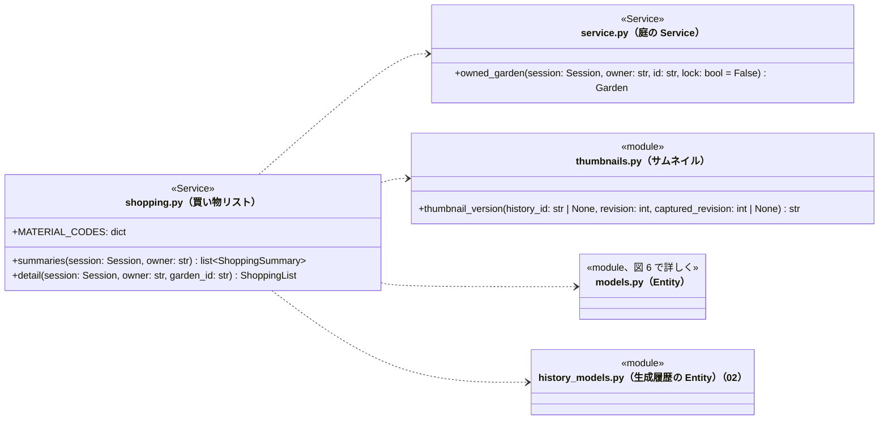

### 線とコードの対応

| 線 | コード |
|---|---|
| shopping.py → service.py | `detail` が `owned_garden` |
| shopping.py → thumbnails.py | `summaries` が `thumbnail_version` で `thumbnailVersion` を作る |
| shopping.py → models.py | `summaries` が `Garden` を `owner_id` で絞り、`PlacedObject` を数え、`GardenThumbnail.revision` を読む。`detail` が `PlacedObject` と `Asset.name` を読む |
| shopping.py → history_models.py | `summaries` が `HistoryEntity` の最新の `id` を読む |

### 決まり

| もの | 決まり |
|---|---|
| `MATERIAL_CODES` | `tree_oak` → `plant.oak`、`shrub_boxwood` → `plant.boxwood`、`brick_paver` → `garden.brick`、`bench_wood` → `garden.bench` の 4 つ |
| `ShoppingRow.key` | `product:`（`productId`）か `asset:`（`assetId`） |
| `ShoppingSummary.thumbnailVersion` | `generated-`（履歴の `id`）、`scene-`（`revision`）、`layout-`（`revision`）のどれか |
| `ShoppingSummary.productCount`・`itemCount` | `productId`（無ければ `assetId`）の種類の数と、配置の数 |

## 図 9 起動・マイグレーション・ローカル DB の準備

モジュールの図です。API の起動とマイグレーションは `python -m kusakari_canvas_api serve` と `migrate`（`scripts/api.mjs`、`docker/api.Dockerfile`）です。`serve` も、container 以外ではマイグレーションを先に行います。ローカルの DB は、setup.bat（`scripts/setup.ps1`）が `setup_database` を、DB-reset.bat（`scripts/reset-database.ps1`）が `reset_database` を実行して用意します。`setup_database` と `reset_database` は、API の起動では使いません。`local_mysql` と、それが使う `setup_files` は、container 以外で API を起動するときにも `ensure_for_settings` から使います（Canvas 専用のローカル MySQL が動いていなければ起動し、ポートが変わっていれば接続先を直す）。

図の `＿＿main＿＿.py` は `__main__.py` のことです。Mermaid では `_` が 2 つ続くと太字・斜体の印として読まれて消えるので、全角の `＿` で書きました。

```mermaid
classDiagram
    direction LR
    class dunder_main["＿＿main＿＿.py（起動のコマンド）"] {
        <<module>>
        +main() int
    }
    class main_py["main.py（API の入口）"] {
        <<module>>
        +create_app(settings: Settings | None) FastAPI
    }
    class config_py["config.py（設定の読み込み）"] {
        <<module>>
        +REPO_ROOT: Path
        +canvas_data_home() Path
    }
    class Settings["Settings（設定）"] {
        <<dataclass>>
        +from_env()$ Settings
    }
    class database_py["database.py（DB 接続）"] {
        <<module>>
        +create_database_engine(settings: Settings) Engine
    }
    class migrations_py["migrations.py（マイグレーション）"] {
        <<module>>
        +HEAD: str = 0008
        +SUPPORTED_REVISIONS: set
        +migration_lock_name(database: str) str
        +type_signature(value, dialect) str
        +validate_schema(connection: Connection, revision: str) None
        +current_revision(connection: Connection) str | None
        +legacy_revision(connection: Connection) str
        +backup_database(settings: Settings) Path
        +alembic_config(connection: Connection) Config
        +migrate(settings: Settings) dict
    }
    class models_py["models.py（Entity）"] {
        <<module>>
    }
    class history_models_py["history_models.py（生成履歴の Entity）（02）"] {
        <<module>>
    }
    class startup_errors_py["startup_errors.py（起動のエラーの文）"] {
        <<module>>
        +MESSAGES: dict
        +safe_error(error: Exception) str
    }
    class local_mysql_py["local_mysql.py（専用のローカル MySQL）"] {
        <<module>>
        +local_root() Path
        +read_state() dict | None
        +connect_admin(state: dict)
        +verify_directory(connection, state: dict) None
        +initialize(bin_path: Path) dict
        +ensure_server(state: dict) dict
        +ensure_for_settings(settings) Settings
    }
    class setup_files_py["setup_files.py（接続設定のファイル）"] {
        <<module>>
        +instance_lock(root: Path)
        +private_file(path: Path, content: str) None
        +save_settings(path: Path, values: dict~str, str~) None
        +protect_secret(value: str, decrypt: bool = False) str
    }
    class setup_database_py["setup_database.py（DB の準備）"] {
        <<module>>
        +file_values(profile: str) dict
        +profile_config(profile: str, default_port: int) dict
        +connect(config: dict, database: bool = True)
        +check_connection(config: dict) bool
        +validate_version(version: str) None
        +mysql_server_responds(host: str, port: int) bool
        +configured_settings(config: dict) Settings
        +validate_existing_database(admin, config: dict, admin_user: str, admin_password: str) None
        +prepare_profile(admin, config: dict) None
        +existing_admin(config: dict)
        +migrate_and_verify(configs: list~dict~) list~dict~
        +main() int
    }
    class reset_database_py["reset_database.py（DB の作り直し）"] {
        <<module>>
        +SUMMARY_TABLES: tuple
        +load_configs() tuple~dict | None, list~
        +start_managed_server(state: dict | None, configs: list~dict~) None
        +summarize(config: dict) dict
        +show_plan(configs: list~dict~, summaries: list~dict~) None
        +kill_connections(configs: list~dict~) None
        +backup(configs: list~dict~, summaries: list~dict~) None
        +recreate(config: dict) None
        +main() int
    }

    dunder_main ..> Settings
    dunder_main ..> local_mysql_py
    dunder_main ..> migrations_py
    dunder_main ..> main_py
    dunder_main ..> startup_errors_py
    Settings ..> config_py
    database_py ..> Settings
    migrations_py ..> Settings
    migrations_py ..> database_py
    migrations_py ..> models_py
    migrations_py ..> history_models_py
    local_mysql_py ..> config_py
    local_mysql_py ..> setup_files_py
    setup_database_py ..> config_py
    setup_database_py ..> Settings
    setup_database_py ..> local_mysql_py
    setup_database_py ..> migrations_py
    setup_database_py ..> setup_files_py
    setup_database_py ..> startup_errors_py
    reset_database_py ..> local_mysql_py
    reset_database_py ..> migrations_py
    reset_database_py ..> setup_database_py
    reset_database_py ..> startup_errors_py
```

### 線とコードの対応

| 線 | コード |
|---|---|
| `__main__.py` → Settings、local_mysql.py、migrations.py、main.py、startup_errors.py | `main` が `Settings.from_env`、`ensure_for_settings`（container 以外）、`migrate`、`create_app`（`serve`）、`safe_error`（失敗の文） |
| Settings → config.py | `from_env` が `load_local_settings`、`canvas_data_home` |
| database.py → Settings | `create_database_engine` |
| migrations.py → Settings、database.py | `migrate`・`backup_database` が `Settings` を受け、`create_database_engine` で接続する |
| migrations.py → models.py、history_models.py | `validate_schema` が `Base.metadata` と照合する。`HistoryEntity` は metadata に載せるためだけに import する |
| local_mysql.py → config.py | `REPO_ROOT`、`canvas_data_home` |
| local_mysql.py → setup_files.py | `instance_lock`、`private_file`、`protect_secret`、`save_settings` |
| setup_database.py → config.py、Settings | `REPO_ROOT`、`configured_settings` が `Settings` を作る |
| setup_database.py → local_mysql.py | `connect_admin`、`initialize`、`read_state` |
| setup_database.py → migrations.py | `current_revision`、`legacy_revision`、`migrate`、`validate_schema` |
| setup_database.py → setup_files.py | `protect_secret`、`save_settings` |
| setup_database.py → startup_errors.py | `safe_error` |
| reset_database.py → local_mysql.py | `ensure_server`、`read_state` |
| reset_database.py → migrations.py | `backup_database` |
| reset_database.py → setup_database.py | `configured_settings`、`connect`、`file_values` など |
| reset_database.py → startup_errors.py | `safe_error` |

### 決まり

| もの | 決まり |
|---|---|
| `migrations.migrate` | MySQL の `GET_LOCK` で同時実行を防ぐ。既存の DB を変えるときは先にバックアップする（container 以外は mysqldump、container は RDS スナップショットの ARN を必須にする）。Flyway の V1、V2 の DB は照合してから Alembic の 0001 か 0002 として記録する |
| `local_mysql.py` | Windows だけ。ほかに名前が `_` で始まる非公開の関数が 15 個ある |
| `reset_database.SUMMARY_TABLES` | `gardens`、`placed_objects`、`garden_thumbnails`、`garden_image_history` |

## 図 10 ドメイン検証（validation.py・calibration.py・placement_bounds.py）

モジュールの図です。`validate_document` が、写真（`validate_photo`、`validate_calibrated_photo`、`validate_projection_frame`）、配置の ID・座標・回転・倍率、植物の構成を確かめます。`method` が `rectangle` のカメラは、保存のたびに `solve_calibration` で計算し直して置き換えます。クライアントが送ったカメラの行列をそのまま使いません。`edges` のカメラは、計算し直さずに、姿勢・画角・高さが正しいかを `verify_edge_calibration` で確かめます。検証する DTO の形は図 4・図 5 にあります。

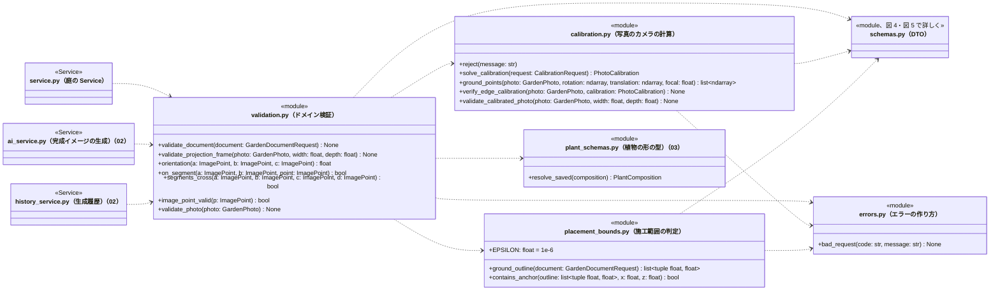

### 線とコードの対応

| 線 | コード |
|---|---|
| service.py → validation.py | `update_garden` の最初に `validate_document` |
| ai_service.py → validation.py | 02 の `validate_snapshot`（完成イメージの生成の前）が、送られた庭のスナップショットに `validate_document` |
| history_service.py → validation.py | 02 の `validate_history`（生成履歴の保存）が、送られた庭のスナップショットに `validate_document` |
| validation.py → calibration.py | `validate_document` が `validate_calibrated_photo` |
| validation.py → placement_bounds.py | `validate_document` が `ground_outline` で施工範囲を地面の座標（m）に直し、`contains_anchor` で配置基準点が中にあるかを調べる。`EPSILON` も使う |
| validation.py → plant_schemas.py | `assetId` が `plant_modular` の配置に `resolve_saved` |
| validation.py → schemas.py | `GardenDocumentRequest`、`GardenPhoto`、`ImagePoint` |
| calibration.py → schemas.py | `solve_calibration` が `CalibrationRequest` を受けて `PhotoCalibration` を作る。`validate_calibrated_photo` が `CalibrationRequest` を作る |
| placement_bounds.py → schemas.py | `ground_outline` が `GardenDocumentRequest` の `photo`・`width`・`depth` を読む |
| validation.py、calibration.py、placement_bounds.py → errors.py | `bad_request`。`calibration.py` は `reject` を通して `INVALID_CALIBRATION` |

### エラー（すべて 400）

| コード | 出すモジュール | 起きるとき |
|---|---|---|
| `INVALID_PHOTO` | validation.py | 写真の形式・大きさ・四隅と輪郭の個数が不正 |
| `INVALID_PHOTO_CORNERS` | validation.py | 四隅が画像の外、順序が時計回りでない、つぶれている |
| `INVALID_PHOTO_BOUNDARY` | validation.py、placement_bounds.py | 輪郭が画像の外・四隅の外・交差・近すぎる・小さすぎる、地面へ変換できない、実寸範囲を超える |
| `INVALID_CALIBRATION` | calibration.py | カメラを求められない、画角が縦 15〜110 度の外、輪郭が地平線を越える、輪郭が庭の実寸範囲を超える、辺の長さの数が輪郭と違う |
| `INVALID_PLANT_MODEL` | validation.py | 植物の配置の商品・構成が足りない・一致しない、固定アセットに構成がある |
| `INVALID_OBJECT_ID`、`DUPLICATE_OBJECT_ID` | validation.py | 配置の ID が UUID でない、重複する |
| `NON_FINITE_NUMBER` | validation.py | 座標・回転・倍率が有限でない |
| `OBJECT_POSITION_OUT_OF_BOUNDS` | validation.py | 配置基準点が施工範囲の外か、Y が 0 でない |
| `INVALID_OBJECT_ROTATION` | validation.py | X 軸・Z 軸の回転がある |
| `INVALID_OBJECT_SCALE` | validation.py | 倍率が 0.25〜3 の外か、一様でない |

## 図 11 サムネイルと買い物リストの DTO（thumbnails.py・shopping.py）

データの図です。`schemas.py` の外にある DTO です。`ThumbnailRequest` は `ApiModel` を継承しますが、`shopping.py` の 3 つは `BaseModel` を直接継承するので、`extra="forbid"` などの設定を持ちません（どれも応答だけに使います）。

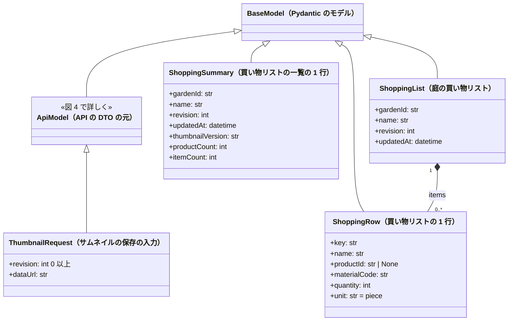

### 使うところと値の制約

| DTO | 使うところ | 制約 |
|---|---|---|
| `ThumbnailRequest` | `POST /api/gardens/{id}/thumbnail` の本文（図 7） | `revision` は 0 以上で `strict=True`（文字列の数を受けない）。`dataUrl` は 450000 文字まで、`repr=False` |
| `ShoppingSummary` | `GET /api/shopping-lists` の応答 | なし |
| `ShoppingList` | `GET /api/gardens/{id}/shopping-list` の応答 | `items` は `name`、`key` の順に並ぶ（`detail`） |
| `ShoppingRow` | `ShoppingList.items` | `key`・`thumbnailVersion` の形は図 8 の表 |

## クラスとコードの対応

| クラス・モジュール | ファイル | 図 |
|---|---|---|
| `create_app`、`error_response`、`app`、`router` | [main.py](https://github.com/abeouga/kusakari-canvas/blob/2c043a4/backend/kusakari_canvas_api/main.py) | 図 1、図 2、図 9 |
| `AuthBoundary` | [auth.py](https://github.com/abeouga/kusakari-canvas/blob/2c043a4/backend/kusakari_canvas_api/auth.py) | 図 1、図 2 |
| `Settings`、`canvas_data_home`、`load_local_settings` | [config.py](https://github.com/abeouga/kusakari-canvas/blob/2c043a4/backend/kusakari_canvas_api/config.py) | 図 1、図 9 |
| `create_database_engine` | [database.py](https://github.com/abeouga/kusakari-canvas/blob/2c043a4/backend/kusakari_canvas_api/database.py) | 図 1、図 9 |
| `ApiError`、`bad_request`、`not_found` | [errors.py](https://github.com/abeouga/kusakari-canvas/blob/2c043a4/backend/kusakari_canvas_api/errors.py) | 図 1、図 3、図 7、図 10 |
| `MediaStore` | [media.py](https://github.com/abeouga/kusakari-canvas/blob/2c043a4/backend/kusakari_canvas_api/media.py) | 図 1、図 3、図 7 |
| `ApiModel` ほか 15 個の DTO | [schemas.py](https://github.com/abeouga/kusakari-canvas/blob/2c043a4/backend/kusakari_canvas_api/schemas.py) | 図 4、図 5 |
| 庭の Service の関数 | [service.py](https://github.com/abeouga/kusakari-canvas/blob/2c043a4/backend/kusakari_canvas_api/service.py) | 図 3 |
| `validate_document` ほか | [validation.py](https://github.com/abeouga/kusakari-canvas/blob/2c043a4/backend/kusakari_canvas_api/validation.py) | 図 10 |
| `solve_calibration` ほか | [calibration.py](https://github.com/abeouga/kusakari-canvas/blob/2c043a4/backend/kusakari_canvas_api/calibration.py) | 図 10 |
| `ground_outline`、`contains_anchor` | [placement_bounds.py](https://github.com/abeouga/kusakari-canvas/blob/2c043a4/backend/kusakari_canvas_api/placement_bounds.py) | 図 10 |
| `Base`、`Asset`、`Garden`、`PlacedObject`、`GardenThumbnail` | [models.py](https://github.com/abeouga/kusakari-canvas/blob/2c043a4/backend/kusakari_canvas_api/models.py) | 図 6 |
| サムネイルの関数、`ThumbnailRequest` | [thumbnails.py](https://github.com/abeouga/kusakari-canvas/blob/2c043a4/backend/kusakari_canvas_api/thumbnails.py) | 図 7、図 11 |
| `summaries`、`detail`、`ShoppingRow`、`ShoppingList`、`ShoppingSummary` | [shopping.py](https://github.com/abeouga/kusakari-canvas/blob/2c043a4/backend/kusakari_canvas_api/shopping.py) | 図 8、図 11 |
| `main`（`serve`・`migrate`） | [`__main__.py`](https://github.com/abeouga/kusakari-canvas/blob/2c043a4/backend/kusakari_canvas_api/__main__.py) | 図 9 |
| マイグレーションの関数 | [migrations.py](https://github.com/abeouga/kusakari-canvas/blob/2c043a4/backend/kusakari_canvas_api/migrations.py) | 図 1、図 9 |
| DB の準備 | [setup_database.py](https://github.com/abeouga/kusakari-canvas/blob/2c043a4/backend/kusakari_canvas_api/setup_database.py) | 図 9 |
| 接続設定のファイル | [setup_files.py](https://github.com/abeouga/kusakari-canvas/blob/2c043a4/backend/kusakari_canvas_api/setup_files.py) | 図 9 |
| DB の作り直し | [reset_database.py](https://github.com/abeouga/kusakari-canvas/blob/2c043a4/backend/kusakari_canvas_api/reset_database.py) | 図 9 |
| 専用のローカル MySQL | [local_mysql.py](https://github.com/abeouga/kusakari-canvas/blob/2c043a4/backend/kusakari_canvas_api/local_mysql.py) | 図 9 |
| `safe_error` | [startup_errors.py](https://github.com/abeouga/kusakari-canvas/blob/2c043a4/backend/kusakari_canvas_api/startup_errors.py) | 図 9 |

## 載せなかったもの

| もの | 理由 | 載せた図 |
|---|---|---|
| `setup_files.py` の `Blob`（`ctypes.Structure` を継承） | Windows の DPAPI に秘密を渡すための構造体で、業務のデータではなく、`protect_secret` の中だけで使うため。フィールドは `size: DWORD`、`data: POINTER(c_byte)` | なし |
| `schemas.py` の `ShoppingTargets` | `list[ShoppingTarget]` に 200 個までの制約を付けた型の別名のため | 図 4 の `shoppingTargets` の線と「関連の上限」の表 |
| `schemas.py` の `_absent` | `PhotoCalibration` の `exclude_if` と検証で使う、値が `None` かを返す小さな関数のため | なし |
| `main.py` の `get_session`、`Db`、`Owner` | `create_app` の中の関数と型の別名で、受け口の引数の型としてだけ現れるため | 図 2 の本文 |
| `local_mysql.py` の、名前が `_` で始まる非公開の関数 15 個 | ポートの選び直し、PowerShell の呼び出し、プロセスの確認など、`initialize` と `ensure_server` の中だけで使う部品のため | 図 9 の「決まり」の表 |
| `auth.py` の `BUYER_ACCOUNT_TYPES`、`SHOP_ACCOUNT_TYPES`、`SHOP_ALLOWED` | `authenticate` の中だけで使う定数のため | 図 1 の「部品の決まり」の表 |
| `__init__.py` | パッケージの説明文だけで、クラスも関数もないため | なし |
| モジュールの図での DTO・Entity の箱 | データの図とモジュールの図を混ぜないため、`schemas.py`・`models.py`・`history_models.py` のモジュールとして置いた | 図 4〜図 6、図 11 |

## 確かめられなかったこと

- GitHub と Obsidian での表示は確かめていません。PNG は mermaid-snap（Mermaid 11.4.1）で書き出したものです。
- 図 2 の「API と受け口」の表の、EC のサーバー（`CanvasShoppingClient`、`CanvasModelClient`）と画面（`PlantPreviewPage.jsx`）から呼ぶことは、c19d497 の版の記述を引き継いだもので、2c043a4 と kusakari-ec のコードでは確かめ直していません。
- 図 10 の 02 の `ai_service.py`・`history_service.py` から `validate_document` への線は、import と呼び出しの行（`validate_snapshot`、`validate_history`）だけを確かめ、どの受け口から呼ぶかは 02 に任せています。
- `CalibrationRequest` を使っていた画面（「画角を手動指定」など）が 2c043a4 でどう変わったかは、この文書の対象（backend）の外なので確かめていません。
