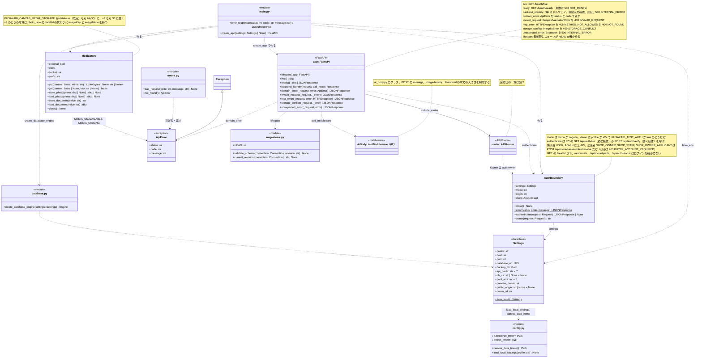
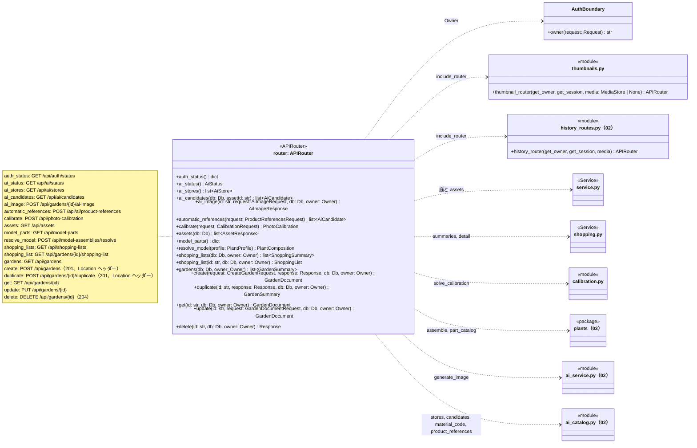
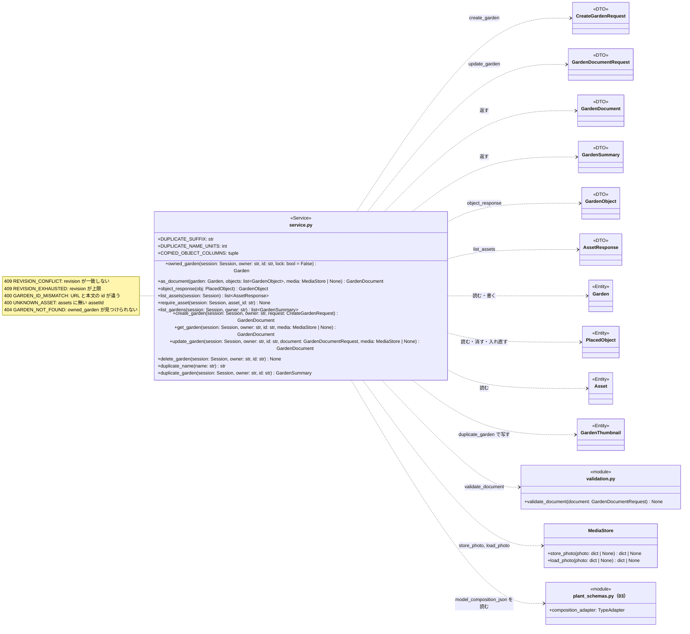
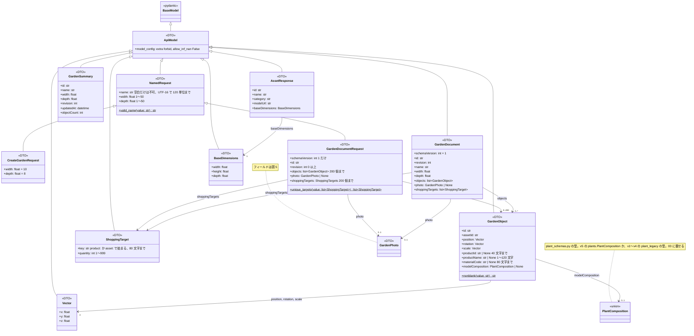
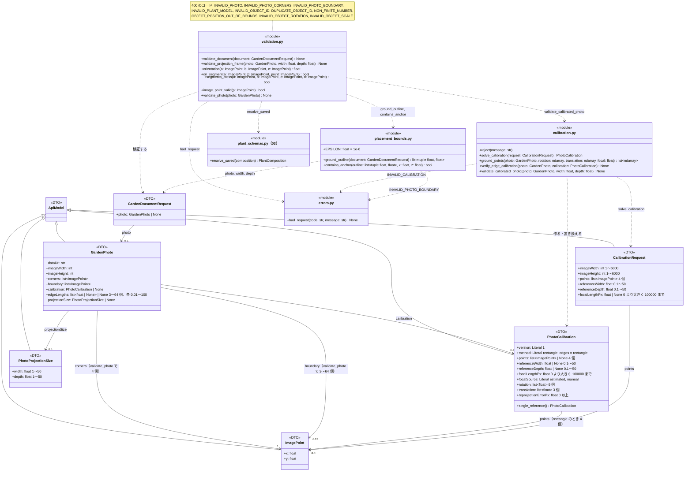
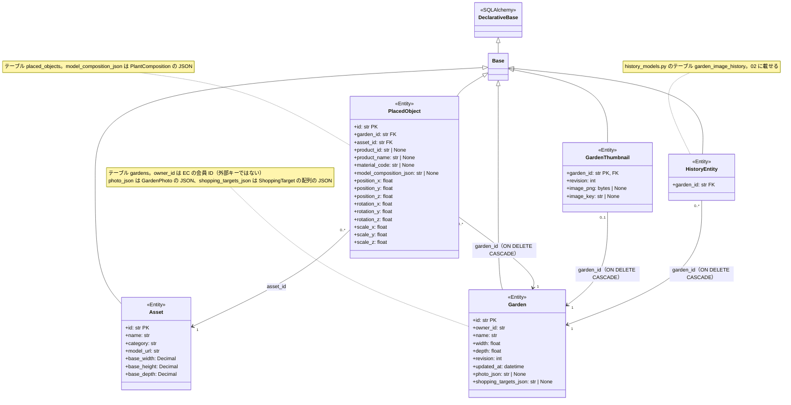
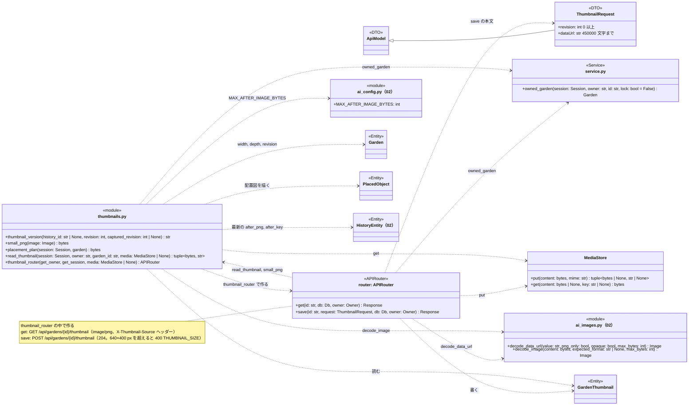
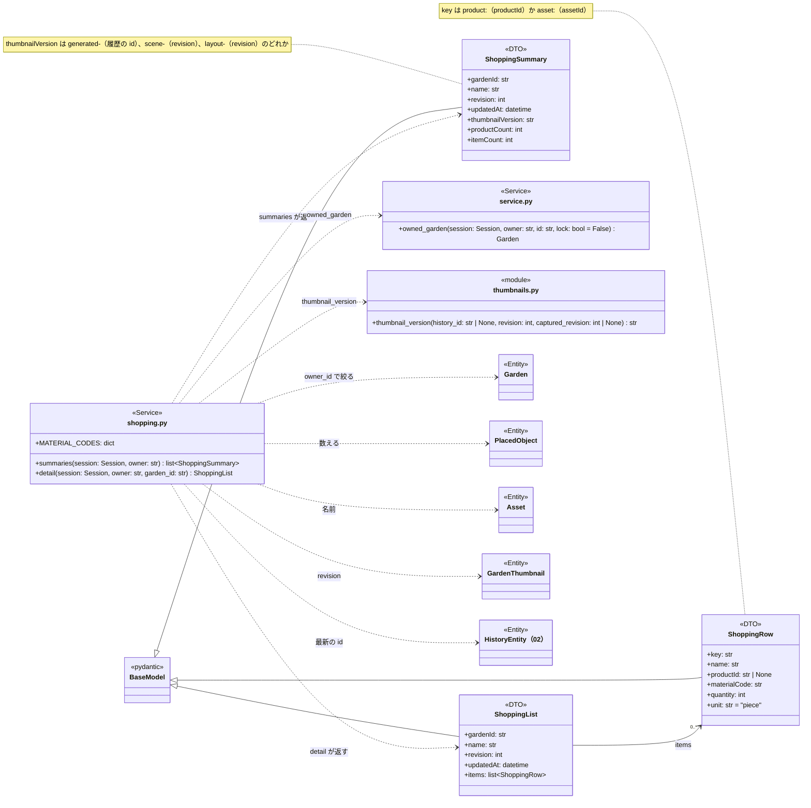

# Kusakari Canvas クラス図 01 API とデータの層

- 対象のコード: kusakari-canvas の main（c19d497、2026-11-20 時点）
- 対象のパッケージ: [backend/kusakari_canvas_api](https://github.com/abeouga/kusakari-canvas/blob/c19d497dfef15b119f9bce8ecb5c886a36da6b7d/backend/kusakari_canvas_api) のうち、[02_画像生成と履歴](<02_画像生成と履歴.md>)（`ai_*.py`、`history_*.py`）と [03_植物モデル](<03_植物モデル.md>)（`plants/`、`plant_legacy/`、`plant_schemas.py`）に入らないモジュールです。
- モジュール全体の一覧と依存は [00_モジュール構成](<00_モジュール構成.md>) にあります。責務とデータ境界は [AGENTS.md](https://github.com/abeouga/kusakari-canvas/blob/c19d497dfef15b119f9bce8ecb5c886a36da6b7d/AGENTS.md) に書かれています。

## 対象のモジュール

| モジュール | 役割 | 載せた図 |
|---|---|---|
| [main.py](https://github.com/abeouga/kusakari-canvas/blob/c19d497dfef15b119f9bce8ecb5c886a36da6b7d/backend/kusakari_canvas_api/main.py) | FastAPI のアプリを組み立てる。ルーター、例外ハンドラー、ミドルウェア、ヘルスチェック | 図 1、図 2 |
| [auth.py](https://github.com/abeouga/kusakari-canvas/blob/c19d497dfef15b119f9bce8ecb5c886a36da6b7d/backend/kusakari_canvas_api/auth.py) | EC のセッションでログインを確かめ、所有者 ID を決める | 図 1 |
| [config.py](https://github.com/abeouga/kusakari-canvas/blob/c19d497dfef15b119f9bce8ecb5c886a36da6b7d/backend/kusakari_canvas_api/config.py) | 環境変数と `.env` から設定を読む | 図 1、図 9 |
| [database.py](https://github.com/abeouga/kusakari-canvas/blob/c19d497dfef15b119f9bce8ecb5c886a36da6b7d/backend/kusakari_canvas_api/database.py) | SQLAlchemy の Engine を作る | 図 1、図 9 |
| [errors.py](https://github.com/abeouga/kusakari-canvas/blob/c19d497dfef15b119f9bce8ecb5c886a36da6b7d/backend/kusakari_canvas_api/errors.py) | API のエラー（`ApiError`）と、それを投げる関数 | 図 1、図 5 |
| [media.py](https://github.com/abeouga/kusakari-canvas/blob/c19d497dfef15b119f9bce8ecb5c886a36da6b7d/backend/kusakari_canvas_api/media.py) | 画像の保存先（MySQL か S3）を切り替える | 図 1、図 3、図 7 |
| [schemas.py](https://github.com/abeouga/kusakari-canvas/blob/c19d497dfef15b119f9bce8ecb5c886a36da6b7d/backend/kusakari_canvas_api/schemas.py) | Pydantic の Request・Response DTO | 図 4、図 5 |
| [service.py](https://github.com/abeouga/kusakari-canvas/blob/c19d497dfef15b119f9bce8ecb5c886a36da6b7d/backend/kusakari_canvas_api/service.py) | 庭の Service。DTO と Entity を詰め替える | 図 3 |
| [validation.py](https://github.com/abeouga/kusakari-canvas/blob/c19d497dfef15b119f9bce8ecb5c886a36da6b7d/backend/kusakari_canvas_api/validation.py) | 保存する庭（GardenDocument）のドメイン検証 | 図 5 |
| [calibration.py](https://github.com/abeouga/kusakari-canvas/blob/c19d497dfef15b119f9bce8ecb5c886a36da6b7d/backend/kusakari_canvas_api/calibration.py) | 写真のカメラ校正の計算と検証 | 図 5 |
| [placement_bounds.py](https://github.com/abeouga/kusakari-canvas/blob/c19d497dfef15b119f9bce8ecb5c886a36da6b7d/backend/kusakari_canvas_api/placement_bounds.py) | 施工範囲を地面の座標（m）に直し、配置基準点が中にあるかを調べる | 図 5 |
| [models.py](https://github.com/abeouga/kusakari-canvas/blob/c19d497dfef15b119f9bce8ecb5c886a36da6b7d/backend/kusakari_canvas_api/models.py) | SQLAlchemy の Entity | 図 6 |
| [thumbnails.py](https://github.com/abeouga/kusakari-canvas/blob/c19d497dfef15b119f9bce8ecb5c886a36da6b7d/backend/kusakari_canvas_api/thumbnails.py) | 庭のサムネイルの読み書きと、そのルーター | 図 7 |
| [shopping.py](https://github.com/abeouga/kusakari-canvas/blob/c19d497dfef15b119f9bce8ecb5c886a36da6b7d/backend/kusakari_canvas_api/shopping.py) | 保存済みの配置から買い物リストを作る | 図 8 |
| [`__main__.py`](https://github.com/abeouga/kusakari-canvas/blob/c19d497dfef15b119f9bce8ecb5c886a36da6b7d/backend/kusakari_canvas_api/__main__.py) | `python -m kusakari_canvas_api serve` と `migrate` の入口 | 図 9 |
| [migrations.py](https://github.com/abeouga/kusakari-canvas/blob/c19d497dfef15b119f9bce8ecb5c886a36da6b7d/backend/kusakari_canvas_api/migrations.py) | スキーマの照合、バックアップ、Alembic の実行 | 図 1、図 9 |
| [setup_database.py](https://github.com/abeouga/kusakari-canvas/blob/c19d497dfef15b119f9bce8ecb5c886a36da6b7d/backend/kusakari_canvas_api/setup_database.py) | ローカルの MySQL のアカウント・設定・スキーマを用意する（setup.bat から） | 図 9 |
| [setup_files.py](https://github.com/abeouga/kusakari-canvas/blob/c19d497dfef15b119f9bce8ecb5c886a36da6b7d/backend/kusakari_canvas_api/setup_files.py) | 接続設定ファイルの書き込みと、Windows による秘密の保護 | 図 9 |
| [reset_database.py](https://github.com/abeouga/kusakari-canvas/blob/c19d497dfef15b119f9bce8ecb5c886a36da6b7d/backend/kusakari_canvas_api/reset_database.py) | 開発用と E2E 用の DB を作り直す（DB-reset.bat から） | 図 9 |
| [local_mysql.py](https://github.com/abeouga/kusakari-canvas/blob/c19d497dfef15b119f9bce8ecb5c886a36da6b7d/backend/kusakari_canvas_api/local_mysql.py) | Canvas 専用のローカル MySQL を起動・管理する（Windows） | 図 9 |
| [startup_errors.py](https://github.com/abeouga/kusakari-canvas/blob/c19d497dfef15b119f9bce8ecb5c886a36da6b7d/backend/kusakari_canvas_api/startup_errors.py) | DB のエラーを、秘密を含まない文に直す | 図 9 |
| [`__init__.py`](https://github.com/abeouga/kusakari-canvas/blob/c19d497dfef15b119f9bce8ecb5c886a36da6b7d/backend/kusakari_canvas_api/__init__.py) | パッケージの説明文だけ | 載せていない |

## 読み方の要点

### DTO・Service・Entity の分け方

AGENTS.md の「Pydantic Request/Response DTO、ドメイン検証、SQLAlchemy Entity を分けます。Entity を API へ直接返しません」は、次の形になっています。

- 受け口は `main.py` の `create_app` の中の `router`（APIRouter）と、`thumbnails.py` の `thumbnail_router` が作る APIRouter です。引数で Pydantic の Request DTO を受け、`response_model` の Response DTO を返します。
- Request DTO と Response DTO は別のクラスです。庭の保存は `GardenDocumentRequest`（`NamedRequest` を継承し、値の範囲の制約を持つ）、応答は `GardenDocument`（制約を持たない）です。作成は `CreateGardenRequest`、一覧は `GardenSummary` です。DTO は `ApiModel`（`extra="forbid"`、`allow_inf_nan=False`）を継承します。ただし `shopping.py` の 3 つの DTO は `BaseModel` を直接継承し、`thumbnails.py` の `ThumbnailRequest` は `schemas.py` の外にあります。
- Service は `service.py`、`shopping.py`、`thumbnails.py` の `read_thumbnail` と、02 の `history_service.py` です。どれも `Session` を引数で受け、`with session.begin()` でトランザクションを区切ります。`service.py` は、Entity を `as_document` と `object_response` で DTO に詰め替えてから返します。
- Repository のクラスはありません。Service が `select`、`session.add`、`delete` を直接書きます。AGENTS.md の「Repository/MySQL」にあたるのは `models.py` の Entity と SQLAlchemy の `Session` です。
- ドメイン検証は `validation.py` の `validate_document` です。`update_garden` の最初に呼びます（02 の `ai_service.py` と `history_service.py` も、送られた庭のスナップショットに使います）。中で `calibration.py`、`placement_bounds.py`、03 の `plant_schemas.resolve_saved` を使います。
- 所有者は `AuthBoundary.owner` が返す `request.state.owner_id` です。ルーターは `Owner`（`Depends(auth.owner)`）として受け取り、Service は `owned_garden` で `owner_id` を条件に読みます。DTO に `ownerId` はありません。

### Entity とテーブル

| Entity（models.py） | テーブル | 主な使い手 |
|---|---|---|
| `Asset` | `assets` | `service.list_assets`、`service.update_garden`（assetId の照合）、`shopping.detail` |
| `Garden` | `gardens` | `service.py` の全関数、`shopping.summaries` |
| `PlacedObject` | `placed_objects` | `service.py`、`shopping.py`、`thumbnails.placement_plan` |
| `GardenThumbnail` | `garden_thumbnails` | `thumbnails.py`、`service.duplicate_garden`、`shopping.summaries` |
| `HistoryEntity`（02 の `history_models.py`） | `garden_image_history` | 02 の `history_service.py`、`thumbnails.read_thumbnail`、`shopping.summaries` |

列の MySQL の型と制約は [テーブル設計図](<../../テーブル設計図/kusakari-canvas/>) を見てください。

### API と受け口

`router` のパスの前には `Settings.api_prefix`（空か `/canvas`）が付きます。`/health/live` と `/health/ready` は `app` に直接あり、前に何も付きません。

| HTTP | パス | 受け口 | Request DTO | Response DTO | 呼ぶ Service など |
|---|---|---|---|---|---|
| GET | `/health/live` | `live` | なし | dict | なし |
| GET | `/health/ready` | `ready` | なし | dict、失敗は 503 `NOT_READY` | `engine.connect` |
| GET | `/api/auth/status` | `auth_status` | なし | dict（`mode`） | `AuthBoundary.mode` |
| GET | `/api/ai/status` | `ai_status` | なし | `AiStatus` | 02 |
| GET | `/api/ai/stores` | `ai_stores` | なし | `list[AiStore]` | 02 `ai_catalog.stores` |
| GET | `/api/ai/candidates` | `ai_candidates` | クエリ `assetId` | `list[AiCandidate]` | `service.require_asset`、02 `ai_catalog` |
| POST | `/api/gardens/{id}/ai-image` | `ai_image` | `AiImageRequest` | `AiImageResponse` | 02 `ai_service.generate_image` |
| POST | `/api/ai/product-references` | `automatic_references` | `ProductReferencesRequest` | `list[AiCandidate]` | 02 `ai_catalog.product_references` |
| POST | `/api/photo-calibration` | `calibrate` | `CalibrationRequest` | `PhotoCalibration` | `calibration.solve_calibration` |
| GET | `/api/assets` | `assets` | なし | `list[AssetResponse]` | `service.list_assets` |
| GET | `/api/model-parts` | `model_parts` | なし | dict（`response_model` なし） | 03 `plants.part_catalog` |
| POST | `/api/model-assemblies/resolve` | `resolve_model` | `PlantProfile` | `PlantComposition` | 03 `plants.assemble` |
| GET | `/api/shopping-lists` | `shopping_lists` | なし | `list[ShoppingSummary]` | `shopping.summaries` |
| GET | `/api/gardens/{id}/shopping-list` | `shopping_list` | なし | `ShoppingList` | `shopping.detail` |
| GET | `/api/gardens` | `gardens` | なし | `list[GardenSummary]` | `service.list_gardens` |
| POST | `/api/gardens` | `create` | `CreateGardenRequest` | `GardenDocument`（201） | `service.create_garden` |
| POST | `/api/gardens/{id}/duplicate` | `duplicate` | なし | `GardenSummary`（201） | `service.duplicate_garden` |
| GET | `/api/gardens/{id}` | `get` | なし | `GardenDocument` | `service.get_garden` |
| PUT | `/api/gardens/{id}` | `update` | `GardenDocumentRequest` | `GardenDocument` | `service.update_garden` |
| DELETE | `/api/gardens/{id}` | `delete` | なし | なし（204） | `service.delete_garden` |
| GET | `/api/gardens/{id}/thumbnail` | `thumbnail_router` の `get` | なし | PNG | `thumbnails.read_thumbnail` |
| POST | `/api/gardens/{id}/thumbnail` | `thumbnail_router` の `save` | `ThumbnailRequest` | なし（204） | `MediaStore.put` |
| GET・POST・DELETE | `/api/gardens/{id}/image-history` 以下 | 02 の `history_router` | 02 | 02 | 02 |

`/api/shopping-lists` と `/api/gardens/{id}/shopping-list` は、Canvas の画面ではなく EC のサーバー（`CanvasShoppingClient`）が呼びます。`/api/model-assemblies/resolve` は、Canvas の `PlantPreviewPage.jsx` と EC のサーバー（`CanvasModelClient`）が呼びます。

処理の流れは [シーケンス図](<../../シーケンス図/kusakari-canvas/>) にあります。とくに、庭の作成は [UC-01](<../../シーケンス図/kusakari-canvas/UC-01_庭プロジェクトを新規作成する.md>)、読み込みは [UC-01-1](<../../シーケンス図/kusakari-canvas/UC-01-1_庭プロジェクトを開く.md>)、保存とサムネイルは [UC-07](<../../シーケンス図/kusakari-canvas/UC-07_庭プロジェクトを保存する.md>)、複製と削除は [UC-08](<../../シーケンス図/kusakari-canvas/UC-08_庭プロジェクトを管理する.md>)、カメラ校正は [UC-04](<../../シーケンス図/kusakari-canvas/UC-04_施工範囲の実寸を定義する.md>)、ログインの確認は [全ユースケース共通の代替フロー](<../../シーケンス図/kusakari-canvas/00_全ユースケース共通の代替フロー.md>)、買い物リストを EC から読む流れは [EC-B24](<../../シーケンス図/kusakari-ec/EC-B24_買い物リストを確認する(EC).md>) です。

## 図 1 アプリの組み立てと横断の部品

`create_app` が、設定・Engine・`MediaStore`・`AuthBoundary` を 1 つずつ作り、`app` と `router` に渡します。`app` の要素（ヘルスチェック、ミドルウェア、例外ハンドラー、lifespan）は `create_app` の中の関数です。

## 図 2 受け口（ルーター）と呼び先

`router` の関数の引数の `Db` は `get_session`（`create_app` の中の関数）が渡す `Session`、`Owner` は `AuthBoundary.owner` が返す所有者 ID（str）です。HTTP メソッドとパスは note にあります。

## 図 3 Service と DTO・Entity の詰め替え（service.py）

`service.py` は Request DTO を受け、Entity を読み書きし、Response DTO を返します。庭の保存（`update_garden`）は、`validate_document` のあと、`with_for_update` で庭の行を固定して `revision` を比べ、一致したら `revision` を 1 増やします。配置は庭の全件を消してから入れ直します（全体スナップショット）。

## 図 4 DTO 庭と配置（schemas.py）

`GardenDocumentRequest` が `PUT /api/gardens/{id}` の本文、`GardenDocument` がその応答と `GET /api/gardens/{id}` の応答です。座標の決まり（1 unit = 1 m、Y が上、地面 Y=0、庭の中心が原点、回転は Y 軸、拡縮は一様）は `GardenObject` の `position`・`rotation`・`scale` に当てはまり、`validation.py` が確かめます。画面側の同じ型は [04_GardenDocumentと画面の状態](<04_GardenDocumentと画面の状態.md>) にあります。

## 図 5 写真とカメラ校正の DTO と、ドメイン検証

`validate_document` が、写真（`validate_photo`、`validate_calibrated_photo`、`validate_projection_frame`）、配置の ID・座標・回転・倍率、植物の構成を確かめます。method が rectangle のカメラ校正は、保存のたびに `solve_calibration` で計算し直して置き換えます。クライアントが送ったカメラの行列をそのまま使いません。

## 図 6 Entity（models.py）

`models.py` には `relationship()` がありません。Entity どうしの関連は `ForeignKey` の列だけで、多重度はその列の NULL 可否と主キーから書いています。フィールドの型は `Mapped[...]` の Python の型です。`GardenThumbnail.image_png` は `deferred=True` で、必要なときだけ読みます。

## 図 7 サムネイル（thumbnails.py）

庭一覧のカードの画像です。読むときは、生成画像（`garden_image_history` の最新）、保存した画面の画像（`garden_thumbnails` の `revision` が庭と同じとき）、配置図（`placed_objects` から描く）の順に使います。保存は、送られた `revision` が庭の `revision` と同じときだけです（違えば 409 `THUMBNAIL_STALE`）。

## 図 8 買い物リスト（shopping.py）

保存済みの配置を、商品（`productId`）か、商品が無ければアセット（`assetId`）ごとに数えます。呼び出し元は EC のサーバーです。`materialCode` が無い配置は `MATERIAL_CODES`（`tree_oak`、`shrub_boxwood`、`brick_paver`、`bench_wood` の 4 つ）から補います。

## 図 9 起動・マイグレーション・ローカル DB の準備

API の起動とマイグレーションは `python -m kusakari_canvas_api serve` と `migrate`（`scripts/api.mjs`、`docker/api.Dockerfile`）です。`serve` も、container 以外ではマイグレーションを先に行います。ローカルの DB は、setup.bat（`scripts/setup.ps1`）が `setup_database` を、DB-reset.bat（`scripts/reset-database.ps1`）が `reset_database` を実行して用意します。`setup_database` と `reset_database` は、API の起動では使いません。`local_mysql` と、それが使う `setup_files` は、container 以外で API を起動するときにも `ensure_for_settings` から使います（Canvas 専用のローカル MySQL が動いていなければ起動し、ポートが変わっていれば接続先を直す）。

```mermaid
classDiagram
    direction LR
    class dunder_main["#95;#95;main#95;#95;.py"] {
        <<module>>
        +main() int
    }
    class main_py["main.py"] {
        <<module>>
        +create_app(settings: Settings | None) FastAPI
    }
    class config_py["config.py"] {
        <<module>>
        +REPO_ROOT: Path
        +canvas_data_home() Path
    }
    class Settings {
        <<dataclass>>
        +from_env()$ Settings
    }
    class database_py["database.py"] {
        <<module>>
        +create_database_engine(settings: Settings) Engine
    }
    class migrations_py["migrations.py"] {
        <<module>>
        +HEAD: str = "0008"
        +SUPPORTED_REVISIONS: set
        +migration_lock_name(database: str) str
        +type_signature(value, dialect) str
        +validate_schema(connection: Connection, revision: str) None
        +current_revision(connection: Connection) str | None
        +legacy_revision(connection: Connection) str
        +backup_database(settings: Settings) Path
        +alembic_config(connection: Connection) Config
        +migrate(settings: Settings) dict
    }
    class Base {
        <<SQLAlchemy>>
    }
    class HistoryEntity["HistoryEntity（02）"] {
        <<Entity>>
    }
    class startup_errors_py["startup_errors.py"] {
        <<module>>
        +MESSAGES: dict
        +safe_error(error: Exception) str
    }
    class local_mysql_py["local_mysql.py"] {
        <<module>>
        +local_root() Path
        +read_state() dict | None
        +connect_admin(state: dict)
        +verify_directory(connection, state: dict) None
        +initialize(bin_path: Path) dict
        +ensure_server(state: dict) dict
        +ensure_for_settings(settings) Settings
    }
    class setup_files_py["setup_files.py"] {
        <<module>>
        +instance_lock(root: Path)
        +private_file(path: Path, content: str) None
        +save_settings(path: Path, values: dict~str, str~) None
        +protect_secret(value: str, decrypt: bool = False) str
    }
    class Structure["ctypes.Structure"]
    class Blob {
        +size: DWORD
        +data: POINTER c_byte
    }
    class setup_database_py["setup_database.py"] {
        <<module>>
        +file_values(profile: str) dict
        +profile_config(profile: str, default_port: int) dict
        +connect(config: dict, database: bool = True)
        +check_connection(config: dict) bool
        +validate_version(version: str) None
        +mysql_server_responds(host: str, port: int) bool
        +configured_settings(config: dict) Settings
        +validate_existing_database(admin, config: dict, admin_user: str, admin_password: str) None
        +prepare_profile(admin, config: dict) None
        +existing_admin(config: dict)
        +migrate_and_verify(configs: list~dict~) list~dict~
        +main() int
    }
    class reset_database_py["reset_database.py"] {
        <<module>>
        +SUMMARY_TABLES: tuple
        +load_configs() tuple~dict | None, list~
        +start_managed_server(state: dict | None, configs: list~dict~) None
        +summarize(config: dict) dict
        +show_plan(configs: list~dict~, summaries: list~dict~) None
        +kill_connections(configs: list~dict~) None
        +backup(configs: list~dict~, summaries: list~dict~) None
        +recreate(config: dict) None
        +main() int
    }
    note for migrations_py "MySQL の GET_LOCK で同時実行を防ぐ。既存 DB を変えるときは先にバックアップする<br/>（container 以外は mysqldump、container は RDS スナップショットの ARN を必須にする）<br/>Flyway の V1, V2 の DB は照合してから Alembic の 0001 か 0002 として記録する"
    note for local_mysql_py "Windows だけ。ほかに先頭が _ の非公開の関数が 15 個ある"

    dunder_main ..> Settings : from_env
    dunder_main ..> local_mysql_py : ensure_for_settings
    dunder_main ..> migrations_py : migrate
    dunder_main ..> main_py : create_app
    dunder_main ..> startup_errors_py : safe_error
    Settings ..> config_py
    database_py ..> Settings
    migrations_py ..> Settings
    migrations_py ..> database_py : create_database_engine
    migrations_py ..> Base : metadata と照合
    migrations_py ..> HistoryEntity : metadata に登録
    local_mysql_py ..> config_py : REPO_ROOT, canvas_data_home
    local_mysql_py ..> setup_files_py : instance_lock, private_file, protect_secret, save_settings
    Structure <|-- Blob
    setup_files_py ..> Blob : protect_secret
    setup_database_py ..> config_py : REPO_ROOT
    setup_database_py ..> Settings : configured_settings
    setup_database_py ..> local_mysql_py : connect_admin, initialize, read_state
    setup_database_py ..> migrations_py : current_revision, legacy_revision, migrate, validate_schema
    setup_database_py ..> setup_files_py : protect_secret, save_settings
    setup_database_py ..> startup_errors_py : safe_error
    reset_database_py ..> local_mysql_py : ensure_server, read_state
    reset_database_py ..> migrations_py : backup_database
    reset_database_py ..> setup_database_py : configured_settings, connect, file_values など
    reset_database_py ..> startup_errors_py : safe_error
```

## 図に載せなかったクラス

対象のモジュールのクラス 30 個（`AuthBoundary`、`Settings`、`ApiError`、`MediaStore`、`models.py` の 5 個、`schemas.py` の 16 個、`shopping.py` の 3 個、`ThumbnailRequest`、`Blob`）は、すべてどれかの図に載せました。クラス以外で図に載せなかったものは次のとおりです。

- `schemas.py` の `ShoppingTargets`: `list[ShoppingTarget]` に 200 個までの制約を付けた型の別名です。図 4 では `GardenDocumentRequest.shoppingTargets` の型として書きました。
- `schemas.py` の `_absent`: `PhotoCalibration` の `exclude_if` と検証で使う、値が `None` かを返す小さな関数です。
- `main.py` の `get_session`: `create_app` の中の関数で、`Depends` で `Session` を渡します。図 2 の本文に書きました。
- `local_mysql.py` の、名前が `_` で始まる非公開の関数 15 個: ポートの選び直し、PowerShell の呼び出し、プロセスの確認など、`initialize` と `ensure_server` の中だけで使う部品です。
- `__init__.py`: パッケージの説明文だけで、クラスも関数もありません。
