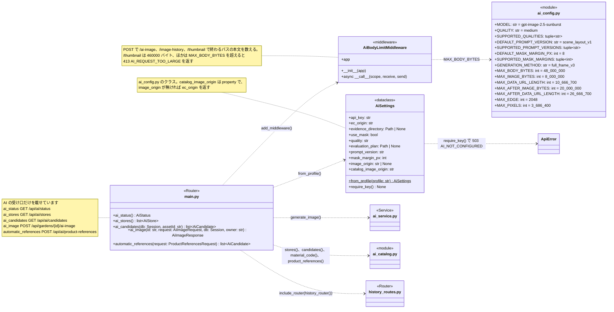
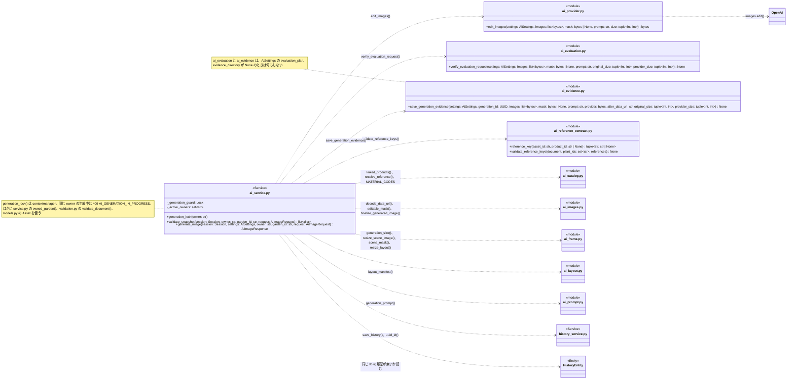
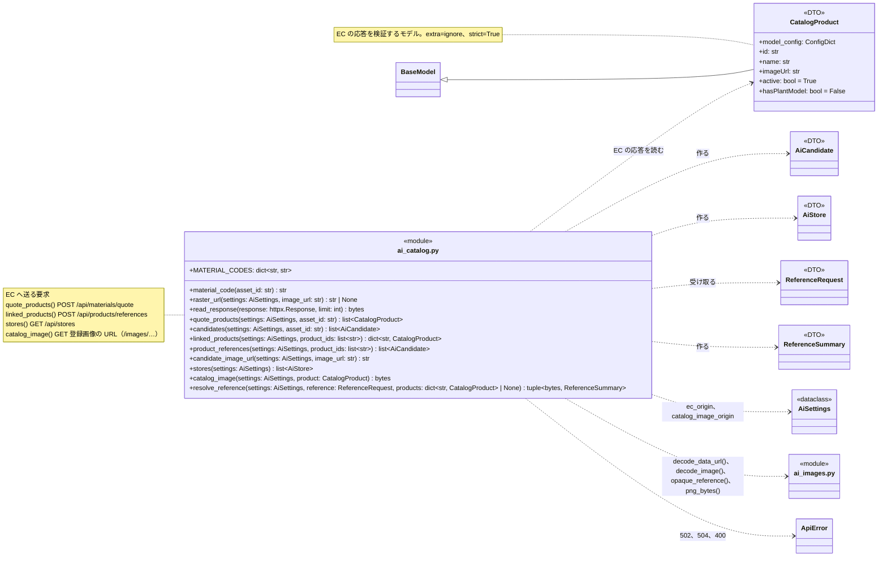
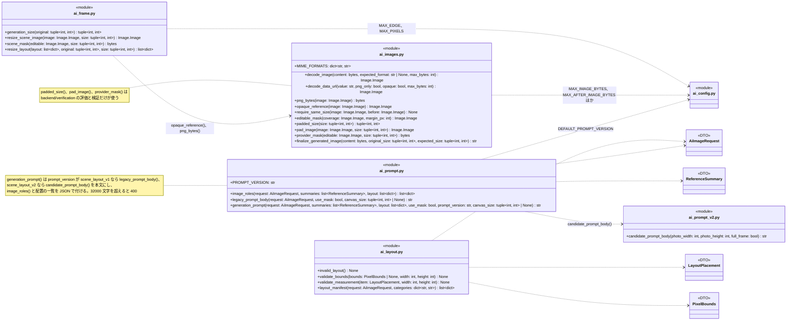
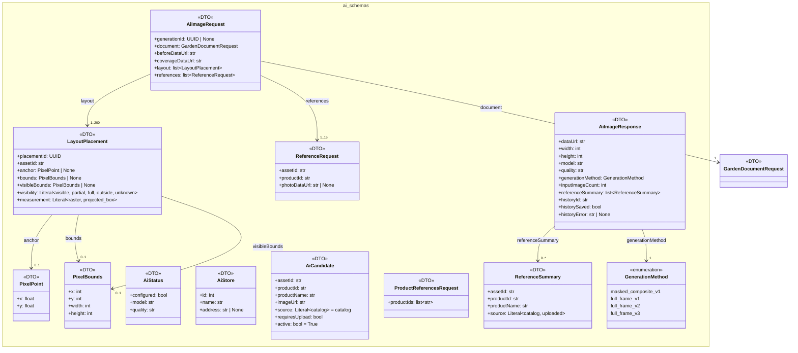
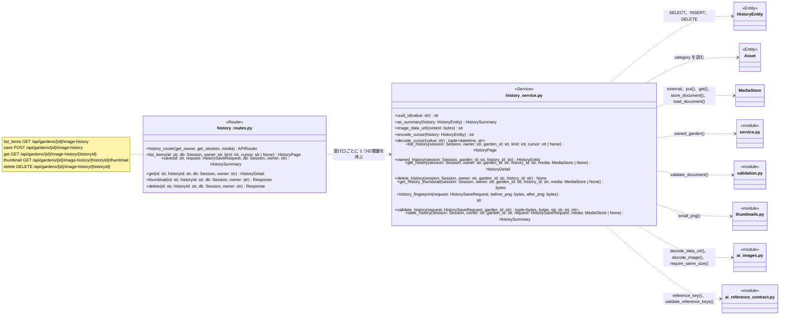
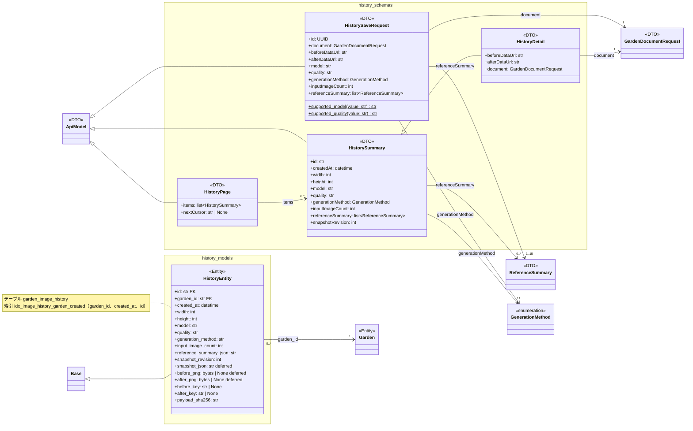

# Kusakari Canvas クラス図 02 画像生成と履歴

- 対象のコード: kusakari-canvas の main、コミット c19d497（2026-11-20 時点）
- 対象のパッケージ: [backend/kusakari_canvas_api](https://github.com/abeouga/kusakari-canvas/blob/c19d497dfef15b119f9bce8ecb5c886a36da6b7d/backend/kusakari_canvas_api) の `ai_*.py`（14 ファイル）と `history_*.py`（4 ファイル）
- 仕様と ADR: [docs/image-studio.md](https://github.com/abeouga/kusakari-canvas/blob/c19d497dfef15b119f9bce8ecb5c886a36da6b7d/docs/image-studio.md)

## パッケージの役割

完成イメージの AI 画像生成と、生成履歴の保存・一覧・取得・削除を受け持ちます。画面から受け取った生成前の画像（Before）、配置物の写る範囲の画像、配置の位置、参考写真をもとに、EC の登録画像を取り、OpenAI の `images.edit` で生成し、結果を生成履歴（テーブル `garden_image_history`）に保存します。

- 受け口は 2 つです。AI の API は `main.py` に直接あり、生成履歴の API は `history_routes.py` の `history_router()` が作ります。
- service は `ai_service.py`（生成）と `history_service.py`（履歴）です。どちらもクラスを持たないモジュールで、関数が処理の単位です。
- テーブルに対応するクラスは `HistoryEntity` だけです。生成の中で読む `gardens` と `assets` は、ほかのパッケージの `service.owned_garden()` と `Asset` を使います。
- `ai_evaluation.py`、`ai_evidence.py`、`ai_prompt_v2.py` と、`ai_images.py` の `padded_size()`・`pad_image()`・`provider_mask()` は、品質評価のための設定（E2E の環境変数）か `backend/verification` の検証スクリプトでだけ使います。ふだんの生成では何もしないか、呼ばれません。

処理の流れは [UC-06 完成イメージ画像を生成・保存する](<../../シーケンス図/kusakari-canvas/UC-06_完成イメージ画像を生成・保存する.md>) を、テーブルの詳細は [テーブル設計図](<../../テーブル設計図/kusakari-canvas/>) を見てください。`main.py` のほかの受け口、`ApiModel`・`GardenDocumentRequest`・`Garden`・`Asset`・`MediaStore` は [01_APIとデータの層](<01_APIとデータの層.md>) にあります。

### 図の読み方

- `<<module>>` はクラスを持たないモジュールです。ファイル名を名前にし、関数をメソッド、モジュールの定数をフィールドとして書きました。`<<Service>>` と `<<Router>>` も、役割を示したモジュールです。
- `<<DTO>>` は Pydantic のモデル、`<<dataclass>>` は `@dataclass(frozen=True)` のクラス、`<<enumeration>>` は `Literal[...]` の型の別名です。
- 引数の既定値と、Pydantic の `Field` の範囲（`max_length` など）は省きました。フィールドの既定値は、`None` 以外のものだけを書いています。型注釈の無い引数は名前だけを書いています。`Literal[...]`、`list[...]` などは `Literal~…~`、`list~…~` の形で書き、図では山かっこで表示されます。
- ほかのパッケージのクラスは、メンバーを書かずに名前だけ載せています。
- API のパスは、環境変数 `KUSAKARI_CANVAS_API_PREFIX` が `/canvas` のときは前に `/canvas` が付きます（`main.py` の `APIRouter(prefix=settings.api_prefix)`）。

### モジュールとクラス

| モジュール | 役割 | クラス | 図 |
| --- | --- | --- | --- |
| [ai_body.py](https://github.com/abeouga/kusakari-canvas/blob/c19d497dfef15b119f9bce8ecb5c886a36da6b7d/backend/kusakari_canvas_api/ai_body.py) | 画像を送る POST の本文の大きさを、FastAPI が読む前に数える | `AiBodyLimitMiddleware` | 図 1 |
| [ai_config.py](https://github.com/abeouga/kusakari-canvas/blob/c19d497dfef15b119f9bce8ecb5c886a36da6b7d/backend/kusakari_canvas_api/ai_config.py) | モデル名、上限値などの定数と、環境変数から読む設定 | `AiSettings` | 図 1 |
| [ai_service.py](https://github.com/abeouga/kusakari-canvas/blob/c19d497dfef15b119f9bce8ecb5c886a36da6b7d/backend/kusakari_canvas_api/ai_service.py) | 生成の service | なし | 図 2 |
| [ai_provider.py](https://github.com/abeouga/kusakari-canvas/blob/c19d497dfef15b119f9bce8ecb5c886a36da6b7d/backend/kusakari_canvas_api/ai_provider.py) | OpenAI の `images.edit` を呼び、エラーを `ApiError` に変える | なし | 図 2 |
| [ai_evaluation.py](https://github.com/abeouga/kusakari-canvas/blob/c19d497dfef15b119f9bce8ecb5c886a36da6b7d/backend/kusakari_canvas_api/ai_evaluation.py) | 評価計画と送る内容が同じかを、送る前に確かめる | なし | 図 2 |
| [ai_evidence.py](https://github.com/abeouga/kusakari-canvas/blob/c19d497dfef15b119f9bce8ecb5c886a36da6b7d/backend/kusakari_canvas_api/ai_evidence.py) | 評価用の証跡（画像、指示文、メタデータ）をファイルに保存する | なし | 図 2 |
| [ai_reference_contract.py](https://github.com/abeouga/kusakari-canvas/blob/c19d497dfef15b119f9bce8ecb5c886a36da6b7d/backend/kusakari_canvas_api/ai_reference_contract.py) | 参考画像と、配置した植物（`assetId` と `productId`）の対応を確かめる | なし | 図 2 |
| [ai_catalog.py](https://github.com/abeouga/kusakari-canvas/blob/c19d497dfef15b119f9bce8ecb5c886a36da6b7d/backend/kusakari_canvas_api/ai_catalog.py) | EC から商品の登録情報、店舗、登録画像を取る | `CatalogProduct` | 図 3 |
| [ai_images.py](https://github.com/abeouga/kusakari-canvas/blob/c19d497dfef15b119f9bce8ecb5c886a36da6b7d/backend/kusakari_canvas_api/ai_images.py) | 画像の読み込みと検査、編集マスク、生成画像の検査 | なし | 図 4 |
| [ai_frame.py](https://github.com/abeouga/kusakari-canvas/blob/c19d497dfef15b119f9bce8ecb5c886a36da6b7d/backend/kusakari_canvas_api/ai_frame.py) | 生成の解像度を決め、画像・マスク・座標を同じ倍率で変える | なし | 図 4 |
| [ai_layout.py](https://github.com/abeouga/kusakari-canvas/blob/c19d497dfef15b119f9bce8ecb5c886a36da6b7d/backend/kusakari_canvas_api/ai_layout.py) | 配置の位置情報を検査し、指示文に入れる配置の一覧を作る | なし | 図 4 |
| [ai_prompt.py](https://github.com/abeouga/kusakari-canvas/blob/c19d497dfef15b119f9bce8ecb5c886a36da6b7d/backend/kusakari_canvas_api/ai_prompt.py) | 指示文を組み立てる（既定は `scene_layout_v1`） | なし | 図 4 |
| [ai_prompt_v2.py](https://github.com/abeouga/kusakari-canvas/blob/c19d497dfef15b119f9bce8ecb5c886a36da6b7d/backend/kusakari_canvas_api/ai_prompt_v2.py) | 評価用の指示文の本文（`scene_layout_v2`） | なし | 図 4 |
| [ai_schemas.py](https://github.com/abeouga/kusakari-canvas/blob/c19d497dfef15b119f9bce8ecb5c886a36da6b7d/backend/kusakari_canvas_api/ai_schemas.py) | AI の API の DTO | `PixelPoint`、`PixelBounds`、`LayoutPlacement`、`ReferenceRequest`、`AiImageRequest`、`AiStatus`、`AiStore`、`AiCandidate`、`ProductReferencesRequest`、`ReferenceSummary`、`AiImageResponse`、`GenerationMethod` | 図 5 |
| [history_routes.py](https://github.com/abeouga/kusakari-canvas/blob/c19d497dfef15b119f9bce8ecb5c886a36da6b7d/backend/kusakari_canvas_api/history_routes.py) | 生成履歴の受け口 | なし | 図 6 |
| [history_service.py](https://github.com/abeouga/kusakari-canvas/blob/c19d497dfef15b119f9bce8ecb5c886a36da6b7d/backend/kusakari_canvas_api/history_service.py) | 生成履歴の service | なし | 図 6 |
| [history_models.py](https://github.com/abeouga/kusakari-canvas/blob/c19d497dfef15b119f9bce8ecb5c886a36da6b7d/backend/kusakari_canvas_api/history_models.py) | 生成履歴の Entity | `HistoryEntity` | 図 7 |
| [history_schemas.py](https://github.com/abeouga/kusakari-canvas/blob/c19d497dfef15b119f9bce8ecb5c886a36da6b7d/backend/kusakari_canvas_api/history_schemas.py) | 生成履歴の DTO | `HistorySaveRequest`、`HistorySummary`、`HistoryPage`、`HistoryDetail` | 図 7 |

### API とクラス

| API | 受け口 | 処理 | 本文 | 応答 |
| --- | --- | --- | --- | --- |
| `GET /api/ai/status` | `main.py` の `ai_status()` | なし（`AiSettings` を読むだけ） | なし | `AiStatus` |
| `GET /api/ai/stores` | `main.py` の `ai_stores()` | `ai_catalog.stores()` | なし | `list[AiStore]` |
| `GET /api/ai/candidates?assetId=` | `main.py` の `ai_candidates()` | `ai_catalog.candidates()` | なし | `list[AiCandidate]` |
| `POST /api/ai/product-references` | `main.py` の `automatic_references()` | `ai_catalog.product_references()` | `ProductReferencesRequest` | `list[AiCandidate]` |
| `POST /api/gardens/{id}/ai-image` | `main.py` の `ai_image()` | `ai_service.generate_image()` | `AiImageRequest` | `AiImageResponse` |
| `GET /api/gardens/{id}/image-history` | `history_routes.py` の `list_items()` | `history_service.list_history()` | なし（`limit`、`cursor`） | `HistoryPage` |
| `POST /api/gardens/{id}/image-history` | `history_routes.py` の `save()` | `history_service.save_history()` | `HistorySaveRequest` | `HistorySummary` |
| `GET /api/gardens/{id}/image-history/{historyId}` | `history_routes.py` の `get()` | `history_service.get_history()` | なし | `HistoryDetail` |
| `GET /api/gardens/{id}/image-history/{historyId}/thumbnail` | `history_routes.py` の `thumbnail()` | `history_service.get_history_thumbnail()` | なし | PNG |
| `DELETE /api/gardens/{id}/image-history/{historyId}` | `history_routes.py` の `delete()` | `history_service.delete_history()` | なし | 204 |

`GET /api/ai/stores` と `GET /api/ai/candidates` は、画面の `frontend/src/api/aiImages.js` に呼び出しの関数（`stores`、`candidates`）がありますが、どの画面からも呼ばれていません。画面は商品に紐づく植物（`plant_modular` で `productId` のあるもの）だけを生成に送り、紐づかない固定の植物（`tree_oak`、`shrub_boxwood`）があると「AIで生成」を押せなくします。そのため `ai_catalog.py` の `material_code()`・`quote_products()`・`candidates()` を通る道は、画面からは使われません。

## 図 1 受け口と設定

`main.py` の AI の受け口と、`ai_config.py` の設定です。`AiSettings` は `create_app()` の中で 1 回だけ `AiSettings.from_profile(settings.profile)` で作られ、各受け口が使います。`from_profile()` は、`profile` が `e2e` のときは E2E 用の環境変数（`KUSAKARI_CANVAS_E2E_OPENAI_API_KEY` など）を読みます。

## 図 2 生成の処理（ai_service.py）

`generate_image()` が生成の 1 回分を進めます。順番は、`generation_lock()` で同じ利用者の同時実行を止める、`validate_snapshot()` で庭の JSON と revision と植物を確かめる、`require_key()` で API キーを確かめる、同じ `generationId` の履歴が無いか確かめる、画像とマスクを作る、参考画像を集める、指示文を作る、`edit_images()` で生成する、`save_history()` で履歴に保存する、です。データベースの読み取りは EC と OpenAI への通信の前に閉じます。

## 図 3 EC から商品の参考画像を取る（ai_catalog.py）

`ai_catalog.py` は EC の API を `httpx` で直接呼びます。応答は 1,000,000 バイト（登録画像は `MAX_IMAGE_BYTES`）と 20 秒を上限に `read_response()` で読み、EC の失敗は `ApiError`（502、504、400）に変えます。`raster_url()` は、登録画像の URL が `KUSAKARI_CANVAS_EC_IMAGE_ORIGIN`（既定は EC の URL）の `/images/…` の PNG・JPEG・WebP のときだけ URL を返します。返らない商品は `requiresUpload` が `True` になり、画面に「参考写真」欄が出ます。

`resolve_reference()` は、`assetId` が `plant_modular` なら `linked_products()` で取った商品を、それ以外なら `quote_products()` の候補から商品を選びます。`photoDataUrl` がある（利用者が参考写真を付けた）ときは EC の登録画像を取らず、`ReferenceSummary.source` を `uploaded` にします。

## 図 4 画像の変換と指示文

画像の変換（`ai_images.py`、`ai_frame.py`）と、指示文の組み立て（`ai_layout.py`、`ai_prompt.py`、`ai_prompt_v2.py`）です。`ai_prompt_v2.py` のほかは、入力の誤りを `errors.py` の `bad_request()` で `ApiError`（400）にします。`finalize_generated_image()` は、OpenAI が返した画像の誤りを 502 にします。

## 図 5 AI の API の DTO（ai_schemas.py）

`ai_schemas.py` のクラスは、すべて `schemas.py` の `ApiModel`（`extra="forbid"`）を継承します。`AiImageRequest` が生成の本文で、`document` に撮影したときの庭の JSON（`GardenDocumentRequest`）をそのまま入れます。多重度は `Field` の `min_length`・`max_length` から書きました。

- 継承（`ApiModel <|-- 各クラス`）の線は、図が込み入るので省きました。`ApiModel` は [01_APIとデータの層](<01_APIとデータの層.md>) にあります。
- `GenerationMethod` は `Literal["masked_composite_v1", "full_frame_v1", "full_frame_v2", "full_frame_v3"]` の別名です。新しい生成は `ai_config.GENERATION_METHOD`（`full_frame_v3`）だけを使い、ほかの値は、前の方式で保存した履歴のために残っています。
- `AiImageResponse.historySaved` が `False` のときは `historyError` に理由が入ります。画面は生成画像を保持したまま `POST /api/gardens/{id}/image-history` で再保存できます。

## 図 6 生成履歴の受け口と service

`history_router(get_owner, get_session, media)` は `APIRouter`（prefix `/api/gardens/{id}/image-history`）を作って返す関数で、受け口の 5 つの関数はその中で定義されています。`main.py` が `history_router(auth.owner, get_session, media)` で組み込みます。`owner` は EC のセッションで確かめた会員 ID で、どの関数も `owned_garden()` で庭の持ち主を確かめてから履歴を扱います。

- `save_history()` は、同じ `id` の履歴があれば追加しません。`payload_sha256`（`history_fingerprint()` が作る、メタデータと画像の SHA-256）と `generation_method` が同じなら今の履歴の `HistorySummary` を返し、違えば 409 `HISTORY_ID_CONFLICT` にします。
- `media.external` が `True`（`KUSAKARI_CANVAS_MEDIA_STORAGE=s3`）のときは、トランザクションの前に画像と庭の JSON の写真をオブジェクトストレージへ入れ、`before_key`・`after_key` にキーを保存します。生成の中の保存（`ai_service.py` の `save_history()` の呼び出し）は `media` を渡さないので、MySQL の `before_png`・`after_png` に入ります。
- `get_history_thumbnail()` は After の画像だけを読み、`thumbnails.py` の `small_png()` で 640×400px 以内に縮めます。
- 一覧のカーソルは、`created_at` と `id` を JSON にして URL 用の Base64 にした文字列です（`encode_cursor()`）。

## 図 7 生成履歴の Entity と DTO

`HistoryEntity` はテーブル `garden_image_history` の 1 行です。`garden_id` は `gardens.id` への外部キー（`fk_image_history_garden`、`ON DELETE CASCADE`）で、SQLAlchemy の `relationship()` はありません。多重度は外部キーと `garden_id` が NOT NULL であることから書きました。

`HistoryEntity` の列と DTO の項目は、`history_service.py` の `as_summary()` と `get_history()` で次のように対応します。

| `HistoryEntity` の列 | DTO の項目 | 備考 |
| --- | --- | --- |
| `id`、`created_at`、`width`、`height`、`model`、`quality` | `HistorySummary` の `id`、`createdAt`、`width`、`height`、`model`、`quality` | `created_at` はタイムゾーンなしの UTC で保存し、返すときに UTC を付けます |
| `generation_method`、`input_image_count`、`snapshot_revision` | `generationMethod`、`inputImageCount`、`snapshotRevision` | `snapshot_revision` は保存した庭の JSON の `revision` です |
| `reference_summary_json` | `referenceSummary` | `ReferenceSummary` のリストを JSON 文字列で保存します |
| `before_png` または `before_key`、`after_png` または `after_key` | `HistoryDetail` の `beforeDataUrl`、`afterDataUrl` | `MediaStore.get()` で読み、`data:image/png;base64,` の形にします |
| `snapshot_json` | `HistoryDetail` の `document` | `MediaStore.load_document()` で写真を戻してから `GardenDocumentRequest` にします |
| `payload_sha256` | なし | 同じ ID で保存し直すときの比較だけに使います |

`width`・`height` は After の画像の寸法です。Before の寸法は、保存した庭の JSON の `photo.imageWidth`・`photo.imageHeight` です。`deferred` の 3 列は、行を読んでも自動では読まず、使うときに読みます。

## 図に載せなかったクラス

担当の 18 ファイルのクラスは、すべていずれかの図に載せました。メンバーの次のものは省いています。

- Pydantic の `Field` の制約（`min_length`、`max_length`、`ge`、`le`、`strict`、`repr=False`）と、引数の既定値です。
- `history_routes.py` の受け口の `Annotated[..., Depends(...)]` と `Query(ge=1, le=50)` などの指定です。図では `Session`、`str`、`int` と書きました。

## 確かめられなかったこと

- OpenAI 側の URL のパスは、このリポジトリのコードにありません。コードにあるのは `base_url="https://api.openai.com/v1"` と SDK の `client.images.edit()` の呼び出しだけです。
- `generation_lock()` は 1 つのプロセスの中だけの排他です（コードのコメントに、複数のプロセスで動かすときは共有のロックが要ると書かれています）。どの環境で API を何プロセスで動かすかは、このリポジトリからは分かりません。
- どの環境で `KUSAKARI_CANVAS_MEDIA_STORAGE=s3` や、評価用の環境変数（`KUSAKARI_CANVAS_AI_EVAL_PLAN` など）を使うかは、このリポジトリにありません。
