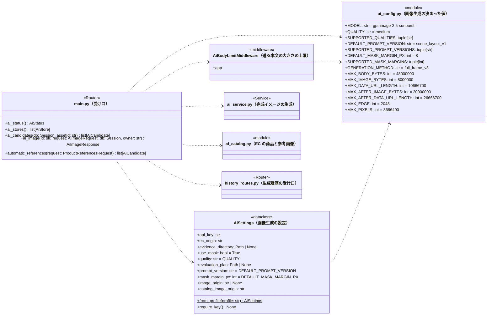
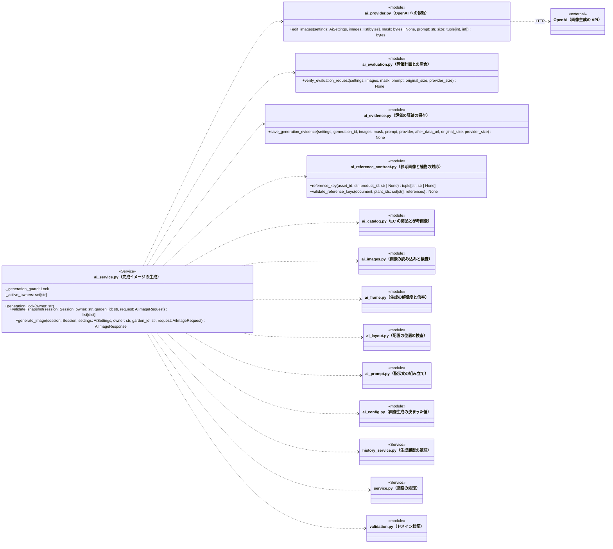
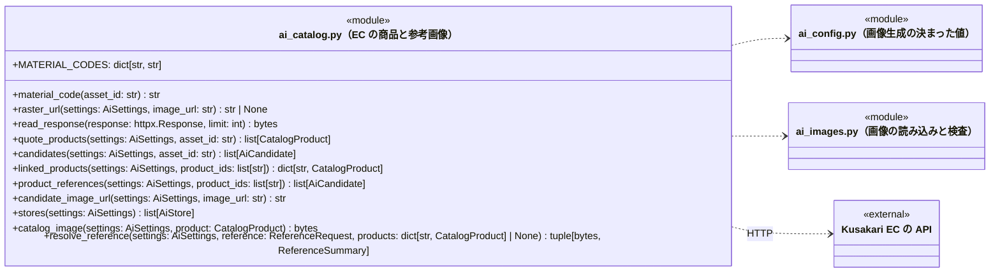
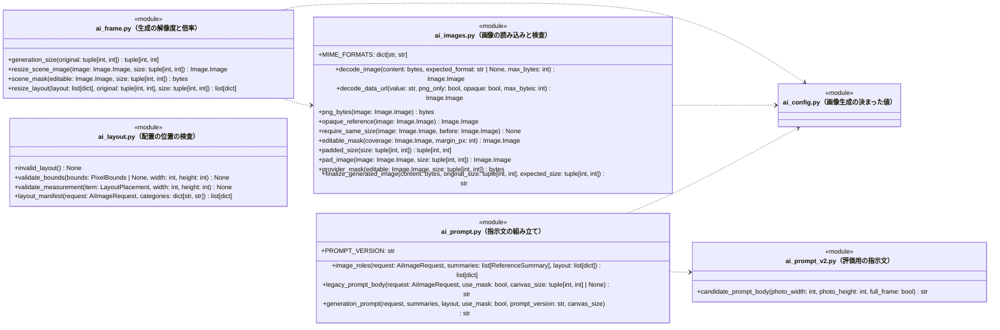
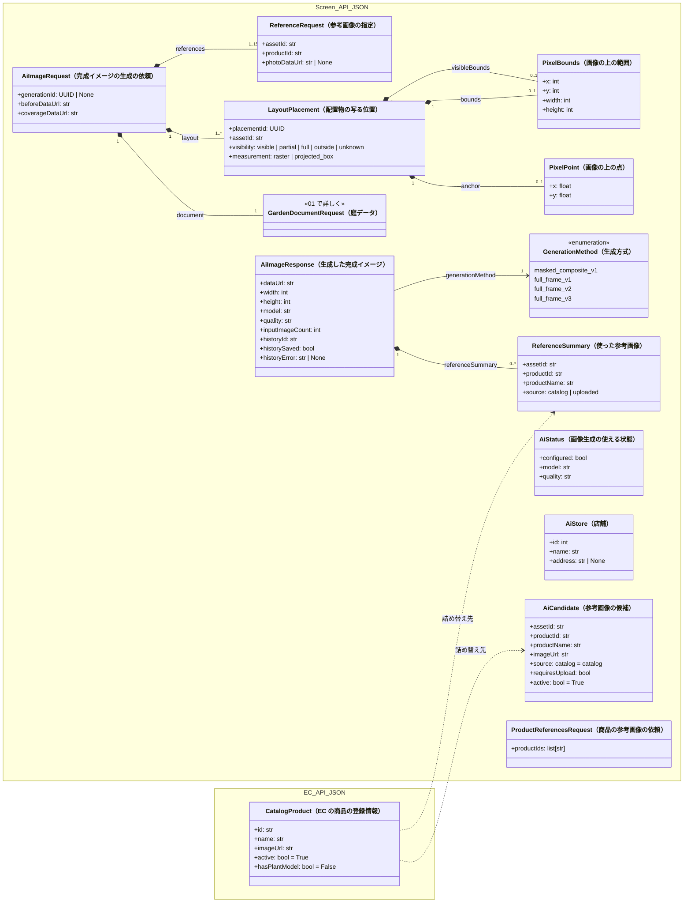
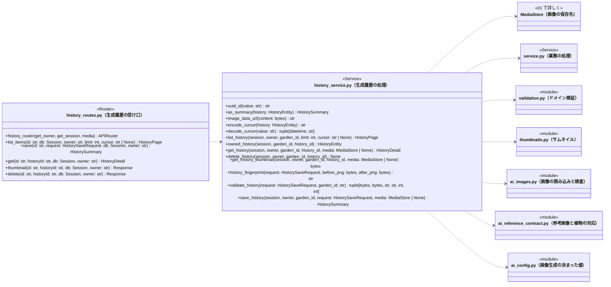
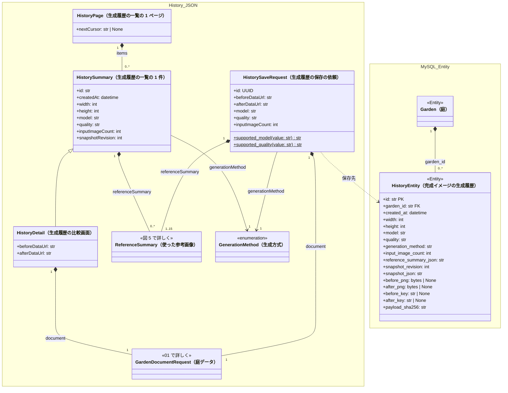

# Kusakari Canvas クラス図 02 画像生成と履歴

- 対象のコード: kusakari-canvas の main（2c043a4、2026-11-24 時点）
- 対象のパッケージ: [backend/kusakari_canvas_api](https://github.com/abeouga/kusakari-canvas/blob/2c043a4/backend/kusakari_canvas_api) の `ai_*.py`（14 ファイル）と `history_*.py`（4 ファイル）と、`main.py` の AI の受け口
- 仕様と ADR: [docs/image-studio.md](https://github.com/abeouga/kusakari-canvas/blob/2c043a4/docs/image-studio.md)
- 全体図: [00_全体図](<00_全体図.md>)。ほかの詳細図: [00_モジュール構成](<00_モジュール構成.md>)、[01_APIとデータの層](<01_APIとデータの層.md>)、[03_植物モデル](<03_植物モデル.md>)、[04_GardenDocumentと画面の状態](<04_GardenDocumentと画面の状態.md>)

完成イメージの AI 画像生成と、生成履歴の保存・一覧・取得・削除の部分を 7 枚で描きます。図 1〜図 4 と図 6 はモジュールの図、図 5 と図 7 はデータの図です。呼び出しの順番は [UC-06 完成イメージ画像を生成・保存する](<../../シーケンス図/kusakari-canvas/UC-06_完成イメージ画像を生成・保存する.md>) に、テーブルの詳細は [テーブル設計図](<../../テーブル設計図/kusakari-canvas/>) に書いています。

## パッケージの役割

画面から受け取った生成前の画像（Before）、配置物の写る範囲の画像、配置の位置、参考写真をもとに、EC の登録画像を取り、OpenAI の `images.edit` で完成イメージを生成し、結果を生成履歴（テーブル `garden_image_history`）に保存します。

- 受け口は 2 つです。AI の API は `main.py` に直接あり、生成履歴の API は `history_routes.py` の `history_router()` が作ります。
- service は `ai_service.py`（生成）と `history_service.py`（履歴）です。どちらもクラスを持たないモジュールで、関数が処理の単位です。
- テーブルに対応するクラスは `HistoryEntity` だけです。生成の中で読む `gardens` と `assets` は、ほかのパッケージの `service.owned_garden()` と `Asset` を使います。
- `ai_evaluation.py`、`ai_evidence.py`、`ai_prompt_v2.py` と、`ai_images.py` の `padded_size()`・`pad_image()`・`provider_mask()` は、品質評価のための設定（E2E の環境変数）か `backend/verification` の検証スクリプトでだけ使います。ふだんの生成では何もしないか、呼ばれません。
- `main.py` のほかの受け口、`ApiModel`・`GardenDocumentRequest`・`Garden`・`Asset`・`MediaStore` の中身は [01_APIとデータの層](<01_APIとデータの層.md>) にあります。

## 図の読み方

- 箱の名前は「英語名（日本語名）」です。英語名はコードのクラス名・型名か、モジュールのファイル名です。
- モジュールの図（図 1〜図 4、図 6）では、`<<module>>`・`<<Service>>`・`<<Router>>` はクラスを持たないモジュールです。export している関数をメソッド、モジュールの定数をフィールドとして書きました。`<<middleware>>` と `<<dataclass>>` は、そのモジュールの中のクラスです。`<<external>>` はこのリポジトリの外のサービスです。
- データの図（図 5、図 7）では、`<<Entity>>` は SQLAlchemy の Entity、印の無い箱は Pydantic の DTO（JSON の形）、`<<enumeration>>` は `Literal[...]` の型の別名です。`<<01 で詳しく>>` の箱は、ほかの詳細図に中身を書いたクラスです。
- 線は 4 種類です。`*--`（黒い菱形）は親が消えると一緒に消える持ち方（JSON の入れ子、`ondelete="CASCADE"` の外部キー）、`-->` は関連、`<|--` は継承、`..>` は依存です。依存は、モジュールの図では import か HTTP、データの図では「保存先」「詰め替え先」を表します。
- 線の両端の数字は多重度です。`0..1` は無いか 1 つ、`1` はちょうど 1 つ、`0..*` は 0 個以上、`1..*` は 1 個以上です。3 桁の上限は図では `*` と書き、図の下の表に書きました。
- 線のラベルは関連の名前（フィールド名・外部キーの列名）です。モジュールの図の依存の線にはラベルを付けず、どの関数・定数を使っているかを図の下の「線とコードの対応」の表に書きました。
- 関連の線で描いたフィールド（`document`、`layout`、`referenceSummary` など）は、箱の中に重ねて書いていません。
- 引数の既定値と、Pydantic の `Field` の範囲（`max_length` など）は省きました。フィールドの既定値は `None` 以外のものだけを書いています。型注釈の無い引数は名前だけを書いています。`list[...]`・`tuple[...]` などの型はコードのとおり角かっこで書きました（Mermaid の `list~…~` の書き方は、1 行に型の引数が 2 つ以上あると引数が消えるため使っていません）。
- API のパスは、環境変数 `KUSAKARI_CANVAS_API_PREFIX` が `/canvas` のときは前に `/canvas` が付きます（`main.py` の `APIRouter(prefix=settings.api_prefix)`）。

## 図 1 受け口と設定

`main.py` の AI の受け口と、`ai_config.py` の設定です。`AiSettings` は `create_app()` の中で 1 回だけ `AiSettings.from_profile(settings.profile)` で作られ、各受け口が使います。`from_profile()` は、`profile` が `e2e` のときは E2E 用の環境変数（`KUSAKARI_CANVAS_E2E_OPENAI_API_KEY` など）を読みます。

AI の API と、受け口の関数の対応です。生成履歴の API は図 6 の下にあります。

| API | 受け口 | 処理 | 本文 | 応答 |
| --- | --- | --- | --- | --- |
| `GET /api/ai/status` | `main.py` の `ai_status()` | なし（`AiSettings` を読むだけ） | なし | `AiStatus` |
| `GET /api/ai/stores` | `main.py` の `ai_stores()` | `ai_catalog.stores()` | なし | `list[AiStore]` |
| `GET /api/ai/candidates?assetId=` | `main.py` の `ai_candidates()` | `service.require_asset()`、`ai_catalog.material_code()`、`ai_catalog.candidates()` | なし | `list[AiCandidate]` |
| `POST /api/ai/product-references` | `main.py` の `automatic_references()` | `ai_catalog.product_references()` | `ProductReferencesRequest` | `list[AiCandidate]` |
| `POST /api/gardens/{id}/ai-image` | `main.py` の `ai_image()` | `ai_service.generate_image()` | `AiImageRequest` | `AiImageResponse` |

線とコードの対応です。

| 線 | 使っているもの | 補足 |
| --- | --- | --- |
| `main.py` → `AiBodyLimitMiddleware` | `app.add_middleware(AiBodyLimitMiddleware)` | POST で `/ai-image`、`/image-history`、`/thumbnail` で終わるパスの本文を、FastAPI が読む前に数えます。`/thumbnail` は 460000 バイト、ほかは `MAX_BODY_BYTES` を超えると 413 `AI_REQUEST_TOO_LARGE` を返します |
| `main.py` → `AiSettings` | `AiSettings.from_profile(settings.profile)`、`api_key`、`quality` | `ai_status()` の `configured` は `api_key` が空でないかです |
| `main.py` → `ai_config.py` | `MODEL` | `AiStatus.model` に入れます |
| `main.py` → `ai_service.py` | `generate_image()` | |
| `main.py` → `ai_catalog.py` | `stores()`、`candidates()`、`material_code()`、`product_references()` | |
| `main.py` → `history_routes.py` | `history_router(auth.owner, get_session, media)` | `router.include_router()` で組み込みます |
| `AiBodyLimitMiddleware` → `ai_config.py` | `MAX_BODY_BYTES` | |
| `AiSettings` → `ai_config.py` | `QUALITY`、`SUPPORTED_QUALITIES`、`DEFAULT_PROMPT_VERSION`、`SUPPORTED_PROMPT_VERSIONS`、`DEFAULT_MASK_MARGIN_PX` | 同じファイルの定数です。`require_key()` は API キーが空なら 503 `AI_NOT_CONFIGURED` の `ApiError` を出します |

`AiSettings.catalog_image_origin` は property で、`image_origin` が無ければ `ec_origin` を返します。

## 図 2 生成の処理（ai_service.py）

`generate_image()` が生成の 1 回分を進めます。順番は、`generation_lock()` で同じ利用者の同時実行を止める、`validate_snapshot()` で庭の JSON と revision と植物を確かめる、`require_key()` で API キーを確かめる、同じ `generationId` の履歴が無いか確かめる、画像とマスクを作る、参考画像を集める、指示文を作る、`edit_images()` で生成する、`save_history()` で履歴に保存する、です。データベースの読み取りは EC と OpenAI への通信の前に閉じます。

線とコードの対応です。

| 線 | 使っているもの | 補足 |
| --- | --- | --- |
| `ai_service.py` → `ai_catalog.py` | `linked_products()`、`resolve_reference()`、`MATERIAL_CODES` | |
| `ai_service.py` → `ai_images.py` | `decode_data_url()`、`editable_mask()`、`finalize_generated_image()`、`png_bytes()`、`require_same_size()` | |
| `ai_service.py` → `ai_frame.py` | `generation_size()`、`resize_scene_image()`、`scene_mask()`、`resize_layout()` | |
| `ai_service.py` → `ai_layout.py` | `layout_manifest()` | |
| `ai_service.py` → `ai_prompt.py` | `generation_prompt()` | |
| `ai_service.py` → `ai_reference_contract.py` | `validate_reference_keys()` | |
| `ai_service.py` → `ai_evaluation.py` | `verify_evaluation_request()` | `AiSettings.evaluation_plan` が `None` のときは何もしません |
| `ai_service.py` → `ai_evidence.py` | `save_generation_evidence()` | `AiSettings.evidence_directory` が `None` のときは何もしません |
| `ai_service.py` → `ai_provider.py` | `edit_images()` | |
| `ai_service.py` → `ai_config.py` | `GENERATION_METHOD`、`MODEL`、`AiSettings` | |
| `ai_service.py` → `history_service.py` | `save_history()`、`uuid_id()` | 生成の中の保存は `media` を渡しません（図 6 の下を参照） |
| `ai_service.py` → `service.py` | `owned_garden()` | |
| `ai_service.py` → `validation.py` | `validate_document()` | |
| `ai_provider.py` → OpenAI | `OpenAI(base_url="https://api.openai.com/v1")` の `client.images.edit()` | OpenAI のエラーを `ApiError` に変えます |

データの図との関係（モジュールの図に Entity・DTO を混ぜないため、線ではなく表に書きました）です。

| モジュール | 使うデータのクラス | 使い方 |
| --- | --- | --- |
| `ai_service.py` | `HistoryEntity`（図 7） | 同じ `generationId` の履歴があれば 409 `HISTORY_ALREADY_EXISTS` |
| `ai_service.py` | `Asset`（[01](<01_APIとデータの層.md>)） | 配置した物の `category` を読み、`tree`・`shrub` を植物として扱う |
| `ai_service.py` | `AiImageRequest`、`AiImageResponse`、`HistorySaveRequest`（図 5、図 7） | 受け取る本文、返す応答、履歴の保存に渡す本文 |

`generation_lock()` は contextmanager で、同じ `owner` の生成中は 409 `AI_GENERATION_IN_PROGRESS` を返します。`validate_snapshot()` が返す 400 は、`GARDEN_ID_MISMATCH`、`AI_PHOTO_REQUIRED`、`UNKNOWN_ASSET`、`AI_NO_PLANTS`、`AI_UNSUPPORTED_ASSET`、`AI_IMAGE_COUNT`（主画像と参考写真の合計が 16 枚を超える）で、庭の revision が違うと 409 `REVISION_CONFLICT` です。

## 図 3 EC から商品の参考画像を取る（ai_catalog.py）

`ai_catalog.py` は EC の API を `httpx` で直接呼びます。通信は `httpx.Client(timeout=10)` で、応答は 1,000,000 バイト（登録画像は `MAX_IMAGE_BYTES`）と、読み始めてから 20 秒を上限に `read_response()` で読み、EC の失敗は `ApiError`（502、504、400）に変えます。`raster_url()` は、登録画像の URL が `KUSAKARI_CANVAS_EC_IMAGE_ORIGIN`（既定は EC の URL）の `/images/…` の PNG・JPEG・WebP のときだけ URL を返します。返らない商品は `requiresUpload` が `True` になり、画面に「参考写真」欄が出ます。

線とコードの対応です。

| 線 | 使っているもの | 補足 |
| --- | --- | --- |
| `ai_catalog.py` → `ai_config.py` | `MAX_IMAGE_BYTES`、`AiSettings` の `ec_origin`・`catalog_image_origin` | |
| `ai_catalog.py` → `ai_images.py` | `decode_data_url()`、`decode_image()`、`opaque_reference()`、`png_bytes()` | |
| `ai_catalog.py` → Kusakari EC の API | `quote_products()` は `POST /api/materials/quote`、`linked_products()` は `POST /api/products/references`、`stores()` は `GET /api/stores`、`catalog_image()` は登録画像の URL（`/images/…`）への `GET` | 失敗は 502 `AI_CATALOG_UNAVAILABLE`・`AI_CATALOG_INVALID`・`AI_REFERENCE_UNAVAILABLE`・`AI_REFERENCE_INVALID`、504 `AI_CATALOG_TIMEOUT`・`AI_REFERENCE_TIMEOUT` などに変えます |

データの図との関係です。

| モジュール | 使うデータのクラス | 使い方 |
| --- | --- | --- |
| `ai_catalog.py` | `CatalogProduct`（図 5） | EC の応答を検証して読む。`ai_catalog.py` の中で定義しています |
| `ai_catalog.py` | `AiCandidate`、`AiStore`、`ReferenceSummary`（図 5） | 作って返す |
| `ai_catalog.py` | `ReferenceRequest`（図 5） | `resolve_reference()` で受け取る |

`resolve_reference()` は、`assetId` が `plant_modular` なら `linked_products()` で取った商品を、それ以外なら `quote_products()` の候補から商品を選びます。`photoDataUrl` がある（利用者が参考写真を付けた）ときは EC の登録画像を取らず、`ReferenceSummary.source` を `uploaded` にします。

`GET /api/ai/stores` と `GET /api/ai/candidates` は、画面の `frontend/src/api/aiImages.js` に呼び出しの関数（`stores`、`candidates`）がありますが、どの画面からも呼ばれていません。画面は商品に紐づく植物（`plant_modular` で `productId` のあるもの）だけを生成に送り、紐づかない固定の植物（`tree_oak`、`shrub_boxwood`）があると「AIで生成」を押せなくします。そのため `ai_catalog.py` の `material_code()`・`quote_products()`・`candidates()` を通る道は、画面からは使われません。

## 図 4 画像の変換と指示文

画像の変換（`ai_images.py`、`ai_frame.py`）と、指示文の組み立て（`ai_layout.py`、`ai_prompt.py`、`ai_prompt_v2.py`）です。`ai_prompt_v2.py` のほかは、入力の誤りを `errors.py` の `bad_request()` で `ApiError`（400）にします。`finalize_generated_image()` は、OpenAI が返した画像の誤りを 502 にします。

線とコードの対応です。

| 線 | 使っているもの | 補足 |
| --- | --- | --- |
| `ai_frame.py` → `ai_images.py` | `opaque_reference()`、`png_bytes()` | |
| `ai_frame.py` → `ai_config.py` | `MAX_EDGE`、`MAX_PIXELS` | |
| `ai_images.py` → `ai_config.py` | `MAX_IMAGE_BYTES`、`MAX_AFTER_IMAGE_BYTES`、`DEFAULT_MASK_MARGIN_PX` ほか | |
| `ai_prompt.py` → `ai_prompt_v2.py` | `candidate_prompt_body()` | `prompt_version` が `scene_layout_v2` のときだけ |
| `ai_prompt.py` → `ai_config.py` | `DEFAULT_PROMPT_VERSION` | |

データの図との関係です。

| モジュール | 使うデータのクラス | 使い方 |
| --- | --- | --- |
| `ai_layout.py` | `AiImageRequest`、`LayoutPlacement`、`PixelBounds`（図 5） | 配置の位置を検査し、指示文に入れる配置の一覧（`list[dict]`）を作る |
| `ai_prompt.py` | `AiImageRequest`、`ReferenceSummary`（図 5） | 指示文の材料にする |

- `generation_prompt()` は、`prompt_version` が `scene_layout_v1` なら `legacy_prompt_body()`、`scene_layout_v2` なら `candidate_prompt_body()` を本文にし、`image_roles()` と配置の一覧を JSON で付けます。32000 文字を超えると 400 です。
- `ai_images.py` の `padded_size()`、`pad_image()`、`provider_mask()` は、`backend/verification` の評価と検証だけが使います。

## 図 5 AI の API の DTO（ai_schemas.py）

画面と API がやり取りする AI の DTO（`ai_schemas.py`）と、EC の応答を読むための `CatalogProduct`（`ai_catalog.py`）です。`AiImageRequest` が生成の本文で、`document` に撮影したときの庭の JSON（`GardenDocumentRequest`）をそのまま入れます。多重度は `Field` の `min_length`・`max_length` から書きました。

多重度の上限は、図では 3 桁を `*` と書きました。コードの上限は次のとおりです。

| 関連 | 上限 | 根拠 |
| --- | --- | --- |
| `AiImageRequest.layout` | 1〜200 | `Field(min_length=1, max_length=200)` |
| `AiImageRequest.references` | 1〜15 | `Field(min_length=1, max_length=15)`。さらに `ai_service.validate_snapshot()` が、主画像 1 枚と参考画像の合計を 16 枚までにします |
| `ProductReferencesRequest.productIds` | 1〜200 | `Field(min_length=1, max_length=200)`。`ai_catalog.linked_products()` も 200 を超えると 400 にします |
| `AiImageResponse.referenceSummary` | 上限なし | `list[ReferenceSummary]`。中身は `references` と同じ数です |

- `ai_schemas.py` のクラスは、すべて `schemas.py` の `ApiModel`（`extra="forbid"`）を継承します。`CatalogProduct` は Pydantic の `BaseModel` を継承し、`model_config = ConfigDict(extra="ignore", strict=True)` で EC の応答の余分な項目を捨てます。継承の線は、図が込み入るので省きました。
- `GenerationMethod` は `Literal["masked_composite_v1", "full_frame_v1", "full_frame_v2", "full_frame_v3"]` の別名です。新しい生成は `ai_config.GENERATION_METHOD`（`full_frame_v3`）だけを使い、ほかの値は、前の方式で保存した履歴のために残っています。
- `AiImageResponse.historySaved` が `False` のときは `historyError` に理由が入ります。画面は生成画像を保持したまま `POST /api/gardens/{id}/image-history` で再保存できます。
- 「詰め替え先」の線は、`ai_catalog.py` の `candidates()`・`product_references()` が `CatalogProduct` から `AiCandidate` を、`resolve_reference()` が `ReferenceSummary` を作ることを表します。

## 図 6 生成履歴の受け口と service

`history_router(get_owner, get_session, media)` は `APIRouter`（prefix `/api/gardens/{id}/image-history`）を作って返す関数で、受け口の 5 つの関数はその中で定義されています。図ではそれらを `history_routes.py` のメソッドとして書きました。`main.py` が `history_router(auth.owner, get_session, media)` で組み込みます。`owner` は EC のセッションで確かめた会員 ID で、どの関数も `owned_garden()` で庭の持ち主を確かめてから履歴を扱います。

生成履歴の API と、受け口の関数の対応です。

| API | 受け口 | 処理 | 本文 | 応答 |
| --- | --- | --- | --- | --- |
| `GET /api/gardens/{id}/image-history` | `history_routes.py` の `list_items()` | `history_service.list_history()` | なし（`limit` は 1〜50、既定 20。`cursor` は 256 文字まで） | `HistoryPage` |
| `POST /api/gardens/{id}/image-history` | `history_routes.py` の `save()` | `history_service.save_history()` | `HistorySaveRequest` | `HistorySummary` |
| `GET /api/gardens/{id}/image-history/{historyId}` | `history_routes.py` の `get()` | `history_service.get_history()` | なし | `HistoryDetail` |
| `GET /api/gardens/{id}/image-history/{historyId}/thumbnail` | `history_routes.py` の `thumbnail()` | `history_service.get_history_thumbnail()` | なし | PNG（`Cache-Control: private, no-cache`） |
| `DELETE /api/gardens/{id}/image-history/{historyId}` | `history_routes.py` の `delete()` | `history_service.delete_history()` | なし | 204 |

線とコードの対応です。

| 線 | 使っているもの | 補足 |
| --- | --- | --- |
| `history_routes.py` → `history_service.py` | `list_history()`、`save_history()`、`get_history()`、`get_history_thumbnail()`、`delete_history()` | 受け口ごとに 1 つの関数を呼びます |
| `history_service.py` → `MediaStore` | `external`、`put()`、`get()`、`store_document()`、`load_document()` | |
| `history_service.py` → `service.py` | `owned_garden()` | |
| `history_service.py` → `validation.py` | `validate_document()` | |
| `history_service.py` → `thumbnails.py` | `small_png()` | |
| `history_service.py` → `ai_images.py` | `decode_data_url()`、`decode_image()`、`require_same_size()` | |
| `history_service.py` → `ai_reference_contract.py` | `reference_key()`、`validate_reference_keys()` | |
| `history_service.py` → `ai_config.py` | `MAX_AFTER_IMAGE_BYTES` | |

データの図との関係です。

| モジュール | 使うデータのクラス | 使い方 |
| --- | --- | --- |
| `history_service.py` | `HistoryEntity`（図 7） | SELECT、INSERT、DELETE |
| `history_service.py` | `Asset`（[01](<01_APIとデータの層.md>)） | `category` を読む |
| `history_service.py`、`history_routes.py` | `HistorySaveRequest`、`HistorySummary`、`HistoryPage`、`HistoryDetail`（図 7）、`ReferenceSummary`（図 5）、`GardenDocumentRequest`（01） | 受け取る本文と返す応答 |

- `save_history()` は、同じ `id` の履歴があれば追加しません。`payload_sha256`（`history_fingerprint()` が作る、メタデータと画像の SHA-256）と `generation_method` が同じなら今の履歴の `HistorySummary` を返し、違えば 409 `HISTORY_ID_CONFLICT` にします。
- `media.external` が `True`（`KUSAKARI_CANVAS_MEDIA_STORAGE=s3`）のときは、トランザクションの前に画像と庭の JSON の写真をオブジェクトストレージへ入れ、`before_key`・`after_key` にキーを保存します。生成の中の保存（`ai_service.py` の `save_history()` の呼び出し）は `media` を渡さないので、MySQL の `before_png`・`after_png` に入ります。
- `get_history_thumbnail()` は After の画像だけを読み、`thumbnails.py` の `small_png()` で 640×400px 以内に縮めます。
- 一覧のカーソルは、`created_at` と `id` を JSON にして URL 用の Base64 にした文字列です（`encode_cursor()`）。

## 図 7 生成履歴の Entity と DTO

`HistoryEntity` はテーブル `garden_image_history` の 1 行です。`garden_id` は `gardens.id` への外部キー（`fk_image_history_garden`、`ON DELETE CASCADE`）で、SQLAlchemy の `relationship()` はありません。多重度は外部キーから書きました。上の枠は画面と API がやり取りする DTO、下の枠は MySQL に保存する Entity です。

`HistoryEntity` の列と DTO の項目は、`history_service.py` の `as_summary()` と `get_history()` で次のように対応します。

| `HistoryEntity` の列 | DTO の項目 | 備考 |
| --- | --- | --- |
| `id`、`created_at`、`width`、`height`、`model`、`quality` | `HistorySummary` の `id`、`createdAt`、`width`、`height`、`model`、`quality` | `created_at` はタイムゾーンなしの UTC で保存し、返すときに UTC を付けます |
| `generation_method`、`input_image_count`、`snapshot_revision` | `generationMethod`、`inputImageCount`、`snapshotRevision` | `snapshot_revision` は保存した庭の JSON の `revision` です |
| `reference_summary_json` | `referenceSummary` | `ReferenceSummary` のリストを JSON 文字列で保存します |
| `before_png` または `before_key`、`after_png` または `after_key` | `HistoryDetail` の `beforeDataUrl`、`afterDataUrl` | `MediaStore.get()` で読み、`data:image/png;base64,` の形にします |
| `snapshot_json` | `HistoryDetail` の `document` | `MediaStore.load_document()` で写真を戻してから `GardenDocumentRequest` にします |
| `payload_sha256` | なし | 同じ ID で保存し直すときの比較だけに使います |

- `width`・`height` は After の画像の寸法です。Before の寸法は、保存した庭の JSON の `photo.imageWidth`・`photo.imageHeight` です。
- `snapshot_json`、`before_png`、`after_png` の 3 列は `deferred=True` で、行を読んでも自動では読まず、使うときに読みます。
- 索引は `idx_image_history_garden_created`（`garden_id`、`created_at`、`id`）です。
- `HistoryEntity` は `models.py` の `Base` を、`HistorySaveRequest`・`HistorySummary`・`HistoryPage` は `schemas.py` の `ApiModel` を継承します。この継承の線は省き、`HistoryDetail` が `HistorySummary` を継承する線だけを描きました。
- `HistorySaveRequest.inputImageCount` は 2〜16（`Field(ge=2, le=16, strict=True)`）です。`supported_model()` は `ai_config.MODEL` 以外の、`supported_quality()` は `SUPPORTED_QUALITIES` 以外の値を拒みます。

## クラスとコードの対応

| クラス・モジュール | ファイル | 役割 | 図 |
| --- | --- | --- | --- |
| `AiBodyLimitMiddleware` | [ai_body.py](https://github.com/abeouga/kusakari-canvas/blob/2c043a4/backend/kusakari_canvas_api/ai_body.py) | 画像を送る POST の本文の大きさを、FastAPI が読む前に数える | 図 1 |
| `ai_config.py`、`AiSettings` | [ai_config.py](https://github.com/abeouga/kusakari-canvas/blob/2c043a4/backend/kusakari_canvas_api/ai_config.py) | モデル名、上限値などの定数と、環境変数から読む設定 | 図 1 |
| `main.py`（AI の受け口だけ） | [main.py](https://github.com/abeouga/kusakari-canvas/blob/2c043a4/backend/kusakari_canvas_api/main.py) | AI の API の受け口 | 図 1 |
| `ai_service.py` | [ai_service.py](https://github.com/abeouga/kusakari-canvas/blob/2c043a4/backend/kusakari_canvas_api/ai_service.py) | 生成の service | 図 2 |
| `ai_provider.py` | [ai_provider.py](https://github.com/abeouga/kusakari-canvas/blob/2c043a4/backend/kusakari_canvas_api/ai_provider.py) | OpenAI の `images.edit` を呼び、エラーを `ApiError` に変える | 図 2 |
| `ai_evaluation.py` | [ai_evaluation.py](https://github.com/abeouga/kusakari-canvas/blob/2c043a4/backend/kusakari_canvas_api/ai_evaluation.py) | 評価計画と送る内容が同じかを、送る前に確かめる | 図 2 |
| `ai_evidence.py` | [ai_evidence.py](https://github.com/abeouga/kusakari-canvas/blob/2c043a4/backend/kusakari_canvas_api/ai_evidence.py) | 評価用の証跡（画像、指示文、メタデータ）をファイルに保存する | 図 2 |
| `ai_reference_contract.py` | [ai_reference_contract.py](https://github.com/abeouga/kusakari-canvas/blob/2c043a4/backend/kusakari_canvas_api/ai_reference_contract.py) | 参考画像と、配置した植物（`assetId` と `productId`）の対応を確かめる | 図 2 |
| `ai_catalog.py` | [ai_catalog.py](https://github.com/abeouga/kusakari-canvas/blob/2c043a4/backend/kusakari_canvas_api/ai_catalog.py) | EC から商品の登録情報、店舗、登録画像を取る | 図 3 |
| `ai_images.py` | [ai_images.py](https://github.com/abeouga/kusakari-canvas/blob/2c043a4/backend/kusakari_canvas_api/ai_images.py) | 画像の読み込みと検査、編集マスク、生成画像の検査 | 図 4 |
| `ai_frame.py` | [ai_frame.py](https://github.com/abeouga/kusakari-canvas/blob/2c043a4/backend/kusakari_canvas_api/ai_frame.py) | 生成の解像度を決め、画像・マスク・座標を同じ倍率で変える | 図 4 |
| `ai_layout.py` | [ai_layout.py](https://github.com/abeouga/kusakari-canvas/blob/2c043a4/backend/kusakari_canvas_api/ai_layout.py) | 配置の位置情報を検査し、指示文に入れる配置の一覧を作る | 図 4 |
| `ai_prompt.py` | [ai_prompt.py](https://github.com/abeouga/kusakari-canvas/blob/2c043a4/backend/kusakari_canvas_api/ai_prompt.py) | 指示文を組み立てる（既定は `scene_layout_v1`） | 図 4 |
| `ai_prompt_v2.py` | [ai_prompt_v2.py](https://github.com/abeouga/kusakari-canvas/blob/2c043a4/backend/kusakari_canvas_api/ai_prompt_v2.py) | 評価用の指示文の本文（`scene_layout_v2`） | 図 4 |
| `PixelPoint`、`PixelBounds`、`LayoutPlacement`、`ReferenceRequest`、`AiImageRequest`、`AiStatus`、`AiStore`、`AiCandidate`、`ProductReferencesRequest`、`ReferenceSummary`、`AiImageResponse`、`GenerationMethod` | [ai_schemas.py](https://github.com/abeouga/kusakari-canvas/blob/2c043a4/backend/kusakari_canvas_api/ai_schemas.py) | AI の API の DTO | 図 5 |
| `CatalogProduct` | [ai_catalog.py](https://github.com/abeouga/kusakari-canvas/blob/2c043a4/backend/kusakari_canvas_api/ai_catalog.py) | EC の応答を検証するモデル | 図 5 |
| `history_routes.py` | [history_routes.py](https://github.com/abeouga/kusakari-canvas/blob/2c043a4/backend/kusakari_canvas_api/history_routes.py) | 生成履歴の受け口 | 図 6 |
| `history_service.py` | [history_service.py](https://github.com/abeouga/kusakari-canvas/blob/2c043a4/backend/kusakari_canvas_api/history_service.py) | 生成履歴の service | 図 6 |
| `HistoryEntity` | [history_models.py](https://github.com/abeouga/kusakari-canvas/blob/2c043a4/backend/kusakari_canvas_api/history_models.py) | 生成履歴の Entity | 図 7 |
| `HistorySaveRequest`、`HistorySummary`、`HistoryPage`、`HistoryDetail` | [history_schemas.py](https://github.com/abeouga/kusakari-canvas/blob/2c043a4/backend/kusakari_canvas_api/history_schemas.py) | 生成履歴の DTO | 図 7 |
| `GardenDocumentRequest`、`Garden`、`Asset`、`MediaStore`、`service.py`、`validation.py`、`thumbnails.py` | `schemas.py`、`models.py`、`media.py`、`service.py`、`validation.py`、`thumbnails.py` | ほかのパッケージのもの。名前だけ載せた | [01_APIとデータの層](<01_APIとデータの層.md>) |

## 載せなかったもの

担当の 18 ファイルのクラスは、すべていずれかの図に載せました。図に載せなかったものは次のとおりです。

| もの | 理由 | 載せた所 |
| --- | --- | --- |
| モジュールの図（図 2、図 3、図 4、図 6）からデータのクラス（`HistoryEntity`、`Asset`、`ai_schemas.py` の DTO など）への依存の線 | 詳細図はデータの図かモジュールの図のどちらか一方にするため | 各図の下の「データの図との関係」の表 |
| `ApiModel`・`BaseModel`・`Base` からの継承の線 | すべての DTO・Entity が継承していて、線を足すと図が込み入るため | 図 5・図 7 の下の文 |
| `ApiError` と `errors.py`（`bad_request()`、`not_found()`）への依存 | ほとんどのモジュールが使うため | 各図の下の表と文の状態コード |
| API のパスと状態コード | 図の中で note を使わないため | 図 1・図 6 の下の API の表、各図の下の文 |
| Pydantic の `Field` の制約（`min_length`、`max_length`、`ge`、`le`、`strict`、`repr=False`）と、引数の既定値 | 型が読みやすいように省いたため | 図 5 の下の上限の表、図 7 の下の文 |
| `history_routes.py` の受け口の `Annotated[..., Depends(...)]` と `Query(ge=1, le=50)` などの指定 | 図では `Session`、`str`、`int` と書いたため | 図 6 の下の API の表 |
| `AiBodyLimitMiddleware` の `__init__(app)` と `async __call__(scope, receive, send)` | ASGI のミドルウェアの決まった形で、業務の操作ではないため。また Mermaid では `__…__` が太字になり名前が崩れるため | 図 1 の下の線とコードの対応の表 |
| `CatalogProduct.model_config` | 設定で、データの項目ではないため | 図 5 の下の文 |
| `ai_evaluation.py`・`ai_evidence.py`・`ai_prompt.py`・`history_service.py` の一部の関数の引数の型 | 箱の幅が広がりすぎるため、名前だけにした | 各関数の型はコードを参照 |

## 確かめられなかったこと

- OpenAI 側の URL のパスは、このリポジトリのコードにありません。コードにあるのは `base_url="https://api.openai.com/v1"` と SDK の `client.images.edit()` の呼び出しだけです。
- `generation_lock()` は 1 つのプロセスの中だけの排他です（コードのコメントに、複数のプロセスで動かすときは共有のロックが要ると書かれています）。どの環境で API を何プロセスで動かすかは、このリポジトリからは分かりません。
- どの環境で `KUSAKARI_CANVAS_MEDIA_STORAGE=s3` や、評価用の環境変数（`KUSAKARI_CANVAS_AI_EVAL_PLAN` など）を使うかは、このリポジトリにありません。
- GitHub と Obsidian での表示は確かめていません。PNG は mermaid-snap（Mermaid 11.4.1）で書き出したものです。
