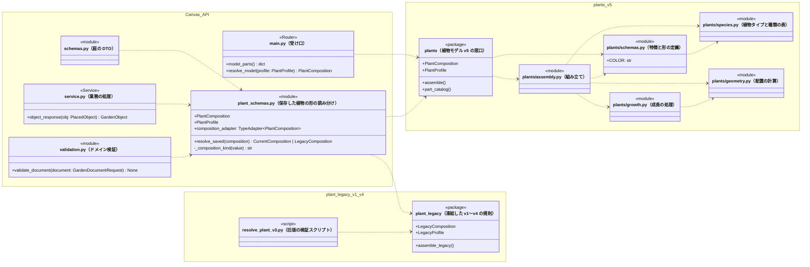
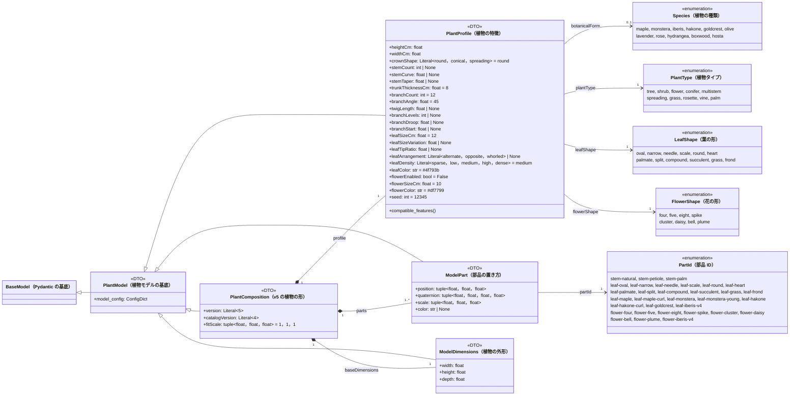
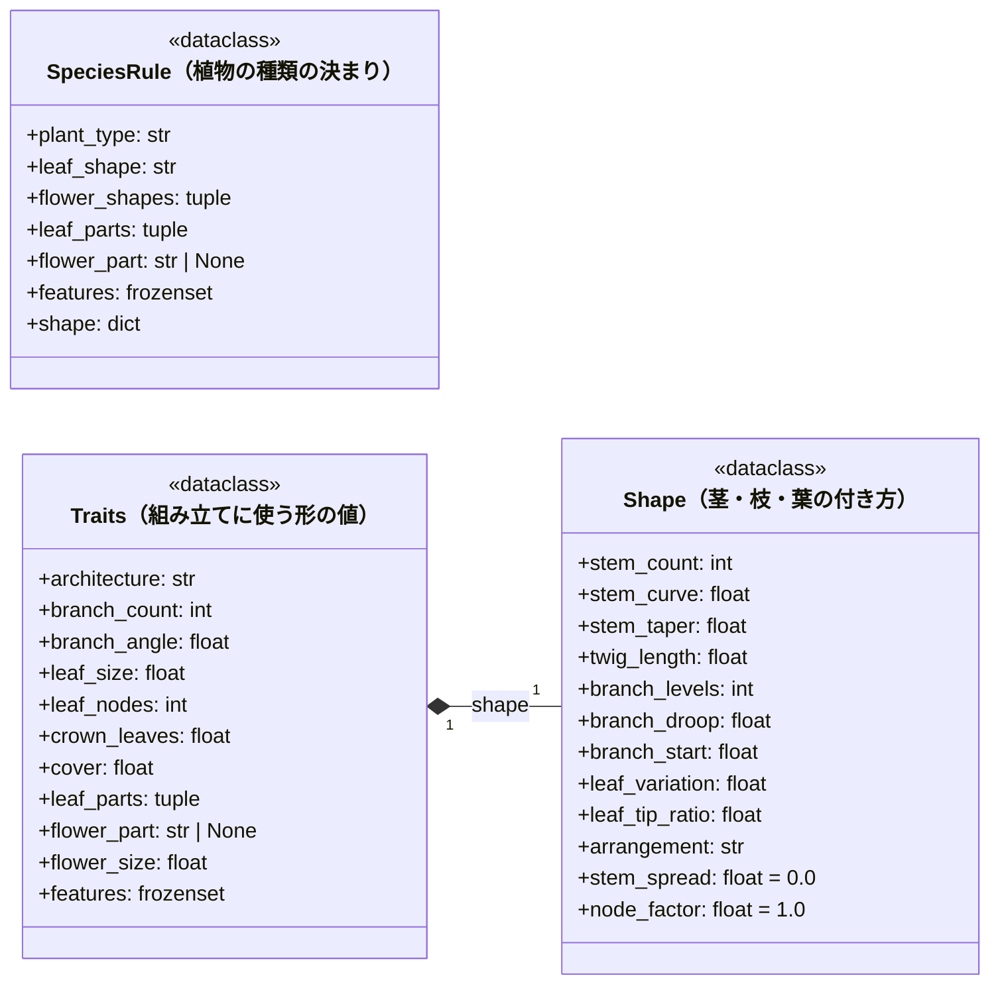
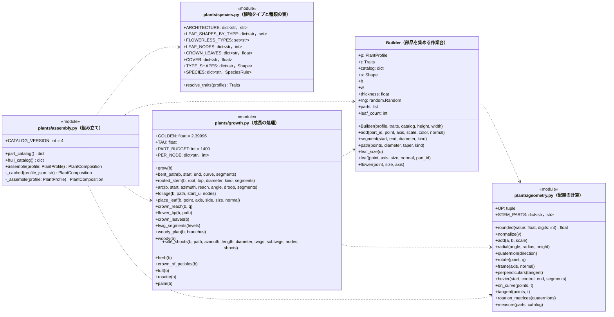
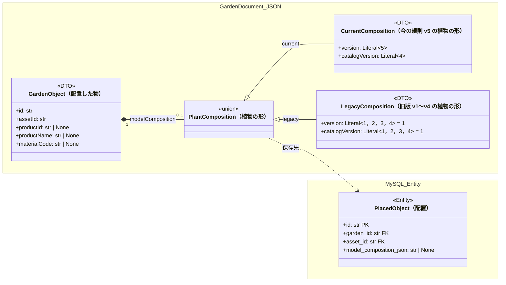
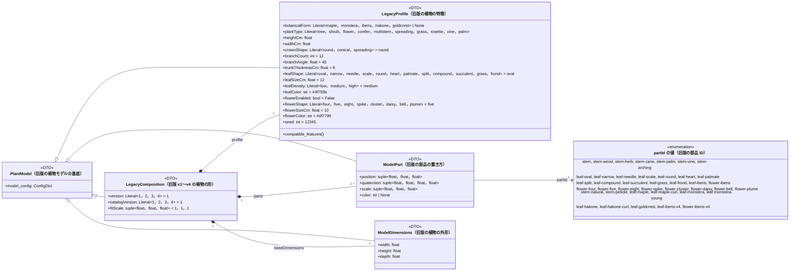

# Kusakari Canvas クラス図 03 植物モデル

- 対象のコード: kusakari-canvas の main（2c043a4、2026-11-24 時点）
- 対象のパッケージ: [backend/kusakari_canvas_api/plants](https://github.com/abeouga/kusakari-canvas/blob/2c043a4/backend/kusakari_canvas_api/plants)（今の規則 v5）、[backend/kusakari_canvas_api/plant_schemas.py](https://github.com/abeouga/kusakari-canvas/blob/2c043a4/backend/kusakari_canvas_api/plant_schemas.py)、[backend/kusakari_canvas_api/plant_legacy](https://github.com/abeouga/kusakari-canvas/blob/2c043a4/backend/kusakari_canvas_api/plant_legacy)（凍結した v1〜v4）
- 仕様と ADR: [docs/plant-assembly-v5.md](https://github.com/abeouga/kusakari-canvas/blob/2c043a4/docs/plant-assembly-v5.md)
- 全体図と、ほかの詳細図: [00_全体図](<00_全体図.md>)、[00_モジュール構成](<00_モジュール構成.md>)、[01_APIとデータの層](<01_APIとデータの層.md>)、[02_画像生成と履歴](<02_画像生成と履歴.md>)、[04_GardenDocumentと画面の状態](<04_GardenDocumentと画面の状態.md>)

## パッケージの役割

出店者が入力した植物の特徴（`PlantProfile`）から、事前に作った GLB 部品の置き方（`PlantComposition`）を求めます。特徴の単位は cm、構成の単位は m で、+Y が上です。同じ特徴と `seed` からは、いつも同じ部品 ID・位置・四元数・倍率・色が出ます。メッシュは作りません。画面は構成のとおりに GLB 部品を並べて描きます。

植物モデルは、次の 3 か所で使われます。

- `POST /api/model-assemblies/resolve`: 特徴から構成を求めます。EC のサーバーが商品を保存するとき（`CanvasModelClient`）と、Canvas の `/model-preview` の画面（`PlantPreviewPage.jsx`、EC の商品登録の画面の枠の中に出ます）が呼びます。`auth.py` の `SHOP_ALLOWED` により、この API だけは店舗側のアカウントも呼べます。
- 庭を読むとき: 配置（`placed_objects` の `model_composition_json`）に保存した構成を、`plant_schemas.py` の `composition_adapter` で読みます。
- 庭の JSON を受け取るとき: `validation.py` の `validate_document()` が、`plant_modular` の配置ごとに `resolve_saved()` で構成を作り直し、送られた構成と同じかを確かめます（改ざんの検出）。`validate_document()` は、庭の保存（`PUT /api/gardens/:id`）、AI 画像生成、生成履歴の保存から呼ばれます。

このパッケージにテーブルはありません。構成は JSON の文字列で `placed_objects.model_composition_json` に入ります（[テーブル設計図](<../../テーブル設計図/kusakari-canvas/>)）。処理の流れは [EC-S03 商品を登録する](<../../シーケンス図/kusakari-ec/EC-S03_商品を登録する.md>)、[UC-05 庭オブジェクトを配置・編集する](<../../シーケンス図/kusakari-canvas/UC-05_庭オブジェクトを配置・編集する.md>)、[UC-07 庭プロジェクトを保存する](<../../シーケンス図/kusakari-canvas/UC-07_庭プロジェクトを保存する.md>) を見てください。`GardenObject`、`PlacedObject` などは [01_APIとデータの層](<01_APIとデータの層.md>) に、画面で構成を描くところは [04_GardenDocumentと画面の状態](<04_GardenDocumentと画面の状態.md>) にあります。

7 枚の図は、データの図（図 2・図 3・図 5・図 7）とモジュールの図（図 1・図 4・図 6）に分けました。

| 図 | 種類 | 中身 |
| --- | --- | --- |
| 図 1 | モジュールの図 | 植物モデルのモジュールと、それを使う API のモジュール |
| 図 2 | データの図 | v5 の特徴と構成（`plants/schemas.py`） |
| 図 3 | データの図 | 種類の表と、組み立てに使う形の値（`plants/species.py` の dataclass） |
| 図 4 | モジュールの図 | v5 の組み立て・成長の処理・配置の計算 |
| 図 5 | データの図 | 保存済みの構成の判別（`plant_schemas.py` の union） |
| 図 6 | モジュールの図 | 凍結した v1〜v4 の規則のモジュール |
| 図 7 | データの図 | 凍結した v1〜v4 の特徴と構成（`plant_legacy/plant_schemas.py`） |

## 図の読み方

- 箱の名前は「英語名（日本語名）」です。英語名はコードのクラス名・型名・ファイル名です。パッケージ（`__init__.py`）はパッケージ名だけを書きました（Mermaid では `__init__` が太字の書き方に読まれるため）。
- ステレオタイプ: `<<DTO>>` は Pydantic のモデル、`<<dataclass>>` は `@dataclass(frozen=True)` のクラス、`<<enumeration>>` は `Literal[...]` の型、`<<union>>` は `Annotated` と `Discriminator` で作った判別つきの union です。`<<module>>` はクラスを持たないモジュール、`<<package>>` はパッケージの `__init__.py`、`<<Router>>`・`<<Service>>` は API の受け口と業務の処理、`<<script>>` はオフラインのスクリプトです。ステレオタイプの無い箱（`Builder` など）は、普通の Python のクラスです。
- 線は 4 種類です。`*--`（黒い菱形）は JSON の入れ子（親が消えると一緒に消える持ち方）、`-->` は関連、`<|--` は継承（図 5 だけは union の選択肢）、`..>` は依存（モジュールの図では import、図 5 では「保存先」）です。
- 線の両端の数字は多重度です。enumeration への関連は、相手側（値の数）だけに書きました（図 2 で元の側の数字が箱に隠れたため）。`1` はちょうど 1 つ、`0..1` は無いか 1 つ、`0..*` は 0 個以上、`1..*` は 1 個以上です。上限は図の下の表に書きました。
- 線のラベルは、関連のフィールド名です。依存の線にはラベルを書かず、どの名前を import しているかを図の下の「線とコードの対応」に書きました。
- 関連の線で描いたフィールド（`profile`、`parts`、`plantType` など）は、箱の中に重ねて書いていません。その既定値は図の下の表に書きました。
- モジュールの図では、モジュールの関数をメソッド、モジュールの定数をフィールドとして書き、ほかのパッケージのモジュールは植物モデルに関係するメンバーだけを載せました。
- 型注釈の無い引数とフィールドは、名前だけを書いています。引数の既定値と、Pydantic の `Field` の範囲（`ge`、`le` など）は省きました。フィールドの既定値は、`None` 以外で、図で書けるものだけを書いています。
- `tuple[...]`、`Literal[...]` などは山かっこで描かれます。型の中の区切りは、図では全角の「，」で書きました（Mermaid 11.4.1 では、半角のカンマが 2 つ以上あると型が消えるため）。コードでは半角のカンマです。
- `PlantComposition` という名前は 3 つあります。図 2 は `plants/schemas.py` の v5 の構成、図 5 の union は `plant_schemas.py` の型（庭の JSON と全体図の PlantComposition はこれ）、図 7 は `plant_legacy/plant_schemas.py` の旧版の構成です。図 5 と図 7 では、コードの import の名前（`CurrentComposition`、`LegacyComposition`、`LegacyProfile`）で描きました。
- 図 7 の `PlantModel`、`ModelPart`、`ModelDimensions` は、v5（図 2）と同じ名前の別のクラスです。

## API とクラス

| API | 受け口 | 処理 | 本文 | 応答 |
| --- | --- | --- | --- | --- |
| `GET /api/model-parts` | `main.py` の `model_parts()` | `plants.part_catalog()` | なし | 部品カタログ v4 の `catalog.json` の内容 |
| `POST /api/model-assemblies/resolve` | `main.py` の `resolve_model()` | `plants.assemble()` | `PlantProfile`（v5、図 2） | `PlantComposition`（v5、図 2） |

- `resolve_model()` は、組み立てで `ValueError` が出ると 400 `INCOMPATIBLE_PLANT_DIMENSIONS` を返します。`PlantProfile` の検査（`compatible_features()`）に通らない本文は、FastAPI の検査で 400 `INVALID_REQUEST` になります。
- `GET /api/model-parts` は、`auth.py` で認証なしに読める GET の 1 つです。画面とサーバーのコードからは呼ばれず、E2E（`e2e/plant-library-v2.spec.ts`）だけが呼びます。

## 図 1 モジュールの構成と使われるところ

植物モデルのモジュールと、それを使う API のモジュールです。矢印は、矢印の元が先を import していることを表します。`plants/` の中は `assembly.py` から `species.py`・`geometry.py`・`growth.py` へ一方向に依存し、`plant_legacy` は import しません。API のコードで v1〜v4 の構成を扱うのは `plant_schemas.py` だけです。`plants/` の各モジュールのメンバーは図 4 に書きました。

### 線とコードの対応（図 1）

| 線 | import する名前 | 使う場面 |
| --- | --- | --- |
| main.py → plants | `PlantComposition`、`PlantProfile`、`assemble`、`part_catalog` | `GET /api/model-parts`、`POST /api/model-assemblies/resolve` |
| schemas.py → plant_schemas.py | `PlantComposition` | `GardenObject.modelComposition` の型（図 5） |
| service.py → plant_schemas.py | `composition_adapter` | `object_response()` が `placed_objects.model_composition_json` を `composition_adapter.validate_json()` で読む |
| validation.py → plant_schemas.py | `resolve_saved` | `validate_document()` が保存された構成を作り直して比べる |
| plant_schemas.py → plants | `PlantComposition`（`CurrentComposition` の名前で）、`PlantProfile`、`assemble` | `version` が 5 の構成の型と作り直し |
| plant_schemas.py → plant_legacy | `LegacyComposition`、`assemble_legacy` | `version` が 5 でない構成の型と作り直し |
| plants → plants/assembly.py | `assemble`、`part_catalog` | パッケージの公開（`__all__`） |
| plants → plants/schemas.py | `PlantComposition`、`PlantProfile` | パッケージの公開（`__all__`） |
| plants/assembly.py → plants/schemas.py | `ModelDimensions`、`ModelPart`、`PlantComposition`、`PlantProfile` | 構成を作る |
| plants/assembly.py → plants/species.py | `resolve_traits` | 特徴から形の値（`Traits`）を決める |
| plants/assembly.py → plants/geometry.py | `Builder`、`measure`、`rounded` | 部品を集めて測る |
| plants/assembly.py → plants/growth.py | `grow` | 成長の処理を選んで動かす |
| plants/growth.py → plants/geometry.py | `UP`、`add`、`bezier`、`normalize`、`on_curve`、`perpendiculars`、`radial`、`rotate`、`tangent` | 枝や葉の位置の計算 |
| plants/schemas.py → plants/species.py | `FLOWERLESS_TYPES`、`LEAF_SHAPES_BY_TYPE`、`SPECIES` | `PlantProfile.compatible_features()` の組み合わせの検査 |
| resolve_plant_v3.py → plant_legacy | `LegacyProfile`、`assemble_legacy` | 標準入力の特徴から旧版の構成を作る |

- `resolve_plant_v3.py` の場所は `backend/verification/` です。
- `plant_schemas.py` は `plants` の `PlantProfile` も import して公開しています（`__all__`）。ほかのモジュールは `PlantProfile` を `plants` から直接 import しています。

## 図 2 植物の特徴と構成（plants/schemas.py）

`PlantProfile` が API の本文（出店者が入力する特徴）、`PlantComposition` が応答で、庭と EC の商品に保存される構成です。`PlantProfile` の `None` の項目は「自動」で、植物タイプと種類（`botanicalForm`）の値を使います。`PlantComposition` は `version` が 5、`catalogVersion` が 4 で、部品は部品カタログ v4 の GLB です。

| 関連 | 多重度・既定値 | 根拠 |
| --- | --- | --- |
| `PlantComposition.parts` | 1〜1500 個 | `Field(min_length=1, max_length=1500)` |
| `PlantProfile.plantType` | 必須 | 既定値なし |
| `PlantProfile.leafShape` | 1 つ、既定値 `oval` | `leafShape: LeafShape = "oval"` |
| `PlantProfile.flowerShape` | 1 つ、既定値 `five` | `flowerShape: FlowerShape = "five"` |
| `PlantProfile.botanicalForm` | 無いか 1 つ、既定値 `None` | `botanicalForm: Species \| None = None` |

- `PlantModel.model_config` は `extra="forbid"`、`allow_inf_nan=False` です。
- `compatible_features()` は `model_validator(mode="after")` です。植物タイプと葉の形（`LEAF_SHAPES_BY_TYPE`）、花の有無（`FLOWERLESS_TYPES`）、`botanicalForm` と植物タイプ・葉の形・花の形の組み合わせ（`SPECIES`）を確かめます。
- `ModelPart` の `position` は m、`quaternion` は (x, y, z, w)、`scale` は部品カタログの基準の大きさに対する倍率です。`ModelDimensions` は組み立てた植物の外形（m）で、各辺は 0 より大きく 30 以下です。
- `fitScale` は v5 では常に既定の (1, 1, 1) です。v1 と v2 の構成だけが、外形を合わせる倍率をここに入れます（図 7）。
- 色の項目（`leafColor`、`flowerColor`、`ModelPart.color`）は、モジュールの定数 `COLOR`（`#` と 16 進 6 桁の正規表現）で検査します。

## 図 3 種類の表と形の値（plants/species.py）

`plants/species.py` の 3 つの dataclass です。`SpeciesRule` は種類（`Species`）ごとの決まり、`Shape` は植物タイプごとの茎・枝・葉の付き方、`Traits` は `resolve_traits()` が特徴から決める、組み立てに使う値です。`resolve_traits()` は植物タイプの `Shape` に、種類の `shape` と、`PlantProfile` の `None` でない項目を順に上書きします。

- `SpeciesRule` の既定値: `flower_shapes`・`leaf_parts` は `()`、`flower_part` は `None`、`features` は `frozenset()`、`shape` は `{}` です（図では `()` がメソッドに読まれるので書いていません）。
- `SpeciesRule.shape` は `Shape` ではなく、`Shape` の一部の項目を上書きする `dict` です。そのため `Shape` との線は引いていません。
- `SpeciesRule.features` は成長の処理が見る特徴の印です（`petiole`、`upright_leaves`、`shoot_flowers`、`flower_stalks`、`single_leaf`、`aerial_roots`、`flow`）。
- 表の行の数: `species.py` の `TYPE_SHAPES` は植物タイプ 10 個（`PlantType` と同じキー）の `Shape`、`SPECIES` は種類 11 個（`Species` と同じキー）の `SpeciesRule` を持ちます（図 4）。種類を増やすときは `SPECIES` に行を足します。

## 図 4 組み立てと成長の処理（plants/assembly.py、species.py、growth.py、geometry.py）

`assemble()` は、特徴を JSON にした文字列をキーにした `_cached()`（`lru_cache`、64 件）の結果の複製を返します。`_assemble()` は `resolve_traits()` で形の値（`Traits`、図 3）を決め、`Builder` と `grow()` で部品を並べ、`measure()` で測った高さと幅が指定に合うまで、制御の大きさを最大 22 回直します。

`Builder` は植物 1 つ分の部品を集めるクラス（`geometry.py`）です。乱数はすべて `random.Random(profile.seed)` から同じ順に引くので、大きさを変えても部品の数と並びは変わりません。成長の処理（`growth.py` の関数）は、`Builder` を引数 `b` で受け取り、`b.segment()`・`b.path()`・`b.leaf()`・`b.flower()` で部品を足します。

### 線とコードの対応（図 4）

| 線 | 使う名前 | 内容 |
| --- | --- | --- |
| assembly.py → species.py | `resolve_traits` | 特徴から `Traits` を決める |
| assembly.py → Builder | `Builder(profile, traits, catalog, *size)` | 試す大きさごとに作業台を作る |
| assembly.py → growth.py | `grow` | 部品を並べる |
| assembly.py → geometry.py | `measure`、`rounded` | 外形を測り、`baseDimensions` を丸める |
| growth.py → Builder | 引数 `b` | `b.segment()`・`b.path()`・`b.leaf()`・`b.flower()` で部品を足す |
| growth.py → geometry.py | `UP`、`add`、`bezier`、`normalize`、`on_curve`、`perpendiculars`、`radial`、`rotate`、`tangent` | 枝や葉の位置の計算 |
| Builder → geometry.py | `frame`、`rounded` ほか | `Builder` は `geometry.py` の中のクラスで、同じモジュールの関数を使う |

- `_assemble()` は、幹が高さや幅より太いとき、外形が合わないとき、根元が地面に付かないとき、部品が 1500 を超えるときに `ValueError` を出します。
- `part_catalog()` は `frontend/public/models/plant-parts/v4/catalog.json` を読みます。`hull_catalog()` は部品ごとの hull の点を numpy の配列にします。
- `grow(b)` は `b.t.architecture` によって、`woody()`、`herb()`、`tuft()`、`rosette()`、`palm()` のどれかを呼びます。部品の数が `PART_BUDGET` に収まるよう、葉の節の数などを減らします。
- `ARCHITECTURE` は植物タイプから成長の処理（`woody`、`herb`、`tuft`、`rosette`、`palm`）を選ぶ表です。`STEM_PARTS` は茎の種類（`wood`、`herb`、`palm`）から部品 ID（`stem-natural`、`stem-petiole`、`stem-palm`）を選ぶ表です。
- `Builder.parts` には部品 1 つを `(partId, position, quaternion, scale, color)` のタプルで入れ、`assembly.py` が `ModelPart` に変えます。
- `Builder` のフィールドには型注釈がありません。`p`・`t`・`s` の型は、`_assemble()` が渡す値（`PlantProfile`、`resolve_traits()` の `Traits`、その `shape`）から書きました。`h`・`w` は numpy の配列の要素が入るので、型を書いていません。図の `Builder(...)` は `__init__` です。
- `rounded()` は `-0` を `0` にそろえます。EC と Canvas が同じ JSON を保存するためです。
- `Builder.leaf()` は、地面より下に出た葉だけを持ち上げ、細い茎でつなぎます。根元は動かしません。

## 図 5 保存済みの構成の判別（plant_schemas.py）

`plant_schemas.py` の `PlantComposition` は、v5 の構成と v1〜v4 の構成のどちらも受け取れる union です。`schemas.py` の `GardenObject.modelComposition` がこの型なので、庭の JSON を受け取る API の本文も、データベースから読んだ構成も、ここで振り分けられます。上の枠は JSON の形、下の枠は MySQL の Entity です。

| 線 | コード | 内容 |
| --- | --- | --- |
| GardenObject → PlantComposition（`modelComposition`） | `schemas.py` の `modelComposition: PlantComposition \| None` | 植物（`assetId` が `plant_modular`）の配置だけが持つ。固定アセットに付けると 400 |
| PlantComposition ← CurrentComposition（`current`） | `Annotated[CurrentComposition, Tag("current")]` | `_composition_kind()` が、`version` が 5 なら `current` を選ぶ |
| PlantComposition ← LegacyComposition（`legacy`） | `Annotated[LegacyComposition, Tag("legacy")]` | それ以外は `legacy`（v1 は `version` が無いことがある） |
| PlantComposition → PlacedObject（保存先） | `placed_objects.model_composition_json` | `service.py` の `update_garden()` が `model_dump_json()` で書き、`object_response()` が `composition_adapter.validate_json()` で読む |

- `CurrentComposition` は図 2 の `PlantComposition`、`LegacyComposition` は図 7 の構成です。図 5 では判別に使う `version`・`catalogVersion` だけを書きました。
- `GardenObject` と `PlacedObject` は、植物モデルに関係するフィールドだけを載せました。全体は [01_APIとデータの層](<01_APIとデータの層.md>) にあります。
- `resolve_saved()` は、`version` が 5 なら `assemble(profile)`、それ以外は `assemble_legacy(profile, version)` で作り直します。
- 受け取るときの検査（`validation.py` の `validate_document()`、どれも 400 `INVALID_PLANT_MODEL`）:

| 条件 | メッセージ |
| --- | --- |
| `plant_modular` なのに `productId`・`productName`・`materialCode`（`product.<productId>`）・`modelComposition` のどれかが足りない | 「商品の植物構成が不足しています。商品から配置し直してください。」 |
| `resolve_saved()` で作り直せない（`ValueError`） | 「植物の特徴と構成の版が一致しません。」 |
| 作り直した構成が、送られた構成と違う | 「保存された植物の部品構成が不正です。」 |
| `plant_modular` でないのに、上の 4 項目のどれかがある | 「固定アセットに植物構成を指定できません。」 |

## 図 6 凍結した v1〜v4 の規則のモジュール（plant_legacy）

`plant_legacy/` は、v1〜v4 の規則で作った構成を、同じ規則で作り直して確かめるためだけに残したパッケージです。出力が 1 バイトも変わってはいけないので、編集しません（`plant_legacy/__init__.py` の docstring と ADR）。矢印は import です。`plant_assembly.py` の補助の関数（`rounded`・`rotate` など）を import する線は省きました（下の表）。

```mermaid
classDiagram
    direction LR

    class plant_legacy_pkg["plant_legacy（凍結した v1〜v4 の窓口）"] {
        <<package>>
        +LegacyComposition
        +LegacyProfile
        +assemble_legacy()
    }
    class plant_assembly["plant_assembly.py（版ごとの振り分けと v1）"] {
        <<module>>
        +part_catalog(version: int) dict
        +quaternion(direction: tuple) tuple
        +rounded(value: float, digits: int) float
        +shifted(origin: tuple, direction: tuple, distance: float) tuple
        +cached_v3(profile_json: str) PlantComposition
        +cached_v4(profile_json: str) PlantComposition
        +assemble(profile: PlantProfile, version: int) PlantComposition
        +rotate(point: tuple, q: tuple) tuple
    }
    class plant_assembly_v2["plant_assembly_v2.py（v2 の組み立て）"] {
        <<module>>
        +assemble_v2(profile, catalog)
    }
    class plant_assembly_v3["plant_assembly_v3.py（v3 の組み立て）"] {
        <<module>>
        +assemble_v3(profile, catalog)
    }
    class plant_assembly_v4["plant_assembly_v4.py（v4 の組み立て）"] {
        <<module>>
        +assemble_v4(profile, catalog)
    }
    class plant_architecture_v3["plant_architecture_v3.py（v3 の成長の処理）"] {
        <<module>>
        +generic(b)
        +grass(b)
    }
    class plant_species_v3["plant_species_v3.py（v3 の種類ごとの形）"] {
        <<module>>
        +maple(b)
        +monstera(b)
        +iberis(b)
        +goldcrest(b)
        +botanical(builder)
    }
    class plant_species_v4["plant_species_v4.py（v4 の種類ごとの形）"] {
        <<module>>
        +maple(b)
        +monstera(b)
        +iberis(b)
        +hakone(b)
        +goldcrest(b)
        +botanical(builder)
    }
    class plant_geometry_v3["plant_geometry_v3.py（v3 の配置の計算）"] {
        <<module>>
        +direction(a, b)
        +frame(axis, normal)
        +part_bounds(part, catalog)
        +bounds(parts, catalog)
        +radial(angle, radius, height)
        +on_curve(points, t)
    }
    class plant_geometry_v4["plant_geometry_v4.py（v4 の配置の計算）"] {
        <<module>>
        +tapered_path(b, points, diameter, kind)
    }
    class PlantBuilder["PlantBuilder（v3 の作業台）"] {
        +p
        +catalog
        +h
        +w
        +rng: random.Random
        +parts: list
        +leaf_size: float
        +density: int
        +thickness: float
        +PlantBuilder(profile, catalog, height, width)
        +add(part_id, point, axis, scale, color, normal)
        +stem(start, end, diameter, kind)
        +curve(start, end, diameter, kind, bow)
        +leaf(point, axis, size, shape, normal)
        +flower(point, size, shape)
        +foliage(start, end, count, path)
    }
    class NaturalBuilder["NaturalBuilder（v4 の作業台）"] {
        +stem(start, end, diameter, kind)
        +leaf(point, axis, size, shape, normal)
    }

    plant_legacy_pkg ..> plant_assembly
    plant_assembly ..> plant_assembly_v2
    plant_assembly ..> plant_assembly_v3
    plant_assembly ..> plant_assembly_v4
    plant_assembly_v4 ..> plant_assembly_v3
    plant_assembly_v3 ..> plant_architecture_v3
    plant_assembly_v3 ..> plant_species_v3
    plant_assembly_v3 ..> PlantBuilder
    plant_assembly_v3 ..> plant_geometry_v3
    plant_assembly_v4 ..> plant_species_v4
    plant_assembly_v4 ..> NaturalBuilder
    plant_assembly_v4 ..> plant_geometry_v3
    plant_species_v3 ..> plant_architecture_v3
    plant_species_v3 ..> plant_geometry_v3
    plant_species_v4 ..> plant_geometry_v3
    plant_species_v4 ..> plant_geometry_v4
    plant_architecture_v3 ..> plant_geometry_v3
    plant_geometry_v4 ..> plant_geometry_v3
    PlantBuilder <|-- NaturalBuilder
```

### 線とコードの対応（図 6）

| 線 | import する名前 | 内容 |
| --- | --- | --- |
| plant_legacy → plant_assembly.py | `assemble`（`assemble_legacy` の名前で公開） | 窓口。`LegacyComposition`・`LegacyProfile` は `plant_schemas.py` の `PlantComposition`・`PlantProfile` の別名（図 7） |
| plant_assembly.py → plant_assembly_v2.py | `assemble_v2`（関数の中で import） | `version` が 2 のとき |
| plant_assembly.py → plant_assembly_v3.py | `assemble_v3`（`cached_v3()` の中で import） | `version` が 3 のとき。`lru_cache`（128 件） |
| plant_assembly.py → plant_assembly_v4.py | `assemble_v4`（`cached_v4()` の中で import） | `version` が 4 のとき。`lru_cache`（64 件） |
| plant_assembly_v4.py → plant_assembly_v3.py | `assemble_v3` | v4 で `botanicalForm` が無いとき |
| plant_assembly_v3.py → plant_architecture_v3.py | `generic` | 種類の無い植物の形 |
| plant_assembly_v3.py → plant_species_v3.py | `botanical`（関数の中で import） | 種類ごとの形 |
| plant_assembly_v3.py → PlantBuilder、plant_geometry_v3.py | `PlantBuilder`、`bounds` | 部品を集めて外形を測る |
| plant_assembly_v4.py → NaturalBuilder、plant_geometry_v3.py | `NaturalBuilder`、`bounds` | 部品を集めて外形を測る |
| plant_assembly_v4.py → plant_species_v4.py | `botanical` | 種類ごとの形 |
| plant_species_v3.py → plant_architecture_v3.py | `grass` | ハコネソウの形 |
| plant_species_v3.py・v4.py、plant_architecture_v3.py → plant_geometry_v3.py | `on_curve`、`radial` | 位置の計算 |
| plant_species_v4.py → plant_geometry_v4.py | `tapered_path` | 細くなる茎 |
| plant_geometry_v4.py → plant_geometry_v3.py | `PlantBuilder`、`direction` | `NaturalBuilder` の親と、向きの計算 |

図では省いた import（どれも `plant_assembly.py` の補助の関数）:

| 使う側 | import する名前 |
| --- | --- |
| plant_assembly_v2.py | `quaternion`、`rotate`、`rounded`、`shifted` |
| plant_assembly_v3.py、plant_assembly_v4.py | `rounded` |
| plant_geometry_v3.py | `quaternion`、`rotate`、`rounded` |
| plant_species_v3.py、plant_species_v4.py | `rotate` |

- `plant_assembly.py` の `assemble()` は、`version` が 4 と 3 なら `cached_v4()`・`cached_v3()` の結果の複製を返し、2 なら `assemble_v2()` を呼び、1 ならこの関数の中で組み立てます。
- 部品カタログは、`part_catalog(version)` が `frontend/public/models/plant-parts/v1/`〜`v4/` の `catalog.json` を版ごとに読みます。
- `PlantBuilder` は `plant_geometry_v3.py`、`NaturalBuilder` は `plant_geometry_v4.py` のクラスです。どちらも部品を `ModelPart`（図 7）として集めます。`PlantBuilder` のフィールドには型注釈がなく、`p` は `LegacyProfile` が入ります。
- v3 の `plant_species_v3.py` には `hakone()` がなく、`botanical()` はハコネソウを `plant_architecture_v3.py` の `grass()` で組み立てます。v4 の `plant_species_v4.py` には `hakone()` があります。

### plant_legacy を使っているところ

`plant_legacy` を import しているのは、次の 2 つだけです（2c043a4 の `git grep` で確かめました）。`plants/` は import していません。

| 使う側 | import するもの | 使う場面 |
| --- | --- | --- |
| [plant_schemas.py](https://github.com/abeouga/kusakari-canvas/blob/2c043a4/backend/kusakari_canvas_api/plant_schemas.py) | `LegacyComposition`、`assemble_legacy` | `version` が 5 でない構成の読み込みと検査（`composition_adapter`、`GardenObject.modelComposition`）と、作り直し（`resolve_saved()`）。庭を読む `GET /api/gardens/:id`、庭の JSON を受け取る `PUT /api/gardens/:id`・`POST /api/gardens/:id/ai-image`・`POST /api/gardens/:id/image-history` などで動きます |
| [backend/verification/resolve_plant_v3.py](https://github.com/abeouga/kusakari-canvas/blob/2c043a4/backend/verification/resolve_plant_v3.py) | `LegacyProfile`、`assemble_legacy` | 標準入力の特徴から旧版の構成を作る、オフラインの検証スクリプト（データベースは使いません） |

ほかに `e2e/plant-v3.spec.ts` が、`e2e/fixtures/plant-composition-v1.json`〜`v4.json` の構成を含む庭を保存・再読み込みできることを確かめています（import ではなく API 経由です）。

## 図 7 凍結した v1〜v4 の特徴と構成（plant_legacy/plant_schemas.py）

v1〜v4 の構成の形です。`LegacyProfile` と `LegacyComposition` は、`plant_legacy/__init__.py` が公開する名前で描きました（コードのクラス名は `PlantProfile`、`PlantComposition`）。

| 関連 | 多重度 | 根拠 |
| --- | --- | --- |
| `LegacyComposition.parts` | 1〜1500 個 | `Field(min_length=1, max_length=1500)` |
| `ModelPart.partId` | 1 つ | 型の別名の無い `Literal[...]`（40 個）。図では別の箱にしました |

- `PlantModel`（旧版）は `BaseModel` を継承し、`model_config` は v5 と同じ `extra="forbid"`、`allow_inf_nan=False` です。
- v5 との違い: `LegacyProfile` の `botanicalForm` は 5 種、`leafDensity` は 3 段階、`leafSizeCm` の範囲は 2〜80 cm で、`stemCount`・`stemCurve`・`stemTaper`・`twigLength`・`branchLevels`・`branchDroop`・`branchStart`・`leafSizeVariation`・`leafTipRatio`・`leafArrangement` がありません。`partId` には v1〜v3 の部品（`stem`、`stem-wood` など）も入ります。
- `LegacyProfile.compatible_features()` は、植物タイプと葉の形、花の有無、`botanicalForm` と植物タイプ・葉の形の組み合わせ、イベリスの花は 4 枚、カエデとモンステラには花を付けない、を確かめます。

## クラスとコードの対応

| クラス・モジュール | ファイル | 図 |
| --- | --- | --- |
| main.py、schemas.py、service.py、validation.py | [backend/kusakari_canvas_api/](https://github.com/abeouga/kusakari-canvas/blob/2c043a4/backend/kusakari_canvas_api) の同じ名前のファイル | 図 1（全体は 01） |
| plant_schemas.py、PlantComposition（union） | [plant_schemas.py](https://github.com/abeouga/kusakari-canvas/blob/2c043a4/backend/kusakari_canvas_api/plant_schemas.py) | 図 1、図 5 |
| plants（窓口） | [plants/\_\_init\_\_.py](https://github.com/abeouga/kusakari-canvas/blob/2c043a4/backend/kusakari_canvas_api/plants/__init__.py) | 図 1 |
| PlantModel、PlantProfile、ModelPart、ModelDimensions、PlantComposition（v5、図 5 では CurrentComposition）、PlantType、LeafShape、FlowerShape、Species、PartId | [plants/schemas.py](https://github.com/abeouga/kusakari-canvas/blob/2c043a4/backend/kusakari_canvas_api/plants/schemas.py) | 図 2、図 5 |
| Shape、SpeciesRule、Traits、species.py | [plants/species.py](https://github.com/abeouga/kusakari-canvas/blob/2c043a4/backend/kusakari_canvas_api/plants/species.py) | 図 3、図 4 |
| assembly.py | [plants/assembly.py](https://github.com/abeouga/kusakari-canvas/blob/2c043a4/backend/kusakari_canvas_api/plants/assembly.py) | 図 4 |
| geometry.py、Builder | [plants/geometry.py](https://github.com/abeouga/kusakari-canvas/blob/2c043a4/backend/kusakari_canvas_api/plants/geometry.py) | 図 4 |
| growth.py | [plants/growth.py](https://github.com/abeouga/kusakari-canvas/blob/2c043a4/backend/kusakari_canvas_api/plants/growth.py) | 図 4 |
| GardenObject | [schemas.py](https://github.com/abeouga/kusakari-canvas/blob/2c043a4/backend/kusakari_canvas_api/schemas.py) | 図 5（全体は 01） |
| PlacedObject | [models.py](https://github.com/abeouga/kusakari-canvas/blob/2c043a4/backend/kusakari_canvas_api/models.py) | 図 5（全体は 01） |
| plant_legacy（窓口） | [plant_legacy/\_\_init\_\_.py](https://github.com/abeouga/kusakari-canvas/blob/2c043a4/backend/kusakari_canvas_api/plant_legacy/__init__.py) | 図 1、図 6 |
| plant_assembly.py、plant_assembly_v2〜v4.py、plant_architecture_v3.py、plant_species_v3・v4.py | [plant_legacy/](https://github.com/abeouga/kusakari-canvas/blob/2c043a4/backend/kusakari_canvas_api/plant_legacy) の同じ名前のファイル | 図 6 |
| plant_geometry_v3.py、PlantBuilder | [plant_legacy/plant_geometry_v3.py](https://github.com/abeouga/kusakari-canvas/blob/2c043a4/backend/kusakari_canvas_api/plant_legacy/plant_geometry_v3.py) | 図 6 |
| plant_geometry_v4.py、NaturalBuilder | [plant_legacy/plant_geometry_v4.py](https://github.com/abeouga/kusakari-canvas/blob/2c043a4/backend/kusakari_canvas_api/plant_legacy/plant_geometry_v4.py) | 図 6 |
| PlantModel（旧版）、LegacyProfile、ModelPart（旧版）、ModelDimensions（旧版）、LegacyComposition | [plant_legacy/plant_schemas.py](https://github.com/abeouga/kusakari-canvas/blob/2c043a4/backend/kusakari_canvas_api/plant_legacy/plant_schemas.py) | 図 5、図 7 |
| resolve_plant_v3.py | [backend/verification/resolve_plant_v3.py](https://github.com/abeouga/kusakari-canvas/blob/2c043a4/backend/verification/resolve_plant_v3.py) | 図 1 |

## 載せなかったもの

担当のパッケージのクラス・モジュールは、すべていずれかの図に載せました。次のものは省いています。

| もの | 理由 | 載せた図・表 |
| --- | --- | --- |
| `plant_legacy` の関数の中で定義した関数（`plant_assembly.py` の `assemble()` の中の `add()`・`foliage()`、`plant_assembly_v2.py` の `add()`・`stem()`・`leaf()`・`flower()`・`foliage()` など） | モジュールから使えない、関数の中の関数のため | なし |
| `plant_assembly.py` の補助の関数を import する線 | どのモジュールも使う補助の関数で、線が増えて図が読みにくくなるため | 図 6 の下の表 |
| `auth.py`（`SHOP_ALLOWED`）、`PlantPreviewPage.jsx`、EC の `CanvasModelClient` | 植物モデルの API を呼ぶ側・通す側で、植物モデルの構造ではないため | 「パッケージの役割」と「API とクラス」 |
| `GardenObject`・`PlacedObject` のほかのフィールド | 植物モデルに関係しないため | 01 |

## 2c043a4 での変更

- c19d497 から 2c043a4 までに、`plants/`・`plant_schemas.py`・`plant_legacy/` は変わっていません（`git diff c19d497 2c043a4 -- backend/kusakari_canvas_api` で確かめました）。
- `main.py` は、写真のカメラ設定の API（`POST /api/photo-calibration`）が消えただけで、植物モデルの受け口（`model_parts()`、`resolve_model()`）は変わっていません。

## 確かめられなかったこと

- 実際のデータベース（Canvas の `placed_objects` と EC の商品）に、`version` が 1〜4 の構成がどれだけ残っているかは確かめていません。`plant_legacy` を消せるかどうかは、このデータによります。
- `scripts/publish-plant-v4.mjs` は `POST /api/model-assemblies/resolve?version=4` を呼びます。今の `resolve_model()` は `version` を受け取らないので、v5 の構成が返ります。このスクリプトを今も使うかどうかは分かりません。
- EC の `CanvasModelClient` が `POST /api/model-assemblies/resolve` を呼ぶことは、kusakari-ec のコードで確かめ直していません（前の版の記述をそのまま残しました）。
- GitHub と Obsidian での表示は確かめていません。PNG は mermaid-snap（Mermaid 11.4.1）で書き出したものです。
