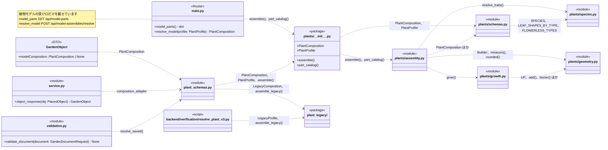
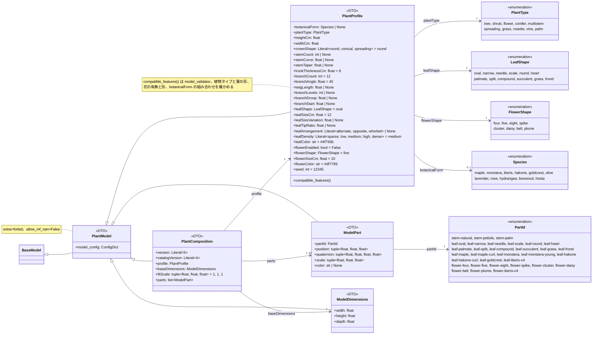
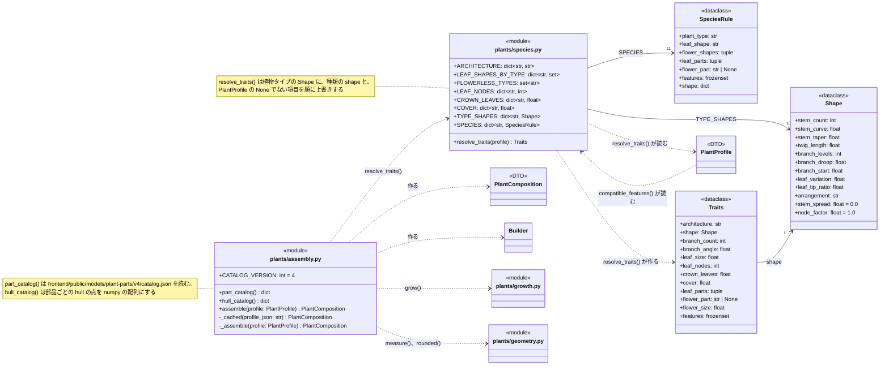
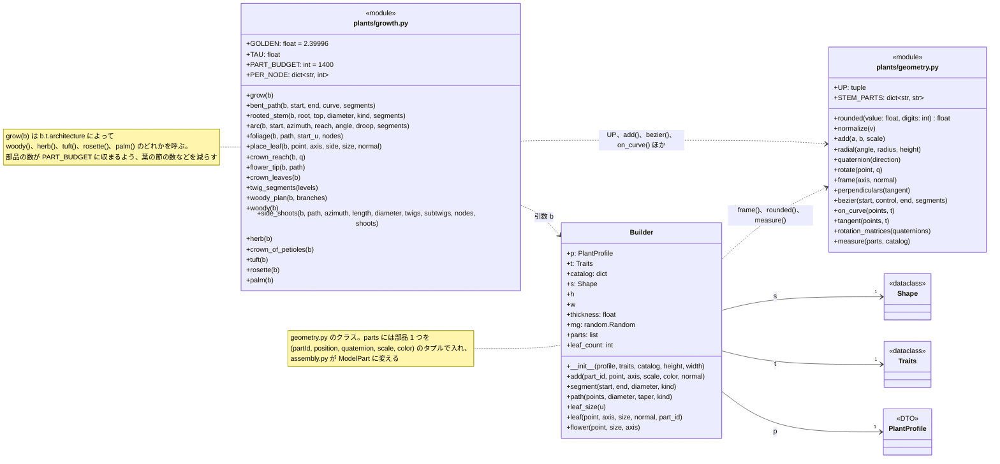
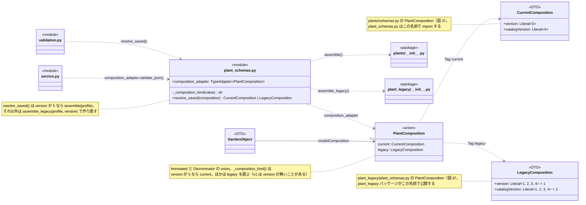

# Kusakari Canvas クラス図 03 植物モデル

- 対象のコード: kusakari-canvas の main、コミット c19d497（2026-11-20 時点）
- 対象のパッケージ: [backend/kusakari_canvas_api/plants](https://github.com/abeouga/kusakari-canvas/blob/c19d497dfef15b119f9bce8ecb5c886a36da6b7d/backend/kusakari_canvas_api/plants)（今の規則 v5）、[backend/kusakari_canvas_api/plant_schemas.py](https://github.com/abeouga/kusakari-canvas/blob/c19d497dfef15b119f9bce8ecb5c886a36da6b7d/backend/kusakari_canvas_api/plant_schemas.py)、[backend/kusakari_canvas_api/plant_legacy](https://github.com/abeouga/kusakari-canvas/blob/c19d497dfef15b119f9bce8ecb5c886a36da6b7d/backend/kusakari_canvas_api/plant_legacy)（凍結した v1〜v4）
- 仕様と ADR: [docs/plant-assembly-v5.md](https://github.com/abeouga/kusakari-canvas/blob/c19d497dfef15b119f9bce8ecb5c886a36da6b7d/docs/plant-assembly-v5.md)

## パッケージの役割

出店者が入力した植物の特徴（`PlantProfile`）から、事前に作った GLB 部品の配置（`PlantComposition`）を求めます。特徴の単位は cm、構成の単位は m で、+Y が上です。同じ特徴と `seed` からは、いつも同じ部品 ID・位置・四元数・倍率・色が出ます。メッシュは作りません。画面は構成のとおりに GLB 部品を並べて描きます。

植物モデルは、次の 3 か所で使われます。

- `POST /api/model-assemblies/resolve`: 特徴から構成を求めます。EC のサーバーが商品を保存するとき（`CanvasModelClient`）と、Canvas の `/model-preview` の画面（`PlantPreviewPage.jsx`、EC の商品登録の画面の枠の中に出ます）が呼びます。`auth.py` の `SHOP_ALLOWED` により、この API だけは店舗側のアカウントも呼べます。
- 庭を読むとき: 配置（`placed_objects` の `model_composition_json`）に保存した構成を、`plant_schemas.py` の `composition_adapter` で読みます。
- 庭の JSON を受け取るとき: `validation.py` の `validate_document()` が、`plant_modular` の配置ごとに `resolve_saved()` で構成を作り直し、送られた構成と同じかを確かめます（改ざんの検出）。`validate_document()` は、庭の保存（`PUT /api/gardens/{id}`）、AI 画像生成、生成履歴の保存から呼ばれます。

このパッケージにテーブルはありません。構成は JSON の文字列で `placed_objects.model_composition_json` に入ります（[テーブル設計図](<../../テーブル設計図/kusakari-canvas/>)）。処理の流れは [EC-S03 商品を登録する](<../../シーケンス図/kusakari-ec/EC-S03_商品を登録する.md>)、[UC-05 庭オブジェクトを配置・編集する](<../../シーケンス図/kusakari-canvas/UC-05_庭オブジェクトを配置・編集する.md>)、[UC-07 庭プロジェクトを保存する](<../../シーケンス図/kusakari-canvas/UC-07_庭プロジェクトを保存する.md>) を見てください。`GardenObject`、`PlacedObject` などは [01_APIとデータの層](<01_APIとデータの層.md>) に、画面で構成を描くところは [04_GardenDocumentと画面の状態](<04_GardenDocumentと画面の状態.md>) にあります。

### 図の読み方

- `<<module>>` はクラスを持たないモジュール、`<<package>>` はパッケージの `__init__.py` です。ファイルのパスを名前にし、関数をメソッド、モジュールの定数をフィールドとして書きました。
- `<<DTO>>` は Pydantic のモデル、`<<dataclass>>` は `@dataclass(frozen=True)` のクラス、`<<enumeration>>` は `Literal[...]` の型の別名、`<<union>>` は `Annotated` で作った判別つきの union です。
- 型注釈の無い引数とフィールドは、名前だけを書いています。引数の既定値と、Pydantic の `Field` の範囲（`ge`、`le` など）は省きました。フィールドの既定値は、`None` 以外のものだけを書いています。
- `tuple[...]`、`Literal[...]` などは `tuple~…~`、`Literal~…~` の形で書き、図では山かっこで表示されます。
- ほかのパッケージのクラスは、メンバーを書かないか、関係するメンバーだけを載せています。

### モジュールとクラス

| モジュール | 役割 | クラス | 図 |
| --- | --- | --- | --- |
| [plant_schemas.py](https://github.com/abeouga/kusakari-canvas/blob/c19d497dfef15b119f9bce8ecb5c886a36da6b7d/backend/kusakari_canvas_api/plant_schemas.py) | 保存された構成を、v5 と v1〜v4 に振り分けて読み、作り直す | `PlantComposition`（union） | 図 1、図 5 |
| [plants/\_\_init\_\_.py](https://github.com/abeouga/kusakari-canvas/blob/c19d497dfef15b119f9bce8ecb5c886a36da6b7d/backend/kusakari_canvas_api/plants/__init__.py) | v5 の公開の窓口（`assemble`、`part_catalog`、`PlantComposition`、`PlantProfile`） | なし | 図 1 |
| [plants/schemas.py](https://github.com/abeouga/kusakari-canvas/blob/c19d497dfef15b119f9bce8ecb5c886a36da6b7d/backend/kusakari_canvas_api/plants/schemas.py) | 特徴と構成の定義 | `PlantModel`、`PlantProfile`、`ModelPart`、`ModelDimensions`、`PlantComposition`、`PlantType`、`LeafShape`、`FlowerShape`、`Species`、`PartId` | 図 2 |
| [plants/species.py](https://github.com/abeouga/kusakari-canvas/blob/c19d497dfef15b119f9bce8ecb5c886a36da6b7d/backend/kusakari_canvas_api/plants/species.py) | 植物タイプと種類の表（データ）と、特徴から形の値を決める処理 | `Shape`、`SpeciesRule`、`Traits` | 図 3 |
| [plants/assembly.py](https://github.com/abeouga/kusakari-canvas/blob/c19d497dfef15b119f9bce8ecb5c886a36da6b7d/backend/kusakari_canvas_api/plants/assembly.py) | 部品カタログを読み、外形を指定の高さと幅に合わせて構成を作る | なし | 図 3 |
| [plants/geometry.py](https://github.com/abeouga/kusakari-canvas/blob/c19d497dfef15b119f9bce8ecb5c886a36da6b7d/backend/kusakari_canvas_api/plants/geometry.py) | 配置の計算と、部品のリストを集める `Builder` | `Builder` | 図 4 |
| [plants/growth.py](https://github.com/abeouga/kusakari-canvas/blob/c19d497dfef15b119f9bce8ecb5c886a36da6b7d/backend/kusakari_canvas_api/plants/growth.py) | 樹木系・草花系・グラス・ロゼット・ヤシの成長の処理 | なし | 図 4 |
| [plant_legacy/](https://github.com/abeouga/kusakari-canvas/blob/c19d497dfef15b119f9bce8ecb5c886a36da6b7d/backend/kusakari_canvas_api/plant_legacy)（11 ファイル） | 凍結した v1〜v4 の規則。保存済みの構成を読む・作り直すためだけに残す | `PlantModel`、`PlantProfile`、`ModelPart`、`ModelDimensions`、`PlantComposition`、`PlantBuilder`、`NaturalBuilder` | 図 6 |

### API とクラス

| API | 受け口 | 処理 | 本文 | 応答 |
| --- | --- | --- | --- | --- |
| `GET /api/model-parts` | `main.py` の `model_parts()` | `plants.part_catalog()` | なし | 部品カタログ v4 の `catalog.json` の内容 |
| `POST /api/model-assemblies/resolve` | `main.py` の `resolve_model()` | `plants.assemble()` | `PlantProfile`（v5） | `PlantComposition`（v5） |

`resolve_model()` は、組み立てで `ValueError` が出ると 400 `INCOMPATIBLE_PLANT_DIMENSIONS` を返します。`PlantProfile` の検査（`compatible_features()`）に通らない本文は、FastAPI の検査で 400 `INVALID_REQUEST` になります。`GET /api/model-parts` は、画面とサーバーのコードからは呼ばれず、E2E（`e2e/plant-library-v2.spec.ts`）だけが呼びます。

## 図 1 モジュールの構成と使われるところ

矢印は import と呼び出しです。`plants/` の中は `assembly.py` から `species.py`・`geometry.py`・`growth.py` へ一方向に依存し、`plant_legacy` は import しません。API のコードで v1〜v4 の構成を扱うのは `plant_schemas.py` だけです。

## 図 2 植物の特徴と構成（plants/schemas.py）

`PlantProfile` が API の本文（出店者が入力する特徴）、`PlantComposition` が応答で、庭と EC の商品に保存される構成です。`PlantProfile` の `None` の項目は「自動」で、植物タイプと種類（`botanicalForm`）の値を使います。`PlantComposition` は `version` が 5、`catalogVersion` が 4 で、部品は部品カタログ v4 の GLB です。

- `ModelPart` の `position` は m、`quaternion` は (x, y, z, w)、`scale` は部品カタログの基準の大きさに対する倍率です。`ModelDimensions` は組み立てた植物の外形（m）で、各辺は 0 より大きく 30 以下です。
- `fitScale` は v5 では常に既定の (1, 1, 1) です。v1 と v2 の構成だけが、外形を合わせる倍率をここに入れます（図 6）。
- 色の項目（`leafColor`、`flowerColor`、`ModelPart.color`）は、モジュールの定数 `COLOR`（`#` と 16 進 6 桁の正規表現）で検査します。

## 図 3 組み立てと種類の表（plants/assembly.py、plants/species.py）

`assemble()` は、特徴を JSON にした文字列をキーにした `_cached()`（`lru_cache`、64 件）の結果の複製を返します。`_assemble()` は `resolve_traits()` で形の値（`Traits`）を決め、`Builder` と `grow()` で部品を並べ、`measure()` で測った高さと幅が指定に合うまで、制御の大きさを最大 22 回直します。幹が高さや幅より太いとき、合わないとき、根元が地面に付かないとき、部品が 1500 を超えるときは `ValueError` を出します。

- `TYPE_SHAPES` は植物タイプ 10 個（`PlantType` と同じキー）、`SPECIES` は種類 11 個（`Species` と同じキー）の行を持ちます。種類を増やすときは `SPECIES` に行を足します。
- `SpeciesRule.features` は成長の処理が見る特徴の印です（`petiole`、`upright_leaves`、`shoot_flowers`、`flower_stalks`、`single_leaf`、`aerial_roots`、`flow`）。
- `ARCHITECTURE` は植物タイプから成長の処理（`woody`、`herb`、`tuft`、`rosette`、`palm`）を選ぶ表です。

## 図 4 成長の処理と部品の配置（plants/growth.py、plants/geometry.py）

`Builder` は植物 1 つ分の部品を集めます。乱数はすべて `random.Random(profile.seed)` から同じ順に引くので、大きさを変えても部品の数と並びは変わりません。成長の処理（`growth.py` の関数）は、`Builder` を引数 `b` で受け取り、`b.segment()`・`b.path()`・`b.leaf()`・`b.flower()` で部品を足します。

- `Builder` のフィールドには型注釈がありません。`p`・`t`・`s` の型は、`assembly.py` の `_assemble()` が渡す値（`PlantProfile`、`resolve_traits()` の `Traits`、その `shape`）から書きました。`h`・`w` は numpy の配列の要素が入るので、型を書いていません。
- `STEM_PARTS` は茎の種類（`wood`、`herb`、`palm`）から部品 ID（`stem-natural`、`stem-petiole`、`stem-palm`）を選ぶ表です。
- `rounded()` は `-0` を `0` にそろえます。EC と Canvas が同じ JSON を保存するためです。
- `Builder.leaf()` は、地面より下に出た葉だけを持ち上げ、細い茎でつなぎます。根元は動かしません。

## 図 5 保存済みの構成の判別（plant_schemas.py）

`plant_schemas.py` の `PlantComposition` は、v5 の構成と v1〜v4 の構成のどちらも受け取れる型です。`schemas.py` の `GardenObject.modelComposition` がこの型なので、庭の JSON を受け取る API の本文も、データベースから読んだ構成も、ここで振り分けられます。

- 読むとき: `service.py` の `object_response()` が、`placed_objects.model_composition_json` を `composition_adapter.validate_json()` で読みます。
- 受け取るとき: `validate_document()` は、`resolve_saved()` で作り直した構成が送られた構成と違えば 400 `INVALID_PLANT_MODEL`「保存された植物の部品構成が不正です。」、作り直せなければ 400 `INVALID_PLANT_MODEL`「植物の特徴と構成の版が一致しません。」にします。
- `plant_schemas.py` は `plants` の `PlantProfile` も import して公開しています（`__all__`）。ほかのモジュールは `PlantProfile` を `plants` から直接 import しています。

## 図 6 凍結した v1〜v4 の規則（plant_legacy）

`plant_legacy/` は、v1〜v4 の規則で作った構成を、同じ規則で作り直して確かめるためだけに残したパッケージです。出力が 1 バイトも変わってはいけないので、編集しません（`plant_legacy/__init__.py` の docstring と ADR）。図はモジュールと主なクラスだけにしました。

```mermaid
classDiagram
    direction LR
    class plant_legacy["plant_legacy/#95;#95;init#95;#95;.py"] {
        <<package>>
        +assemble_legacy
        +LegacyComposition
        +LegacyProfile
    }
    note for plant_legacy "assemble_legacy は plant_assembly.py の assemble。<br/>LegacyComposition と LegacyProfile は<br/>plant_schemas.py の PlantComposition と PlantProfile の別名"
    class plant_assembly["plant_legacy/plant_assembly.py"] {
        <<module>>
        +part_catalog(version: int) dict
        +cached_v3(profile_json: str) PlantComposition
        +cached_v4(profile_json: str) PlantComposition
        +assemble(profile: PlantProfile, version: int) PlantComposition
    }
    note for plant_assembly "assemble() は version 4 と 3 を cached_v4()、cached_v3()、<br/>2 を assemble_v2() で組み立て、1 はこの関数の中で組み立てる"
    class plant_assembly_v2["plant_legacy/plant_assembly_v2.py"] {
        <<module>>
        +assemble_v2(profile, catalog)
    }
    class plant_assembly_v3["plant_legacy/plant_assembly_v3.py"] {
        <<module>>
        +assemble_v3(profile, catalog)
    }
    class plant_assembly_v4["plant_legacy/plant_assembly_v4.py"] {
        <<module>>
        +assemble_v4(profile, catalog)
    }
    class plant_architecture_v3["plant_legacy/plant_architecture_v3.py"] {
        <<module>>
        +generic(b)
        +grass(b)
    }
    class plant_species_v3["plant_legacy/plant_species_v3.py"] {
        <<module>>
        +botanical(builder)
    }
    class plant_species_v4["plant_legacy/plant_species_v4.py"] {
        <<module>>
        +botanical(builder)
    }
    class PlantBuilder {
        +add(part_id, point, axis, scale, color, normal)
        +stem(start, end, diameter, kind)
        +curve(start, end, diameter, kind, bow)
        +leaf(point, axis, size, shape, normal)
        +flower(point, size, shape)
        +foliage(start, end, count, path)
    }
    note for PlantBuilder "plant_legacy/plant_geometry_v3.py のクラス"
    class NaturalBuilder {
        +stem(start, end, diameter, kind)
        +leaf(point, axis, size, shape, normal)
    }
    note for NaturalBuilder "plant_legacy/plant_geometry_v4.py のクラス"
    class PlantModel {
        <<DTO>>
    }
    class LegacyProfile {
        <<DTO>>
        +botanicalForm: Literal~maple#44; monstera#44; iberis#44; hakone#44; goldcrest~ | None
        +leafDensity: Literal~low#44; medium#44; high~ = medium
        +compatible_features()
    }
    note for LegacyProfile "plant_legacy/plant_schemas.py の PlantProfile。<br/>v5 の stemCount など 10 項目が無い"
    class ModelPart {
        <<DTO>>
    }
    class ModelDimensions {
        <<DTO>>
    }
    class LegacyComposition {
        <<DTO>>
        +version: Literal~1#44; 2#44; 3#44; 4~ = 1
        +catalogVersion: Literal~1#44; 2#44; 3#44; 4~ = 1
        +profile: PlantProfile
        +baseDimensions: ModelDimensions
        +fitScale: tuple~float#44; float#44; float~ = 1#44; 1#44; 1
        +parts: list~ModelPart~
    }

    plant_legacy ..> plant_assembly : assemble
    plant_legacy ..> LegacyComposition
    plant_legacy ..> LegacyProfile
    plant_assembly ..> plant_assembly_v2 : assemble_v2()
    plant_assembly ..> plant_assembly_v3 : cached_v3() から assemble_v3()
    plant_assembly ..> plant_assembly_v4 : cached_v4() から assemble_v4()
    plant_assembly_v4 ..> plant_assembly_v3 : botanicalForm が無いとき assemble_v3()
    plant_assembly_v4 ..> NaturalBuilder
    plant_assembly_v4 ..> plant_species_v4 : botanical()
    plant_assembly_v3 ..> PlantBuilder
    plant_assembly_v3 ..> plant_architecture_v3 : generic()
    plant_assembly_v3 ..> plant_species_v3 : botanical()
    plant_species_v3 ..> plant_architecture_v3 : grass()
    PlantBuilder <|-- NaturalBuilder
    PlantBuilder ..> ModelPart : 作る
    PlantModel <|-- LegacyProfile
    PlantModel <|-- ModelPart
    PlantModel <|-- ModelDimensions
    PlantModel <|-- LegacyComposition
    LegacyComposition --> "1" LegacyProfile : profile
    LegacyComposition --> "1" ModelDimensions : baseDimensions
    LegacyComposition --> "1..1500" ModelPart : parts
```

- v5 との違い: `LegacyProfile` の `botanicalForm` は 5 種、`leafDensity` は 3 段階で、`stemCount`・`stemCurve`・`stemTaper`・`twigLength`・`branchLevels`・`branchDroop`・`branchStart`・`leafSizeVariation`・`leafTipRatio`・`leafArrangement` がありません。`ModelPart.partId` には v1〜v3 の部品（`stem`、`stem-wood` など）も入ります。
- 部品カタログは、`part_catalog(version)` が `frontend/public/models/plant-parts/v1/`〜`v4/` の `catalog.json` を版ごとに読みます。

### plant_legacy を使っているところ

`plant_legacy` を import しているのは、次の 2 つだけです（コミット c19d497 の `git grep` で確かめました）。`plants/` は import していません。

| 使う側 | import するもの | 使う場面 |
| --- | --- | --- |
| [plant_schemas.py](https://github.com/abeouga/kusakari-canvas/blob/c19d497dfef15b119f9bce8ecb5c886a36da6b7d/backend/kusakari_canvas_api/plant_schemas.py) | `LegacyComposition`、`assemble_legacy` | `version` が 5 でない構成の読み込みと検査（`composition_adapter`、`GardenObject.modelComposition`）と、作り直し（`resolve_saved()`）。庭を読む `GET /api/gardens/{id}`、庭の JSON を受け取る `PUT /api/gardens/{id}`・`POST /api/gardens/{id}/ai-image`・`POST /api/gardens/{id}/image-history` などで動きます |
| [backend/verification/resolve_plant_v3.py](https://github.com/abeouga/kusakari-canvas/blob/c19d497dfef15b119f9bce8ecb5c886a36da6b7d/backend/verification/resolve_plant_v3.py) | `LegacyProfile`、`assemble_legacy` | 標準入力の特徴から旧版の構成を作る、オフラインの検証スクリプト（データベースは使いません） |

ほかに `e2e/plant-v3.spec.ts` が、`e2e/fixtures/plant-composition-v1.json`〜`v4.json` の構成を含む庭を保存・再読み込みできることを確かめています（import ではなく API 経由です）。

## 図に載せなかったクラス

担当のパッケージのクラスは、すべていずれかの図に載せました。次のものは省いています。

- `plant_legacy` の補助の関数: `plant_assembly.py` の `quaternion()`・`rounded()`・`shifted()`・`rotate()`、`plant_geometry_v3.py` の `direction()`・`frame()`・`part_bounds()`・`bounds()`・`radial()`・`on_curve()`、`plant_geometry_v4.py` の `tapered_path()`、`plant_species_v3.py`・`plant_species_v4.py` の種類ごとの関数（`maple()`、`monstera()`、`iberis()`、`hakone()`、`goldcrest()`）です。図を簡単にするためです。
- `plant_legacy` の `PlantModel`、`ModelPart`、`ModelDimensions` のフィールドと、`PlantBuilder` のフィールドです。v5 の同じ名前のクラス（図 2、図 4）とほぼ同じ形です。

## 確かめられなかったこと

- 実際のデータベース（Canvas の `placed_objects` と EC の商品）に、`version` が 1〜4 の構成がどれだけ残っているかは確かめていません。`plant_legacy` を消せるかどうかは、このデータによります。
- `scripts/publish-plant-v4.mjs` は `POST /api/model-assemblies/resolve?version=4` を呼びます。今の `resolve_model()` は `version` を受け取らないので、v5 の構成が返ります。このスクリプトを今も使うかどうかは分かりません。
