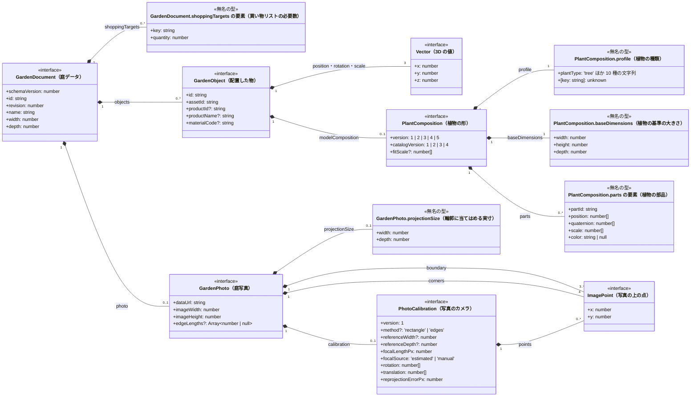
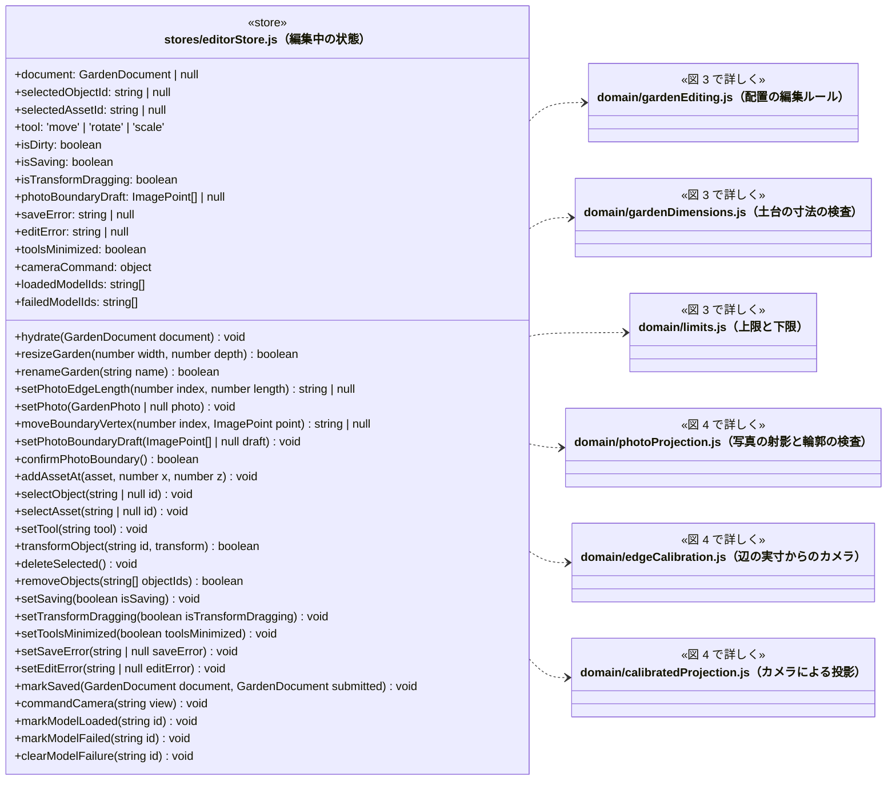
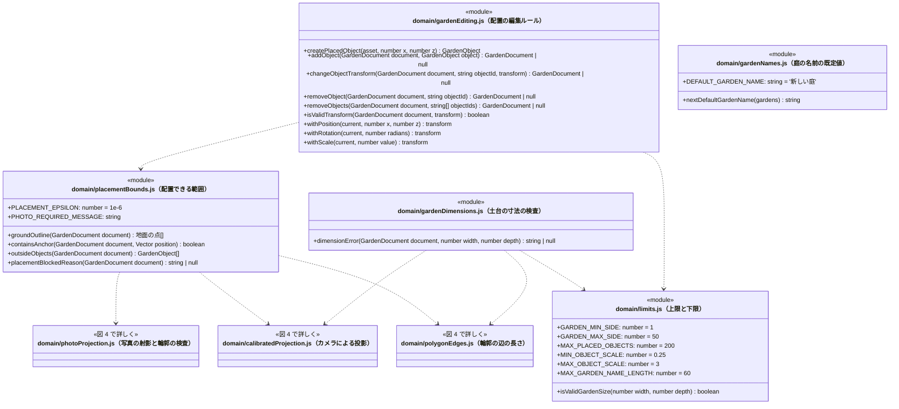
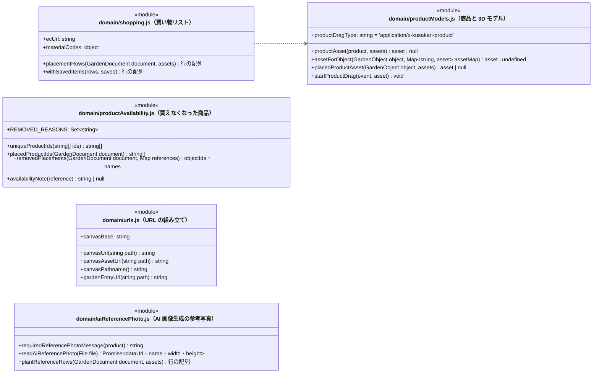
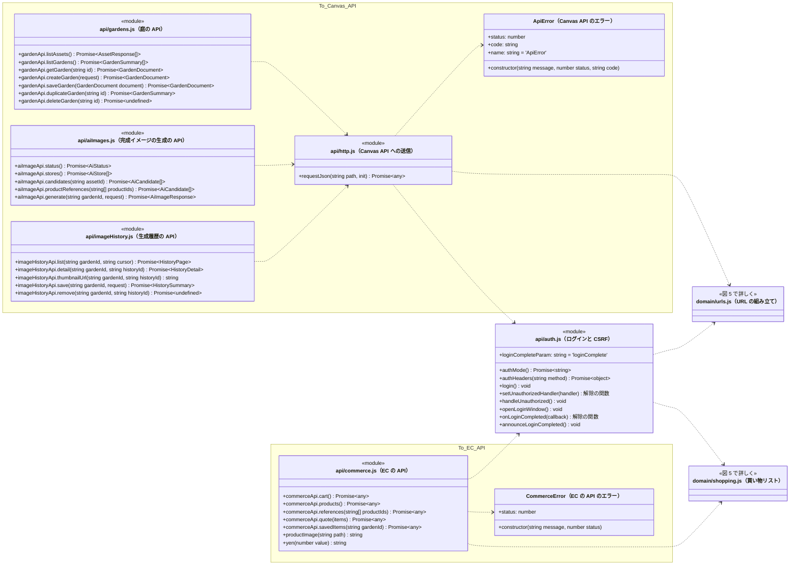
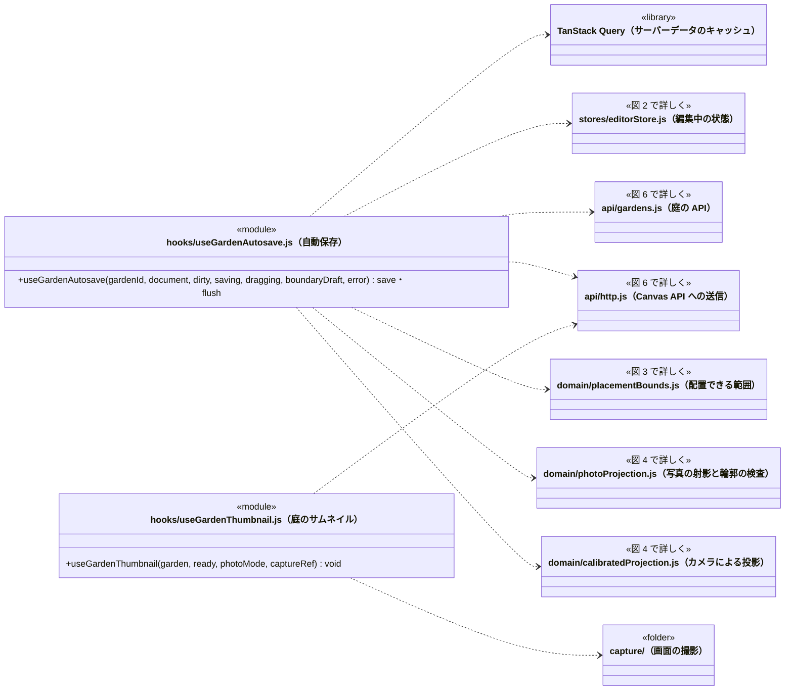
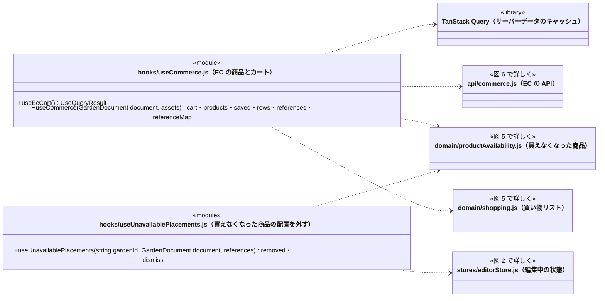

# Kusakari Canvas クラス図 04 GardenDocument と画面の状態

- 対象のコード: kusakari-canvas の main（2c043a4、2026-11-24 時点）
- 詳細図: [00_全体図](<00_全体図.md>)、[01_APIとデータの層](<01_APIとデータの層.md>)、[02_画像生成と履歴](<02_画像生成と履歴.md>)、[03_植物モデル](<03_植物モデル.md>)

Kusakari Canvas の画面（frontend）が持つ庭のデータの型 GardenDocument（図 1）と、編集中の状態（図 2）、編集のルール（図 3〜図 5）、HTTP（図 6）、サーバーデータと自動保存のフック（図 7・図 8）の詳細図です。図 1 だけがデータの図で、図 2〜図 8 はモジュールの図です。

フォルダーの単位の依存の向き（pages・three・hooks・editorStore・domain・api）は、[00_全体図](<00_全体図.md>) の図 2 に描いたので、この文書には載せていません。00 の図 2 に無い細かい点は 2 つです。`components/` は `pages/` と同じ向きに依存します。`api/` から `domain/` への import は、`urls.js` の `canvasUrl` と `shopping.js` の `ecUrl` だけです（図 6）。

テーブルの詳細は [テーブル設計図/kusakari-canvas](<../../テーブル設計図/kusakari-canvas>) を、処理の流れは [シーケンス図/kusakari-canvas](<../../シーケンス図/kusakari-canvas>) を見てください。保存の流れは [UC-07 庭プロジェクトを保存する](<../../シーケンス図/kusakari-canvas/UC-07_庭プロジェクトを保存する.md>)、配置の流れは [UC-05 庭オブジェクトを配置・編集する](<../../シーケンス図/kusakari-canvas/UC-05_庭オブジェクトを配置・編集する.md>) にあります。

## このパッケージの役割

- frontend は JavaScript（JSX）で書かれています。TypeScript のファイルは型の宣言（`.d.ts`）だけです。`npm run check:js`（`tsc -p frontend/jsconfig.json`、checkJs）で JS の型を検査します。interface は `types/garden.d.ts` にだけあります。
- `types/garden.d.ts` は、画面と E2E（`e2e/`）が共有する JSON の形です。JS のモジュールはこの型を import しません。frontend/src の中で参照するのは、`hooks/useUnavailablePlacements.js` の JSDoc と、`three/photoCamera.d.ts` の `import type` だけです。
- 編集の流れは、画面と 3D の操作 → `editorStore` のアクション → `domain` の検証済みの編集操作 → 新しい GardenDocument → 自動保存（`hooks/useGardenAutosave.js`）→ `api` → Canvas API です。AGENTS.md の依存の向きと同じです。
- 編集中の GardenDocument は `editorStore.document` にあります。サーバーから読んだ庭は TanStack Query のキャッシュ（`['garden', gardenId]`）にあり、庭を開いたときに `hydrate()` で写します。同じ id の庭なら写し直しません。
- 編集操作は、引数の GardenDocument を書き換えず、新しいオブジェクトを返します。成り立たない操作では、domain の関数が `null` か理由を返し、editorStore は document を変えません（理由を `editError` に入れるアクションはあります）。自動保存は、送った document と今の document が同じオブジェクトかどうかで、送っている間の編集を見分けます（`markSaved`）。
- Three.js の Scene・Object3D・Mesh・カメラは、GardenDocument にも editorStore にも入れません。

## 図の読み方

- 箱の名前は「英語名（日本語名）」です。英語名は、データの図（図 1）では `types/garden.d.ts` の型名、モジュールの図（図 2〜図 8）ではファイルのパスかクラス名です。
- 図 1 は画面の型（`frontend/src/types/garden.d.ts`）を描きました。同じ名前の API の DTO（`backend/kusakari_canvas_api/schemas.py`）との違いは、図 1 の下の「backend の DTO との対応」の表に書きました。00_全体図 の図 1 は DTO の側を描いているので、型の書き方（`number` と `float`、`?` と `| None`）が違います。
- ステレオタイプは次のとおりです。`<<interface>>` は `garden.d.ts` の interface、`<<無名の型>>` は名前の無い入れ子の型（`{ ... }` と書かれた型）で、表示名は「親の型.フィールド名」です。`<<store>>` は Zustand のストア、`<<module>>` はクラスを持たない JS のモジュール、`<<library>>` は外のライブラリー、`<<folder>>` はフォルダー、`<<図 n で詳しく>>` はほかの図に中身を載せたモジュールです。
- モジュールの図では、export している関数をメソッド、export している定数をフィールドとして書きます。export していない関数は書きません。`gardenApi` のように関数をまとめたオブジェクトは、`gardenApi.getGarden()` の形でメソッドに書きます。
- JS なので、引数と戻り値の型はコードに書かれていません。図の型は、渡している値と返している値から読みました。形が決まっていない引数（`asset`、`transform` など）は、名前だけ書きます。戻り値の「地面の点」は `{ x, z }`（m）、「行の配列」は買い物リストなどの行のオブジェクトの配列です。2 つ以上の値をオブジェクトで返すものは「A・B」とキーを並べました。`api` の戻り値で frontend に型が無いものは、backend の `response_model` のクラス名で書きました。
- 線は 2 種類を使いました。`*--`（黒い菱形）は JSON の入れ子のコンポジション、`..>` は import して使う依存です。関連 `-->` と継承 `<|--` は、この文書にはありません（`ApiError`・`CommerceError` が JavaScript の `Error` を継承していることは、図 6 の下の表に書きました）。
- 枠（namespace）は図 6 だけで使い、送り先（Canvas API か EC の API か）で区切りました。
- 線の両端の数字は多重度です。`1` は必ず 1 つ、`0..1` は無いか 1 つ、`0..*` は 0 個以上、`3..*` は 3 個以上です。多重度は、保存できる形（API の検査を通る形）で書きました。
- 関連の線で描いたフィールド（`objects`、`photo` など）は、箱の中に重ねて書いていません。
- 依存の線にはラベルを付けていません。どの関数・定数を使うかは、各図の下の「線とコードの対応」の表に書きました。

## 図 1 GardenDocument の型（types/garden.d.ts）

GardenDocument は、庭 1 つ分の全体のスナップショットです。保存は、この全体を `PUT /api/gardens/{id}` で送ります。写真を読み込んだ直後は `corners` と `boundary` が空の配列で、輪郭を確定するまで自動保存しません。

多重度の上限は、図では `*` と書きました。`GardenPhoto.boundary` の `3..64` と `PhotoCalibration.points` の「0 または 4」は、Mermaid 11.4.1 で末尾が箱に隠れるか切れるので、図ではそれぞれ `3..*`・`0..*` と書きました。コードの上限と根拠は次のとおりです。

| 関連 | 多重度 | 根拠 |
| --- | --- | --- |
| `GardenDocument.objects` | 0〜200 | `GardenDocumentRequest.objects` の `max_length=200`、画面は `limits.MAX_PLACED_OBJECTS` |
| `GardenDocument.shoppingTargets` | 0〜200（省略できる） | `ShoppingTargets` の `max_length=200`。`garden.d.ts` では `shoppingTargets?` |
| `GardenObject` の `position`・`rotation`・`scale` | 各 1 つ（計 3） | `garden.d.ts` の `GardenObject` |
| `GardenObject.modelComposition` | 0..1 | `garden.d.ts` の `modelComposition?` |
| `PlantComposition.parts` | 0 以上（上限はコードに無い） | `garden.d.ts` の `parts: {...}[]`。中身は [03_植物モデル](<03_植物モデル.md>) |
| `GardenPhoto.corners` | 4（保存するとき） | `validation.py`。読み込んだ直後は 0 |
| `GardenPhoto.boundary` | 3〜64（保存するとき。図では `3..*`） | `validation.py`、画面は `photoProjection.validBoundary`。読み込んだ直後は 0 |
| `GardenPhoto.calibration`、`projectionSize` | 0..1 | `garden.d.ts` の `?` と `| null` |
| `PhotoCalibration.points` | 0 または 4（図では `0..*`） | `schemas.py` の `PhotoCalibration.points`（`min_length=4, max_length=4`、`method` が `'edges'` のときは持たない） |

- `shoppingTargets` は、以前の画面で保存していた必要数です。今の画面では編集も表示もしませんが、読み込んだ値をそのまま保存し直します（`garden.d.ts` のコメント）。
- `GardenObject` の `productId`・`productName`・`materialCode`・`modelComposition` は、植物の商品から置いた配置（`assetId` が `plant_modular`）だけが持ちます。固定のアセット（`tree_oak`、`shrub_boxwood`、`brick_paver`、`bench_wood`）の配置は持ちません。
- `PlantComposition.profile.plantType` は `'tree'`・`'shrub'`・`'flower'`・`'conifer'`・`'multistem'`・`'spreading'`・`'grass'`・`'rosette'`・`'vine'`・`'palm'` の 10 種です。`version` 1〜4 は以前の組み立ての規則で、5 が今の規則です。
- `PhotoCalibration.method` が `'edges'` のときは、輪郭と `edgeLengths` から画面の `applyEdgeLength` が求めたカメラで、`points`・`referenceWidth`・`referenceDepth` を持ちません。`method` が無いか `'rectangle'` のときは、基準の長方形（`points` の 4 点と実寸）から求めたカメラです。このカメラは、以前のカメラ設定の画面で保存された庭にだけ残っていて、2c043a4 の画面からは新しく作れません。保存（PUT）のときに、backend の `calibration.validate_calibrated_photo` が `points` と実寸から計算し直します。
- `projectionSize` は、カメラの無い写真で、輪郭の外接矩形に当てはめる実寸（m）です。

### 座標と単位の決まり

| 対象 | 決まり | 根拠のコード |
| --- | --- | --- |
| 3D の座標（`Vector`） | 1 unit = 1 m です。Y が上で、地面は Y=0 です。原点は庭の中心で、X が幅、Z が奥行きの向きです。+Z が写真の手前、-Z が奥です。 | `domain/edgeCalibration.js`、`domain/polygonEdges.js`、`domain/placementBounds.js` の `groundOutline` |
| `GardenObject.position` | y は常に 0 です。x・z（配置基準点）だけを、施工範囲の輪郭と土台の矩形の中に制限します。辺の上も含み、許容誤差は 1e-6 m（`PLACEMENT_EPSILON`）です。モデルの枝葉や端は判定しません。 | `gardenEditing.addObject`、`isValidTransform`、`placementBounds.containsAnchor` |
| `GardenObject.rotation` | Y 軸の回りだけです（x=0、z=0）。単位はラジアンです。 | `isValidTransform` |
| `GardenObject.scale` | 一様（x=y=z）で、0.25〜3 です。 | `isValidTransform`、`MIN_OBJECT_SCALE`、`MAX_OBJECT_SCALE` |
| 庭の大きさ | `width`・`depth` はそれぞれ 1〜50 m です。配置は 200 個までです。 | `domain/limits.js` |
| `ImagePoint` | 元画像に対する 0〜1 の座標です。x は右、y は下の向きです。 | `calibratedProjection.projectWorld` |
| `GardenPhoto.boundary` | 施工範囲の輪郭です。3〜64 点の単純な多角形で、始点を最後に重ねません。 | `photoProjection.validBoundary` |
| `GardenPhoto.corners` | 輪郭の外接矩形から作る 4 点です（下左 → 下右 → 上右 → 上左）。利用者は入力しません。 | `photoProjection.withPhotoBoundary` |
| `GardenPhoto.edgeLengths` | `edgeLengths[i]` は `boundary[i]` → `boundary[i+1]` の辺の実寸（m）です。未入力は null です。 | `garden.d.ts` のコメント、`polygonEdges.edgeLength` |
| `PhotoCalibration` | 写真を撮ったカメラです。`rotation` は 3×3 の回転行列を行の順に並べた 9 要素で、世界座標をカメラ座標（OpenCV の軸。右・下・前）へ移します。`translation` は 3 要素、`focalLengthPx` は画素単位の焦点距離です。 | `calibratedProjection.projectWorld`、`edgeCalibration.js` |
| 表示のカメラ | 保存しません。写真の上の Three.js のカメラは、`three/photoCamera.js` の `createPhotoCamera(photo, width, depth)` が GardenPhoto から毎回作ります。3D 表示の視点は `editorStore.cameraCommand`（`'home'` か `'top'`）で切り替えます。 | `three/photoCamera.js`、`three/GardenCanvas.jsx` |

### backend の DTO との対応

| schemas.py の DTO | 使うところ | frontend の型 | 違いと追加の検査 |
| --- | --- | --- | --- |
| `GardenDocumentRequest` | `PUT /api/gardens/{id}` の本文 | `GardenDocument` | `NamedRequest` を継承します。name は空白だけを不可とし、UTF-16 で 120 単位までです。width・depth は 1〜50 です。schemaVersion は 1 だけ、revision は 0 以上、objects は 200 個まで、shoppingTargets は 200 個までで key の重複は不可です。 |
| `GardenDocument` | `GET /api/gardens/{id}`、`POST /api/gardens`、`PUT /api/gardens/{id}` の応答 | `GardenDocument` | shoppingTargets の既定は空の配列で、応答には必ず入ります（frontend の型では省略できます）。 |
| `GardenObject` | GardenDocument の objects | `GardenObject` | productId は英小文字か数字で始まり、英小文字・数字・ハイフンからなる 40 文字まで、productName は 1〜120 文字、materialCode は 80 文字までです。この 3 つと modelComposition は、無いときは JSON に出しません。validation.py が、id が UUID の形であること、`plant_modular` なら productId・productName・modelComposition があり materialCode が `product.{productId}` であることを確かめます。 |
| `Vector` | position、rotation、scale | `Vector` | 形は同じです。validation.py が、position.y=0、施工範囲の中、rotation の x・z が 0、scale が 0.25〜3 で一様なことを確かめます。 |
| `PlantComposition`（plant_schemas.py） | GardenObject の modelComposition | `PlantComposition` | version 5 は plants/schemas.py の `PlantComposition`、1〜4 は plant_legacy の `LegacyComposition` で受けます。 |
| `GardenPhoto` | GardenDocument の photo | `GardenPhoto` | 保存するときは、corners が 4 点、boundary が 3〜64 点です（validation.py）。dataUrl は JPEG か PNG の data URL で、画像は 5,000,000 バイトまで、各辺 6000 px まで、2500 万画素までです。edgeLengths は 3〜64 要素で、各要素は 0.01〜100 か null です。calibration・edgeLengths・projectionSize は、無いときは JSON に出しません。 |
| `ImagePoint` | corners、boundary、PhotoCalibration の points | `ImagePoint` | 形は同じです。0〜1 の範囲は validation.py が確かめます。 |
| `PhotoCalibration` | GardenPhoto の calibration | `PhotoCalibration` | method の既定は `'rectangle'` で、`'rectangle'` のときは JSON に出しません。`'rectangle'` は points（4 点）・referenceWidth・referenceDepth（0.1〜50）が必須で、`'edges'` はこの 3 つを持てません。rotation は 9 要素、translation は 3 要素です。 |
| `PhotoProjectionSize` | GardenPhoto の projectionSize | `GardenPhoto.projectionSize`（無名の型） | width・depth は 1〜50 です。 |
| `ShoppingTarget`、`ShoppingTargets` | GardenDocument の shoppingTargets | `GardenDocument.shoppingTargets` の要素（無名の型） | key は `product:` か `asset:` で始まる 80 文字まで、quantity は 1〜999 です。`ShoppingTargets` は、200 個までの配列の型の別名です。 |
| `CreateGardenRequest` | `POST /api/gardens` の本文 | 型なし（`gardenApi.createGarden` の JSDoc が `{name: string, width?: number, depth?: number}`） | width の既定は 10、depth の既定は 8 です。画面は name だけを送ります（`pages/GardenListPage.jsx`）。 |
| `CalibrationRequest` | API の本文には使いません。保存（PUT）のときに `calibration.py` の `validate_calibrated_photo` が、基準の長方形のカメラを計算し直すために中で作ります。 | なし | imageWidth・imageHeight は 1〜6000、points は 4 点、referenceWidth・referenceDepth は 0.1〜50 です。focalLengthPx は null か、0 より大きく 100000 以下の値です。 |
| `GardenSummary` | `GET /api/gardens` の応答の要素、`POST /api/gardens/{id}/duplicate` の応答 | 型なし | id、name、width、depth、revision、updatedAt、objectCount です。 |
| `AssetResponse`、`BaseDimensions` | `GET /api/assets` の応答の要素 | 型なし（図 5 の asset の表を見てください） | id、name、category、modelUrl、baseDimensions（width・height・depth）です。 |
| `ApiModel`、`NamedRequest` | DTO の基底のクラス | なし | `ApiModel` は余分なキーを拒否し（`extra="forbid"`）、NaN と Infinity を拒否します（`allow_inf_nan=False`）。 |

GardenDocument とテーブルの対応は、次のとおりです（backend の `service.py` が変換します）。

| frontend の型 | テーブルと列 |
| --- | --- |
| `GardenDocument` の id・name・width・depth・revision | `gardens` の同じ名前の列です。schemaVersion は保存せず、応答では常に 1 です。持ち主（`owner_id`）と `updated_at` は GardenDocument に入れません。 |
| `GardenDocument.photo`（`GardenPhoto` の全体） | `gardens.photo_json`（JSON の文字列）です。画像の保存先が `s3` のときは、dataUrl の代わりに `imageKey` を入れます（`media.py`）。 |
| `GardenDocument.shoppingTargets` | `gardens.shopping_targets_json` です。 |
| `GardenObject` | `placed_objects` の 1 行です（`id`、`asset_id`、`product_id`、`product_name`、`material_code`、`model_composition_json`、`position_x`〜`scale_z`）。 |

## 図 2 編集中の状態（stores/editorStore.js）

`editorStore.js` は、Zustand の `create()` で作る 1 つのストア `useEditorStore` です。部品は `useEditorStore((state) => ...)` で状態を読み、`useEditorStore.getState()` からアクションを呼びます。編集のアクションは domain の関数で新しい GardenDocument を作り、`set()` で `document` を差し替えて `isDirty` を true にします。`document` の型は図 1 の GardenDocument です。

### 線とコードの対応

| 元 | 先 | 使う関数・定数 |
| --- | --- | --- |
| editorStore | gardenEditing | `createPlacedObject`、`addObject`、`changeObjectTransform`、`removeObject`、`removeObjects` |
| editorStore | gardenDimensions | `dimensionError` |
| editorStore | limits | `MAX_GARDEN_NAME_LENGTH` |
| editorStore | photoProjection | `validSurface`、`withPhotoBoundary` |
| editorStore | edgeCalibration | `applyEdgeLength`、`withEdgeLengthsForBoundary` |
| editorStore | calibratedProjection | `calibratedBoundaryError` |

### フィールド

| フィールド | 中身 |
| --- | --- |
| `document` | 編集中の GardenDocument（図 1）です。庭を開くまでは null です。 |
| `photoBoundaryDraft` | 描画中の輪郭の頂点です。描画していないときは null です。`document` にも API にも入れません。 |
| `toolsMinimized` | 写真に重なる右上のツールバーと右下の完成イメージのボタンを小さくする表示の状態です（#58）。庭のデータには入れません。 |
| `cameraCommand` | `{ view: 'home' | 'top', sequence: number }` です。初めは `{ view: 'home', sequence: 0 }` です。 |
| `loadedModelIds`、`failedModelIds` | GLB と植物モデルの読み込みが済んだ配置、失敗した配置の id です。 |

### アクションと、呼ぶ部品

| アクション | 呼ぶ部品 | 使う domain の関数 | 変えるもの、失敗したとき |
| --- | --- | --- | --- |
| `hydrate(document)` | `pages/EditorPage.jsx`（庭を読み込んだとき） | なし | 同じ id の庭なら何もしません。違えば `structuredClone` で写して先頭の配置を選び、保存・変形・描画中の輪郭・エラー・モデルの読み込みの状態を初めに戻します（`tool`・`cameraCommand`・`toolsMinimized` はそのままです）。 |
| `resizeGarden(width, depth)` | `components/GardenDimensions.jsx` | `dimensionError` | 輪郭の描画中・変形のドラッグ中と、`dimensionError` が理由を返したときは false です。 |
| `renameGarden(name)` | `components/GardenTitle.jsx` | `MAX_GARDEN_NAME_LENGTH` | 前後の空白を除いて 1〜60 文字です。上の操作中、空、60 文字を超えるときは false です。 |
| `setPhotoEdgeLength(index, length)` | `components/EdgeMeasurementPopover.jsx` | `applyEdgeLength` | 失敗の理由の文字列を返し、成功は null です。輪郭の描画中・変形のドラッグ中は「輪郭編集・配置物の移動が終わってから変更してください。」です。全部の辺がそろうとカメラを求め直し、庭の width・depth と配置の位置も変わります。 |
| `setPhoto(photo)` | `components/PhotoOverlay.jsx`（写真の読み込みと取り外し）、`moveBoundaryVertex` | `withEdgeLengthsForBoundary` | 輪郭が変わったときは `edgeLengths` を合わせ直します。写真を替えたか外したときは `photoBoundaryDraft` を null にします。 |
| `moveBoundaryVertex(index, point)` | `components/PhotoOverlay.jsx` | `withPhotoBoundary`、`validSurface`、`calibratedBoundaryError` | 成り立たない形や、地平線・実寸の範囲を越える移動は反映せず、理由の文字列を返します。反映は `setPhoto` で行います。 |
| `setPhotoBoundaryDraft(draft)` | `components/PhotoOverlay.jsx` | なし | 描画中の頂点を置き換えます。写真が無いときは何もしません。 |
| `confirmPhotoBoundary()` | `components/PhotoOverlay.jsx` | `withPhotoBoundary`、`withEdgeLengthsForBoundary`、`validSurface` | 描画中の頂点を `photo.boundary` にします。成り立たない輪郭は false です。 |
| `addAssetAt(asset, x, z)` | `three/DropPlacement.jsx`、`three/GardenGround.jsx` | `createPlacedObject`、`addObject` | 置いた配置を選びます。置けないときは `editError` に「配置数の上限に達したか、配置位置が範囲外です。」を入れます。 |
| `transformObject(id, transform)` | `three/PlacedObject.jsx` | `changeObjectTransform` | 制限を外れると `editError` に「庭の範囲、回転軸、拡大縮小の制限内で入力してください。」を入れ、false を返します。 |
| `deleteSelected()` | `pages/EditorPage.jsx`（「削除」、Delete・Backspace キー） | `removeObject` | 選んだ配置を消し、先頭の配置を選びます。 |
| `removeObjects(objectIds)` | `hooks/useUnavailablePlacements.js` | `removeObjects` | 買えなくなった商品の配置をまとめて外します。 |
| `selectObject(id)`、`selectAsset(id)`、`setTool(tool)` | `pages/EditorPage.jsx`、`components/PhotoOverlay.jsx`、`three/PlacedObject.jsx`、`three/DropPlacement.jsx` | なし | 選んだ配置、置く商品・アセット、ツール（`'move'`・`'rotate'`・`'scale'`）だけを変えます。 |
| `setSaving`、`setSaveError`、`markSaved` | `hooks/useGardenAutosave.js` | なし | 自動保存の状態です。`markSaved` は、送ったあとに編集が無ければ応答の document に置き換え、編集があれば revision だけを受け取って `isDirty` を残します。 |
| `setTransformDragging`、`setEditError` | `three/PlacedObject.jsx`、`three/RotationRing.jsx`、`three/DropPlacement.jsx`、`three/GardenGround.jsx` | なし | 変形のドラッグ中の印と、配置のエラーです。 |
| `setToolsMinimized(toolsMinimized)` | `components/ObjectToolbar.jsx`（「ツールを最小化」「ツールを表示」） | なし | `ObjectToolbar.jsx` と `components/CompletionMenu.jsx` がこの値を読んで小さく表示します。輪郭の描画中は、ツールバーを最小化の表示にしません。 |
| `commandCamera(view)` | `pages/EditorPage.jsx`（「上から見る」「初期視点」） | なし | `cameraCommand.sequence` を 1 増やします。`three/GardenCanvas.jsx` がこれを見て視点を動かします。 |
| `markModelLoaded`、`markModelFailed`、`clearModelFailure` | `pages/EditorPage.jsx` | なし | GLB と植物モデルの読み込みの結果です。 |

### 状態の置き場所

| 状態 | 置き場所 | 保存 |
| --- | --- | --- |
| 編集中の庭（GardenDocument） | `editorStore.document` | 自動保存で `PUT /api/gardens/{id}` に送ります。 |
| 選択、ツール、描画中の輪郭、保存中、エラー、ツールの最小化、モデルの読み込み | `editorStore` のほかのフィールド | 保存しません。 |
| サーバーの庭、アセット、庭の一覧、EC の商品など | TanStack Query のキャッシュ（図 8 の下の表） | サーバーが正です。 |
| 写真と 3D の切り替え（`viewMode`）、ログインの期限切れ（`sessionExpired`）、ダイアログの開閉など | `pages/EditorPage.jsx` の `useState` | 保存しません。 |
| 右パネルの幅 | `localStorage`（`components/SidebarResize.jsx`） | そのブラウザーだけに残します。 |

## 図 3 配置と庭の寸法の編集ルール（domain）

配置の追加・変形・削除と、土台の寸法・庭の名前の決まりです。`gardenEditing.js` の関数は、成り立たないときに `null` を返します。`transform` は `{ position, rotation, scale }`（どれも Vector）の形です。

### 線とコードの対応

| 元 | 先 | 使う関数・定数 |
| --- | --- | --- |
| gardenEditing | placementBounds | `containsAnchor` |
| gardenEditing | limits | `MAX_PLACED_OBJECTS`、`MIN_OBJECT_SCALE`、`MAX_OBJECT_SCALE` |
| gardenDimensions | limits | `isValidGardenSize` |
| gardenDimensions | calibratedProjection | `calibratedBoundaryError` |
| gardenDimensions | polygonEdges | `photoGroundPoint` |
| placementBounds | photoProjection | `validSurface` |
| placementBounds | calibratedProjection | `calibratedBoundaryError` |
| placementBounds | polygonEdges | `photoGroundPoint` |

- `gardenEditing.js` のどの関数も、引数の document を書き換えず、新しいオブジェクトを返します。`withPosition`・`withRotation`・`withScale` は、frontend/src に呼び出し元がありません。
- `createPlacedObject` は `crypto.randomUUID()` で id を作り、position を `{ x, y: 0, z }`、rotation を 0、scale を 1 にします。`asset.modelComposition` があるとき（植物の商品）だけ、productId・productName・materialCode・modelComposition の写しを持たせます。`assetId` は `asset.placedAssetId` があればそれ（`plant_modular`）、無ければ `asset.id` です。
- `addObject` は、配置がすでに 200 個のとき、position.y が 0 でないとき、x・z が有限でないとき、施工範囲の外のとき、id が重なるときに `null` を返します。
- `groundOutline` は、写真が無ければ土台の矩形、写真があれば確定した輪郭を地面へ写した多角形を返します。輪郭が成り立たないときは空の配列です。
- `placementBlockedReason` は、写真の無い庭に新しく置こうとしたときの理由（`PHOTO_REQUIRED_MESSAGE`）を返します。
- `dimensionError` は、幅・奥行きが 1〜50 m でないとき、配置が新しい土台の外に出るとき、写真の輪郭が範囲の外になるときに理由を返します。
- `nextDefaultGardenName` は、庭の一覧と重ならない名前（「新しい庭」「新しい庭 2」…）を返します。

## 図 4 写真・輪郭・カメラの計算（domain）

写真の上の点と地面の点を行き来する計算です。カメラの無い写真は、輪郭の外接矩形を庭の幅・奥行き（`projectionSize` があればその値）に当てはめる射影変換（`homography`）を使います。カメラのある写真は `PhotoCalibration` で投影します。

```mermaid
classDiagram
    direction LR

    class photoProjection["domain/photoProjection.js（写真の射影と輪郭の検査）"] {
        <<module>>
        +unitCorners: ImagePoint[]
        +homography(ImagePoint[] from, ImagePoint[] to) 点を写す関数 | null
        +homographyMatrix(ImagePoint[] from, ImagePoint[] to) number[] | null
        +validCorners(ImagePoint[] points) boolean
        +validBoundary(ImagePoint[] points) boolean
        +validSurface(GardenPhoto photo) boolean
        +withPhotoBoundary(GardenPhoto photo, ImagePoint[] boundary) GardenPhoto
        +pointInPolygon(point, polygon) boolean
    }
    class calibratedProjection["domain/calibratedProjection.js（カメラによる投影）"] {
        <<module>>
        +projectWorld(GardenPhoto photo, Vector point) ImagePoint | null
        +projectionCorners(GardenPhoto photo, number width, number depth) ImagePoint[]
        +groundPoint(GardenPhoto photo, ImagePoint point) 地面の点 | null
        +cameraAlignedGrid(GardenPhoto photo, outline) 線の配列
        +calibratedBoundaryError(GardenPhoto photo, number width, number depth) string | null
    }
    class polygonEdges["domain/polygonEdges.js（輪郭の辺の長さ）"] {
        <<module>>
        +photoGroundPoint(GardenPhoto photo, number width, number depth, ImagePoint point) 地面の点 | null
        +edgeLength(GardenDocument document, number index) number | null
    }
    class edgeCalibration["domain/edgeCalibration.js（辺の実寸からのカメラ）"] {
        <<module>>
        +EDGE_LENGTH_TOLERANCE: number = 0.01
        +isEdgeCalibration(GardenPhoto photo) boolean
        +applyEdgeLength(GardenDocument document, number edgeIndex, number requestedLength) document または error
        +withEdgeLengthsForBoundary(GardenPhoto photo) GardenPhoto
    }
    class gardenSummary["domain/gardenSummary.js（面積と外周）"] {
        <<module>>
        +groundSummary(GardenDocument document) area・perimeter・label
    }
    class limits["domain/limits.js（上限と下限）"] {
        <<図 3 で詳しく>>
    }
    class placementBounds["domain/placementBounds.js（配置できる範囲）"] {
        <<図 3 で詳しく>>
    }

    calibratedProjection ..> photoProjection
    polygonEdges ..> calibratedProjection
    polygonEdges ..> photoProjection
    edgeCalibration ..> calibratedProjection
    edgeCalibration ..> photoProjection
    edgeCalibration ..> polygonEdges
    edgeCalibration ..> limits
    edgeCalibration ..> placementBounds
    gardenSummary ..> polygonEdges
```

### 線とコードの対応

| 元 | 先 | 使う関数・定数 |
| --- | --- | --- |
| calibratedProjection | photoProjection | `homography`、`unitCorners` |
| polygonEdges | calibratedProjection | `groundPoint` |
| polygonEdges | photoProjection | `homography`、`unitCorners` |
| edgeCalibration | calibratedProjection | `calibratedBoundaryError`、`groundPoint`、`projectWorld` |
| edgeCalibration | photoProjection | `homography`、`unitCorners` |
| edgeCalibration | polygonEdges | `edgeLength` |
| edgeCalibration | limits | `isValidGardenSize` |
| edgeCalibration | placementBounds | `containsAnchor` |
| gardenSummary | polygonEdges | `photoGroundPoint`、`edgeLength` |

- `validSurface` は、corners と boundary が成り立つかを確かめます。カメラも `projectionSize` も無い写真では、輪郭が corners の内側にあることも確かめます。自動保存と配置の範囲は、これが false の間は止まります。
- `calibratedBoundaryError` は、カメラのある写真で、輪郭の点が地平線を越えるか、庭の実寸の範囲（幅・奥行きの半分 + 0.05 m）を越えるときに理由を返します。
- `edgeLength` は、利用者が入力した辺の実寸があればそれを返し、無ければ今の投影から測った長さを返します。
- `applyEdgeLength` は `{ document }` か `{ error }` を返します。長さは 0.01〜100 m です。辺を計測できないとき（「この辺を計測できません。写真上の輪郭を確認してください。」）、カメラを求められないとき、求めたあとの幅・奥行きが 1〜50 m に収まらないとき、輪郭が庭の実寸の範囲を越えるとき、配置が庭の外に出るときなどは `error` です。
- 全部の辺の実寸がそろうと、`applyEdgeLength` は輪郭と実寸だけからカメラを求め、`method` が `'edges'` の PhotoCalibration を作ります。庭の width・depth は輪郭の外接矩形、`projectionSize` は null です。配置は、写真の上の根元の位置を保って地面の座標を求め直します。
- `withEdgeLengthsForBoundary` は、輪郭を変えたときの `edgeLengths` です。`'edges'` のカメラなら新しい輪郭の辺の長さを入れ直し、そうでなければ辺の数が変わったときだけ消します。
- `groundSummary` は、輪郭の面積・外周と、その求め方の説明を返します。説明は、カメラが無ければ「カメラ未設定・土台寸法からの概算」、基準の長方形のカメラなら「写真の基準長方形の実寸から求めたパースに基づく推定」、`'edges'` のカメラなら「写真上の辺の実寸から求めたパースに基づく推定」です。計測できない辺があるときは「計測できません。写真上の輪郭を確認してください」を返します。

## 図 5 商品・買い物リスト・URL（domain）

EC の商品と配置をつなぐ関数、買い物リストの行、URL の組み立て、AI 画像生成の参考写真の検査です。

### 線とコードの対応

| 元 | 先 | 使う関数・定数 |
| --- | --- | --- |
| shopping | productModels | `assetForObject` |

画面の「asset」は、型の宣言の無いオブジェクトです。作る関数ごとの形は次のとおりです。`createPlacedObject(asset, x, z)`（図 3）がこれを受け取って GardenObject を作ります。

| 作るところ | id | placedAssetId | ほかのキー |
| --- | --- | --- | --- |
| `GET /api/assets`（`AssetResponse`） | `tree_oak` などのアセット ID | なし | name、category、modelUrl、baseDimensions |
| `productAsset(product, assets)`（植物の商品） | `product:` + 商品 ID | `plant_modular` | name、category（`profile.plantType`）、productId、materialCode（商品の `canvasMaterialCode`）、modelComposition、baseDimensions |
| `productAsset(product, assets)`（固定のアセットの商品 `canvas-oak`・`canvas-boxwood`・`canvas-brick`・`canvas-bench`） | 対応するアセットの `AssetResponse` をそのまま返します。ほかの商品は null です。 | なし | `GET /api/assets` と同じ |
| `placedProductAsset(object, assets)`（保存済みの植物の配置） | `saved:` + 配置の id | 配置の assetId | name、category、productId、materialCode、modelComposition、baseDimensions。modelComposition の無い配置には、その assetId の `AssetResponse` を返します。 |

- `ecUrl` は、`VITE_KUSAKARI_EC_URL` から作る EC の基準の URL です。
- `placementRows` は、配置を商品 ID（無ければ assetId）ごとにまとめた買い物リストの行を返します。行は key、productId、assetId、name、materialCode、footprint、quantity、unit（`"piece"`）を持ちます。materialCode は、配置が持つ値か、`materialCodes`（`tree_oak` → `plant.oak` など 4 つ）の値です。
- `withSavedItems` は、EC で買い物リストに入れた商品のうち、配置に無いものを `unplaced: true` の行として足します。
- `REMOVED_REASONS` は `DELETED`・`STORE_CLOSED`・`STORE_SUSPENDED`・`ORGANIZATION_SUSPENDED` です。`removedPlacements` は、この理由の商品の配置だけを外す対象にします。
- `availabilityNote` は、買えない商品に「在庫なし」か「現在は購入できません」を返します。
- `canvasUrl` は、Vite の `BASE_URL`（`canvasBase`）の下の URL を作ります。`gardenEntryUrl` は、今の URL の `productId` を引き継ぎます。
- `aiReferencePhoto.js` は AI 画像生成の参考写真の検査です（PNG・JPEG・WebP、8,000,000 バイトまで、各辺 2,048 px まで、合計 3,686,400 画素まで）。AI 画像生成は [02_画像生成と履歴](<02_画像生成と履歴.md>) を見てください。

## 図 6 HTTP の関数（api）

Canvas API へは `requestJson`（同じオリジン）で、EC の API へは `commerce.js` の中の関数（`credentials: 'include'`）で送ります。図の枠 `To_Canvas_API` は Canvas API へ送るモジュール、`To_EC_API` は EC の API へ送るモジュールです。`auth.js` は両方から使うので枠の外に置きました。どちらも、書き込みの要求の前に `authHeaders` が EC の CSRF トークンを取り、401 のときは `handleUnauthorized` を呼びます。下の表の Canvas API のパスは、`canvasUrl()` が Vite の `BASE_URL`（`frontend/vite.config.js` の `KUSAKARI_CANVAS_WEB_BASE`、既定は `/`）の下に付けます。

### 線とコードの対応

| 元 | 先 | 使う関数・定数 |
| --- | --- | --- |
| http | ApiError | 失敗の応答で `throw new ApiError(...)` します（同じファイルの中のクラス）。`ApiError` は JavaScript の `Error` を継承します（`class ApiError extends Error`）。 |
| commerce | CommerceError | 失敗の応答で `throw new CommerceError(...)` します（同じファイルの中のクラス）。`CommerceError` は JavaScript の `Error` を継承します（`class CommerceError extends Error`）。 |
| gardens、aiImages、imageHistory | http | `requestJson` |
| http、commerce | auth | `authHeaders`、`handleUnauthorized` |
| http、auth | urls | `canvasUrl` |
| auth、commerce | shopping | `ecUrl` |

- `requestJson` は、失敗の応答を `ApiError`（message、status、code）にします。本文が読めないときは code が `REQUEST_FAILED` です。204 は `undefined` を返します。

| 関数 | 送り先 | HTTP | パス | 呼ぶところ |
| --- | --- | --- | --- | --- |
| `gardenApi.listAssets` | Canvas API | GET | `/api/assets` | `pages/EditorPage.jsx` |
| `gardenApi.listGardens` | Canvas API | GET | `/api/gardens` | `pages/GardenListPage.jsx` |
| `gardenApi.getGarden` | Canvas API | GET | `/api/gardens/{id}` | `pages/EditorPage.jsx` |
| `gardenApi.createGarden` | Canvas API | POST | `/api/gardens` | `pages/GardenListPage.jsx` |
| `gardenApi.saveGarden` | Canvas API | PUT | `/api/gardens/{id}` | `hooks/useGardenAutosave.js` |
| `gardenApi.duplicateGarden` | Canvas API | POST | `/api/gardens/{id}/duplicate` | `pages/GardenListPage.jsx` |
| `gardenApi.deleteGarden` | Canvas API | DELETE | `/api/gardens/{id}` | `pages/GardenListPage.jsx` |
| `requestJson` を直接 | Canvas API | POST | `/api/gardens/{id}/thumbnail` | `hooks/useGardenThumbnail.js` |
| `requestJson` を直接 | Canvas API | POST | `/api/model-assemblies/resolve` | `pages/PlantPreviewPage.jsx` |
| `authMode` | Canvas API | GET | `/api/auth/status` | `components/AuthGate.jsx`、`authHeaders` |
| `authHeaders` | EC | GET | `/api/auth/csrf` | `requestJson`、`commerce.js` の書き込み。GET・HEAD・OPTIONS と、`authMode` が `demo` のときは取りません。 |
| `login`、`openLoginWindow` | EC | 画面の移動 | `/account/login?returnTo=...` | `handleUnauthorized`、`components/AuthGate.jsx`、`pages/EditorPage.jsx` |
| `commerceApi.cart` | EC | GET | `/api/cart` | `hooks/useCommerce.js` の `useEcCart` |
| `commerceApi.products` | EC | GET | `/api/products` | `hooks/useCommerce.js` |
| `commerceApi.references` | EC | POST | `/api/products/references` | `hooks/useCommerce.js` |
| `commerceApi.quote` | EC | POST | `/api/materials/quote` | frontend/src に呼び出し元はありません。 |
| `commerceApi.savedItems` | EC | GET | `/api/shopping-lists/{gardenId}/saved-items` | `hooks/useCommerce.js` |
| `aiImageApi.status` | Canvas API | GET | `/api/ai/status` | `components/AiImageGeneration.jsx` |
| `aiImageApi.stores` | Canvas API | GET | `/api/ai/stores` | frontend/src に呼び出し元はありません。 |
| `aiImageApi.candidates` | Canvas API | GET | `/api/ai/candidates?assetId=...` | frontend/src に呼び出し元はありません。 |
| `aiImageApi.productReferences` | Canvas API | POST | `/api/ai/product-references` | `components/AiImageGeneration.jsx` |
| `aiImageApi.generate` | Canvas API | POST | `/api/gardens/{id}/ai-image` | `components/AiImageGeneration.jsx` |
| `imageHistoryApi.list` | Canvas API | GET | `/api/gardens/{id}/image-history?limit=20&cursor=...` | `components/GenerationHistory.jsx` |
| `imageHistoryApi.detail` | Canvas API | GET | `/api/gardens/{id}/image-history/{historyId}` | `components/GenerationHistory.jsx` |
| `imageHistoryApi.thumbnailUrl` | Canvas API | （URL を返すだけ。img 要素が GET） | `/api/gardens/{id}/image-history/{historyId}/thumbnail` | `components/HistoryCard.jsx` |
| `imageHistoryApi.save` | Canvas API | POST | `/api/gardens/{id}/image-history` | `components/AiImageGeneration.jsx` |
| `imageHistoryApi.remove` | Canvas API | DELETE | `/api/gardens/{id}/image-history/{historyId}` | `components/GenerationHistory.jsx` |

- `setUnauthorizedHandler` は、401 のときの処理を差し替えます。`pages/EditorPage.jsx` は、未保存の編集か描画中の輪郭があるときは EC のログインへ移らず、編集内容を残して再ログインを案内する処理を登録します（[UC-07 の詳細図 2](<../../シーケンス図/kusakari-canvas/UC-07_庭プロジェクトを保存する.md>)）。
- `onLoginCompleted` と `announceLoginCompleted` は、別のウィンドウでの再ログインの完了を `BroadcastChannel` で知らせます。

## 図 7 自動保存とサムネイル（hooks）

保存にかかわる 2 つのフックです。

### 線とコードの対応

| 元 | 先 | 使う関数・定数 |
| --- | --- | --- |
| useGardenAutosave | TanStack Query | `useQueryClient`、`setQueryData`、`invalidateQueries` |
| useGardenAutosave | editorStore | `getState`、`setSaving`、`setSaveError`、`markSaved` |
| useGardenAutosave | gardens | `gardenApi.saveGarden` |
| useGardenAutosave | http | `ApiError`（失敗の種類の判定） |
| useGardenAutosave | placementBounds | `outsideObjects` |
| useGardenAutosave | photoProjection | `validSurface` |
| useGardenAutosave | calibratedProjection | `calibratedBoundaryError` |
| useGardenThumbnail | http | `requestJson`（`POST /api/gardens/{id}/thumbnail`） |
| useGardenThumbnail | capture | `captureImage`、`thumbnailImage` |

- `useGardenAutosave` は、document が変わって 500 ms たつと `save()` を呼びます。要求は同時に 1 件だけです。変形のドラッグ中、輪郭の描画中、施工範囲の外の配置、成り立たない輪郭、実寸の範囲を越える輪郭のときは送りません（export していない `saveBlocker` が理由を返します）。`saveError` やログインの期限切れがある間は自動では送りません。`flush()` は `isDirty` が消えるまで `save()` を繰り返します。
- 保存が成功すると、`markSaved(saved, submitted)` で状態を確定し、`['garden', gardenId]` のキャッシュを応答で置き換え、`['gardens']` を古い印にします。失敗の文言は、401・`OBJECT_POSITION_OUT_OF_BOUNDS`・409・ほかの 4xx・通信の失敗で分けて `setSaveError` に入れます。
- `useGardenThumbnail` は、`ready` になって 600 ms 後に撮影し、`POST /api/gardens/{id}/thumbnail`（revision、dataUrl）で送ります。失敗したら 1.5 秒後にやり直し、試すのは 3 回までです。`pages/EditorPage.jsx` は、保存済みで、保存中・変形のドラッグ中・輪郭の描画中でなく、全部の配置のモデルを読み込んだときに `ready` を true にします。

## 図 8 EC の商品と、買えなくなった商品の配置（hooks）

TanStack Query で EC の商品などを取るフックと、買えなくなった商品の配置を外すフックです。

### 線とコードの対応

| 元 | 先 | 使う関数・定数 |
| --- | --- | --- |
| useCommerce | TanStack Query | `useQuery`、`keepPreviousData` |
| useCommerce | commerce | `commerceApi.cart`、`products`、`savedItems`、`references` |
| useCommerce | productAvailability | `uniqueProductIds` |
| useCommerce | shopping | `ecUrl`、`placementRows`、`withSavedItems` |
| useUnavailablePlacements | productAvailability | `placedProductIds`、`removedPlacements` |
| useUnavailablePlacements | editorStore | `removeObjects` |

- `useCommerce` の `rows` は、`placementRows`（今の配置）に `withSavedItems`（EC で買い物リストに入れた商品）を足した買い物リストの行です。`referenceMap` は、商品 ID から EC の照会の結果を引く Map です。
- `useUnavailablePlacements` は、庭を開いたときに 1 回だけ調べます。`references` は `useCommerce` が返す照会の結果です。照会の結果がそろってから `removedPlacements` で外す配置を決め、`removeObjects` を呼びます。照会に失敗したら配置を外しません。保存は自動保存に任せます。`removed` は知らせる商品名の配列、`dismiss()` は知らせを閉じます。

TanStack Query のキーは次のとおりです。`main.jsx` の `QueryClient` の既定は、取得が `retry: 1`・`refetchOnWindowFocus: false`、更新が `retry: false` です。

| queryKey | 取得する関数 | 使うところ | 設定と更新 |
| --- | --- | --- | --- |
| `['garden', gardenId]` | `gardenApi.getGarden` | `pages/EditorPage.jsx` | `staleTime: Infinity`。保存が成功すると `useGardenAutosave` が `setQueryData` で置き換えます。 |
| `['assets']` | `gardenApi.listAssets` | `pages/EditorPage.jsx` | `staleTime: Infinity` |
| `['gardens']` | `gardenApi.listGardens` | `pages/GardenListPage.jsx` | 作成・複製・削除と、保存の成功で `invalidateQueries` します。 |
| `['ec-cart', ecUrl]` | `commerceApi.cart` | `hooks/useCommerce.js` の `useEcCart`（`components/SiteHeader.jsx` も使います） | `retry: false`、`staleTime` 10 秒、`refetchOnWindowFocus: true` |
| `['ec-products', ecUrl]` | `commerceApi.products` | `hooks/useCommerce.js` | 同上 |
| `['ec-saved-items', ecUrl, document.id]` | `commerceApi.savedItems` | `hooks/useCommerce.js` | 同上。document の id があるときだけ取ります。 |
| `['ec-product-references', ecUrl, ids]` | `commerceApi.references` | `hooks/useCommerce.js` | 同上。ids は行の商品 ID を重ねずに並べ、コンマでつないだ文字列です。ids があるときだけ取り、`placeholderData: keepPreviousData` です。 |
| `['ai-status']`、`['ai-product-references', productIds]`、`['garden-image-history', gardenId]` など | `api/aiImages.js`、`api/imageHistory.js` | `components/AiImageGeneration.jsx`、`components/GenerationHistory.jsx` | [02_画像生成と履歴](<02_画像生成と履歴.md>) を見てください。 |

## クラスとコードの対応

| クラス | ファイル | 詳細図 |
| --- | --- | --- |
| GardenDocument、GardenObject、Vector、PlantComposition、GardenPhoto、PhotoCalibration、ImagePoint と無名の型 | [types/garden.d.ts](https://github.com/abeouga/kusakari-canvas/blob/2c043a4/frontend/src/types/garden.d.ts) | 図 1 |
| 図 1 と対応する DTO | [schemas.py](https://github.com/abeouga/kusakari-canvas/blob/2c043a4/backend/kusakari_canvas_api/schemas.py)、[plant_schemas.py](https://github.com/abeouga/kusakari-canvas/blob/2c043a4/backend/kusakari_canvas_api/plant_schemas.py) | 01 図 4・図 5、03 |
| editorStore（`useEditorStore`） | [stores/editorStore.js](https://github.com/abeouga/kusakari-canvas/blob/2c043a4/frontend/src/stores/editorStore.js) | 図 2 |
| gardenEditing、placementBounds、limits、gardenDimensions、gardenNames | [domain/](https://github.com/abeouga/kusakari-canvas/blob/2c043a4/frontend/src/domain) の同じ名前の `.js` | 図 3 |
| photoProjection、calibratedProjection、polygonEdges、edgeCalibration、gardenSummary | [domain/](https://github.com/abeouga/kusakari-canvas/blob/2c043a4/frontend/src/domain) の同じ名前の `.js` | 図 4 |
| productModels、shopping、productAvailability、urls、aiReferencePhoto | [domain/](https://github.com/abeouga/kusakari-canvas/blob/2c043a4/frontend/src/domain) の同じ名前の `.js` | 図 5 |
| http、ApiError、auth、gardens、commerce、CommerceError、aiImages、imageHistory | [api/](https://github.com/abeouga/kusakari-canvas/blob/2c043a4/frontend/src/api) の同じ名前の `.js` | 図 6 |
| useGardenAutosave、useGardenThumbnail | [hooks/](https://github.com/abeouga/kusakari-canvas/blob/2c043a4/frontend/src/hooks) の同じ名前の `.js` | 図 7 |
| useCommerce、useUnavailablePlacements | [hooks/](https://github.com/abeouga/kusakari-canvas/blob/2c043a4/frontend/src/hooks) の同じ名前の `.js` | 図 8 |

## 載せなかったもの

| もの | 理由 | 載せた図 |
| --- | --- | --- |
| フォルダーの依存の向きの図 | [00_全体図](<00_全体図.md>) の図 2 と重なるため | 00_全体図 図 2 |
| `types/garden.js` | 中身は `export {}` だけの空のモジュールで、型は `garden.d.ts` にあるため | なし |
| export していない関数と定数（`useGardenAutosave.js` の `saveBlocker`、`useCommerce.js` の `cartKey`、`commerce.js` の `request`、`auth.js` の `loginUrl`、`imageHistory.js` の `historyPath`、`aiReferencePhoto.js` の `matchesFormat`、`photoProjection.js` の `orientation`・`onSegment`・`segmentsCross`、`gardenEditing.js` の `cloneTransform`、`edgeCalibration.js` のカメラを求める関数（`cameraAxes`、`evaluate`、`refine`、`fitCamera`、`cameraParams` など）、`productModels.js` の `legacyModels`・`catalogForRule`） | モジュールの外から使えないため。`saveBlocker` の条件は図 7 の下に書いた | 図 7（`saveBlocker` の条件だけ） |
| `components/` と `pages/` の React のコンポーネント | 画面の部品で、データの型も保存する状態も持たないため。どの部品がどのアクションを呼ぶかは図 2 の表に、TanStack Query を直接使う画面は図 8 の表に書いた | 00_全体図 図 2（`pages/`） |
| `three/` の描画の部品 | GardenDocument と editorStore を読んで描くだけで、保存するデータを持たないため。AGENTS.md で、Three.js の Scene・Object3D・Mesh を業務データにしない決まり。座標にかかわる `createPhotoCamera` だけ、図 1 の「座標と単位の決まり」に書いた | 00_全体図 図 2（`three/`） |
| `capture/`（`captureImage`、`thumbnailImage`） | この文書の対象のフォルダーの外のため。図 7 では依存先として名前だけ載せた | 図 7 |
| JavaScript の `Error` と、`ApiError`・`CommerceError` からの継承の線 | 組み込みのクラスで、図 6 では継承の線が `http.js` の箱の裏を通って読みにくくなったため。継承は図 6 の「線とコードの対応」に書いた | 図 6（表だけ） |
| EC の API の応答（カート、商品、商品の照会、保存した商品） | frontend に型の宣言が無く、形は EC の DTO で決まるため。図 6 では `any` と書いた | 図 6 |

## 確かめられなかったこと

- GitHub と Obsidian での表示は確かめていません。PNG は mermaid-snap（Mermaid 11.4.1）で書き出したものです。
- JS の引数と戻り値の型は、コードに書かれていないので、渡している値と返している値から読みました。
- `aiImageApi` と `imageHistoryApi` の戻り値の型名（`AiStatus`、`HistoryPage` など）は backend の `response_model` から取りました。中身は [02_画像生成と履歴](<02_画像生成と履歴.md>) を見てください。
