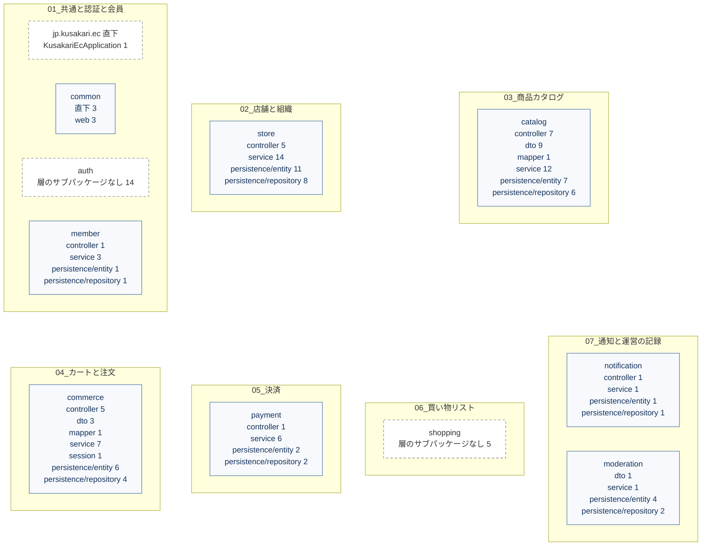
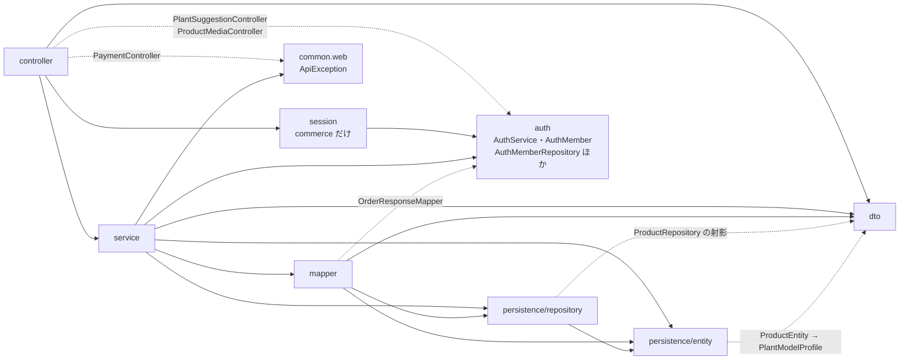
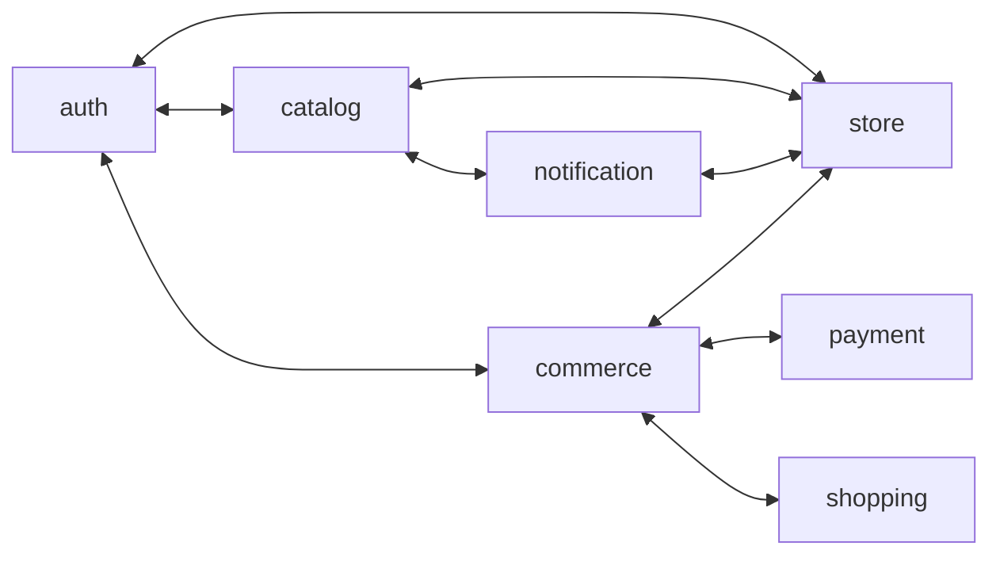
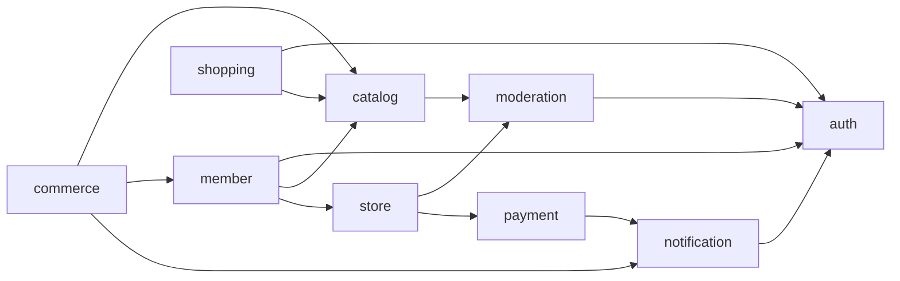
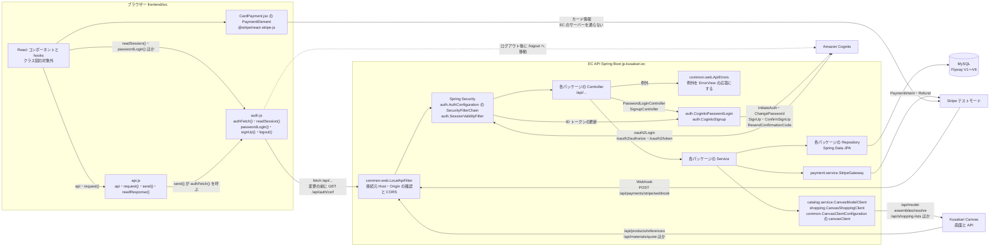

# EC のパッケージ構成

Kusakari EC の backend（Spring Boot）の Java パッケージの構成と、パッケージの間の依存を示します。画面から API までのつながりと、外部のシステム（Cognito、Stripe、Kusakari Canvas）とのつながりも、このファイルに 1 枚でまとめます。各パッケージのクラスは 01〜07 のファイルにあります。

## 対象のコード

- kusakari-ec の main、コミット 19a2be3（2026-11-20 時点）です。
- backend: [backend/src/main/java/jp/kusakari/ec](https://github.com/abeouga/kusakari-ec/blob/19a2be307ee71a2cd87e538236c3c8c42929c5b3/backend/src/main/java/jp/kusakari/ec) の 162 ファイルです。
- 画面: [frontend/src/api.js](https://github.com/abeouga/kusakari-ec/blob/19a2be307ee71a2cd87e538236c3c8c42929c5b3/frontend/src/api.js) と [frontend/src/auth.js](https://github.com/abeouga/kusakari-ec/blob/19a2be307ee71a2cd87e538236c3c8c42929c5b3/frontend/src/auth.js) を、つながりの図にだけ載せます。
- 画面の React コンポーネント（`frontend/src` の `.jsx`）と hooks は、クラス図の対象外です。画面の操作の流れは [シーケンス図/kusakari-ec](<../../シーケンス図/kusakari-ec>) を見てください。テーブルの詳細は [テーブル設計図/kusakari-ec](<../../テーブル設計図/kusakari-ec>) を見てください。

## ファイルとパッケージの対応

| ファイル | 載っているパッケージ | 主な内容 |
| --- | --- | --- |
| [01_共通と認証と会員](<01_共通と認証と会員.md>) | `jp.kusakari.ec` 直下、`common`、`common.web`、`auth`、`member` | 起動とマイグレーション、エラー応答、接続元の確認、Cognito での認証、会員（`members`）と権限の判定、受取連絡先、退会 |
| [02_店舗と組織](<02_店舗と組織.md>) | `store` | 組織、店舗の担当者とロール、招待、出店申請、店舗の閉鎖、組織の停止、オーナーの譲渡 |
| [03_商品カタログ](<03_商品カタログ.md>) | `catalog` | 商品、在庫、カテゴリ、商品画像、店舗の Entity、材料コードと商品の対応、植物のモデル、運営による商品の停止 |
| [04_カートと注文](<04_カートと注文.md>) | `commerce` | カート、注文、受け渡しの状態、注文実績、ヘルスチェック |
| [05_決済](<05_決済.md>) | `payment` | 決済、返金、Stripe の呼び出しと Webhook |
| [06_買い物リスト](<06_買い物リスト.md>) | `shopping` | 庭の買い物リスト（Kusakari Canvas との連携） |
| [07_通知と運営の記録](<07_通知と運営の記録.md>) | `notification`、`moderation` | 通知、運営による警告・停止の履歴 |

パッケージの名前と、置かれているクラスの役割が一致しないところがあります。

- 店舗の Entity（`StoreEntity`、`stores` テーブル）と `StoreRepository` は `catalog` パッケージにあります。店舗の API（`StoreController`）は `store` パッケージです。
- 運営による商品の停止の API（`ProductModerationController`、`ProductModerationService`）は `catalog`、店舗の停止の API（`StoreModerationController`、`StoreModerationService`）は `store` にあります。組織の停止の履歴（`OrganizationModerationEventEntity`）も `store` です。`moderation` パッケージは、商品と店舗の履歴の Entity と、履歴の共通の読み方（`ModerationHistory`）だけを持ちます。
- `/api/health` の `HealthController` は `commerce` パッケージにあります。

## 図1 パッケージと層

枠は 01〜07 のファイル、四角はパッケージです。四角の中は、層のサブパッケージとそのファイル数です。点線の四角は、層のサブパッケージを持たないパッケージです。

| パッケージ | controller | dto | mapper | service | session | persistence/entity | persistence/repository | 直下 | 計 |
| --- | --- | --- | --- | --- | --- | --- | --- | --- | --- |
| `jp.kusakari.ec` 直下 | | | | | | | | 1 | 1 |
| `auth` | | | | | | | | 14 | 14 |
| `catalog` | 7 | 9 | 1 | 12 | | 7 | 6 | | 42 |
| `commerce` | 5 | 3 | 1 | 7 | 1 | 6 | 4 | | 27 |
| `common` | | | | | | | | 3（ほかに `web` 3） | 6 |
| `member` | 1 | | | 3 | | 1 | 1 | | 6 |
| `moderation` | | 1 | | 1 | | 4 | 2 | | 8 |
| `notification` | 1 | | | 1 | | 1 | 1 | | 4 |
| `payment` | 1 | | | 6 | | 2 | 2 | | 11 |
| `shopping` | | | | | | | | 5 | 5 |
| `store` | 5 | | | 14 | | 11 | 8 | | 38 |

- 数は `.java` のファイル数です。1 つのファイルに入れ子の record や enum があるので、クラスの数はもっと多くなります。
- `auth` と `shopping` は、Controller・Service・Entity・Repository を同じパッケージに置いています。

## 図2 層の間の依存

層のサブパッケージを持つパッケージで、どの層がどの層のクラスを使うかを、すべてのファイルの参照から数えて描きました。矢印は「使う側 → 使われる側」です。点線は、ラベルに書いたクラスだけにある参照です。

- Controller が Repository や Entity を直接使うところはありません。逆向き（Service → Controller、Repository → Service など）の参照もありません。
- 図にない同じ層どうしの参照もあります。Service はほかの Service を呼びます。Entity はほかの Entity を、dto はほかの dto を参照します。
- `commerce.session.CartSessionResolver` は、Controller（`CartController`、`OrderController`、`shopping.ShoppingController`）から使われ、`auth.AuthService` と `auth.MemberCartService` でカートの ID を決めます。

## 図3 パッケージの間の依存

`import` と、コードの中の完全な名前（`jp.kusakari.ec.…`）から確かめました。矢印は「使う側 → 使われる側」です。

`common` には、すべてのパッケージと `KusakariEcApplication` が依存します（`common.web.ApiException` を 44 ファイルが使い、`KusakariEcApplication` が `DeploymentMigration` を使います）。線が多くなるので、`common` への線は図から省きます。

### 図3-1 互いに依存している組

両方向の矢印は、2 つのパッケージが互いのクラスを使っていることを示します。パッケージの単位では循環しています。

### 図3-2 一方向の依存

### 依存の元になっているクラス

| 使う側 | 使われる側 | 使っているクラス（使う側のクラス → 使われる側のクラス） |
| --- | --- | --- |
| 直下 | `common` | `KusakariEcApplication` → `DeploymentMigration` |
| `common` 以外のすべて | `common` | 44 のファイル → `ApiException`。パッケージごとのファイル数は `auth` 6、`catalog` 11、`commerce` 6、`member` 2、`moderation` 1、`notification` 1、`payment` 3、`shopping` 3、`store` 11 |
| `auth` | `catalog` | `AuthService` → `StoreEntity`、`StoreRepository`。`StoreCapabilityPolicy` → `StoreEntity` |
| `auth` | `commerce` | `MemberCartService` → `CartEntity`、`CartRepository` |
| `auth` | `store` | `AuthService` → `OrganizationEntity`、`OrganizationMemberEntity`、`StoreMemberEntity`、`StoreMemberId`、`OrganizationRepository`、`OrganizationMemberRepository`、`StoreMemberRepository`。`StoreCapabilityPolicy` → `OrganizationMemberEntity`。`SignupController` → `StoreInvitationService` |
| `catalog` | `auth` | `PlantSuggestionController`、`ProductMediaController`、`CategoryService`、`ProductEditorService`、`ProductModerationService`、`SellerProductService` → `AuthService` |
| `catalog` | `moderation` | `ProductModerationController`、`SellerProductController` → `ModerationDtos`。`ProductModerationService` → `ModerationDtos`、`ModerationAction`、`ProductModerationEventEntity`、`ProductModerationEventRepository`、`ModerationHistory` |
| `catalog` | `notification` | `ProductModerationService` → `NotificationService`、`NotificationEntity` |
| `catalog` | `store` | `CatalogService` → `OrganizationEntity`、`OrganizationRepository` |
| `commerce` | `auth` | `CheckoutService`、`OrderService`、`OrderWorkflowService` → `AuthService`。`SalesReportService` → `AuthService`、`AuthMember`、`StoreCapabilityPolicy`。`OrderResponseMapper` → `AuthMember`、`AuthMemberRepository`。`CartSessionResolver` → `AuthService`、`MemberCartService` |
| `commerce` | `catalog` | `CommerceDtos` → `CatalogDtos`。`CartService` → `CatalogDtos`、`CatalogService`。`CheckoutService` → `ProductStoreReference`、`InventoryEntity`、`StoreEntity`、`InventoryRepository`、`ProductRepository`、`StoreRepository`。`OrderResponseMapper` → `ProductImageReference`、`StoreEntity`、`ProductRepository`、`StoreRepository`。`SalesReportService` → `StoreEntity`、`StoreRepository`。`StockReturn` → `InventoryEntity`、`InventoryRepository` |
| `commerce` | `member` | `DeliveryService` → `PickupContactRepository` |
| `commerce` | `notification` | `CheckoutService`、`OrderWorkflowService` → `NotificationService`、`NotificationEntity` |
| `commerce` | `payment` | `OrderController` → `PaymentService`。`CheckoutService` → `PaymentEntity`、`PaymentRepository`、`StripeGateway`。`OrderWorkflowService` → `RefundService`。`OrderResponseMapper` → `PaymentEntity`、`RefundEntity`、`PaymentRepository`、`RefundRepository` |
| `commerce` | `shopping` | `CartService` → `ShoppingDtos` |
| `commerce` | `store` | `CheckoutService` → `OrganizationEntity`、`OrganizationRepository`。`OrderWorkflowService` → `ClosureSettlement` |
| `member` | `auth` | `MemberService` → `AuthService`、`AuthMember`、`AuthMemberRepository` |
| `member` | `catalog` | `MemberService` → `StoreRepository` |
| `member` | `store` | `MemberService` → `OrganizationEntity`、`PendingOwnerSuccession` |
| `moderation` | `auth` | `ModerationHistory` → `AuthMember`、`AuthMemberRepository` |
| `notification` | `auth` | `NotificationService` → `AuthService`、`AuthMember`、`AuthMemberRepository` |
| `notification` | `catalog` | `NotificationService` → `StoreRepository` |
| `notification` | `store` | `NotificationService` → `OrganizationEntity`、`OrganizationRepository`、`StoreMemberRepository`、`PendingOwnerSuccession` |
| `payment` | `commerce` | `PaymentService` → `CommerceDtos`、`OrderEntity`、`OrderRepository`、`StockReturn`。`RefundService` → `OrderEntity`、`OrderRepository` |
| `payment` | `notification` | `PaymentService` → `NotificationService`、`NotificationEntity` |
| `shopping` | `auth` | `ShoppingController` → `AuthService` |
| `shopping` | `catalog` | `SavedShoppingItems` → `CatalogService`。`ShoppingService` → `CatalogService`、`MaterialProductRepository` |
| `shopping` | `commerce` | `ShoppingController` → `CartSessionResolver`。`ShoppingDtos` → `CommerceDtos`。`ShoppingService` → `CartService`。`SavedShoppingItems` → `CartRepository` |
| `store` | `auth` | `StaffPolicy`、`StoreClosureService`、`StoreService` → `AuthService`、`AuthMember`。`OrganizationSuspensionService`、`StoreModerationService` → `AuthService`。`StoreApplicationService` → `AuthService`、`AuthMember`、`AuthMemberRepository`。`MemberEventService`、`OwnerSuccessionNotices`、`OwnerSuccessionService`、`StaffAccountService`、`StoreInvitationService` → `AuthMember`、`AuthMemberRepository` |
| `store` | `catalog` | `ClosureSettlement`、`MemberEventService`、`OrganizationSuspensionService`、`StaffAccountService`、`StoreClosureService`、`StoreInvitationService`、`StoreModerationService`、`StoreService` → `StoreRepository`（`ClosureSettlement` と `MemberEventService` 以外は `StoreEntity` も） |
| `store` | `commerce` | `OpenOrders` → `OrderEntity`、`OrderRepository`、`StockReturn` |
| `store` | `moderation` | `StoreModerationController`、`StoreService` → `ModerationDtos`。`StoreModerationService` → `ModerationDtos`、`ModerationAction`、`StoreModerationEventEntity`、`StoreModerationEventRepository`、`ModerationHistory` |
| `store` | `notification` | `OpenOrders`、`OrganizationSuspensionService`、`StaffAccountService`、`StoreApplicationService`、`StoreClosureService`、`StoreModerationService` → `NotificationService`、`NotificationEntity`。`OwnerSuccessionNotices` → `NotificationEntity`、`NotificationRepository` |
| `store` | `payment` | `ClosureSettlement` → `AfterCommit`。`OpenOrders` → `RefundService` |

## 図4 画面から API、外部のシステムまで

画面の部品が `api.js` と `auth.js` を通って `/api` の Controller に届くまでと、外部のシステムとのつながりです。実線は呼び出し、点線はブラウザーの画面の移動です。

### 画面の側

- 画面の部品は、`api.js` の `api`（`api.cart()` など）と `request()` で API を呼びます。`request()` は `/api` を前に付け、`send()` を通して `auth.js` の `authFetch()` を呼びます。`authFetch()` は、GET・HEAD・OPTIONS 以外のとき、先に `GET /api/auth/csrf` で CSRF のトークンを取ってヘッダーに付けます。
- 応答は `readResponse()` が JSON にします。失敗の応答は `ApiError`（`status`・`code`）にします。ログイン中の 401 では `kusakari-session-expired` のイベントを出します。
- ログイン・登録・ログアウトとログイン状態の取得は、`auth.js` の `readSession()`（`GET /api/auth/me`）、`passwordLogin()`、`signUp()`、`confirmSignUp()`、`resendSignUpCode()`、`logout()` が直接呼びます。
- 例外として、`fetch()` や `<a href>`・`` で直接 `/api` を開くところがあります（`usePlantSuggestion.js` の商品画像、`AuthPanel.jsx` と `AccountPage.jsx` の `/api/auth/login?managed=true`、買い物リストのサムネイル、出店申請の提出書類）。
- 開発では、Vite の `proxy` が `/api` を `http://127.0.0.1:8086` に送ります（[frontend/vite.config.js](https://github.com/abeouga/kusakari-ec/blob/19a2be307ee71a2cd87e538236c3c8c42929c5b3/frontend/vite.config.js)）。

### API の側

- すべての要求は、まず `LocalApiFilter` を通ります。許可していない Host か Origin なら、403 `ORIGIN_REJECTED` を返します。Origin は、EC の画面（`kusakari.ec.web-origin`）と Canvas（`kusakari.ec.canvas-origin`）だけを許可します。
- 次に Spring Security を通ります。`kusakari.auth.mode=cognito` のときは `cognitoSecurity` のフィルターチェーンです。`SessionValidityFilter` が、期限の切れた ID トークンを Cognito のリフレッシュトークンで更新し、会員が使えるかを `AuthService.current()` で確かめます。隔離した E2E の `demo` のときは `demoSecurity` で、すべての要求を通します。
- Controller と Service が投げた `ApiException` などの例外は、`ApiErrors` が `{code, message}` の応答にします。
- `common.CanvasClientConfiguration` の `canvasClient` は、Canvas を呼ぶときに、利用者の要求の `KUSAKARI_SESSION` の Cookie と `X-CSRF-TOKEN` のヘッダーをそのまま付けます。

### 外部のシステム

| 外部のシステム | EC の側のクラス | つながり |
| --- | --- | --- |
| Amazon Cognito | `AuthConfiguration`（`cognitoClients`、`cognitoSecurity`）、`AuthController`、`AuthUrls` | Hosted UI でのログインとパスワードの再設定。`GET /api/auth/login?managed=true` から `/api/auth/authorize/cognito` へ移り、Cognito の `/oauth2/authorize` を開きます。戻り先は `/api/auth/callback/cognito` です。ログアウトの後、画面は `AuthUrls.logout()` の `/logout` へ移ります |
| Amazon Cognito | `CognitoPasswordLogin`、`CognitoSignup` | ログイン画面のカードからの、パスワードでのログイン（`InitiateAuth`）、ID トークンの更新、パスワードの変更（`ChangePassword`）、登録（`SignUp`、`ConfirmSignUp`、`ResendConfirmationCode`） |
| Stripe | `StripeGateway`、`PaymentController` | PaymentIntent と返金を作ります。支払いの結果は `POST /api/payments/stripe/webhook` で受け取り、署名を確かめます。カード情報は画面の `PaymentElement` から Stripe へ直接送られます |
| Kusakari Canvas | `CanvasModelClient`、`CanvasShoppingClient` | EC から Canvas の API を呼びます（`/api/model-assemblies/resolve`、`/api/shopping-lists`、`/api/gardens` など） |
| Kusakari Canvas | `CatalogController`、`CartController`、`ShoppingController` など | Canvas の画面と API から EC の API が呼ばれます（`/api/products/references`、`/api/materials/quote`、`/api/cart` など）。`/api/products/references` と `/api/materials/quote` は、認証と CSRF の対象外です |

## 確かめられなかったこと

- 公開環境で `/api` に届くまでの経路（CloudFront など）は、この図に書いていません。`deploy/` のファイルは見ていません。
- Canvas の側で EC の API を呼ぶコードは、kusakari-canvas の main（コミット c19d497）の `frontend/src/api/commerce.js` と `backend/kusakari_canvas_api/ai_catalog.py` で確かめただけです。Canvas の側のすべての呼び出しは数えていません。
