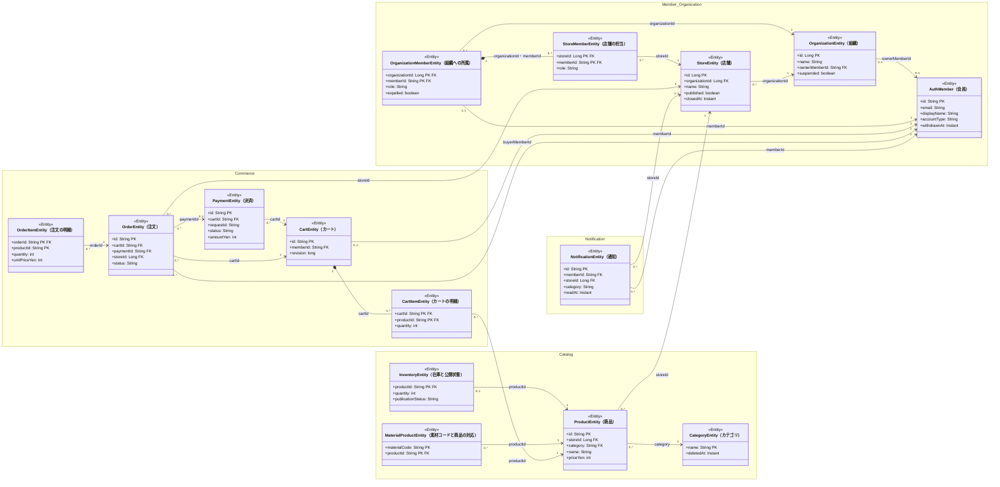
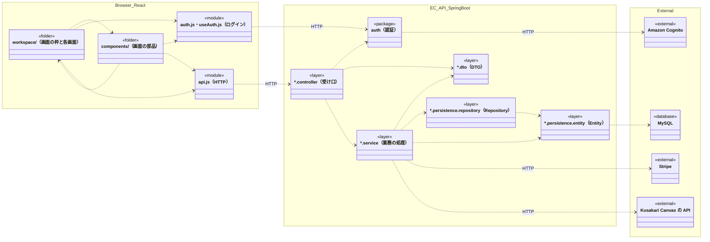

# Kusakari EC クラス図 00 全体図

- 対象のコード: kusakari-ec の main（8892344、2026-11-24 時点）
- 詳細図: [01_共通と認証と会員](<01_共通と認証と会員.md>)、[02_店舗と組織](<02_店舗と組織.md>)、[03_商品カタログ](<03_商品カタログ.md>)、[04_カートと注文](<04_カートと注文.md>)、[05_決済](<05_決済.md>)、[06_買い物リスト](<06_買い物リスト.md>)、[07_通知と運営の記録](<07_通知と運営の記録.md>)

EC が何を扱い、どう分かれているかを 2 枚で見るための図です。図 1 はデータの構造、図 2 は層の構成です。呼び出しの順番はシーケンス図に書いています。

## 詳細図とパッケージの対応

| ファイル | 載っているパッケージ | 主な内容 |
| --- | --- | --- |
| [01_共通と認証と会員](<01_共通と認証と会員.md>) | `jp.kusakari.ec` 直下、`common`、`common.web`、`auth`、`member` | 起動とマイグレーション、エラー応答、接続元の確認、Cognito での認証、会員（`members`）と権限の判定、受取連絡先、退会 |
| [02_店舗と組織](<02_店舗と組織.md>) | `store` | 組織、店舗の担当者とロール、招待、出店申請、店舗の閉鎖、組織の停止、オーナーの譲渡 |
| [03_商品カタログ](<03_商品カタログ.md>) | `catalog` | 商品、在庫、カテゴリ、商品画像、店舗の Entity、材料コードと商品の対応、植物のモデル、運営による商品の停止 |
| [04_カートと注文](<04_カートと注文.md>) | `commerce` | カート、注文、受け渡しの状態、注文実績、ヘルスチェック |
| [05_決済](<05_決済.md>) | `payment` | 決済、返金、Stripe の呼び出しと Webhook |
| [06_買い物リスト](<06_買い物リスト.md>) | `shopping` | 庭の買い物リスト（Kusakari Canvas との連携） |
| [07_通知と運営の記録](<07_通知と運営の記録.md>) | `notification`、`moderation` | 通知、運営による警告・停止の履歴 |

パッケージの名前と、置かれているクラスの役割が一致しないところがあります。

- 店舗の Entity（`StoreEntity`、`stores` テーブル）と `StoreRepository` は `catalog` パッケージにあります。店舗の API（`StoreController`）は `store` パッケージです。
- 運営による商品の停止の API（`ProductModerationController`、`ProductModerationService`）は `catalog`、店舗の停止の API（`StoreModerationController`、`StoreModerationService`）は `store` にあります。組織の停止の履歴（`OrganizationModerationEventEntity`）も `store` です。`moderation` パッケージは、商品と店舗の履歴の Entity と、履歴の共通の読み方（`ModerationHistory`）だけを持ちます。
- `/api/health` の `HealthController` は `commerce` パッケージにあります。

## 図の読み方

- 箱の名前は「英語名（日本語名）」です。英語名は Java のクラス名です。
- 図 1 は JPA の Entity です。Entity の間に `@ManyToOne` などの関連の注釈はなく、関連はすべて MySQL の外部キー（`backend/src/main/resources/db/migration/` の `V1`〜`V7`）です。線のラベルは外部キーの列にあたる Java のフィールド名です。
- 線は 4 種類です。`*--`（黒い菱形）は `ON DELETE CASCADE` の外部キー、`-->` は外部キー、`..>` は依存（図 2 の import か HTTP）です。継承の線は、この 2 枚にはありません。
- 線の両端の数字は多重度です。`0..1` は無いか 1 つ、`0..*` は 0 個以上です。NULL を許す外部キーは `0..1`、一意キーのある外部キーは相手側から見て `0..1` です。
- 複合主キー（`@EmbeddedId`）のクラスは、キーのフィールドを箱の中に展開して書き、`*Id` のクラスは省きました。
- 状態の列（`status`、`accountType` など）は、Java でも `String` です。取りうる値は詳細図にあります。

## 図 1 データの全体図

会員と組織・店舗、商品、カートと注文、通知の 4 つのまとまりの、主な Entity 15 個です。

図に描かなかった外部キーです。どれも会員（`members`）を指す記録用の列で、線を足すと会員の箱に線が集まって読めなくなるため、表にしました。

| 列 | 多重度（相手側） | 意味 |
|---|---|---|
| `OrganizationEntity.pendingOwnerMemberId` | 0..1 | オーナーの譲渡の承認待ちの相手（V6） |
| `ProductEntity.createdByMemberId` | 0..1 | 商品を追加した会員（V7。初期データの商品は空） |
| `PaymentEntity.buyerMemberId` | 1 | 決済した会員 |
| `OrderEntity.cancelledByMemberId` | 0..1 | 注文をキャンセルした人 |

- `OrderItemEntity.productId` には外部キーがありません。注文の商品は、注文したときの商品番号・名前・単価を写して持つので、商品が消えても注文は残ります。
- `OrderEntity.paymentId` の外部キーは `(payment_id, cart_id, request_id)` の組で、同じお会計の決済だけを指せます。
- 1 つのお会計（`cartId`・`requestId`）から、店舗ごとに 1 件の注文ができます（一意キー `uk_orders_request`）。

## 図 2 層の全体図

画面のフォルダーと、API の層のサブパッケージを描きました。API の各パッケージ（`catalog`、`store`、`commerce` など）は、同じ層のサブパッケージを持つので、層ごとに 1 つの箱にまとめています。矢印は import か、`HTTP` と書いたものは HTTP の呼び出しです（Entity から MySQL への 1 本を除く）。

| 線 | 根拠 |
|---|---|
| controller → service・dto・auth | `*.controller` の 19・10・2 ファイルが import する |
| service → repository・entity・dto | `*.service` の 33・30・17 ファイルが import する。controller から repository・entity は import しない |
| service → Stripe | [StripeGateway](https://github.com/abeouga/kusakari-ec/blob/8892344/backend/src/main/java/jp/kusakari/ec/payment/service/StripeGateway.java) |
| service → Kusakari Canvas の API | [CanvasModelClient](https://github.com/abeouga/kusakari-ec/blob/8892344/backend/src/main/java/jp/kusakari/ec/catalog/service/CanvasModelClient.java)、[CanvasShoppingClient](https://github.com/abeouga/kusakari-ec/blob/8892344/backend/src/main/java/jp/kusakari/ec/shopping/CanvasShoppingClient.java)（`shopping` は層のサブパッケージを持たない） |
| auth → Amazon Cognito | [CognitoPasswordLogin](https://github.com/abeouga/kusakari-ec/blob/8892344/backend/src/main/java/jp/kusakari/ec/auth/CognitoPasswordLogin.java)、[CognitoSignup](https://github.com/abeouga/kusakari-ec/blob/8892344/backend/src/main/java/jp/kusakari/ec/auth/CognitoSignup.java) |

## クラスとコードの対応

| クラス | パッケージ | 詳細図 |
|---|---|---|
| AuthMember | `auth` | 01 |
| OrganizationEntity、OrganizationMemberEntity、StoreMemberEntity | `store.persistence.entity` | 02 |
| StoreEntity、ProductEntity、InventoryEntity、CategoryEntity、MaterialProductEntity | `catalog.persistence.entity` | 03 |
| CartEntity、CartItemEntity、OrderEntity、OrderItemEntity | `commerce.persistence.entity` | 04 |
| PaymentEntity | `payment.persistence.entity` | 05 |
| NotificationEntity | `notification.persistence.entity` | 07 |

## 載せなかったもの

| もの | 理由 | 載せた図 |
|---|---|---|
| PickupContactEntity（受取連絡先） | 会員の付け足しの情報で、ほかの Entity とつながらないため | 01 |
| StoreApplicationEntity、StoreInvitationEntity、StoreInvitationUseEntity、OrganizationMemberEventEntity、OrganizationModerationEventEntity | 出店申請・招待・記録の Entity で、店舗と組織の主な構造は変わらないため | 02 |
| ProductMediaEntity、`product_images` | 商品の画像の付け足しの情報のため | 03 |
| RefundEntity、`stripe_events` | 返金と Webhook の記録で、注文と決済の構造は変わらないため | 05 |
| `garden_shopping_lists`・`garden_shopping_items` | 庭の買い物リスト（Kusakari Canvas との連携）の表で、Entity のクラスが無いため | 06 |
| ProductModerationEventEntity、StoreModerationEventEntity | 運営の記録の Entity のため | 07 |
| DTO、Controller、Service | 図 1 はデータの保存の形、図 2 は層の単位で描いたため | 01〜07 |
| 画面の `components/CardPayment.jsx` から Stripe へのつながり（`@stripe/stripe-js` でカードの入力欄を出す） | 画面から Stripe へのつながりで、層の構成は変わらないため | 05 |

## 確かめられなかったこと

- GitHub と Obsidian での表示は確かめていません。PNG は mermaid-snap（Mermaid 11.4.1）で書き出したものです。
