# EC のクラス図 01 共通と認証と会員

- 対象のコード: kusakari-ec の main（8892344、2026-11-24 時点）
- 対象のパッケージ
  - `jp.kusakari.ec` 直下: [KusakariEcApplication.java](https://github.com/abeouga/kusakari-ec/blob/8892344/backend/src/main/java/jp/kusakari/ec/KusakariEcApplication.java)
  - `common`: [backend/src/main/java/jp/kusakari/ec/common](https://github.com/abeouga/kusakari-ec/blob/8892344/backend/src/main/java/jp/kusakari/ec/common)
  - `common.web`: [backend/src/main/java/jp/kusakari/ec/common/web](https://github.com/abeouga/kusakari-ec/blob/8892344/backend/src/main/java/jp/kusakari/ec/common/web)
  - `auth`: [backend/src/main/java/jp/kusakari/ec/auth](https://github.com/abeouga/kusakari-ec/blob/8892344/backend/src/main/java/jp/kusakari/ec/auth)
  - `member`: [backend/src/main/java/jp/kusakari/ec/member](https://github.com/abeouga/kusakari-ec/blob/8892344/backend/src/main/java/jp/kusakari/ec/member)
- 詳細図: [02_店舗と組織](<02_店舗と組織.md>)、[03_商品カタログ](<03_商品カタログ.md>)、[04_カートと注文](<04_カートと注文.md>)、[05_決済](<05_決済.md>)、[06_買い物リスト](<06_買い物リスト.md>)、[07_通知と運営の記録](<07_通知と運営の記録.md>)

起動、すべての API に共通の処理（エラー応答と接続元の確認）、Cognito での認証、会員と権限の判定、受取連絡先と退会のクラスを 11 枚に分けて描きます。図 1〜図 8 はモジュールの図（設定・Controller・Service・Repository・フィルター・例外）、図 9〜図 11 はデータの図（Entity・record・enum）です。テーブルの詳細は [テーブル設計図 01 会員と通知](<../../テーブル設計図/kusakari-ec/01_会員と通知.md>) にあります。

## パッケージの役割

| パッケージ | 役割 |
| --- | --- |
| `jp.kusakari.ec` 直下 | 起動します。引数が `migrate` だけのときは、Flyway のマイグレーションだけを実行して終わります。 |
| `common` | Canvas の API を呼ぶ `RestClient` の設定、コンテナで起動するときのスキーマの確認、デプロイのときのマイグレーションです。 |
| `common.web` | すべての API に共通の、エラー応答（`ApiErrors`、`ApiException`）と接続元の確認（`LocalApiFilter`）です。 |
| `auth` | Spring Security の設定、Cognito での認証と登録、会員の Entity（`members`）、会員の種別と店舗のロールによる権限の判定です。層のサブパッケージはありません。 |
| `member` | 受取連絡先（`member_pickup_contacts`）、退会、運営による会員の一覧と利用の停止・再開です。 |

## 読み方の要点

| クラス | テーブル | API |
| --- | --- | --- |
| `AuthMember`、`AuthMemberRepository` | `members` | （直接の API はありません。`AuthService` と `MemberService` が使います） |
| `PickupContactEntity`、`PickupContactRepository` | `member_pickup_contacts` | `GET`・`PUT`・`DELETE /api/account/pickup-contact` |
| `AuthController` | | `GET /api/auth/me`、`POST /api/auth/verify`、`GET /api/auth/csrf`、`GET /api/auth/login`、`GET /api/auth/reset` |
| `PasswordLoginController` | | `POST /api/auth/login`、`PUT /api/account/password` |
| `SignupController` | | `POST /api/auth/signup`、`POST /api/auth/signup/confirm`、`POST /api/auth/signup/resend` |
| `MemberController` | | `/api/account/pickup-contact`、`DELETE /api/account`、`GET /api/operator/members`、`PUT /api/operator/members/{id}/enabled` |
| `AuthConfiguration` の `cognitoSecurity` | | Spring Security が受ける `/api/auth/authorize/cognito`、`/api/auth/callback/cognito`、`POST /api/auth/logout` |

- 会員を表すクラスは `auth` パッケージの `AuthMember` です。`member` パッケージには会員の Entity はありません。
- `AuthService` は、ほかのパッケージを含めて 26 のファイルから使われます。ログイン中の会員（`current()`）と、店舗を操作できるかの判定（`requireSeller()` など）は、ここに集まっています。
- Entity には JPA の関連（`@ManyToOne` など）はありません。`PickupContactEntity.memberId` などは ID の文字列で、DB の外部キーが `members.id` を指します（図 9）。
- 処理の流れは、次のシーケンス図を見てください。
  - [EC-B01 ログインする](<../../シーケンス図/kusakari-ec/EC-B01_ログインする.md>)、[EC-B02 ログアウトする](<../../シーケンス図/kusakari-ec/EC-B02_ログアウトする.md>)、[EC-B16 一般アカウントを登録する](<../../シーケンス図/kusakari-ec/EC-B16_一般アカウントを登録する.md>)
  - [EC-B19 パスワードを変更する](<../../シーケンス図/kusakari-ec/EC-B19_パスワードを変更する.md>)、[EC-B20 パスワードを再設定する](<../../シーケンス図/kusakari-ec/EC-B20_パスワードを再設定する.md>)、[EC-B21 アカウントを退会する](<../../シーケンス図/kusakari-ec/EC-B21_アカウントを退会する.md>)
  - [EC-A01 会員を検索・確認する](<../../シーケンス図/kusakari-ec/EC-A01_会員を検索・確認する.md>)、[EC-A02 アカウントの利用状況を変更する](<../../シーケンス図/kusakari-ec/EC-A02_アカウントの利用状況を変更する.md>)、[EC-C01 アカウントのメニューを開く](<../../シーケンス図/kusakari-ec/EC-C01_アカウントのメニューを開く.md>)
  - 401・403 などの共通の流れは [全ユースケース共通の代替フロー](<../../シーケンス図/kusakari-ec/00_全ユースケース共通の代替フロー.md>)

## 図の読み方

- 箱の名前は「英語名（日本語名）」です。英語名は Java のクラス名で、入れ子の record と enum は「外側のクラス.名前」です。ほかの詳細図で詳しく描いたクラスは、名前の後ろに（02）〜（07）を付け、メンバーを省きました。Spring などのライブラリーのクラスも、名前だけ載せています。
- ステレオタイプは、Spring のアノテーション（`<<Configuration>>`、`<<Component>>`、`<<Service>>`、`<<Controller>>`（`@RestController`）、`<<RestControllerAdvice>>`、`<<Repository>>`（Spring Data の interface）、`<<Entity>>`、`<<SpringBootApplication>>`）か、Java の種類（`<<record>>`、`<<enumeration>>`、`<<interface>>`、`<<abstract>>`、`<<final>>`、`<<exception>>`）です。
- 可視性は `+` が public、`-` が private、`#` が protected、`~` がパッケージ内だけです。下線（`$`）は static です。メソッドは public とパッケージ内のものを書き、private のメソッドは「載せなかったもの」に書きました。getter と setter（Lombok の `@Getter` など）は書いていません。
- 線は 4 種類です。`-->` は関連（Spring が注入するフィールド、Entity の外部キーの列）、`*--`（黒い菱形）はコンポジション（JSON の入れ子）、`<|--` は継承（`implements` を含む）、`..>` は依存（呼び出し・作る・使う）です。
- 線の端の数字は多重度です。`1` はちょうど 1 つ、`0..1` は無いか 1 つ、`0..*` は 0 個以上です。モジュールの図の関連は、注入するフィールドなので相手側に `1` だけを書きました。
- 線のラベルは関連の名前（フィールド名・外部キーの列名）です。依存の線にはラベルを付けず、使っているメソッドは各図の下の「線とコードの対応」に書きました。
- 関連の線で描いたフィールドは、箱の中に重ねて書いていません。
- モジュールの図には Entity・record・enum の箱を置かず、型の名前としてだけ書きました。中身は図 9〜図 11 にあります。
- Mermaid で描けない型引数 2 つ以上の型（`Map<String, String>` など）は `Map[String，String]` のように角かっこと全角の読点で書きました。

## 図 1 起動と common

モジュールの図です。

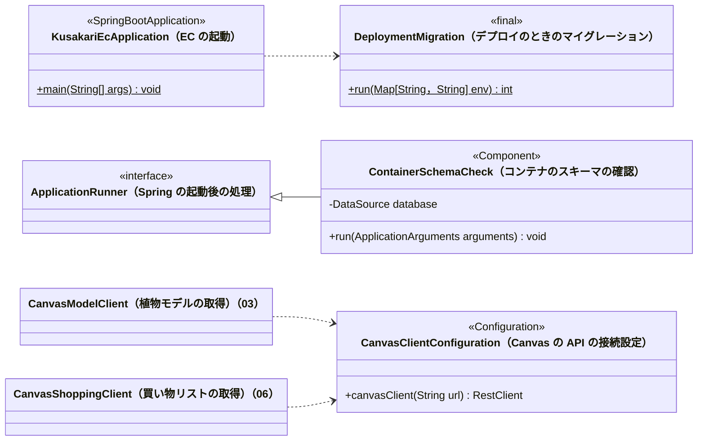

### 線とコードの対応

| 線 | コード |
| --- | --- |
| KusakariEcApplication → DeploymentMigration | 引数が `migrate` だけのとき、`System.exit(DeploymentMigration.run(System.getenv()))` |
| ApplicationRunner ← ContainerSchemaCheck | `implements ApplicationRunner` |
| CanvasModelClient・CanvasShoppingClient → CanvasClientConfiguration | `@Qualifier("canvasClient") RestClient` で、`canvasClient` の Bean を受け取る |

### 部品の決まり

| 部品 | 決まり |
| --- | --- |
| `DeploymentMigration.run` | 環境変数 `KUSAKARI_EC_DB_URL`・`KUSAKARI_EC_DB_USER`・`KUSAKARI_EC_DB_PASSWORD` で DB につなぎ、`flyway.migrate()` を実行します。既存の DB に未適用のマイグレーションがあるときは、`KUSAKARI_EC_MIGRATION_BACKUP_REFERENCE` に RDS のスナップショットの ARN が無ければ止めます。成功で 0、失敗で 1 を返します。 |
| `ContainerSchemaCheck` | プロファイル `container` のときだけ動きます（`@Profile("container")`）。`flyway.validate()` の後、未適用のマイグレーションがあれば起動を止めます。 |
| `CanvasClientConfiguration.canvasClient` | Bean の名前は `canvasClient`、送り先は `kusakari.ec.canvas-api-url` です。要求の `KUSAKARI_SESSION` の Cookie と `X-CSRF-TOKEN` を、Canvas への要求に付けます。接続 3 秒・読み取り 10 秒で切ります。 |

## 図 2 common.web エラー応答と接続元の確認

モジュールの図です。応答の本文 `ApiErrors.ErrorView` は図 10 にあります。

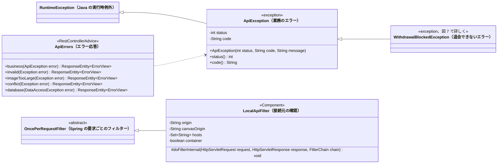

### 線とコードの対応

| 線 | コード |
| --- | --- |
| ApiErrors → ApiException | `business` が `@ExceptionHandler(ApiException.class)` で受け、`status()` と `code()` で応答を作る |
| ApiException ← WithdrawalBlockedException | `member` パッケージのクラス（図 7）。`MemberController` が自分の `@ExceptionHandler` で応答にする |

### ApiErrors が受ける例外

応答の本文は `ErrorView`（`code`、`message`）です。

| メソッド | 受ける例外 | 状態 | `code` |
| --- | --- | --- | --- |
| `business` | `ApiException` | `ApiException.status()` | `ApiException.code()` |
| `invalid` | `MethodArgumentNotValidException`、`HttpMessageNotReadableException`、`MethodArgumentTypeMismatchException`、`HandlerMethodValidationException` | 400 | `INVALID_INPUT` |
| `imageTooLarge` | `MaxUploadSizeExceededException` | 413 | `IMAGE_TOO_LARGE` |
| `conflict` | `OptimisticLockingFailureException`、`DataIntegrityViolationException` | 409 | `DATA_CHANGED` |
| `database` | `DataAccessException` | 503 | `DATABASE_UNAVAILABLE` |

### 部品の決まり

| 部品 | 決まり |
| --- | --- |
| `ApiException` | `common` 以外の 44 のファイルが使います。業務のエラーは、この例外に状態とコードを入れて投げます。 |
| `ApiErrors` を通らない応答 | Spring Security の段階で止まった要求の 401 `LOGIN_REQUIRED` と 403 `FORBIDDEN` は、`AuthConfiguration` の `authenticationEntryPoint` と `accessDeniedHandler` が返します。`SessionValidityFilter` も、受けた `ApiException` から自分で応答を書きます（図 3）。 |
| `LocalApiFilter` | いちばん先に動くフィルターです（`@Order(HIGHEST_PRECEDENCE)`）。Host が `127.0.0.1`・`localhost`（コンテナでは公開の Host も）でないか、`Origin` が EC の画面か Canvas の画面でなければ 403 `ORIGIN_REJECTED` を返します。コンテナでのヘルスチェック（`GET /api/health`、`/api/health/ready`）は Host を確かめません。許可した `Origin` には CORS のヘッダーを付け、`OPTIONS` には 204 を返します。すべての応答に `X-Kusakari-EC-Backend: spring-boot`、`Cache-Control: no-store`、`X-Content-Type-Options: nosniff` を付けます。コンテナで `KUSAKARI_PRIVATE_PREVIEW` が `true` でなければ起動を止めます。 |

## 図 3 Spring Security の設定と Cognito の呼び出し

モジュールの図です。`CognitoPasswordLogin.Login` と `CognitoPasswordLogin.Tokens` は図 10 にあります。

```mermaid
classDiagram
    direction LR
    class AuthConfiguration["AuthConfiguration（認証の設定）"] {
        <<Configuration>>
        ~cognitoClients(String clientId, String issuer, String domain, String origin) ClientRegistrationRepository
        ~demoSecurity(HttpSecurity http, Environment environment) SecurityFilterChain
        ~cognitoSecurity(HttpSecurity http, AuthService members, ClientRegistrationRepository clients, ObjectMapper json, AuthUrls urls, CognitoPasswordLogin passwords) SecurityFilterChain
    }
    class OncePerRequestFilter["OncePerRequestFilter（Spring の要求ごとのフィルター）"] {
        <<abstract>>
    }
    class SessionValidityFilter["SessionValidityFilter（ログインの有効性の確認）"] {
        -ObjectMapper json
        #doFilterInternal(HttpServletRequest request, HttpServletResponse response, FilterChain chain) void
    }
    class AuthService["AuthService（ログイン中の会員と権限）"] {
        <<Service、図 5 で詳しく>>
    }
    class CognitoPasswordLogin["CognitoPasswordLogin（Cognito のパスワードログイン）"] {
        <<Service>>
        -RestClient client
        -String clientId
        -NimbusJwtDecoder decoder
        +authenticate(String email, String password) Login
        +refresh(String refreshToken, String subject) OidcUser
        +changePassword(String email, String subject, String previous, String proposed) void
    }
    class CognitoRefreshSession["CognitoRefreshSession（リフレッシュトークンの保管）"] {
        <<final>>
        ~String ATTRIBUTE$
        ~store(HttpServletRequest request, String refreshToken)$ void
        ~find(HttpServletRequest request)$ String
    }
    class AuthUrls["AuthUrls（認証の戻り先の URL）"] {
        <<Component>>
        -String origin
        -String canvasOrigin
        -String domain
        -String clientId
        +webOrigin() String
        +safeReturn(String target) String
        +logout() String
    }
    class CognitoSignup["CognitoSignup（Cognito の会員登録）"] {
        <<Service>>
        -RestClient client
        -String clientId
        -String issuer
        +issuer() String
        +signUp(String email, String password) String
        +confirm(String email, String code) void
        +resend(String email) void
    }

    OncePerRequestFilter <|-- SessionValidityFilter
    AuthService "1" <-- SessionValidityFilter : members
    SessionValidityFilter --> "1" CognitoPasswordLogin : passwords
    SessionValidityFilter ..> CognitoRefreshSession
    AuthConfiguration ..> SessionValidityFilter
    AuthConfiguration ..> AuthService
    AuthConfiguration ..> CognitoRefreshSession
    AuthConfiguration ..> AuthUrls
```

### 線とコードの対応

| 線 | コード |
| --- | --- |
| AuthConfiguration → SessionValidityFilter | `cognitoSecurity` が `new SessionValidityFilter(members, passwords, json)` を作り、`addFilterBefore(…, AuthorizationFilter.class)` で加える |
| AuthConfiguration → AuthService | ログインの成功で `provision()` と `current()` |
| AuthConfiguration → AuthUrls | ログインの成功で `safeReturn()`、失敗で `webOrigin()`、ログアウトで `logout()` |
| AuthConfiguration → CognitoRefreshSession | ログインの成功で `store()` |
| SessionValidityFilter → AuthService | `AuthService.idTokenValid()` と `current()` |
| SessionValidityFilter → CognitoPasswordLogin | ID トークンの期限が切れたときに `refresh()` |
| SessionValidityFilter → CognitoRefreshSession | `find()` でリフレッシュトークンを読む |

### 部品の決まり

| 部品 | 決まり |
| --- | --- |
| `kusakari.auth.mode` | `cognitoClients`・`cognitoSecurity`・`CognitoPasswordLogin`・`CognitoSignup` は `cognito` のときだけ作られます。`demoSecurity` は `demo` のときで、`kusakari.test-auth` が `true` でなければ起動を止めます（CSRF を切り、すべての要求を通す）。 |
| `cognitoSecurity` の認可 | ログイン・登録・ヘルスチェックと、商品・店舗・カテゴリの GET、`/api/products/references`、`/api/materials/quote`、Stripe の通知（`POST /api/payments/stripe/webhook`）を認証なしで通し、ほかの要求はログインを求めます。CSRF は `/api/products/references`、`/api/materials/quote`、Stripe の通知だけ確かめません。 |
| `oauth2Login` | Cognito の Hosted UI でのログインです（PKCE）。認可の入口は `/api/auth/authorize/cognito`、戻り先は `/api/auth/callback/*` です。成功すると `AuthService.provision()` で会員を作り、リフレッシュトークンを `CognitoRefreshSession.store()` でセッションに入れ、`AUTH_RETURN_TO` へ移します。失敗すると `/account/login?auth=failed` へ移します。 |
| `logout` | `POST /api/auth/logout` で `KUSAKARI_SESSION` の Cookie を消し、Cognito のログアウトの URL（`logoutUrl`）を JSON で返します。 |
| `SessionValidityFilter` | ログイン中の要求のたびに（ログインとログアウトのパスを除く）、期限の切れた ID トークンをリフレッシュトークンで更新し、`AuthService.current()` で会員が使えるかを確かめます。`ApiException` を受けたら、503 のときを除いてセッションを消し、`status`・`code`・`message` の JSON を返します。`/api/auth/me` の 401 だけは、そのまま Controller に通します。 |
| `CognitoPasswordLogin`・`CognitoSignup` | Cognito の API（`AWSCognitoIdentityProviderService` の `InitiateAuth`、`ChangePassword`、`SignUp`、`ConfirmSignUp`、`ResendConfirmationCode`）を `RestClient` で直接呼びます。Cognito のエラーは `ApiException` に変えます（`EMAIL_IN_USE`、`PASSWORD_REJECTED`、`CODE_MISMATCH`、`CODE_EXPIRED`、`ALREADY_CONFIRMED`、`AUTH_RATE_LIMITED`、`INVALID_SIGNUP`、`CODE_DELIVERY_FAILED`、`AUTH_UNAVAILABLE` など）。 |
| `AuthUrls.safeReturn` | ログイン後の戻り先を、EC の画面か Canvas の画面の URL に限ります。それ以外と `/account/login`・`/api/auth/` は EC の画面のトップにします。 |

## 図 4 認証の Controller

モジュールの図です。入力の record（`LoginRequest` など）と応答の `AuthService.SessionView` は図 10 にあります。

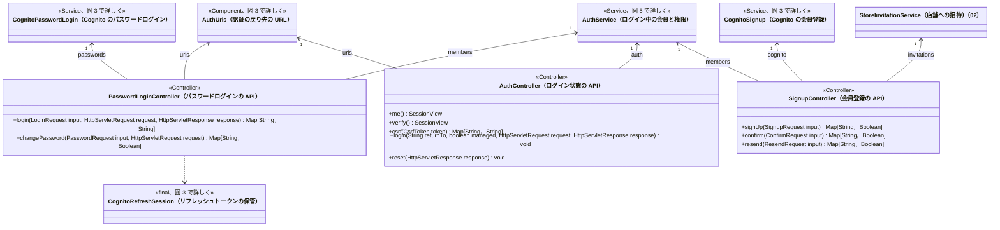

### API と受け口

| HTTP | パス | 受け口 | 入力 | 応答 |
| --- | --- | --- | --- | --- |
| GET | `/api/auth/me` | `AuthController.me` | なし | `SessionView`（ログインしていなくても 200） |
| POST | `/api/auth/verify` | `AuthController.verify` | なし | `SessionView`（ログインしていなければ 401） |
| GET | `/api/auth/csrf` | `AuthController.csrf` | なし | `headerName`・`token` |
| GET | `/api/auth/login` | `AuthController.login` | クエリ `returnTo`、`managed` | リダイレクト |
| GET | `/api/auth/reset` | `AuthController.reset` | なし | `/api/auth/login?managed=true` へリダイレクト |
| POST | `/api/auth/login` | `PasswordLoginController.login` | `LoginRequest` | `returnTo` |
| PUT | `/api/account/password` | `PasswordLoginController.changePassword` | `PasswordRequest` | `changed` |
| POST | `/api/auth/signup` | `SignupController.signUp` | `SignupRequest` | `codeSent` |
| POST | `/api/auth/signup/confirm` | `SignupController.confirm` | `ConfirmRequest` | `confirmed` |
| POST | `/api/auth/signup/resend` | `SignupController.resend` | `ResendRequest` | `codeSent` |

### 線とコードの対応

| 線 | コード |
| --- | --- |
| AuthController → AuthService | `me()` が `session()`、`verify()` が `current()` と `session()`、`login()`・`reset()` が `enabled()` |
| AuthController → AuthUrls | `login()` が `webOrigin()` と `safeReturn()` |
| PasswordLoginController → CognitoPasswordLogin | `login()` が `authenticate()`、`changePassword()` が `changePassword()` |
| PasswordLoginController → AuthService | `login()` が `provision()` と `current()`、`changePassword()` が `current()` |
| PasswordLoginController → AuthUrls | `login()` が `safeReturn()` |
| PasswordLoginController → CognitoRefreshSession | `login()` が `store()` |
| SignupController → CognitoSignup | `signUp()`・`issuer()`・`confirm()`・`resend()` |
| SignupController → AuthService | 企業様向けの登録で `registerApplicant()` |
| SignupController → StoreInvitationService | 招待キーがあるときに `register()`（[02_店舗と組織](<02_店舗と組織.md>)） |

### 決まり

- `AuthController.login()` は、`managed` が `false` なら EC の画面のログイン（`/account/login`）へ、`true` なら `/api/auth/authorize/cognito`（Hosted UI）へ移します。`login()` と `reset()` は、`kusakari.auth.mode` が `cognito` でなければ 503 です。パスワードの再設定は Cognito の画面で行います。
- `PasswordLoginController` と `SignupController` は、`kusakari.auth.mode` が `cognito` のときだけ作られます。`PasswordLoginController.login()` は、`CognitoPasswordLogin.authenticate()` の後に `AuthService.provision()` で会員を作り、セッション ID を変えてから、リフレッシュトークンと CSRF のトークンをセッションに入れます。`changePassword()` は、新しいパスワードと確認用が違えば 400 `PASSWORD_MISMATCH`、成功するとセッションを消します。
- `SignupController.signUp()` は、パスワードと確認用が違えば 400 `PASSWORD_MISMATCH` です。招待キーがあれば `StoreInvitationService.register()` に任せ（招待キーと `business` の両方があれば 400 `INVALID_SIGNUP`）、`business` が `true` なら `AuthService.registerApplicant()` で申請中の会員（`SHOP_OWNER_APPLICANT`）を作ります。購入者の会員は、初めてログインしたときに `provision()` が作ります。

## 図 5 会員と権限の判定

モジュールの図です。会員の Entity `AuthMember` は図 9、応答の `AuthService.SessionView` は図 10 にあります。

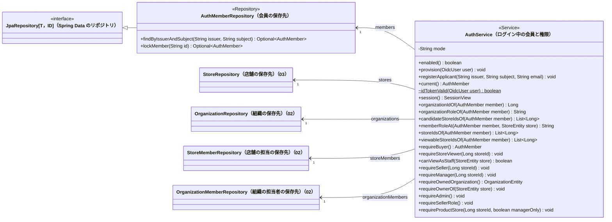

### 線とコードの対応

| 線 | コード |
| --- | --- |
| JpaRepository ← AuthMemberRepository | `extends JpaRepository<AuthMember, String>` |
| AuthService → AuthMemberRepository | `provision()`・`registerApplicant()` が `findByIssuerAndSubject()` と `saveAndFlush()`、`current()` が `findByIssuerAndSubject()` |
| AuthService → StoreRepository | `findById()`、`findByOrganizationIdOrderByIdAsc()` |
| AuthService → OrganizationRepository | `findByOwnerMemberId()` |
| AuthService → StoreMemberRepository | `findById()`、`findAllForMember()`、`existsById()` |
| AuthService → OrganizationMemberRepository | `findForMember()`（組織と人事のロール、除名されたか） |

### 決まり

| 部品 | 決まり |
| --- | --- |
| `AuthMemberRepository.lockMember` | `@Lock(PESSIMISTIC_WRITE)` で会員の行をロックして読みます（`MemberCartService` が使う） |
| `AuthService.provision` | メールが確認済みでなければ 403 `EMAIL_UNVERIFIED`。初めてログインした購入者の会員（`USER`）を作ります。会員があればメール確認済みにするだけです。表示名は Cognito の名前（無ければメールアドレス）の先頭 120 文字です。 |
| `AuthService.current` | ログイン中の会員を `members` から読みます。ログインしていない・ID トークンの期限切れは 401 `LOGIN_REQUIRED`、停止中と退会済み（`enabled` が `false`）は 403 `ACCOUNT_DISABLED`、組織から除名された担当者は 403 `ACCOUNT_EXPELLED` です。 |
| `require…()` | 足りなければ 403 `FORBIDDEN` を投げます。`requireBuyer()` は購入者と運営だけを通し（403 `BUYER_REQUIRED`）、`requireProductStore()` は扱えない店舗の商品を 404 `PRODUCT_NOT_FOUND` にします。`kusakari.auth.mode` が `cognito` でないとき（`enabled()` が `false`）は、多くの `require…()` が何も確かめずに戻ります。 |
| `memberRoleAt` | その店舗での立場を `OWNER`・`MANAGER`・`STAFF`・`NONE`（所属でロールなし）・`ADMIN`（運営）か、担当でなければ空で返します。 |
| ほかのパッケージの Repository | `StoreRepository` は `catalog`（[03_商品カタログ](<03_商品カタログ.md>)）、ほかの 3 つは `store`（[02_店舗と組織](<02_店舗と組織.md>)）のクラスです。 |

## 図 6 店舗での立場と会員のカート

モジュールの図です。`StoreCapabilityPolicy.Capability` と `StoreCapabilityPolicy.Position` は図 11 にあります。

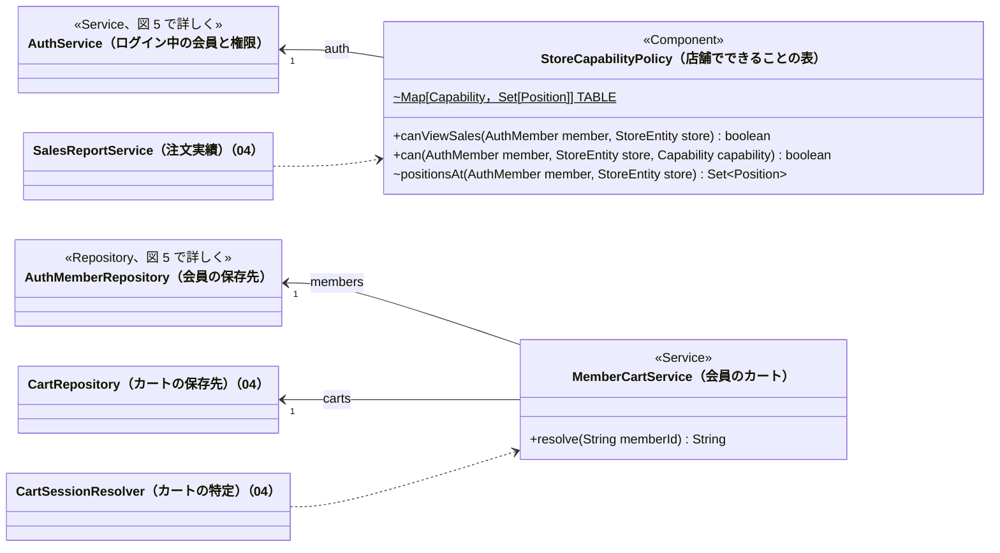

### 線とコードの対応

| 線 | コード |
| --- | --- |
| StoreCapabilityPolicy → AuthService | `positionsAt()` が `memberRoleAt()`、`organizationRoleOf()`、`organizationIdOf()` |
| SalesReportService → StoreCapabilityPolicy | `canViewSales()` |
| MemberCartService → AuthMemberRepository | `resolve()` が `lockMember()` で会員の行をロックする |
| MemberCartService → CartRepository | `findByMemberId()`、無ければ `CartEntity` を作って `saveAndFlush()` |
| CartSessionResolver → MemberCartService | `resolve()`（[04_カートと注文](<04_カートと注文.md>)） |

### 店舗でできることの表（`TABLE`）

今は注文実績を見られるかだけを決めます。立場は `AuthService.memberRoleAt()` と `organizationRoleOf()` から求めます。

| できること | 使う店舗 | オーナー | ORG_ADMIN | MANAGER | STAFF | 運営 |
| --- | --- | --- | --- | --- | --- | --- |
| `VIEW_STORE_SALES` | 営業中・閉鎖中 | ○ | × | ○ | ○ | ○ |
| `VIEW_CLOSED_STORE_SALES` | 閉鎖済み（`closedAt` あり） | ○ | ○ | × | × | ○ |

運営が停止した営業中の店舗は、運営だけが見られます。`ORG_ADMIN` は、同じ組織の店舗なら店舗のロールと併せて持ちます。

## 図 7 member の Controller と Service

モジュールの図です。`MemberService.PickupContact`、`MemberService.Member`、`MemberController.EnabledRequest`、`MemberController.WithdrawalBlockedView`、`WithdrawalBlockedException.BlockingOrder` は図 11 にあります。

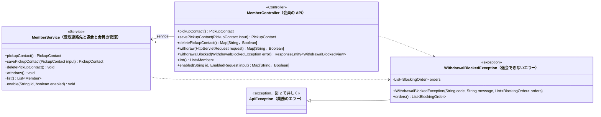

### API と受け口

| HTTP | パス | 受け口 | 入力 | 応答 | 使える人 |
| --- | --- | --- | --- | --- | --- |
| GET | `/api/account/pickup-contact` | `pickupContact` | なし | `PickupContact`（無ければ空の文字列 3 つ） | ログイン中の会員 |
| PUT | `/api/account/pickup-contact` | `savePickupContact` | `PickupContact` | `PickupContact` | ログイン中の会員 |
| DELETE | `/api/account/pickup-contact` | `deletePickupContact` | なし | `deleted` | ログイン中の会員 |
| DELETE | `/api/account` | `withdraw` | なし | `withdrawn`。退会できなければ 409 の `WithdrawalBlockedView` | 運営以外の会員 |
| GET | `/api/operator/members` | `list` | なし | `List<Member>` | 運営（`requireAdmin()`） |
| PUT | `/api/operator/members/{id}/enabled` | `enabled` | `EnabledRequest` | `enabled` | 運営（`requireAdmin()`） |

### 線とコードの対応

| 線 | コード |
| --- | --- |
| MemberController → MemberService | 各受け口が同じ名前のメソッドを呼ぶ（`enabled` は `enable()`） |
| MemberController → WithdrawalBlockedException | `@ExceptionHandler(WithdrawalBlockedException.class)` の `withdrawalBlocked()` が、`status()`・`code()`・`orders()` で `WithdrawalBlockedView` を作る |
| MemberService → WithdrawalBlockedException | `withdraw()` が投げる |
| ApiException ← WithdrawalBlockedException | `extends ApiException`。状態はいつも 409 |

### エラー

| メソッド | 状態 | `code` | とき |
| --- | --- | --- | --- |
| `withdraw` | 409 | `ADMIN_REQUIRED` | 運営は退会できない |
| `withdraw` | 409 | `WITHDRAWAL_ACCOUNT_CHANGED` | ロックを待つ間に担当者からオーナーになった |
| `withdraw` | 409 | `WITHDRAWAL_OPEN_ORDERS` | 購入者の未完了の注文がある（`orders` にその注文を入れる） |
| `withdraw` | 409 | `WITHDRAWAL_LISTED_PRODUCTS` | オーナーの組織の店舗に出品中の商品がある |
| `withdraw` | 409 | `WITHDRAWAL_STORE_ORDERS` | オーナーの組織の店舗に未完了の注文かキャンセル申請がある |
| `enable` | 404 | `MEMBER_NOT_FOUND` | 会員がない |
| `enable` | 409 | `MEMBER_FIXED` | 運営か退会済みの会員 |

`withdraw()` の後、`MemberController` がセッションを無効にします。

## 図 8 member の永続化と、MemberService が使うクラス

モジュールの図です。受取連絡先の Entity `PickupContactEntity` は図 9 にあります。

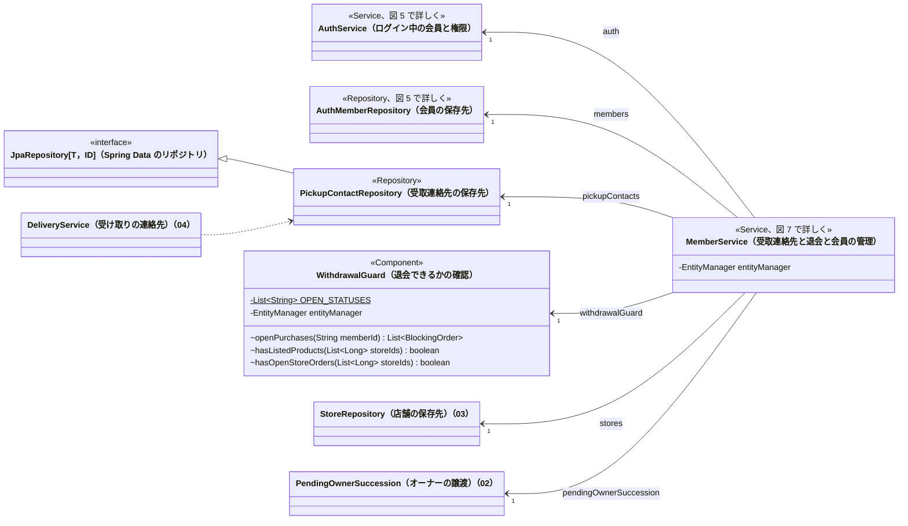

### 線とコードの対応

| 線 | コード |
| --- | --- |
| MemberService → AuthService | `current()`、`storeIdsOf()`、`requireAdmin()` |
| MemberService → AuthMemberRepository | `list()` が `findAll()`、`lockMember()`（private）が `findById()` |
| MemberService → PickupContactRepository | `findById()`、`save()`、`deleteById()` |
| MemberService → WithdrawalGuard | `withdraw()` が `openPurchases()`、`hasListedProducts()`、`hasOpenStoreOrders()` |
| MemberService → StoreRepository | `withdraw()` がオーナーのときに `lock()` |
| MemberService → PendingOwnerSuccession | `lockOrganizationOf()`、`invalidateFor()`、`invalidateForOwner()`（[02_店舗と組織](<02_店舗と組織.md>)） |
| JpaRepository ← PickupContactRepository | `extends JpaRepository<PickupContactEntity, String>`。メソッドは宣言していない |
| DeliveryService → PickupContactRepository | 注文の受取連絡先を作るために `findById()`（[04_カートと注文](<04_カートと注文.md>)） |

### 決まり

| 部品 | 決まり |
| --- | --- |
| `withdraw` のロック | 行を「店舗 → 組織 → 会員」の順にロックします。店舗はオーナーのときだけ `StoreRepository.lock()`、組織は `PendingOwnerSuccession.lockOrganizationOf()`、会員は `lockMember()`（`EntityManager.refresh()` で `PESSIMISTIC_WRITE`）です。 |
| `enable` のロック | 停止するときだけ組織をロックしてから会員をロックし、再開のときは会員だけをロックします。 |
| オーナーの譲渡 | 退会と停止では、承認待ちのオーナーの譲渡があれば、`PendingOwnerSuccession.invalidateFor()` と `invalidateForOwner()` で無効にします。 |
| `WithdrawalGuard` | パッケージの中だけのクラスです。JPQL で `OrderEntity`、`InventoryEntity`、`ProductEntity` を数えます。「未完了」の注文は、`status` が `ACCEPTED` か `READY`（`OPEN_STATUSES`）、または `cancellationStatus` が `PENDING` の注文です。出品中の商品は、在庫の `publicationStatus` が `PUBLISHED` の商品です。 |

## 図 9 会員と、会員を指す Entity

データの図です。このパッケージの Entity は `AuthMember`（`members`）と `PickupContactEntity`（`member_pickup_contacts`）の 2 つです。ほかのパッケージの Entity のうち、会員を指す主なものを（02）〜（07）を付けて載せ、会員を指す列だけを書きました。Entity に JPA の関連は無いので、線は DB の外部キーから描いています。`OrganizationEntity.pendingOwnerMemberId`（承認待ちの譲渡先）の線は、`ownerMemberId` の線と重なって多重度が読めなくなるので図から外し、下の「関連と外部キー」の表に書きました。

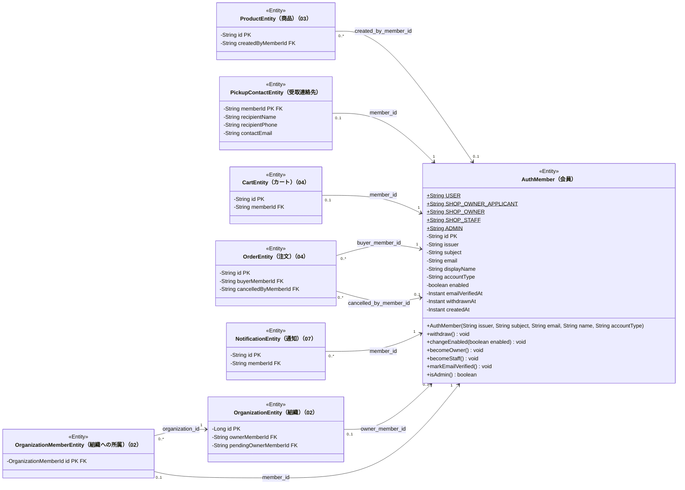

### Entity とテーブル

| Entity | テーブル | 列の補足 | 主な使い手 |
| --- | --- | --- | --- |
| `AuthMember` | `members` | `issuer` と `subject` の組は一意（`uk_members_issuer_subject`）で、Cognito の利用者と 1 対 1 です。`id` と `account_type` の組も一意（`uk_members_id_type`）で、組織と担当者の外部キーが種別まで指します。`accountType` は定数の `USER`（購入者）、`SHOP_OWNER_APPLICANT`（申請中）、`SHOP_OWNER`（オーナー）、`SHOP_STAFF`（担当者）、`ADMIN`（運営）のどれかで、DB の `ck_members_account_type` も同じ値に限ります。`emailVerifiedAt`・`withdrawnAt` は NULL 可、`createdAt` は DB が入れます。会員の行は消しません（退会・停止・除名は列で表す）。 | `AuthService`、`MemberService`、`MemberCartService` |
| `PickupContactEntity` | `member_pickup_contacts` | 主キーの `memberId` が会員の ID で、会員ごとに 0 か 1 行です。Entity の `length` は `recipientName` 100・`recipientPhone` 30・`contactEmail` 200 ですが、V1 の列は 120・40・255 です。 | `MemberService`、`DeliveryService`（04） |

### 状態を変えるメソッド

| メソッド | 変えること | 使うところ |
| --- | --- | --- |
| `AuthMember(issuer, subject, email, name, accountType)` | `id` に新しい UUID を入れて作る | `AuthService.provision()`（`USER`）、`registerApplicant()`（`SHOP_OWNER_APPLICANT`）、`StoreInvitationService`（02） |
| `withdraw()` | `enabled` を `false`、`withdrawnAt` に今の日時 | `MemberService.withdraw()` |
| `changeEnabled()` | 運営による停止・再開 | `MemberService.enable()` |
| `becomeOwner()`・`becomeStaff()` | `accountType` を `SHOP_OWNER`・`SHOP_STAFF` に。出店申請の承認とオーナーの譲渡 | `StoreApplicationService.decide()`、`OwnerSuccessionService`（02） |
| `markEmailVerified()` | `emailVerifiedAt` が空なら今の日時 | `AuthService.provision()` |

### 関連と外部キー

どの外部キーにも `ON DELETE` の指定はありません（会員は消さないため）。

| 関連 | 外部キーの名前 | 多重度の根拠 | 載せた図 |
| --- | --- | --- | --- |
| `PickupContactEntity` 0..1 — 1 `AuthMember` | `fk_pickup_contacts_member` | `member_id` が主キー | この図 |
| `OrganizationEntity` 0..1 — 0..1 `AuthMember`（オーナー） | `fk_organizations_owner`（`owner_member_id`, `owner_account_type`） | `owner_member_id` は NULL 可で一意（`uk_organizations_owner`） | 02 |
| `OrganizationEntity` 0..* — 0..1 `AuthMember`（承認待ちの譲渡先） | `fk_organizations_pending_owner`（V6） | `pending_owner_member_id` は NULL 可、一意ではない | 02（この図では線を省いた） |
| `OrganizationMemberEntity` 0..1 — 1 `AuthMember` | `fk_org_members_member`（`member_id`, `member_account_type`） | `member_id` は NULL 不可で一意（`uk_org_members_member`）。主キーは `organization_id` と `member_id` の組 | 02 |
| `OrganizationMemberEntity` 0..* — 1 `OrganizationEntity` | `fk_org_members_org` | `organization_id` は NULL 不可 | 02 |
| `ProductEntity` 0..* — 0..1 `AuthMember`（追加した人） | `fk_products_created_by`（V7） | `created_by_member_id` は NULL 可（初期データの商品は空） | 03 |
| `CartEntity` 0..1 — 1 `AuthMember` | `fk_carts_member` | `member_id` は NULL 不可で一意（`uk_carts_member`） | 04 |
| `OrderEntity` 0..* — 1 `AuthMember`（買った人） | `fk_orders_buyer` | `buyer_member_id` は NULL 不可 | 04 |
| `OrderEntity` 0..* — 0..1 `AuthMember`（キャンセルした人） | `fk_orders_cancelled_by` | `cancelled_by_member_id` は NULL 可 | 04 |
| `NotificationEntity` 0..* — 1 `AuthMember` | `fk_notifications_member` | `member_id` は NULL 不可 | 07 |

ほかにも、`payments.buyer_member_id`（05）、`refunds.requested_by_member_id`（05）、`store_applications.applicant_member_id`（02）、`store_invitations.issued_by_member_id`（02）、`store_invitation_uses.member_id`（02）、`product_moderation_events`・`store_moderation_events`・`organization_moderation_events` の `actor_member_id`（07・02）、`organization_member_events` の `actor_member_id`・`target_member_id`（02）が `members.id` を指します。`store_members` は `members` ではなく `organization_members` を指します。

`ProductRepository`（03）は、8892344 で `ProductEntity` と `AuthMember` を JPQL で結び（`join AuthMember m on m.id = p.createdByMemberId`）、商品を追加した会員の表示名（`ProductCreatorName`）を読むようになりました。退会・停止・除名された会員も行が残るので、名前はそのまま返します。

## 図 10 認証と共通の DTO

データの図です。API の入力と応答の record と、Cognito を呼んだ結果の record です。互いを持つ関連はありません。

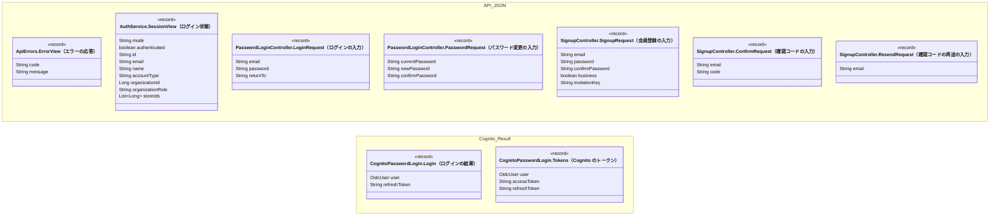

### 使うところと値の制約

| record | 使うところ | 値の制約・補足 |
| --- | --- | --- |
| `ApiErrors.ErrorView` | `ApiErrors` の応答の本文（図 2） | |
| `AuthService.SessionView` | `GET /api/auth/me`、`POST /api/auth/verify` の応答 | `mode` は `cognito` か `demo`。ログインしていなければ `authenticated` が `false` で、ほかは空と空の配列。`name` は `AuthMember.displayName`。`organizationId`・`organizationRole` はオーナーと担当者だけ |
| `PasswordLoginController.LoginRequest` | `POST /api/auth/login` の入力 | `email` はメールアドレスで 254 文字まで、`password` は 256 文字まで（どちらも必須）、`returnTo` は 2048 文字まで |
| `PasswordLoginController.PasswordRequest` | `PUT /api/account/password` の入力 | どれも必須で 256 文字まで。`newPassword` は 8 文字以上 |
| `SignupController.SignupRequest` | `POST /api/auth/signup` の入力 | `email` はメールアドレスで 254 文字まで、`password` は 8〜256 文字、`confirmPassword` は 256 文字まで。`invitationKey` は空か `StoreInvitationService.KEY_PATTERN`（前後の空白は可） |
| `SignupController.ConfirmRequest` | `POST /api/auth/signup/confirm` の入力 | `code` は数字 6 桁（前後の空白は可） |
| `SignupController.ResendRequest` | `POST /api/auth/signup/resend` の入力 | `email` はメールアドレスで 254 文字まで |
| `CognitoPasswordLogin.Login` | `authenticate()` の戻り値（`PasswordLoginController.login()` が使う） | public。リフレッシュトークンはサーバーのセッションにだけ置き、画面には返さない |
| `CognitoPasswordLogin.Tokens` | `CognitoPasswordLogin` の中だけ（private） | `InitiateAuth` の結果 |

パスワードかトークンを持つ record（`LoginRequest`、`PasswordRequest`、`SignupRequest`、`Login`、`Tokens`）は、`toString()` で値を出しません。

## 図 11 会員の DTO と店舗での立場の enum

データの図です。会員の API の入力と応答の record と、`StoreCapabilityPolicy` の enum です。

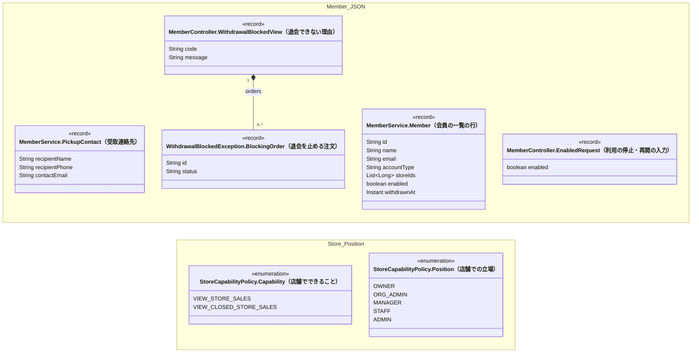

### 使うところと値の制約

| 型 | 使うところ | 値の制約・補足 |
| --- | --- | --- |
| `MemberService.PickupContact` | 受取連絡先の API の入力と応答の両方 | `recipientName` は 100 文字まで、`recipientPhone` は `[0-9+() -]{0,30}`、`contactEmail` はメールアドレスで 200 文字まで（どれも必須）。保存のとき `recipientName` の前後の空白を除く |
| `MemberService.Member` | `GET /api/operator/members` の応答の行 | `name` は `AuthMember.displayName`、`storeIds` は `AuthService.storeIdsOf()`。`withdrawnAt` は退会していなければ空 |
| `MemberController.EnabledRequest` | `PUT /api/operator/members/{id}/enabled` の入力 | |
| `MemberController.WithdrawalBlockedView` | `DELETE /api/account` の 409 の応答 | `code` は図 7 の「エラー」の表の `WITHDRAWAL_…` |
| `WithdrawalBlockedException.BlockingOrder` | `WithdrawalBlockedView.orders` と `WithdrawalBlockedException.orders` | `WITHDRAWAL_OPEN_ORDERS` のときだけ入る。新しい注文から並ぶ |
| `StoreCapabilityPolicy.Capability`・`Position` | `StoreCapabilityPolicy.TABLE`（図 6） | 対応は図 6 の「店舗でできることの表」 |

### 関連の多重度の根拠

| 関連 | 根拠 |
| --- | --- |
| `WithdrawalBlockedView` 1 — 0..* `BlockingOrder` | `List<WithdrawalBlockedException.BlockingOrder> orders`。上限は無い。`WITHDRAWAL_OPEN_ORDERS` 以外では空の配列 |

## クラスとコードの対応

担当のパッケージの 43 の型（ファイル 27、入れ子の record と enum 16）を、すべてどれかの図に載せました。

| クラス | ファイル | 図 |
| --- | --- | --- |
| `KusakariEcApplication` | [KusakariEcApplication.java](https://github.com/abeouga/kusakari-ec/blob/8892344/backend/src/main/java/jp/kusakari/ec/KusakariEcApplication.java) | 図 1 |
| `CanvasClientConfiguration` | [common/CanvasClientConfiguration.java](https://github.com/abeouga/kusakari-ec/blob/8892344/backend/src/main/java/jp/kusakari/ec/common/CanvasClientConfiguration.java) | 図 1 |
| `ContainerSchemaCheck` | [common/ContainerSchemaCheck.java](https://github.com/abeouga/kusakari-ec/blob/8892344/backend/src/main/java/jp/kusakari/ec/common/ContainerSchemaCheck.java) | 図 1 |
| `DeploymentMigration` | [common/DeploymentMigration.java](https://github.com/abeouga/kusakari-ec/blob/8892344/backend/src/main/java/jp/kusakari/ec/common/DeploymentMigration.java) | 図 1 |
| `ApiErrors`、`ApiErrors.ErrorView` | [common/web/ApiErrors.java](https://github.com/abeouga/kusakari-ec/blob/8892344/backend/src/main/java/jp/kusakari/ec/common/web/ApiErrors.java) | 図 2、図 10 |
| `ApiException` | [common/web/ApiException.java](https://github.com/abeouga/kusakari-ec/blob/8892344/backend/src/main/java/jp/kusakari/ec/common/web/ApiException.java) | 図 2、図 7 |
| `LocalApiFilter` | [common/web/LocalApiFilter.java](https://github.com/abeouga/kusakari-ec/blob/8892344/backend/src/main/java/jp/kusakari/ec/common/web/LocalApiFilter.java) | 図 2 |
| `AuthConfiguration` | [auth/AuthConfiguration.java](https://github.com/abeouga/kusakari-ec/blob/8892344/backend/src/main/java/jp/kusakari/ec/auth/AuthConfiguration.java) | 図 3 |
| `SessionValidityFilter` | [auth/SessionValidityFilter.java](https://github.com/abeouga/kusakari-ec/blob/8892344/backend/src/main/java/jp/kusakari/ec/auth/SessionValidityFilter.java) | 図 3 |
| `CognitoRefreshSession` | [auth/CognitoRefreshSession.java](https://github.com/abeouga/kusakari-ec/blob/8892344/backend/src/main/java/jp/kusakari/ec/auth/CognitoRefreshSession.java) | 図 3、図 4 |
| `AuthUrls` | [auth/AuthUrls.java](https://github.com/abeouga/kusakari-ec/blob/8892344/backend/src/main/java/jp/kusakari/ec/auth/AuthUrls.java) | 図 3、図 4 |
| `CognitoPasswordLogin`、`.Login`、`.Tokens` | [auth/CognitoPasswordLogin.java](https://github.com/abeouga/kusakari-ec/blob/8892344/backend/src/main/java/jp/kusakari/ec/auth/CognitoPasswordLogin.java) | 図 3、図 4、図 10 |
| `CognitoSignup` | [auth/CognitoSignup.java](https://github.com/abeouga/kusakari-ec/blob/8892344/backend/src/main/java/jp/kusakari/ec/auth/CognitoSignup.java) | 図 3、図 4 |
| `AuthController` | [auth/AuthController.java](https://github.com/abeouga/kusakari-ec/blob/8892344/backend/src/main/java/jp/kusakari/ec/auth/AuthController.java) | 図 4 |
| `PasswordLoginController`、`.LoginRequest`、`.PasswordRequest` | [auth/PasswordLoginController.java](https://github.com/abeouga/kusakari-ec/blob/8892344/backend/src/main/java/jp/kusakari/ec/auth/PasswordLoginController.java) | 図 4、図 10 |
| `SignupController`、`.SignupRequest`、`.ConfirmRequest`、`.ResendRequest` | [auth/SignupController.java](https://github.com/abeouga/kusakari-ec/blob/8892344/backend/src/main/java/jp/kusakari/ec/auth/SignupController.java) | 図 4、図 10 |
| `AuthService`、`.SessionView` | [auth/AuthService.java](https://github.com/abeouga/kusakari-ec/blob/8892344/backend/src/main/java/jp/kusakari/ec/auth/AuthService.java) | 図 3〜図 8、図 10 |
| `AuthMemberRepository` | [auth/AuthMemberRepository.java](https://github.com/abeouga/kusakari-ec/blob/8892344/backend/src/main/java/jp/kusakari/ec/auth/AuthMemberRepository.java) | 図 5、図 6、図 8 |
| `AuthMember` | [auth/AuthMember.java](https://github.com/abeouga/kusakari-ec/blob/8892344/backend/src/main/java/jp/kusakari/ec/auth/AuthMember.java) | 図 9 |
| `StoreCapabilityPolicy`、`.Capability`、`.Position` | [auth/StoreCapabilityPolicy.java](https://github.com/abeouga/kusakari-ec/blob/8892344/backend/src/main/java/jp/kusakari/ec/auth/StoreCapabilityPolicy.java) | 図 6、図 11 |
| `MemberCartService` | [auth/MemberCartService.java](https://github.com/abeouga/kusakari-ec/blob/8892344/backend/src/main/java/jp/kusakari/ec/auth/MemberCartService.java) | 図 6 |
| `MemberController`、`.EnabledRequest`、`.WithdrawalBlockedView` | [member/controller/MemberController.java](https://github.com/abeouga/kusakari-ec/blob/8892344/backend/src/main/java/jp/kusakari/ec/member/controller/MemberController.java) | 図 7、図 11 |
| `MemberService`、`.PickupContact`、`.Member` | [member/service/MemberService.java](https://github.com/abeouga/kusakari-ec/blob/8892344/backend/src/main/java/jp/kusakari/ec/member/service/MemberService.java) | 図 7、図 8、図 11 |
| `WithdrawalBlockedException`、`.BlockingOrder` | [member/service/WithdrawalBlockedException.java](https://github.com/abeouga/kusakari-ec/blob/8892344/backend/src/main/java/jp/kusakari/ec/member/service/WithdrawalBlockedException.java) | 図 2、図 7、図 11 |
| `WithdrawalGuard` | [member/service/WithdrawalGuard.java](https://github.com/abeouga/kusakari-ec/blob/8892344/backend/src/main/java/jp/kusakari/ec/member/service/WithdrawalGuard.java) | 図 8 |
| `PickupContactEntity` | [member/persistence/entity/PickupContactEntity.java](https://github.com/abeouga/kusakari-ec/blob/8892344/backend/src/main/java/jp/kusakari/ec/member/persistence/entity/PickupContactEntity.java) | 図 9 |
| `PickupContactRepository` | [member/persistence/repository/PickupContactRepository.java](https://github.com/abeouga/kusakari-ec/blob/8892344/backend/src/main/java/jp/kusakari/ec/member/persistence/repository/PickupContactRepository.java) | 図 8 |
| `members`、`member_pickup_contacts` の列と外部キー | [V1__schema.sql](https://github.com/abeouga/kusakari-ec/blob/8892344/backend/src/main/resources/db/migration/V1__schema.sql)、[V6__owner_succession.sql](https://github.com/abeouga/kusakari-ec/blob/8892344/backend/src/main/resources/db/migration/V6__owner_succession.sql)、[V7__sample_products_and_creator.sql](https://github.com/abeouga/kusakari-ec/blob/8892344/backend/src/main/resources/db/migration/V7__sample_products_and_creator.sql) | 図 9 |

## 載せなかったもの

| もの | 理由 | 載せた図 |
| --- | --- | --- |
| private のメソッド（`DeploymentMigration.required`、`SessionValidityFilter.renewIdToken`、`AuthUrls.encode`、`CognitoPasswordLogin` の `authenticateTokens`・`initiateAuth`・`toUser`、`CognitoSignup` の `call`・`errorType`・`translate`、`AuthService` の `limit`・`canManageView`・`requireStoreRole`・`denied`、`MemberService.lockMember`） | クラスの中だけで使う部品のため | 各図の「線とコードの対応」と「決まり」の表 |
| `AuthConfiguration` の中のラムダ（ログインの成功・失敗、ログアウト、401・403 の応答） | クラスではないため | 図 3 の「部品の決まり」 |
| 各クラスのコンストラクター（`AuthMember` と `ApiException`・`WithdrawalBlockedException` を除く） | Spring が値を注入するためのもので、業務の操作ではないため。`@Value` で読む設定の名前は表に書いた | 図 1〜図 3 の表 |
| `SessionValidityFilter` の `members`・`passwords` 以外の Spring の部品（`ObjectMapper` など）の線 | ライブラリーのクラスで、業務のつながりではないため | 箱の属性 |
| 図 9 の `OrganizationEntity.pendingOwnerMemberId` から `AuthMember` への線 | `ownerMemberId` の線と重なり、`AuthMember` の側の多重度が箱に隠れたため | 図 9 の「関連と外部キー」の表 |
| 図 9 の、会員を指すほかの Entity（`PaymentEntity`、`RefundEntity`、`StoreApplicationEntity`、`StoreInvitationEntity` など） | 図が 20 クラスを超えないよう、主なものに絞ったため | 図 9 の「関連と外部キー」の表の下 |
| モジュールの図での Entity・record・enum の箱 | データの図とモジュールの図を混ぜないため | 図 9〜図 11 |

## 確かめられなかったこと

- GitHub と Obsidian での表示は確かめていません。PNG は mermaid-snap（Mermaid 11.4.1）で書き出したものです。
- `WithdrawalGuard` の JPQL が読む `OrderEntity`、`InventoryEntity`、`ProductEntity` の列と、図 9 のほかのパッケージの Entity の列は、外部キーの列と主キーだけを 8892344 で確かめ、ほかの列は 02〜07 の担当に任せています。
- 図 9 の `OrganizationEntity` の `ownerMemberId` の多重度は、DB の一意制約（`uk_organizations_owner`）から書きました。Entity の側には一意の宣言がありません。
