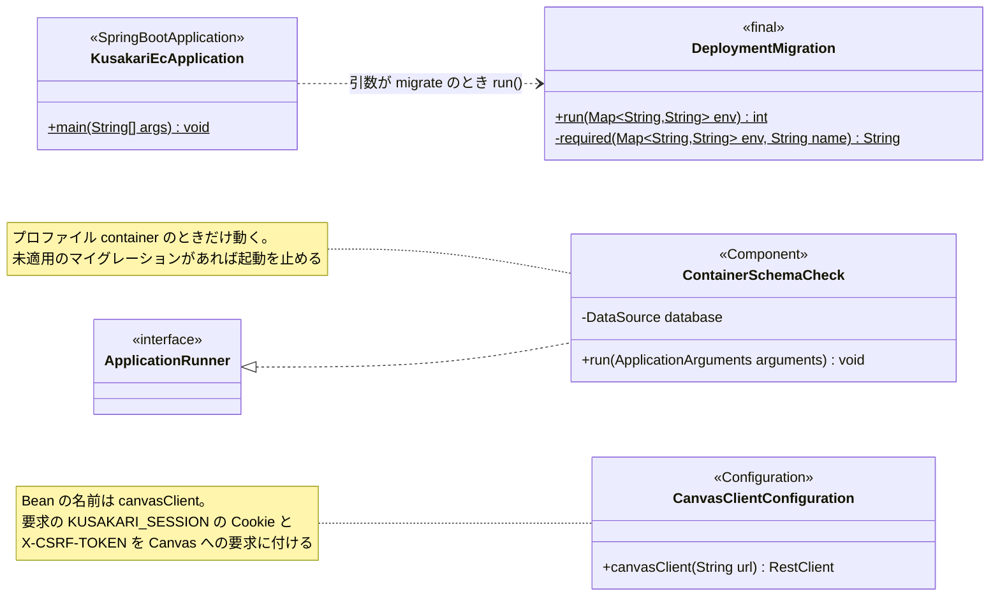
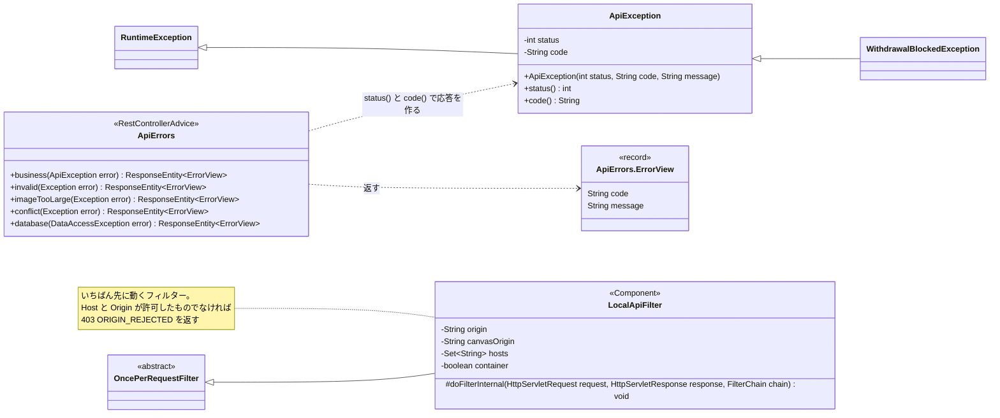
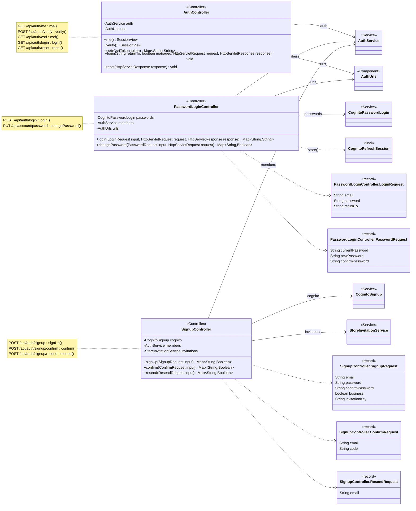
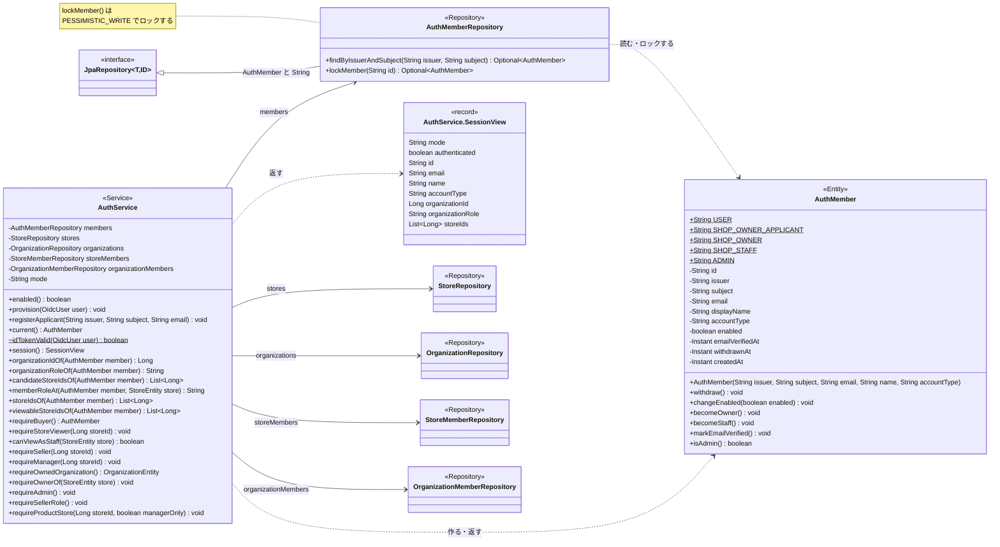
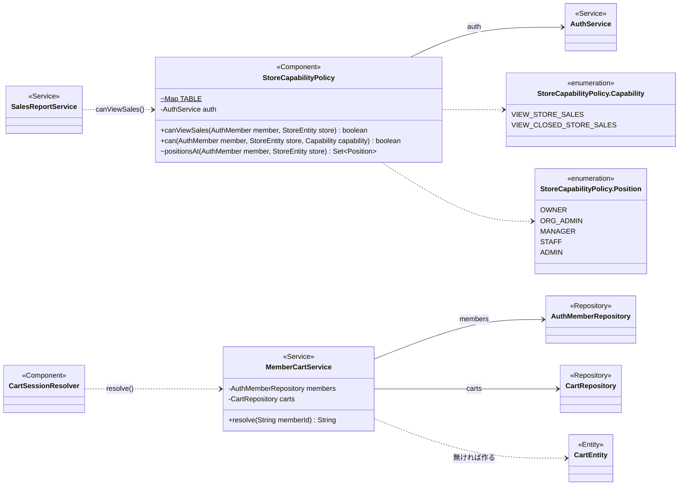
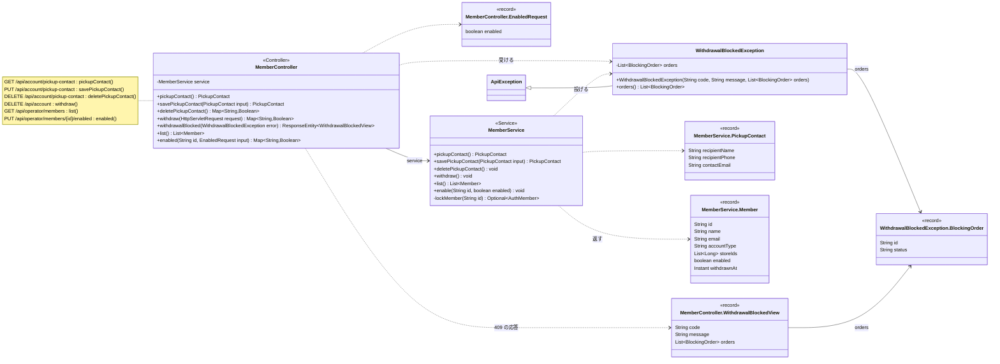
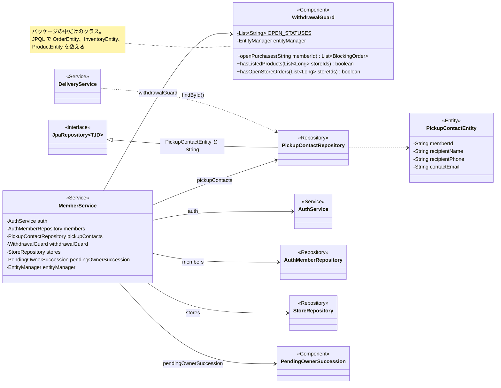

# EC のクラス図 01 共通と認証と会員

起動、すべての API に共通の処理（エラー応答と接続元の確認）、Cognito での認証、会員と権限の判定、受取連絡先と退会のクラスです。

## 対象のコード

- kusakari-ec の main、コミット 19a2be3（2026-11-20 時点）です。
- 対象のパッケージとソースのフォルダー
  - `jp.kusakari.ec` 直下: [KusakariEcApplication.java](https://github.com/abeouga/kusakari-ec/blob/19a2be307ee71a2cd87e538236c3c8c42929c5b3/backend/src/main/java/jp/kusakari/ec/KusakariEcApplication.java)
  - `common`: [backend/src/main/java/jp/kusakari/ec/common](https://github.com/abeouga/kusakari-ec/blob/19a2be307ee71a2cd87e538236c3c8c42929c5b3/backend/src/main/java/jp/kusakari/ec/common)
  - `common.web`: [backend/src/main/java/jp/kusakari/ec/common/web](https://github.com/abeouga/kusakari-ec/blob/19a2be307ee71a2cd87e538236c3c8c42929c5b3/backend/src/main/java/jp/kusakari/ec/common/web)
  - `auth`: [backend/src/main/java/jp/kusakari/ec/auth](https://github.com/abeouga/kusakari-ec/blob/19a2be307ee71a2cd87e538236c3c8c42929c5b3/backend/src/main/java/jp/kusakari/ec/auth)
  - `member`: [backend/src/main/java/jp/kusakari/ec/member](https://github.com/abeouga/kusakari-ec/blob/19a2be307ee71a2cd87e538236c3c8c42929c5b3/backend/src/main/java/jp/kusakari/ec/member)
- パッケージ全体の構成は [00_パッケージ構成](<00_パッケージ構成.md>) を見てください。

## パッケージの役割

| パッケージ | 役割 |
| --- | --- |
| `jp.kusakari.ec` 直下 | 起動します。引数が `migrate` だけのときは、Flyway のマイグレーションだけを実行して終わります。 |
| `common` | Canvas の API を呼ぶ `RestClient` の設定、コンテナで起動するときのスキーマの確認、デプロイのときのマイグレーションです。 |
| `common.web` | すべての API に共通の、エラー応答（`ApiErrors`、`ApiException`）と接続元の確認（`LocalApiFilter`）です。 |
| `auth` | Spring Security の設定、Cognito での認証と登録、会員の Entity（`members`）、会員の種別と店舗のロールによる権限の判定です。層のサブパッケージはありません。 |
| `member` | 受取連絡先（`member_pickup_contacts`）、退会、運営による会員の一覧と利用の停止・再開です。 |

## 読み方の要点

| クラス | テーブル | API |
| --- | --- | --- |
| `AuthMember`、`AuthMemberRepository` | `members` | （直接の API はありません。`AuthService` と `MemberService` が使います） |
| `PickupContactEntity`、`PickupContactRepository` | `member_pickup_contacts` | `GET`・`PUT`・`DELETE /api/account/pickup-contact` |
| `AuthController` | | `GET /api/auth/me`、`POST /api/auth/verify`、`GET /api/auth/csrf`、`GET /api/auth/login`、`GET /api/auth/reset` |
| `PasswordLoginController` | | `POST /api/auth/login`、`PUT /api/account/password` |
| `SignupController` | | `POST /api/auth/signup`、`POST /api/auth/signup/confirm`、`POST /api/auth/signup/resend` |
| `MemberController` | | `/api/account/pickup-contact`、`DELETE /api/account`、`GET /api/operator/members`、`PUT /api/operator/members/{id}/enabled` |
| `AuthConfiguration` の `cognitoSecurity` | | Spring Security が受ける `/api/auth/authorize/cognito`、`/api/auth/callback/cognito`、`POST /api/auth/logout` |

- 会員を表すクラスは `auth` パッケージの `AuthMember` です。`member` パッケージには会員の Entity はありません。
- `AuthService` は、ほかのパッケージを含めて 26 のファイルから使われます。ログイン中の会員（`current()`）と、店舗を操作できるかの判定（`requireSeller()` など）は、ここに集まっています。
- Entity には JPA の関連（`@ManyToOne` など）はありません。`PickupContactEntity.memberId` は ID の文字列で、DB の外部キー `fk_pickup_contacts_member` が `members.id` を指します。テーブルの詳細は [テーブル設計図 01 会員と通知](<../../テーブル設計図/kusakari-ec/01_会員と通知.md>) を見てください。
- 処理の流れは、次のシーケンス図を見てください。
  - [EC-B01 ログインする](<../../シーケンス図/kusakari-ec/EC-B01_ログインする.md>)、[EC-B02 ログアウトする](<../../シーケンス図/kusakari-ec/EC-B02_ログアウトする.md>)、[EC-B16 一般アカウントを登録する](<../../シーケンス図/kusakari-ec/EC-B16_一般アカウントを登録する.md>)
  - [EC-B19 パスワードを変更する](<../../シーケンス図/kusakari-ec/EC-B19_パスワードを変更する.md>)、[EC-B20 パスワードを再設定する](<../../シーケンス図/kusakari-ec/EC-B20_パスワードを再設定する.md>)、[EC-B21 アカウントを退会する](<../../シーケンス図/kusakari-ec/EC-B21_アカウントを退会する.md>)
  - [EC-A01 会員を検索・確認する](<../../シーケンス図/kusakari-ec/EC-A01_会員を検索・確認する.md>)、[EC-A02 アカウントの利用状況を変更する](<../../シーケンス図/kusakari-ec/EC-A02_アカウントの利用状況を変更する.md>)、[EC-C01 アカウントのメニューを開く](<../../シーケンス図/kusakari-ec/EC-C01_アカウントのメニューを開く.md>)
  - 401・403 などの共通の流れは [全ユースケース共通の代替フロー](<../../シーケンス図/kusakari-ec/00_全ユースケース共通の代替フロー.md>)

### 図の書き方

- 入れ子の record と enum は、「外側のクラス.名前」の表示名で載せます。
- ほかのパッケージのクラスと、Spring などのライブラリのクラスは、メンバーを省いて名前だけ載せます。
- 可視性は `+` が public、`-` が private、`#` が protected、`~` がパッケージ内だけです。下線（`$`）は static です。
- `-->` はフィールドで持つクラス（ラベルはフィールド名）、`..>` は呼ぶか引数・戻り値で使うクラスです。

## 図1 起動と common

- `DeploymentMigration.run()` は、環境変数 `KUSAKARI_EC_DB_URL`・`KUSAKARI_EC_DB_USER`・`KUSAKARI_EC_DB_PASSWORD` で DB につなぎ、`flyway.migrate()` を実行します。既存の DB に未適用のマイグレーションがあるときは、`KUSAKARI_EC_MIGRATION_BACKUP_REFERENCE` に RDS のスナップショットの ARN が無ければ止めます。
- `canvasClient` は、`catalog.service.CanvasModelClient` と `shopping.CanvasShoppingClient` が `@Qualifier("canvasClient")` で受け取ります（[03_商品カタログ](<03_商品カタログ.md>)、[06_買い物リスト](<06_買い物リスト.md>)）。

## 図2 common.web エラー応答と接続元の確認

`ApiErrors` が受ける例外と応答です。応答の本文は `ErrorView`（`code`、`message`）です。

| メソッド | 受ける例外 | 状態 | `code` |
| --- | --- | --- | --- |
| `business` | `ApiException` | `ApiException.status()` | `ApiException.code()` |
| `invalid` | `MethodArgumentNotValidException`、`HttpMessageNotReadableException`、`MethodArgumentTypeMismatchException`、`HandlerMethodValidationException` | 400 | `INVALID_INPUT` |
| `imageTooLarge` | `MaxUploadSizeExceededException` | 413 | `IMAGE_TOO_LARGE` |
| `conflict` | `OptimisticLockingFailureException`、`DataIntegrityViolationException` | 409 | `DATA_CHANGED` |
| `database` | `DataAccessException` | 503 | `DATABASE_UNAVAILABLE` |

- `ApiException` は、`common` 以外の 44 のファイルが使います。業務のエラーは、この例外に状態とコードを入れて投げます。
- `WithdrawalBlockedException` は `member` パッケージのクラスです（図7）。`MemberController` が自分の `@ExceptionHandler` で、注文の一覧を含む応答にします。
- Controller と Service の中で `AuthService` が投げる 401・403 の `ApiException` は、`ApiErrors.business()` が応答にします。Spring Security の段階で止まった要求の 401 `LOGIN_REQUIRED` と 403 `FORBIDDEN` は `ApiErrors` を通らず、`AuthConfiguration` の `authenticationEntryPoint` と `accessDeniedHandler` が返します。`SessionValidityFilter` も、受けた `ApiException` から自分で応答を書きます（図3）。

## 図3 Spring Security の設定と Cognito の呼び出し

```mermaid
classDiagram
    direction LR
    class AuthConfiguration {
        <<Configuration>>
        ~cognitoClients(String clientId, String issuer, String domain, String origin) ClientRegistrationRepository
        ~demoSecurity(HttpSecurity http, Environment environment) SecurityFilterChain
        ~cognitoSecurity(HttpSecurity http, AuthService members, ClientRegistrationRepository clients, ObjectMapper json, AuthUrls urls, CognitoPasswordLogin passwords) SecurityFilterChain
    }
    class OncePerRequestFilter {
        <<abstract>>
    }
    class SessionValidityFilter {
        -AuthService members
        -CognitoPasswordLogin passwords
        -ObjectMapper json
        #doFilterInternal(HttpServletRequest request, HttpServletResponse response, FilterChain chain) void
        -renewIdToken(HttpServletRequest request, HttpServletResponse response, Authentication auth) void
    }
    class CognitoRefreshSession {
        <<final>>
        ~String ATTRIBUTE$
        ~store(HttpServletRequest request, String refreshToken)$ void
        ~find(HttpServletRequest request)$ String
    }
    class AuthUrls {
        <<Component>>
        -String origin
        -String canvasOrigin
        -String domain
        -String clientId
        +webOrigin() String
        +safeReturn(String target) String
        +logout() String
    }
    class CognitoPasswordLogin {
        <<Service>>
        -RestClient client
        -String clientId
        -NimbusJwtDecoder decoder
        +authenticate(String email, String password) Login
        +refresh(String refreshToken, String subject) OidcUser
        +changePassword(String email, String subject, String previous, String proposed) void
    }
    class Login["CognitoPasswordLogin.Login"] {
        <<record>>
        OidcUser user
        String refreshToken
    }
    class Tokens["CognitoPasswordLogin.Tokens"] {
        <<record>>
        OidcUser user
        String accessToken
        String refreshToken
    }
    class CognitoSignup {
        <<Service>>
        -RestClient client
        -String clientId
        -String issuer
        +issuer() String
        +signUp(String email, String password) String
        +confirm(String email, String code) void
        +resend(String email) void
    }
    class AuthService {
        <<Service>>
    }
    OncePerRequestFilter <|-- SessionValidityFilter
    AuthConfiguration ..> SessionValidityFilter : 作ってフィルターに加える
    AuthConfiguration ..> AuthService : provision() と current()
    AuthConfiguration ..> AuthUrls : safeReturn()・webOrigin()・logout()
    AuthConfiguration ..> CognitoRefreshSession : store()
    SessionValidityFilter --> AuthService : members
    SessionValidityFilter --> CognitoPasswordLogin : passwords
    SessionValidityFilter ..> CognitoRefreshSession : find()
    CognitoPasswordLogin ..> Login : 返す
    CognitoPasswordLogin ..> Tokens : 中で使う
    note for AuthConfiguration "cognitoClients と cognitoSecurity は<br/>kusakari.auth.mode が cognito のとき。<br/>demoSecurity は demo のときで、<br/>kusakari.test-auth が true でなければ起動を止める"
```

- `cognitoSecurity` は、ログイン・登録・ヘルスチェックと、商品・店舗・カテゴリの GET などを認証なしで通し、ほかの `/api` はログインを求めます。`oauth2Login` は Cognito の Hosted UI でのログインで、認可の入口は `/api/auth/authorize/cognito`、戻り先は `/api/auth/callback/*` です。成功すると `AuthService.provision()` で会員を作り、リフレッシュトークンを `CognitoRefreshSession.store()` でセッションに入れます。
- `SessionValidityFilter` は、ログイン中の要求のたびに、期限の切れた ID トークンをリフレッシュトークンで更新し（`CognitoPasswordLogin.refresh()`）、`AuthService.current()` で会員が使えるかを確かめます。
- `CognitoPasswordLogin` と `CognitoSignup` は、Cognito の API（`AWSCognitoIdentityProviderService` の `InitiateAuth`、`ChangePassword`、`SignUp`、`ConfirmSignUp`、`ResendConfirmationCode`）を `RestClient` で直接呼びます。どちらも `kusakari.auth.mode` が `cognito` のときだけ作られます。
- パスワードかトークンを持つ record（`LoginRequest`、`PasswordRequest`、`SignupRequest`、`Login`、`Tokens`）は、`toString()` で値を出しません。

## 図4 認証の Controller と入力

- `AuthController.login()` は、`managed` が `false` なら EC の画面のログイン（`/account/login`）へ、`true` なら `/api/auth/authorize/cognito`（Hosted UI）へ移します。`reset()` は `/api/auth/login?managed=true` へ移します。パスワードの再設定は Cognito の画面で行います。
- `PasswordLoginController` と `SignupController` は、`kusakari.auth.mode` が `cognito` のときだけ作られます。`PasswordLoginController.login()` は、`CognitoPasswordLogin.authenticate()` の後に `AuthService.provision()` で会員を作り、セッション ID を変えてから、リフレッシュトークンと CSRF のトークンをセッションに入れます。
- `SignupController.signUp()` は、招待キーがあれば `StoreInvitationService.register()` に任せ（[02_店舗と組織](<02_店舗と組織.md>)）、`business` が `true` なら `AuthService.registerApplicant()` で申請中の会員（`SHOP_OWNER_APPLICANT`）を作ります。購入者の会員は、初めてログインしたときに `provision()` が作ります。

## 図5 会員と権限の判定

- `AuthMember` は `members` テーブルの Entity です。`issuer` と `subject` の組は一意（`@UniqueConstraint`）で、Cognito の利用者と 1 対 1 です。`accountType` は定数の `USER`（購入者）、`SHOP_OWNER_APPLICANT`（申請中）、`SHOP_OWNER`（オーナー）、`SHOP_STAFF`（担当者）、`ADMIN`（運営）のどれかです。
- 状態の変更は Entity のメソッドで行います。退会は `withdraw()`（`enabled` を `false`、`withdrawnAt` に今の日時）、運営による停止・再開は `changeEnabled()`、出店申請の承認とオーナーの譲渡は `becomeOwner()` と `becomeStaff()` です。
- `AuthService.current()` は、ログイン中の会員を `members` から読みます。ログインしていない・ID トークンの期限切れは 401 `LOGIN_REQUIRED`、停止中と退会済み（`enabled` が `false`）は 403 `ACCOUNT_DISABLED`、組織から除名された担当者は 403 `ACCOUNT_EXPELLED` です。
- 権限の判定は `require…()` のメソッドです。足りなければ 403 `FORBIDDEN` を投げます。`requireBuyer()` は購入者と運営だけを通し（403 `BUYER_REQUIRED`）、`requireProductStore()` は扱えない店舗の商品を 404 `PRODUCT_NOT_FOUND` にします。`kusakari.auth.mode` が `cognito` でないとき（`enabled()` が `false`）は、多くの `require…()` が何も確かめずに戻ります。
- 店舗とロールの Entity・Repository は、`StoreRepository` が `catalog`（[03_商品カタログ](<03_商品カタログ.md>)）、ほかが `store`（[02_店舗と組織](<02_店舗と組織.md>)）のクラスです。

## 図6 店舗での立場と会員のカート

- `StoreCapabilityPolicy` は、店舗での立場（`Position`）と、できること（`Capability`）の対応表 `TABLE` です。`TABLE` の型は `Map<Capability, Set<Position>>` です（Mermaid では入れ子の型引数を正しく描けないので、図では `Map` とだけ書きます）。今は注文実績を見られるかだけを決めます。営業中と閉鎖中の店舗は `VIEW_STORE_SALES`（オーナー、MANAGER、STAFF、運営）、閉鎖済みの店舗は `VIEW_CLOSED_STORE_SALES`（オーナー、ORG_ADMIN、運営）です。立場は `AuthService.memberRoleAt()` と `organizationRoleOf()` から求めます。
- `MemberCartService.resolve()` は、会員の行を `lockMember()` でロックしてから、会員のカートを探し、無ければ作ってカートの ID を返します。`commerce.session.CartSessionResolver` が使います（[04_カートと注文](<04_カートと注文.md>)）。

## 図7 member の Controller と Service

- `MemberService.PickupContact` は、受取連絡先の API の入力と応答の両方に使う record です。入力の検証は、`recipientName` が 100 文字まで、`recipientPhone` が `[0-9+() -]{0,30}`、`contactEmail` がメールアドレスで 200 文字までです。
- `withdraw()` は、退会できないときに `WithdrawalBlockedException`（409）を投げます。`code` は `WITHDRAWAL_OPEN_ORDERS`（購入者の未完了の注文。`orders` にその注文を入れる）、`WITHDRAWAL_LISTED_PRODUCTS`（オーナーの店舗に出品中の商品）、`WITHDRAWAL_STORE_ORDERS`（オーナーの店舗に未完了の注文かキャンセル申請）です。運営は 409 `ADMIN_REQUIRED` で退会できません。
- `list()` と `enable()` は運営だけが使えます（`AuthService.requireAdmin()`）。`enable()` は、運営と退会済みの会員を 409 `MEMBER_FIXED` で拒否します。
- `withdraw()` の後、`MemberController` がセッションを無効にします。

## 図8 member の永続化と、MemberService が使うクラス

- `PickupContactEntity` は `member_pickup_contacts` テーブルの Entity です。主キーの `memberId` は会員の ID で、会員ごとに 1 行です。`PickupContactRepository` は `JpaRepository` を継ぐだけで、メソッドを宣言していません。
- `commerce.service.DeliveryService` も、注文の受取連絡先を作るために `PickupContactRepository.findById()` を使います（[04_カートと注文](<04_カートと注文.md>)）。
- `withdraw()` は、行を「店舗 → 組織 → 会員」の順にロックします。店舗はオーナーのときだけ `StoreRepository.lock()`、組織は `PendingOwnerSuccession.lockOrganizationOf()`、会員は `lockMember()`（`EntityManager.refresh()` で `PESSIMISTIC_WRITE`）です。`enable()` は、停止するときだけ組織をロックしてから会員をロックし、再開のときは会員だけをロックします。
- 退会と停止では、承認待ちのオーナーの譲渡があれば、`PendingOwnerSuccession.invalidateFor()` と `invalidateForOwner()` で無効にします（[02_店舗と組織](<02_店舗と組織.md>)）。
- `WithdrawalGuard` が「未完了」とみなす注文は、`status` が `ACCEPTED` か `READY`、または `cancellationStatus` が `PENDING` の注文です。出品中の商品は、在庫の `publicationStatus` が `PUBLISHED` の商品です。
- Entity の `length` と、DB の列の長さが違うところがあります。`PickupContactEntity` は `recipientName` 100・`recipientPhone` 30・`contactEmail` 200 ですが、V1 の `member_pickup_contacts` は 120・40・255 です。

## 図に載せなかったクラス

ありません。担当のパッケージの 43 の型（ファイル 27、入れ子の record と enum 16）を、すべてどれかの図に載せました。

| パッケージ | ファイル | 入れ子の型 |
| --- | --- | --- |
| `jp.kusakari.ec` 直下 | `KusakariEcApplication` | |
| `common` | `CanvasClientConfiguration`、`ContainerSchemaCheck`、`DeploymentMigration` | |
| `common.web` | `ApiErrors`、`ApiException`、`LocalApiFilter` | `ApiErrors.ErrorView` |
| `auth` | `AuthConfiguration`、`AuthController`、`AuthMember`、`AuthMemberRepository`、`AuthService`、`AuthUrls`、`CognitoPasswordLogin`、`CognitoRefreshSession`、`CognitoSignup`、`MemberCartService`、`PasswordLoginController`、`SessionValidityFilter`、`SignupController`、`StoreCapabilityPolicy` | `AuthService.SessionView`、`CognitoPasswordLogin.Login`、`CognitoPasswordLogin.Tokens`、`PasswordLoginController.LoginRequest`、`PasswordLoginController.PasswordRequest`、`SignupController.SignupRequest`、`SignupController.ConfirmRequest`、`SignupController.ResendRequest`、`StoreCapabilityPolicy.Capability`、`StoreCapabilityPolicy.Position` |
| `member` | `MemberController`、`MemberService`、`WithdrawalBlockedException`、`WithdrawalGuard`、`PickupContactEntity`、`PickupContactRepository` | `MemberController.EnabledRequest`、`MemberController.WithdrawalBlockedView`、`MemberService.PickupContact`、`MemberService.Member`、`WithdrawalBlockedException.BlockingOrder` |

`AuthConfiguration` の中のラムダ（ログインの成功・失敗、ログアウト、401・403 の応答）はクラスではないので、図3の説明に書きました。

## 確かめられなかったこと

- `WithdrawalGuard` の JPQL が読む `OrderEntity`、`InventoryEntity`、`ProductEntity` の列は、04・03 の担当の範囲なので、このファイルでは型を確かめていません。
