# Kusakari EC クラス図 02 店舗と組織

- 対象のコード: kusakari-ec の main（8892344、2026-11-24 時点）
- 対象のパッケージ: `jp.kusakari.ec.store`（[backend/src/main/java/jp/kusakari/ec/store](https://github.com/abeouga/kusakari-ec/tree/8892344/backend/src/main/java/jp/kusakari/ec/store)）
  - [controller](https://github.com/abeouga/kusakari-ec/tree/8892344/backend/src/main/java/jp/kusakari/ec/store/controller)（5 ファイル）、[persistence/entity](https://github.com/abeouga/kusakari-ec/tree/8892344/backend/src/main/java/jp/kusakari/ec/store/persistence/entity)（11 ファイル）、[persistence/repository](https://github.com/abeouga/kusakari-ec/tree/8892344/backend/src/main/java/jp/kusakari/ec/store/persistence/repository)（8 ファイル）、[service](https://github.com/abeouga/kusakari-ec/tree/8892344/backend/src/main/java/jp/kusakari/ec/store/service)（14 ファイル）
- ほかの詳細図: [01_共通と認証と会員](<01_共通と認証と会員.md>)、[03_商品カタログ](<03_商品カタログ.md>)、[04_カートと注文](<04_カートと注文.md>)、[07_通知と運営の記録](<07_通知と運営の記録.md>)
- 列と制約の詳しいことは [テーブル設計図 02_組織と店舗](<../../テーブル設計図/kusakari-ec/02_組織と店舗.md>) と [06_運営と組織の操作の記録](<../../テーブル設計図/kusakari-ec/06_運営と組織の操作の記録.md>) にあります。

store パッケージは、出店者の側の組織と店舗の管理を扱います。19a2be3 から 8892344 までの間に、このパッケージのファイルは変わっていません（8892344 の変更は catalog・shopping とマイグレーション `V7__sample_products_and_creator.sql` だけで、`V7` は `products` に列を足すもので、このパッケージのテーブルには触りません）。

20 枚に分けて描きます。図 1〜図 3、図 11、図 12、図 16、図 17 はデータの図（Entity と record・enum）、ほかはモジュールの図（Controller・Service・部品・Repository）です。図 16 と図 17 は、図 7・図 9・図 10・図 13〜図 15 から record と enum を移すために、図 18〜図 20 は、図 6・図 8・図 10 の線が箱の裏を通らないよう、`OpenOrders`、`PendingOwnerSuccession` と `OwnerSuccessionNotices`、`StaffPolicy` を分けるために足しました。処理の流れは [シーケンス図](<../../シーケンス図/kusakari-ec/>) にあります。

## パッケージの役割

- 組織（`organizations`）と、そのオーナー、組織への所属（`organization_members`）、店舗の担当とロール（`store_members`）を扱います。
- 出店申請（`organization_applications`）の提出・取り下げ・審査を扱います。承認すると組織を作ります。
- 店舗の情報の表示・作成・編集・公開と、店舗の閉鎖を扱います。
- 運営による店舗の警告・利用停止と、組織の受付停止・停止を扱います。
- 出店者画面の人事（アカウント一覧、ロールの割り振り、組織からの除名と復帰、店舗の招待キー、担当者の操作の記録）を扱います。
- オーナーの譲渡（申し出・取り消し・承認・断り・自動で無効）を扱います。
- 店舗の Entity（`StoreEntity`）と Repository（`StoreRepository`）は catalog パッケージにあり、中身は [03_商品カタログ](<03_商品カタログ.md>) の図 2 にあります。この文書では、中身を書かない箱として置きます。
- 会員（`AuthMember`）と `AuthService` は auth パッケージにあります（[01_共通と認証と会員](<01_共通と認証と会員.md>)）。

## 図の読み方

- 箱の名前は「英語名（日本語名）」です。英語名はコードのクラス名です。入れ子の record・enum は「外のクラス.名前」です（Mermaid の箱の ID には `.` が使えないので `_` にしていますが、表示は `.` です）。
- ほかのパッケージのクラスは、名前の後ろに担当の詳細図の番号（01）・（03）・（04）・（05）・（07）を付け、中身を書かない箱にしました。このパッケージのクラスで中身を書かない箱は、`<<図 n で詳しく>>` の図に中身があります。
- ステレオタイプは、`<<Entity>>` が JPA の Entity、`<<Embeddable>>` が複合主キーのクラス、`<<record>>` が Java の record、`<<enumeration>>` が enum、`<<Controller>>` が `@RestController`、`<<Service>>` が `@Service`、`<<Component>>` が `@Component`、`<<Repository>>` が Spring Data JPA の Repository（interface）、`<<exception>>` が例外のクラスです。
- 線は 4 種類です。`*--`（黒い菱形）は、親が消えると一緒に消える持ち方（`ON DELETE CASCADE` の外部キー、複合主キーの埋め込み、JSON の入れ子）です。`-->` は関連（データの図では外部キー、モジュールの図では DI で受け取るフィールド）、`<|--` は継承、`..>` は依存（フィールドに持たずに使う）です。
- 線の両端の数字は多重度です。`1` はちょうど 1 つ、`0..1` は無いか 1 つ、`0..2` は 2 つまで、`0..*` は 0 個以上です。
- 線のラベルは関連の名前です。データの図では外部キーの列名（2 列の外部キーは `・` でつなぐ）、モジュールの図ではフィールド名です。依存の線にはラベルを付けず、使っているメソッドは各図の下の「線とコードの対応」に書きました。
- 関連の線で描いたフィールド（複合主キーの `id`、record の中の record）は、箱の中に重ねて書いていません。外部キーの列のフィールドは、`FK` を付けて箱にも書きました。
- Entity のフィールドの後ろの〔 〕は、フィールド名と違う列名です。`$` の付いたものは `static` です。
- Entity の状態や種類の値は enum ではなく、`String` の定数です（図 1〜図 3 の `$` の付いた `String`）。
- Entity は Lombok の `@Getter` で getter を持ちます。図には getter と、JPA のための `protected` の引数の無いコンストラクター（`@NoArgsConstructor`）を書いていません。setter はなく、状態はメソッドで変えます。`@Embeddable` のクラスは、Lombok の `@Data` と `@AllArgsConstructor` を持ち、`java.io.Serializable` を実装します（線は省きました）。
- Controller の HTTP のメソッドとパスは、図に書かず、各図の下の「API とクラス」の表に書きました。
- Entity どうしに JPA の関連（`@ManyToOne` など）はありません。外部キーは Flyway の `V1__schema.sql`、`V3__organization_moderation_events.sql`、`V4__organization_member_events.sql`、`V6__owner_succession.sql` にあり、データの図の線はこの外部キーから描きました。
- 処理の流れは [シーケンス図](<../../シーケンス図/kusakari-ec/>) を見てください。関係の深いものは次のとおりです。
  - 出店申請: [EC-B17](<../../シーケンス図/kusakari-ec/EC-B17_出店の申請をする.md>)、[EC-B18](<../../シーケンス図/kusakari-ec/EC-B18_出店申請状況を確認する.md>)、[EC-A03](<../../シーケンス図/kusakari-ec/EC-A03_出店申請を審査する.md>)
  - 店舗の情報: [EC-B05](<../../シーケンス図/kusakari-ec/EC-B05_販売店舗の情報を確認する.md>)、[EC-A05](<../../シーケンス図/kusakari-ec/EC-A05_店舗情報を確認する.md>)、[EC-S02](<../../シーケンス図/kusakari-ec/EC-S02_店舗プロフィールを編集する.md>)、[EC-C03](<../../シーケンス図/kusakari-ec/EC-C03_出店者画面のメニューを開く.md>)
  - 運営の警告・利用停止: [EC-A11](<../../シーケンス図/kusakari-ec/EC-A11_店舗の利用を停止・再開する.md>)
  - 招待キーでの登録: [EC-B16](<../../シーケンス図/kusakari-ec/EC-B16_一般アカウントを登録する.md>)
  - 閉鎖済み・停止への切り替え: [EC-S10](<../../シーケンス図/kusakari-ec/EC-S10_注文を引き渡し完了にする.md>)、[EC-S13](<../../シーケンス図/kusakari-ec/EC-S13_注文キャンセル申請を処理する.md>)
  - オーナーの譲渡の自動の無効: [EC-A02](<../../シーケンス図/kusakari-ec/EC-A02_アカウントの利用状況を変更する.md>)、[EC-B21](<../../シーケンス図/kusakari-ec/EC-B21_アカウントを退会する.md>)、[EC-B15](<../../シーケンス図/kusakari-ec/EC-B15_利用者通知を確認する.md>)、[EC-S11](<../../シーケンス図/kusakari-ec/EC-S11_イベント通知を確認する.md>)

## 層の分け方

- 層は controller → service → persistence/repository → persistence/entity の順に呼びます。Controller は Entity を返さず、Service の中の record（店舗の警告・利用停止は moderation パッケージの `ModerationDtos` の record）を返します。
- 運営か、オーナーか、どのロールかの確認は、各 Service が `AuthService` か `StaffPolicy` を呼んで行います。ログインの要否は、`auth/AuthConfiguration.java` の `cognitoSecurity()` の `permitAll()` の指定です（`GET /api/stores/*` だけ不要）。

| Controller | パス | ログイン |
| --- | --- | --- |
| `StoreController` | `/api/stores/{id}`、`/api/seller/stores`、`/api/seller/stores/{id}`、`/api/seller/stores/{id}/published`、`/api/seller/stores/{id}/closure`、`/api/operator/stores`、`/api/operator/stores/{id}/closure`、`/api/operator/stores/{id}/order-cancellations` | `GET /api/stores/{id}` だけ不要 |
| `StoreModerationController` | `/api/operator/stores/{id}/enabled`、`/warning`、`/moderation-events` | 必要 |
| `StoreApplicationController` | `/api/account/store-applications/**`、`/api/operator/applications/**` | 必要 |
| `OrganizationController` | `/api/operator/organizations/**` | 必要 |
| `StaffController` | `/api/seller/accounts/**`、`/api/seller/owner-succession/**`、`/api/seller/stores/{storeId}/member-events`、`/api/seller/stores/{storeId}/invitations`、`/api/seller/invitations/{id}/revoke` | 必要 |

## 図 1 組織・所属・担当の Entity

データの図です。組織と、組織に所属する担当者、担当者が受け持つ店舗の関係です。オーナーは `organization_members` に行を持たず、`OrganizationEntity.ownerMemberId` だけで組織と結び付きます。`organization_members` に入るのは担当者（`SHOP_STAFF`）だけです。

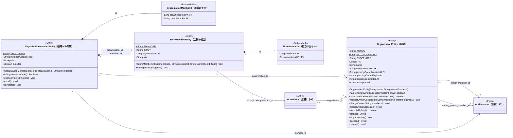

### Entity とテーブル

| Entity | テーブル | 主キー | Entity にフィールドの無い列 | 補足 |
| --- | --- | --- | --- | --- |
| `OrganizationEntity` | `organizations` | `id`（自動採番） | `owner_account_type`（既定 `SHOP_OWNER`）、`created_at` | `name` は 160 文字まで。事業者名の正本はここだけ |
| `OrganizationMemberEntity`、`OrganizationMemberId` | `organization_members` | `organization_id`、`member_id` | `created_at` | `memberAccountType` は既定 `SHOP_STAFF`（CHECK で `SHOP_STAFF` だけ）。`role` は `ORG_ADMIN` か空 |
| `StoreMemberEntity`、`StoreMemberId` | `store_members` | `store_id`、`member_id` | `created_at` | `role` は `MANAGER`・`STAFF` か空。空は、招待キーで登録した直後の「ロール未割り当て」 |

### 関連と外部キー

| 関連 | 外部キーの名前 | 削除のとき | 多重度の根拠 |
| --- | --- | --- | --- |
| `OrganizationEntity` 0..1 — 0..1 `AuthMember`（オーナー） | `fk_organizations_owner`（`owner_member_id`, `owner_account_type`）→ `members (id, account_type)` | 指定なし | `owner_member_id` は NULL 可（サンプルの組織だけ空）で、一意キー `uk_organizations_owner`。会員の種別が `SHOP_OWNER` の人だけを指せる |
| `OrganizationEntity` 0..* — 0..1 `AuthMember`（承認待ちの譲渡先） | `fk_organizations_pending_owner` → `members (id)`（`V6`） | 指定なし | `pending_owner_member_id` は NULL 可。`pending_owner_expires_at` と一緒に空になる（`ck_organizations_pending_owner`） |
| `OrganizationMemberEntity` 0..* — 1 `OrganizationEntity` | `fk_org_members_org` | 指定なし | `organization_id` は主キーの一部（`OrganizationMemberId.organizationId`） |
| `OrganizationMemberEntity` 0..1 — 1 `AuthMember` | `fk_org_members_member`（`member_id`, `member_account_type`）→ `members (id, account_type)` | 指定なし | `member_id` は一意キー `uk_org_members_member`。担当者は 1 つの組織にだけ所属する |
| `OrganizationMemberEntity` 1 — 0..* `StoreMemberEntity` | `fk_store_members_member`（`organization_id`, `member_id`）→ `organization_members` | `ON DELETE CASCADE` | 所属の行を消すと、店舗の担当の行も消える（オーナーの譲渡の承認で使う） |
| `StoreMemberEntity` 0..* — 1 `StoreEntity` | `fk_store_members_store`（`store_id`, `organization_id`）→ `stores (id, organization_id)` | 指定なし | ほかの組織の店舗を担当にできないよう、店舗と組織の組で参照する |
| `StoreEntity` 0..* — 1 `OrganizationEntity` | `fk_stores_org` | 指定なし | `stores.organization_id` は NULL 不可（03 の `StoreEntity`） |

### 決まり

| もの | 決まり |
| --- | --- |
| `OrganizationEntity.status()` | `suspended` なら `SUSPENDED`、`suspensionStartedAt` が空なら `ACTIVE`、それ以外は `NOT_ACCEPTING` を返す。DB の `ck_organizations_suspension` が `suspended` なら `suspension_started_at` があることを求める |
| `OrganizationEntity.acceptsOrders()` | `suspensionStartedAt` が空のときだけ `true`。受付停止中と停止のどちらでも新しい注文を受けない |
| オーナーの譲渡の承認待ち | `pendingOwnerMemberId` と `pendingOwnerExpiresAt`（申し出から 30 分）に持つ。`hasPendingOwnerSuccession()` は期限内の申し出があるか、`hasExpiredOwnerSuccession()` は期限が過ぎた申し出が残っているか |
| 人事のロールと店舗のロール | 人事のロールは `OrganizationMemberEntity.role`（`ORG_ADMIN` か空）、店舗の操作のロールは `StoreMemberEntity.role`（`MANAGER`・`STAFF` か空） |
| 除名 | 論理削除。`OrganizationMemberEntity.expel()` で `expelled` を立て、所属と担当の行は残す。`reinstate()` で戻すと、元の店舗とロールに戻る |

## 図 2 操作の記録の Entity

データの図です。`OrganizationMemberEventEntity` は担当者の操作の記録、`OrganizationModerationEventEntity` は運営による組織の受付停止・停止・再開の記録です。どちらも行を書き換えずに足していきます。

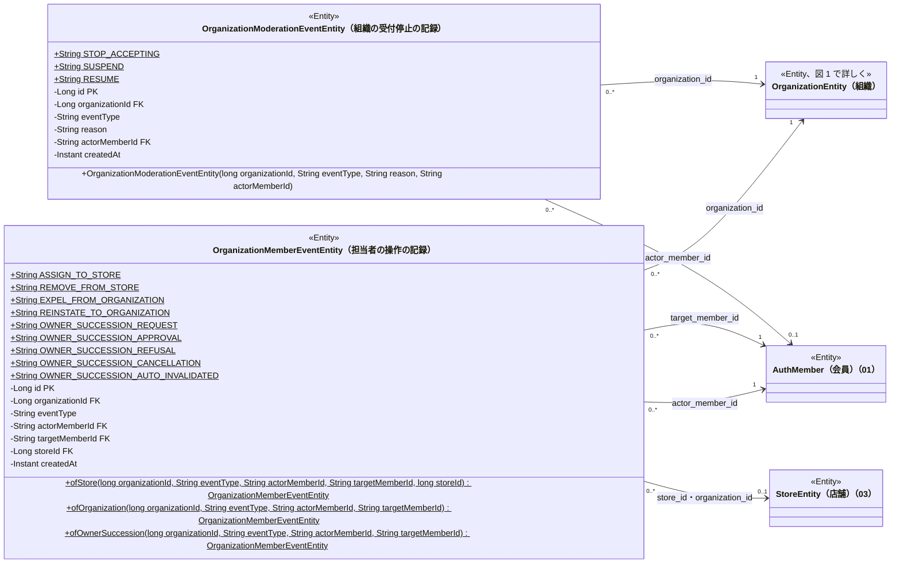

### Entity とテーブル

| Entity | テーブル | 主キー | 補足 |
| --- | --- | --- | --- |
| `OrganizationMemberEventEntity` | `organization_member_events`（`V4`、種類は `V6` で追加） | `id`（自動採番） | `public` のコンストラクターを持たず、種類ごとの 3 つの `static` のメソッドで作る。種類が合わないと `IllegalArgumentException`。列はすべて `updatable = false` |
| `OrganizationModerationEventEntity` | `organization_moderation_events`（`V3`） | `id`（自動採番） | `reason` は 1000 文字まで、作るときに前後の空白を除く。列はすべて `updatable = false` |

### 関連と外部キー

| 関連 | 外部キーの名前 | 多重度の根拠 |
| --- | --- | --- |
| `OrganizationMemberEventEntity` 0..* — 1 `OrganizationEntity` | `fk_org_member_events_org` | `organization_id` は NULL 不可 |
| `OrganizationMemberEventEntity` 0..* — 1 `AuthMember`（操作した人） | `fk_org_member_events_actor` | `actor_member_id` は NULL 不可。自動で無効（`OWNER_SUCCESSION_AUTO_INVALIDATED`）の記録では、申し出たオーナー |
| `OrganizationMemberEventEntity` 0..* — 1 `AuthMember`（操作された人） | `fk_org_member_events_target` | `target_member_id` は NULL 不可。オーナーの譲渡の記録では譲渡先 |
| `OrganizationMemberEventEntity` 0..* — 0..1 `StoreEntity` | `fk_org_member_events_store`（`store_id`, `organization_id`）→ `stores (id, organization_id)` | `store_id` は NULL 可。`ck_org_member_events_store` が、`ASSIGN_TO_STORE`・`REMOVE_FROM_STORE`（`ofStore()`）のときだけ店舗を入れることを求める |
| `OrganizationModerationEventEntity` 0..* — 1 `OrganizationEntity` | `fk_organization_moderation_org` | `organization_id` は NULL 不可 |
| `OrganizationModerationEventEntity` 0..* — 0..1 `AuthMember` | `fk_organization_moderation_actor` | `actor_member_id` は NULL 可。未完了の注文がなくなって自動で停止したとき（`SUSPEND`）だけ空（`ck_organization_moderation_actor`） |

`STOP_ACCEPTING` の記録は理由が必須です（`ck_organization_moderation_reason`）。担当者の操作の記録は、操作された人が除名された後も残します（除名は論理削除なので `members` の行も残る）。

## 図 3 出店申請と招待キーの Entity

データの図です。出店申請は組織を作るための申請で、承認すると `organizationId` に作った組織が入ります。招待キーは店舗ごとに発行し、キーで新規登録した人を `StoreInvitationUseEntity` に残します。

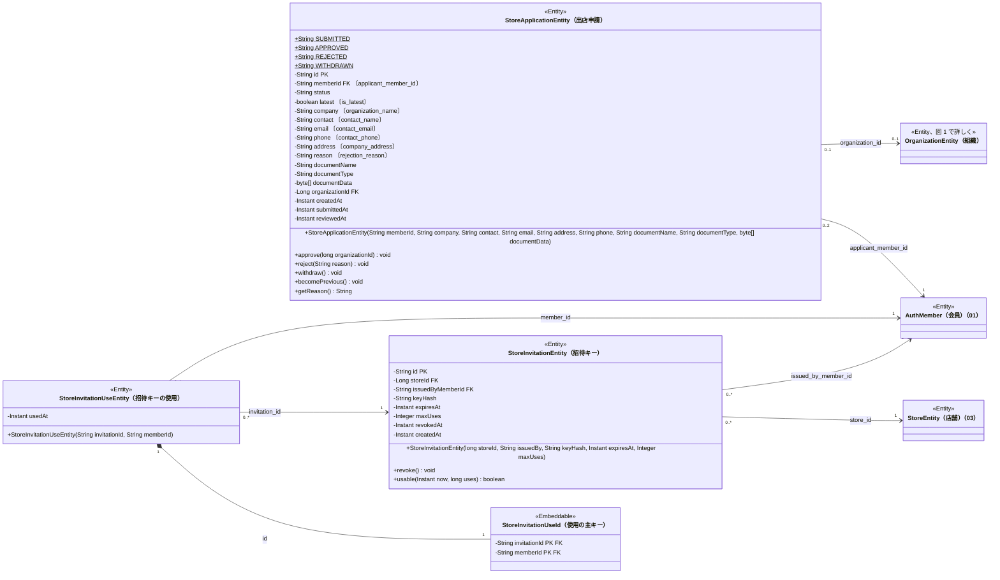

### Entity とテーブル

| Entity | テーブル | 主キー | 補足 |
| --- | --- | --- | --- |
| `StoreApplicationEntity` | `organization_applications` | `id`（コンストラクターで UUID を作る） | クラス名は `StoreApplicationEntity` だが、申請の対象は組織。作ったときは `status` が `SUBMITTED`、`latest` が `true`。提出書類は `documentData`（`LONGBLOB`）として申請の行に入る |
| `StoreInvitationEntity` | `store_invitations` | `id`（コンストラクターで UUID を作る） | キーそのものは保存せず、SHA-256 の `keyHash`（一意キー `uk_invitations_key`）だけを持つ。`createdAt` は DB の既定値で入る（`insertable = false`） |
| `StoreInvitationUseEntity`、`StoreInvitationUseId` | `store_invitation_uses` | `invitation_id`、`member_id` | `usedAt` は DB の既定値で入る（`insertable = false`） |

### 関連と外部キー

| 関連 | 外部キーの名前 | 多重度の根拠 |
| --- | --- | --- |
| `StoreApplicationEntity` 0..2 — 1 `AuthMember` | `fk_applications_applicant` | `applicant_member_id` は NULL 不可。一意キー `uk_applications_applicant_latest`（`applicant_member_id`, `is_latest`）で、1 人につき今の申請（`latest = true`）と前回の申請（`false`）の 2 行まで |
| `StoreApplicationEntity` 0..1 — 0..1 `OrganizationEntity` | `fk_applications_organization` | `organization_id` は NULL 可で、一意キー `uk_applications_organization`。`ck_applications_approved` が「`APPROVED` のときだけ組織がある」を求める |
| `StoreInvitationEntity` 0..* — 1 `StoreEntity` | `fk_invitations_store` | `store_id` は NULL 不可 |
| `StoreInvitationEntity` 0..* — 1 `AuthMember` | `fk_invitations_issuer` | `issued_by_member_id` は NULL 不可 |
| `StoreInvitationUseEntity` 0..* — 1 `StoreInvitationEntity` | `fk_invitation_uses_invitation` | `invitation_id` は主キーの一部。人数の上限は `maxUses`（1 か空）で、アプリがキーの行をロックして確かめる |
| `StoreInvitationUseEntity` 0..1 — 1 `AuthMember` | `fk_invitation_uses_member` | `member_id` は一意キー `uk_invitation_uses_member`。キーは新規登録のときだけ使えるので 1 人 1 行まで |

### 決まり

| もの | 決まり |
| --- | --- |
| `StoreApplicationEntity.status` | DB の CHECK は `DRAFT`・`SUBMITTED`・`APPROVED`・`REJECTED`・`WITHDRAWN` を許し、列の既定値は `DRAFT`。Entity は `DRAFT` の定数を持たず、作ったときに `SUBMITTED` にする |
| 前回の申請 | `becomePrevious()` で `latest` を `false` にする。`ck_applications_previous` が、前回の申請は `REJECTED`・`WITHDRAWN` だけを求める |
| `StoreApplicationEntity.getReason()` | Lombok の getter の代わりに書いたメソッド。`reason` が `null` なら空文字を返す。`approve()` は `reason` を空文字にする |
| `StoreInvitationEntity.maxUses` | 1 は 1 回限り、空は期限内なら何回でも（`ck_invitations_max_uses` は 1 以上） |
| `StoreInvitationEntity.usable()` | 取り消し・期限切れでなく、使った人数（`StoreInvitationUseEntity` の件数）が `maxUses` に達していないかを返す |
| `StoreInvitationEntity.revoke()` | `revokedAt` が空のときだけ今の時刻を入れる |

## 図 4 Repository

モジュールの図です。どの Repository も Spring Data JPA の `JpaRepository` を継承した interface です。`JpaRepository` に渡す型（Entity と主キーの型）は図の下の表にあります。

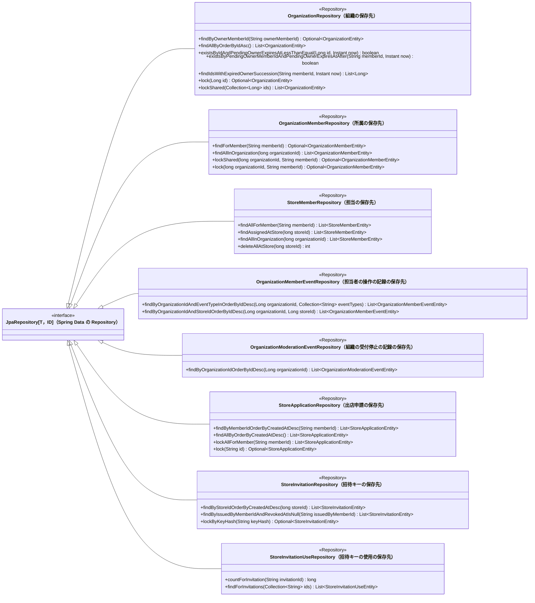

### 継承の型とロック

| Repository | `JpaRepository` の型（Entity、主キー） | ロックして読むメソッド |
| --- | --- | --- |
| `OrganizationRepository` | `OrganizationEntity`、`Long` | `lock()` は `PESSIMISTIC_WRITE`、`lockShared()` は `PESSIMISTIC_READ` |
| `OrganizationMemberRepository` | `OrganizationMemberEntity`、`OrganizationMemberId` | `lock()` は `PESSIMISTIC_WRITE`、`lockShared()` は `PESSIMISTIC_READ` |
| `StoreMemberRepository` | `StoreMemberEntity`、`StoreMemberId` | なし |
| `OrganizationMemberEventRepository` | `OrganizationMemberEventEntity`、`Long` | なし |
| `OrganizationModerationEventRepository` | `OrganizationModerationEventEntity`、`Long` | なし |
| `StoreApplicationRepository` | `StoreApplicationEntity`、`String` | `lock()`、`lockAllForMember()` は `PESSIMISTIC_WRITE` |
| `StoreInvitationRepository` | `StoreInvitationEntity`、`String` | `lockByKeyHash()` は `PESSIMISTIC_WRITE` |
| `StoreInvitationUseRepository` | `StoreInvitationUseEntity`、`StoreInvitationUseId` | なし |

### メソッドの決まり

| メソッド | 決まり |
| --- | --- |
| `OrganizationRepository.lockShared()` | お会計（commerce パッケージの `CheckoutService`）が使う。受付停止と同時のお会計で、受付停止の後に注文ができないようにする |
| `OrganizationRepository.findIdsWithExpiredOwnerSuccession()` | その人がオーナーか譲渡先で、期限が過ぎた申し出が残っている組織の ID（通知一覧の読み込みで使う） |
| `StoreMemberRepository.findAssignedAtStore()` | `role` が空でない担当だけを返す |
| `StoreMemberRepository.deleteAllAtStore()` | `@Modifying` の DELETE。閉鎖済みになった店舗の担当を外す（組織への所属は残す） |
| `StoreApplicationRepository.lockAllForMember()` | 今の申請（`latest = true`）が先頭に来る |
| `StoreInvitationUseRepository.findForInvitations()` | `usedAt` の順に返す |

`OrganizationRepository`、`OrganizationMemberRepository`、`StoreMemberRepository` は、ほかのパッケージからも使われます（auth の `AuthService`、notification の `NotificationService`、catalog の `CatalogService`、commerce の `CheckoutService`）。

## 図 5 店舗の情報と運営の警告・利用停止の Service

モジュールの図です。店舗の公開ページ・出店者の店舗一覧・運営の店舗一覧と、店舗の作成・編集・公開、運営による店舗の警告・利用停止です。`Profile`・`Input` の形は図 11、`State`・`EventView`・`Warning` は moderation パッケージの `ModerationDtos` の record（[07_通知と運営の記録](<07_通知と運営の記録.md>)）です。

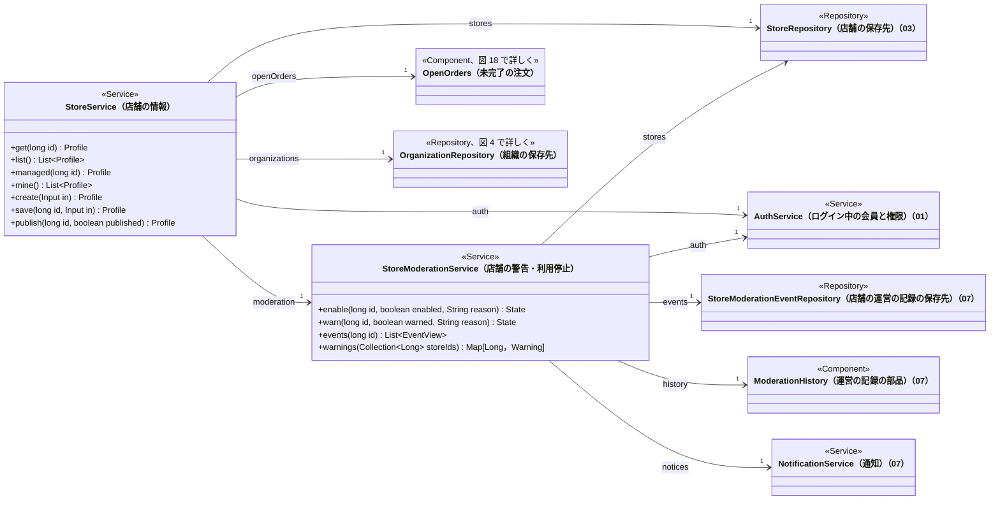

### 線とコードの対応

| 線 | コード |
| --- | --- |
| StoreService → StoreRepository | 店舗を読む・作る（`StoreEntity.create()` と `saveAndFlush()`）・ロックして書く |
| StoreService → OrganizationRepository | `Profile.company` に組織の名前を入れる。組織が停止なら公開ページで見せない |
| StoreService → AuthService | `current()`、`requireOwnedOrganization()` などで、見られる人・作れる人を確かめる |
| StoreService → OpenOrders | `count()` で未完了の注文の件数を `Profile.openOrderCount` に入れる |
| StoreService → StoreModerationService | `warnings()` で運営の今の警告を `Profile.warning` に入れる |
| StoreModerationService → StoreRepository | 店舗の行をロックして `suspended`・警告を変える |
| StoreModerationService → StoreModerationEventRepository | 履歴に 1 行足す・読む |
| StoreModerationService → ModerationHistory | `ModerationHistory.reasonFor()` で理由を確かめる |
| StoreModerationService → AuthService | 運営かを確かめる |
| StoreModerationService → NotificationService | 店舗の出店者に通知する |

### 部品の決まり

| 部品 | 決まり |
| --- | --- |
| `StoreService` | `@Transactional`（読むだけのメソッドは `readOnly = true`） |
| `StoreService.get()` | 店舗の公開ページ。購入者と未ログインには、公開中と閉鎖中の店舗だけを返し、ほかは 404。組織が停止（`OrganizationEntity.suspended`）なら店舗も見えない |
| `StoreService.mine()`、`list()`、`managed()` | `mine()` は出店者画面の店舗一覧、`list()` は運営の店舗一覧、`managed()` は閉鎖の操作の後に返す店舗。どれも未完了の注文の件数と運営の警告を付ける |
| `StoreService.create()` | オーナーが自分の組織に店舗を作る。作った直後は非公開 |
| `StoreService.save()` | `Input.revision` と `StoreEntity` の `revision` を比べ、違えば 409 `STORE_CHANGED` |
| `StoreModerationService` | `@Transactional`。店舗の行をロックしてから履歴に 1 行足し、店舗の出店者に通知する |
| `StoreModerationService.enable()`、`warn()` | `enable()` は店舗の利用停止（`enabled = false`）と再開、`warn()` は警告と警告の解除。履歴は moderation パッケージの `store_moderation_events` に入る |

## 図 6 店舗の閉鎖と組織の受付停止・停止の Service

モジュールの図です。店舗の閉鎖は、営業中 → 閉鎖中 → 閉鎖済みです。組織は、通常（`ACTIVE`）→ 受付停止中（`NOT_ACCEPTING`）→ 停止（`SUSPENDED`）です。どちらも未完了の注文がなくなった時点で次の状態になります。`OrganizationView` の形は図 11 にあります。両方が使う `OpenOrders` と、その先の注文・在庫・返金のクラスは、線が箱の裏を通らないよう図 18 に分けました。

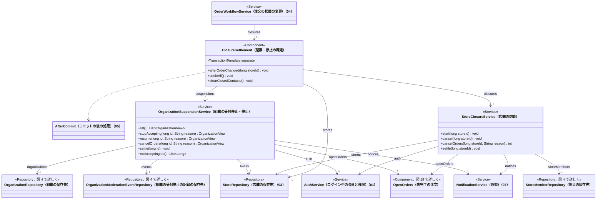

### 線とコードの対応

| 線 | コード |
| --- | --- |
| StoreClosureService → StoreRepository | 店舗の行をロックして、閉鎖中・閉鎖済みにする |
| StoreClosureService → StoreMemberRepository | `settle()` が閉鎖済みにした店舗の担当を `deleteAllAtStore()` で外す |
| StoreClosureService → AuthService | 操作した人が運営か店舗の組織のオーナーかを確かめ、`OWNER` か `ADMIN` として記録する |
| StoreClosureService → OpenOrders | `count()`、`notifyBuyers()`、`cancelAll()` |
| OrganizationSuspensionService → OrganizationRepository | 組織の行を `lock()` でロックして状態を変える |
| OrganizationSuspensionService → OrganizationModerationEventRepository | 操作を `organization_moderation_events` に 1 行足す・読む |
| OrganizationSuspensionService → StoreRepository | 組織の店舗の ID と数を読む |
| OrganizationSuspensionService → OpenOrders | `count()`、`notifyBuyers()`、`cancelAll()` |
| ClosureSettlement → StoreClosureService、OrganizationSuspensionService | `settle()` |
| ClosureSettlement → StoreRepository | 店舗の組織の ID を読む。`clearClosedContacts()` が `clearClosedContacts()` で閉鎖済みの店舗の連絡先を消す |
| ClosureSettlement → AfterCommit | `afterOrderChanged()` が `AfterCommit.run()` で、コミットの後に確かめる（`static` のメソッドなので依存の線） |
| OrderWorkflowService → ClosureSettlement | 注文の状態を変えた後に `afterOrderChanged()` |

### 部品の決まり

| 部品 | 決まり |
| --- | --- |
| `StoreClosureService.start()`、`settle()` | `start()` で閉鎖中にし、未完了の注文がなくなった時点で `settle()` が閉鎖済みにして、その店舗の担当（`store_members`）を消す |
| `StoreClosureService.cancel()` | 運営が始めた閉鎖をオーナーが取り消すと 403 `CLOSED_BY_OPERATOR` |
| `OrganizationSuspensionService` | `stopAccepting()` で受付停止中にし、未完了の注文がなくなった時点で `settle()` が停止にする。`resume()` で通常に戻す。自動で停止したときの理由は `AUTO_SUSPEND_REASON` |
| `ClosureSettlement.settleAll()` | `@Scheduled`。既定で 1 分ごと（`kusakari.ec.closure-settlement-interval-ms`、最初は 15 秒後）に、閉鎖中の店舗と受付停止中の組織を確かめ直す |
| `ClosureSettlement.clearClosedContacts()` | `@Scheduled`。既定で 1 日ごと（`kusakari.ec.store-contact-purge-interval-ms`、最初は 30 秒後）に、閉鎖済みから 90 日（`CONTACT_RETENTION`）たった店舗の連絡先を消す |
| `ClosureSettlement.separate` | `PROPAGATION_REQUIRES_NEW` の `TransactionTemplate`。注文の行のロックを持ったまま店舗・組織の行をロックしないよう、別のトランザクションで確かめる |

## 図 7 出店申請の Service

モジュールの図です。`Input`・`Application`・`Document` の形は図 16 にあります。

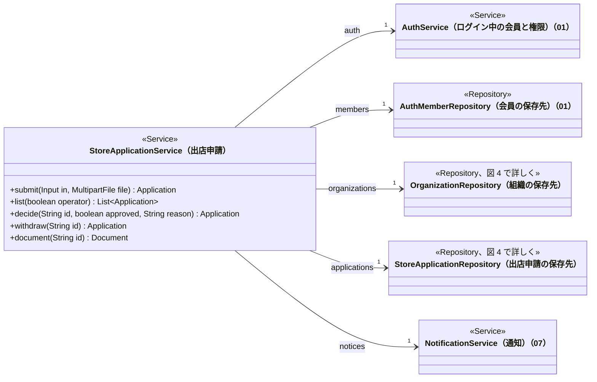

### 線とコードの対応

| 線 | コード |
| --- | --- |
| StoreApplicationService → AuthService | ログイン中の会員と、運営かを確かめる |
| StoreApplicationService → AuthMemberRepository | 承認で、申請者の会員の種別を `SHOP_OWNER` にして DB に反映する |
| StoreApplicationService → OrganizationRepository | 承認で `OrganizationEntity` を作る |
| StoreApplicationService → StoreApplicationRepository | 申請を作る・ロックして読む（`lockAllForMember()`、`lock()`）・前々回の申請を消す |
| StoreApplicationService → NotificationService | 申請の受け付けと審査の結果を申請者に通知する |

### 部品の決まり

| 部品 | 決まり |
| --- | --- |
| `StoreApplicationService` | `@Transactional`。承認（`decide()` の `approved = true`）で、申請者を `SHOP_OWNER` にしてから `OrganizationEntity` を作る（組織のオーナーは種別が `SHOP_OWNER` の会員に限られるため） |
| `submit()` | 企業様向けの登録で作ったアカウント（`AuthMember.SHOP_OWNER_APPLICANT`）だけが使える。提出書類は 5MB 以内の PDF・PNG・JPEG で、ファイルの先頭のバイトで種類を決める（違えば 400 `INVALID_DOCUMENT`）。再申請では、前々回の申請を消し、今の申請を前回の申請（`becomePrevious()`）にしてから、新しい申請を作る |
| `list()` | `list(false)` は自分の申請、`list(true)` は運営の一覧 |
| `decide()` | 却下の理由が空なら 400 `REASON_REQUIRED` |
| `document()` | 運営か申請者本人だけが提出書類を取り出せる |

## 図 8 人事の権限・アカウント一覧・操作の記録の Service

モジュールの図です。人事の権限の判定は `StaffPolicy` だけで行います。`StaffPolicy` の中身と、それが使うクラスは図 20 にあります（この図に描くと線が箱の裏を通ったため）。`Viewer`・`AccountsView`・`Event` の形は図 12 にあります。

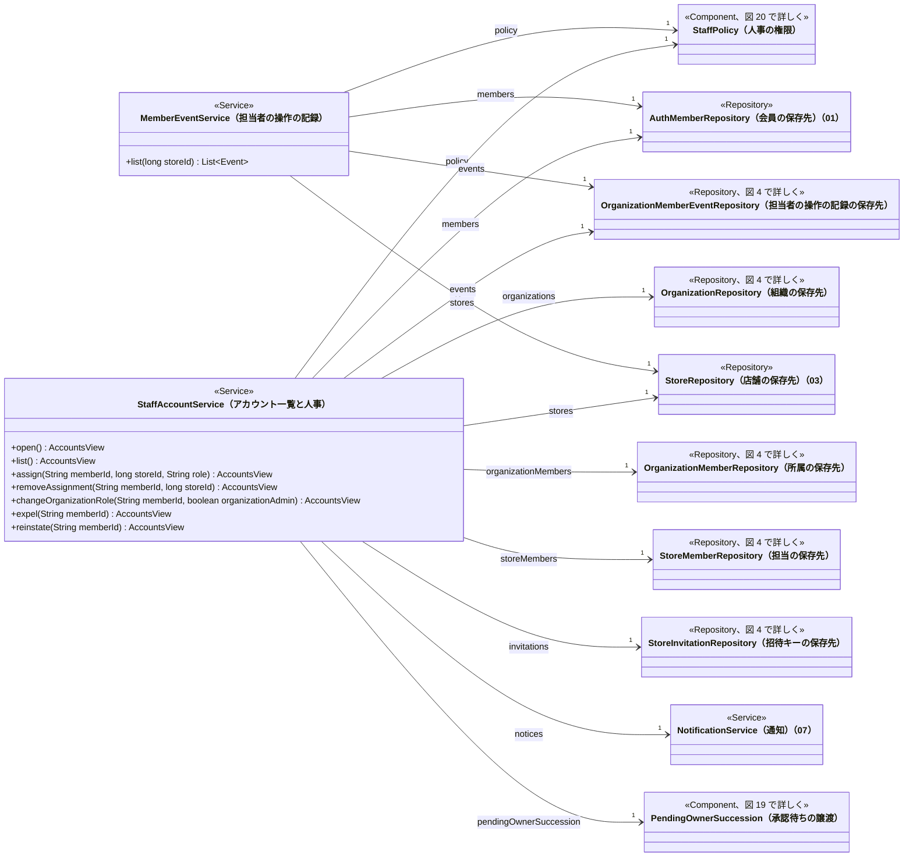

### 線とコードの対応

| 線 | コード |
| --- | --- |
| StaffAccountService → StaffPolicy、MemberEventService → StaffPolicy | 最初に `viewer()` を呼び、`Viewer` のメソッドでできる操作を決める |
| StaffAccountService → AuthMemberRepository、OrganizationRepository、OrganizationMemberRepository、StoreMemberRepository、StoreRepository | アカウント一覧（`list()`）を作る。所属・担当の行を作る・変える・消す |
| StaffAccountService → OrganizationMemberEventRepository | 担当の出入り（`ofStore()`）、除名と復帰（`ofOrganization()`）を記録する |
| StaffAccountService → StoreInvitationRepository | `expel()` が、その人が発行した招待キーを `findByIssuedByMemberIdAndRevokedAtIsNull()` で探して取り消す |
| StaffAccountService → NotificationService | 店舗の担当から外した人などに通知する |
| StaffAccountService → PendingOwnerSuccession | `open()` が `expireIfDue()`、`expel()` が `lock()` で組織の行をロックしてから `invalidateFor()` |
| MemberEventService → OrganizationMemberEventRepository | 組織の記録（除名・復帰・譲渡）と、指定した店舗の担当の出入りの記録を読み、`id` の新しい順に並べる |
| MemberEventService → AuthMemberRepository、StoreRepository | 操作した人・された人の名前とメールを読む。店舗が自分の組織のものかを確かめる（違えば 404 `STORE_NOT_FOUND`） |

### 部品の決まり

| 部品 | 決まり |
| --- | --- |
| `StaffAccountService` | `@Transactional`。どの変更のメソッドも、最後に `list()` の結果を返す |
| `StaffAccountService.open()` | 期限が過ぎたオーナーの譲渡の申し出を無効として記録してから（`PendingOwnerSuccession.expireIfDue()`）、`list()` を返す |
| `assign()`、`removeAssignment()` | `assign()` はロール（`MANAGER`・`STAFF`・`NONE`）を割り振り、担当でない店舗なら担当に加える。`removeAssignment()` は店舗の担当から外し、本人に通知する |
| `changeOrganizationRole()` | `ORG_ADMIN` の付け外し |
| `expel()`、`reinstate()` | `expel()` は組織からの除名。その人が発行した招待キーを取り消し、承認待ちの譲渡先なら申し出を無効にする。`reinstate()` は復帰 |
| `MemberEventService` | `@Transactional(readOnly = true)`。オーナーと `ORG_ADMIN` だけが見られる（`Viewer.personnel()`）。除名・復帰・オーナーの譲渡は組織の全件（`ORGANIZATION_EVENTS`）、店舗の担当の出入りは指定した店舗の分を返す |

## 図 9 招待キーの Service

モジュールの図です。`Issued`・`Invitation`・`User` の形は図 16 にあります。

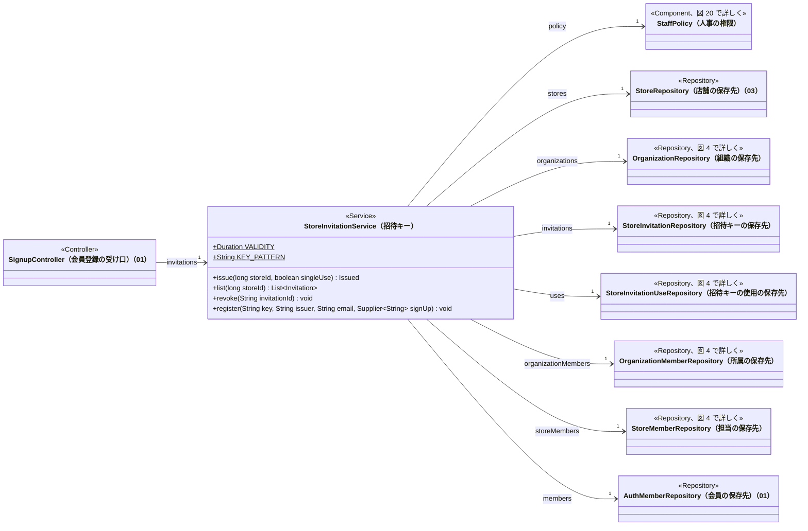

### 線とコードの対応

| 線 | コード |
| --- | --- |
| SignupController → StoreInvitationService | 招待キーがある新規登録で `register()` |
| StoreInvitationService → StaffPolicy | `issue()`・`list()`・`revoke()` が `viewer()` で、キーを扱える人かを確かめる |
| StoreInvitationService → StoreRepository、OrganizationRepository | `issue()`・`list()`・`revoke()` が店舗が自分の組織のものかを確かめる（違えば 404 `STORE_NOT_FOUND`）。`register()` が、店舗が停止中・閉鎖済みでなく、組織が停止でないかを確かめる |
| StoreInvitationService → StoreInvitationRepository | キーを作る・取り消す。`register()` が `lockByKeyHash()` でキーの行をロックする |
| StoreInvitationService → StoreInvitationUseRepository | `countForInvitation()` で使った人数を数え、使用の記録を作る。`list()` が `findForInvitations()` |
| StoreInvitationService → OrganizationMemberRepository、StoreMemberRepository、AuthMemberRepository | `register()` が会員（`SHOP_STAFF`）・組織への所属・店舗の担当（ロールなし）を作る。`list()` が使った人の名前とメールを読む |

### 部品の決まり

| 部品 | 決まり |
| --- | --- |
| `StoreInvitationService` | `@Transactional`。キーは 32 バイトの乱数を URL で使える Base64 にしたもの（`KEY_PATTERN` は `[A-Za-z0-9_-]{43}`）。有効期限（`VALIDITY`）は発行から 30 日 |
| `issue()` | キーを発行し、キーそのものを `Issued.key` で返す。DB にはハッシュだけを残すので、後から表示できない。停止中・閉鎖済みの店舗には発行できない（409 `STORE_NOT_INVITABLE`） |
| `list()` | キーごとの状態（`ACTIVE`・`EXPIRED`・`REVOKED`・`USED_UP`）と使った人を返す |
| `revoke()` | 取り消し。使った人の所属は変えない |
| `register()` | キーの行をロックして使えるかを確かめてから `signUp`（Cognito への登録）を呼び、同じトランザクションで会員・所属・担当・使用の記録を作る。キーが使えなければ Cognito に登録せず、400 `INVITATION_INVALID` |

## 図 10 オーナーの譲渡の Service

モジュールの図です。オーナーの譲渡は、オーナーの申し出、譲渡先の承認か断り、オーナーの取り消し、自動の無効でできています。自動の無効を受け持つ `PendingOwnerSuccession` と、通知を作る `OwnerSuccessionNotices` は、同じ Repository を使う線が箱の裏を通ったため図 19 に分けました。`Decision` の形は図 12、`PendingOwnerSuccession.Reason` は図 16 にあります。

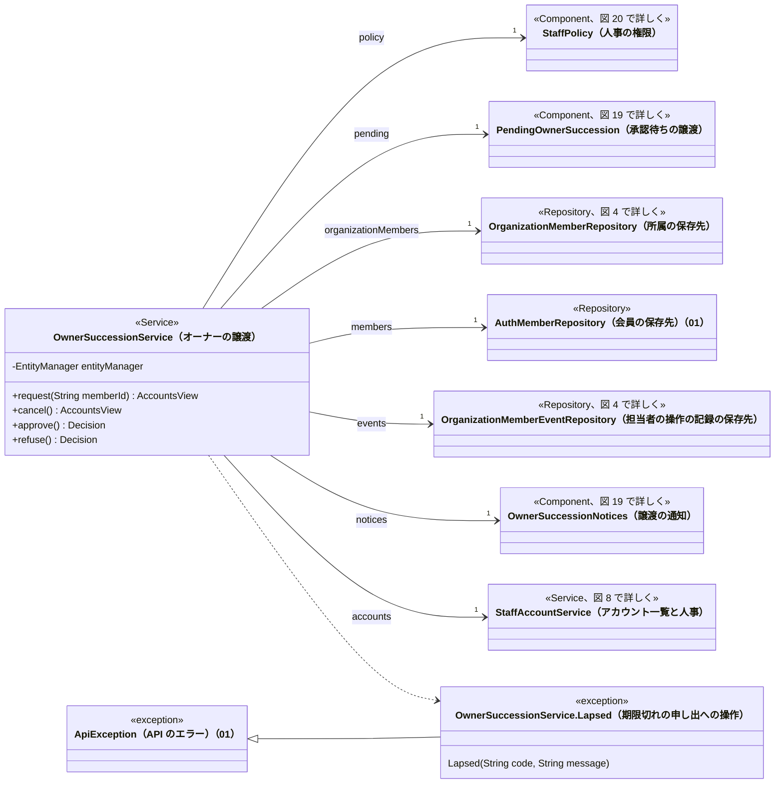

### 線とコードの対応

| 線 | コード |
| --- | --- |
| OwnerSuccessionService → StaffPolicy | `viewer()` で、オーナーか（`request()`・`cancel()`）、今の譲渡先か（`approve()`・`refuse()`）を確かめる |
| OwnerSuccessionService → PendingOwnerSuccession | `lock()`・`lockOrganizationOf()` で組織の行をロックし、`expireIfDue()` で期限切れを先に無効にする |
| OwnerSuccessionService → OrganizationMemberRepository、AuthMemberRepository | `approve()` が新しいオーナーの所属を消し、会員の種別を `SHOP_OWNER` にし、元のオーナーを `SHOP_STAFF` の `ORG_ADMIN` として所属させる |
| OwnerSuccessionService → OrganizationMemberEventRepository | 申し出・取り消し・承認・断りを `ofOwnerSuccession()` で記録する |
| OwnerSuccessionService → OwnerSuccessionNotices | `requested()`・`cancelled()`・`approved()`・`refused()` |
| OwnerSuccessionService → StaffAccountService | `request()`・`cancel()` が最後に `list()` の結果を返す |
| OwnerSuccessionService → Lapsed | 期限が過ぎた申し出に承認・断りをしたとき投げる |

### 部品の決まり

| 部品 | 決まり |
| --- | --- |
| `OwnerSuccessionService` | `@Transactional`。`approve()` と `refuse()` は `@Transactional(noRollbackFor = Lapsed.class)` で、「自動で無効」の記録を残したまま 409 にする |
| 承認の期限 | `APPROVAL_PERIOD` は 30 分。承認待ちは `OrganizationEntity` の `pendingOwnerMemberId` と `pendingOwnerExpiresAt` に持つ |
| `approve()` | 1 つのトランザクションで、新しいオーナーの所属を消し（店舗の担当は外部キーの CASCADE で消える）、会員の種別を `SHOP_OWNER` にし、組織のオーナーを付け替え、元のオーナーを `SHOP_STAFF` の `ORG_ADMIN` として所属させる。所属と会員の行は `EntityManager.refresh()` でロックして読み直す |
| `Lapsed` | `private static final` の入れ子のクラスで、`ApiException`（状態は 409）を継承する |

## 図 11 店舗と組織の DTO

データの図です。`StoreService.Profile` は店舗の API の応答、`StoreService.Input` は店舗の作成・編集の本文、`OrganizationSuspensionService.OrganizationView` は運営の組織一覧の 1 行です。

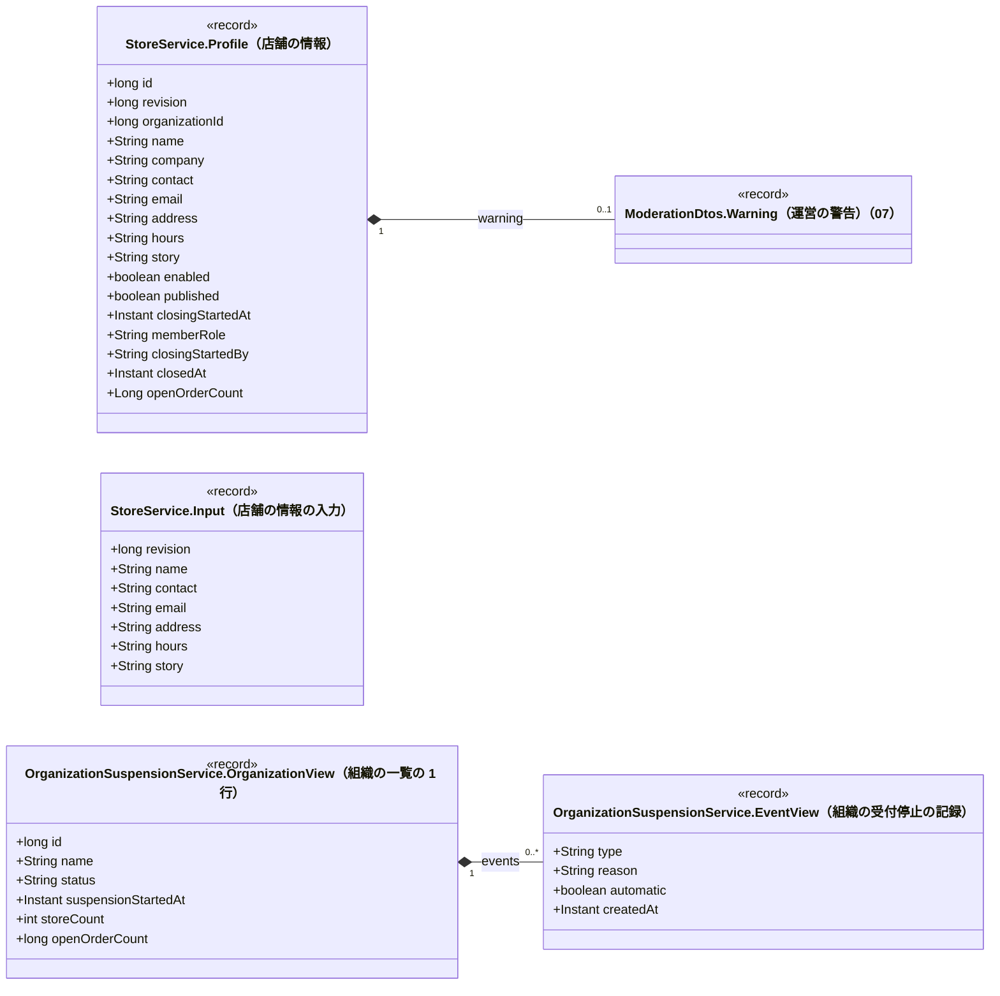

### 使うところと値の制約

| record | 使うところ | 値と制約 |
| --- | --- | --- |
| `Profile` | `StoreController` のすべての応答（図 13） | `company` は組織の名前（`OrganizationEntity.name`）。`enabled` は「運営が停止していない」（`StoreEntity.suspended` の逆）、`published` は「オーナーが公開した」。`closingStartedBy` は `OWNER`・`ADMIN` |
| `Profile.memberRole` | 出店者画面の店舗一覧（`StoreService.mine()`）だけで入る | その店舗での自分の立場（`OWNER`・`MANAGER`・`STAFF`・`NONE`・`ADMIN`。空は担当外） |
| `Profile.openOrderCount`、`warning` | 出店者と運営に返すときだけ入る | 購入者と未ログインの公開ページでは `null` |
| `Input` | `POST /api/seller/stores`、`PUT /api/seller/stores/{id}` の本文 | `name` は必須で 100 文字まで、`contact` は 100 文字まで、`email` はメールの形式で 200 文字まで、`address` は必須で 200 文字まで、`hours` は必須で 80 文字まで、`story` は 1000 文字まで |
| `OrganizationView` | `OrganizationController` のすべての応答（図 14） | `status` は `ACTIVE`・`NOT_ACCEPTING`・`SUSPENDED`。`openOrderCount` は停止を止めている注文の件数 |
| `EventView` | `OrganizationView.events` | `automatic` は、操作した運営がいない（自動で停止した）記録で `true` |

## 図 12 人事の DTO

データの図です。出店者画面のアカウント一覧・担当者の操作の記録・オーナーの譲渡の応答と、人事の権限の判定に使う `Viewer` です。

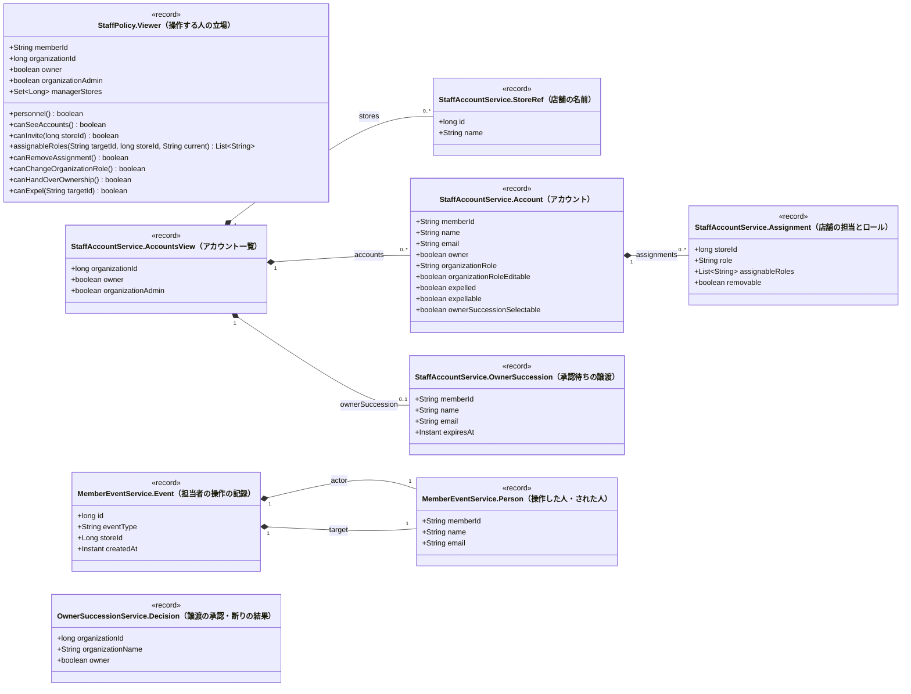

### 使うところと値の制約

| record | 使うところ | 値と制約 |
| --- | --- | --- |
| `Viewer` | `StaffPolicy.viewer()` の戻り値。応答には出ない | `personnel()` は、オーナーか `ORG_ADMIN` か。`managerStores` は `MANAGER` のロールがある店舗の ID。`canSeeAccounts()`、`assignableRoles()`、`canExpel()` などが、できる操作を決める |
| `AccountsView` | `GET /api/seller/accounts` などの応答（図 15） | `ownerSuccession` は、オーナーにだけ、期限内の承認待ちがあるときに入る。それ以外は `null` |
| `Account` | `AccountsView.accounts` | `expelled` は除名中。`expellable` は操作する人がこの人を除名・復帰させられるか。`ownerSuccessionSelectable` はオーナーが今この人に譲渡を申し出られるか |
| `Assignment` | `Account.assignments` | `role` は `MANAGER`・`STAFF`・`NONE`（ロール未割り当て）か、担当でなければ `null`。`assignableRoles` は操作する人が選べる値で、画面は判定せず、この値のとおりに選択肢を出す |
| `Event`、`Person` | `GET /api/seller/stores/{storeId}/member-events` の応答 | `storeId` は担当の出入りの記録だけに入る。会員が見つからないときの `Person` は、名前とメールが空文字 |
| `Decision` | 譲渡の承認・断りの応答 | `owner` は、操作した人が今この組織のオーナーか。承認なら `true`、断りなら `false` |

## 図 13 店舗と運営の警告・利用停止の Controller

モジュールの図です。Request の record（`PublishedRequest`、`CancellationRequest`、`EnabledRequest`）の形は図 17 にあります。

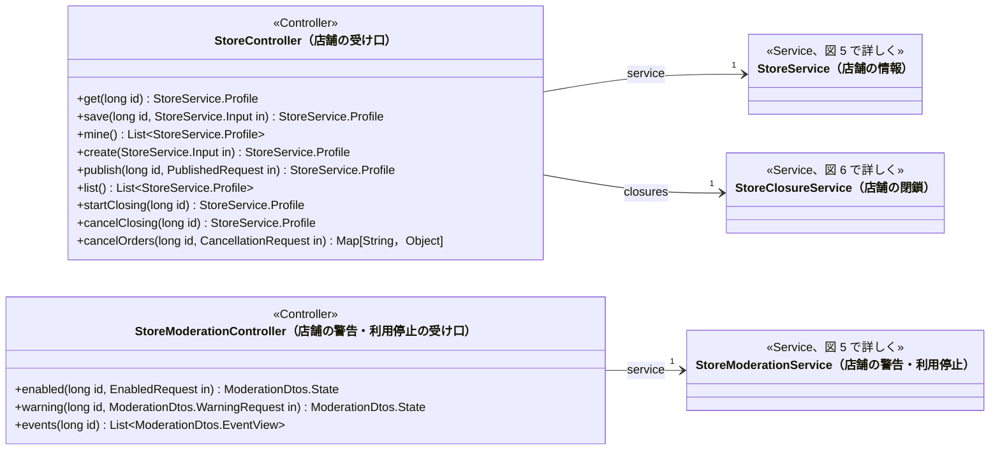

### API とクラス

| HTTP | パス | 受け口 | 本文 | 応答 | 呼ぶ Service |
| --- | --- | --- | --- | --- | --- |
| GET | `/api/stores/{id}` | `StoreController.get` | なし | `Profile` | `StoreService.get()` |
| PUT | `/api/seller/stores/{id}` | `StoreController.save` | `StoreService.Input`（`@Valid`） | `Profile` | `StoreService.save()` |
| GET | `/api/seller/stores` | `StoreController.mine` | なし | `List<Profile>` | `StoreService.mine()` |
| POST | `/api/seller/stores` | `StoreController.create` | `StoreService.Input`（`@Valid`） | `Profile`（201） | `StoreService.create()` |
| PUT | `/api/seller/stores/{id}/published` | `StoreController.publish` | `PublishedRequest` | `Profile` | `StoreService.publish()` |
| GET | `/api/operator/stores` | `StoreController.list` | なし | `List<Profile>` | `StoreService.list()` |
| POST | `/api/seller/stores/{id}/closure`、`/api/operator/stores/{id}/closure` | `StoreController.startClosing` | なし | `Profile` | `StoreClosureService.start()` の後に `StoreService.managed()` |
| DELETE | `/api/seller/stores/{id}/closure`、`/api/operator/stores/{id}/closure` | `StoreController.cancelClosing` | なし | `Profile` | `StoreClosureService.cancel()` の後に `StoreService.managed()` |
| POST | `/api/operator/stores/{id}/order-cancellations` | `StoreController.cancelOrders` | `CancellationRequest`（`@Valid`） | `cancelled`（件数）と `store`（`Profile`） | `StoreClosureService.cancelOrders()` の後に `StoreService.managed()` |
| PUT | `/api/operator/stores/{id}/enabled` | `StoreModerationController.enabled` | `EnabledRequest`（`@Valid`） | `ModerationDtos.State` | `StoreModerationService.enable()` |
| PUT | `/api/operator/stores/{id}/warning` | `StoreModerationController.warning` | `ModerationDtos.WarningRequest`（`@Valid`） | `ModerationDtos.State` | `StoreModerationService.warn()` |
| GET | `/api/operator/stores/{id}/moderation-events` | `StoreModerationController.events` | なし | `List<ModerationDtos.EventView>` | `StoreModerationService.events()` |

`startClosing()` と `cancelClosing()` は、出店者と運営の 2 つのパスで同じ処理を呼びます。利用停止の理由が必須なことは、`ModerationHistory.reasonFor()` が確かめます。

## 図 14 出店申請と組織の受付停止の Controller

モジュールの図です。Request の record（`Decision`、`ReasonRequest`、`ResumeRequest`）の形は図 17 にあります。

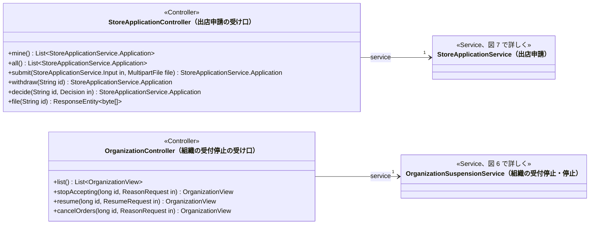

### API とクラス

| HTTP | パス | 受け口 | 本文 | 応答 | 呼ぶ Service |
| --- | --- | --- | --- | --- | --- |
| GET | `/api/account/store-applications` | `StoreApplicationController.mine` | なし | `List<Application>` | `StoreApplicationService.list(false)` |
| GET | `/api/operator/applications` | `StoreApplicationController.all` | なし | `List<Application>` | `StoreApplicationService.list(true)` |
| POST | `/api/account/store-applications` | `StoreApplicationController.submit` | `multipart/form-data` の `application`（`Input` の JSON、`@Valid`）と `document`（提出書類） | `Application` | `StoreApplicationService.submit()` |
| PUT | `/api/account/store-applications/{id}/withdrawal` | `StoreApplicationController.withdraw` | なし | `Application` | `StoreApplicationService.withdraw()` |
| PUT | `/api/operator/applications/{id}` | `StoreApplicationController.decide` | `Decision`（`@Valid`） | `Application` | `StoreApplicationService.decide()` |
| GET | `/api/account/store-applications/{id}/document` | `StoreApplicationController.file` | なし | 提出書類のバイト列 | `StoreApplicationService.document()` |
| GET | `/api/operator/organizations` | `OrganizationController.list` | なし | `List<OrganizationView>` | `OrganizationSuspensionService.list()` |
| POST | `/api/operator/organizations/{id}/stop-accepting` | `OrganizationController.stopAccepting` | `ReasonRequest`（`@Valid`） | `OrganizationView` | `OrganizationSuspensionService.stopAccepting()` |
| POST | `/api/operator/organizations/{id}/resume` | `OrganizationController.resume` | `ResumeRequest`（`@Valid`） | `OrganizationView` | `OrganizationSuspensionService.resume()` |
| POST | `/api/operator/organizations/{id}/order-cancellations` | `OrganizationController.cancelOrders` | `ReasonRequest`（`@Valid`） | `OrganizationView` | `OrganizationSuspensionService.cancelOrders()` |

`file()` は提出書類を `Content-Disposition: attachment` で返し、`X-Content-Type-Options: nosniff` と `Cache-Control: no-store` を付けます。`OrganizationView` は `OrganizationSuspensionService.OrganizationView`（図 11）です。

## 図 15 人事の Controller

モジュールの図です。Request の record（`RoleRequest`、`OrganizationRoleRequest`、`InvitationRequest`）の形は図 17 にあります。

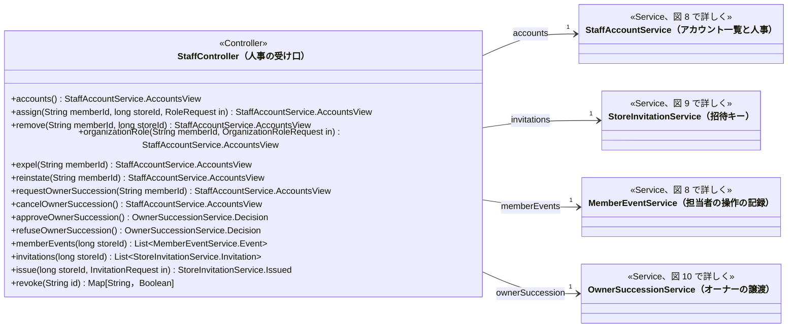

### API とクラス

`StaffController` のパスの前には `/api/seller` が付きます（`@RequestMapping`）。

| HTTP | パス | 受け口 | 本文 | 応答 | 呼ぶ Service |
| --- | --- | --- | --- | --- | --- |
| GET | `/api/seller/accounts` | `accounts` | なし | `AccountsView` | `StaffAccountService.open()` |
| PUT | `/api/seller/accounts/{memberId}/stores/{storeId}` | `assign` | `RoleRequest`（`@Valid`） | `AccountsView` | `StaffAccountService.assign()` |
| DELETE | `/api/seller/accounts/{memberId}/stores/{storeId}` | `remove` | なし | `AccountsView` | `StaffAccountService.removeAssignment()` |
| PUT | `/api/seller/accounts/{memberId}/organization-role` | `organizationRole` | `OrganizationRoleRequest` | `AccountsView` | `StaffAccountService.changeOrganizationRole()` |
| POST | `/api/seller/accounts/{memberId}/expulsion` | `expel` | なし | `AccountsView` | `StaffAccountService.expel()` |
| DELETE | `/api/seller/accounts/{memberId}/expulsion` | `reinstate` | なし | `AccountsView` | `StaffAccountService.reinstate()` |
| POST | `/api/seller/accounts/{memberId}/owner-succession` | `requestOwnerSuccession` | なし | `AccountsView` | `OwnerSuccessionService.request()` |
| DELETE | `/api/seller/owner-succession` | `cancelOwnerSuccession` | なし | `AccountsView` | `OwnerSuccessionService.cancel()` |
| POST | `/api/seller/owner-succession/approval` | `approveOwnerSuccession` | なし | `Decision` | `OwnerSuccessionService.approve()` |
| POST | `/api/seller/owner-succession/refusal` | `refuseOwnerSuccession` | なし | `Decision` | `OwnerSuccessionService.refuse()` |
| GET | `/api/seller/stores/{storeId}/member-events` | `memberEvents` | なし | `List<Event>` | `MemberEventService.list()` |
| GET | `/api/seller/stores/{storeId}/invitations` | `invitations` | なし | `List<Invitation>` | `StoreInvitationService.list()` |
| POST | `/api/seller/stores/{storeId}/invitations` | `issue` | `InvitationRequest` | `Issued`（201） | `StoreInvitationService.issue()` |
| POST | `/api/seller/invitations/{id}/revoke` | `revoke` | なし | `{"revoked": true}` | `StoreInvitationService.revoke()` |

パスの `memberId` と、`revoke()` の `id` は、`@Pattern`（`[0-9a-f-]{36}`、UUID の形。定数 `MEMBER_ID`）で確かめます。

## 図 16 出店申請・招待キー・オーナーの譲渡の DTO

データの図です。図 7・図 9・図 10 の Service の中で宣言した record と enum です。前の版では Service と同じ図にあったものを、データの図とモジュールの図を分けるために、この図に移しました。

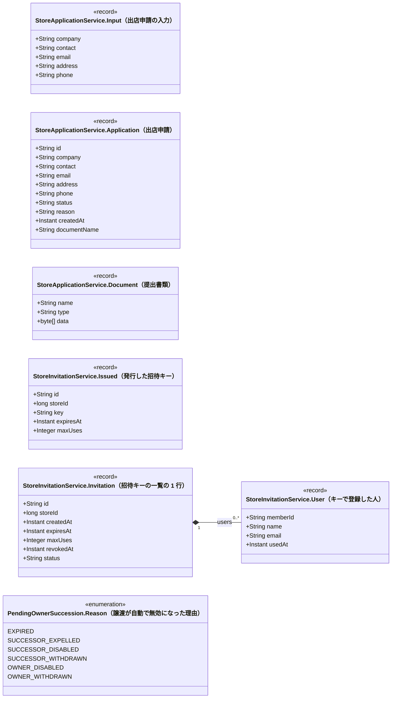

### 使うところと値の制約

| record・enum | 使うところ | 値と制約 |
| --- | --- | --- |
| `StoreApplicationService.Input` | `POST /api/account/store-applications` の `application` パート | どれも必須。`company`・`contact` は 100 文字まで、`email`・`address` は 200 文字まで、`email` はメールの形式、`phone` は `[0-9+() -]{1,30}` |
| `StoreApplicationService.Application` | 出店申請の API の応答（図 14） | `status` は `SUBMITTED`・`APPROVED`・`REJECTED`・`WITHDRAWN`。`reason` は却下の理由（無ければ空文字） |
| `StoreApplicationService.Document` | `document()` の戻り値（`file()` がバイト列にして返す） | `type` は `application/pdf`・`image/png`・`image/jpeg` のどれか |
| `StoreInvitationService.Issued` | `POST /api/seller/stores/{storeId}/invitations` の応答 | `key` はこの応答でだけ返す。`maxUses` は 1 か `null` |
| `StoreInvitationService.Invitation` | `GET /api/seller/stores/{storeId}/invitations` の応答 | `status` は `ACTIVE`・`EXPIRED`・`REVOKED`・`USED_UP`。`users` の人数の上限は `maxUses`（1 か無し）なので図では `0..*` |
| `StoreInvitationService.User` | `Invitation.users` | 会員が見つからないときは、名前とメールが空文字 |
| `PendingOwnerSuccession.Reason` | `PendingOwnerSuccession` の `invalidateFor()`・`invalidateForOwner()`・`invalidate()` と、`OwnerSuccessionNotices.invalidated()` の引数（図 19） | 期限切れ、譲渡先の除名・利用停止・退会、オーナーの利用停止・退会。通知の文面で使う |

## 図 17 Controller の Request

データの図です。図 13〜図 15 の Controller の中で宣言した、本文の record です。前の版では Controller と同じ図にあったものを、この図に移しました。record どうしの関連はありません。

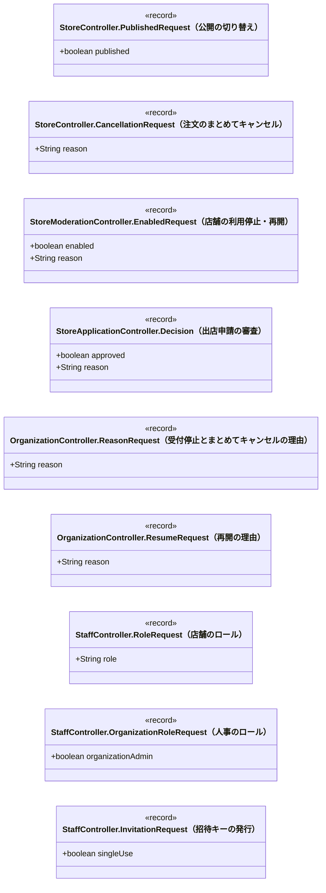

### 使うところと値の制約

| record | 使うところ | 制約 |
| --- | --- | --- |
| `PublishedRequest` | `PUT /api/seller/stores/{id}/published` | なし（`@Valid` も付かない） |
| `CancellationRequest` | `POST /api/operator/stores/{id}/order-cancellations` | `reason` は必須（`@NotBlank`）で 500 文字まで |
| `EnabledRequest` | `PUT /api/operator/stores/{id}/enabled` | `reason` は 500 文字まで。利用停止のときに必須なことは `ModerationHistory.reasonFor()` が確かめる |
| `Decision` | `PUT /api/operator/applications/{id}` | `reason` は `null` でなく（`@NotNull`）500 文字まで。却下の理由が空でないことは `StoreApplicationService.decide()` が確かめる（400 `REASON_REQUIRED`） |
| `ReasonRequest` | `POST /api/operator/organizations/{id}/stop-accepting`、`/order-cancellations` | `reason` は必須（`@NotBlank`）で 500 文字まで |
| `ResumeRequest` | `POST /api/operator/organizations/{id}/resume` | `reason` は `null` でなく（`@NotNull`）500 文字まで |
| `RoleRequest` | `PUT /api/seller/accounts/{memberId}/stores/{storeId}` | `role` は `@NotNull` で `@Pattern`（`MANAGER|STAFF|NONE`） |
| `OrganizationRoleRequest` | `PUT /api/seller/accounts/{memberId}/organization-role` | なし |
| `InvitationRequest` | `POST /api/seller/stores/{storeId}/invitations` | なし。`singleUse` が `true` なら `maxUses` を 1 にする |

`StoreModerationController.warning()` の本文は moderation パッケージの `ModerationDtos.WarningRequest` です（[07_通知と運営の記録](<07_通知と運営の記録.md>)）。

## 図 18 未完了の注文の部品（OpenOrders）

モジュールの図です。店舗の閉鎖と組織の受付停止・停止で共通の部品です。図 6 に全部の線を描くと線が箱の裏を通ったため、この図に分けました。

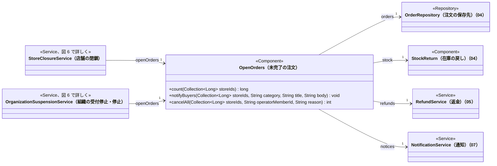

### 線とコードの対応

| 線 | コード |
| --- | --- |
| StoreClosureService → OpenOrders、OrganizationSuspensionService → OpenOrders | `count()`、`notifyBuyers()`、`cancelAll()` |
| OpenOrders → OrderRepository | `count()` が `countByStatus()` で未完了の注文を数え、`notifyBuyers()` が `findBuyersByStatus()` で購入者を探し、`cancelAll()` が `lockByStatus()` で対象の注文をロックして読む |
| OpenOrders → StockReturn、RefundService | `cancelAll()` が、キャンセルした注文の在庫を戻し、カードで支払い済みなら返金する |
| OpenOrders → NotificationService | 購入者と店舗に通知する |

### 部品の決まり

| 部品 | 決まり |
| --- | --- |
| `OpenOrders` | 未完了の注文は `PENDING_PAYMENT`・`ACCEPTED`・`READY`（`BLOCKING`）、運営のまとめてキャンセルの対象は `ACCEPTED`・`READY`（`CANCELLABLE`）。キャンセルした注文の購入者への通知の題名は `CANCELLED_TITLE` |
| `OpenOrders.cancelAll()` | `@Transactional(propagation = MANDATORY)`。呼ぶ側のトランザクションの中で動く |

## 図 19 承認待ちの譲渡と譲渡の通知の部品

モジュールの図です。オーナーの譲渡の申し出を自動で無効にする `PendingOwnerSuccession` と、譲渡の通知を作る `OwnerSuccessionNotices` です。図 10 から分けました。`PendingOwnerSuccession.Reason` の値は図 16 にあります。

```mermaid
classDiagram
    direction LR
    class OwnerSuccessionService["OwnerSuccessionService（オーナーの譲渡）"] {
        <<Service、図 10 で詳しく>>
    }
    class MemberService["MemberService（会員の利用停止・退会）（01）"] {
        <<Service>>
    }
    class NotificationService["NotificationService（通知）（07）"] {
        <<Service>>
    }
    class PendingOwnerSuccession["PendingOwnerSuccession（承認待ちの譲渡）"] {
        <<Component>>
        -EntityManager entityManager
        +lock(long organizationId) OrganizationEntity
        +lockOrganizationOf(String memberId) Optional~OrganizationEntity~
        +invalidateFor(OrganizationEntity locked, String memberId, Reason reason) void
        +invalidateForOwner(OrganizationEntity locked, String memberId, Reason reason) void
        +expireIfDue(OrganizationEntity locked) boolean
        +expireIfDue(long organizationId) void
        +expireIfDueFor(String memberId) void
        +invalidate(OrganizationEntity locked, Reason reason) void
    }
    class OwnerSuccessionNotices["OwnerSuccessionNotices（譲渡の通知）"] {
        <<Component>>
        +requested(OrganizationEntity organization, String successorId, Instant expiresAt) void
        +approved(OrganizationEntity organization, AuthMember successor, AuthMember previousOwner) void
        +cancelled(OrganizationEntity organization, String successorId) void
        +refused(OrganizationEntity organization, String successorId) void
        +invalidated(OrganizationEntity organization, String successorId, Instant expiresAt, Reason reason) void
    }
    class OrganizationRepository["OrganizationRepository（組織の保存先）"] {
        <<Repository、図 4 で詳しく>>
    }
    class OrganizationMemberRepository["OrganizationMemberRepository（所属の保存先）"] {
        <<Repository、図 4 で詳しく>>
    }
    class OrganizationMemberEventRepository["OrganizationMemberEventRepository（担当者の操作の記録の保存先）"] {
        <<Repository、図 4 で詳しく>>
    }
    class NotificationRepository["NotificationRepository（通知の保存先）（07）"] {
        <<Repository>>
    }
    class AuthMemberRepository["AuthMemberRepository（会員の保存先）（01）"] {
        <<Repository>>
    }

    OwnerSuccessionService --> "1" PendingOwnerSuccession : pending
    MemberService --> "1" PendingOwnerSuccession : pendingOwnerSuccession
    NotificationService --> "1" PendingOwnerSuccession : pendingOwnerSuccession
    PendingOwnerSuccession --> "1" OrganizationRepository : organizations
    PendingOwnerSuccession --> "1" OrganizationMemberRepository : organizationMembers
    PendingOwnerSuccession --> "1" OrganizationMemberEventRepository : events
    PendingOwnerSuccession --> "1" OwnerSuccessionNotices : notices
    OwnerSuccessionNotices --> "1" NotificationRepository : notices
    OwnerSuccessionNotices --> "1" AuthMemberRepository : members
```

### 線とコードの対応

| 線 | コード |
| --- | --- |
| PendingOwnerSuccession → OrganizationRepository | `lock()` が `PESSIMISTIC_WRITE` でロックし、`EntityManager.refresh()` で DB の今の値に読み直す。`expireIfDue(long)` は `existsByIdAndPendingOwnerExpiresAtLessThanEqual()` で先にロックせず確かめる。`expireIfDueFor()` は `findIdsWithExpiredOwnerSuccession()` |
| PendingOwnerSuccession → OrganizationMemberRepository | 譲渡先の所属を確かめる |
| PendingOwnerSuccession → OrganizationMemberEventRepository | `invalidate()` が `OWNER_SUCCESSION_AUTO_INVALIDATED` を記録する |
| PendingOwnerSuccession → OwnerSuccessionNotices | `invalidate()` が `invalidated()` で、オーナーと譲渡先に「譲渡の結果」を通知する |
| OwnerSuccessionNotices → NotificationRepository、AuthMemberRepository | 通知の宛て先の名前を読み、通知を直接保存する |
| MemberService → PendingOwnerSuccession | 譲渡先とオーナーの利用停止・退会で、`lockOrganizationOf()` で組織の行をロックしてから `invalidateFor()`・`invalidateForOwner()` |
| NotificationService → PendingOwnerSuccession | 通知一覧の読み込みで `expireIfDueFor()` |

### 部品の決まり

| 部品 | 決まり |
| --- | --- |
| `PendingOwnerSuccession` | `@Transactional(propagation = MANDATORY)`。呼ぶ側のトランザクションの中で動く。期限切れは定期処理で探さず、次の操作のとき（申し出、アカウント一覧、通知一覧の読み込み、承認・断り）に見つける |
| `OwnerSuccessionNotices` | 譲渡の通知の宛て先と文面を決める。`NotificationService` は `PendingOwnerSuccession` を使うので、依存が循環しないよう、`NotificationRepository` に直接保存する。呼ぶ側が巻き戻せば通知も残らない |

## 図 20 人事の権限の部品（StaffPolicy）

モジュールの図です。図 8・図 9・図 10 の Service が使う `StaffPolicy` の中身と、それが使うクラスです。図 8 から分けました。`Viewer` の形は図 12 にあります。

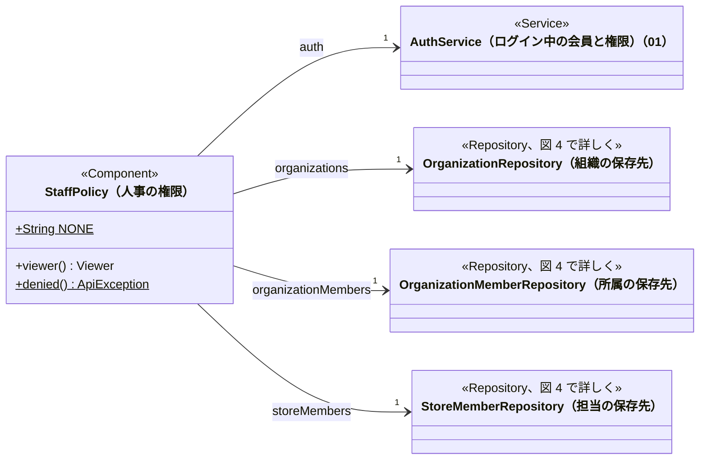

### 線とコードの対応

| 線 | コード |
| --- | --- |
| StaffPolicy → AuthService、OrganizationRepository、OrganizationMemberRepository、StoreMemberRepository | `viewer()` が、ログイン中の会員から `Viewer` を作る。`SHOP_OWNER` なら `organizations.owner_member_id` から、`SHOP_STAFF` なら所属と店舗の担当から作る |

### 部品の決まり

| 部品 | 決まり |
| --- | --- |
| `StaffPolicy.viewer()` | 組織が無ければ 403 `FORBIDDEN`（`denied()`） |
| `StaffPolicy.NONE` | 店舗のロールの「未割り当て」を表す値 |

## 行を足す・消す Service

図には、Service が Entity を作る・消す依存の線を書いていません（データの図とモジュールの図を分けたため）。どの Service がどのテーブルに行を足すか・消すかは、次のとおりです。

| Service のメソッド | 足す行 | 消す行 |
| --- | --- | --- |
| `StoreApplicationService.submit()` | `StoreApplicationEntity` | 再申請のときの前々回の `StoreApplicationEntity` |
| `StoreApplicationService.decide()` | 承認のとき `OrganizationEntity` | なし |
| `OrganizationSuspensionService` の `stopAccepting()`・`resume()`・`settle()` | `OrganizationModerationEventEntity` | なし |
| `StaffAccountService.assign()` | 担当でない店舗のとき `StoreMemberEntity` と `OrganizationMemberEventEntity`（`ofStore()`） | なし |
| `StaffAccountService.removeAssignment()` | `OrganizationMemberEventEntity`（`ofStore()`） | `StoreMemberEntity` |
| `StaffAccountService` の `expel()`・`reinstate()` | `OrganizationMemberEventEntity`（`ofOrganization()`） | なし |
| `StoreInvitationService.issue()` | `StoreInvitationEntity` | なし |
| `StoreInvitationService.register()` | `AuthMember`、`OrganizationMemberEntity`、`StoreMemberEntity`、`StoreInvitationUseEntity` | なし |
| `OwnerSuccessionService` の `request()`・`cancel()`・`refuse()` | `OrganizationMemberEventEntity`（`ofOwnerSuccession()`） | なし |
| `OwnerSuccessionService.approve()` | 元のオーナーの `OrganizationMemberEntity`、`OrganizationMemberEventEntity`（`ofOwnerSuccession()`） | 新しいオーナーの `OrganizationMemberEntity`（担当の `store_members` は外部キーの CASCADE で消える） |
| `PendingOwnerSuccession.invalidate()` | `OrganizationMemberEventEntity`（`ofOwnerSuccession()`） | なし |
| `StoreClosureService.settle()` | なし | 閉鎖済みにした店舗の `StoreMemberEntity`（`deleteAllAtStore()`） |
| `StoreService.create()` | `StoreEntity`（`StoreEntity.create()`） | なし |
| `StoreModerationService` の `enable()`・`warn()` | moderation パッケージの `StoreModerationEventEntity` | なし |
| `OwnerSuccessionNotices` の各メソッド | notification パッケージの `NotificationEntity` | なし |

## クラスとコードの対応

リンクはすべて 8892344 のファイルです。`S` は `backend/src/main/java/jp/kusakari/ec/store` の略です。

| クラス | ファイル | 図 |
| --- | --- | --- |
| `OrganizationEntity` | [S/persistence/entity/OrganizationEntity.java](https://github.com/abeouga/kusakari-ec/blob/8892344/backend/src/main/java/jp/kusakari/ec/store/persistence/entity/OrganizationEntity.java) | 図 1（図 2・図 3 は参照） |
| `OrganizationMemberEntity` | [S/persistence/entity/OrganizationMemberEntity.java](https://github.com/abeouga/kusakari-ec/blob/8892344/backend/src/main/java/jp/kusakari/ec/store/persistence/entity/OrganizationMemberEntity.java) | 図 1 |
| `OrganizationMemberId` | [S/persistence/entity/OrganizationMemberId.java](https://github.com/abeouga/kusakari-ec/blob/8892344/backend/src/main/java/jp/kusakari/ec/store/persistence/entity/OrganizationMemberId.java) | 図 1 |
| `StoreMemberEntity` | [S/persistence/entity/StoreMemberEntity.java](https://github.com/abeouga/kusakari-ec/blob/8892344/backend/src/main/java/jp/kusakari/ec/store/persistence/entity/StoreMemberEntity.java) | 図 1 |
| `StoreMemberId` | [S/persistence/entity/StoreMemberId.java](https://github.com/abeouga/kusakari-ec/blob/8892344/backend/src/main/java/jp/kusakari/ec/store/persistence/entity/StoreMemberId.java) | 図 1 |
| `OrganizationMemberEventEntity` | [S/persistence/entity/OrganizationMemberEventEntity.java](https://github.com/abeouga/kusakari-ec/blob/8892344/backend/src/main/java/jp/kusakari/ec/store/persistence/entity/OrganizationMemberEventEntity.java) | 図 2 |
| `OrganizationModerationEventEntity` | [S/persistence/entity/OrganizationModerationEventEntity.java](https://github.com/abeouga/kusakari-ec/blob/8892344/backend/src/main/java/jp/kusakari/ec/store/persistence/entity/OrganizationModerationEventEntity.java) | 図 2 |
| `StoreApplicationEntity` | [S/persistence/entity/StoreApplicationEntity.java](https://github.com/abeouga/kusakari-ec/blob/8892344/backend/src/main/java/jp/kusakari/ec/store/persistence/entity/StoreApplicationEntity.java) | 図 3 |
| `StoreInvitationEntity` | [S/persistence/entity/StoreInvitationEntity.java](https://github.com/abeouga/kusakari-ec/blob/8892344/backend/src/main/java/jp/kusakari/ec/store/persistence/entity/StoreInvitationEntity.java) | 図 3 |
| `StoreInvitationUseEntity` | [S/persistence/entity/StoreInvitationUseEntity.java](https://github.com/abeouga/kusakari-ec/blob/8892344/backend/src/main/java/jp/kusakari/ec/store/persistence/entity/StoreInvitationUseEntity.java) | 図 3 |
| `StoreInvitationUseId` | [S/persistence/entity/StoreInvitationUseId.java](https://github.com/abeouga/kusakari-ec/blob/8892344/backend/src/main/java/jp/kusakari/ec/store/persistence/entity/StoreInvitationUseId.java) | 図 3 |
| 8 つの Repository | [S/persistence/repository](https://github.com/abeouga/kusakari-ec/tree/8892344/backend/src/main/java/jp/kusakari/ec/store/persistence/repository) | 図 4 |
| `StoreService`、`Profile`、`Input` | [S/service/StoreService.java](https://github.com/abeouga/kusakari-ec/blob/8892344/backend/src/main/java/jp/kusakari/ec/store/service/StoreService.java) | 図 5、図 11 |
| `StoreModerationService` | [S/service/StoreModerationService.java](https://github.com/abeouga/kusakari-ec/blob/8892344/backend/src/main/java/jp/kusakari/ec/store/service/StoreModerationService.java) | 図 5 |
| `StoreClosureService` | [S/service/StoreClosureService.java](https://github.com/abeouga/kusakari-ec/blob/8892344/backend/src/main/java/jp/kusakari/ec/store/service/StoreClosureService.java) | 図 6 |
| `OrganizationSuspensionService`、`OrganizationView`、`EventView` | [S/service/OrganizationSuspensionService.java](https://github.com/abeouga/kusakari-ec/blob/8892344/backend/src/main/java/jp/kusakari/ec/store/service/OrganizationSuspensionService.java) | 図 6、図 11 |
| `OpenOrders` | [S/service/OpenOrders.java](https://github.com/abeouga/kusakari-ec/blob/8892344/backend/src/main/java/jp/kusakari/ec/store/service/OpenOrders.java) | 図 18（図 6 は参照） |
| `ClosureSettlement` | [S/service/ClosureSettlement.java](https://github.com/abeouga/kusakari-ec/blob/8892344/backend/src/main/java/jp/kusakari/ec/store/service/ClosureSettlement.java) | 図 6 |
| `StoreApplicationService`、`Input`、`Application`、`Document` | [S/service/StoreApplicationService.java](https://github.com/abeouga/kusakari-ec/blob/8892344/backend/src/main/java/jp/kusakari/ec/store/service/StoreApplicationService.java) | 図 7、図 16 |
| `StaffPolicy`、`Viewer` | [S/service/StaffPolicy.java](https://github.com/abeouga/kusakari-ec/blob/8892344/backend/src/main/java/jp/kusakari/ec/store/service/StaffPolicy.java) | 図 20、図 12（図 8〜図 10 は参照） |
| `StaffAccountService`、`AccountsView`、`StoreRef`、`Account`、`Assignment`、`OwnerSuccession` | [S/service/StaffAccountService.java](https://github.com/abeouga/kusakari-ec/blob/8892344/backend/src/main/java/jp/kusakari/ec/store/service/StaffAccountService.java) | 図 8、図 12 |
| `MemberEventService`、`Event`、`Person` | [S/service/MemberEventService.java](https://github.com/abeouga/kusakari-ec/blob/8892344/backend/src/main/java/jp/kusakari/ec/store/service/MemberEventService.java) | 図 8、図 12 |
| `StoreInvitationService`、`Issued`、`Invitation`、`User` | [S/service/StoreInvitationService.java](https://github.com/abeouga/kusakari-ec/blob/8892344/backend/src/main/java/jp/kusakari/ec/store/service/StoreInvitationService.java) | 図 9、図 16 |
| `OwnerSuccessionService`、`Lapsed`、`Decision` | [S/service/OwnerSuccessionService.java](https://github.com/abeouga/kusakari-ec/blob/8892344/backend/src/main/java/jp/kusakari/ec/store/service/OwnerSuccessionService.java) | 図 10、図 12 |
| `PendingOwnerSuccession`、`Reason` | [S/service/PendingOwnerSuccession.java](https://github.com/abeouga/kusakari-ec/blob/8892344/backend/src/main/java/jp/kusakari/ec/store/service/PendingOwnerSuccession.java) | 図 19、図 16（図 10 は参照） |
| `OwnerSuccessionNotices` | [S/service/OwnerSuccessionNotices.java](https://github.com/abeouga/kusakari-ec/blob/8892344/backend/src/main/java/jp/kusakari/ec/store/service/OwnerSuccessionNotices.java) | 図 19（図 10 は参照） |
| `StoreController`、`PublishedRequest`、`CancellationRequest` | [S/controller/StoreController.java](https://github.com/abeouga/kusakari-ec/blob/8892344/backend/src/main/java/jp/kusakari/ec/store/controller/StoreController.java) | 図 13、図 17 |
| `StoreModerationController`、`EnabledRequest` | [S/controller/StoreModerationController.java](https://github.com/abeouga/kusakari-ec/blob/8892344/backend/src/main/java/jp/kusakari/ec/store/controller/StoreModerationController.java) | 図 13、図 17 |
| `StoreApplicationController`、`Decision` | [S/controller/StoreApplicationController.java](https://github.com/abeouga/kusakari-ec/blob/8892344/backend/src/main/java/jp/kusakari/ec/store/controller/StoreApplicationController.java) | 図 14、図 17 |
| `OrganizationController`、`ReasonRequest`、`ResumeRequest` | [S/controller/OrganizationController.java](https://github.com/abeouga/kusakari-ec/blob/8892344/backend/src/main/java/jp/kusakari/ec/store/controller/OrganizationController.java) | 図 14、図 17 |
| `StaffController`、`RoleRequest`、`OrganizationRoleRequest`、`InvitationRequest` | [S/controller/StaffController.java](https://github.com/abeouga/kusakari-ec/blob/8892344/backend/src/main/java/jp/kusakari/ec/store/controller/StaffController.java) | 図 15、図 17 |
| 外部キー | [V1__schema.sql](https://github.com/abeouga/kusakari-ec/blob/8892344/backend/src/main/resources/db/migration/V1__schema.sql)、[V3__organization_moderation_events.sql](https://github.com/abeouga/kusakari-ec/blob/8892344/backend/src/main/resources/db/migration/V3__organization_moderation_events.sql)、[V4__organization_member_events.sql](https://github.com/abeouga/kusakari-ec/blob/8892344/backend/src/main/resources/db/migration/V4__organization_member_events.sql)、[V6__owner_succession.sql](https://github.com/abeouga/kusakari-ec/blob/8892344/backend/src/main/resources/db/migration/V6__owner_succession.sql) | 図 1〜図 3 |

## 載せなかったもの

store パッケージの 38 ファイルのクラスと、その中で宣言した 30 個の record・enum・クラス（Controller の 9 個の record、Service の 20 個の record と enum、`OwnerSuccessionService.Lapsed`）は、どれかの図にあります。

| もの | 理由 | 載せた図 |
| --- | --- | --- |
| `private` のメソッドと定数（`OwnerSuccessionService.APPROVAL_PERIOD`・`NOT_PENDING`、`MemberEventService.ORGANIZATION_EVENTS`、`StaffController.MEMBER_ID`、`OwnerSuccessionNotices.DEADLINE`・`UNCHANGED`、`StoreInvitationService.RANDOM` など） | 業務の操作ではなく、クラスの中だけで使うため | 値が読み方に関わるものは、各図の「部品の決まり」「API とクラス」の表 |
| アクセス修飾子の無いパッケージの中だけのもの（`OpenOrders` の `BLOCKING`・`CANCELLABLE`・`CANCELLED_TITLE`、`OrganizationSuspensionService.AUTO_SUSPEND_REASON`、`ClosureSettlement.CONTACT_RETENTION`、`StoreInvitationService.hash()`） | 同上 | 図 6・図 9・図 18 の「部品の決まり」の表 |
| Service が DI で受け取るフィールド | 関連の線（ラベルがフィールド名）で描いたので、箱の属性に重ねない | 図 5〜図 10、図 13〜図 15、図 18〜図 20 の線 |
| `java.io.Serializable` と、`@Embeddable` のクラスからの実現の線 | Java の組み込みの interface で、3 つのクラスが実装するだけのため | 「図の読み方」 |
| `JpaRepository` の型引数 | Mermaid 11.4.1 では型引数が 2 つの `~…~` が消えるため、箱は `JpaRepository[T，ID]` と書き、実際の型は表にした | 図 4 の「継承の型とロック」の表 |
| `EntityManager`、`TransactionTemplate`、`MultipartFile`、`ResponseEntity`、`PlatformTransactionManager` などのフレームワークのクラス | 箱を作らず、フィールドや引数の型として書いた。`ClosureSettlement` は `PlatformTransactionManager` をコンストラクターで受け取り、`separate` を作る | 図 6、図 10、図 14 |
| モジュールの図での record・enum の箱 | データの図とモジュールの図を混ぜないため | 図 11、図 12、図 16、図 17 |
| moderation の `ModerationDtos`（`State`、`EventView`、`WarningRequest`） | 07 のクラスで、このパッケージでは型名として使うだけのため。`Warning` だけは `Profile` の中身なので図 11 に箱を置いた | 図 11、図 13、図 17 の表 |
| `StoreEntity`、`StoreRepository` の中身 | catalog パッケージのクラスで、03 の担当のため | 03 の図 2・図 3 |
| `AuthMember`、`AuthService`、`AuthMemberRepository` の中身 | auth パッケージのクラスで、01 の担当のため | 01 |

## 確かめられなかったこと

- GitHub と Obsidian での表示は確かめていません。PNG は mermaid-snap（Mermaid 11.4.1）で書き出したものです。
- 図 5〜図 10 の「線とコードの対応」の、ほかのパッケージのクラスのメソッド（`AuthService.requireOwnedOrganization()`、`OrderRepository.lockByStatus()`、`StoreRepository.clearClosedContacts()`、`ModerationHistory.reasonFor()` など）は、store パッケージの呼び出しの行だけを確かめ、呼ばれる側の中身は 01・03・04・07 に任せています。
- `StoreApplicationService.Document.type` の値は、`submit()` がファイルの先頭のバイトで決めて保存する 3 つの値から書きました。これより前に保存された行の値は確かめていません。
