# kusakari-ec 店舗と組織（store パッケージ）のクラス図

- 対象のコード: kusakari-ec の main（19a2be3、2026-11-20 時点）
- 対象のパッケージ: `jp.kusakari.ec.store`（[backend/src/main/java/jp/kusakari/ec/store](https://github.com/abeouga/kusakari-ec/tree/19a2be307ee71a2cd87e538236c3c8c42929c5b3/backend/src/main/java/jp/kusakari/ec/store)）
  - [controller](https://github.com/abeouga/kusakari-ec/tree/19a2be307ee71a2cd87e538236c3c8c42929c5b3/backend/src/main/java/jp/kusakari/ec/store/controller)（5 ファイル）、[persistence/entity](https://github.com/abeouga/kusakari-ec/tree/19a2be307ee71a2cd87e538236c3c8c42929c5b3/backend/src/main/java/jp/kusakari/ec/store/persistence/entity)（11 ファイル）、[persistence/repository](https://github.com/abeouga/kusakari-ec/tree/19a2be307ee71a2cd87e538236c3c8c42929c5b3/backend/src/main/java/jp/kusakari/ec/store/persistence/repository)（8 ファイル）、[service](https://github.com/abeouga/kusakari-ec/tree/19a2be307ee71a2cd87e538236c3c8c42929c5b3/backend/src/main/java/jp/kusakari/ec/store/service)（14 ファイル）

## パッケージの役割

store パッケージは、出店者の側の組織と店舗の管理を扱います。

- 組織（`organizations`）と、そのオーナー、組織への所属（`organization_members`）、店舗の担当とロール（`store_members`）を扱います。
- 出店申請（`organization_applications`）の提出・取り下げ・審査を扱います。承認すると組織を作ります。
- 店舗の情報の表示・作成・編集・公開と、店舗の閉鎖を扱います。
- 運営による店舗の警告・利用停止と、組織の受付停止・停止を扱います。
- 出店者画面の人事（アカウント一覧、ロールの割り振り、組織からの除名と復帰、店舗の招待キー、担当者の操作の記録）を扱います。
- オーナーの譲渡（申し出・取り消し・承認・断り・自動で無効）を扱います。
- 店舗の Entity（`StoreEntity`）と Repository（`StoreRepository`）は catalog パッケージにあります（[03_商品カタログ](<03_商品カタログ.md>) の図 2）。
- 会員（`AuthMember`）と `AuthService` は auth パッケージにあります（[01_共通と認証と会員](<01_共通と認証と会員.md>)）。

## 読み方の要点

- 層は controller → service → persistence/repository → persistence/entity の順に呼びます。Controller は Entity を返さず、Service の中の record（店舗の警告・利用停止は moderation パッケージの `ModerationDtos` の record）を返します。
- Entity どうしに JPA の関連（`@ManyToOne` など）はありません。ID の列で参照します。図 1〜図 3 では、依存の破線（`..>`）に参照するフィールド名を付けて示し、多重度は書きません。外部キーは Flyway の `V1__schema.sql`、`V3__organization_moderation_events.sql`、`V4__organization_member_events.sql`、`V6__owner_succession.sql` にあります。列と制約の詳しいことは [テーブル設計図](<../../テーブル設計図/kusakari-ec/>) を見てください。
- Entity のフィールドの後ろの〔 〕は、フィールド名と違う列名です。Controller のメソッドの後ろの〔 〕は、HTTP のメソッドとパスです。
- 状態や種類の値は enum ではなく、Entity の `String` の定数（`$` の付いたフィールド）です。
- 図の `namespace` の枠（`auth`、`catalog` など）は、ほかのパッケージです。その中のクラスは名前だけを書きます。
- store パッケージのクラスで、ステレオタイプだけでメンバーの無い箱は、別の図にメンバーを書いたクラスです。
- Entity は Lombok の `@Getter` で getter を持ちます。図には getter と、JPA のための `protected` の引数の無いコンストラクター（`@NoArgsConstructor`）を書きません。setter はなく、状態はメソッドで変えます。`OrganizationMemberId` などの `@Embeddable` のクラスは、Lombok の `@Data` と `@AllArgsConstructor` を持ちます。
- 処理の流れは [シーケンス図](<../../シーケンス図/kusakari-ec/>) を見てください。関係の深いものは次のとおりです。
  - 出店申請: [EC-B17](<../../シーケンス図/kusakari-ec/EC-B17_出店の申請をする.md>)、[EC-B18](<../../シーケンス図/kusakari-ec/EC-B18_出店申請状況を確認する.md>)、[EC-A03](<../../シーケンス図/kusakari-ec/EC-A03_出店申請を審査する.md>)
  - 店舗の情報: [EC-B05](<../../シーケンス図/kusakari-ec/EC-B05_販売店舗の情報を確認する.md>)、[EC-A05](<../../シーケンス図/kusakari-ec/EC-A05_店舗情報を確認する.md>)、[EC-S02](<../../シーケンス図/kusakari-ec/EC-S02_店舗プロフィールを編集する.md>)、[EC-C03](<../../シーケンス図/kusakari-ec/EC-C03_出店者画面のメニューを開く.md>)
  - 運営の警告・利用停止: [EC-A11](<../../シーケンス図/kusakari-ec/EC-A11_店舗の利用を停止・再開する.md>)
  - 招待キーでの登録: [EC-B16](<../../シーケンス図/kusakari-ec/EC-B16_一般アカウントを登録する.md>)
  - 閉鎖済み・停止への切り替え: [EC-S10](<../../シーケンス図/kusakari-ec/EC-S10_注文を引き渡し完了にする.md>)、[EC-S13](<../../シーケンス図/kusakari-ec/EC-S13_注文キャンセル申請を処理する.md>)
  - オーナーの譲渡の自動の無効: [EC-A02](<../../シーケンス図/kusakari-ec/EC-A02_アカウントの利用状況を変更する.md>)、[EC-B21](<../../シーケンス図/kusakari-ec/EC-B21_アカウントを退会する.md>)、[EC-B15](<../../シーケンス図/kusakari-ec/EC-B15_利用者通知を確認する.md>)、[EC-S11](<../../シーケンス図/kusakari-ec/EC-S11_イベント通知を確認する.md>)

| クラス | テーブル | 主キー | Entity にフィールドの無い列 |
| --- | --- | --- | --- |
| `OrganizationEntity` | `organizations` | `id` | `owner_account_type`、`created_at` |
| `OrganizationMemberEntity`、`OrganizationMemberId` | `organization_members` | `organization_id`、`member_id` | `created_at` |
| `StoreMemberEntity`、`StoreMemberId` | `store_members` | `store_id`、`member_id` | `created_at` |
| `OrganizationMemberEventEntity` | `organization_member_events` | `id` | なし |
| `OrganizationModerationEventEntity` | `organization_moderation_events` | `id` | なし |
| `StoreApplicationEntity` | `organization_applications` | `id` | なし |
| `StoreInvitationEntity` | `store_invitations` | `id` | なし |
| `StoreInvitationUseEntity`、`StoreInvitationUseId` | `store_invitation_uses` | `invitation_id`、`member_id` | なし |

| Controller | パス | ログイン |
| --- | --- | --- |
| `StoreController` | `/api/stores/{id}`、`/api/seller/stores`、`/api/seller/stores/{id}`、`/api/seller/stores/{id}/published`、`/api/seller/stores/{id}/closure`、`/api/operator/stores`、`/api/operator/stores/{id}/closure`、`/api/operator/stores/{id}/order-cancellations` | `GET /api/stores/{id}` だけ不要 |
| `StoreModerationController` | `/api/operator/stores/{id}/enabled`、`/warning`、`/moderation-events` | 必要 |
| `StoreApplicationController` | `/api/account/store-applications/**`、`/api/operator/applications/**` | 必要 |
| `OrganizationController` | `/api/operator/organizations/**` | 必要 |
| `StaffController` | `/api/seller/accounts/**`、`/api/seller/owner-succession/**`、`/api/seller/stores/{storeId}/member-events`、`/api/seller/stores/{storeId}/invitations`、`/api/seller/invitations/{id}/revoke` | 必要 |

ログインの要否は、`auth/AuthConfiguration.java` の `cognitoSecurity()` の `permitAll()` の指定です（`GET /api/stores/*` が不要）。運営か、オーナーか、どのロールかの確認は、各 Service が `AuthService` か `StaffPolicy` を呼んで行います。

## 図 1 組織・所属・担当の Entity

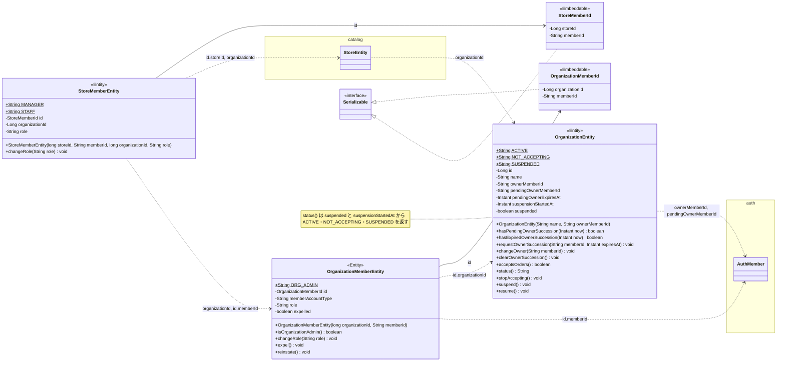

- オーナーは `organization_members` に行を持たず、`OrganizationEntity.ownerMemberId` だけで組織と結び付きます。`organization_members` に入るのは担当者（`SHOP_STAFF`）だけです。
- 人事のロールは `OrganizationMemberEntity.role`（`ORG_ADMIN` か空）、店舗の操作のロールは `StoreMemberEntity.role`（`MANAGER`・`STAFF` か空）です。空の `StoreMemberEntity.role` は、招待キーで登録した直後の「ロール未割り当て」です。
- 除名は論理削除です。`OrganizationMemberEntity.expel()` で `expelled` を立て、所属と担当の行は残します。
- `store_members` から `organization_members` への外部キーは `ON DELETE CASCADE` です。オーナーの譲渡の承認で所属の行を消すと、店舗の担当の行も消えます。

## 図 2 操作の記録の Entity

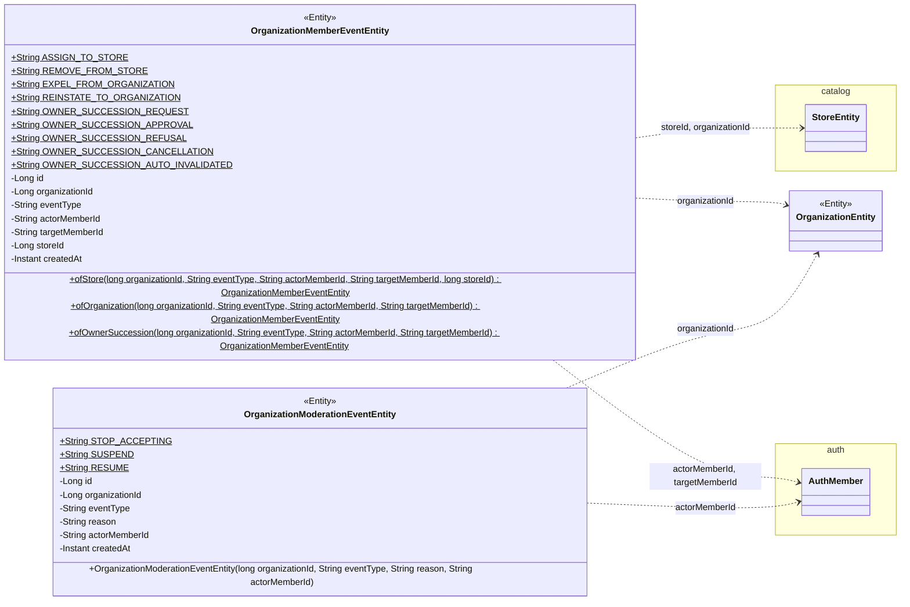

- `OrganizationMemberEventEntity` は担当者の操作の記録、`OrganizationModerationEventEntity` は運営による組織の受付停止・停止・再開の記録です。
- `OrganizationMemberEventEntity` と `OrganizationModerationEventEntity` は、行を書き換えずに足していく記録です。`OrganizationMemberEventEntity` は `public` のコンストラクターを持たず、種類ごとの 3 つの `static` のメソッドで作ります。店舗の担当の出入り（`ofStore()`）だけが `storeId` を持ちます。
- `OrganizationModerationEventEntity.actorMemberId` は、未完了の注文がなくなって自動で停止したとき（`SUSPEND`）は空です。

## 図 3 出店申請と招待キーの Entity

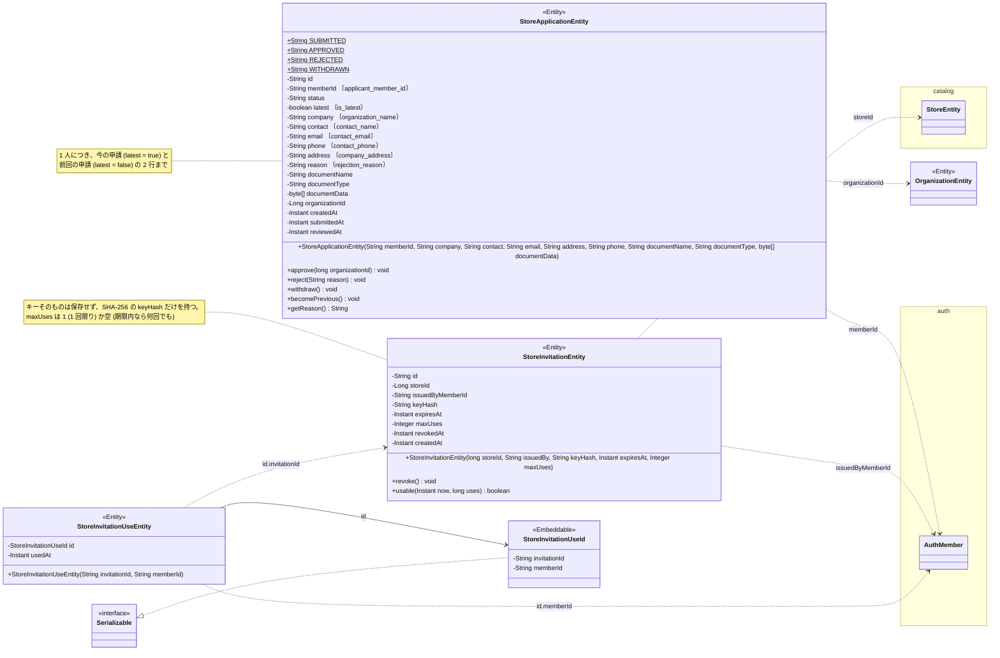

- クラス名は `StoreApplicationEntity` ですが、テーブルは `organization_applications` です。申請の対象は組織で、`organizationId` は承認で作った組織です。
- `StoreApplicationEntity` は、作ったときに `status` が `SUBMITTED`、`latest` が `true` です。`id` はコンストラクターで UUID を作ります。`getReason()` は Lombok の getter の代わりに書いたメソッドで、`reason` が `null` なら `""` を返します。
- 提出書類は `documentData`（`LONGBLOB`）として申請の行に入ります。
- `StoreInvitationEntity.usable()` は、取り消し・期限切れでなく、使った人数（`StoreInvitationUseEntity` の件数）が `maxUses` に達していないかを返します。`createdAt` と `StoreInvitationUseEntity.usedAt` は DB の既定値で入ります（`insertable = false`）。

## 図 4 Repository

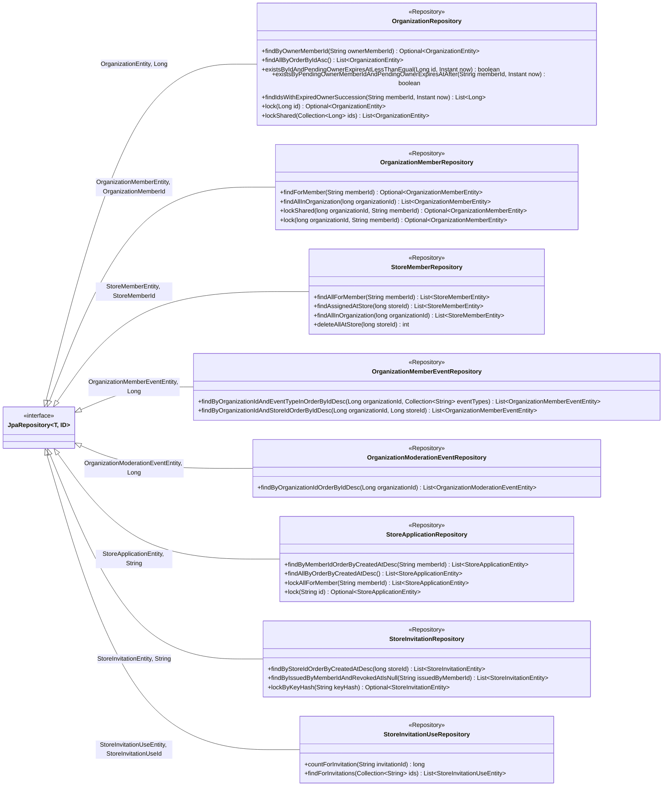

- どの Repository も `JpaRepository` を継承した interface です。線のラベルは、`JpaRepository` の型引数（Entity と主キーの型）です。
- `lock` で始まるメソッドは、`@Lock` で行をロックして読みます。

| メソッド | ロック |
| --- | --- |
| `OrganizationRepository.lock()`、`OrganizationMemberRepository.lock()`、`StoreApplicationRepository.lock()`、`StoreApplicationRepository.lockAllForMember()`、`StoreInvitationRepository.lockByKeyHash()` | `PESSIMISTIC_WRITE` |
| `OrganizationRepository.lockShared()`、`OrganizationMemberRepository.lockShared()` | `PESSIMISTIC_READ` |

- `OrganizationRepository.lockShared()` は、お会計（commerce パッケージの `CheckoutService`）が使います。受付停止と同時のお会計で、受付停止の後に注文ができないようにします。
- `StoreMemberRepository.deleteAllAtStore()` は `@Modifying` の DELETE です。閉鎖済みになった店舗の担当を外します。
- `OrganizationRepository`、`OrganizationMemberRepository`、`StoreMemberRepository` は、ほかのパッケージからも使われます（`AuthService`、`NotificationService`、`CatalogService`、`CheckoutService`）。

## 図 5 店舗の情報と運営の警告・利用停止の Service

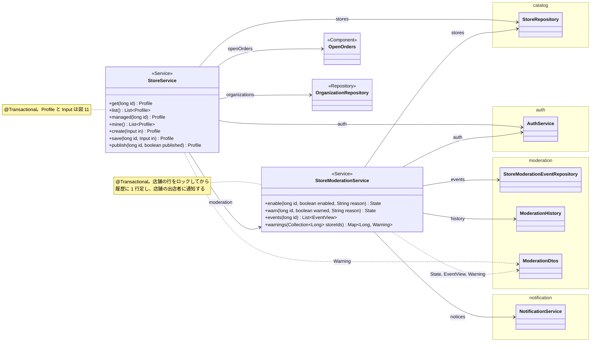

- `StoreService.get()` は店舗の公開ページです。購入者と未ログインには、公開中と閉鎖中の店舗だけを返し、ほかは 404 にします。組織が停止（`OrganizationEntity.suspended`）なら、店舗も見えません。
- `StoreService.mine()` は出店者画面の店舗一覧です。`list()` は運営の店舗一覧です。`managed()` は閉鎖の操作の後に返す店舗です。どれも未完了の注文の件数（`OpenOrders.count()`）と運営の警告（`StoreModerationService.warnings()`）を付けます。
- `StoreService.create()` は、オーナーが自分の組織に店舗を作ります。作った直後は非公開です。`save()` は `Input.revision` と `StoreEntity` の `revision` を比べ、違えば 409 `STORE_CHANGED` にします。
- `StoreModerationService.enable()` は店舗の利用停止（`enabled = false`）と再開、`warn()` は警告と警告の解除です。履歴は moderation パッケージの `store_moderation_events` に入ります（[07_通知と運営の記録](<07_通知と運営の記録.md>)）。
- `State`、`EventView`、`Warning` は moderation パッケージの `ModerationDtos` の中の record です。

## 図 6 店舗の閉鎖と組織の受付停止・停止の Service

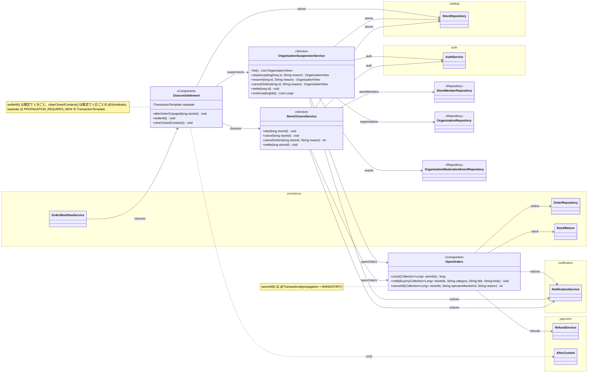

- 店舗の閉鎖は、営業中 → 閉鎖中 → 閉鎖済みです。`StoreClosureService.start()` で閉鎖中にし、未完了の注文がなくなった時点で `settle()` が閉鎖済みにして、その店舗の担当（`store_members`）を消します。
- 組織は、通常（`ACTIVE`）→ 受付停止中（`NOT_ACCEPTING`）→ 停止（`SUSPENDED`）です。`OrganizationSuspensionService.stopAccepting()` で受付停止中にし、未完了の注文がなくなった時点で `settle()` が停止にします。`resume()` で通常に戻します。操作は `organization_moderation_events` に記録します。
- `OpenOrders` は、閉鎖と停止で共通の部品です。未完了の注文は支払い待ち・注文受付・受取準備完了（`PENDING_PAYMENT`・`ACCEPTED`・`READY`）で、運営のまとめてキャンセル（`cancelAll()`）の対象は `ACCEPTED`・`READY` です。キャンセルでは在庫を戻し（`StockReturn`）、カードで支払い済みなら返金し（`RefundService`）、購入者と店舗に通知します。
- `ClosureSettlement` は、閉鎖中の店舗と受付停止中の組織を確かめ直す部品です。注文の状態を変えた `OrderWorkflowService` が `afterOrderChanged()` を呼び、コミットの後に確かめます（`AfterCommit.run()`）。ほかの経路は、既定で 1 分ごとの `settleAll()` で拾います（間隔は `kusakari.ec.closure-settlement-interval-ms` の設定）。`clearClosedContacts()` は、閉鎖済みから 90 日たった店舗の連絡先を消します。

## 図 7 出店申請の Service

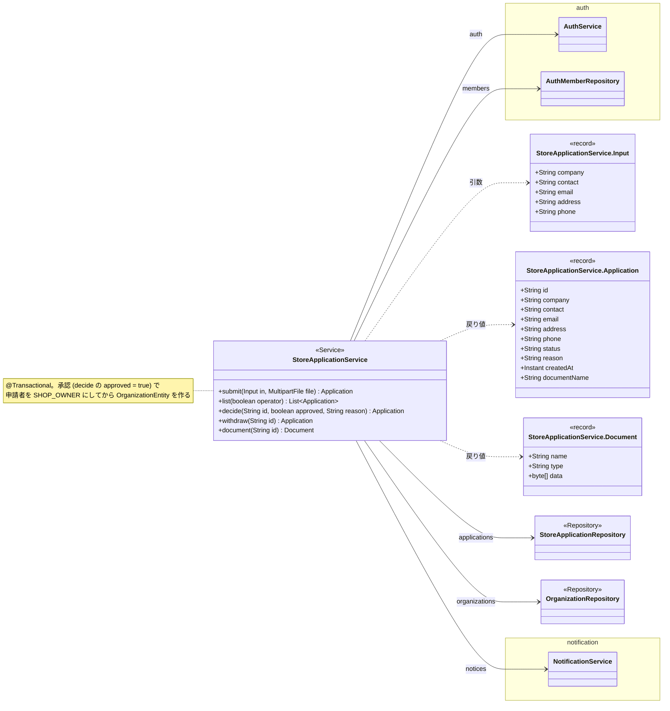

- `submit()` は、企業様向けの登録で作ったアカウント（`AuthMember.SHOP_OWNER_APPLICANT`）だけが使えます。提出書類は 5MB 以内の PDF・PNG・JPEG で、ファイルの先頭のバイトで種類を決めます。再申請では、前々回の申請を消し、今の申請を前回の申請（`becomePrevious()`）にしてから、新しい申請を作ります。
- `list(false)` は自分の申請、`list(true)` は運営の一覧です。`document()` は、運営か申請者本人だけが提出書類を取り出せます。
- `Input` の検証は、`company`・`contact` が 100 文字まで、`email`・`address` が 200 文字まで、`email` はメールの形式、`phone` は `[0-9+() -]{1,30}` です。

## 図 8 人事の権限・アカウント一覧・操作の記録の Service

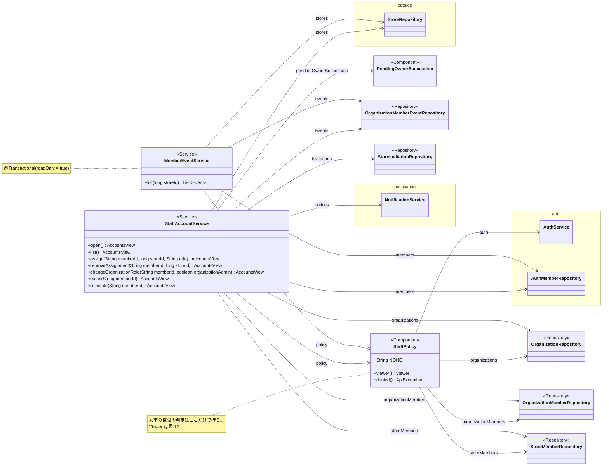

- `StaffPolicy.viewer()` は、ログイン中の店舗側のアカウントの立場（`Viewer`）を返します。`SHOP_OWNER` なら `organizations.owner_member_id` から、`SHOP_STAFF` なら所属と店舗の担当から作ります。組織が無ければ 403 `FORBIDDEN`（`denied()`）です。`Viewer` のメソッド（`canSeeAccounts()`、`assignableRoles()`、`canExpel()` など）が、できる操作を決めます。
- `StaffAccountService` は `@Transactional` です。`open()` は、期限が過ぎたオーナーの譲渡の申し出を無効として記録してから（`PendingOwnerSuccession.expireIfDue()`）、`list()` を返します。どの変更のメソッドも、最後に `list()` の結果を返します。
- `assign()` はロール（`MANAGER`・`STAFF`・`NONE`）を割り振り、担当でない店舗なら担当に加えます。`removeAssignment()` は店舗の担当から外し、本人に通知します。`changeOrganizationRole()` は `ORG_ADMIN` の付け外しです。
- `expel()` は組織からの除名です。その人が発行した招待キーを取り消し、承認待ちの譲渡先なら申し出を無効にします（`PendingOwnerSuccession.invalidateFor()`）。`reinstate()` は復帰です。
- `MemberEventService.list()` は担当者の操作の記録です。除名・復帰・オーナーの譲渡は組織の全件、店舗の担当の出入りは指定した店舗の分を返します。オーナーと `ORG_ADMIN` だけが見られます。

## 図 9 招待キーの Service

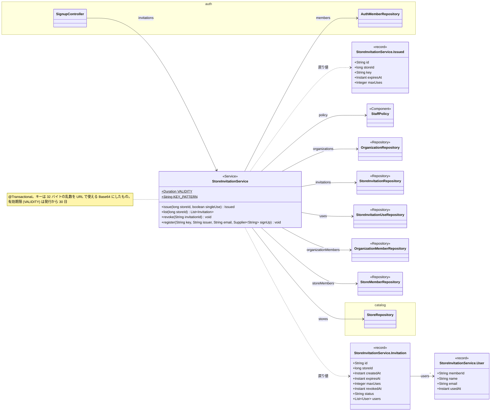

- `issue()` はキーを発行し、キーそのものを `Issued.key` で返します。DB にはハッシュだけを残すので、後から表示できません。停止中・閉鎖済みの店舗には発行できません（409 `STORE_NOT_INVITABLE`）。
- `list()` は、キーごとの状態（`ACTIVE`・`EXPIRED`・`REVOKED`・`USED_UP`）と使った人を返します。`revoke()` は取り消しで、使った人の所属は変えません。
- `register()` は auth パッケージの `SignupController` が呼ぶ、招待キーでの新規登録です。キーの行をロックして使えるかを確かめてから `signUp`（Cognito への登録）を呼び、同じトランザクションで会員（`SHOP_STAFF`）・組織への所属・店舗の担当（ロールなし）・使用の記録を作ります。キーが使えなければ 400 `INVITATION_INVALID` です。

## 図 10 オーナーの譲渡の Service

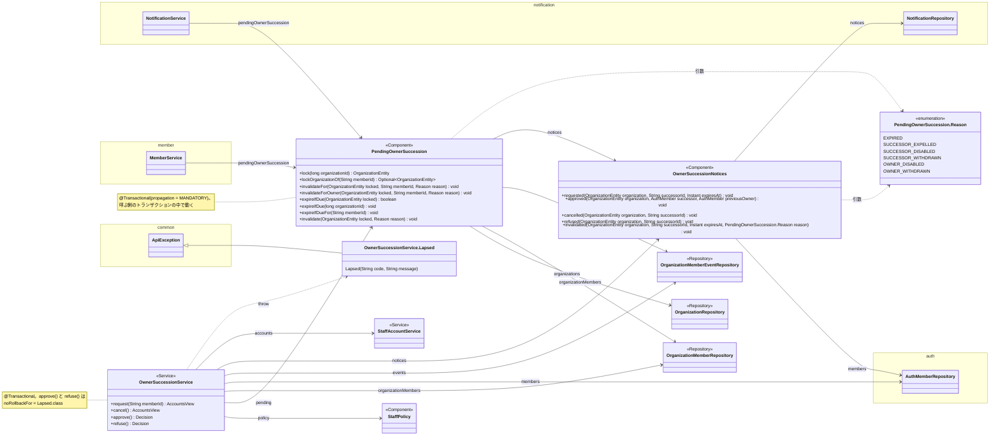

- `OwnerSuccessionService` の `request()`・`cancel()` はオーナーだけ、`approve()`・`refuse()` は今の譲渡先だけが使えます。承認待ちは `OrganizationEntity` の `pendingOwnerMemberId` と `pendingOwnerExpiresAt`（申し出から 30 分）に持ちます。
- `approve()` は 1 つのトランザクションで、新しいオーナーの所属を消し、会員の種別を `SHOP_OWNER` にし、組織のオーナーを付け替え、元のオーナーを `SHOP_STAFF` の `ORG_ADMIN` として所属させます。所属と会員の行は `EntityManager.refresh()` でロックして読み直します。
- `Lapsed` は `private` の例外のクラスです。期限が過ぎた申し出に承認・断りをしたとき、「自動で無効」の記録を残したまま 409 にするために使います。
- `PendingOwnerSuccession` は、承認待ちを自動で無効にする処理の置き場所です。期限切れは定期処理で探さず、次の操作のとき（申し出、アカウント一覧、通知一覧の読み込み、承認・断り）に見つけます。譲渡先の除名（`StaffAccountService.expel()`）、譲渡先とオーナーの利用停止・退会（member パッケージの `MemberService`）でも、`invalidateFor()`・`invalidateForOwner()` で無効にします。通知一覧の読み込み（notification パッケージの `NotificationService`）は `expireIfDueFor()` を呼びます。
- `OwnerSuccessionNotices` は、譲渡の通知の宛て先と文面を決めます。`NotificationService` は `PendingOwnerSuccession` を使うので、依存が循環しないよう、`NotificationRepository` に直接保存します。

## 図 11 店舗と組織の DTO

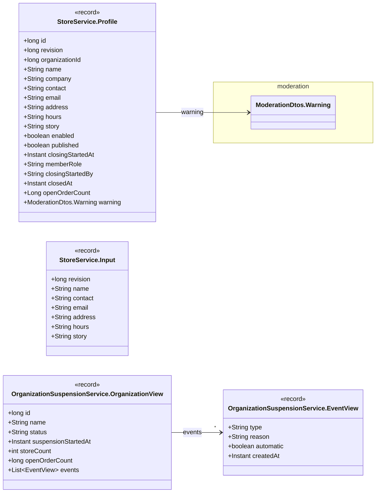

- `Profile.company` は組織の名前（`OrganizationEntity.name`）です。`enabled` は「運営が停止していない」（`StoreEntity.suspended` の逆）、`published` は「オーナーが公開した」です。
- `Profile.memberRole` は、出店者画面の店舗一覧（`StoreService.mine()`）だけで入る、その店舗での自分の立場です。`openOrderCount` と `warning` は、出店者と運営に返すときだけ入り、購入者と未ログインの公開ページでは `null` です。
- `Input` の検証は、`name` が必須で 100 文字まで、`contact` が 100 文字まで、`email` がメールの形式で 200 文字まで、`address` が必須で 200 文字まで、`hours` が必須で 80 文字まで、`story` が 1000 文字までです。
- `EventView.automatic` は、操作した運営がいない（自動で停止した）記録で `true` です。

## 図 12 人事の DTO

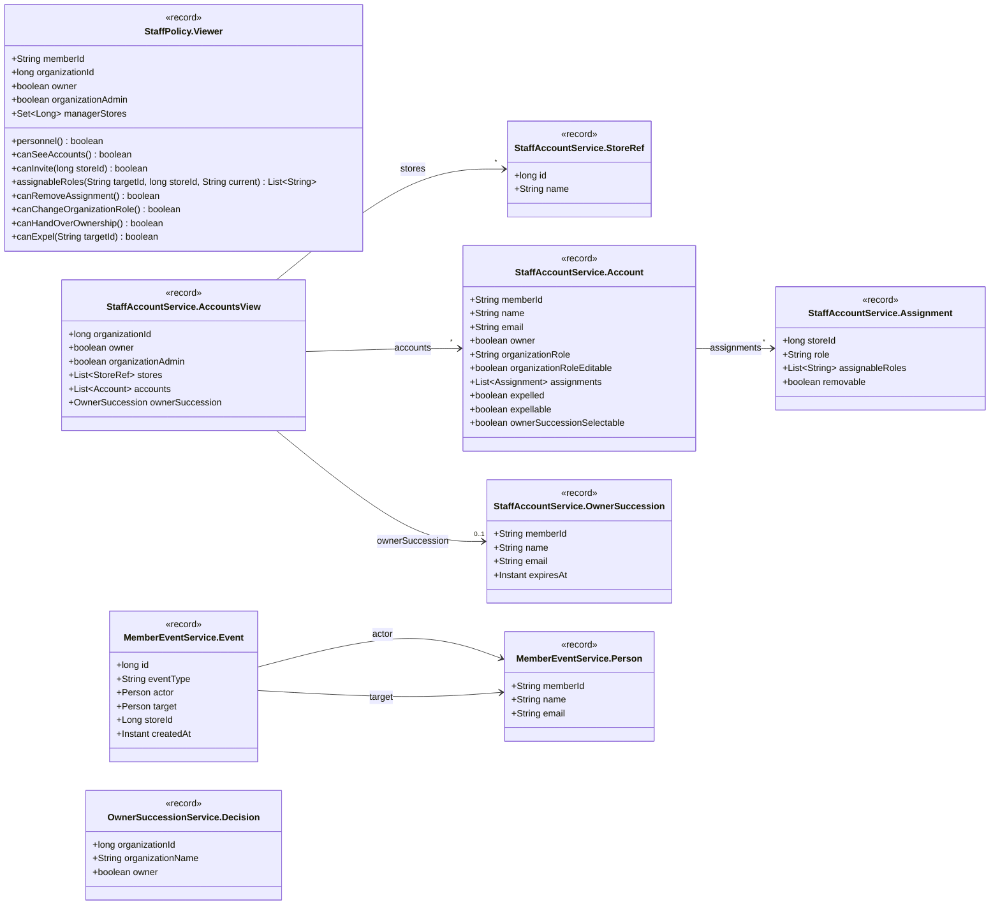

- `Viewer.personnel()` は、オーナーか `ORG_ADMIN` かです。`managerStores` は `MANAGER` のロールがある店舗の ID です。
- `AccountsView.ownerSuccession` は、オーナーにだけ、期限内の承認待ちがあるときに入ります。それ以外は `null` です。
- `Assignment.role` は `MANAGER`・`STAFF`・`NONE`（ロール未割り当て）か、担当でなければ `null` です。`assignableRoles` は、操作する人が選べる値です。画面は判定せず、この値のとおりに選択肢を出します。
- `Decision.owner` は、操作した人が今この組織のオーナーかです。承認なら `true`、断りなら `false` です。

## 図 13 店舗と運営の警告・利用停止の Controller

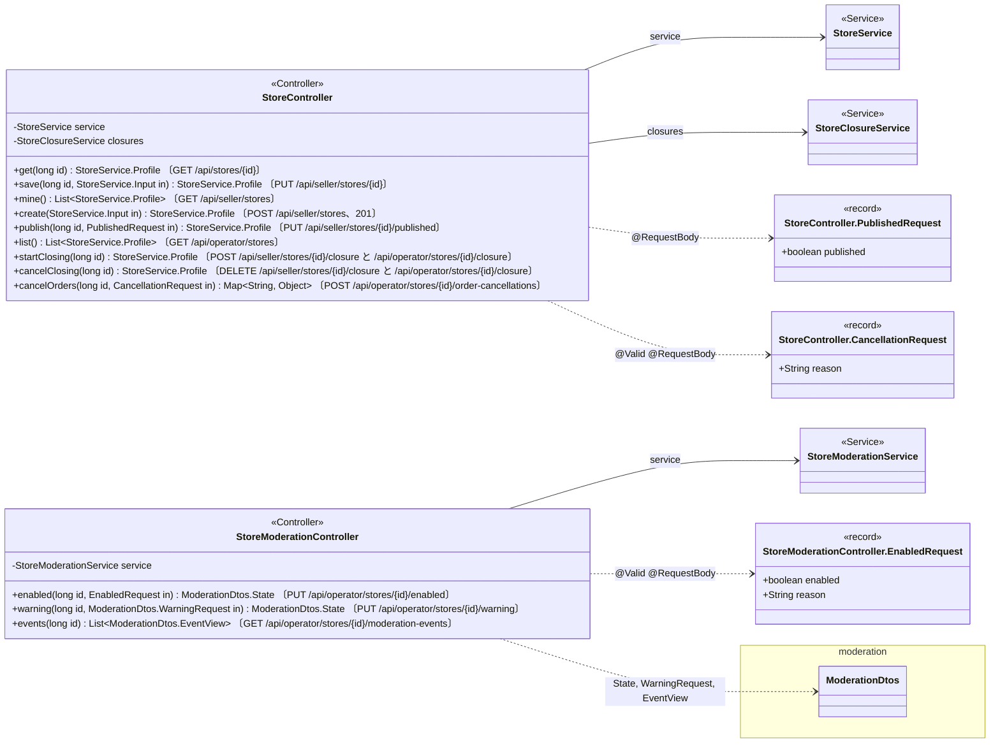

- `startClosing()` と `cancelClosing()` は、出店者と運営の 2 つのパスで同じ処理を呼びます。`StoreClosureService` が、操作した人が運営か店舗の組織のオーナーかを確かめ、`OWNER` か `ADMIN` として記録します。運営が始めた閉鎖をオーナーが取り消すと 403 `CLOSED_BY_OPERATOR` です。
- `startClosing()`、`cancelClosing()`、`cancelOrders()` は、操作の後に `StoreService.managed()` の店舗を返します。`cancelOrders()` の応答は `cancelled`（件数）と `store` です。
- 入力の検証は、`CancellationRequest.reason` が必須で 500 文字まで、`EnabledRequest.reason` が 500 文字までです。利用停止の理由が必須なことは、`ModerationHistory.reasonFor()` が確かめます。

## 図 14 出店申請と組織の受付停止の Controller

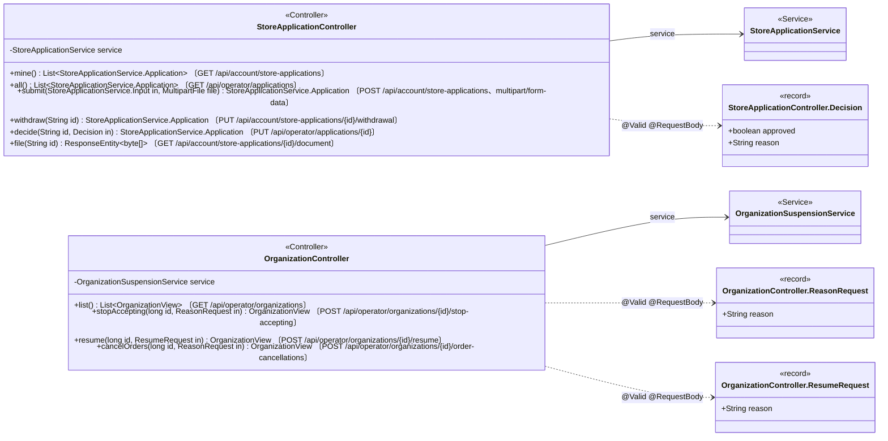

- `submit()` は、`application`（`StoreApplicationService.Input` の JSON）と `document`（提出書類のファイル）の 2 つのパートを受け取ります。
- `file()` は提出書類を `Content-Disposition: attachment` で返し、`X-Content-Type-Options: nosniff` と `Cache-Control: no-store` を付けます。
- `mine()` と `all()` は、どちらも `StoreApplicationService.list()` を呼びます（引数が `false` と `true`）。
- 入力の検証は、`Decision.reason` が `null` でなく 500 文字まで、`ReasonRequest.reason` が必須で 500 文字まで、`ResumeRequest.reason` が `null` でなく 500 文字までです。却下の理由が空でないことは、`StoreApplicationService.decide()` が確かめます（400 `REASON_REQUIRED`）。
- `OrganizationView` は `OrganizationSuspensionService.OrganizationView` です（図 11）。

## 図 15 人事の Controller

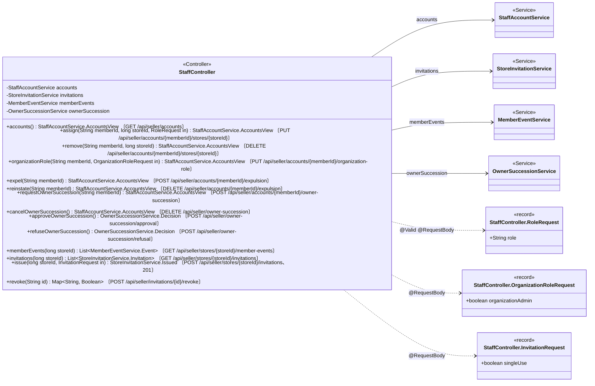

- `accounts()` は `StaffAccountService.open()` を呼びます。`remove()` は `removeAssignment()`、`organizationRole()` は `changeOrganizationRole()` を呼びます。
- `RoleRequest.role` は `@Pattern`（`MANAGER|STAFF|NONE`）で確かめます。パスの `memberId` と、`revoke()` の `id` も、`@Pattern`（`[0-9a-f-]{36}`、UUID の形）で確かめます。
- `revoke()` の応答は `{"revoked": true}` です。

## 行を足す・消す Service

図には、Service が Entity を作る・消す依存の線を書いていません。どの Service がどのテーブルに行を足すか・消すかは、次のとおりです。

| Service のメソッド | 足す行 | 消す行 |
| --- | --- | --- |
| `StoreApplicationService.submit()` | `StoreApplicationEntity` | 再申請のときの前々回の `StoreApplicationEntity` |
| `StoreApplicationService.decide()` | 承認のとき `OrganizationEntity` | なし |
| `OrganizationSuspensionService` の `stopAccepting()`・`resume()`・`settle()` | `OrganizationModerationEventEntity` | なし |
| `StaffAccountService.assign()` | 担当でない店舗のとき `StoreMemberEntity` と `OrganizationMemberEventEntity`（`ofStore()`） | なし |
| `StaffAccountService.removeAssignment()` | `OrganizationMemberEventEntity`（`ofStore()`） | `StoreMemberEntity` |
| `StaffAccountService` の `expel()`・`reinstate()` | `OrganizationMemberEventEntity`（`ofOrganization()`） | なし |
| `StoreInvitationService.issue()` | `StoreInvitationEntity` | なし |
| `StoreInvitationService.register()` | `AuthMember`、`OrganizationMemberEntity`、`StoreMemberEntity`、`StoreInvitationUseEntity` | なし |
| `OwnerSuccessionService` の `request()`・`cancel()`・`refuse()` | `OrganizationMemberEventEntity`（`ofOwnerSuccession()`） | なし |
| `OwnerSuccessionService.approve()` | 元のオーナーの `OrganizationMemberEntity`、`OrganizationMemberEventEntity`（`ofOwnerSuccession()`） | 新しいオーナーの `OrganizationMemberEntity`（担当の `store_members` は外部キーの CASCADE で消える） |
| `PendingOwnerSuccession.invalidate()` | `OrganizationMemberEventEntity`（`ofOwnerSuccession()`） | なし |
| `StoreClosureService.settle()` | なし | 閉鎖済みにした店舗の `StoreMemberEntity`（`deleteAllAtStore()`） |
| `StoreService.create()` | `StoreEntity`（`StoreEntity.create()`） | なし |
| `StoreModerationService` の `enable()`・`warn()` | moderation パッケージの `StoreModerationEventEntity` | なし |
| `OwnerSuccessionNotices` の各メソッド | notification パッケージの `NotificationEntity` | なし |

## 図に載せなかったクラス

- ありません。store パッケージの 38 ファイルのクラスと、その中で宣言した 30 個の record・enum・クラス（Controller の 9 個の record、Service の 20 個の record と enum、`OwnerSuccessionService.Lapsed`）は、どれかの図にあります。
- メンバーのうち、`private` のメソッドと定数（`OwnerSuccessionService.APPROVAL_PERIOD`、`MemberEventService.ORGANIZATION_EVENTS`、`StaffController.MEMBER_ID` など）と、アクセス修飾子の無いパッケージの中だけのもの（`OpenOrders` の `BLOCKING`・`CANCELLABLE`・`CANCELLED_TITLE`、`OrganizationSuspensionService.AUTO_SUSPEND_REASON`、`ClosureSettlement.CONTACT_RETENTION`、`StoreInvitationService.hash()`）は書いていません。値が読み方に関わるものは、図の下の文に書きました。
- `JpaRepository`、`Serializable`、`EntityManager`、`TransactionTemplate`、`MultipartFile`、`ResponseEntity` などのフレームワークと Java のクラスは、`JpaRepository` と `Serializable` を除いて箱を作らず、フィールドや引数の型として書いています。`OwnerSuccessionService` と `PendingOwnerSuccession` は `EntityManager` をフィールドに持ち、行をロックして読み直す（`refresh()`）ために使います。
