# Kusakari EC クラス図 03 商品カタログ

- 対象のコード: kusakari-ec の main（[8892344](https://github.com/abeouga/kusakari-ec/blob/8892344/backend/src/main/java/jp/kusakari/ec/catalog)、2026-11-24 時点）
- 対象のパッケージ: `jp.kusakari.ec.catalog`（[controller](https://github.com/abeouga/kusakari-ec/blob/8892344/backend/src/main/java/jp/kusakari/ec/catalog/controller)、[dto](https://github.com/abeouga/kusakari-ec/blob/8892344/backend/src/main/java/jp/kusakari/ec/catalog/dto)、[mapper](https://github.com/abeouga/kusakari-ec/blob/8892344/backend/src/main/java/jp/kusakari/ec/catalog/mapper)、[persistence/entity](https://github.com/abeouga/kusakari-ec/blob/8892344/backend/src/main/java/jp/kusakari/ec/catalog/persistence/entity)、[persistence/repository](https://github.com/abeouga/kusakari-ec/blob/8892344/backend/src/main/java/jp/kusakari/ec/catalog/persistence/repository)、[service](https://github.com/abeouga/kusakari-ec/blob/8892344/backend/src/main/java/jp/kusakari/ec/catalog/service)）
- パッケージ全体の構成: [00_パッケージ構成](<00_パッケージ構成.md>)。全体図: [00_全体図](<00_全体図.md>)。

商品、在庫と公開状態、カテゴリ、商品画像、素材コードと商品の対応（`material_products`）、植物のモデル、運営による商品の警告・停止のクラスを 14 枚に分けて描きます。図 1・図 2・図 10〜図 13 はデータの図（Entity・DTO・record）、図 3〜図 9・図 14 はモジュールの図（Controller・Service・Repository・Mapper）です。呼び出しの順番は [シーケンス図](<../../シーケンス図/kusakari-ec/>) にあり、商品の登録は EC-S03、編集は EC-S04、在庫数は EC-S05、販売状態は EC-S06、運営の停止は EC-A10 です。

## パッケージの役割

- 購入者向けの商品と店舗の一覧、Kusakari Canvas からの照会（庭に置いた商品の状態、素材コードからの商品候補）の受け口があります。
- 出店者の商品の登録・編集・削除、在庫数と公開状態の変更、商品画像の保存、AI による植物の特徴の推定の受け口があります。
- 運営によるカテゴリの管理と、商品の警告・公開停止の受け口があります。
- 店舗の Entity（`StoreEntity`）と Repository（`StoreRepository`）もこのパッケージにあります。店舗の作成・編集・閉鎖は store パッケージの Service が使います（[02_店舗と組織](<02_店舗と組織.md>)）。
- `CatalogService` の `listing()`・`listingsByIds()`・`REMOVED_REASONS`、`InventoryRepository` の `lockAll()`、`ProductRepository` の `findStoreReferences()`・`findImageReferences()`・`lockSharedSuspension()` は、カートと注文（[04_カートと注文](<04_カートと注文.md>)）と買い物リスト（[06_買い物リスト](<06_買い物リスト.md>)）からも使われます。

## 図の読み方

- 箱の名前は「英語名（日本語名）」です。英語名はコードのクラス名です。入れ子の record は「外側のクラス.名前」で書きます。ほかの詳細図で詳しく描いたものは、名前の後ろに（01）・（02）・（07）を付けるか、`<<図 10 で詳しく>>` のように書いています。
- ステレオタイプは、`<<Entity>>` が JPA の Entity、`<<Embeddable>>` が埋め込みの主キー、`<<record>>` が Java の record、`<<DTO>>` が Lombok の getter・setter を持つ DTO のクラス、`<<Repository>>` が Spring Data の Repository、`<<Service>>`・`<<Controller>>`・`<<Component>>`・`<<Mapper>>` がそれぞれの Spring の部品、`<<package>>` がパッケージ、`<<external>>` が外部のシステムです。
- 可視性は `+` が public、`-` が private、`~` がパッケージの中だけです。名前の後ろの `$` は static です。`PK` は主キー、`FK` は外部キーの列です。
- 線は 4 種類です。`*--`（黒い菱形）は、親の中に入れ子で持つもの（JSON の列や応答の JSON の入れ子、`@EmbeddedId`）です。`-->` は関連（データの図では外部キーとフィールド）、`<|--` は継承、`..>` は依存（モジュールの図ではフィールドで持って呼ぶこと、データの図では詰め替え先）です。
- 線の両端の数字は多重度です。`1` はちょうど 1 つ、`0..1` は無いか 1 つ、`0..*` は 0 個以上、`1..*` は 1 個以上です。コードの上限は図では書かず、各図の下の表に書きました。
- 線のラベルは関連の名前（外部キーの列名・フィールド名）です。依存の線にはラベルを付けず、どのフィールドで持ち、どのメソッドを呼ぶかは各図の下の「線とコードの対応」に書きました。
- Entity どうしに JPA の関連（`@ManyToOne` など）はありません。図 1・図 2 の関連の線は、ID の列と Flyway のマイグレーション（[V1__schema.sql](https://github.com/abeouga/kusakari-ec/blob/8892344/backend/src/main/resources/db/migration/V1__schema.sql)、[V7__sample_products_and_creator.sql](https://github.com/abeouga/kusakari-ec/blob/8892344/backend/src/main/resources/db/migration/V7__sample_products_and_creator.sql)）の外部キーから描きました。列名がフィールド名と違うものは、各図の下の表にあります。列と制約の詳しいことは [テーブル設計図](<../../テーブル設計図/kusakari-ec/>) を見てください。
- モジュールの図では、DTO・Entity は引数と戻り値の型名としてだけ書き、箱は図 1・図 2・図 10〜図 13 に置きました。`ApiException`（common.web パッケージ）を投げる線は省き、各図の下の「エラー」の表に書きました。図 4・図 5 では、Repository を `persistence.repository` のパッケージの箱 1 つにまとめています（Repository のメソッドは図 3）。
- namespace（枠）は、図 5 では線を読みやすくするために `SellerProductService` を囲み、図 12 では record を作る場所（Repository・Service・Controller）で区切っています。

## 図 1 商品・在庫・カテゴリ・画像・素材コードの Entity

データの図です。商品（`products`）を中心に、在庫と公開状態（`inventory`）、カテゴリ（`categories`）、素材コードとの対応（`material_products`）、店舗（`stores`）、商品を追加した会員（`members`）とのつながりを描きます。8892344 で、商品を追加した会員の列 `created_by_member_id` が増えました。

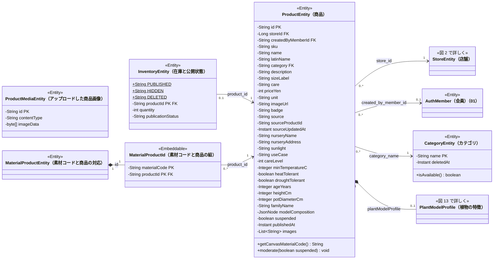

### Entity とテーブル

| Entity | テーブル | 列の補足 |
| --- | --- | --- |
| `ProductEntity` | `products` | `category` は列 `category_name`。`plantModelProfile`（列 `plant_model_profile`）と `modelComposition`（列 `model_composition`）は JSON 列。`images` は `@ElementCollection` で、別のテーブル `product_images`（`product_id`、`sort_order`、`image_url`）に `sort_order` の順で入る。`storeId` と `createdByMemberId` は `updatable = false`（登録した後は変えない）。`suspended` に setter はなく、`moderate()` だけが変える |
| `InventoryEntity` | `inventory` | `publicationStatus` は `PUBLISHED`・`HIDDEN`・`DELETED`（列の CHECK 制約 `ck_inventory_status`）。`productId` に setter はない |
| `CategoryEntity` | `categories` | `deletedAt` は、削除した商品がまだ参照しているカテゴリを消したときに入る |
| `ProductMediaEntity` | `product_media` | `imageData` は `LONGBLOB`。商品の `imageUrl` と `images` に `/api/product-images/{id}` の形で入るが、外部キーはない |
| `MaterialProductEntity` | `material_products` | 主キーは `MaterialProductId`（`@EmbeddedId`、列 `material_code`・`product_id`） |

### 関連と外部キー

| 関連 | 外部キーの名前 | 多重度の根拠 |
| --- | --- | --- |
| `ProductEntity` 0..* — 1 `StoreEntity` | `fk_products_store` | `store_id` は NULL 不可 |
| `ProductEntity` 0..* — 0..1 `AuthMember` | `fk_products_created_by`（V7） | `created_by_member_id` は NULL 可。初期データの商品は NULL。会員は論理削除なので、退会した会員の行も残る |
| `ProductEntity` 0..* — 1 `CategoryEntity` | `fk_products_category` | `category_name` は NULL 不可 |
| `ProductEntity` 1 — 0..1 `PlantModelProfile` | なし（JSON 列） | `plant_model_profile` は NULL 可 |
| `InventoryEntity` 0..1 — 1 `ProductEntity` | `fk_inventory_product` | `product_id` が主キー。商品と 1 対 1 だが、行のない商品は「削除済み」として扱う（`CatalogService`） |
| `MaterialProductId` 0..* — 1 `ProductEntity` | `fk_material_products_product` | 主キーが（`material_code`、`product_id`）なので、1 つの商品に複数の素材コードを持てる。今のコードが保存するのは `product.{商品 ID}` の 1 行だけ |

### 決まり

- 商品の削除は行を消さず、`inventory.publication_status` を `DELETED` にします。注文と庭の記録が商品を参照するためです。
- `getCanvasMaterialCode()` は、`modelComposition` があるときに `product.{id}` を返します。構成があると、`ProductEditorService` がこの素材コードと商品の対応を `material_products` に保存します（図 5）。
- `products` には、Entity に対応するフィールドが無い列（`flowering_description`、`seasonal_care`、`style_description`）があります。`CategoryEntity.name` の `@Column(length = 30)` に対して、`categories.name` は `VARCHAR(80)` です。`InventoryEntity.publicationStatus` の初めの値は `PUBLISHED` ですが、`inventory.publication_status` の列の既定値は `HIDDEN` です。

## 図 2 店舗の Entity

データの図です。`StoreEntity` には `@Getter` だけがあり、setter はありません。状態は `create()`、`updateProfile()`、`changePublished()` などのメソッドで変えます。店舗の Repository（`StoreRepository`）は図 3 に移しました。

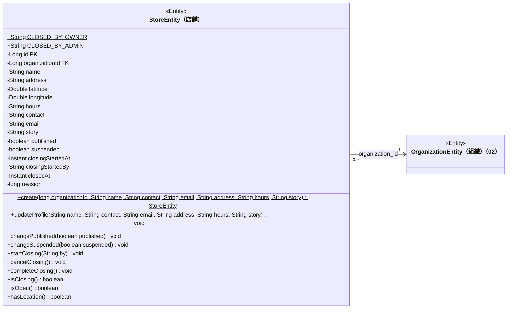

### Entity とテーブル

| フィールド | 列 | 補足 |
| --- | --- | --- |
| `organizationId` | `organization_id` | `updatable = false`（作った後は変えない）。外部キー `fk_stores_org`、NULL 不可 |
| `hours` | `business_hours` | |
| `contact` | `contact_name` | 閉鎖済みから期間がたつと `StoreRepository.clearClosedContacts()` が空にする |
| `email` | `contact_email` | 同上 |
| `story` | `introduction` | 2000 文字まで |
| `latitude`、`longitude` | 同じ名前 | 両方 NULL か両方あり（`ck_stores_location`） |
| `closingStartedAt`、`closingStartedBy` | 同じ名前 | 空なら営業中、日時があれば閉鎖中（閉鎖済みを含む）。`closingStartedBy` は `CLOSED_BY_OWNER`（`OWNER`）か `CLOSED_BY_ADMIN`（`ADMIN`） |
| `closedAt` | `closed_at` | 空でなければ閉鎖済み。再開できない |
| `revision` | `revision` | `@Version`（楽観ロック） |

- `isOpen()` は、公開中で、停止されておらず、閉鎖を始めていない店舗です。組織の停止は `isOpen()` では見ず、`StoreRepository.findOpen()` と `CatalogService` が確かめます。
- `stores` の `created_at` の列に対応するフィールドはありません。

## 図 3 Repository

モジュールの図です。どの Repository も Spring Data の `JpaRepository` を継承します。戻り値の Entity は図 1・図 2、record（`ProductImageReference`、`ProductStoreReference`、`ProductCreatorName`）は図 12 にあります。8892344 で、商品を追加した人の名前を読む 3 つのメソッド（`findCreatorNamesAtStore()`、`findCreatorName()`、`findAllCreatorNames()`）が `ProductRepository` に増えました。

```mermaid
classDiagram
    direction TB
    class JpaRepository["JpaRepository[T，ID]（Spring Data の Repository）"] {
        <<interface>>
        +findAll() List~T~
        +findAllById(Iterable~ID~ ids) List~T~
        +findById(ID id) Optional~T~
        +existsById(ID id) boolean
        +save(T entity) T
        +delete(T entity) void
    }
    class ProductRepository["ProductRepository（商品）"] {
        <<Repository>>
        +String CREATOR_NAMES$
        +existsByCategory(String category) boolean
        +isCategoryInUse(String category) boolean
        +renameCategory(String previous, String next) void
        +findAll() List~ProductEntity~
        +findByIdIn(Collection~String~ ids) List~ProductEntity~
        +findAllNotDeleted() List~ProductEntity~
        +findNotDeletedAtStore(long storeId) List~ProductEntity~
        +findImageReferences(Collection~String~ ids) List~ProductImageReference~
        +findStoreReferences(Collection~String~ ids) List~ProductStoreReference~
        +existsByStoreIdAndSku(Long storeId, String sku) boolean
        +findCreatorNamesAtStore(long storeId) List~ProductCreatorName~
        +findCreatorName(String id) Optional~ProductCreatorName~
        +findAllCreatorNames() List~ProductCreatorName~
        +findLocked(String id) Optional~ProductEntity~
        +lockSharedSuspension(Collection~String~ ids) List~Object[]~
        +findSuspendedIdsAtStore(long storeId) List~String~
    }
    class InventoryRepository["InventoryRepository（在庫）"] {
        <<Repository>>
        +findAllAtStore(long storeId) List~InventoryEntity~
        +lock(String productId) Optional~InventoryEntity~
        +lockAll(Collection~String~ productIds) List~InventoryEntity~
    }
    class CategoryRepository["CategoryRepository（カテゴリ）"] {
        <<Repository>>
        +findByDeletedAtIsNull() List~CategoryEntity~
        +lock(String name) Optional~CategoryEntity~
        +share(String name) Optional~CategoryEntity~
    }
    class MaterialProductRepository["MaterialProductRepository（素材コードと商品の対応）"] {
        <<Repository>>
        +findAllForCodes(Collection~String~ codes) List~MaterialProductEntity~
    }
    class ProductMediaRepository["ProductMediaRepository（商品画像）"] {
        <<Repository>>
    }
    class StoreRepository["StoreRepository（店舗）"] {
        <<Repository>>
        +lock(Long id) Optional~StoreEntity~
        +findAllByOrderByIdAsc() List~StoreEntity~
        +findByOrganizationIdOrderByIdAsc(Long organizationId) List~StoreEntity~
        +existsByOrganizationIdAndName(Long organizationId, String name) boolean
        +findOpen() List~StoreEntity~
        +findClosingIds() List~Long~
        +clearClosedContacts(Instant before) int
    }

    JpaRepository <|-- ProductRepository
    JpaRepository <|-- InventoryRepository
    JpaRepository <|-- CategoryRepository
    JpaRepository <|-- MaterialProductRepository
    JpaRepository <|-- ProductMediaRepository
    JpaRepository <|-- StoreRepository
```

### Repository と Entity

`JpaRepository` の箱には、この文書の Service が使うメソッドだけを書きました。

| Repository | 型の引数（Entity、主キー） | 補足 |
| --- | --- | --- |
| `ProductRepository` | `ProductEntity`、`String` | `findAll()`・`findByIdIn()`・`findAllNotDeleted()`・`findNotDeletedAtStore()` は `@EntityGraph` で `images` も読む。`findLocked()` は `@Lock(PESSIMISTIC_WRITE)`。`lockSharedSuspension()` は SQL の `FOR SHARE` で、各行は `[id, suspended]`。`renameCategory()` は `@Modifying` の UPDATE |
| `InventoryRepository` | `InventoryEntity`、`String` | `lock()`・`lockAll()` は `@Lock(PESSIMISTIC_WRITE)`。`lockAll()` は `product_id` の昇順にロックする（デッドロックを避ける） |
| `CategoryRepository` | `CategoryEntity`、`String` | `lock()` は `PESSIMISTIC_WRITE`、`share()` は `PESSIMISTIC_READ` |
| `MaterialProductRepository` | `MaterialProductEntity`、`MaterialProductId` | |
| `ProductMediaRepository` | `ProductMediaEntity`、`String` | 独自のメソッドを持たず、`save()` と `findById()` だけを使う |
| `StoreRepository` | `StoreEntity`、`Long` | `lock()` は `@Lock(PESSIMISTIC_WRITE)`。`clearClosedContacts()` は `@Modifying` の UPDATE で、`revision` も 1 増やす |

### 問い合わせの決まり

| メソッド | 決まり |
| --- | --- |
| `findAllNotDeleted()`、`findNotDeletedAtStore()`、`isCategoryInUse()` | 「削除されていない商品」は、`inventory.publication_status` が `DELETED` の行が無い商品 |
| `findImageReferences()`、`findStoreReferences()` | 大きな JSON 列（`model_composition`）を読まないよう、record へ直接読み出す |
| `findCreatorNamesAtStore()`、`findCreatorName()`、`findAllCreatorNames()` | 定数 `CREATOR_NAMES` の JPQL で、`ProductEntity` と `AuthMember`（auth パッケージ）を `createdByMemberId` で内部結合し、`ProductCreatorName`（商品 ID と会員の `displayName`）を返す。追加した人が空の商品は含まない |
| `findOpen()` | 公開中で、停止・閉鎖を始めておらず、組織（`OrganizationEntity`、store パッケージ）の `suspensionStartedAt` が空（受付停止中・停止でない）の店舗。`GET /api/stores` に使う |
| `findClosingIds()` | 閉鎖を始めていて、まだ閉鎖済みでない店舗の ID |

`InventoryRepository.findAllAtStore()` を呼ぶコードは、8892344 の backend には見つかりません。

## 図 4 商品・店舗の一覧と照会、カテゴリの Service

モジュールの図です。`CatalogService` は購入者に見えて今買えるかを決め、`CategoryService` は運営のカテゴリの管理と、商品の登録・編集のときのカテゴリの確認を行います。`Listing` と `StoreState` の record は図 12 にあります。この文書の Repository は、線が箱の裏を通らないよう `persistence.repository` のパッケージの箱 1 つにまとめました。どの Repository のどのメソッドを使うかは、図の下の表にあります。

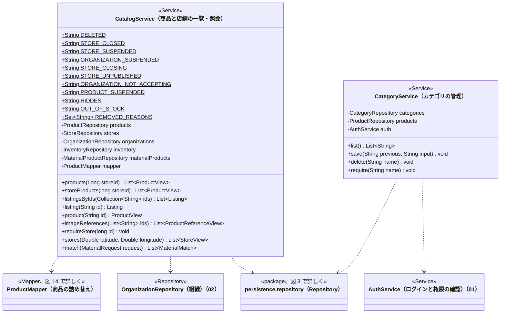

### 線とコードの対応

| 線 | フィールド | 使うメソッド |
| --- | --- | --- |
| CatalogService → persistence.repository の ProductRepository | `products` | `findAllNotDeleted()`、`findNotDeletedAtStore()`、`findByIdIn()`、`findImageReferences()`、`findStoreReferences()` |
| CatalogService → persistence.repository の StoreRepository | `stores` | `findAllById()`、`existsById()`、`findOpen()` |
| CatalogService → OrganizationRepository | `organizations` | `findAllById()`（店舗の組織の停止・受付停止を見る） |
| CatalogService → persistence.repository の InventoryRepository | `inventory` | `findAllById()`（在庫数と公開状態） |
| CatalogService → persistence.repository の MaterialProductRepository | `materialProducts` | `findAllForCodes()` |
| CatalogService → ProductMapper | `mapper` | `toView()` |
| CategoryService → persistence.repository の CategoryRepository | `categories` | `findByDeletedAtIsNull()`、`lock()`、`share()`、`saveAndFlush()`、`deleteById()`、`delete()` |
| CategoryService → persistence.repository の ProductRepository | `products` | `renameCategory()`、`isCategoryInUse()`、`existsByCategory()` |
| CategoryService → AuthService | `auth` | `requireAdmin()`（`save()`・`delete()`） |

### 決まり

| 項目 | 決まり |
| --- | --- |
| `@Transactional` | `CatalogService` は `readOnly = true`。`CategoryService` は書き込みあり（`list()` だけ `readOnly`） |
| 買えない理由 | 10 個の定数。`REMOVED_REASONS`（`DELETED`、`STORE_CLOSED`、`STORE_SUSPENDED`、`ORGANIZATION_SUSPENDED`）は戻らない理由で、カートの明細と庭の配置から外す理由として使う。8892344 から、買い物リスト（06 の `ShoppingService`）も、素材コードから選ぶ候補からこの理由の商品を外すのに使う |
| 理由の決め方 | 在庫の行が無いか `DELETED` なら `DELETED`。次に店舗・組織の理由（閉鎖済み、停止、組織の停止、閉鎖中、非公開、組織の受付停止の順）、運営の停止なら `PRODUCT_SUSPENDED`、出店者が非公開なら `HIDDEN`。一覧では在庫数を見ない。`imageReferences()` だけは、在庫 0 も `OUT_OF_STOCK` にする |
| `products()` と `storeProducts()` | `products()` は購入者に見えて今買える商品だけ（`Listing.purchasable()`）。`storeProducts()` は出店者の一覧用で、非公開の商品も含む |
| 並び順 | `olive`、`lavender`、`rosemary`、`monstera` の順に先に並べ、残りは商品 ID の順（MySQL で JSON を含む行を並べ替えないため Java で並べる） |
| `stores()` | 緯度・経度があれば距離（km、小数 1 桁）の近い順。位置の無い店舗は後ろ |
| `match()` | `storeId` が null なら全店舗の商品から候補を出す。候補は買える商品だけ |
| `CategoryService.save()` | `previous` が空なら追加、空でなければ名前の変更。前に消した名前を追加し直すと、行の `deletedAt` を空に戻す |
| `CategoryService.delete()` | 削除されていない商品が使っていれば 409。削除した商品だけが使っていれば行を残して `deletedAt` を入れ、だれも使っていなければ行を消す |

### エラー

| Service | 状態 | コード | 起きるとき |
| --- | --- | --- | --- |
| `CatalogService` | 404 | `PRODUCT_NOT_FOUND` | `listing()` で商品が無い。`imageReferences()` で見つからない ID がある |
| `CatalogService` | 400 | `DUPLICATE_PRODUCT` | `imageReferences()` の ID が重なる |
| `CatalogService` | 404 | `STORE_NOT_FOUND` | `requireStore()` で店舗が無い |
| `CatalogService` | 400 | `INVALID_LOCATION` | 緯度と経度の片方だけ、または範囲外 |
| `CategoryService` | 400 | `INVALID_CATEGORY` | 名前が空。`require()` で使えるカテゴリが無い |
| `CategoryService` | 409 | `CATEGORY_EXISTS` | 同じ名前のカテゴリがある |
| `CategoryService` | 404 | `CATEGORY_NOT_FOUND` | 変更・削除するカテゴリが無い |
| `CategoryService` | 409 | `CATEGORY_IN_USE` | 削除されていない商品が使っている |

## 図 5 商品の登録・編集、出店者の操作、商品画像の Service

モジュールの図です。`ProductMediaService.Image` の record は図 12 にあります。8892344 で、`ProductEditorService.create()` が商品を追加した会員を記録し、`SellerProductService` が商品を追加した人の名前を応答に入れるようになりました。Repository は図 4 と同じく `persistence.repository` の箱 1 つにまとめ、`SellerProductService` は、`ProductEditorService` から各部品への線がその箱の裏を通らないよう、namespace `Seller_operations`（出店者の一覧・公開状態・在庫の操作）で囲みました。

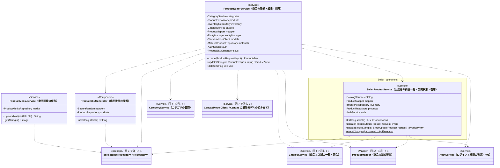

### 線とコードの対応

| 線 | フィールド | 使うメソッド |
| --- | --- | --- |
| ProductEditorService → CategoryService | `categories` | `require()`（カテゴリを共有ロックして確かめる） |
| ProductEditorService → CatalogService | `catalog` | `requireStore()`、`product()`（応答を作る） |
| ProductEditorService → CanvasModelClient | `models` | `resolve()`（非公開の `resolveModel()` の中。植物の特徴が変わったときなどに構成を取り直す） |
| ProductEditorService → ProductSkuGenerator | `skus` | `next()`（商品番号が空のとき） |
| ProductEditorService → SellerProductService | なし（static） | `stockChanged()` |
| ProductEditorService → ProductMapper | `mapper` | `toEntity()`、`updateEntity()` |
| ProductEditorService → persistence.repository の ProductRepository | `products` | `existsByStoreIdAndSku()`、`findLocked()` |
| ProductEditorService → persistence.repository の InventoryRepository | `inventory` | `save()`、`lock()` |
| ProductEditorService → persistence.repository の MaterialProductRepository | `materials` | `save()`（非公開の `linkMaterial()` の中。構成があれば `product.{商品 ID}` の対応を保存） |
| ProductEditorService → AuthService | `auth` | `requireManager()`（登録）、`requireProductStore()`（編集は `false`、削除は `true`）、`current()`（商品を追加した会員の ID、8892344 から） |
| SellerProductService → CatalogService | `catalog` | `storeProducts()`、`requireStore()`、`product()` |
| SellerProductService → ProductMapper | `mapper` | `toSellerView(product, createdByName)`（8892344 で引数が 2 つになった） |
| SellerProductService → persistence.repository の ProductRepository | `products` | `findStoreReferences()`、`findCreatorNamesAtStore()`（`list()`）、`findCreatorName()`（`updateStock()`）。後の 2 つは 8892344 から |
| SellerProductService → persistence.repository の InventoryRepository | `inventory` | `lockAll()`、`lock()` |
| SellerProductService → AuthService | `auth` | `requireStoreViewer()`（一覧）、`requireManager()`（削除）、`requireSeller()`（公開状態・在庫） |
| ProductSkuGenerator → persistence.repository の ProductRepository | `products` | `existsByStoreIdAndSku()` |
| ProductMediaService → persistence.repository の ProductMediaRepository | `media` | `save()`、`findById()` |

`ProductEditorService` は `EntityManager` の `persist()`・`flush()` でも商品を保存します（非公開の `saveProduct()`）。

### 決まり

| 項目 | 決まり |
| --- | --- |
| 権限 | 商品の登録と削除はオーナーか MANAGER、編集は STAFF もできる。公開・非公開の切り替えと在庫数は STAFF もでき、`DELETED` への変更はオーナーか MANAGER だけ。一覧はロール未割り当ての担当者も所属店舗なら見られる |
| 商品を追加した人 | `create()` が `auth.current().getId()` を `createdByMemberId` に入れる。編集では変えない（列が `updatable = false`）。`list()`・`updateStock()` の応答の `createdByName` に表示名が入る |
| 登録 | 在庫は 1 以上（400 `STOCK_REQUIRED`）。商品番号が空なら採番し、あれば店舗の中で重複を確かめる |
| 編集 | 商品の行と在庫の行を `FOR UPDATE` でロックし、`expectedStock`（省くと `stock`）と今の在庫数を比べる。店舗と商品番号は変えられない |
| 削除 | 行を消さず、在庫の公開状態を `DELETED` にする |
| 公開状態の一括変更 | 25 件まで。在庫の行をお会計と同じ順（商品 ID の昇順）にロックし、全件を確かめてから変える |
| `stockChanged()` | パッケージの中だけで使う static のメソッドで、409 `STOCK_CHANGED` の `ApiException` を作る |
| `ProductSkuGenerator` | パッケージの中だけのクラス。`KS-年月日-6 文字` を最大 5 回作り直す |
| `ProductMediaService.upload()` | 5MB まで。先頭のバイトから PNG・JPEG・WebP を判定し、送られた Content-Type と一致すれば `product_media` に保存して `/api/product-images/{id}` を返す |

### エラー

| Service | 状態 | コード | 起きるとき |
| --- | --- | --- | --- |
| `ProductEditorService` | 400 | `STOCK_REQUIRED` | 登録の在庫が 0 |
| `ProductEditorService` | 404 | `PRODUCT_NOT_FOUND` | 編集・削除する商品が無い |
| `ProductEditorService` | 400 | `STORE_IMMUTABLE` | 編集で店舗を変えようとした |
| `ProductEditorService` | 409 | `SKU_IMMUTABLE` | 編集で商品番号を変えようとした |
| `ProductEditorService` | 409 | `SKU_EXISTS` | 店舗の中で商品番号が重なる |
| `ProductEditorService`、`SellerProductService` | 409 | `PRODUCT_ARCHIVED` | 削除済みの商品を編集・変更しようとした |
| `ProductEditorService`、`SellerProductService` | 409 | `STOCK_CHANGED` | 在庫数が画面を開いた後に変わった |
| `ProductEditorService` | 400 | `PLANT_HEIGHT_MISMATCH` | 商品の高さと植物の特徴の高さが違う |
| `SellerProductService` | 400 | `DUPLICATE_PRODUCT` | 商品 ID が重なる |
| `SellerProductService` | 404 | `PRODUCT_NOT_FOUND` | 選んだ店舗の商品でない |
| `ProductSkuGenerator` | 503 | `SKU_UNAVAILABLE` | 5 回とも番号が重なった |
| `ProductMediaService` | 400 | `INVALID_IMAGE` | 空、5MB 超え、形式が違う |
| `ProductMediaService` | 404 | `IMAGE_NOT_FOUND` | 画像が無い |

## 図 6 運営による商品の警告・公開停止の Service

モジュールの図です。`ProductModerationService.Product` の record は図 12 にあります。履歴と通知のクラスは moderation パッケージと notification パッケージにあり、[07_通知と運営の記録](<07_通知と運営の記録.md>) で詳しく描いています。8892344 で、運営の商品一覧の 1 行に商品を追加した人の名前（`createdByName`）が増えました。

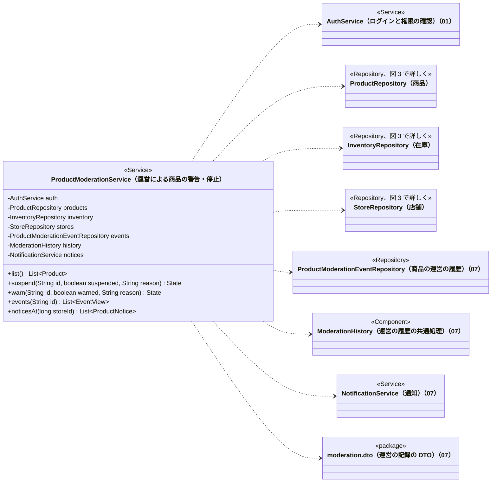

### 線とコードの対応

| 線 | フィールド | 使うもの |
| --- | --- | --- |
| ProductModerationService → AuthService | `auth` | `requireAdmin()`（`list()`・`suspend()`・`warn()`・`events()`）、`requireStoreViewer()`（`noticesAt()`）、`current()`（履歴の操作した人） |
| ProductModerationService → ProductRepository | `products` | `findAll()`、`findAllCreatorNames()`（8892344 から）、`findLocked()`、`existsById()`、`findSuspendedIdsAtStore()`、`findImageReferences()` |
| ProductModerationService → InventoryRepository | `inventory` | `findAll()`（削除済みかを見る） |
| ProductModerationService → StoreRepository | `stores` | `findAll()`（店舗名） |
| ProductModerationService → ProductModerationEventRepository | `events` | `findByEventTypeInOrderByIdDesc()`、`findByProductIdOrderByIdDesc()`、`findAtStore()`、`save()`（`ProductModerationEventEntity` を 1 行足す）、`flush()` |
| ProductModerationService → ModerationHistory | `history` | `views()`。static の `activeWarnings()`、`activeWarning()`、`reasonFor()`、`noticeBody()`、`WARNING_TYPES` も使う |
| ProductModerationService → NotificationService | `notices` | `toStore()`（店舗の出店者に `NotificationEntity.MODERATION` の通知） |
| ProductModerationService → moderation.dto | なし | `ModerationDtos` の `State`、`Warning`、`EventView`、`ProductNotice` を返す。操作の種類は `ModerationAction`（`SUSPEND`、`RESUME`、`WARN`、`CLEAR_WARNING`） |

### 決まり

- `@Transactional` です。`suspend()`・`warn()` は商品の行を `findLocked()` でロックし、履歴に 1 行足して、店舗の出店者（オーナーと担当者）に通知します。すでにその状態なら何もしません（二重送信で履歴と通知を重ねない）。
- `warn()` は公開の状態を変えません。警告していない商品の解除は何もしません。
- `noticesAt()` は、出店者の商品一覧の「運営からの警告・停止」に使う、警告中か停止中の削除されていない商品です。
- エラーは、商品が無いときの 404 `PRODUCT_NOT_FOUND` と、`ModerationHistory.reasonFor()` が投げる理由の検査のエラー（07）です。

## 図 7 植物の特徴の推定と植物モデルの組み立て

モジュールの図です。AI による植物の特徴の推定（`PlantSuggestionService`）と、Kusakari Canvas の API で 3D の構成を組み立てる部品（`CanvasModelClient`）を描きます。受け口の DTO と `PlantModelProfile` は図 13 にあります。

```mermaid
classDiagram
    direction LR
    class PlantSuggestionController["PlantSuggestionController（植物の特徴の推定の受け口）"] {
        <<Controller>>
        -PlantSuggestionService service
        -AuthService auth
        +suggest(PlantSuggestionRequest input) PlantSuggestionView
    }
    class PlantSuggestionService["PlantSuggestionService（植物の特徴の AI 推定）"] {
        <<Service>>
        -String INSTRUCTIONS$
        -PlantSuggestionClient ai
        -PlantSuggestionFitter fitter
        -ObjectMapper mapper
        -Validator validator
        -Semaphore slots
        +suggest(PlantSuggestionRequest input) PlantSuggestionView
    }
    class PlantSuggestionClient["PlantSuggestionClient（OpenAI API の呼び出し）"] {
        <<Service>>
        -RestClient client
        -String key
        -String model
        -ObjectMapper mapper
        +infer(String instructions, String text, String image) JsonNode
    }
    class PlantSuggestionFitter["PlantSuggestionFitter（推定の寸法合わせ）"] {
        <<Service>>
        -CanvasModelClient models
        +fit(PlantModelProfile profile) boolean
    }
    class PlantSuggestionSchema["PlantSuggestionSchema（AI の出力の形）"] {
        <<utility>>
        ~create(ObjectMapper mapper)$ ObjectNode
    }
    class CanvasModelClient["CanvasModelClient（Canvas の植物モデルの組み立て）"] {
        <<Service>>
        -RestClient client
        -ObjectMapper mapper
        +resolve(PlantModelProfile profile) JsonNode
        +checkSuggestion(PlantModelProfile profile) void
    }
    class AuthService["AuthService（ログインと権限の確認）（01）"] {
        <<Service>>
    }
    class CanvasClientConfiguration["CanvasClientConfiguration（Canvas の接続の設定）（01）"]
    class OpenAI_API["OpenAI API"] {
        <<external>>
    }
    class Canvas_API["Kusakari Canvas API"] {
        <<external>>
    }

    PlantSuggestionController ..> PlantSuggestionService
    PlantSuggestionController ..> AuthService
    PlantSuggestionService ..> PlantSuggestionClient
    PlantSuggestionService ..> PlantSuggestionFitter
    PlantSuggestionClient ..> PlantSuggestionSchema
    PlantSuggestionClient ..> OpenAI_API
    PlantSuggestionFitter ..> CanvasModelClient
    CanvasModelClient ..> CanvasClientConfiguration
    CanvasModelClient ..> Canvas_API
```

### API と受け口

| HTTP | パス | 受け口 | Request | Response | ログイン |
| --- | --- | --- | --- | --- | --- |
| POST | `/api/products/plant-model-suggestions` | `PlantSuggestionController.suggest()` | `PlantSuggestionRequest` | `PlantSuggestionView` | 必要。`auth.requireSellerRole()` で出店者だけ |

### 線とコードの対応

| 線 | フィールド | 使うもの |
| --- | --- | --- |
| PlantSuggestionController → PlantSuggestionService | `service` | `suggest()` |
| PlantSuggestionController → AuthService | `auth` | `requireSellerRole()` |
| PlantSuggestionService → PlantSuggestionClient | `ai` | `infer()` |
| PlantSuggestionService → PlantSuggestionFitter | `fitter` | `fit()` |
| PlantSuggestionClient → PlantSuggestionSchema | なし（static） | `create()`（OpenAI API に渡す JSON Schema） |
| PlantSuggestionClient → OpenAI API | `client` | HTTP の `POST https://api.openai.com/v1/responses`。`key` と `model` は設定 `kusakari.ec.openai-api-key`、`kusakari.ec.plant-suggestion-model` |
| PlantSuggestionFitter → CanvasModelClient | `models` | `checkSuggestion()` |
| CanvasModelClient → CanvasClientConfiguration | `client` | `@Qualifier("canvasClient")` の `RestClient` を受け取る |
| CanvasModelClient → Kusakari Canvas API | `client` | HTTP の `POST /api/model-assemblies/resolve` |

`CanvasModelClient.resolve()` は、商品の登録・編集で `ProductEditorService` からも呼ばれます（図 5）。

### 決まり

- `PlantSuggestionService.suggest()` は DB を使いません。OpenAI API で特徴を推定し、`PlantSuggestionFitter.fit()` で Canvas API に組み立てられるかを確かめます。組み立てられないときは、葉・花・幹の大きさを 0.7・0.45・0.25 倍にして確かめ直します（OpenAI API は呼び直さない）。同時に 2 件まで（`Semaphore`）です。
- `PlantSuggestionSchema` はパッケージの中だけで使う `final` のクラスです。
- `CanvasModelClient.resolve()` は 3D の構成を取って返します。`checkSuggestion()` は AI の推定を確かめるだけで、結果を保存しません。

### エラー

| クラス | 状態 | コード |
| --- | --- | --- |
| `PlantSuggestionService` | 429・422・502・400 | `AI_BUSY`、`AI_PLANT_UNIDENTIFIED`、`AI_INVALID_PROFILE`、`AI_INVALID_IMAGE` |
| `PlantSuggestionClient` | 503・422・429・502・504 | `AI_NOT_CONFIGURED`、`AI_AUTHENTICATION_FAILED`（503）、`AI_REFUSED`（422）、`AI_RATE_LIMITED`（429）、`AI_SERVICE_ERROR`・`AI_INVALID_RESPONSE`（502）、`AI_TIMEOUT`（504） |
| `PlantSuggestionFitter` | 422 | `AI_MODEL_DIMENSIONS`（3 回縮めても組み立てられない） |
| `CanvasModelClient` | 502・503・422 | `INVALID_MODEL_RESPONSE`・`AI_MODEL_INVALID`（502）、`MODEL_SERVICE_UNAVAILABLE`（503）、`AI_MODEL_DIMENSIONS`・`AI_MODEL_INCOMPATIBLE`（422） |

## 図 8 購入者・Kusakari Canvas・商品画像の受け口

モジュールの図です。`CategoryController.Input` の record は図 12 にあります。

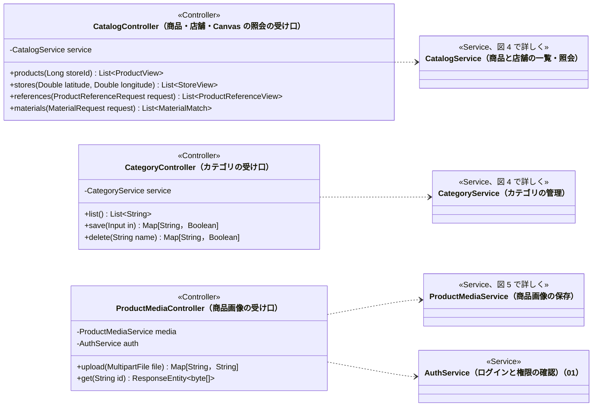

### API と受け口

| HTTP | パス | 受け口 | 呼ぶもの | ログイン |
| --- | --- | --- | --- | --- |
| GET | `/api/products` | `CatalogController.products()` | `CatalogService.products()` | 不要 |
| GET | `/api/stores` | `CatalogController.stores()` | `CatalogService.stores()` | 不要 |
| POST | `/api/products/references` | `CatalogController.references()` | `CatalogService.imageReferences()` | 不要。Kusakari Canvas が呼び、CSRF の確認もしない |
| POST | `/api/materials/quote` | `CatalogController.materials()` | `CatalogService.match()` | 不要。Kusakari Canvas が呼び、CSRF の確認もしない |
| GET | `/api/categories` | `CategoryController.list()` | `CategoryService.list()` | 不要 |
| PUT | `/api/operator/categories` | `CategoryController.save()` | `CategoryService.save()`。応答は `{"saved": true}` | 必要（運営） |
| DELETE | `/api/operator/categories/{name}` | `CategoryController.delete()` | `CategoryService.delete()`。応答は `{"deleted": true}` | 必要（運営） |
| POST | `/api/product-images` | `ProductMediaController.upload()` | `AuthService.requireSellerRole()` の後に `ProductMediaService.upload()`。応答は `{"imageUrl": ...}` | 必要（出店者） |
| GET | `/api/product-images/{id}` | `ProductMediaController.get()` | `ProductMediaService.get()`。`X-Content-Type-Options: nosniff` を付ける | 不要 |

ログインの要否は、`auth/AuthConfiguration.java` の `kusakari.auth.mode` が `cognito` のときの `permitAll()` と `csrf.ignoringRequestMatchers()` の指定です。運営・出店者のロールの確認は各 Service が `AuthService` を呼んで行います。

## 図 9 出店者と運営の受け口

モジュールの図です。`ProductModerationController.Input` の record は図 12 にあります。どの Controller も Service を呼ぶだけで、権限の確認は Service の中で行います。

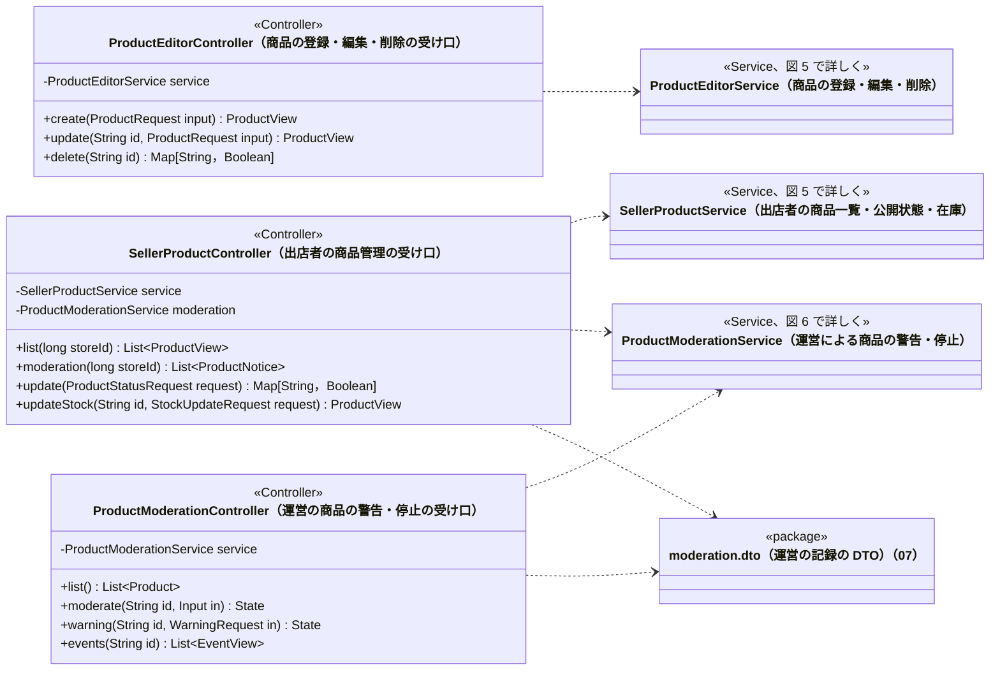

### API と受け口

どれもログインが必要です。

| HTTP | パス | 受け口 | 呼ぶもの | 応答 |
| --- | --- | --- | --- | --- |
| POST | `/api/products` | `ProductEditorController.create()` | `ProductEditorService.create()` | `ProductView` |
| PUT | `/api/products/{id}` | `ProductEditorController.update()` | `ProductEditorService.update()` | `ProductView` |
| DELETE | `/api/products/{id}` | `ProductEditorController.delete()` | `ProductEditorService.delete()` | `{"deleted": true}` |
| GET | `/api/seller/products` | `SellerProductController.list()` | `SellerProductService.list()` | `List<ProductView>`（`createdByName` 入り、`modelComposition` なし） |
| GET | `/api/seller/products/moderation` | `SellerProductController.moderation()` | `ProductModerationService.noticesAt()` | `List<ProductNotice>` |
| PATCH | `/api/seller/products/status` | `SellerProductController.update()` | `SellerProductService.update()` | `{"updated": true}` |
| PUT | `/api/seller/products/{id}/stock` | `SellerProductController.updateStock()` | `SellerProductService.updateStock()` | `ProductView`（`createdByName` 入り） |
| GET | `/api/operator/products` | `ProductModerationController.list()` | `ProductModerationService.list()` | `List<ProductModerationService.Product>`（`createdByName` 入り） |
| PUT | `/api/operator/products/{id}/moderation` | `ProductModerationController.moderate()` | `ProductModerationService.suspend()` | `ModerationDtos.State` |
| PUT | `/api/operator/products/{id}/warning` | `ProductModerationController.warning()` | `ProductModerationService.warn()` | `ModerationDtos.State` |
| GET | `/api/operator/products/{id}/moderation-events` | `ProductModerationController.events()` | `ProductModerationService.events()` | `List<ModerationDtos.EventView>` |

### 線とコードの対応

| 線 | フィールド | 使うもの |
| --- | --- | --- |
| ProductModerationController → moderation.dto | なし | `ModerationDtos.State`・`WarningRequest`・`EventView` を受ける・返す |
| SellerProductController → moderation.dto | なし | `ModerationDtos.ProductNotice` を返す |

ほかの線は、上の表の「呼ぶもの」のとおりです。

## 図 10 商品の Request・Response

データの図です。商品の登録・編集の本文（`ProductRequest`）、商品の応答（`CatalogDtos.ProductView`）、出店者の公開状態と在庫数の本文を描きます。依存の線は詰め替え先で、`ProductMapper`（図 14）が `ProductRequest` を `ProductEntity` に、`ProductEntity` を `ProductView` に詰め替えます。8892344 で、`ProductView` に商品を追加した人の表示名（`createdByName`）が増えました。

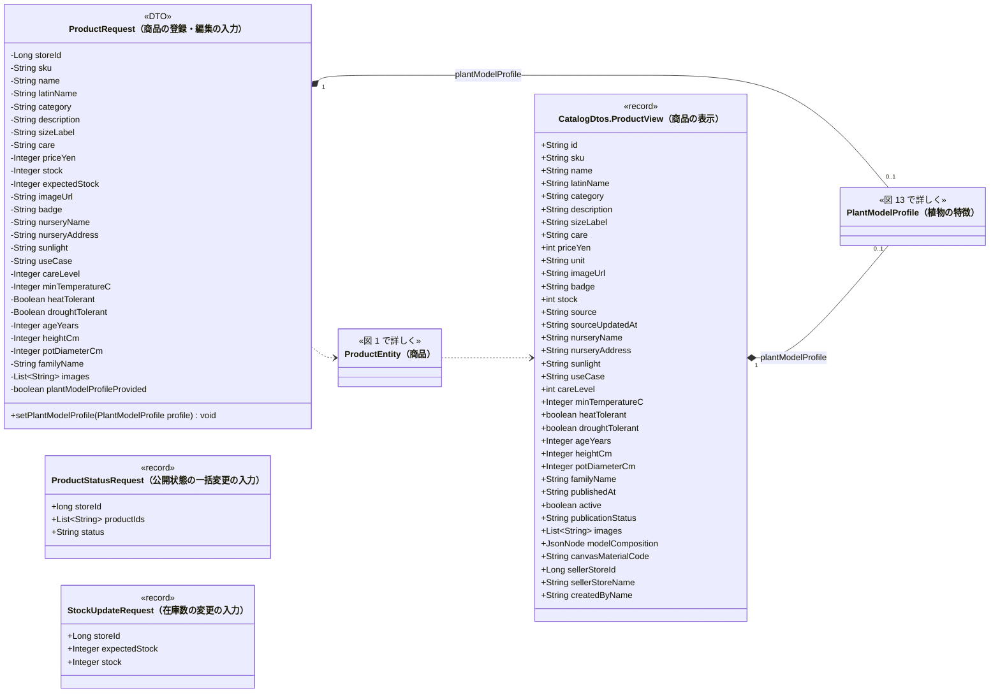

### 使うところ

| DTO | 使うところ |
| --- | --- |
| `ProductRequest` | `POST /api/products` と `PUT /api/products/{id}` の本文。Lombok の `@Getter`・`@Setter` のクラス |
| `ProductView` | 商品の一覧・登録・編集・在庫の応答。04 のカート・注文、06 の買い物リストも使う |
| `ProductStatusRequest` | `PATCH /api/seller/products/status` の本文 |
| `StockUpdateRequest` | `PUT /api/seller/products/{id}/stock` の本文 |

### 値の制約と決まり

| フィールド | 制約・決まり |
| --- | --- |
| `ProductRequest.sku` | 50 文字まで。登録で空にするとサーバーが採番し、編集で空なら今の値のまま |
| `ProductRequest.stock`、`expectedStock` | 0〜10000。`expectedStock` は編集のときの「変更前の在庫数」で、省くと `stock` と同じ値として比べる |
| `ProductRequest.priceYen` | 1〜100000 |
| `ProductRequest.imageUrl`、`images` の各要素 | `/images/…`、`/api/product-images/{UUID}`、`https://…` のどれか。`images` は 4 件まで |
| `ProductRequest.sunlight` | `未設定`、`日なた`、`半日陰`、`日陰` |
| `ProductRequest.careLevel` | 1〜3 |
| `ProductRequest.heightCm` | 10〜1500。植物の特徴があれば、その `heightCm` と同じでなければならない |
| `ProductRequest.plantModelProfile` | `@Valid`。`plantModelProfileProvided` は `@JsonIgnore` で、JSON に `plantModelProfile` があったか（`null` を含む）を覚える。`setPlantModelProfile()` が `true` にする |
| `ProductView.active` | 在庫の公開状態が `DELETED` でないこと |
| `ProductView.modelComposition` | 出店者向けの応答（`toSellerView()`）では外す |
| `ProductView.createdByName` | 商品を追加した会員の表示名。出店者の一覧と在庫の変更の応答だけで入れる。購入者向けの応答と、追加した人が空の初期データの商品では `null` で、`@JsonInclude(NON_NULL)` により JSON に項目ごと出さない |
| `ProductStatusRequest` | `status` は `PUBLISHED`、`HIDDEN`、`DELETED` のどれか。`productIds` は 1〜25 件 |
| `StockUpdateRequest` | `expectedStock` と `stock` は 0〜10000、すべて必須 |

## 図 11 Kusakari Canvas との照会と店舗の一覧の DTO

データの図です。どれも `CatalogDtos` の中の record です。Kusakari Canvas が庭に置いた商品の状態を求める照会（`ProductReferenceRequest` → `ProductReferenceView`）と、素材コードから商品の候補を求める照会（`MaterialRequest` → `MaterialMatch`）、店舗の一覧（`StoreView`）を描きます。

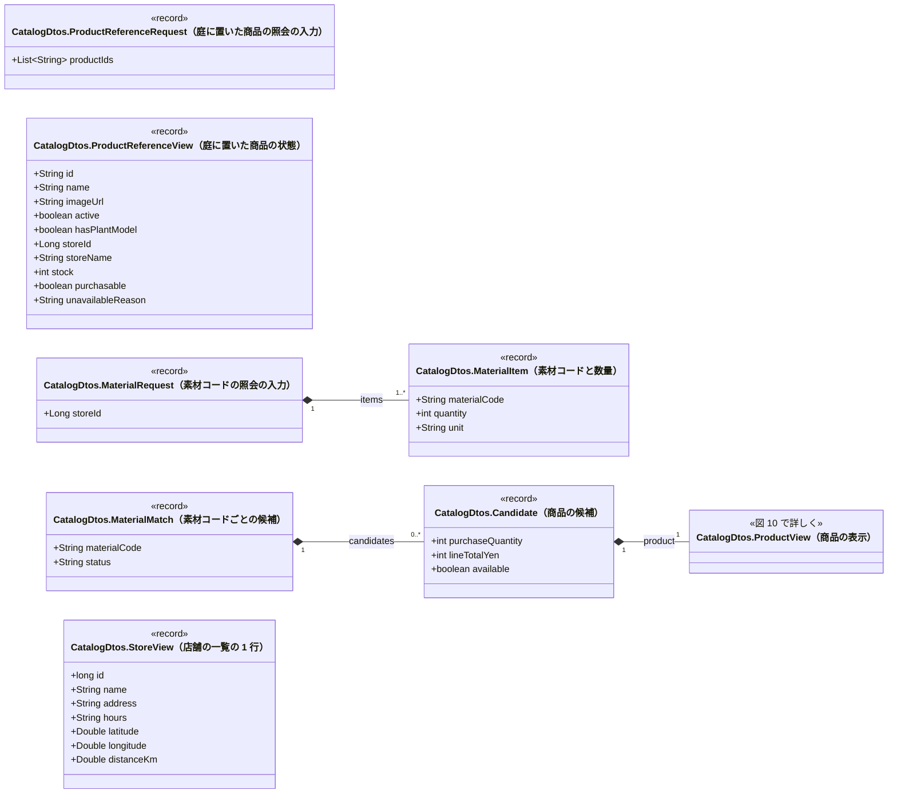

### 関連の上限と値の制約

| 関連・フィールド | 上限・制約 |
| --- | --- |
| `ProductReferenceRequest.productIds` | 1〜200 件、各 40 文字まで。重複は 400 `DUPLICATE_PRODUCT` |
| `MaterialRequest.items` | 1〜50 件（`@NotEmpty @Size(max = 50)`） |
| `MaterialRequest.storeId` | 正の数。`null` なら全店舗の商品から候補を出す |
| `MaterialItem.materialCode` | 80 文字まで |
| `MaterialItem.quantity` | 1〜99 |
| `MaterialItem.unit` | `piece` だけ |
| `MaterialMatch.candidates` | 上限なし。素材コードに対応する、買える商品の数だけ |
| `MaterialMatch.status` | `MATCHED`（候補あり）か `UNMAPPED` |
| `Candidate.available` | 商品の在庫数が `MaterialItem.quantity` 以上か。`lineTotalYen` は価格と数量の積 |
| `ProductReferenceView.unavailableReason` | `CatalogService` の買えない理由の定数（図 4）。照会では在庫 0 も `OUT_OF_STOCK` |
| `StoreView.distanceKm` | `GET /api/stores` に緯度と経度を付けたときだけ入る。位置を登録していない店舗は、緯度・経度・距離が `null` |

## 図 12 Repository・Service・Controller の中の record

データの図です。Repository が読み出す record（`dto` パッケージ）、Service の中の record、Controller の本文の record を描きます。前の版では図 3〜図 6・図 8・図 9 にモジュールと一緒に描いていたものを、この図にまとめました。8892344 で、商品を追加した人の名前の `ProductCreatorName` が増え、`ProductModerationService.Product` に `createdByName` が増えました。

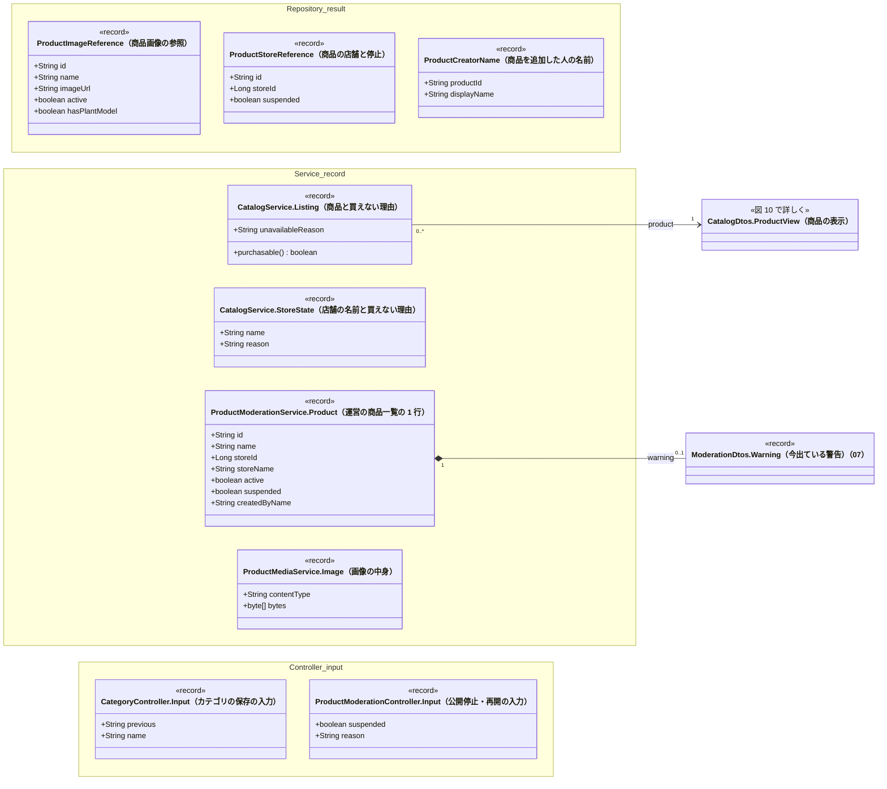

### 使うところと決まり

| record | ファイル | 作るところ・使うところ |
| --- | --- | --- |
| `ProductImageReference` | `dto` | `ProductRepository.findImageReferences()` が JPQL の `new` で作る。`active` は削除されていないこと、`hasPlantModel` は `model_composition` があること。`CatalogService.imageReferences()`（`ProductReferenceView` へ詰め替える）、`ProductModerationService.noticesAt()`、04 の `OrderResponseMapper` が使う |
| `ProductStoreReference` | `dto` | `ProductRepository.findStoreReferences()` が作る。`CatalogService.imageReferences()`、`SellerProductService`（店舗の商品か確かめる）、04 の `CheckoutService` が使う |
| `ProductCreatorName` | `dto`（8892344 で追加） | `ProductRepository` の `findCreatorNamesAtStore()`・`findCreatorName()`・`findAllCreatorNames()` が作る。`displayName` は `AuthMember` の表示名。`SellerProductService` が `ProductView.createdByName` に、`ProductModerationService.list()` が `Product.createdByName` に入れる。購入者には返さない |
| `CatalogService.Listing` | `CatalogService` の中（public） | 商品と、購入者に見えて今買えるか。`unavailableReason` は買えない理由（買えるなら `null`）、`purchasable()` はそれが `null` か。04 の `CartService`、06 の `ShoppingService`・`SavedShoppingItems` が使う |
| `CatalogService.StoreState` | `CatalogService` の中（private） | 店舗の名前と、店舗・組織の側で買えない理由 |
| `ProductModerationService.Product` | `ProductModerationService` の中 | `GET /api/operator/products` の応答の 1 行。`active` は出店者が削除していないこと、`warning` は今出ている警告（無ければ `null`）、`createdByName` は商品を追加した人の表示名（初期データの商品は `null`） |
| `ProductMediaService.Image` | `ProductMediaService` の中 | `get()` の戻り値。Controller が `Content-Type` と本文にする |
| `CategoryController.Input` | `CategoryController` の中 | `PUT /api/operator/categories` の本文。`previous` は必須で 30 文字まで（空なら追加）、`name` は空白不可で 30 文字まで |
| `ProductModerationController.Input` | `ProductModerationController` の中 | `PUT /api/operator/products/{id}/moderation` の本文。`suspended` が `true` で公開停止（理由は必須）、`false` で再開（理由は任意）。`reason` は 500 文字まで |

## 図 13 植物の特徴の DTO

データの図です。出店者が入力し、AI が推定する植物の特徴（`PlantModelProfile`）と、推定の受け口の入力と応答を描きます。前の版では図 7 にモジュールと一緒に描いていたものを、この図に移しました。

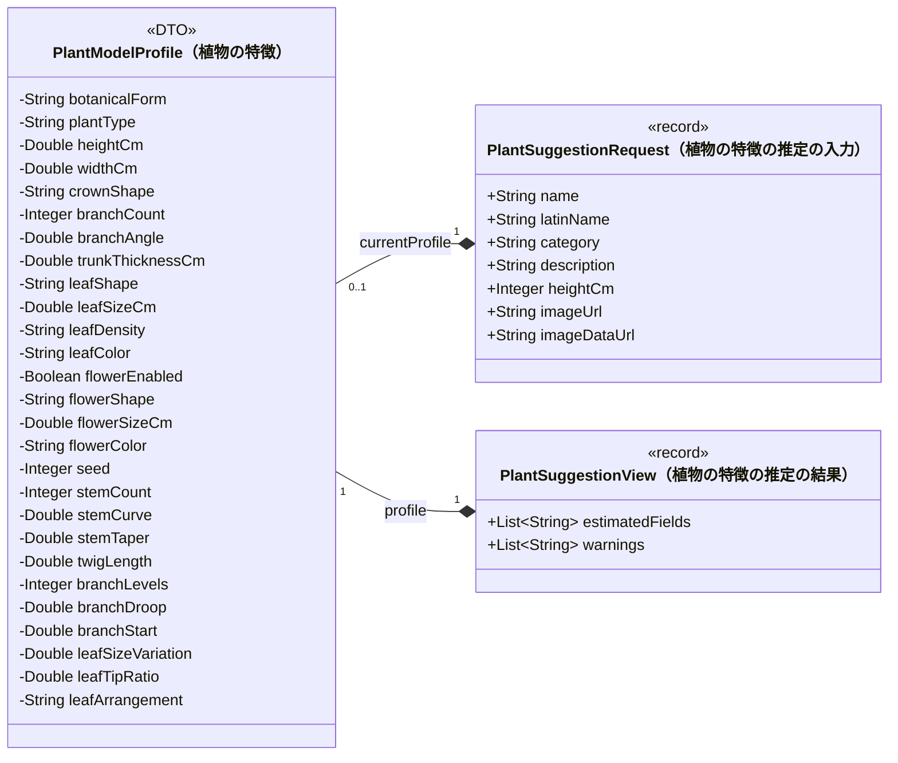

### 使うところと値の制約

| DTO・フィールド | 使うところ・制約 |
| --- | --- |
| `PlantModelProfile` | Lombok の `@Data` のクラス。`products.plant_model_profile`（JSON 列、図 1）、`ProductRequest`・`ProductView`（図 10）、Canvas の `POST /api/model-assemblies/resolve` の本文（図 7）に入る |
| `PlantModelProfile` の `botanicalForm` から `seed` まで | `botanicalForm` 以外は `@NotNull`。`plantType`・`crownShape`・`leafShape`・`leafDensity`・`flowerShape`・`botanicalForm` は決まった値（`@Pattern`）、色は `#` と 16 進 6 桁、寸法は `@DecimalMin`・`@DecimalMax` の範囲 |
| `PlantModelProfile` の `stemCount` から後 | 形の細かい指定。`null` なら Canvas が植物の種類に合わせた自動の値を使い、JSON に出さない（`@JsonInclude(NON_NULL)`） |
| `PlantSuggestionRequest` | `POST /api/products/plant-model-suggestions` の本文。`name` は 120 文字まで、`description` は 5000 文字まで、`heightCm` は 10〜1500、`imageUrl`（HTTPS）と `imageDataUrl`（PNG・JPEG・WebP の data URL、5MB まで）はどちらか一方 |
| `PlantSuggestionRequest.currentProfile` | 今の入力。`seed` を引き継ぐ（無ければ 12345） |
| `PlantSuggestionView.profile` | 推定した特徴。`heightCm` が入力にあれば、その値のまま |
| `PlantSuggestionView.estimatedFields` | 推定で決めたフィールドの名前（`seed` と、入力にあった `heightCm` を除く） |
| `PlantSuggestionView.warnings` | 推定上の注意。7 件まで、AI の注意は各 400 文字まで |

## 図 14 商品の詰め替え（ProductMapper）

モジュールの図です。`ProductMapper` は MapStruct の `@Mapper(componentModel = "spring")` の interface で、実装のクラスはビルドのときに作られます。DTO と Entity は `dto`・`persistence.entity` のパッケージとして置き、詳しい形は図 1・図 10 にあります。8892344 で、`toSellerView()` が商品を追加した人の名前を受け取るようになりました。

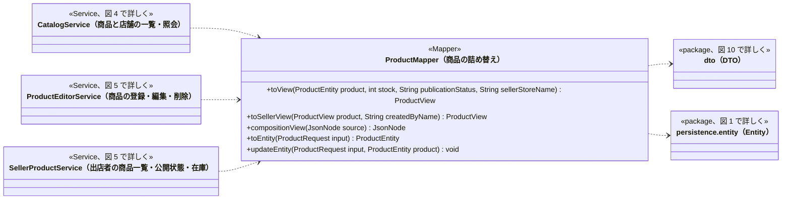

### 線とコードの対応

| 線 | 使うメソッド |
| --- | --- |
| CatalogService → ProductMapper | `toView()` |
| ProductEditorService → ProductMapper | `toEntity()`（登録）、`updateEntity()`（編集） |
| SellerProductService → ProductMapper | `toSellerView()` |
| ProductMapper → dto | `ProductRequest` を受け、`CatalogDtos.ProductView` を返す |
| ProductMapper → persistence.entity | `ProductEntity` を受ける・作る・書き換える |

### 写し方の決まり

| メソッド | 決まり |
| --- | --- |
| `toView()` | `active` は `publicationStatus` が `DELETED` でないこと、`sellerStoreId` は `product.storeId`、`modelComposition` は `compositionView()` を通す。`createdByName` は写さない（`null`） |
| `toSellerView()` | `modelComposition` を外し、`createdByName` に引数の値を入れる |
| `compositionView()` | 古い構成の JSON の `profile` に `botanicalForm` が無いとき、応答にだけ `null` を足す（Entity の JSON は変えない） |
| `toEntity()` | `id`、`unit`、`source`、`sourceProductId`、`sourceUpdatedAt`、`publishedAt` と、`care`、`minTemperatureC`、`sunlight`、`careLevel`、`heatTolerant`、`droughtTolerant`、`useCase` を写さない（`ignore = true`） |
| `updateEntity()` | `toEntity()` と同じものに加えて、`storeId` を写さない |
| 写さない先 | `unmappedTargetPolicy = IGNORE`。`createdByMemberId` は `ProductRequest` に無いので写らず、`ProductEditorService.create()` が入れる |

## クラスとコードの対応

ファイルはすべて `backend/src/main/java/jp/kusakari/ec/catalog/` の下です。

| クラス | ファイル | 図 |
| --- | --- | --- |
| `ProductEntity` | [persistence/entity/ProductEntity.java](https://github.com/abeouga/kusakari-ec/blob/8892344/backend/src/main/java/jp/kusakari/ec/catalog/persistence/entity/ProductEntity.java) | 図 1、図 10 |
| `InventoryEntity` | [persistence/entity/InventoryEntity.java](https://github.com/abeouga/kusakari-ec/blob/8892344/backend/src/main/java/jp/kusakari/ec/catalog/persistence/entity/InventoryEntity.java) | 図 1 |
| `CategoryEntity` | [persistence/entity/CategoryEntity.java](https://github.com/abeouga/kusakari-ec/blob/8892344/backend/src/main/java/jp/kusakari/ec/catalog/persistence/entity/CategoryEntity.java) | 図 1 |
| `ProductMediaEntity` | [persistence/entity/ProductMediaEntity.java](https://github.com/abeouga/kusakari-ec/blob/8892344/backend/src/main/java/jp/kusakari/ec/catalog/persistence/entity/ProductMediaEntity.java) | 図 1 |
| `MaterialProductEntity` | [persistence/entity/MaterialProductEntity.java](https://github.com/abeouga/kusakari-ec/blob/8892344/backend/src/main/java/jp/kusakari/ec/catalog/persistence/entity/MaterialProductEntity.java) | 図 1 |
| `MaterialProductId` | [persistence/entity/MaterialProductId.java](https://github.com/abeouga/kusakari-ec/blob/8892344/backend/src/main/java/jp/kusakari/ec/catalog/persistence/entity/MaterialProductId.java) | 図 1 |
| `StoreEntity` | [persistence/entity/StoreEntity.java](https://github.com/abeouga/kusakari-ec/blob/8892344/backend/src/main/java/jp/kusakari/ec/catalog/persistence/entity/StoreEntity.java) | 図 2 |
| `ProductRepository` | [persistence/repository/ProductRepository.java](https://github.com/abeouga/kusakari-ec/blob/8892344/backend/src/main/java/jp/kusakari/ec/catalog/persistence/repository/ProductRepository.java) | 図 3 |
| `InventoryRepository` | [persistence/repository/InventoryRepository.java](https://github.com/abeouga/kusakari-ec/blob/8892344/backend/src/main/java/jp/kusakari/ec/catalog/persistence/repository/InventoryRepository.java) | 図 3 |
| `CategoryRepository` | [persistence/repository/CategoryRepository.java](https://github.com/abeouga/kusakari-ec/blob/8892344/backend/src/main/java/jp/kusakari/ec/catalog/persistence/repository/CategoryRepository.java) | 図 3 |
| `MaterialProductRepository` | [persistence/repository/MaterialProductRepository.java](https://github.com/abeouga/kusakari-ec/blob/8892344/backend/src/main/java/jp/kusakari/ec/catalog/persistence/repository/MaterialProductRepository.java) | 図 3 |
| `ProductMediaRepository` | [persistence/repository/ProductMediaRepository.java](https://github.com/abeouga/kusakari-ec/blob/8892344/backend/src/main/java/jp/kusakari/ec/catalog/persistence/repository/ProductMediaRepository.java) | 図 3 |
| `StoreRepository` | [persistence/repository/StoreRepository.java](https://github.com/abeouga/kusakari-ec/blob/8892344/backend/src/main/java/jp/kusakari/ec/catalog/persistence/repository/StoreRepository.java) | 図 3 |
| `CatalogService`、`Listing`、`StoreState` | [service/CatalogService.java](https://github.com/abeouga/kusakari-ec/blob/8892344/backend/src/main/java/jp/kusakari/ec/catalog/service/CatalogService.java) | 図 4、図 12 |
| `CategoryService` | [service/CategoryService.java](https://github.com/abeouga/kusakari-ec/blob/8892344/backend/src/main/java/jp/kusakari/ec/catalog/service/CategoryService.java) | 図 4 |
| `ProductEditorService` | [service/ProductEditorService.java](https://github.com/abeouga/kusakari-ec/blob/8892344/backend/src/main/java/jp/kusakari/ec/catalog/service/ProductEditorService.java) | 図 5 |
| `SellerProductService` | [service/SellerProductService.java](https://github.com/abeouga/kusakari-ec/blob/8892344/backend/src/main/java/jp/kusakari/ec/catalog/service/SellerProductService.java) | 図 5 |
| `ProductSkuGenerator` | [service/ProductSkuGenerator.java](https://github.com/abeouga/kusakari-ec/blob/8892344/backend/src/main/java/jp/kusakari/ec/catalog/service/ProductSkuGenerator.java) | 図 5 |
| `ProductMediaService`、`Image` | [service/ProductMediaService.java](https://github.com/abeouga/kusakari-ec/blob/8892344/backend/src/main/java/jp/kusakari/ec/catalog/service/ProductMediaService.java) | 図 5、図 12 |
| `ProductModerationService`、`Product` | [service/ProductModerationService.java](https://github.com/abeouga/kusakari-ec/blob/8892344/backend/src/main/java/jp/kusakari/ec/catalog/service/ProductModerationService.java) | 図 6、図 12 |
| `PlantSuggestionService` | [service/PlantSuggestionService.java](https://github.com/abeouga/kusakari-ec/blob/8892344/backend/src/main/java/jp/kusakari/ec/catalog/service/PlantSuggestionService.java) | 図 7 |
| `PlantSuggestionClient` | [service/PlantSuggestionClient.java](https://github.com/abeouga/kusakari-ec/blob/8892344/backend/src/main/java/jp/kusakari/ec/catalog/service/PlantSuggestionClient.java) | 図 7 |
| `PlantSuggestionFitter` | [service/PlantSuggestionFitter.java](https://github.com/abeouga/kusakari-ec/blob/8892344/backend/src/main/java/jp/kusakari/ec/catalog/service/PlantSuggestionFitter.java) | 図 7 |
| `PlantSuggestionSchema` | [service/PlantSuggestionSchema.java](https://github.com/abeouga/kusakari-ec/blob/8892344/backend/src/main/java/jp/kusakari/ec/catalog/service/PlantSuggestionSchema.java) | 図 7 |
| `CanvasModelClient` | [service/CanvasModelClient.java](https://github.com/abeouga/kusakari-ec/blob/8892344/backend/src/main/java/jp/kusakari/ec/catalog/service/CanvasModelClient.java) | 図 5、図 7 |
| `PlantSuggestionController` | [controller/PlantSuggestionController.java](https://github.com/abeouga/kusakari-ec/blob/8892344/backend/src/main/java/jp/kusakari/ec/catalog/controller/PlantSuggestionController.java) | 図 7 |
| `CatalogController` | [controller/CatalogController.java](https://github.com/abeouga/kusakari-ec/blob/8892344/backend/src/main/java/jp/kusakari/ec/catalog/controller/CatalogController.java) | 図 8 |
| `CategoryController`、`Input` | [controller/CategoryController.java](https://github.com/abeouga/kusakari-ec/blob/8892344/backend/src/main/java/jp/kusakari/ec/catalog/controller/CategoryController.java) | 図 8、図 12 |
| `ProductMediaController` | [controller/ProductMediaController.java](https://github.com/abeouga/kusakari-ec/blob/8892344/backend/src/main/java/jp/kusakari/ec/catalog/controller/ProductMediaController.java) | 図 8 |
| `ProductEditorController` | [controller/ProductEditorController.java](https://github.com/abeouga/kusakari-ec/blob/8892344/backend/src/main/java/jp/kusakari/ec/catalog/controller/ProductEditorController.java) | 図 9 |
| `SellerProductController` | [controller/SellerProductController.java](https://github.com/abeouga/kusakari-ec/blob/8892344/backend/src/main/java/jp/kusakari/ec/catalog/controller/SellerProductController.java) | 図 9 |
| `ProductModerationController`、`Input` | [controller/ProductModerationController.java](https://github.com/abeouga/kusakari-ec/blob/8892344/backend/src/main/java/jp/kusakari/ec/catalog/controller/ProductModerationController.java) | 図 9、図 12 |
| `ProductRequest` | [dto/ProductRequest.java](https://github.com/abeouga/kusakari-ec/blob/8892344/backend/src/main/java/jp/kusakari/ec/catalog/dto/ProductRequest.java) | 図 10 |
| `ProductStatusRequest` | [dto/ProductStatusRequest.java](https://github.com/abeouga/kusakari-ec/blob/8892344/backend/src/main/java/jp/kusakari/ec/catalog/dto/ProductStatusRequest.java) | 図 10 |
| `StockUpdateRequest` | [dto/StockUpdateRequest.java](https://github.com/abeouga/kusakari-ec/blob/8892344/backend/src/main/java/jp/kusakari/ec/catalog/dto/StockUpdateRequest.java) | 図 10 |
| `CatalogDtos` の 8 つの record | [dto/CatalogDtos.java](https://github.com/abeouga/kusakari-ec/blob/8892344/backend/src/main/java/jp/kusakari/ec/catalog/dto/CatalogDtos.java) | 図 10（`ProductView`）、図 11 |
| `ProductImageReference` | [dto/ProductImageReference.java](https://github.com/abeouga/kusakari-ec/blob/8892344/backend/src/main/java/jp/kusakari/ec/catalog/dto/ProductImageReference.java) | 図 12 |
| `ProductStoreReference` | [dto/ProductStoreReference.java](https://github.com/abeouga/kusakari-ec/blob/8892344/backend/src/main/java/jp/kusakari/ec/catalog/dto/ProductStoreReference.java) | 図 12 |
| `ProductCreatorName` | [dto/ProductCreatorName.java](https://github.com/abeouga/kusakari-ec/blob/8892344/backend/src/main/java/jp/kusakari/ec/catalog/dto/ProductCreatorName.java) | 図 12 |
| `PlantModelProfile` | [dto/PlantModelProfile.java](https://github.com/abeouga/kusakari-ec/blob/8892344/backend/src/main/java/jp/kusakari/ec/catalog/dto/PlantModelProfile.java) | 図 13 |
| `PlantSuggestionRequest` | [dto/PlantSuggestionRequest.java](https://github.com/abeouga/kusakari-ec/blob/8892344/backend/src/main/java/jp/kusakari/ec/catalog/dto/PlantSuggestionRequest.java) | 図 13 |
| `PlantSuggestionView` | [dto/PlantSuggestionView.java](https://github.com/abeouga/kusakari-ec/blob/8892344/backend/src/main/java/jp/kusakari/ec/catalog/dto/PlantSuggestionView.java) | 図 13 |
| `ProductMapper` | [mapper/ProductMapper.java](https://github.com/abeouga/kusakari-ec/blob/8892344/backend/src/main/java/jp/kusakari/ec/catalog/mapper/ProductMapper.java) | 図 14 |

商品を追加した会員の記録を足した理由は、kusakari-ec の [docs/decisions/2026-11-20-sample-products-and-creator.md](https://github.com/abeouga/kusakari-ec/blob/8892344/docs/decisions/2026-11-20-sample-products-and-creator.md) にあります。

## 載せなかったもの

| もの | 理由 | 載せた図 |
| --- | --- | --- |
| `CatalogDtos` のクラスそのもの | record を入れるためだけの `final` のクラスで、`private` のコンストラクターしか持たないため | 中の 8 つの record を図 10・図 11 に `CatalogDtos.〜` の名前で載せた |
| `product_images` のテーブル | Entity が無く、`ProductEntity.images`（`@ElementCollection`）が読み書きするため | 図 1 の `images` と「Entity とテーブル」の表 |
| モジュールの図での DTO・Entity・record の箱 | データの図とモジュールの図を混ぜないため | 図 1・図 2・図 10〜図 13 |
| 図 4・図 5 の Repository ごとの箱 | 1 つずつ置くと、ほかの Service からの線が箱の裏を通ったため、`persistence.repository` のパッケージの箱 1 つにまとめた | 図 3、図 4・図 5 の「線とコードの対応」の表 |
| `ApiException`（common.web）への線 | ほぼすべての Service から引くと図が読めなくなるため | 各図の「エラー」の表 |
| 各 Service の非公開のメソッド（`CatalogService.listings()`・`unavailableReason()`・`storeStates()`、`ProductEditorService.resolveModel()`・`linkMaterial()`・`saveProduct()`、`SellerProductService.requireAtStore()` など） | 公開のメソッドの中だけで使う部品のため | 図 4・図 5 の「線とコードの対応」「決まり」の表 |
| `ProductModerationEventEntity`、`ModerationAction`、`NotificationEntity`、`ModerationDtos` の record（`Warning` を除く） | moderation・notification パッケージのクラスのため | 07 |
| `JpaRepository`、`EntityManager`、`RestClient`、`ObjectMapper`、`Validator`、`SecureRandom`、`Semaphore`、`MultipartFile`、`JsonNode` などのフレームワークと Java のクラス | ライブラリのクラスのため。`JpaRepository` だけは継承を示すため図 3 に置いた | フィールドと引数の型 |
| MapStruct が `ProductMapper` から作る実装のクラス | ビルドで作られるソースのため | 図 14 の本文 |

## 確かめられなかったこと

- GitHub と Obsidian での表示は確かめていません。PNG は mermaid-snap（Mermaid 11.4.1）で書き出したものです。
- `ProductMapper` の `toEntity()` と `updateEntity()` で、`ProductRequest` のどのフィールドが `ProductEntity` に写るかは、`@Mapping` の注釈と、同じ名前のフィールドを写す MapStruct の決まりから読んだものです。生成された実装は読んでいません。`care`・`sunlight`・`careLevel` などを写さない（`ignore = true`）ので、`ProductRequest` で送ったこれらの値は保存されないと読めますが、実行して確かめていません。
- `@Lock(PESSIMISTIC_WRITE)` と `@Lock(PESSIMISTIC_READ)` が MySQL で `FOR UPDATE` と `FOR SHARE` になることは、注釈から読んだもので、実行して確かめていません。
- 図 1 の `ProductEntity` と `AuthMember` の多重度（0..* — 0..1）は、V7 の外部キー `fk_products_created_by` と、列が NULL 可であることから決めました。JPA の側には関連の注釈はありません。
