# kusakari-ec 商品カタログ（catalog パッケージ）のクラス図

- 対象のコード: kusakari-ec の main（19a2be3、2026-11-20 時点）
- 対象のパッケージ: `jp.kusakari.ec.catalog`（[backend/src/main/java/jp/kusakari/ec/catalog](https://github.com/abeouga/kusakari-ec/tree/19a2be307ee71a2cd87e538236c3c8c42929c5b3/backend/src/main/java/jp/kusakari/ec/catalog)）
  - [controller](https://github.com/abeouga/kusakari-ec/tree/19a2be307ee71a2cd87e538236c3c8c42929c5b3/backend/src/main/java/jp/kusakari/ec/catalog/controller)、[dto](https://github.com/abeouga/kusakari-ec/tree/19a2be307ee71a2cd87e538236c3c8c42929c5b3/backend/src/main/java/jp/kusakari/ec/catalog/dto)、[mapper](https://github.com/abeouga/kusakari-ec/tree/19a2be307ee71a2cd87e538236c3c8c42929c5b3/backend/src/main/java/jp/kusakari/ec/catalog/mapper)、[persistence/entity](https://github.com/abeouga/kusakari-ec/tree/19a2be307ee71a2cd87e538236c3c8c42929c5b3/backend/src/main/java/jp/kusakari/ec/catalog/persistence/entity)、[persistence/repository](https://github.com/abeouga/kusakari-ec/tree/19a2be307ee71a2cd87e538236c3c8c42929c5b3/backend/src/main/java/jp/kusakari/ec/catalog/persistence/repository)、[service](https://github.com/abeouga/kusakari-ec/tree/19a2be307ee71a2cd87e538236c3c8c42929c5b3/backend/src/main/java/jp/kusakari/ec/catalog/service)

## パッケージの役割

catalog パッケージは、商品、在庫と公開状態、カテゴリ、商品画像、資材コードと商品の対応（`material_products`）、植物モデル（庭オブジェクト）を扱います。

- 購入者向けの商品と店舗の一覧、Kusakari Canvas からの照会（庭に置いた商品の参照、資材コードからの商品候補）の受け口があります。
- 出店者の商品の登録・編集・削除、在庫数と公開状態の変更、商品画像の保存、AI による植物モデルの推定の受け口があります。
- 運営による商品の警告・公開停止の受け口があります。
- 店舗の Entity（`StoreEntity`）と Repository（`StoreRepository`）もこのパッケージにあります。店舗の作成・編集・閉鎖は store パッケージのサービスが使います（[02_店舗と組織](<02_店舗と組織.md>) を参照）。
- `CatalogService` の `listing()`・`listingsByIds()`、`InventoryRepository` の `lockAll()`、`ProductRepository` の `findStoreReferences()`・`lockSharedSuspension()` などは、カートと注文（[04_カートと注文](<04_カートと注文.md>)）と買い物リスト（[06_買い物リスト](<06_買い物リスト.md>)）からも使われます。

## 読み方の要点

- 層は controller → service → persistence/repository → persistence/entity の順に呼びます。Controller は Entity を返さず、dto の record やクラスを返します。Entity から `ProductView` への変換と、`ProductRequest` から Entity への変換は、MapStruct の `ProductMapper` が行います。
- Entity どうしに JPA の関連（`@ManyToOne`、`@OneToMany` など）はありません。ID の列（`storeId`、`productId`、`category`）で参照します。図では、依存の破線（`..>`）に参照するフィールド名を付けて示し、多重度は書きません。外部キーは Flyway の `V1__schema.sql` にあります。列と制約の詳しいことは [テーブル設計図](<../../テーブル設計図/kusakari-ec/>) を見てください。
- Entity のフィールドの後ろの〔 〕は、フィールド名と違う列名やテーブル名です。Controller のメソッドの後ろの〔 〕は、HTTP のメソッドとパスです。
- 商品の削除は行を消さず、`inventory.publication_status` を `DELETED` にします。注文と庭の記録が商品を参照するためです。
- 植物の商品は、出店者が入力した特徴（`plantModelProfile`、JSON 列）と、Kusakari Canvas の API が組み立てた 3D の構成（`modelComposition`、JSON 列）を持ちます。構成があると、資材コード `product.{商品 ID}` と商品の対応を `material_products` に保存します。
- 処理の流れは [シーケンス図](<../../シーケンス図/kusakari-ec/>) を見てください。商品の登録は EC-S03、編集は EC-S04、在庫数は EC-S05、販売状態は EC-S06 です。

| クラス | テーブル | 主キー |
| --- | --- | --- |
| `ProductEntity` | `products`（`images` は `product_images`） | `id` |
| `InventoryEntity` | `inventory` | `product_id` |
| `CategoryEntity` | `categories` | `name` |
| `ProductMediaEntity` | `product_media` | `id` |
| `MaterialProductEntity`、`MaterialProductId` | `material_products` | `material_code`、`product_id` |
| `StoreEntity` | `stores` | `id` |

| Controller | パス | ログイン |
| --- | --- | --- |
| `CatalogController` | `GET /api/products`、`GET /api/stores`、`POST /api/products/references`、`POST /api/materials/quote` | 不要（後の 2 つは Kusakari Canvas が呼び、CSRF の確認もしない） |
| `CategoryController` | `GET /api/categories`、`PUT /api/operator/categories`、`DELETE /api/operator/categories/{name}` | GET は不要 |
| `ProductMediaController` | `POST /api/product-images`、`GET /api/product-images/{id}` | GET は不要 |
| `PlantSuggestionController` | `POST /api/products/plant-model-suggestions` | 必要 |
| `ProductEditorController` | `POST /api/products`、`PUT /api/products/{id}`、`DELETE /api/products/{id}` | 必要 |
| `SellerProductController` | `GET /api/seller/products`、`GET /api/seller/products/moderation`、`PATCH /api/seller/products/status`、`PUT /api/seller/products/{id}/stock` | 必要 |
| `ProductModerationController` | `GET /api/operator/products`、`PUT /api/operator/products/{id}/moderation`、`PUT /api/operator/products/{id}/warning`、`GET /api/operator/products/{id}/moderation-events` | 必要 |

ログインの要否は、`auth/AuthConfiguration.java` の `cognitoSecurity()`（`kusakari.auth.mode` が `cognito` の設定）の `permitAll()` の指定です。ロールの確認は各 Service が `AuthService` を呼んで行います。

## 図 1 商品・在庫・カテゴリ・画像・資材コードの Entity

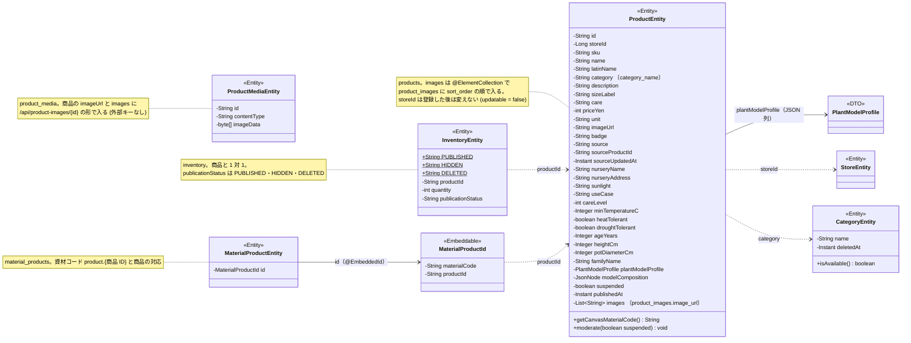

- `ProductEntity.getCanvasMaterialCode()` は、`modelComposition` があるときに `product.{id}` を返します。`moderate()` は運営の公開停止（`suspended`）を変えます。`suspended` に setter はありません。
- `PlantModelProfile` は dto パッケージのクラスで、`products.plant_model_profile` の JSON 列に入ります。フィールドは図 7 にあります。`StoreEntity` のフィールドは図 2 にあります。
- `products` には、Entity に対応するフィールドが無い列（`flowering_description`、`seasonal_care`、`style_description`）があります。`CategoryEntity.name` の `@Column(length = 30)` に対して、`categories.name` は `VARCHAR(80)` です。`InventoryEntity` の `publicationStatus` の初めの値は `PUBLISHED` ですが、`inventory.publication_status` の列の既定値は `HIDDEN` です。

## 図 2 店舗の Entity と Repository

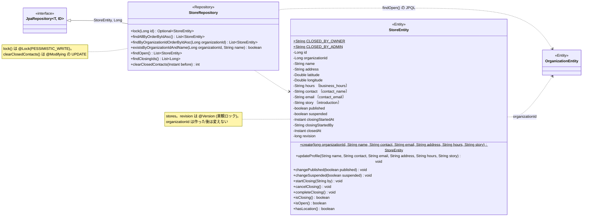

- `StoreEntity` には `@Getter` だけがあり、setter はありません。状態は `create()`、`updateProfile()`、`changePublished()` などのメソッドで変えます。
- `findOpen()` は、公開中で、停止・閉鎖されておらず、組織（`OrganizationEntity`、store パッケージ）が停止していない店舗を返します。`GET /api/stores` の一覧に使います。
- `stores` の `created_at` の列に対応するフィールドはありません。

## 図 3 商品まわりの Repository

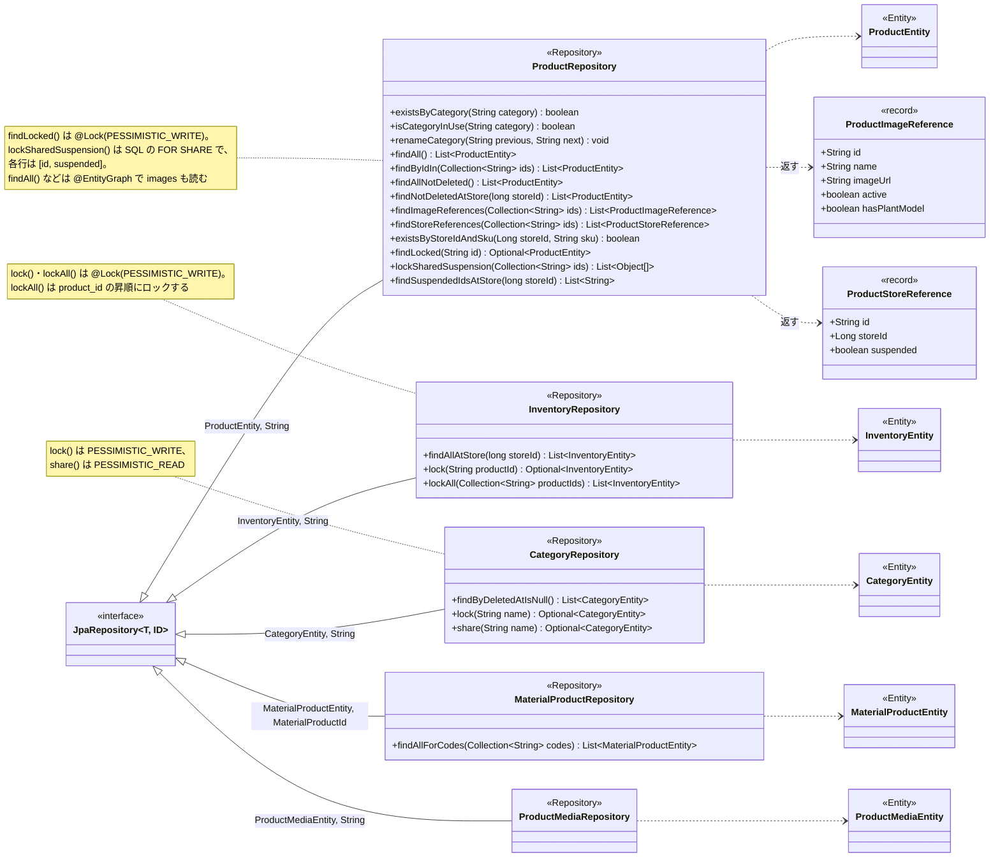

- 「削除されていない商品」は、`inventory.publication_status` が `DELETED` の行が無い商品です（`findAllNotDeleted()`、`findNotDeletedAtStore()`、`isCategoryInUse()` の JPQL）。
- `findImageReferences()` と `findStoreReferences()` は、大きな JSON 列（`model_composition`）を読まないように、record（`ProductImageReference`、`ProductStoreReference`）へ直接読み出します。
- `ProductMediaRepository` は独自のメソッドを持たず、`JpaRepository` の `save()` と `findById()` だけを使います。
- `InventoryRepository.findAllAtStore()` を呼ぶコードは、この時点の main には見つかりません。

## 図 4 商品・店舗の一覧と照会、カテゴリの Service

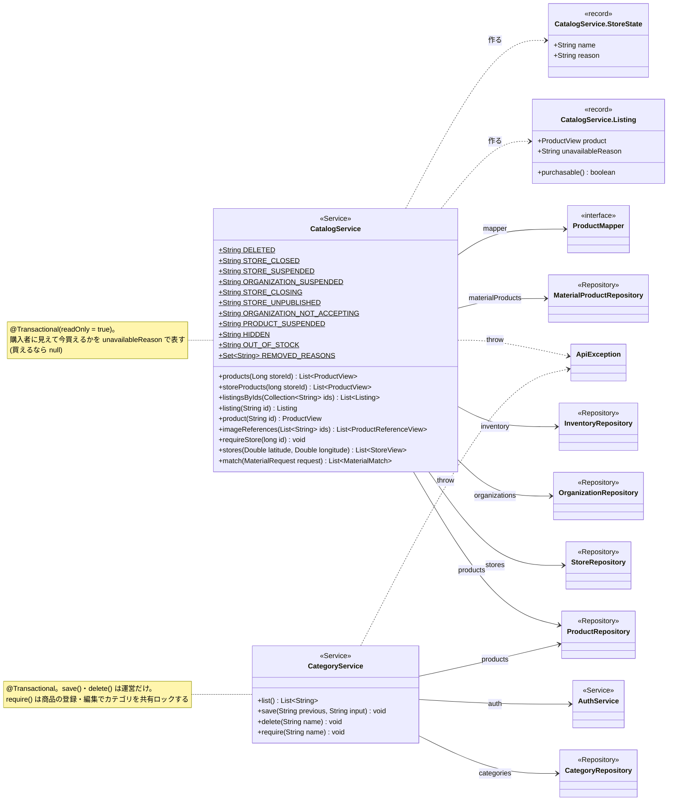

- `CatalogService.products()` は、購入者に見えて今買える商品だけを返します（`Listing.purchasable()`）。`storeProducts()` は出店者の一覧用で、非公開の商品も含みます。
- 買えない理由は 10 個の定数です。`REMOVED_REASONS`（`DELETED`、`STORE_CLOSED`、`STORE_SUSPENDED`、`ORGANIZATION_SUSPENDED`）は戻らない理由で、カートの明細と庭の配置から外す理由として使います。
- `StoreState` は `private` の record で、店舗の名前と、店舗・組織の側で買えない理由を持ちます。
- `OrganizationRepository`（store パッケージ）、`AuthService`（auth パッケージ）、`ApiException`（common.web パッケージ）は、名前だけを書いています。

## 図 5 商品の登録・編集、出店者の操作、商品画像の Service

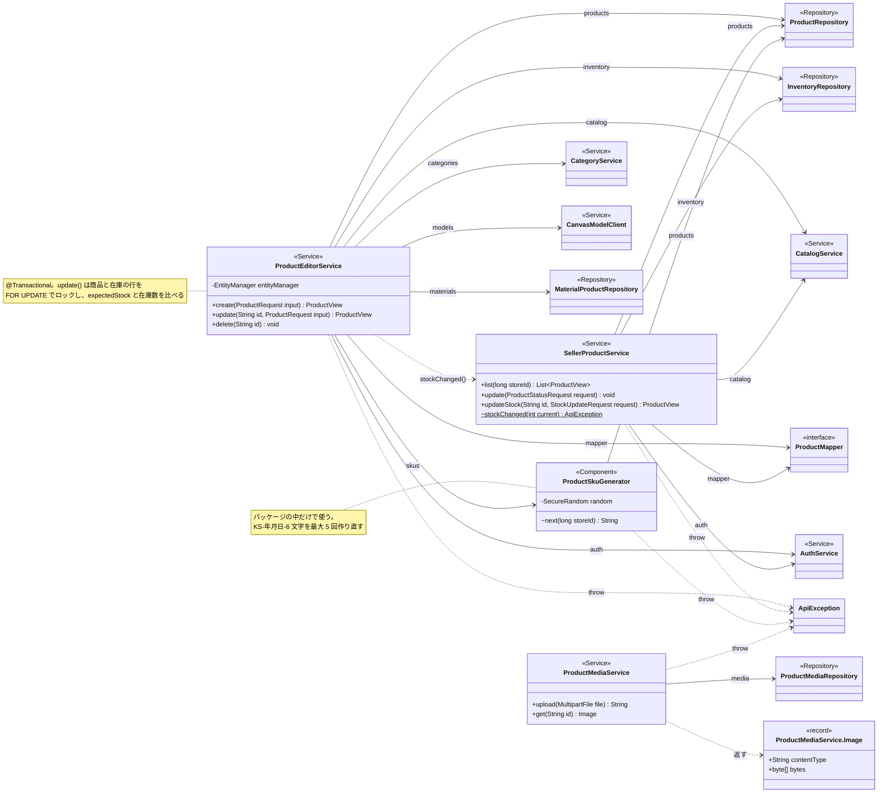

- `ProductEditorService` の登録（`create()`）と削除（`delete()`）はオーナーか MANAGER、編集（`update()`）は STAFF もできます。権限は `AuthService` の `requireManager()` と `requireProductStore()` で確かめます。
- `ProductEditorService` の非公開のメソッド `resolveModel()` は、植物の特徴が変わったときに `CanvasModelClient.resolve()` で構成を取り直します。`linkMaterial()` は、構成があると `material_products` に対応を保存します。
- `SellerProductService.stockChanged()` はパッケージの中だけで使う `static` のメソッドで、409 `STOCK_CHANGED` の `ApiException` を作ります。`ProductEditorService.update()` も使います。
- `ProductMediaService.upload()` は、先頭のバイトから PNG・JPEG・WebP を判定して `product_media` に保存し、`/api/product-images/{id}` を返します。

## 図 6 運営による商品の警告・公開停止の Service

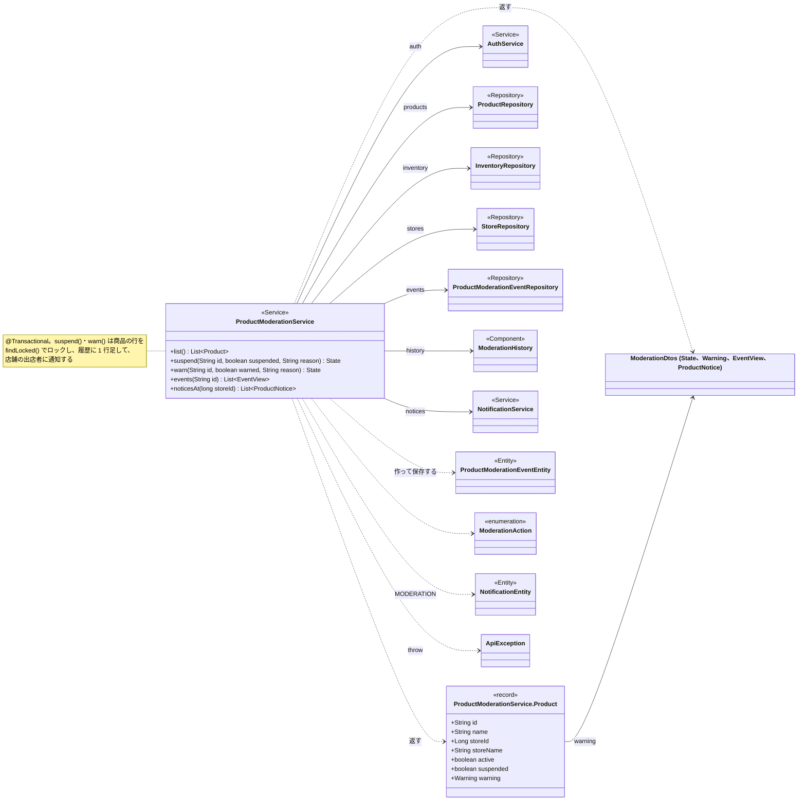

- `list()`、`suspend()`、`warn()`、`events()` は運営だけ（`AuthService.requireAdmin()`）が使えます。`noticesAt()` は出店者の商品一覧の「運営からの警告・停止」に使い、所属店舗の担当者なら見られます（`requireStoreViewer()`）。
- 履歴と通知のクラスは moderation パッケージと notification パッケージにあります。詳しくは [07_通知と運営の記録](<07_通知と運営の記録.md>) を見てください。

## 図 7 植物モデルの推定と組み立て

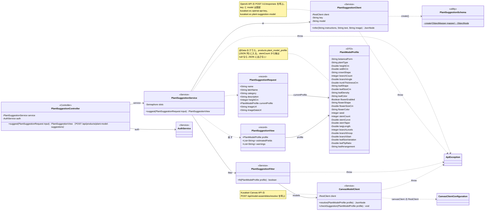

- `PlantSuggestionService.suggest()` は DB を使いません。OpenAI API で特徴を推定し、`PlantSuggestionFitter.fit()` で Canvas API に組み立てられるかを確かめます。組み立てられないときは、葉・花・幹の大きさを小さくして確かめ直します。同時に 2 件まで（`Semaphore`）です。
- `PlantSuggestionSchema` はパッケージの中だけで使う `final` のクラスで、OpenAI API に渡す JSON Schema を作ります。
- `CanvasModelClient.resolve()` は商品の登録・編集で 3D の構成を取ります。`checkSuggestion()` は AI の推定を確かめるだけで、結果を保存しません。
- `PlantModelProfile` の各フィールドには、`@Pattern`、`@DecimalMin` などの検査の注釈が付いています（図では省略）。`CanvasClientConfiguration`（common パッケージ）は、`canvasClient` という名前の `RestClient` を作ります。

## 図 8 購入者・Kusakari Canvas・商品画像の受け口

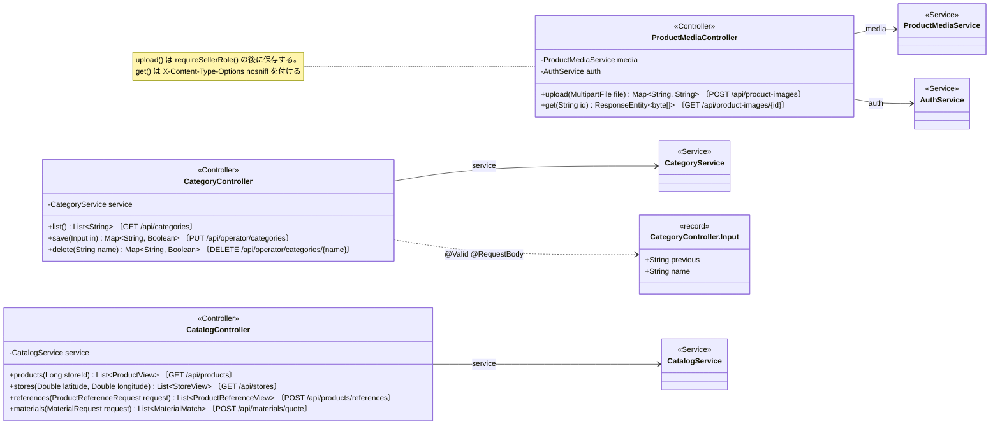

- `CatalogController.references()` は `imageReferences()`、`materials()` は `match()` を呼びます。どちらも Kusakari Canvas が、庭に置いた商品の状態と、資材コードからの商品候補を求めるのに使います。
- `CategoryController.save()` は、`Input.previous` が空なら追加、空でなければ名前の変更です。

## 図 9 出店者と運営の受け口

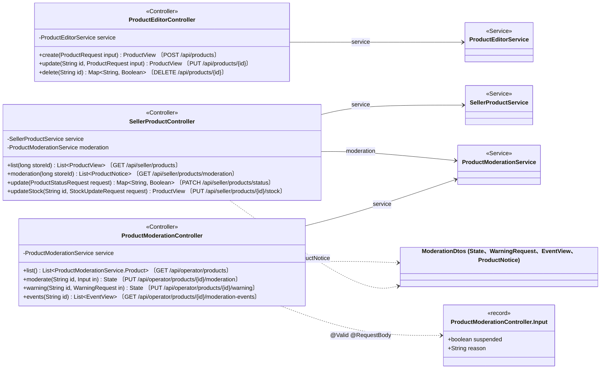

- `ProductEditorController` と `SellerProductController` は Service を呼ぶだけで、権限の確認は Service の中で行います。
- `ProductModerationController.moderate()` の `Input` は、`suspended` が `true` で公開停止、`false` で再開です。理由は 500 文字まで（`@Size(max = 500)`）です。

## 図 10 商品の Request・Response と ProductMapper

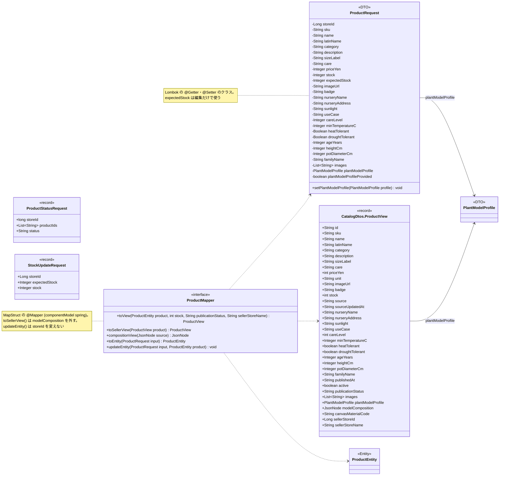

- `ProductRequest` は商品の登録（`POST /api/products`）と編集（`PUT /api/products/{id}`）の両方で使います。`sku` は登録では空にするとサーバーが採番し、編集では空なら今の値のままです。`expectedStock` は編集のときの「変更前の在庫数」で、省くと `stock` と同じ値として比べます。
- `plantModelProfileProvided` は `@JsonIgnore` で、JSON に `plantModelProfile` があったか（`null` を含む）を覚えます。`setPlantModelProfile()` が `true` にします。
- `ProductView.active` は在庫の公開状態が `DELETED` でないことです。`toView()` の `@Mapping` の式で決めます。`compositionView()` は古い構成の JSON に `botanicalForm` が無いとき、応答にだけ `null` を足します。
- `ProductStatusRequest.status` は `PUBLISHED`、`HIDDEN`、`DELETED` のどれかで、商品は 25 件までです。`StockUpdateRequest` の `expectedStock` と `stock` は 0〜10000 です。

## 図 11 Kusakari Canvas との照会と店舗の一覧の DTO

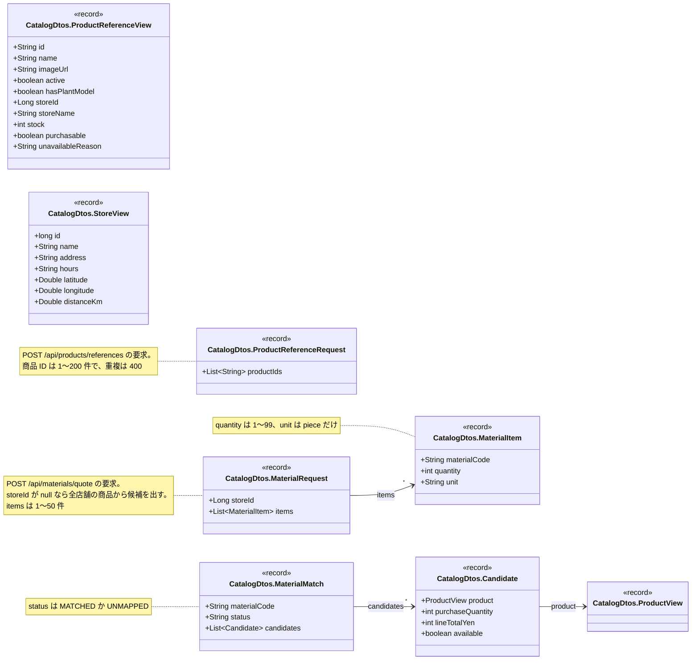

- `ProductReferenceView.unavailableReason` には、`CatalogService` の買えない理由の定数（図 4）が入ります。照会では在庫 0 も `OUT_OF_STOCK` として買えない理由にします。
- `Candidate.available` は、商品の在庫数が `MaterialItem.quantity` 以上かです。`lineTotalYen` は価格と数量の積です。
- `StoreView.distanceKm` は、`GET /api/stores` に緯度と経度を付けたときだけ入ります。位置を登録していない店舗は、緯度・経度・距離が `null` です。

## 図に載せなかったクラス

- `CatalogDtos`（dto）: record を入れるためだけの `final` のクラスで、`private` のコンストラクターしか持ちません。中の 8 つの record（`ProductView`、`StoreView`、`ProductReferenceView`、`ProductReferenceRequest`、`MaterialItem`、`MaterialRequest`、`Candidate`、`MaterialMatch`）は、図 10 と図 11 に `CatalogDtos.〜` の名前で載せています。
- `JpaRepository`、`EntityManager`、`RestClient`、`ObjectMapper`、`Validator`、`SecureRandom`、`Semaphore`、`MultipartFile`、`JsonNode` などのフレームワークと Java のクラスは、`JpaRepository` を除いて図に箱を作らず、フィールドや引数の型として書いています。
- MapStruct が `ProductMapper` から作る実装のクラスは、ビルドで作られるソースなので載せていません。

## 確かめられなかったこと

- `ProductMapper` の `toEntity()` と `updateEntity()` で、`ProductRequest` のどのフィールドが `ProductEntity` に写るかは、`@Mapping` の注釈と、同じ名前のフィールドを写す MapStruct の決まりから読んだものです。生成された実装は読んでいません。
- `@Lock(PESSIMISTIC_WRITE)` と `@Lock(PESSIMISTIC_READ)` が MySQL で `FOR UPDATE` と `FOR SHARE` になることは、注釈から読んだもので、実行して確かめていません。
