# Kusakari EC クラス図 04 カートと注文

- 対象のコード: kusakari-ec の main（8892344、2026-11-24 時点）
- 対象のパッケージ: `jp.kusakari.ec.commerce`（[backend/src/main/java/jp/kusakari/ec/commerce](https://github.com/abeouga/kusakari-ec/blob/8892344/backend/src/main/java/jp/kusakari/ec/commerce)）
  - [controller](https://github.com/abeouga/kusakari-ec/blob/8892344/backend/src/main/java/jp/kusakari/ec/commerce/controller)、[dto](https://github.com/abeouga/kusakari-ec/blob/8892344/backend/src/main/java/jp/kusakari/ec/commerce/dto)、[mapper](https://github.com/abeouga/kusakari-ec/blob/8892344/backend/src/main/java/jp/kusakari/ec/commerce/mapper)、[persistence/entity](https://github.com/abeouga/kusakari-ec/blob/8892344/backend/src/main/java/jp/kusakari/ec/commerce/persistence/entity)、[persistence/repository](https://github.com/abeouga/kusakari-ec/blob/8892344/backend/src/main/java/jp/kusakari/ec/commerce/persistence/repository)、[service](https://github.com/abeouga/kusakari-ec/blob/8892344/backend/src/main/java/jp/kusakari/ec/commerce/service)、[session](https://github.com/abeouga/kusakari-ec/blob/8892344/backend/src/main/java/jp/kusakari/ec/commerce/session)
- 全体図とパッケージの対応: [00_全体図](<00_全体図.md>)

commerce パッケージは、購入者のカート、お会計（注文の確定）、注文の受け渡しとキャンセル、店舗の注文実績を扱います。図 1・図 9・図 10・図 11 はデータの図（Entity と DTO）、図 2〜図 8 はモジュールの図（Repository、Service、Controller）です。呼び出しの順番は [シーケンス図](<../../シーケンス図/kusakari-ec/>) に書いています。

19a2be3 から 8892344 までに、commerce パッケージのコードは変わっていません。カートの明細の中の `ProductView`（catalog パッケージ）に `createdByName` が増えましたが、カートの応答では null で、JSON に出ません（図 9）。

## パッケージの役割

- 受け取りは店舗受け取りだけです。受取店舗は商品の店舗で、カートの明細には受取店舗を持ちません。
- 1 回のお会計で、受取店舗ごとに 1 件の注文（`orders` の 1 行）を作り、在庫を減らします。
- カードの決済と返金は payment パッケージ（[05_決済](<05_決済.md>)）が扱います。commerce は `PaymentService`・`RefundService`・`StripeGateway`・`PaymentRepository`・`RefundRepository` を使います。
- 庭の買い物リストからカートに入れる処理は shopping パッケージ（[06_買い物リスト](<06_買い物リスト.md>)）の `ShoppingService` が受け、`CartService.addShoppingItems()` を呼びます。
- 店舗の閉鎖・組織の停止による注文のまとめてキャンセルは store パッケージ（[02_店舗と組織](<02_店舗と組織.md>)）の `OpenOrders` が行い、`OrderRepository`・`StockReturn`・`OrderEntity.cancelByOperator()` と、payment パッケージの `RefundService` を使います。
- ヘルスチェックの受け口（`HealthController`）も、このパッケージの controller にあります。

## 図の読み方

- 箱の名前は「英語名（日本語名）」です。英語名はコードのクラス名です。ほかのパッケージのクラスは、名前の後ろに詳しく載せたファイルの番号（01〜07）を付け、中身は書いていません。
- `CommerceDtos`・`DeliveryDtos`・`SalesDtos` の中の record は、入れ物のクラスの名前を付けずに record の名前で書きました（`CommerceDtos.CartView` を `CartView` と書く）。どの入れ物にあるかは各図の下の表にあります。
- ステレオタイプは、`<<Entity>>` が JPA の Entity、`<<Embeddable>>` が複合主キーのクラス、`<<record>>` が Java の record、`<<Repository>>` が Spring Data の Repository、`<<Service>>`・`<<Component>>`・`<<Controller>>` が Spring の Bean です。
- 線は 4 種類です。`*--`（黒い菱形）は、親が消えると一緒に消える持ち方（`ON DELETE CASCADE` の外部キー、JSON の入れ子、`@EmbeddedId`）です。`-->` は関連（データの図では外部キー、モジュールの図では Spring が注入するフィールド）、`<|--` は継承、`..>` は依存（呼ぶだけ、投げるだけ）です。
- 線の両端の数字は多重度です。`1` はちょうど 1 つ、`0..1` は無いか 1 つ、`0..*` は 0 個以上、`1..*` は 1 個以上です。コードの上限は図に書かず、各図の下の表に書きました。
- 線のラベルは関連の名前です。データの図では外部キーの列名かフィールド名、モジュールの図では注入するフィールドの名前です。依存の線にはラベルを付けず、使っているメソッドは各図の下の「線とコードの対応」に書きました。
- データの図の Entity は、外部キーの列も属性に書き、`FK` を付けました。JSON の入れ子（DTO の `items` など）は、線で描いたので属性に重ねていません。
- Lombok が作る getter・setter・コンストラクターは書いていません。
- `CartController` と `OrderController` のメソッドは、`HttpServletRequest` と `HttpServletResponse` も引数に取ります。どちらも `CartSessionResolver.resolve()` に渡すだけなので、図では省きました。

## API とクラス

| HTTP | パス | Controller のメソッド | Service のメソッド | シーケンス図 |
| --- | --- | --- | --- | --- |
| GET | `/api/cart` | `CartController.get()` | `CartService.read()` | [EC-B08](<../../シーケンス図/kusakari-ec/EC-B08_カートを確認する.md>) |
| PUT | `/api/cart/items/{productId}` | `CartController.updateItem()` | `CartService.updateItem()` | [EC-B07](<../../シーケンス図/kusakari-ec/EC-B07_商品をカートに追加する.md>)、[EC-B09](<../../シーケンス図/kusakari-ec/EC-B09_カートの数量を変更する.md>)、[EC-B10](<../../シーケンス図/kusakari-ec/EC-B10_カートから商品を削除する.md>) |
| POST | `/api/orders` | `OrderController.checkout()` | `CheckoutService.placeOrder()` の後に `PaymentService.start()` | [EC-B12](<../../シーケンス図/kusakari-ec/EC-B12_商品を購入する.md>) |
| GET | `/api/orders` | `OrderController.list()` | `OrderService.list()` | [EC-B13](<../../シーケンス図/kusakari-ec/EC-B13_注文履歴を確認する.md>) |
| PUT | `/api/orders/{id}` | `OrderController.updateDetails()` | `OrderService.updateDetails()` | [EC-B13](<../../シーケンス図/kusakari-ec/EC-B13_注文履歴を確認する.md>) |
| DELETE | `/api/orders/{id}` | `OrderController.delete()` | `OrderService.delete()` | [EC-B13](<../../シーケンス図/kusakari-ec/EC-B13_注文履歴を確認する.md>) |
| GET | `/api/orders/{id}` | `OrderWorkflowController.buyer()` | `OrderWorkflowService.buyerOrder()` | [EC-B12](<../../シーケンス図/kusakari-ec/EC-B12_商品を購入する.md>) |
| POST | `/api/orders/{id}/cancellation` | `OrderWorkflowController.request()` | `OrderWorkflowService.requestCancellation()` | [EC-B14](<../../シーケンス図/kusakari-ec/EC-B14_注文キャンセルを申請する.md>) |
| GET | `/api/seller/orders?storeId=…` | `OrderWorkflowController.seller()` | `OrderWorkflowService.sellerOrders()` | [EC-S08](<../../シーケンス図/kusakari-ec/EC-S08_注文一覧・詳細を確認する.md>) |
| GET | `/api/seller/orders/{id}` | `OrderWorkflowController.sellerOrder()` | `OrderWorkflowService.sellerOrder()` | なし（EC-S08 の画面は呼びません） |
| GET | `/api/operator/orders` | `OrderWorkflowController.all()` | `OrderWorkflowService.allOrders()` | なし |
| PUT | `/api/seller/orders/{id}/status` | `OrderWorkflowController.status()` | `OrderWorkflowService.changeStatus()` | [EC-S09](<../../シーケンス図/kusakari-ec/EC-S09_注文を受取準備完了にする.md>)、[EC-S10](<../../シーケンス図/kusakari-ec/EC-S10_注文を引き渡し完了にする.md>) |
| PUT | `/api/seller/orders/{id}/cancellation` | `OrderWorkflowController.decide()` | `OrderWorkflowService.decideCancellation()` | [EC-S13](<../../シーケンス図/kusakari-ec/EC-S13_注文キャンセル申請を処理する.md>) |
| GET | `/api/seller/sales/stores` | `SalesReportController.stores()` | `SalesReportService.viewableStores()` | [EC-S07](<../../シーケンス図/kusakari-ec/EC-S07_注文実績を確認する.md>)、[EC-C03](<../../シーケンス図/kusakari-ec/EC-C03_出店者画面のメニューを開く.md>) |
| GET | `/api/seller/stores/{storeId}/sales` | `SalesReportController.seller()` | `SalesReportService.report()` | [EC-S07](<../../シーケンス図/kusakari-ec/EC-S07_注文実績を確認する.md>) |
| GET | `/api/operator/stores/{storeId}/sales` | `SalesReportController.operator()` | `SalesReportService.operatorReport()` | [EC-A05](<../../シーケンス図/kusakari-ec/EC-A05_店舗情報を確認する.md>) |
| GET | `/api/health`、`/api/health/ready` | `HealthController.health()`、`ready()` | なし | なし |

`/api/health` と `/api/health/ready` はログインなしで呼べます。ほかはログインが必要です（`auth/AuthConfiguration.java` の `cognitoSecurity()`）。ロールの確認は各 Service が `AuthService` を呼んで行います。カート・注文の購入者の API は、`CartSessionResolver` の中で `AuthService.requireBuyer()` を呼びます。

## 図 1 カートと注文の Entity

データの図です。Entity どうしに JPA の関連（`@ManyToOne`、`@OneToMany` など）はなく、ID の列で参照します。線は MySQL の外部キー（`V1__schema.sql`）を描き、多重度は列の NULL 可否・一意キー・主キーと、値を入れるコードから決めました。ほかのパッケージの Entity は名前だけを書いています。

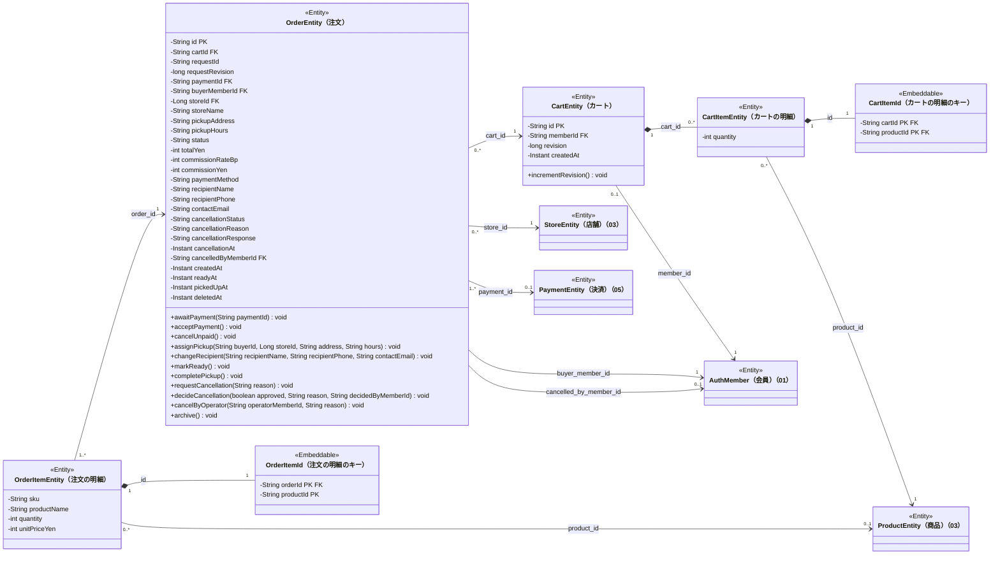

### Entity とテーブル

| Entity | テーブル | 主キー | 補足 |
| --- | --- | --- | --- |
| `CartEntity` | `carts` | `id` | 会員ごとに 1 つ（一意キー `uk_carts_member`）。`revision` は明細を変えるたびに 1 増やす（`incrementRevision()`）。`memberId` は auth パッケージの `MemberCartService.resolve()` がカートを作るときに入れる |
| `CartItemEntity`、`CartItemId` | `cart_items` | `cart_id`、`product_id` | `quantity` は 1〜99（`ck_cart_items_quantity`）。数量 0 は行を消す |
| `OrderEntity` | `orders` | `id` | お会計 1 回で受取店舗ごとに 1 行（一意キー `uk_orders_request`：`cart_id`、`request_id`、`store_id`）。`storeName`・`pickupAddress`・`pickupHours` は注文したときの店舗の値を写す |
| `OrderItemEntity`、`OrderItemId` | `order_items` | `order_id`、`product_id` | `sku`・`productName`・`unitPriceYen` は注文したときの商品の値を写す |

| フィールド | 列 |
| --- | --- |
| `OrderEntity.pickupAddress` | `store_address` |
| `OrderEntity.pickupHours` | `store_business_hours` |
| そのほか | フィールド名をスネークケースにした名前（`buyerMemberId` は `buyer_member_id`） |

### 関連と外部キー

| 関連 | 外部キーの名前 | 削除のとき | 多重度の根拠 |
| --- | --- | --- | --- |
| `CartEntity` 0..1 — 1 `AuthMember` | `fk_carts_member` | 指定なし | `member_id` は NULL 不可、一意キー `uk_carts_member` |
| `CartEntity` 1 — 0..* `CartItemEntity` | `fk_cart_items_cart` | `ON DELETE CASCADE` | `cart_id` は主キーの一部。上限は 50 種類（`CartService` の `CART_LIMIT`。DB の制約ではない） |
| `CartItemEntity` 0..* — 1 `ProductEntity` | `fk_cart_items_product` | 指定なし | `product_id` は主キーの一部 |
| `OrderEntity` 0..* — 1 `CartEntity` | `fk_orders_cart` | 指定なし | `cart_id` は NULL 不可 |
| `OrderEntity` 0..* — 1 `AuthMember`（`buyer_member_id`） | `fk_orders_buyer` | 指定なし | NULL 不可。`assignPickup()` で入れる。図では、注文の側の `0..*` が箱に隠れるため、相手側の多重度だけを書いた（下の行も同じ） |
| `OrderEntity` 0..* — 0..1 `AuthMember`（`cancelled_by_member_id`） | `fk_orders_cancelled_by` | 指定なし | NULL 可。`decideCancellation()`（承認）と `cancelByOperator()` で入れる |
| `OrderEntity` 0..* — 1 `StoreEntity` | `fk_orders_store` | 指定なし | `store_id` は NULL 不可 |
| `OrderEntity` 1..* — 0..1 `PaymentEntity` | `fk_orders_payment`（`payment_id`、`cart_id`、`request_id` → `payments`） | 指定なし | `payment_id` は NULL 可（店頭払いは null）。カードのお会計は決済を 1 つ作り、その回のすべての注文が指す（`CheckoutService.placeOrder()`）。外部キーが 3 列なので、注文は同じお会計の決済だけを指せる |
| `OrderItemEntity` 1..* — 1 `OrderEntity` | `fk_order_items_order` | 指定なし（CASCADE ではない） | `order_id` は主キーの一部。DB は 0 行も許すが、`placeOrder()` は受取店舗ごとの明細をまとめて注文を作るので、注文には必ず 1 行以上ある。注文は消さず `archive()` で隠すだけなので、コンポジションではなく関連で描いた |
| `OrderItemEntity` 0..* — 0..1 `ProductEntity` | なし | — | `order_items.product_id` には外部キーがない。`OrderResponseMapper` がこの ID で今の商品の画像を探し、見つからなければ `imageUrl` を null にする |

列の MySQL の型と制約は [テーブル設計図](<../../テーブル設計図/kusakari-ec/>) の [04_カートと買い物リスト](<../../テーブル設計図/kusakari-ec/04_カートと買い物リスト.md>) と [05_注文と決済](<../../テーブル設計図/kusakari-ec/05_注文と決済.md>) を見てください。

### 注文の状態を変えるメソッド

`OrderEntity` には `@Getter` だけがあり、setter はありません。状態は次のメソッドで変えます。`status` の初めの値は `ACCEPTED`、`cancellationStatus` の初めの値は `NONE` です（`ck_orders_status`・`ck_orders_cancellation_status` の値だけを取る）。`CartEntity`・`CartItemEntity`・`OrderItemEntity` には `@Getter` と `@Setter` があります。

| メソッド | `status` | `cancellationStatus` | 呼ぶところ |
| --- | --- | --- | --- |
| コンストラクター | `ACCEPTED` | `NONE` | `CheckoutService.placeOrder()` |
| `awaitPayment()` | `PENDING_PAYMENT`（`paymentId` も入れる） | 変えない | `CheckoutService`（カードのとき） |
| `acceptPayment()` | `PENDING_PAYMENT` なら `ACCEPTED` | 変えない | `PaymentService`（支払いの成功） |
| `cancelUnpaid()` | `PENDING_PAYMENT` なら `CANCELLED` | 変えない | `PaymentService`（支払いの失敗・時間切れ） |
| `assignPickup()`、`changeRecipient()` | 変えない（受取店舗・購入者・受取連絡先を入れる） | 変えない | `CheckoutService`、`OrderService.updateDetails()`（`changeRecipient()` だけ） |
| `markReady()` | `READY`（`readyAt` を入れる） | 変えない | `OrderWorkflowService.changeStatus()` |
| `completePickup()` | `COMPLETED`（`pickedUpAt` を入れる） | 変えない | `OrderWorkflowService.changeStatus()` |
| `requestCancellation()` | 変えない | `PENDING` | `OrderWorkflowService.requestCancellation()` |
| `decideCancellation()` | 承認なら `CANCELLED` | `APPROVED` か `REJECTED` | `OrderWorkflowService.decideCancellation()` |
| `cancelByOperator()` | `CANCELLED` | 変えない（申請が出ていたことを残す） | `OpenOrders.cancelAll()`（store パッケージ） |
| `archive()` | 変えない（`deletedAt` を入れる） | 変えない | `OrderService.delete()` |

## 図 2 カートと注文の Repository

モジュールの図です。4 つの Repository は Spring Data の `JpaRepository` を継承します。扱う Entity と主キーの型は図の下の表にあります（Entity の箱は図 1）。

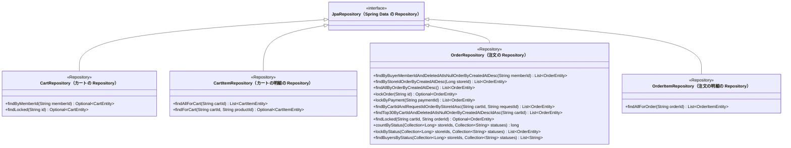

### Repository と Entity

| Repository | 継承 | 扱う Entity（図 1） |
| --- | --- | --- |
| `CartRepository` | `JpaRepository<CartEntity, String>` | `CartEntity` |
| `CartItemRepository` | `JpaRepository<CartItemEntity, CartItemId>` | `CartItemEntity` |
| `OrderRepository` | `JpaRepository<OrderEntity, String>` | `OrderEntity` |
| `OrderItemRepository` | `JpaRepository<OrderItemEntity, OrderItemId>` | `OrderItemEntity` |

### 問い合わせの決まり

| メソッド | 決まり |
| --- | --- |
| `CartRepository.findLocked()` | `@Lock(PESSIMISTIC_WRITE)` |
| `OrderRepository.lockOrder()`、`lockByPayment()`、`findLocked()`、`lockByStatus()` | `@Lock(PESSIMISTIC_WRITE)`。`lockByPayment()` と `lockByStatus()` は注文 ID の順にロックする |
| `findAllForCart()`、`findForCart()`、`findAllForOrder()`、`lockOrder()`、`lockByPayment()`、`findLocked()`、`countByStatus()`、`lockByStatus()`、`findBuyersByStatus()` | `@Query` の JPQL。ほかは Spring Data のメソッド名からの問い合わせ |
| `findAllForCart()`、`findAllForOrder()` | 商品 ID の順に返す |

### ほかのパッケージからの利用

| メソッド | 使うところ |
| --- | --- |
| `CartRepository.findByMemberId()`、`saveAndFlush()` | auth パッケージの `MemberCartService.resolve()`（[01_共通と認証と会員](<01_共通と認証と会員.md>)） |
| `CartRepository.findLocked()` | shopping パッケージの `SavedShoppingItems`（[06_買い物リスト](<06_買い物リスト.md>)） |
| `OrderRepository.lockByPayment()` | payment パッケージの `PaymentService` と `RefundService`（[05_決済](<05_決済.md>)） |
| `OrderRepository.countByStatus()`、`lockByStatus()`、`findBuyersByStatus()` | store パッケージの `OpenOrders`（店舗の閉鎖・組織の停止、[02_店舗と組織](<02_店舗と組織.md>)） |

`CartItemRepository.findForCart()`、`OrderRepository.findTop30ByCartIdAndDeletedAtIsNullOrderByCreatedAtDescIdAsc()`、`OrderRepository.findLocked()` を呼ぶコードは、8892344 の backend には見つかりません。

## 図 3 カートの Service

モジュールの図です。`CartSessionResolver` が購入者のカートの ID を決め、`CartService` がカートを読み書きします。

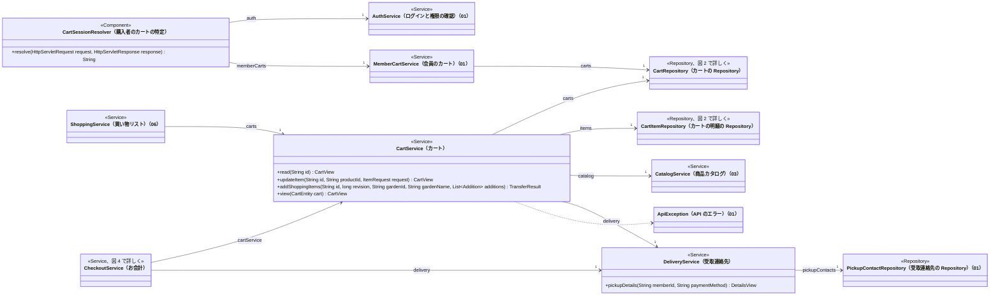

### 線とコードの対応

| 線 | コード |
| --- | --- |
| ShoppingService → CartService（`carts`） | `addShoppingItems()` |
| CheckoutService → CartService（`cartService`） | `view()`（ロックの後のカートの金額と在庫を確かめる） |
| CheckoutService → DeliveryService（`delivery`） | `pickupDetails()`（注文に写す受取連絡先） |
| CartSessionResolver → AuthService（`auth`） | `requireBuyer()` |
| CartSessionResolver → MemberCartService（`memberCarts`） | `resolve()`（会員のカートの ID。無ければ作る） |
| MemberCartService → CartRepository（`carts`） | `findByMemberId()`、`saveAndFlush()` |
| CartService → CartRepository（`carts`） | `findLocked()`（`read()`・`updateItem()`・`addShoppingItems()` の最初） |
| CartService → CartItemRepository（`items`） | `findAllForCart()`、`findById()`、`save()`、`delete()`、`flush()` |
| CartService → CatalogService（`catalog`） | `listing()`、`listingsByIds()`、`REMOVED_REASONS` |
| CartService → DeliveryService（`delivery`） | `pickupDetails(memberId, "NONE")`（`CartView.details`） |
| CartService → ApiException | 下の表のエラーを投げる |
| DeliveryService → PickupContactRepository（`pickupContacts`） | `findById()` |

### 決まり

| もの | 決まり |
| --- | --- |
| `CartSessionResolver.resolve()` | `AuthService.requireBuyer()` の会員 ID を `MemberCartService.resolve()` に渡し、カートの ID を返す。ログインしていなければ 401、店舗側・申請中のアカウントは 403。カート・注文・庭の買い物リストの購入者の API は、すべてここを通る |
| `CartService` | `@Transactional(isolation = READ_COMMITTED)` |
| `CartService.read()` | 商品の削除・店舗の閉鎖・店舗の停止・組織の停止（`CatalogService.REMOVED_REASONS`）で買えなくなった明細を外し、`CartView.removedItems` で返す。外したときは `revision` を 1 増やす。非公開・在庫 0・商品の停止・組織の受付停止は外さず、買えない明細として返す |
| `CartService.updateItem()` | 数量 0 で明細を消す。送られた `revision` がカートと違えば 409 `CART_CHANGED`、買えない商品は 409 `PRODUCT_ARCHIVED`、在庫を超える数量は 409 `OUT_OF_STOCK`、51 種類目は 400 `CART_LIMIT`、カートが無ければ 404 `CART_NOT_FOUND` |
| `CartService.addShoppingItems()` | 選んだ商品ごとに、カートにある数量へ足して保存する。足せない商品は理由（`PRODUCT_ARCHIVED`、`QUANTITY_LIMIT`、`OUT_OF_STOCK`、`CART_LIMIT`）を付けて `TransferResult.skipped` に入れる。`Addition`・`TransferResult` は shopping パッケージの DTO |
| `CartService.view()` | Entity から `CartView` を作る |
| `DeliveryService.pickupDetails()` | 会員の受取連絡先（member パッケージ）を `DetailsView` にする。無ければ空の文字列で返す |

## 図 4 お会計の Service

モジュールの図です。`CheckoutService.placeOrder()` が、受取店舗ごとに `OrderEntity` と `OrderItemEntity` を作り、カードなら `PaymentEntity` を 1 つ作ります。

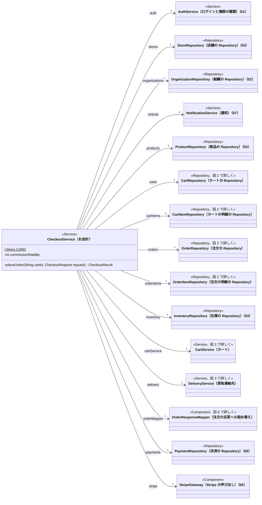

### 線とコードの対応

| 線 | コード |
| --- | --- |
| → AuthService（`auth`） | `current()`（注文の購入者、決済の購入者） |
| → StoreRepository（`stores`） | `lock()`（店舗 ID の順） |
| → OrganizationRepository（`organizations`） | `lockShared()`（店舗の組織が注文を受け付けるか） |
| → NotificationService（`notices`） | `send()`（購入者）、`toStore()`（店舗）。店頭払いのときだけ |
| → ProductRepository（`products`） | `findStoreReferences()`（ロックする店舗）、`lockSharedSuspension()`（商品の停止） |
| → CartRepository（`carts`） | `findLocked()` |
| → CartItemRepository（`cartItems`） | `findAllForCart()`、`deleteAll()`（注文を作った後にカートを空にする） |
| → OrderRepository（`orders`） | `findByCartIdAndRequestIdOrderByStoreIdAsc()`（同じ `requestId` の注文）、`save()` |
| → OrderItemRepository（`orderItems`） | `save()`、`findAllForOrder()` |
| → InventoryRepository（`inventory`） | `lockAll()`（商品 ID の順）。在庫を減らす |
| → CartService（`cartService`） | `view()` |
| → DeliveryService（`delivery`） | `pickupDetails()` |
| → OrderResponseMapper（`orderMapper`） | `toView()` |
| → PaymentRepository（`payments`） | `saveAndFlush()`（カードの決済を作る）、`findByCartIdAndRequestId()`（同じ `requestId` のとき） |
| → StripeGateway（`stripe`） | `enabled()` |

### 決まり

| もの | 決まり |
| --- | --- |
| `CheckoutService` | `@Transactional(isolation = READ_COMMITTED)` |
| `CARD` | `"CARD"` |
| `commissionRateBp` | 設定 `kusakari.ec.commission-rate-bp`（`@Value`、既定 800 = 8%） |
| 同じ `requestId` | すでに注文があれば、その注文を返す。`revision`・合計・支払方法が違えば 409 `REQUEST_REUSED` |
| ロックの順 | カート、店舗（店舗 ID の順）、組織（共有ロック）、商品の停止（共有ロック）、在庫（商品 ID の順） |
| 店頭払い（`PAY_AT_STORE`） | 注文を `ACCEPTED` で作り、`NotificationService` で購入者と店舗に知らせる |
| カード（`CARD`） | `PaymentEntity` を 1 つ作り、注文を `awaitPayment()` で `PENDING_PAYMENT` にする。知らせは支払いの成功のとき（`PaymentService`）に送る。`StripeGateway.enabled()` が false なら 409 `CARD_PAYMENT_UNAVAILABLE`。Stripe の PaymentIntent は、このトランザクションのコミットの後に `PaymentService.start()` が作る（[05_決済](<05_決済.md>)） |
| 手数料 | `commissionYen = totalYen × commissionRateBp ÷ 10000`（1 円未満は切り捨て）。率と額を注文に保存する |
| エラー | 404 `CART_NOT_FOUND`、409 `CART_CHANGED`、409 `EMPTY_CART`、409 `STORE_DISABLED`、409 `OUT_OF_STOCK`、409 `PRICE_CHANGED` |

## 図 5 注文の Service

モジュールの図です。`OrderService` は購入者の注文の一覧・受取連絡先の変更・履歴からの非表示、`OrderWorkflowService` は購入者・店舗・運営の注文の参照と、受取準備完了・引き渡し完了・キャンセルの申請と回答です。`StockReturn` は取り消した注文の在庫を戻します。3 つとも `ApiException`（01）を投げますが、依存の線が `OrderWorkflowService` の箱の裏を通って読めなくなるため、この図では `ApiException` の箱と線を省き、投げるエラーを下の表に書きました。

```mermaid
classDiagram
  direction TB
  class PaymentService["PaymentService（決済）（05）"] {
    <<Service>>
  }
  class OpenOrders["OpenOrders（未完了の注文のまとめてキャンセル）（02）"] {
    <<Component>>
  }
  class OrderService["OrderService（購入者の注文）"] {
    <<Service>>
    +list(String cartId) List~OrderView~
    +updateDetails(String cartId, String orderId, DetailsRequest request) OrderView
    +delete(String cartId, String orderId) void
  }
  class OrderWorkflowService["OrderWorkflowService（注文の受け渡しとキャンセル）"] {
    <<Service>>
    +sellerOrders(long storeId) List~OrderView~
    +allOrders() List~OrderView~
    +buyerOrder(String id) OrderView
    +sellerOrder(String id) OrderView
    +changeStatus(String id, String expectedStatus, String status) OrderView
    +requestCancellation(String id, String reason) OrderView
    +decideCancellation(String id, boolean approved, String reason) OrderView
  }
  class StockReturn["StockReturn（在庫の戻し）"] {
    <<Component>>
    +restock(Collection~String~ orderIds) void
  }
  class AuthService["AuthService（ログインと権限の確認）（01）"] {
    <<Service>>
  }
  class OrderRepository["OrderRepository（注文の Repository）"] {
    <<Repository、図 2 で詳しく>>
  }
  class OrderItemRepository["OrderItemRepository（注文の明細の Repository）"] {
    <<Repository、図 2 で詳しく>>
  }
  class OrderResponseMapper["OrderResponseMapper（注文の応答への詰め替え）"] {
    <<Component、図 6 で詳しく>>
  }
  class RefundService["RefundService（返金）（05）"] {
    <<Service>>
  }
  class NotificationService["NotificationService（通知）（07）"] {
    <<Service>>
  }
  class ClosureSettlement["ClosureSettlement（閉鎖・停止の確定）（02）"] {
    <<Component>>
  }
  class InventoryRepository["InventoryRepository（在庫の Repository）（03）"] {
    <<Repository>>
  }

  PaymentService --> "1" StockReturn : stock
  OpenOrders --> "1" StockReturn : stock
  OrderService --> "1" AuthService : auth
  OrderService --> "1" OrderRepository : orders
  OrderService --> "1" OrderItemRepository : items
  OrderService --> "1" OrderResponseMapper : mapper
  OrderWorkflowService --> "1" AuthService : auth
  OrderWorkflowService --> "1" OrderRepository : orders
  OrderWorkflowService --> "1" OrderItemRepository : items
  OrderWorkflowService --> "1" StockReturn : stock
  OrderWorkflowService --> "1" RefundService : refunds
  OrderWorkflowService --> "1" OrderResponseMapper : mapper
  OrderWorkflowService --> "1" NotificationService : notices
  OrderWorkflowService --> "1" ClosureSettlement : closures
  StockReturn --> "1" OrderItemRepository : items
  StockReturn --> "1" InventoryRepository : inventory
```

### 線とコードの対応

| 線 | コード |
| --- | --- |
| PaymentService → StockReturn（`stock`） | `restock()`（支払いの失敗・時間切れの注文） |
| OpenOrders → StockReturn（`stock`） | `restock()`（まとめてキャンセルした注文） |
| OrderService → AuthService（`auth`） | `current()` |
| OrderService → OrderRepository（`orders`） | `findByBuyerMemberIdAndDeletedAtIsNullOrderByCreatedAtDesc()`、`lockOrder()` |
| OrderService → OrderItemRepository（`items`） | `findAllForOrder()` |
| OrderService → OrderResponseMapper（`mapper`） | `toView()` |
| OrderService → ApiException（図では省いた） | 404 `ORDER_NOT_FOUND`、409 `ORDER_FIXED` |
| OrderWorkflowService → AuthService（`auth`） | `requireBuyer()`、`requireSeller()`、`requireAdmin()`、`requireManager()`、`current()` |
| OrderWorkflowService → OrderRepository（`orders`） | `findByStoreIdOrderByCreatedAtDesc()`、`findAllByOrderByCreatedAtDesc()`、`findById()`、`lockOrder()` |
| OrderWorkflowService → OrderItemRepository（`items`） | `findAllForOrder()` |
| OrderWorkflowService → StockReturn（`stock`） | `restock()`（キャンセルの承認） |
| OrderWorkflowService → RefundService（`refunds`） | `refundCancelledOrder()`（キャンセルの承認。カードで支払い済みなら返金） |
| OrderWorkflowService → OrderResponseMapper（`mapper`） | `toView()`（購入者）、`toStoreView()`（店舗・運営） |
| OrderWorkflowService → NotificationService（`notices`） | `send()`（購入者）、`toStore()`（キャンセル申請を店舗へ） |
| OrderWorkflowService → ClosureSettlement（`closures`） | `afterOrderChanged()`（引き渡し完了とキャンセルの承認の後） |
| OrderWorkflowService → ApiException（図では省いた） | 404 `ORDER_NOT_FOUND`、409 `ORDER_CHANGED`、400 `REASON_REQUIRED` |
| StockReturn → OrderItemRepository（`items`） | `findAllForOrder()` |
| StockReturn → InventoryRepository（`inventory`） | `lockAll()`（商品 ID の順） |
| StockReturn → ApiException（図では省いた） | 409 `STOCK_NOT_FOUND` |

### 決まり

| もの | 決まり |
| --- | --- |
| `OrderService` | `@Transactional`。引数の `cartId` は使わず、`AuthService.current()` の会員 ID で注文を探す。受取連絡先は `ACCEPTED` の注文だけ変えられる（それ以外は 409 `ORDER_FIXED`）。`delete()` は注文を消さず、`archive()` で `deletedAt` を入れて履歴から隠す |
| `OrderWorkflowService` | `@Transactional`（参照のメソッドは `readOnly = true`）。ほかの店舗の注文は 404 `ORDER_NOT_FOUND` として返し、注文の有無を知らせない |
| `changeStatus()` | 受け付けるのは `ACCEPTED` から `READY`、`READY` から `COMPLETED` だけ。キャンセル申請中（`cancellationStatus` が `PENDING`）は 409 `ORDER_CHANGED` |
| `requestCancellation()` | `ACCEPTED` で申請中でない注文だけ |
| `decideCancellation()` | `AuthService.requireManager()` で、オーナーか MANAGER だけが回答できる。却下で理由が空なら 400 `REASON_REQUIRED`。承認すると在庫を戻し、返金を頼む |
| `afterOrderChanged()` | 閉鎖中の店舗・受付停止中の組織の未完了の注文がなくなったかを、store パッケージが確かめる |
| `StockReturn.restock()` | `@Transactional(propagation = MANDATORY)`。呼ぶ側が注文の行をロックしてから呼ぶ |

## 図 6 注文の応答と注文実績の Service

モジュールの図です。`OrderResponseMapper` は `OrderEntity` と `OrderItemEntity` を `OrderView` に詰め替え、`SalesReportService` は店舗の注文実績を作ります。`OrderResponseMapper` を使う `CheckoutService`（図 4）・`OrderService`・`OrderWorkflowService`（図 5）は、それぞれの図に線があるので、この図では箱を省き、下の表にだけ書きました。

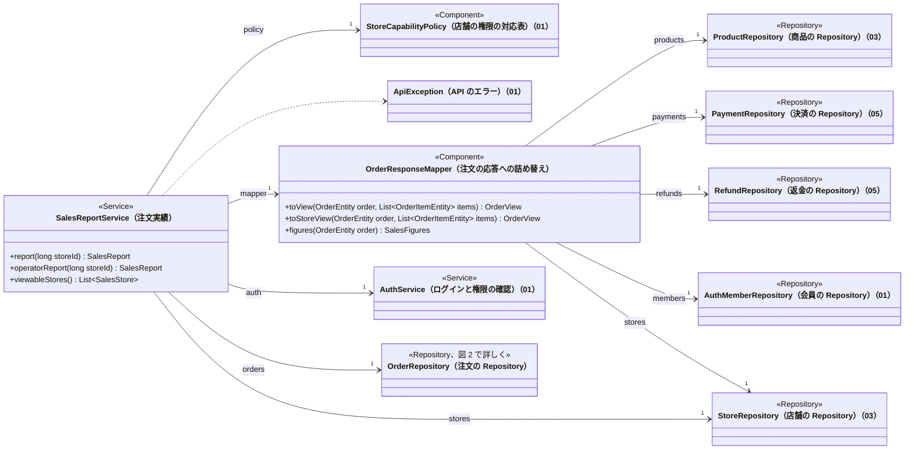

### 線とコードの対応

| 線 | コード |
| --- | --- |
| CheckoutService（`orderMapper`）・OrderService（`mapper`） → OrderResponseMapper（図 4・図 5） | `toView()` |
| OrderWorkflowService（`mapper`） → OrderResponseMapper（図 5） | `toView()`、`toStoreView()` |
| SalesReportService → OrderResponseMapper（`mapper`） | `figures()`（注文 1 件の手数料と差引額） |
| SalesReportService → AuthService（`auth`） | `enabled()`、`current()`、`requireAdmin()`、`requireSellerRole()`、`candidateStoreIdsOf()` |
| SalesReportService → StoreCapabilityPolicy（`policy`） | `canViewSales()` |
| SalesReportService → StoreRepository（`stores`） | `findById()`、`findAllByOrderByIdAsc()`、`findAllById()` |
| SalesReportService → OrderRepository（`orders`） | `findByStoreIdOrderByCreatedAtDesc()` |
| SalesReportService → ApiException | 404 `STORE_NOT_FOUND`、403 `FORBIDDEN` |
| OrderResponseMapper → ProductRepository（`products`） | `findImageReferences()`（明細の `imageUrl`。今の商品の画像） |
| OrderResponseMapper → PaymentRepository（`payments`） | `findById()`（`paymentStatus`。`paymentId` が null なら null） |
| OrderResponseMapper → RefundRepository（`refunds`） | `findByOrderId()`（`refundStatus`。返金がなければ null） |
| OrderResponseMapper → StoreRepository（`stores`） | `findById()`（`storeClosing`。店舗の `isClosing()`） |
| OrderResponseMapper → AuthMemberRepository（`members`） | `findById()`（`cancelledBy`。運営（`isAdmin()`）なら `OPERATOR`、それ以外は `STORE`） |

### 決まり

| もの | 決まり |
| --- | --- |
| `toView()` | 購入者向け。`sales` を null にする |
| `toStoreView()` | 店舗・運営向け。`figures()` を `sales` に入れる |
| `figures()` | `CANCELLED` の注文は手数料と差引額を 0 として返す（保存した額は残す）。`CANCELLED` と `PENDING_PAYMENT` の注文は合計に含めない（`counted` が false） |
| `SalesReportService` | `@Transactional(readOnly = true)`。注文を変えない |
| `report()` | 出店者画面の注文実績。認証が有効（`AuthService.enabled()`）で、`canViewSales()` が false なら 403 `FORBIDDEN` |
| `operatorReport()` | 運営の店舗管理から開く注文実績。`AuthService.requireAdmin()` で確かめる |
| `viewableStores()` | 注文実績を見られる店舗の一覧。運営には全店舗、それ以外は自分の組織・担当の店舗のうち `canViewSales()` が true のもの |

## 図 7 購入者の受け口

モジュールの図です。HTTP のメソッドとパスは「API とクラス」の表にあります。

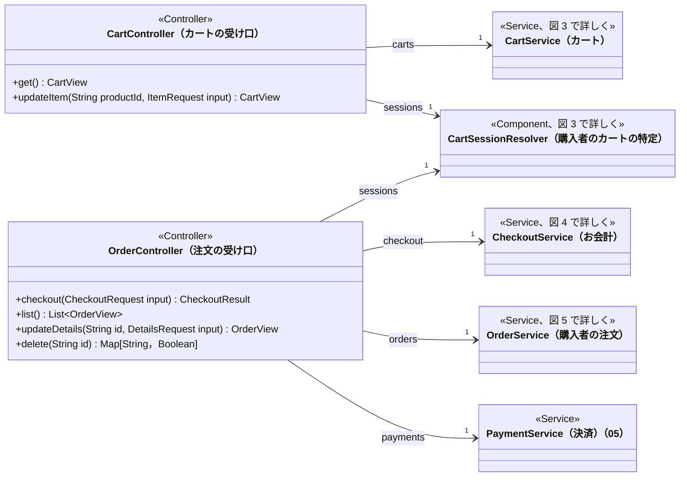

### 線とコードの対応

| 線 | コード |
| --- | --- |
| CartController → CartService（`carts`） | `get()` が `read()`、`updateItem()` が `updateItem()` |
| CartController・OrderController → CartSessionResolver（`sessions`） | どのメソッドも最初に `resolve()` でカートの ID を決める。店舗側・申請中のアカウントは、ここで 403 になる |
| OrderController → CheckoutService（`checkout`） | `checkout()` が `placeOrder()` |
| OrderController → OrderService（`orders`） | `list()`、`updateDetails()`、`delete()` |
| OrderController → PaymentService（`payments`） | `checkout()` が、`placeOrder()` のトランザクションがコミットした後に `start()` を呼ぶ |

### 決まり

| もの | 決まり |
| --- | --- |
| `checkout()` の戻り値 | `CheckoutResult.payment` はカードのときだけ入る。支払い待ちなら `clientSecret` を持つ（[05_決済](<05_決済.md>)） |
| `delete()` の戻り値 | `{"deleted": true}`。注文は消さず、`deletedAt` を入れて履歴から隠すだけ |
| 入力の検証 | `@Valid @RequestBody` で `ItemRequest`・`CheckoutRequest`・`DetailsRequest` を確かめる（図 9） |

## 図 8 店舗・運営の受け口とヘルスチェック

モジュールの図です。`OrderWorkflowController` の入力の record（`StatusRequest`、`CancellationRequest`、`DecisionRequest`）の形は図 11 にあります。HTTP のメソッドとパスは「API とクラス」の表にあります。

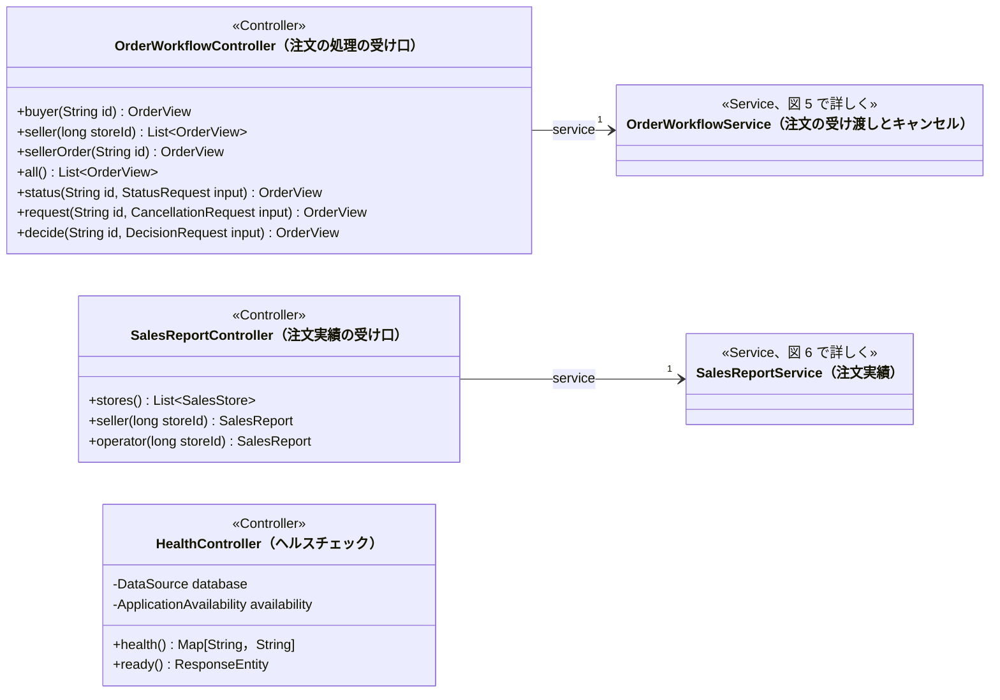

### 線とコードの対応

| 線 | コード |
| --- | --- |
| OrderWorkflowController → OrderWorkflowService（`service`） | `buyer()` が `buyerOrder()`、`seller()` が `sellerOrders()`、`sellerOrder()` が `sellerOrder()`、`all()` が `allOrders()`、`status()` が `changeStatus()`、`request()` が `requestCancellation()`、`decide()` が `decideCancellation()` |
| SalesReportController → SalesReportService（`service`） | `stores()` が `viewableStores()`、`seller()` が `report()`、`operator()` が `operatorReport()` |

### 決まり

| もの | 決まり |
| --- | --- |
| `OrderWorkflowController` | `buyer()` と `request()` は購入者、`seller()`・`sellerOrder()`・`status()`・`decide()` は店舗、`all()` は運営の受け口。誰が呼べるかは `OrderWorkflowService` が `AuthService` で確かめる |
| `HealthController.ready()` | 戻り値の型は `ResponseEntity<Map<String, String>>`。起動・停止の途中か、データベースにつながらなければ 503 を返す。応答に、データベースの URL や SQL のエラーは入れない |
| `HealthController` | `DataSource` と `ApplicationAvailability`（Spring のクラス）だけを使い、ほかのクラスを呼ばない |

## 図 9 カートと注文の DTO

データの図です。カート・お会計・注文の API の要求と応答の record です。`ProductView`（catalog パッケージ）のフィールドは [03_商品カタログ](<03_商品カタログ.md>)、`SalesFigures` のフィールドは図 10 にあります。

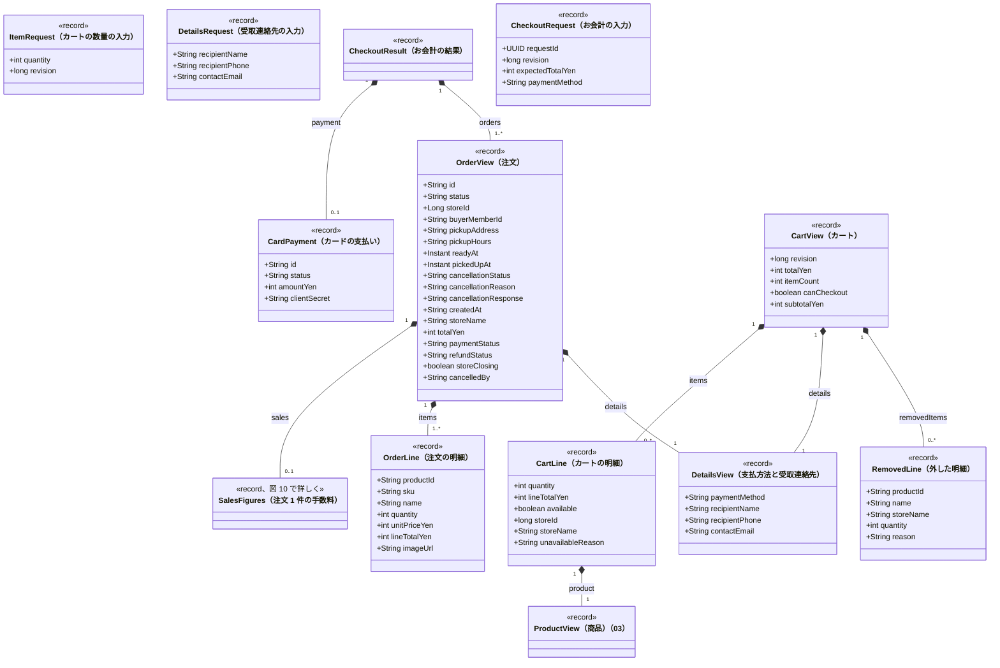

### record と入れ物のクラス

`CommerceDtos`・`DeliveryDtos` は、record を入れるためだけの `final` のクラスで、`private` のコンストラクターしか持ちません。

| record | 入れ物 | 使うところ |
| --- | --- | --- |
| `ItemRequest` | `CommerceDtos` | `PUT /api/cart/items/{productId}` の本文 |
| `CheckoutRequest` | `CommerceDtos` | `POST /api/orders` の本文 |
| `CheckoutResult`、`CardPayment` | `CommerceDtos` | `POST /api/orders` の応答 |
| `CartView`、`CartLine`、`RemovedLine` | `CommerceDtos` | `GET /api/cart`・`PUT /api/cart/items/{productId}` の応答。`CartView` は shopping パッケージの `TransferResult` にも入る |
| `OrderView`、`OrderLine` | `CommerceDtos` | 注文の API の応答 |
| `DetailsRequest` | `DeliveryDtos` | `PUT /api/orders/{id}` の本文 |
| `DetailsView` | `DeliveryDtos` | `CartView.details`、`OrderView.details` |
| `ProductView` | catalog パッケージの `CatalogDtos` | `CartLine.product` |
| `SalesFigures` | `SalesDtos` | `OrderView.sales` |

### 関連の多重度の根拠

| 関連 | 多重度 | 根拠 |
| --- | --- | --- |
| `CheckoutResult.orders` | 1..* | 型は `List<OrderView>`。空のカートは 409 `EMPTY_CART` なので、受取店舗ごとの注文が 1 件以上ある。店舗 ID の順 |
| `CheckoutResult.payment` | 0..1 | カードのときだけ。店頭払いは null |
| `CartView.items` | 0..* | 上限 50 種類（`CartService` の `CART_LIMIT`） |
| `CartView.removedItems` | 0..* | カートを開いたときに外した明細。外さなかったときは空 |
| `CartView.details`、`OrderView.details` | 1 | `DeliveryService.pickupDetails()` と `OrderResponseMapper` が必ず作る |
| `CartLine.product` | 1 | `CatalogService` の `Listing.product()`。見つからない商品は例外 |
| `OrderView.items` | 1..* | 注文には明細が 1 行以上ある（図 1） |
| `OrderView.sales` | 0..1 | 店舗・運営の応答（`toStoreView()`）だけ。購入者には null |

### 値の決まり

| フィールド | 決まり |
| --- | --- |
| `ItemRequest` | `quantity` は 0〜99（`@Min(0)`、`@Max(99)`）、`revision` は 0 以上 |
| `CheckoutRequest` | `requestId` は必須、`revision` は 0 以上、`expectedTotalYen` は 1 以上、`paymentMethod` は `CARD` か `PAY_AT_STORE`（`@Pattern`） |
| `DetailsRequest` | `recipientName` は 100 文字まで、`recipientPhone` は `[0-9+() -]{0,30}`、`contactEmail` は `@Email` で 200 文字まで。どれも `@NotNull` |
| `CardPayment.clientSecret` | `status` が `PENDING` のときだけ |
| `CartView.subtotalYen`、`totalYen` | 送料はないので同じ値 |
| `DetailsView.paymentMethod` | カートではお会計まで `NONE` |
| `CartLine.storeId`、`storeName` | 商品の店舗（受取店舗）。`unavailableReason` は今は買えない理由で、買えるなら null。在庫不足だけなら null で `available` が false |
| `RemovedLine.reason` | `DELETED`、`STORE_CLOSED`、`STORE_SUSPENDED`、`ORGANIZATION_SUSPENDED` のどれか |
| `OrderLine.imageUrl` | 今の商品の画像。注文の後に商品が無くなれば null |
| `OrderView.paymentStatus` | `PENDING`、`SUCCEEDED`、`FAILED`、`EXPIRED`。店頭払いは null |
| `OrderView.refundStatus` | `REQUESTED`、`SUCCEEDED`、`FAILED`。返金がなければ null |
| `OrderView.cancelledBy` | `OPERATOR` か `STORE`。キャンセルされていなければ null |
| `ProductView.createdByName` | 8892344 で増えたフィールド。カートの `ProductView`（`ProductMapper.toView()`）では null で、`@JsonInclude(NON_NULL)` なので JSON に出ない |

## 図 10 注文実績の DTO

データの図です。`SalesDtos` の record です。`SalesDtos` も、record を入れるためだけの `final` のクラスです。

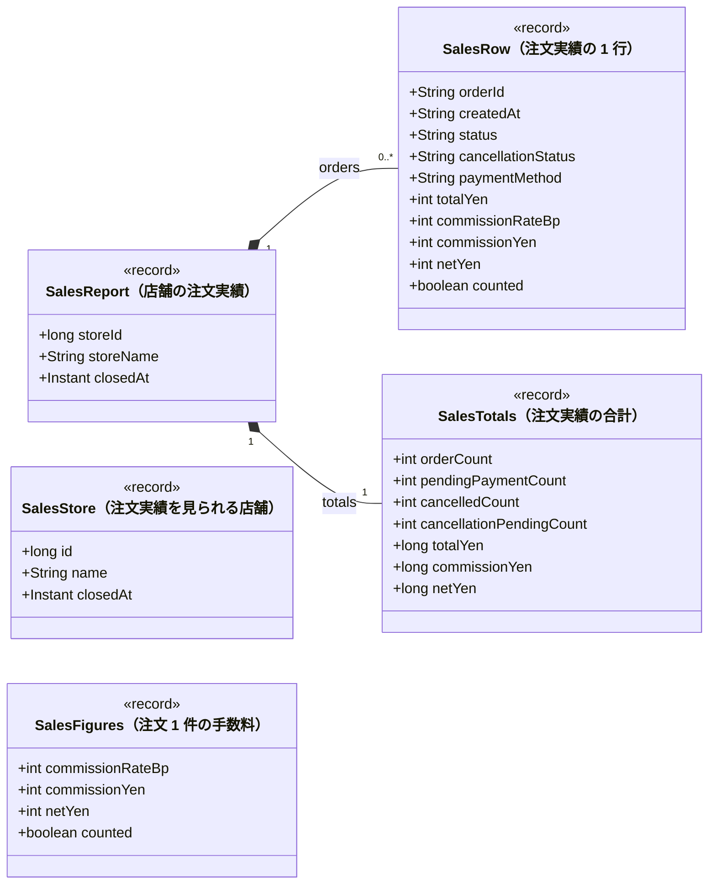

| record | 使うところ | 決まり |
| --- | --- | --- |
| `SalesReport` | `GET /api/seller/stores/{storeId}/sales`、`GET /api/operator/stores/{storeId}/sales` の応答 | `orders` は店舗の注文すべてを新しい順（0 件もある）。`closedAt` があれば閉鎖済みの店舗で、画面は読み取り専用と表示する |
| `SalesRow` | `SalesReport.orders` | 注文 1 件を 1 行。`commissionRateBp`・`commissionYen`・`netYen`・`counted` は、`OrderResponseMapper.figures()` の `SalesFigures` から写す |
| `SalesTotals` | `SalesReport.totals` | `orderCount` と各金額は `counted` の注文だけ。`cancellationPendingCount` はキャンセル申請中の、`CANCELLED` でない注文 |
| `SalesStore` | `GET /api/seller/sales/stores` の応答 | `closedAt` があれば閉鎖済みの店舗 |
| `SalesFigures` | `OrderView.sales`（図 9） | `commissionRateBp` と保存した手数料は注文したときの値。`CANCELLED` は `commissionYen`・`netYen` を 0 で返す |

手数料は表示だけで、請求・精算・Stripe での差し引きはしません。

## 図 11 注文の処理の入力

データの図です。`OrderWorkflowController`（図 8）の中に入れ子で定義した、要求の本文の record です。

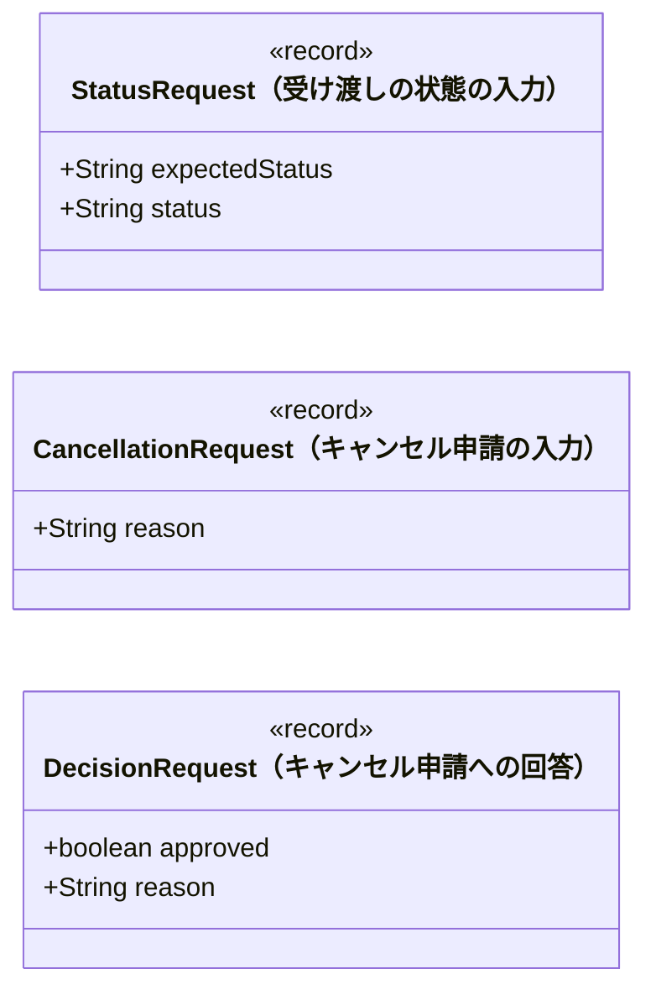

| record | 使うところ | 検証 |
| --- | --- | --- |
| `OrderWorkflowController.StatusRequest` | `PUT /api/seller/orders/{id}/status` の本文 | `expectedStatus` は `@NotBlank`。`status` は `READY` か `COMPLETED`（`@Pattern`、`@NotNull`） |
| `OrderWorkflowController.CancellationRequest` | `POST /api/orders/{id}/cancellation` の本文 | `reason` は `@NotBlank`、500 文字まで |
| `OrderWorkflowController.DecisionRequest` | `PUT /api/seller/orders/{id}/cancellation` の本文 | `reason` は `@NotNull`、500 文字まで。却下で空なら 400 `REASON_REQUIRED`（Service） |

## クラスとコードの対応

リンクはすべて `https://github.com/abeouga/kusakari-ec/blob/8892344/backend/src/main/java/jp/kusakari/ec/commerce/` の下です。

| クラス | ファイル | 図 |
| --- | --- | --- |
| `CartEntity` | [persistence/entity/CartEntity.java](https://github.com/abeouga/kusakari-ec/blob/8892344/backend/src/main/java/jp/kusakari/ec/commerce/persistence/entity/CartEntity.java) | 図 1 |
| `CartItemEntity` | [persistence/entity/CartItemEntity.java](https://github.com/abeouga/kusakari-ec/blob/8892344/backend/src/main/java/jp/kusakari/ec/commerce/persistence/entity/CartItemEntity.java) | 図 1 |
| `CartItemId` | [persistence/entity/CartItemId.java](https://github.com/abeouga/kusakari-ec/blob/8892344/backend/src/main/java/jp/kusakari/ec/commerce/persistence/entity/CartItemId.java) | 図 1 |
| `OrderEntity` | [persistence/entity/OrderEntity.java](https://github.com/abeouga/kusakari-ec/blob/8892344/backend/src/main/java/jp/kusakari/ec/commerce/persistence/entity/OrderEntity.java) | 図 1 |
| `OrderItemEntity` | [persistence/entity/OrderItemEntity.java](https://github.com/abeouga/kusakari-ec/blob/8892344/backend/src/main/java/jp/kusakari/ec/commerce/persistence/entity/OrderItemEntity.java) | 図 1 |
| `OrderItemId` | [persistence/entity/OrderItemId.java](https://github.com/abeouga/kusakari-ec/blob/8892344/backend/src/main/java/jp/kusakari/ec/commerce/persistence/entity/OrderItemId.java) | 図 1 |
| `CartRepository` | [persistence/repository/CartRepository.java](https://github.com/abeouga/kusakari-ec/blob/8892344/backend/src/main/java/jp/kusakari/ec/commerce/persistence/repository/CartRepository.java) | 図 2 |
| `CartItemRepository` | [persistence/repository/CartItemRepository.java](https://github.com/abeouga/kusakari-ec/blob/8892344/backend/src/main/java/jp/kusakari/ec/commerce/persistence/repository/CartItemRepository.java) | 図 2 |
| `OrderRepository` | [persistence/repository/OrderRepository.java](https://github.com/abeouga/kusakari-ec/blob/8892344/backend/src/main/java/jp/kusakari/ec/commerce/persistence/repository/OrderRepository.java) | 図 2 |
| `OrderItemRepository` | [persistence/repository/OrderItemRepository.java](https://github.com/abeouga/kusakari-ec/blob/8892344/backend/src/main/java/jp/kusakari/ec/commerce/persistence/repository/OrderItemRepository.java) | 図 2 |
| `CartSessionResolver` | [session/CartSessionResolver.java](https://github.com/abeouga/kusakari-ec/blob/8892344/backend/src/main/java/jp/kusakari/ec/commerce/session/CartSessionResolver.java) | 図 3 |
| `CartService` | [service/CartService.java](https://github.com/abeouga/kusakari-ec/blob/8892344/backend/src/main/java/jp/kusakari/ec/commerce/service/CartService.java) | 図 3 |
| `DeliveryService` | [service/DeliveryService.java](https://github.com/abeouga/kusakari-ec/blob/8892344/backend/src/main/java/jp/kusakari/ec/commerce/service/DeliveryService.java) | 図 3 |
| `CheckoutService` | [service/CheckoutService.java](https://github.com/abeouga/kusakari-ec/blob/8892344/backend/src/main/java/jp/kusakari/ec/commerce/service/CheckoutService.java) | 図 4 |
| `OrderService` | [service/OrderService.java](https://github.com/abeouga/kusakari-ec/blob/8892344/backend/src/main/java/jp/kusakari/ec/commerce/service/OrderService.java) | 図 5 |
| `OrderWorkflowService` | [service/OrderWorkflowService.java](https://github.com/abeouga/kusakari-ec/blob/8892344/backend/src/main/java/jp/kusakari/ec/commerce/service/OrderWorkflowService.java) | 図 5 |
| `StockReturn` | [service/StockReturn.java](https://github.com/abeouga/kusakari-ec/blob/8892344/backend/src/main/java/jp/kusakari/ec/commerce/service/StockReturn.java) | 図 5 |
| `OrderResponseMapper` | [mapper/OrderResponseMapper.java](https://github.com/abeouga/kusakari-ec/blob/8892344/backend/src/main/java/jp/kusakari/ec/commerce/mapper/OrderResponseMapper.java) | 図 6 |
| `SalesReportService` | [service/SalesReportService.java](https://github.com/abeouga/kusakari-ec/blob/8892344/backend/src/main/java/jp/kusakari/ec/commerce/service/SalesReportService.java) | 図 6 |
| `CartController` | [controller/CartController.java](https://github.com/abeouga/kusakari-ec/blob/8892344/backend/src/main/java/jp/kusakari/ec/commerce/controller/CartController.java) | 図 7 |
| `OrderController` | [controller/OrderController.java](https://github.com/abeouga/kusakari-ec/blob/8892344/backend/src/main/java/jp/kusakari/ec/commerce/controller/OrderController.java) | 図 7 |
| `OrderWorkflowController`（`StatusRequest`、`CancellationRequest`、`DecisionRequest` を含む） | [controller/OrderWorkflowController.java](https://github.com/abeouga/kusakari-ec/blob/8892344/backend/src/main/java/jp/kusakari/ec/commerce/controller/OrderWorkflowController.java) | 図 8、図 11 |
| `SalesReportController` | [controller/SalesReportController.java](https://github.com/abeouga/kusakari-ec/blob/8892344/backend/src/main/java/jp/kusakari/ec/commerce/controller/SalesReportController.java) | 図 8 |
| `HealthController` | [controller/HealthController.java](https://github.com/abeouga/kusakari-ec/blob/8892344/backend/src/main/java/jp/kusakari/ec/commerce/controller/HealthController.java) | 図 8 |
| `CommerceDtos` の record | [dto/CommerceDtos.java](https://github.com/abeouga/kusakari-ec/blob/8892344/backend/src/main/java/jp/kusakari/ec/commerce/dto/CommerceDtos.java) | 図 9 |
| `DeliveryDtos` の record | [dto/DeliveryDtos.java](https://github.com/abeouga/kusakari-ec/blob/8892344/backend/src/main/java/jp/kusakari/ec/commerce/dto/DeliveryDtos.java) | 図 9 |
| `SalesDtos` の record | [dto/SalesDtos.java](https://github.com/abeouga/kusakari-ec/blob/8892344/backend/src/main/java/jp/kusakari/ec/commerce/dto/SalesDtos.java) | 図 10 |

外部キーは [V1__schema.sql](https://github.com/abeouga/kusakari-ec/blob/8892344/backend/src/main/resources/db/migration/V1__schema.sql) の `carts`・`cart_items`・`orders`・`order_items` から読みました。8892344 で増えた `V7__sample_products_and_creator.sql` は、これらのテーブルを変えていません。

## 載せなかったもの

| もの | 理由 | 載せた図 |
| --- | --- | --- |
| `CommerceDtos`、`DeliveryDtos`、`SalesDtos` の入れ物のクラス | record を入れるためだけの `final` のクラスで、`private` のコンストラクターしか持たない | 中の record は図 9・図 10 |
| Entity のコンストラクター | 業務の操作ではない（フィールドに値を入れるだけ）。`OrderEntity` のコンストラクターは `id`・`cartId`・`requestId`・`requestRevision`・`storeName`・`totalYen`・`commissionRateBp`・`commissionYen`・`paymentMethod` を受ける | 図 1 の表 |
| `CartService` の private のメソッド（`requireLockedCart`、`checkRevision`、`listingsById`）、`CheckoutService` の private のメソッド（`requireOpen`、`requireNotSuspended`、`placeStoreOrder` など） | 外から呼べない | 図 3・図 4 の「決まり」の表 |
| `DataSource`、`ApplicationAvailability`、`HttpServletRequest`、`HttpServletResponse`、`JpaRepository` の型の引数 | フレームワークと Java のクラス。`JpaRepository` を除いて箱を作らず、フィールドや引数の型として書いた | 図 2・図 8 |
| モジュールの図の DTO・Entity の箱 | スキルの決まりで、モジュールの図には型名だけを書く | 図 1・図 9・図 10・図 11 |
| shopping パッケージの `Addition`・`TransferResult` | shopping パッケージの DTO | [06_買い物リスト](<06_買い物リスト.md>) |

## 確かめられなかったこと

- `@Lock(PESSIMISTIC_WRITE)` が MySQL で `FOR UPDATE` になることは、注釈から読んだもので、実行して確かめていません。
- 注文に明細が 1 行以上あること（`OrderEntity` 1 — 1..* `OrderItemEntity`）は `CheckoutService.placeOrder()` のコードから読んだもので、DB の制約ではありません。テストデータや手で入れた行に、明細の無い注文があるかは確かめていません。
