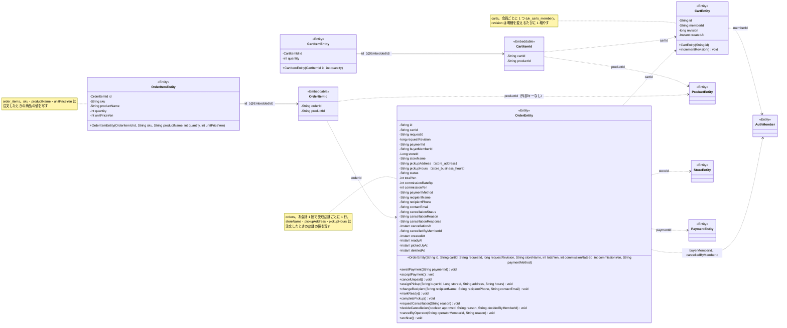
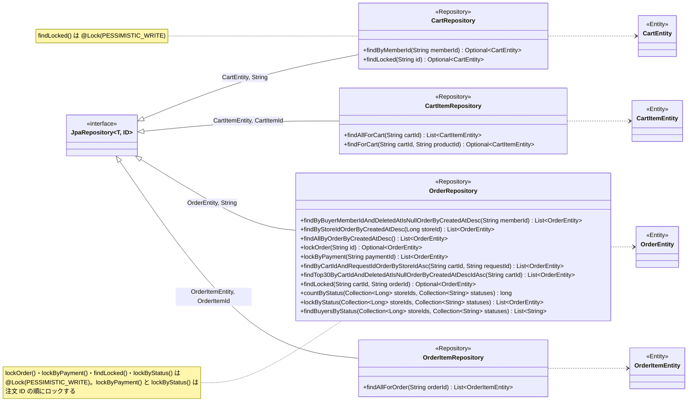
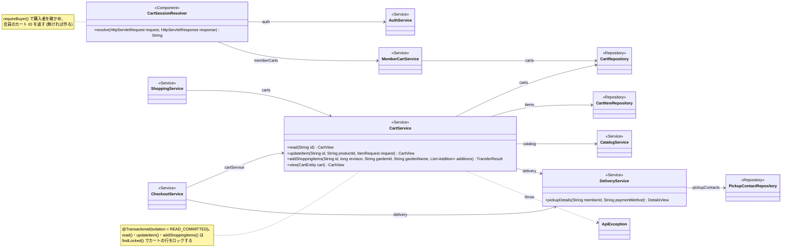
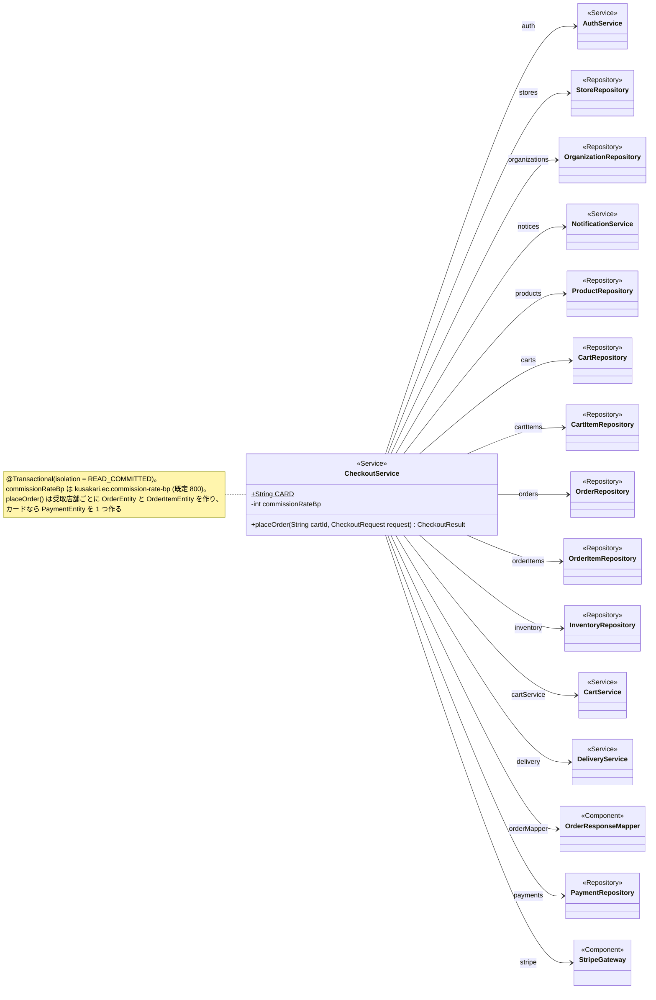
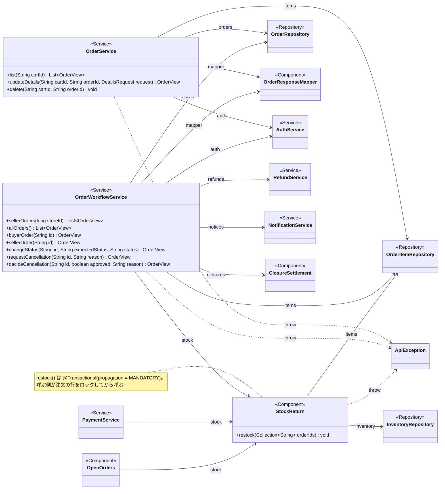
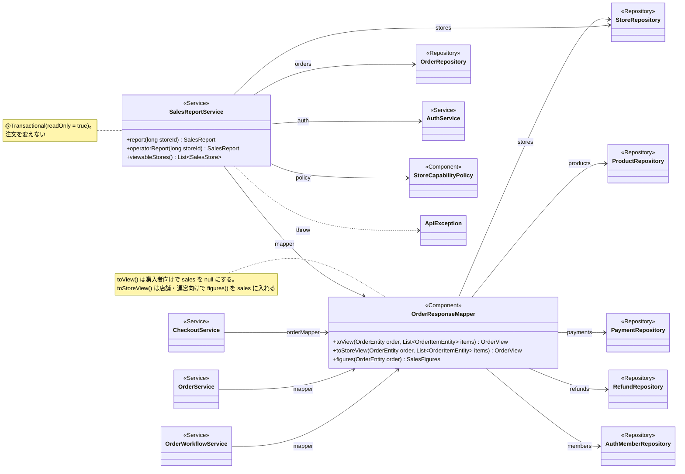
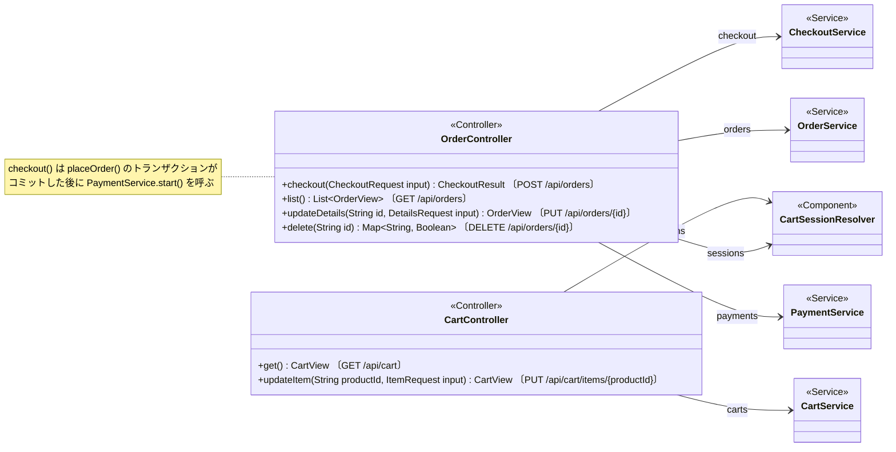
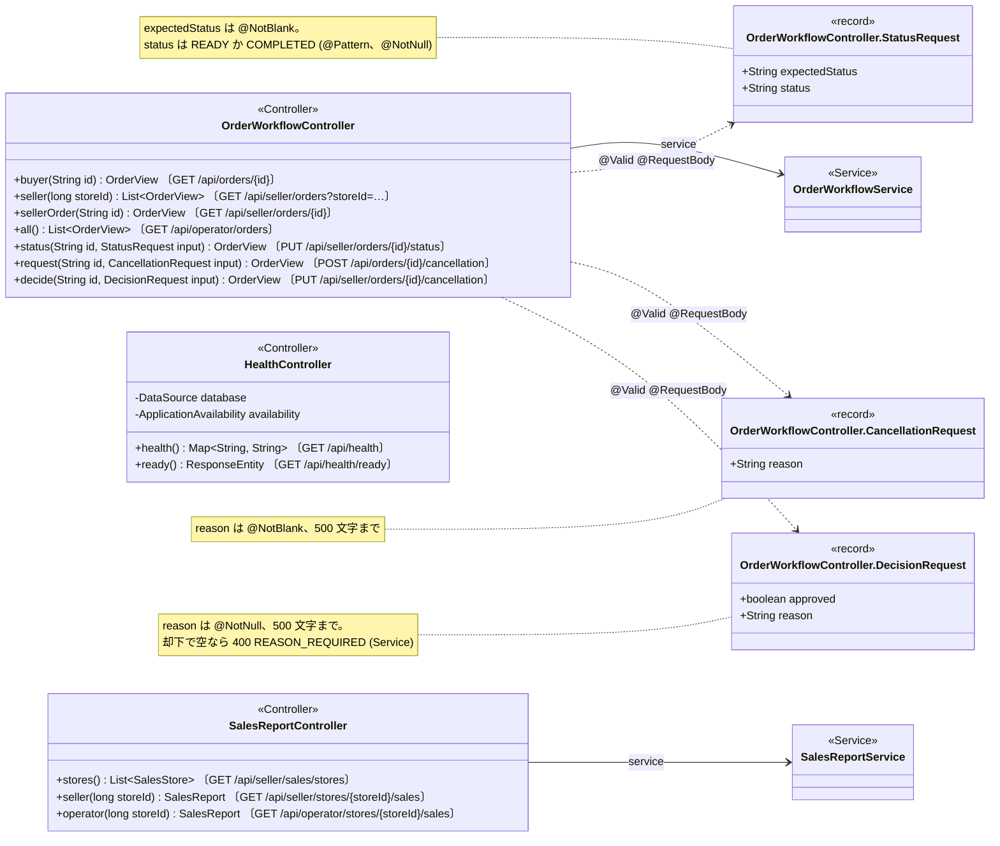
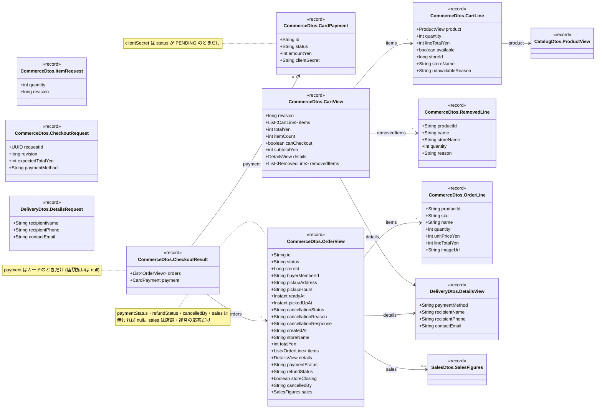
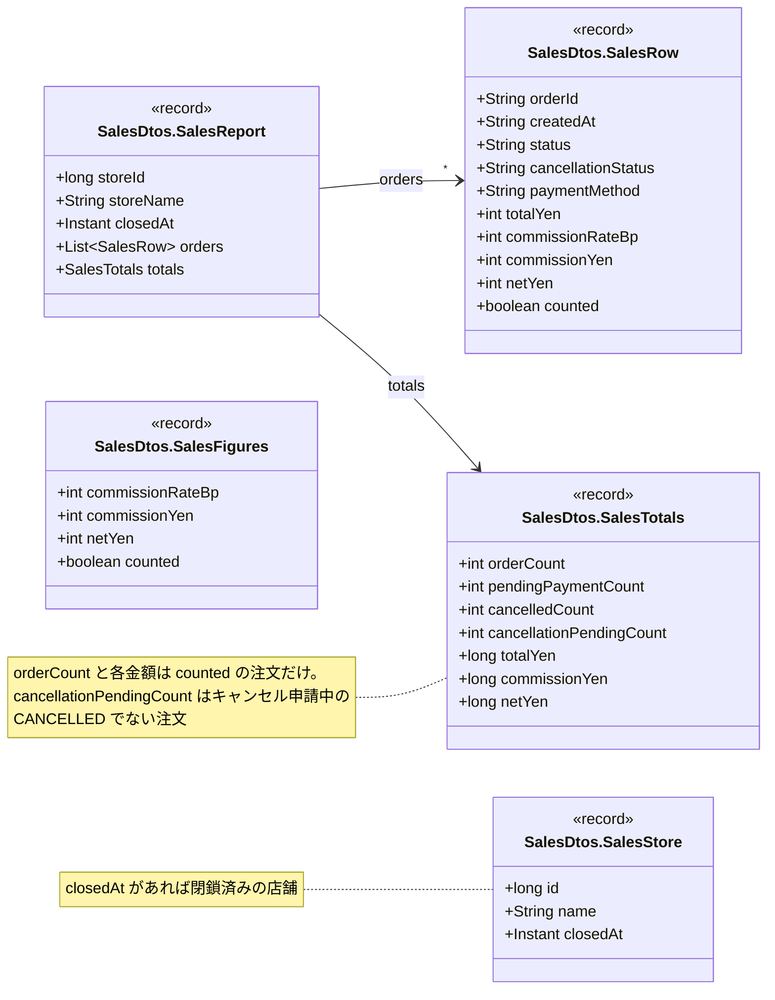

# kusakari-ec カートと注文（commerce パッケージ）のクラス図

- 対象のコード: kusakari-ec の main（19a2be3、2026-11-20 時点）
- 対象のパッケージ: `jp.kusakari.ec.commerce`（[backend/src/main/java/jp/kusakari/ec/commerce](https://github.com/abeouga/kusakari-ec/tree/19a2be307ee71a2cd87e538236c3c8c42929c5b3/backend/src/main/java/jp/kusakari/ec/commerce)）
  - [controller](https://github.com/abeouga/kusakari-ec/tree/19a2be307ee71a2cd87e538236c3c8c42929c5b3/backend/src/main/java/jp/kusakari/ec/commerce/controller)、[dto](https://github.com/abeouga/kusakari-ec/tree/19a2be307ee71a2cd87e538236c3c8c42929c5b3/backend/src/main/java/jp/kusakari/ec/commerce/dto)、[mapper](https://github.com/abeouga/kusakari-ec/tree/19a2be307ee71a2cd87e538236c3c8c42929c5b3/backend/src/main/java/jp/kusakari/ec/commerce/mapper)、[persistence/entity](https://github.com/abeouga/kusakari-ec/tree/19a2be307ee71a2cd87e538236c3c8c42929c5b3/backend/src/main/java/jp/kusakari/ec/commerce/persistence/entity)、[persistence/repository](https://github.com/abeouga/kusakari-ec/tree/19a2be307ee71a2cd87e538236c3c8c42929c5b3/backend/src/main/java/jp/kusakari/ec/commerce/persistence/repository)、[service](https://github.com/abeouga/kusakari-ec/tree/19a2be307ee71a2cd87e538236c3c8c42929c5b3/backend/src/main/java/jp/kusakari/ec/commerce/service)、[session](https://github.com/abeouga/kusakari-ec/tree/19a2be307ee71a2cd87e538236c3c8c42929c5b3/backend/src/main/java/jp/kusakari/ec/commerce/session)

## パッケージの役割

commerce パッケージは、購入者のカート、お会計（注文の確定）、注文の受け渡しとキャンセル、店舗の注文実績を扱います。

- 受け取りは店舗受け取りだけです。受取店舗は商品の店舗で、カートの明細には受取店舗を持ちません。
- 1 回のお会計で、受取店舗ごとに 1 件の注文（`orders` の 1 行）を作り、在庫を減らします。
- カードの決済と返金は payment パッケージ（[05_決済](<05_決済.md>)）が扱います。commerce は `PaymentService`・`RefundService`・`StripeGateway`・`PaymentRepository`・`RefundRepository` を呼びます。
- 庭の買い物リストからカートに入れる処理は shopping パッケージ（[06_買い物リスト](<06_買い物リスト.md>)）の `ShoppingService` が受け、`CartService.addShoppingItems()` を呼びます。
- 店舗の閉鎖・組織の停止による注文のまとめてキャンセルは store パッケージ（[02_店舗と組織](<02_店舗と組織.md>)）の `OpenOrders` が行い、`OrderRepository`・`StockReturn`・`OrderEntity.cancelByOperator()` と、payment パッケージの `RefundService` を使います。
- ヘルスチェックの受け口（`HealthController`）も、このパッケージの controller にあります。

## 読み方の要点

- 層は controller → service → persistence/repository → persistence/entity の順に呼びます。Controller は Entity を返さず、dto の record（`OrderController.delete()` と `HealthController` は `Map`）を返します。Entity から `OrderView` への変換は `OrderResponseMapper`（mapper）が行います。
- Spring が注入するフィールドは、関連（`-->`）にフィールド名を付けて書きます。フレームワークのクラス（`DataSource`、`JdbcTemplate` など）は箱を作らず、フィールドの型として書きます。
- ほかのパッケージのクラスは、名前とステレオタイプだけを書きます。中身は [00_パッケージ構成](<00_パッケージ構成.md>) から各パッケージの図をたどってください。
- Entity どうしに JPA の関連（`@ManyToOne`、`@OneToMany` など）はありません。ID の列で参照します。図では、依存の破線（`..>`）に参照するフィールド名を付けて示し、多重度は書きません。列と制約の詳しいことは [テーブル設計図](<../../テーブル設計図/kusakari-ec/>) を見てください。
- Entity のフィールドの後ろの〔 〕は、フィールド名と違う列名です。Controller のメソッドの後ろの〔 〕は、HTTP のメソッドとパスです。
- `CartController` と `OrderController` のメソッドは、`HttpServletRequest` と `HttpServletResponse` も引数に取ります。どちらも `CartSessionResolver.resolve()` に渡すだけなので、図では省きました。
- Lombok が作る getter・setter・コンストラクターは書いていません。

| クラス | テーブル | 主キー |
| --- | --- | --- |
| `CartEntity` | `carts` | `id` |
| `CartItemEntity`、`CartItemId` | `cart_items` | `cart_id`、`product_id` |
| `OrderEntity` | `orders` | `id` |
| `OrderItemEntity`、`OrderItemId` | `order_items` | `order_id`、`product_id` |

| API | Controller のメソッド | Service のメソッド | シーケンス図 |
| --- | --- | --- | --- |
| `GET /api/cart` | `CartController.get()` | `CartService.read()` | [EC-B08](<../../シーケンス図/kusakari-ec/EC-B08_カートを確認する.md>) |
| `PUT /api/cart/items/{productId}` | `CartController.updateItem()` | `CartService.updateItem()` | [EC-B07](<../../シーケンス図/kusakari-ec/EC-B07_商品をカートに追加する.md>)、[EC-B09](<../../シーケンス図/kusakari-ec/EC-B09_カートの数量を変更する.md>)、[EC-B10](<../../シーケンス図/kusakari-ec/EC-B10_カートから商品を削除する.md>) |
| `POST /api/orders` | `OrderController.checkout()` | `CheckoutService.placeOrder()` の後に `PaymentService.start()` | [EC-B12](<../../シーケンス図/kusakari-ec/EC-B12_商品を購入する.md>) |
| `GET /api/orders` | `OrderController.list()` | `OrderService.list()` | [EC-B13](<../../シーケンス図/kusakari-ec/EC-B13_注文履歴を確認する.md>) |
| `PUT /api/orders/{id}` | `OrderController.updateDetails()` | `OrderService.updateDetails()` | [EC-B13](<../../シーケンス図/kusakari-ec/EC-B13_注文履歴を確認する.md>) |
| `DELETE /api/orders/{id}` | `OrderController.delete()` | `OrderService.delete()` | [EC-B13](<../../シーケンス図/kusakari-ec/EC-B13_注文履歴を確認する.md>) |
| `GET /api/orders/{id}` | `OrderWorkflowController.buyer()` | `OrderWorkflowService.buyerOrder()` | [EC-B12](<../../シーケンス図/kusakari-ec/EC-B12_商品を購入する.md>) |
| `POST /api/orders/{id}/cancellation` | `OrderWorkflowController.request()` | `OrderWorkflowService.requestCancellation()` | [EC-B14](<../../シーケンス図/kusakari-ec/EC-B14_注文キャンセルを申請する.md>) |
| `GET /api/seller/orders?storeId=…` | `OrderWorkflowController.seller()` | `OrderWorkflowService.sellerOrders()` | [EC-S08](<../../シーケンス図/kusakari-ec/EC-S08_注文一覧・詳細を確認する.md>) |
| `GET /api/seller/orders/{id}` | `OrderWorkflowController.sellerOrder()` | `OrderWorkflowService.sellerOrder()` | なし（EC-S08 の画面は呼びません） |
| `GET /api/operator/orders` | `OrderWorkflowController.all()` | `OrderWorkflowService.allOrders()` | なし |
| `PUT /api/seller/orders/{id}/status` | `OrderWorkflowController.status()` | `OrderWorkflowService.changeStatus()` | [EC-S09](<../../シーケンス図/kusakari-ec/EC-S09_注文を受取準備完了にする.md>)、[EC-S10](<../../シーケンス図/kusakari-ec/EC-S10_注文を引き渡し完了にする.md>) |
| `PUT /api/seller/orders/{id}/cancellation` | `OrderWorkflowController.decide()` | `OrderWorkflowService.decideCancellation()` | [EC-S13](<../../シーケンス図/kusakari-ec/EC-S13_注文キャンセル申請を処理する.md>) |
| `GET /api/seller/sales/stores` | `SalesReportController.stores()` | `SalesReportService.viewableStores()` | [EC-S07](<../../シーケンス図/kusakari-ec/EC-S07_注文実績を確認する.md>)、[EC-C03](<../../シーケンス図/kusakari-ec/EC-C03_出店者画面のメニューを開く.md>) |
| `GET /api/seller/stores/{storeId}/sales` | `SalesReportController.seller()` | `SalesReportService.report()` | [EC-S07](<../../シーケンス図/kusakari-ec/EC-S07_注文実績を確認する.md>) |
| `GET /api/operator/stores/{storeId}/sales` | `SalesReportController.operator()` | `SalesReportService.operatorReport()` | [EC-A05](<../../シーケンス図/kusakari-ec/EC-A05_店舗情報を確認する.md>) |
| `GET /api/health`、`GET /api/health/ready` | `HealthController.health()`、`ready()` | なし | なし |

`/api/health` と `/api/health/ready` はログインなしで呼べます。ほかはログインが必要です（`auth/AuthConfiguration.java` の `cognitoSecurity()`）。ロールの確認は各 Service が `AuthService` を呼んで行います。カート・注文の購入者の API は、`CartSessionResolver` の中で `AuthService.requireBuyer()` を呼びます。

## 図 1 カートと注文の Entity

- `OrderEntity` には `@Getter` だけがあり、setter はありません。状態は次のメソッドで変えます。`status` の初めの値は `ACCEPTED`、`cancellationStatus` の初めの値は `NONE` です。

| メソッド | `status` | `cancellationStatus` | 呼ぶところ |
| --- | --- | --- | --- |
| `awaitPayment()` | `PENDING_PAYMENT`（`paymentId` も入れる） | 変えない | `CheckoutService`（カードのとき） |
| `acceptPayment()` | `PENDING_PAYMENT` なら `ACCEPTED` | 変えない | `PaymentService.succeeded()` |
| `cancelUnpaid()` | `PENDING_PAYMENT` なら `CANCELLED` | 変えない | `PaymentService`（支払いの失敗・時間切れ） |
| `markReady()` | `READY`（`readyAt` を入れる） | 変えない | `OrderWorkflowService.changeStatus()` |
| `completePickup()` | `COMPLETED`（`pickedUpAt` を入れる） | 変えない | `OrderWorkflowService.changeStatus()` |
| `requestCancellation()` | 変えない | `PENDING` | `OrderWorkflowService.requestCancellation()` |
| `decideCancellation()` | 承認なら `CANCELLED` | `APPROVED` か `REJECTED` | `OrderWorkflowService.decideCancellation()` |
| `cancelByOperator()` | `CANCELLED` | 変えない | `OpenOrders.cancelAll()`（store パッケージ） |
| `archive()` | 変えない（`deletedAt` を入れる） | 変えない | `OrderService.delete()` |

- `AuthMember`（auth パッケージ、`members`）、`ProductEntity`・`StoreEntity`（catalog パッケージ）、`PaymentEntity`（payment パッケージ）は名前だけを書いています。
- `order_items.product_id` には外部キーがありません。`OrderResponseMapper` が、この ID で今の商品の画像を探します。
- `CartEntity`・`CartItemEntity`・`OrderItemEntity` には `@Getter` と `@Setter` があります。`CartEntity.memberId` は、auth パッケージの `MemberCartService` がカートを作るときに入れます。

## 図 2 カートと注文の Repository

- `findAllForCart()`、`findForCart()`、`findAllForOrder()`、`lockOrder()`、`lockByPayment()`、`findLocked()`、`countByStatus()`、`lockByStatus()`、`findBuyersByStatus()` は `@Query` の JPQL です。ほかは Spring Data のメソッド名からの問い合わせです。
- `countByStatus()`、`lockByStatus()`、`findBuyersByStatus()` は、store パッケージの `OpenOrders` が店舗の閉鎖・組織の停止で使います。`lockByPayment()` は payment パッケージの `PaymentService` と `RefundService` が使います。
- `CartItemRepository.findForCart()`、`OrderRepository.findTop30ByCartIdAndDeletedAtIsNullOrderByCreatedAtDescIdAsc()`、`OrderRepository.findLocked()` を呼ぶコードは、この時点の main には見つかりません。

## 図 3 カートの Service

- `CartSessionResolver.resolve()` は、`AuthService.requireBuyer()` の会員 ID を `MemberCartService.resolve()` に渡して、カートの ID を返します。カート・注文・庭の買い物リストの購入者の API は、すべてここを通ります。
- `CartService.read()` は、商品の削除・店舗の閉鎖・店舗の停止・組織の停止（`CatalogService.REMOVED_REASONS`）で買えなくなった明細を外し、`CartView.removedItems` で返します。外したときは `revision` を 1 増やします。
- `updateItem()` は数量 0 で明細を消します。在庫を超える数量は 409 `OUT_OF_STOCK`、51 種類目は 400 `CART_LIMIT`、古い `revision` は 409 `CART_CHANGED` です。
- `addShoppingItems()` は、選んだ商品ごとに、カートにある数量へ足して保存します。足せない商品は理由（`PRODUCT_ARCHIVED`、`QUANTITY_LIMIT`、`OUT_OF_STOCK`、`CART_LIMIT`）を付けて `skipped` に入れます。
- `view()` は Entity から `CartView` を作ります。`CheckoutService` も、ロックの後のカートの金額を確かめるのに使います。
- `DeliveryService.pickupDetails()` は、会員の受取連絡先（member パッケージの `PickupContactRepository`）を `DetailsView` にします。無ければ空の文字列で返します。
- `AuthService`・`MemberCartService`（auth）、`CatalogService`（catalog）、`PickupContactRepository`（member）、`ShoppingService`（shopping）、`ApiException`（common.web）は名前だけを書いています。

## 図 4 お会計の Service

- `placeOrder()` は、同じ `requestId` の注文がすでにあれば、その注文を返します（内容が違えば 409 `REQUEST_REUSED`）。
- ロックは、カート、店舗（`StoreRepository.lock()`、店舗 ID の順）、組織（`OrganizationRepository.lockShared()`）、商品の停止（`ProductRepository.lockSharedSuspension()`）、在庫（`InventoryRepository.lockAll()`、商品 ID の順）の順に取ります。
- 店頭払い（`PAY_AT_STORE`）は注文を `ACCEPTED` で作り、`NotificationService` で購入者と店舗に知らせます。カード（`CARD`）は `PaymentEntity` を作り、注文を `awaitPayment()` で `PENDING_PAYMENT` にします。知らせは支払いの成功のとき（`PaymentService`）に送ります。
- カードを選んだのに `StripeGateway.enabled()` が false なら、409 `CARD_PAYMENT_UNAVAILABLE` です。Stripe の PaymentIntent は、このトランザクションのコミットの後に `PaymentService.start()` が作ります（[05_決済](<05_決済.md>)）。
- 手数料は `commissionYen = totalYen × commissionRateBp ÷ 10000`（1 円未満は切り捨て）で、率と額を注文に保存します。
- `AuthService`（auth）、`StoreRepository`・`ProductRepository`・`InventoryRepository`（catalog）、`OrganizationRepository`（store）、`NotificationService`（notification）、`PaymentRepository`・`StripeGateway`（payment）は名前だけを書いています。

## 図 5 注文の Service

- `OrderService` は購入者の注文の一覧・受取連絡先の変更・履歴からの非表示です。引数の `cartId` は使わず、`AuthService.current()` の会員 ID で注文を探します。受取連絡先は `ACCEPTED` の注文だけ変えられます（それ以外は 409 `ORDER_FIXED`）。
- `OrderWorkflowService` は、購入者・店舗・運営の注文の参照と、受取準備完了・引き渡し完了・キャンセルの申請と回答です。ほかの店舗の注文は 404 `ORDER_NOT_FOUND` として返し、注文の有無を知らせません。
- `changeStatus()` が受け付けるのは `ACCEPTED` から `READY`、`READY` から `COMPLETED` だけです。キャンセル申請中（`cancellationStatus` が `PENDING`）は 409 `ORDER_CHANGED` です。
- `decideCancellation()` は `AuthService.requireManager()` で、オーナーか MANAGER だけが回答できます。承認すると `StockReturn.restock()` で在庫を戻し、`RefundService.refundCancelledOrder()` を呼びます（カードで支払い済みなら返金）。
- 引き渡し完了とキャンセルの承認の後は、`ClosureSettlement.afterOrderChanged()` を呼びます。閉鎖中の店舗・受付停止中の組織の未完了の注文がなくなったかを、store パッケージが確かめます。
- `StockReturn` は、payment パッケージの `PaymentService`（支払いの失敗・時間切れ）と、store パッケージの `OpenOrders`（まとめてキャンセル）からも呼ばれます。
- `AuthService`（auth）、`RefundService`・`PaymentService`（payment）、`NotificationService`（notification）、`ClosureSettlement`・`OpenOrders`（store）、`InventoryRepository`（catalog）、`ApiException`（common.web）は名前だけを書いています。

## 図 6 注文の応答と注文実績の Service

- `OrderResponseMapper` は、`OrderView` の次の値をほかのテーブルから読みます。
  - `paymentStatus`: `PaymentRepository.findById()` の決済の `status`（`paymentId` が null なら null）。
  - `refundStatus`: `RefundRepository.findByOrderId()` の返金の `status`（返金がなければ null）。
  - `storeClosing`: `StoreRepository.findById()` の店舗の `isClosing()`。
  - `cancelledBy`: `AuthMemberRepository.findById()` の会員が運営（`isAdmin()`）なら `OPERATOR`、それ以外は `STORE`。
  - 明細の `imageUrl`: `ProductRepository.findImageReferences()` の今の商品の画像。
- `figures()` は注文 1 件の手数料と差引額です。`CANCELLED` の注文は手数料と差引額を 0 として返し、`CANCELLED` と `PENDING_PAYMENT` の注文は合計に含めません（`counted` が false）。
- `SalesReportService.report()` は出店者画面の注文実績です。認証が有効（`AuthService.enabled()`）で、`StoreCapabilityPolicy.canViewSales()` が false なら 403 `FORBIDDEN` です。`operatorReport()` は運営の店舗管理から開く注文実績で、`AuthService.requireAdmin()` で確かめます。`viewableStores()` は注文実績を見られる店舗の一覧です。
- `ProductRepository`・`StoreRepository`（catalog）、`PaymentRepository`・`RefundRepository`（payment）、`AuthMemberRepository`・`AuthService`・`StoreCapabilityPolicy`（auth）、`ApiException`（common.web）は名前だけを書いています。

## 図 7 購入者の受け口

- どのメソッドも、まず `CartSessionResolver.resolve()` でカートの ID を決めます。店舗側・申請中のアカウントは、ここで 403 になります。
- `OrderController.checkout()` の戻り値の `CheckoutResult.payment` は、カードのときだけ入ります。支払い待ちなら `clientSecret` を持ちます（[05_決済](<05_決済.md>)）。
- `OrderController.delete()` は `{"deleted": true}` を返します。注文は消さず、`deletedAt` を入れて履歴から隠すだけです。
- `PaymentService`（payment）は名前だけを書いています。

## 図 8 店舗・運営の受け口とヘルスチェック

- `OrderWorkflowController` の `buyer()` と `request()` は購入者、`seller()`・`sellerOrder()`・`status()`・`decide()` は店舗、`all()` は運営の受け口です。誰が呼べるかは `OrderWorkflowService` が `AuthService` で確かめます。
- `HealthController.ready()` の戻り値の型は `ResponseEntity<Map<String, String>>` です。起動・停止の途中か、データベースにつながらなければ 503 を返します。応答に、データベースの URL や SQL のエラーは入れません。
- `HealthController` は `DataSource` と `ApplicationAvailability`（Spring のクラス）だけを使い、ほかのクラスを呼びません。

## 図 9 カートと注文の DTO

- `CommerceDtos` と `DeliveryDtos` は、record を入れるためだけの `final` のクラスです。図では `CommerceDtos.〜` のように、入れ物のクラスの名前を付けて書いています。
- `ProductView`（catalog パッケージ）のフィールドは [03_商品カタログ](<03_商品カタログ.md>) の図 10 にあります。`SalesFigures` のフィールドは図 10 にあります。
- 送料はないので、`CartView` の `subtotalYen` と `totalYen` は同じ値です。カートの `details.paymentMethod` はお会計まで `NONE` です。
- 要求の record の入力の検証は次のとおりです。

| record | 検証 |
| --- | --- |
| `ItemRequest` | `quantity` は 0〜99（`@Min(0)`、`@Max(99)`）、`revision` は 0 以上 |
| `CheckoutRequest` | `requestId` は必須、`revision` は 0 以上、`expectedTotalYen` は 1 以上、`paymentMethod` は `CARD` か `PAY_AT_STORE`（`@Pattern`） |
| `DetailsRequest` | `recipientName` は 100 文字まで、`recipientPhone` は `[0-9+() -]{0,30}`、`contactEmail` は `@Email` で 200 文字まで。どれも `@NotNull` |

## 図 10 注文実績の DTO

- `SalesDtos` も、record を入れるためだけの `final` のクラスです。
- `SalesRow` は注文 1 件を 1 行にしたものです。`commissionRateBp`・`commissionYen`・`netYen`・`counted` は、`OrderResponseMapper.figures()` の `SalesFigures` から写します。
- 手数料は表示だけで、請求・精算・Stripe での差し引きはしません。

## 図に載せなかったクラス

- `CommerceDtos`、`DeliveryDtos`、`SalesDtos`（dto）: record を入れるためだけの `final` のクラスで、`private` のコンストラクターしか持ちません。中の record は、図 9 と図 10 に `CommerceDtos.〜` のような名前で載せています。
- `JpaRepository`、`DataSource`、`ApplicationAvailability`、`HttpServletRequest`、`HttpServletResponse` などのフレームワークと Java のクラスは、`JpaRepository` を除いて図に箱を作らず、フィールドや引数の型として書いています。

## 確かめられなかったこと

- `@Lock(PESSIMISTIC_WRITE)` が MySQL で `FOR UPDATE` になることは、注釈から読んだもので、実行して確かめていません。
