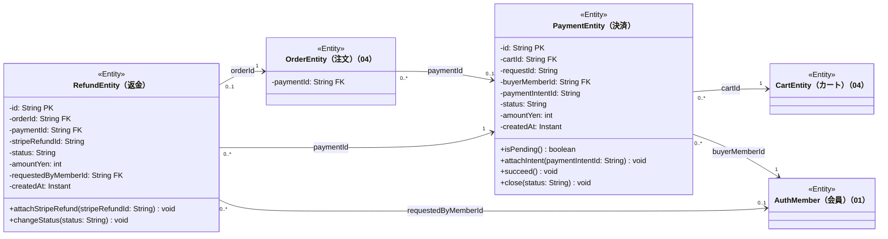
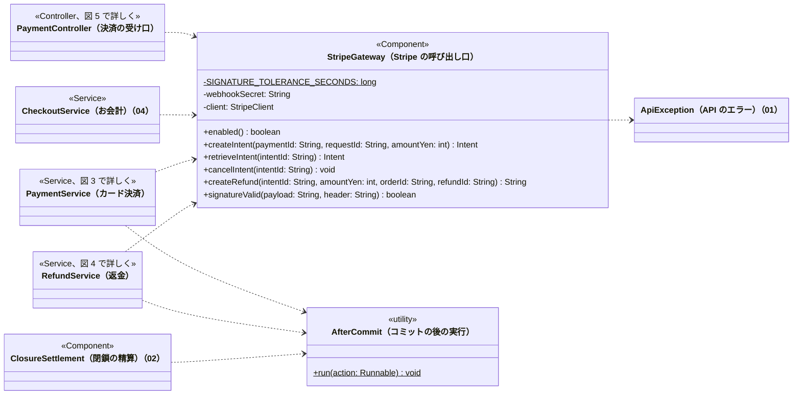
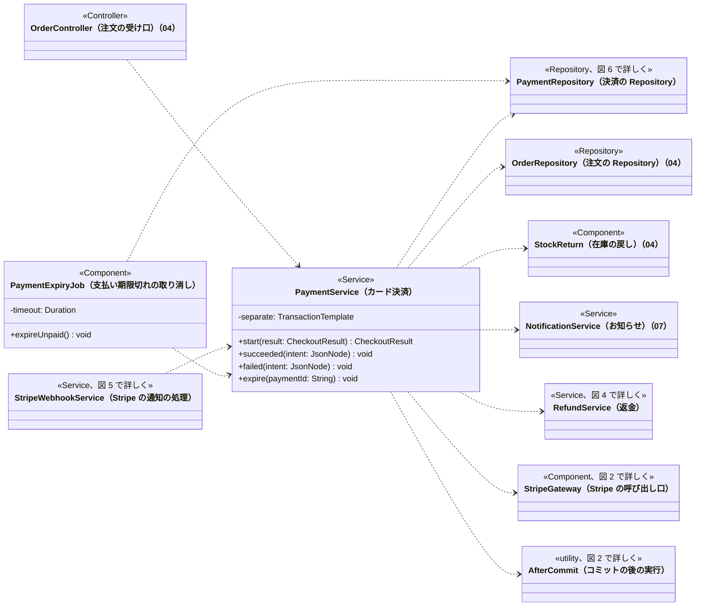
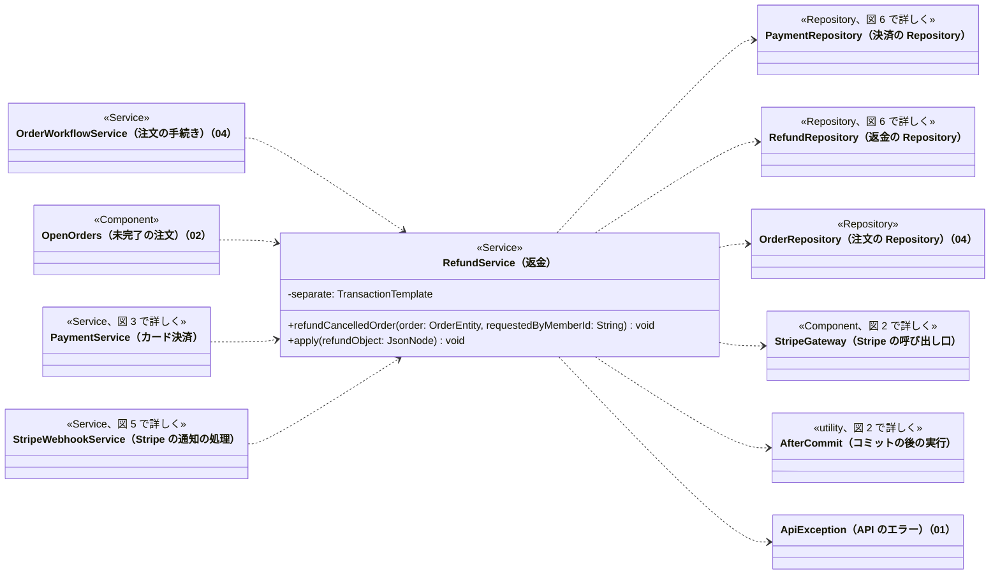
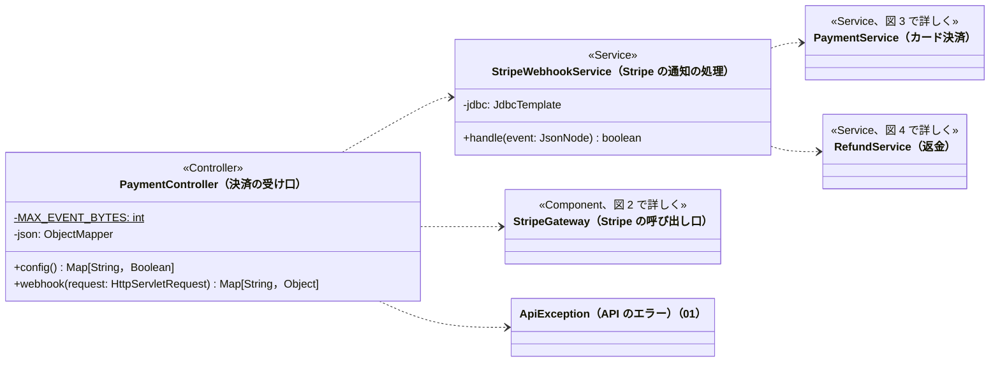
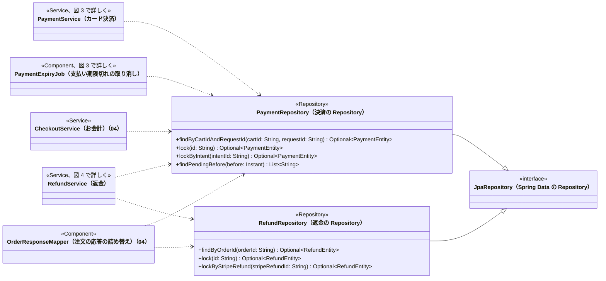

# Kusakari EC クラス図 05 決済

- 対象のコード: kusakari-ec の main（8892344、2026-11-24 時点）
- 対象のパッケージ: `jp.kusakari.ec.payment`（[backend/src/main/java/jp/kusakari/ec/payment](https://github.com/abeouga/kusakari-ec/blob/8892344/backend/src/main/java/jp/kusakari/ec/payment)）
  - [controller](https://github.com/abeouga/kusakari-ec/blob/8892344/backend/src/main/java/jp/kusakari/ec/payment/controller)、[persistence/entity](https://github.com/abeouga/kusakari-ec/blob/8892344/backend/src/main/java/jp/kusakari/ec/payment/persistence/entity)、[persistence/repository](https://github.com/abeouga/kusakari-ec/blob/8892344/backend/src/main/java/jp/kusakari/ec/payment/persistence/repository)、[service](https://github.com/abeouga/kusakari-ec/blob/8892344/backend/src/main/java/jp/kusakari/ec/payment/service)
- 全体図とパッケージの対応: [00_全体図](<00_全体図.md>)

payment パッケージの Entity、Repository、Service、Controller を 6 枚に分けて描きます。図 1 はデータの図（Entity）、図 2〜図 6 はモジュールの図です。呼び出しの順番は、カードでの購入が [EC-B12](<../../シーケンス図/kusakari-ec/EC-B12_商品を購入する.md>)、キャンセルの承認による返金が [EC-S13](<../../シーケンス図/kusakari-ec/EC-S13_注文キャンセル申請を処理する.md>) にあります。

## パッケージの役割

payment パッケージは、Stripe（テストモードだけ）を使うカード決済と返金を扱います。

- お会計 1 回のカード払いに、決済を 1 つ作ります（`payments` の 1 行、Stripe の PaymentIntent 1 つ）。金額は、そのお会計の全店舗の注文の合計です。店頭払いのお会計には作りません。
- 決済の結果（成功・失敗）は、Stripe の通知（Webhook）で受け取り、支払い待ち（`PENDING_PAYMENT`）の注文を受け付けるか取り消します。支払われないまま時間が過ぎた決済は、定期処理で取り消します。
- 返金は注文 1 件に 1 行です（`refunds`）。キャンセルの承認、店舗の閉鎖・組織の停止によるまとめてキャンセル、取り消した後に届いた支払いで返金します。結果は Webhook で反映します。
- 注文の行（`OrderEntity`）と在庫の戻し（`StockReturn`）は commerce パッケージ（[04_カートと注文](<04_カートと注文.md>)）のクラスを使います。
- Stripe を呼ぶ間は DB のロックを持ちません。決済・返金の行は呼ぶ側のトランザクションで作り、Stripe の呼び出しはコミットの後（`AfterCommit.run()`）か、トランザクションの外（`PaymentService.start()`）で行います。Stripe の ID を行に書くときは、`REQUIRES_NEW` の `TransactionTemplate` で別のトランザクションにします。
- ロックの順は、決済 → 注文（注文 ID の順）→ 在庫（商品 ID の昇順）です。

## 図の読み方

- 箱の名前は「英語名（日本語名）」です。英語名はコードのクラス名です。ほかのパッケージのクラスは、名前の後ろに詳しく描いた詳細図の番号（（01）・（02）・（04）・（07））を付け、名前だけを書きました。ライブラリのクラス（`TransactionTemplate` など）も名前だけです。
- ステレオタイプは、`<<Entity>>` が JPA の Entity、`<<Repository>>` が Spring Data の Repository（interface）、`<<Service>>`・`<<Component>>`・`<<Controller>>` が Spring の Bean の種類、`<<utility>>` が static のメソッドだけを持つクラスです。
- フィールドとメソッドは `名前: 型`、`メソッド(引数: 型) 戻り値の型` の形で書きました。`$` の付いた下線のものは static です。getter（Lombok の `@Getter`）とコンストラクターは書いていません。
- 線は 4 種類です。`-->` は関連（データの図では ID の列での参照）、`*--` はコンポジション、`<|--` は継承、`..>` は依存（モジュールの図では、Spring が注入するフィールドと呼び出し）です。この文書では `*--` を使っていません。
- 線の両端の数字は多重度です。`1` はちょうど 1 つ、`0..1` は無いか 1 つ、`0..*` は 0 個以上です。
- 線のラベルは関連の名前（ID を持つフィールドの名前）です。依存の線にはラベルを付けず、注入するフィールドの名前と使っているメソッドは、各図の下の「線とコードの対応」に書きました。
- モジュールの図では、Entity・DTO の箱を描かず、フィールド・引数・戻り値の型として書きました。どのクラスがどの Entity・DTO を使うかは「データの図との関係」の表にあります。

## 図 1 決済と返金の Entity

データの図です。Entity どうしに JPA の関連（`@ManyToOne` など）はありません。ID の列で参照し、多重度は列の NULL 可否と一意キーから書いています。参照する列は、箱の中にも `FK` を付けて書きました。列の MySQL の型と制約は [テーブル設計図 05_注文と決済](<../../テーブル設計図/kusakari-ec/05_注文と決済.md>) を見てください。

### Entity とテーブル

| Entity | テーブル | 主キー | 列の補足 |
| --- | --- | --- | --- |
| `PaymentEntity` | `payments` | `id` | お会計 1 回のカード決済（PaymentIntent 1 つ）。`cartId` と `requestId` でお会計を表す（一意キー `uk_payments_checkout`）。`paymentIntentId` は NULL 可で一意（`uk_payments_intent`）。`amountYen` は 0 より大きい（`ck_payments_amount`） |
| `RefundEntity` | `refunds` | `id` | 注文 1 件に 1 行（`uk_refunds_order`）。`stripeRefundId` は NULL 可で一意（`uk_refunds_stripe`）。`requestedByMemberId` は Stripe の管理画面からの返金では null |
| （Entity なし。`StripeWebhookService` が `JdbcTemplate` で書く） | `stripe_events` | `event_id` | 処理済みの Stripe の通知。列は `event_id`、`event_type`、`processed_at` |

- `payments` と `refunds` には、Entity に対応するフィールドが無い `updated_at` の列があります（MySQL の `ON UPDATE` で変わります）。
- どちらの Entity にも `@Getter` だけがあり、setter はありません。コンストラクターは `PaymentEntity(id, cartId, requestId, buyerMemberId, amountYen)` と `RefundEntity(id, orderId, paymentId, amountYen, requestedByMemberId)` です。
- `attachIntent()` と `attachStripeRefund()` は、まだ ID が無いときだけ入れます。

### 関連と外部キー

| 関連 | 外部キーの名前 | 多重度の根拠 |
| --- | --- | --- |
| `PaymentEntity` 0..* — 1 `CartEntity` | `fk_payments_cart` | `cart_id` は NULL 不可。一意なのは `cart_id` と `request_id` の組なので、カート 1 つに決済は何度でも作られる |
| `PaymentEntity` 0..* — 1 `AuthMember` | `fk_payments_buyer` | `buyer_member_id` は NULL 不可 |
| `OrderEntity` 0..* — 0..1 `PaymentEntity` | `fk_orders_payment`（`payment_id`、`cart_id`、`request_id` → `payments`） | `orders.payment_id` は NULL 可（店頭払いは null）。お会計 1 回の全店舗の注文が 1 つの決済を指す。同じお会計（`cart_id`、`request_id`）の決済だけを指せる |
| `RefundEntity` 0..1 — 1 `OrderEntity` | `fk_refunds_order`（`order_id`、`payment_id` → `orders`） | `order_id` は NULL 不可で一意（`uk_refunds_order`）。その注文が支払われた決済だけを指せる |
| `RefundEntity` 0..* — 1 `PaymentEntity` | `fk_refunds_payment` | `payment_id` は NULL 不可、一意ではない |
| `RefundEntity` 0..* — 0..1 `AuthMember` | `fk_refunds_requested_by` | `requested_by_member_id` は NULL 可 |

### 状態の値とメソッド

`status` は enum ではなく、`String` の定数（`PaymentEntity.PENDING` など）です。値は `ck_payments_status`・`ck_refunds_status` でも制限しています。

| メソッド | `PaymentEntity.status` | 呼ぶところ |
| --- | --- | --- |
| （作ったとき） | `PENDING` | `CheckoutService.placeOrder()`（commerce） |
| `succeed()` | `SUCCEEDED` | `PaymentService.succeeded()`。`FAILED`・`EXPIRED` の後に届いても `SUCCEEDED` にし、注文は取り消したまま返金する |
| `close("FAILED")` | `FAILED` | `PaymentService.failed()`（`PENDING` のときだけ） |
| `close("EXPIRED")` | `EXPIRED` | `PaymentService.expire()`（`PENDING` のときだけ） |

| メソッド | `RefundEntity.status` | 呼ぶところ |
| --- | --- | --- |
| （作ったとき） | `REQUESTED` | `RefundService.refundCancelledOrder()`、Stripe の管理画面からの返金を記録するとき |
| `changeStatus()` | Stripe の Refund の `succeeded` なら `SUCCEEDED`、`failed`・`canceled` なら `FAILED` | `RefundService.apply()` |
| `changeStatus("FAILED")` | `FAILED` | Stripe に返金を頼めず、`stripeRefundId` が無いまま（`RefundService` の中） |

- `close()` は `FAILED` か `EXPIRED` だけを、`changeStatus()` は `REQUESTED`・`SUCCEEDED`・`FAILED` だけを受け付け、ほかは `IllegalArgumentException` です。

## 図 2 Stripe の呼び出し

モジュールの図です。`StripeGateway` は Stripe の Java ライブラリ（`StripeClient`）を包み、ほかのクラスは Stripe を直接呼びません。鍵が無いときも起動は止めず、カード決済を使えなくします。

### 線とコードの対応

| 線 | フィールド | コード |
| --- | --- | --- |
| PaymentController → StripeGateway | `stripe` | `config()` が `enabled()`、`webhook()` が `signatureValid()` |
| CheckoutService → StripeGateway | `stripe` | `placeOrder()` が `enabled()`（カードを選んだのに false なら 409 `CARD_PAYMENT_UNAVAILABLE`） |
| PaymentService → StripeGateway | `stripe` | `start()` が `createIntent()`・`retrieveIntent()`、取り消しのときに `cancelIntent()` |
| RefundService → StripeGateway | `stripe` | 返金の依頼で `createRefund()` |
| PaymentService、RefundService、ClosureSettlement → AfterCommit | （static） | `AfterCommit.run()` で、Stripe の呼び出し・店舗の精算をコミットの後に行う |
| StripeGateway → ApiException | （throw） | 下の「エラー」の表 |

### 部品の決まり

| 部品 | 決まり |
| --- | --- |
| `StripeGateway` のコンストラクター | `secretKey` は `STRIPE_SECRET_KEY`、`webhookSecret` は `STRIPE_WEBHOOK_SECRET`。テスト用の鍵（`sk_test_` か `rk_test_`）と `whsec_` の署名の鍵がそろったときだけ `client` を作る。無ければ `enabled()` は false |
| `createIntent()` | 金額（円）、`currency` が `jpy`、自動の売上確定、リダイレクトする支払方法を除く設定、`metadata.payment_id` で PaymentIntent を作る。Idempotency-Key は `requestId` なので、同じお会計の再送では同じ PaymentIntent が返る |
| `createRefund()` | Idempotency-Key は `refund-` と注文 ID。`metadata` に `refund_id` と `order_id` を付ける。戻り値は Stripe の Refund の ID |
| `cancelIntent()` | `client` が無ければ何もしない。失敗してもログに残すだけ |
| `signatureValid()` | 届いたままの本文と `Stripe-Signature` ヘッダーで署名を確かめる。時刻のずれは `SIGNATURE_TOLERANCE_SECONDS`（300 秒）まで |
| `StripeGateway.Intent` | `StripeGateway` の中の record。フィールドは `id: String`（PaymentIntent の ID）と `clientSecret: String`。`createIntent()`・`retrieveIntent()` の戻り値 |
| `AfterCommit` | `private` のコンストラクターだけを持つ `final` のクラス。`TransactionSynchronization` の `afterCommit()` で `action` を実行する |

### エラー

| 状態 | コード | 起きるとき |
| --- | --- | --- |
| 409 | `CARD_PAYMENT_UNAVAILABLE` | `client` が無いときに `createIntent()`・`retrieveIntent()`・`createRefund()` を呼んだ |
| 502 | `PAYMENT_PROVIDER_ERROR` | Stripe の呼び出しが失敗した（`StripeException`） |

## 図 3 カード決済の Service

モジュールの図です。`PaymentService` はお会計で作った支払い待ちの注文を、Stripe の通知で確定するか取り消します。`PaymentExpiryJob` は支払われなかった決済を時間切れで取り消します。

### 線とコードの対応

| 線 | フィールド | コード |
| --- | --- | --- |
| OrderController → PaymentService | `payments` | `checkout()` が、お会計のトランザクションがコミットされた後に `start()` を呼ぶ |
| StripeWebhookService → PaymentService | `payments` | `handle()` が `payment_intent.succeeded` で `succeeded()`、`payment_intent.payment_failed` で `failed()` |
| PaymentExpiryJob → PaymentService | `service` | `expireUnpaid()` が決済ごとに `expire()` |
| PaymentExpiryJob → PaymentRepository | `payments` | `findPendingBefore()` |
| PaymentService → PaymentRepository | `payments` | `findById()`、`lock()`、`lockByIntent()` |
| PaymentService → OrderRepository | `orders` | `lockByPayment()` で決済の注文をロックする |
| PaymentService → StockReturn | `stock` | 取り消すときに `restock()` で在庫を戻す |
| PaymentService → NotificationService | `notices` | `send()` で購入者に、`toStore()` で店舗に知らせる |
| PaymentService → RefundService | `refunds` | 取り消した後に届いた支払いを `refundCancelledOrder()` で返金する |
| PaymentService → StripeGateway | `stripe` | `createIntent()`、`retrieveIntent()`、`cancelIntent()` |
| PaymentService → AfterCommit | （static） | 取り消した決済の `cancelIntent()` をコミットの後に呼ぶ |

### データの図との関係

| クラス | 使う Entity・DTO |
| --- | --- |
| `PaymentService` | `PaymentEntity`（図 1）、`OrderEntity`・`CommerceDtos.CheckoutResult`・`CommerceDtos.CardPayment`（04）、`NotificationEntity.ORDER`（07）、`StripeGateway.Intent`（図 2 の表） |
| `PaymentExpiryJob` | なし（決済の ID だけを扱う） |

### 部品の決まり

| 部品 | 決まり |
| --- | --- |
| `start()` | トランザクションの外で呼ぶ。決済に PaymentIntent が無ければ `createIntent()` で作り、`separate` のトランザクションで ID を保存する。あれば `retrieveIntent()` で読み直す。支払い待ちなら `CardPayment.clientSecret` を入れた `CheckoutResult` を返す |
| `succeeded()` | `@Transactional(propagation = MANDATORY)`。決済を `SUCCEEDED` にし、ロックした注文を `OrderEntity.acceptPayment()` で受け付け、購入者と店舗に知らせる。時間切れ・失敗で取り消した後に届いた支払いは、注文を取り消したまま `refundCancelledOrder()` で返金し、購入者に知らせる |
| `failed()`、`expire()` | `failed()` は `@Transactional(propagation = MANDATORY)`、`expire()` は `@Transactional`。`PENDING` の決済だけを `FAILED`・`EXPIRED` にし、注文を `OrderEntity.cancelUnpaid()` で取り消し、`restock()` で在庫を戻し、購入者に知らせ、コミットの後で `cancelIntent()` を呼ぶ |
| 決済の探し方 | 通知の PaymentIntent の ID（`lockByIntent()`）で探す。ID をまだ保存していなければ、`metadata.payment_id`（`lock()`）で探す |
| `separate` | コンストラクターで受け取る `PlatformTransactionManager` から作る、`PROPAGATION_REQUIRES_NEW` の `TransactionTemplate` |
| `PaymentExpiryJob.expireUnpaid()` | `@Scheduled`。間隔は `kusakari.ec.payment-expiry-interval-ms`（既定 60000）、起動の 10000 ms 後から。`findPendingBefore()` の決済ごとに `expire()` を呼び、1 件の失敗では止めず、次の回にもう一度試す |
| `PaymentExpiryJob.timeout` | `kusakari.ec.payment-timeout-minutes`（既定 30）。1 未満は起動時に `IllegalArgumentException` |

## 図 4 返金の Service

モジュールの図です。`RefundService` は返金の処理を 1 か所にまとめます。返金の行（`REQUESTED`）を呼ぶ側のトランザクションで作り、コミットの後で Stripe に返金を頼みます。結果は Webhook で反映します。

### 線とコードの対応

| 線 | フィールド | コード |
| --- | --- | --- |
| OrderWorkflowService → RefundService | `refunds` | キャンセルの承認（`decideCancellation()`）で `refundCancelledOrder()` |
| OpenOrders → RefundService | `refunds` | 店舗の閉鎖・組織の停止によるまとめてキャンセル（`cancelAll()`）で `refundCancelledOrder()` |
| PaymentService → RefundService | `refunds` | 取り消した後に届いた支払い（`succeeded()`）で `refundCancelledOrder()` |
| StripeWebhookService → RefundService | `refunds` | `handle()` が `refund.*`・`charge.refunded` で `apply()` |
| RefundService → PaymentRepository | `payments` | `findById()`、`lockByIntent()` |
| RefundService → RefundRepository | `refunds` | `save()`、`findByOrderId()`、`lock()`、`lockByStripeRefund()` |
| RefundService → OrderRepository | `orders` | Stripe の管理画面からの返金を記録するときに `lockByPayment()` |
| RefundService → StripeGateway | `stripe` | `createRefund()` |
| RefundService → AfterCommit | （static） | 返金の依頼をコミットの後に行う |
| RefundService → ApiException | （catch） | `createRefund()` が投げた `ApiException` を受けて、返金の行を `FAILED` にする |

### データの図との関係

| クラス | 使う Entity |
| --- | --- |
| `RefundService` | `RefundEntity`・`PaymentEntity`（図 1）、`OrderEntity`（04） |

### 部品の決まり

| 部品 | 決まり |
| --- | --- |
| `refundCancelledOrder()` | `@Transactional(propagation = MANDATORY)`。注文がカードで支払い済み（決済が `SUCCEEDED` で PaymentIntent がある）のときだけ、返金の行（`REQUESTED`、金額は注文の合計）を作る。店頭払い・未払い・返金済みの注文には何もしない。Stripe への返金の依頼はコミットの後。`requestedByMemberId` は自動の返金では null |
| 返金を頼めなかったとき | `createRefund()` が `ApiException` を投げたら、`separate` のトランザクションで返金の行を `FAILED` にする（`stripeRefundId` が無いときだけ） |
| `apply()` | `@Transactional(propagation = MANDATORY)`。Webhook の Refund（ID が `re_` か `pyr_` で始まるもの）を返金の行に反映する。行は Stripe の Refund の ID、`metadata.refund_id` の順に探す |
| Stripe の管理画面からの返金 | どちらでも見つからず、`metadata.refund_id` を持たない Refund は、同じ PaymentIntent の決済の注文のうち、金額が合い、まだ返金の無い注文 1 件に記録する。注文の状態は変えない。合う注文が無ければ記録しない |
| `separate` | `PaymentService` と同じく、`PROPAGATION_REQUIRES_NEW` の `TransactionTemplate` |

## 図 5 受け口と Webhook の振り分け

モジュールの図です。`PaymentController` は、カードを使えるかを画面に返す受け口と、Stripe の通知の受け口を持ちます。`StripeWebhookService` は通知を記録してから、種類ごとに `PaymentService`・`RefundService` へ振り分けます。

### API と受け口

| API | Controller のメソッド | 呼ぶもの | ログイン |
| --- | --- | --- | --- |
| `GET /api/payments/config` | `PaymentController.config()` | `StripeGateway.enabled()` | 必要 |
| `POST /api/payments/stripe/webhook` | `PaymentController.webhook()` | `StripeGateway.signatureValid()`、`StripeWebhookService.handle()` | 不要（CSRF の確認もしない。Stripe の署名で確かめる） |

ログインと CSRF の指定は `auth/AuthConfiguration.java` の `cognitoSecurity()` にあります。カード決済を始める `POST /api/orders` は commerce パッケージの `OrderController` が受け、`PaymentService.start()` を呼びます（図 3）。

### 線とコードの対応

| 線 | フィールド | コード |
| --- | --- | --- |
| PaymentController → StripeGateway | `stripe` | `config()` が `enabled()`、`webhook()` が `signatureValid()` |
| PaymentController → StripeWebhookService | `webhooks` | `webhook()` が `handle()` |
| PaymentController → ApiException | （throw） | 400 `INVALID_WEBHOOK` |
| StripeWebhookService → PaymentService | `payments` | `payment_intent.succeeded` は `succeeded()`、`payment_intent.payment_failed` は `failed()` |
| StripeWebhookService → RefundService | `refunds` | `refund.created`・`refund.updated`・`refund.failed` は `apply()`、`charge.refunded` は `refunds.data` の各要素に `apply()`。そのほかの通知は記録するだけ |

### 部品の決まり

| 部品 | 決まり |
| --- | --- |
| `config()` | `{"cardAvailable": …}` を返す |
| `webhook()` | 本文が `MAX_EVENT_BYTES`（512 KB）を超える、署名が不正、JSON が読めない、`handle()` が `IllegalArgumentException` を投げたときは 400 `INVALID_WEBHOOK`。成功なら `{"received": true, "processed": …}` を返す。`processed` は、今回処理したら true、処理済みの通知なら false |
| `handle()` | `@Transactional`。通知の `id` が `evt_` で始まらない、255 文字を超える、`type` が空か 100 文字を超えるときは `IllegalArgumentException`。`stripe_events` に `INSERT IGNORE` で記録し、記録できなければ処理済みとして false を返す |
| 記録と処理のトランザクション | 1 つのトランザクション。処理が失敗すると記録ごと取り消され、Stripe の再送で処理し直す。`PaymentService.succeeded()`・`failed()` と `RefundService.apply()` は、このトランザクションの中で呼ばれる |

## 図 6 決済と返金の Repository

モジュールの図です。前の版の図 1 に Entity と一緒に描いていた Repository を、データの図とモジュールの図を分けるために、この図に移しました。どちらも Spring Data JPA の `JpaRepository` を継承する interface です。

### Repository と Entity

| Repository | 継承 | 扱う Entity |
| --- | --- | --- |
| `PaymentRepository` | `JpaRepository<PaymentEntity, String>` | `PaymentEntity`（図 1） |
| `RefundRepository` | `JpaRepository<RefundEntity, String>` | `RefundEntity`（図 1） |

### メソッドの決まり

| メソッド | 決まり |
| --- | --- |
| `PaymentRepository.lock()`、`lockByIntent()` | `@Lock(PESSIMISTIC_WRITE)` |
| `PaymentRepository.findPendingBefore()` | `PENDING` で作成日時が `before` より前の決済の ID を、作成日時の順に返す |
| `RefundRepository.lock()`、`lockByStripeRefund()` | `@Lock(PESSIMISTIC_WRITE)` |

### 線とコードの対応

| 線 | フィールド | コード |
| --- | --- | --- |
| PaymentService → PaymentRepository | `payments` | `findById()`、`lock()`、`lockByIntent()` |
| PaymentExpiryJob → PaymentRepository | `payments` | `findPendingBefore()` |
| RefundService → PaymentRepository、RefundRepository | `payments`、`refunds` | 図 4 の表 |
| CheckoutService → PaymentRepository | `payments` | `findByCartIdAndRequestId()`（お会計の再送）、`saveAndFlush()`（決済を作る） |
| OrderResponseMapper → PaymentRepository、RefundRepository | `payments`、`refunds` | 注文の応答に決済と返金の状態を入れる（`findById()`、`findByOrderId()`） |

## クラスとコードの対応

| クラス | ファイル | 図 |
| --- | --- | --- |
| `PaymentController` | [controller/PaymentController.java](https://github.com/abeouga/kusakari-ec/blob/8892344/backend/src/main/java/jp/kusakari/ec/payment/controller/PaymentController.java) | 図 2、図 5 |
| `PaymentEntity` | [persistence/entity/PaymentEntity.java](https://github.com/abeouga/kusakari-ec/blob/8892344/backend/src/main/java/jp/kusakari/ec/payment/persistence/entity/PaymentEntity.java) | 図 1 |
| `RefundEntity` | [persistence/entity/RefundEntity.java](https://github.com/abeouga/kusakari-ec/blob/8892344/backend/src/main/java/jp/kusakari/ec/payment/persistence/entity/RefundEntity.java) | 図 1 |
| `PaymentRepository` | [persistence/repository/PaymentRepository.java](https://github.com/abeouga/kusakari-ec/blob/8892344/backend/src/main/java/jp/kusakari/ec/payment/persistence/repository/PaymentRepository.java) | 図 6 |
| `RefundRepository` | [persistence/repository/RefundRepository.java](https://github.com/abeouga/kusakari-ec/blob/8892344/backend/src/main/java/jp/kusakari/ec/payment/persistence/repository/RefundRepository.java) | 図 6 |
| `AfterCommit` | [service/AfterCommit.java](https://github.com/abeouga/kusakari-ec/blob/8892344/backend/src/main/java/jp/kusakari/ec/payment/service/AfterCommit.java) | 図 2 |
| `PaymentExpiryJob` | [service/PaymentExpiryJob.java](https://github.com/abeouga/kusakari-ec/blob/8892344/backend/src/main/java/jp/kusakari/ec/payment/service/PaymentExpiryJob.java) | 図 3 |
| `PaymentService` | [service/PaymentService.java](https://github.com/abeouga/kusakari-ec/blob/8892344/backend/src/main/java/jp/kusakari/ec/payment/service/PaymentService.java) | 図 3 |
| `RefundService` | [service/RefundService.java](https://github.com/abeouga/kusakari-ec/blob/8892344/backend/src/main/java/jp/kusakari/ec/payment/service/RefundService.java) | 図 4 |
| `StripeGateway`、`StripeGateway.Intent` | [service/StripeGateway.java](https://github.com/abeouga/kusakari-ec/blob/8892344/backend/src/main/java/jp/kusakari/ec/payment/service/StripeGateway.java) | 図 2 |
| `StripeWebhookService` | [service/StripeWebhookService.java](https://github.com/abeouga/kusakari-ec/blob/8892344/backend/src/main/java/jp/kusakari/ec/payment/service/StripeWebhookService.java) | 図 5 |

## 載せなかったもの

| もの | 理由 | 載せた図 |
| --- | --- | --- |
| `StripeGateway.Intent`（record） | フィールドが 2 つだけで、`StripeGateway` の戻り値としてしか使わないため。データの図とモジュールの図を混ぜないため、箱を作らなかった | 図 2 の「部品の決まり」の表 |
| `PaymentEntity`・`RefundEntity` の状態の定数（`PENDING` など）とコンストラクター | 定数は `status` の値の一覧で、表のほうが読みやすいため。コンストラクターは getter と同じく省いた | 図 1 の表 |
| `stripe_events` のテーブル | Entity が無く、`StripeWebhookService` が `JdbcTemplate` で直接書くため | 図 1 の「Entity とテーブル」の表、図 5 |
| `PaymentExpiryJob`、`RefundService`、`StripeGateway` の `static` の `Logger`（`log`） | ログを書くためだけのフィールドのため | なし |
| ライブラリのクラス（`StripeClient`、`ObjectMapper`、`JsonNode`、`JdbcTemplate`、`TransactionTemplate`、`PlatformTransactionManager`、`TransactionSynchronization`、`Duration` など） | 業務のクラスではないため。フィールドや引数の型として書いた | 図 2〜図 6 の箱の中 |
| 前の版の図の note と線のラベル（`run()`、`throw`、`作る` など） | 図の中で note と関数名を使わない決まりのため | 各図の「線とコードの対応」「部品の決まり」の表 |

## 確かめられなかったこと

- GitHub と Obsidian での表示は確かめていません。PNG は mermaid-snap（Mermaid 11.4.1）で書き出したものです。
- Stripe が同じ Idempotency-Key に同じ PaymentIntent・Refund を返すこと、通知の中身（`data.object` の形、`charge.refunded` に `refunds` が含まれるか）は、コードのコメントと Stripe のライブラリの呼び方から読んだもので、Stripe に送って確かめていません。
- `@Lock(PESSIMISTIC_WRITE)` が MySQL で `FOR UPDATE` になることは、注釈から読んだもので、実行して確かめていません。
- ほかのパッケージのクラスの日本語名（`ClosureSettlement`、`OpenOrders`、`OrderWorkflowService` など）は、この文書で付けたもので、02・04 の詳細図の名前と合わせていません（同じ時間に直されているため）。
