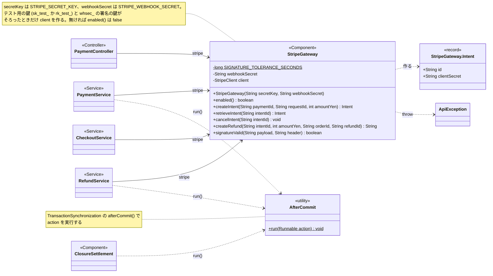
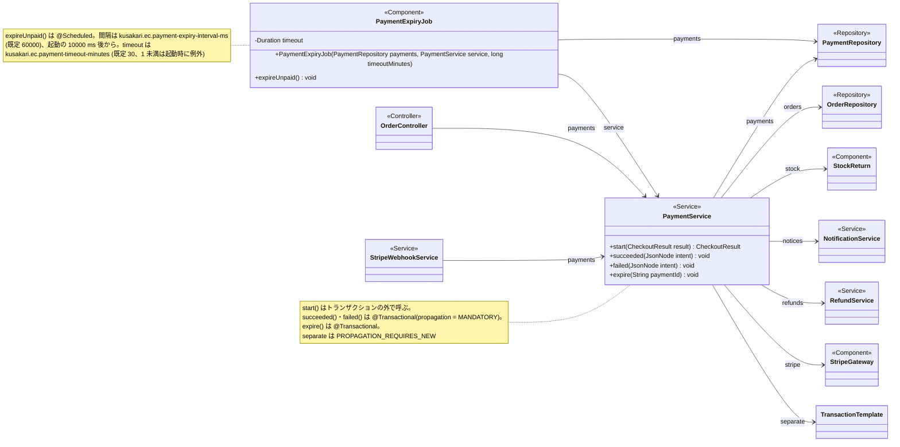
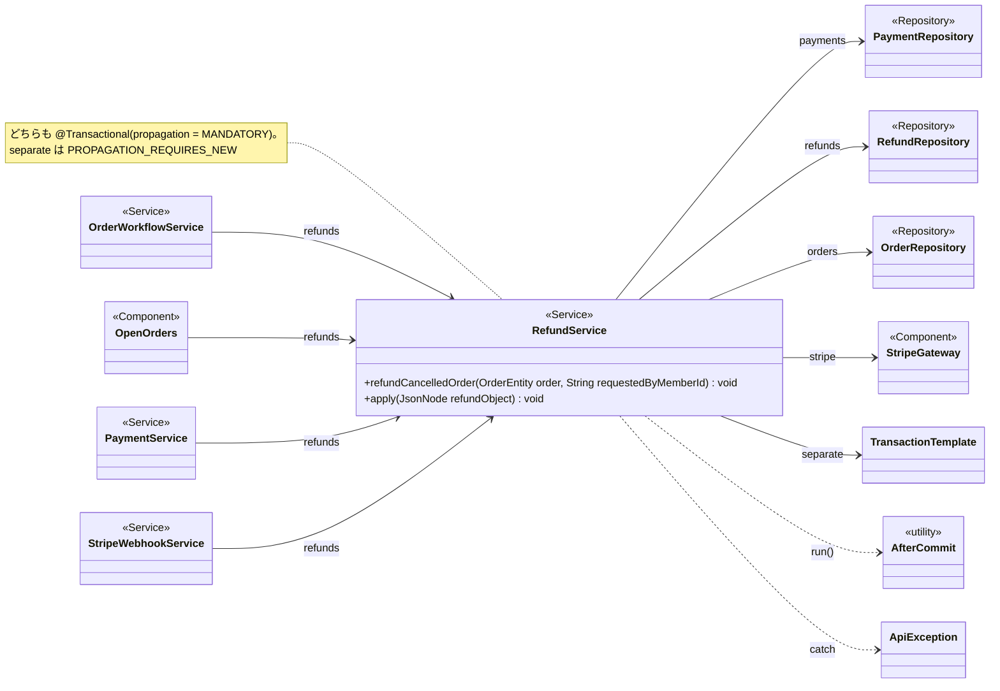
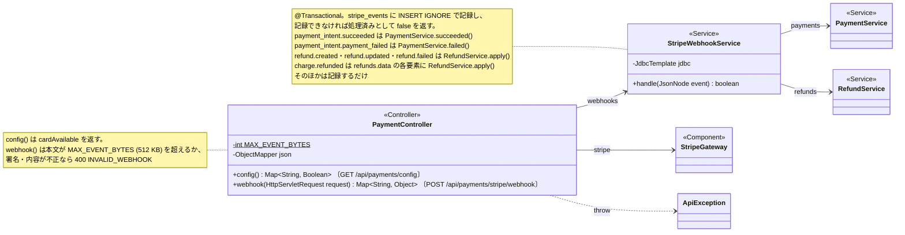

# kusakari-ec 決済（payment パッケージ）のクラス図

- 対象のコード: kusakari-ec の main（19a2be3、2026-11-20 時点）
- 対象のパッケージ: `jp.kusakari.ec.payment`（[backend/src/main/java/jp/kusakari/ec/payment](https://github.com/abeouga/kusakari-ec/tree/19a2be307ee71a2cd87e538236c3c8c42929c5b3/backend/src/main/java/jp/kusakari/ec/payment)）
  - [controller](https://github.com/abeouga/kusakari-ec/tree/19a2be307ee71a2cd87e538236c3c8c42929c5b3/backend/src/main/java/jp/kusakari/ec/payment/controller)、[persistence/entity](https://github.com/abeouga/kusakari-ec/tree/19a2be307ee71a2cd87e538236c3c8c42929c5b3/backend/src/main/java/jp/kusakari/ec/payment/persistence/entity)、[persistence/repository](https://github.com/abeouga/kusakari-ec/tree/19a2be307ee71a2cd87e538236c3c8c42929c5b3/backend/src/main/java/jp/kusakari/ec/payment/persistence/repository)、[service](https://github.com/abeouga/kusakari-ec/tree/19a2be307ee71a2cd87e538236c3c8c42929c5b3/backend/src/main/java/jp/kusakari/ec/payment/service)

## パッケージの役割

payment パッケージは、Stripe（テストモードだけ）を使うカード決済と返金を扱います。

- お会計 1 回のカード払いに、決済を 1 つ作ります（`payments` の 1 行、Stripe の PaymentIntent 1 つ）。金額は、そのお会計の全店舗の注文の合計です。店頭払いのお会計には作りません。
- 決済の結果（成功・失敗）は、Stripe の通知（Webhook）で受け取り、支払い待ち（`PENDING_PAYMENT`）の注文を受け付けるか取り消します。支払われないまま時間が過ぎた決済は、定期処理で取り消します。
- 返金は注文 1 件に 1 行です（`refunds`）。キャンセルの承認、店舗の閉鎖・組織の停止によるまとめてキャンセル、取り消した後に届いた支払いで返金します。結果は Webhook で反映します。
- 注文の行（`OrderEntity`）と在庫の戻し（`StockReturn`）は commerce パッケージ（[04_カートと注文](<04_カートと注文.md>)）のクラスを使います。

## 読み方の要点

- 図の書き方は [04_カートと注文](<04_カートと注文.md>) と同じです。Spring が注入するフィールドは関連（`-->`）にフィールド名を付け、呼ぶだけのものは依存（`..>`）で書きます。ほかのパッケージのクラスとライブラリのクラス（`StripeClient`、`JdbcTemplate`、`TransactionTemplate` など）は名前だけを書きます。
- Entity どうしに JPA の関連はありません。ID の列で参照し、図では依存の破線（`..>`）に参照するフィールド名を付けて示します。列と制約の詳しいことは [テーブル設計図](<../../テーブル設計図/kusakari-ec/>) を見てください。
- Stripe を呼ぶ間は DB のロックを持ちません。決済・返金の行は呼ぶ側のトランザクションで作り、Stripe の呼び出しはコミットの後（`AfterCommit.run()`）か、トランザクションの外（`PaymentService.start()`）で行います。Stripe の ID を行に書くときは、`REQUIRES_NEW` の `TransactionTemplate` で別のトランザクションにします。
- ロックの順は、決済 → 注文（注文 ID の順）→ 在庫（商品 ID の昇順）です。
- 処理の流れは、カードでの購入が [EC-B12](<../../シーケンス図/kusakari-ec/EC-B12_商品を購入する.md>)、キャンセルの承認による返金が [EC-S13](<../../シーケンス図/kusakari-ec/EC-S13_注文キャンセル申請を処理する.md>) にあります。

| クラス | テーブル | 主キー |
| --- | --- | --- |
| `PaymentEntity` | `payments` | `id` |
| `RefundEntity` | `refunds` | `id` |
| （Entity なし。`StripeWebhookService` が `JdbcTemplate` で書く） | `stripe_events` | `event_id` |

| API | Controller のメソッド | 呼ぶもの | ログイン |
| --- | --- | --- | --- |
| `GET /api/payments/config` | `PaymentController.config()` | `StripeGateway.enabled()` | 必要 |
| `POST /api/payments/stripe/webhook` | `PaymentController.webhook()` | `StripeGateway.signatureValid()`、`StripeWebhookService.handle()` | 不要（CSRF の確認もしない。Stripe の署名で確かめる） |

ログインと CSRF の指定は `auth/AuthConfiguration.java` の `cognitoSecurity()` にあります。カード決済を始める `POST /api/orders` は commerce パッケージの `OrderController` が受け、`PaymentService.start()` を呼びます。

## 図 1 決済と返金の Entity と Repository

```mermaid
classDiagram
  direction LR
  class PaymentEntity {
    <<Entity>>
    +String PENDING$
    +String SUCCEEDED$
    +String FAILED$
    +String EXPIRED$
    -String id
    -String cartId
    -String requestId
    -String buyerMemberId
    -String paymentIntentId
    -String status
    -int amountYen
    -Instant createdAt
    +PaymentEntity(String id, String cartId, String requestId, String buyerMemberId, int amountYen)
    +isPending() boolean
    +attachIntent(String paymentIntentId) void
    +succeed() void
    +close(String status) void
  }
  class RefundEntity {
    <<Entity>>
    +String REQUESTED$
    +String SUCCEEDED$
    +String FAILED$
    -String id
    -String orderId
    -String paymentId
    -String stripeRefundId
    -String status
    -int amountYen
    -String requestedByMemberId
    -Instant createdAt
    +RefundEntity(String id, String orderId, String paymentId, int amountYen, String requestedByMemberId)
    +attachStripeRefund(String stripeRefundId) void
    +changeStatus(String status) void
  }
  class JpaRepository~T, ID~ {
    <<interface>>
  }
  class PaymentRepository {
    <<Repository>>
    +findByCartIdAndRequestId(String cartId, String requestId) Optional~PaymentEntity~
    +lock(String id) Optional~PaymentEntity~
    +lockByIntent(String intentId) Optional~PaymentEntity~
    +findPendingBefore(Instant before) List~String~
  }
  class RefundRepository {
    <<Repository>>
    +findByOrderId(String orderId) Optional~RefundEntity~
    +lock(String id) Optional~RefundEntity~
    +lockByStripeRefund(String stripeRefundId) Optional~RefundEntity~
  }
  class OrderEntity {
    <<Entity>>
  }
  class CartEntity {
    <<Entity>>
  }
  class AuthMember {
    <<Entity>>
  }

  JpaRepository <|-- PaymentRepository : PaymentEntity, String
  JpaRepository <|-- RefundRepository : RefundEntity, String
  PaymentRepository ..> PaymentEntity
  RefundRepository ..> RefundEntity
  PaymentEntity ..> CartEntity : cartId
  PaymentEntity ..> AuthMember : buyerMemberId
  RefundEntity ..> OrderEntity : orderId
  RefundEntity ..> PaymentEntity : paymentId
  RefundEntity ..> AuthMember : requestedByMemberId
  OrderEntity ..> PaymentEntity : paymentId

  note for PaymentEntity "payments。お会計 1 回のカード決済 (PaymentIntent 1 つ)。<br/>cartId と requestId でお会計を表す (uk_payments_checkout)"
  note for RefundEntity "refunds。注文 1 件に 1 行 (uk_refunds_order)。<br/>requestedByMemberId は Stripe の管理画面からの返金では null"
  note for PaymentRepository "lock()・lockByIntent() は @Lock(PESSIMISTIC_WRITE)。<br/>findPendingBefore() は PENDING で作成日時が before より前の決済の ID"
  note for RefundRepository "lock()・lockByStripeRefund() は @Lock(PESSIMISTIC_WRITE)"
```

- どちらの Entity にも `@Getter` だけがあり、setter はありません。`attachIntent()` と `attachStripeRefund()` は、まだ ID が無いときだけ入れます。
- `close()` は `FAILED` か `EXPIRED` だけを、`changeStatus()` は `REQUESTED`・`SUCCEEDED`・`FAILED` だけを受け付け、ほかは `IllegalArgumentException` です。
- `payments` と `refunds` には、Entity に対応するフィールドが無い `updated_at` の列があります（MySQL の `ON UPDATE` で変わります）。
- `OrderEntity.paymentId` は、同じお会計（`cart_id`、`request_id`）の決済だけを指せます（外部キー `fk_orders_payment`）。`RefundEntity` の `orderId` と `paymentId` は、その注文が支払われた決済だけを指せます（外部キー `fk_refunds_order`）。
- `OrderEntity`・`CartEntity`（commerce）、`AuthMember`（auth）は名前だけを書いています。

| メソッド | `PaymentEntity.status` | 呼ぶところ |
| --- | --- | --- |
| （作ったとき） | `PENDING` | `CheckoutService.placeOrder()`（commerce） |
| `succeed()` | `SUCCEEDED` | `PaymentService.succeeded()`。`FAILED`・`EXPIRED` の後に届いても `SUCCEEDED` にし、注文は取り消したまま返金する |
| `close("FAILED")` | `FAILED` | `PaymentService.failed()`（`PENDING` のときだけ） |
| `close("EXPIRED")` | `EXPIRED` | `PaymentService.expire()`（`PENDING` のときだけ） |

| メソッド | `RefundEntity.status` | 呼ぶところ |
| --- | --- | --- |
| （作ったとき） | `REQUESTED` | `RefundService.refundCancelledOrder()`、Stripe の管理画面からの返金を記録するとき |
| `changeStatus()` | Stripe の Refund の `succeeded` なら `SUCCEEDED`、`failed`・`canceled` なら `FAILED` | `RefundService.apply()` |
| `changeStatus("FAILED")` | `FAILED` | Stripe に返金を頼めず、`stripeRefundId` が無いまま（`RefundService` の中） |

## 図 2 Stripe の呼び出し

- `StripeGateway` は Stripe の Java ライブラリ（`StripeClient`）を包み、ほかのクラスは Stripe を直接呼びません。鍵が無いときも起動は止めず、カード決済を使えなくします。
- `createIntent()` は、金額（円）、`currency` が `jpy`、自動の売上確定、リダイレクトする支払方法を除く設定、`metadata.payment_id` で PaymentIntent を作ります。Idempotency-Key は `requestId` なので、同じお会計の再送では同じ PaymentIntent が返ります。
- `createRefund()` の Idempotency-Key は `refund-` と注文 ID で、`metadata` に `refund_id` と `order_id` を付けます。
- `client` が無いときに `createIntent()`・`retrieveIntent()`・`createRefund()` を呼ぶと 409 `CARD_PAYMENT_UNAVAILABLE`、Stripe の呼び出しが失敗すると 502 `PAYMENT_PROVIDER_ERROR` の `ApiException` です。`cancelIntent()` は失敗してもログに残すだけです。
- `signatureValid()` は、届いたままの本文と `Stripe-Signature` ヘッダーで署名を確かめます。時刻のずれは 300 秒まで許します。
- `AfterCommit` は `private` のコンストラクターだけを持つ `final` のクラスです。store パッケージの `ClosureSettlement` も使います。
- `CheckoutService`（commerce）、`ClosureSettlement`（store）、`ApiException`（common.web）は名前だけを書いています。

## 図 3 カード決済の Service

- `start()` は、お会計のトランザクションがコミットされた後に `OrderController.checkout()` から呼ばれます。決済に PaymentIntent が無ければ `createIntent()` で作って ID を保存し、あれば `retrieveIntent()` で読み直します。支払い待ちなら `CardPayment.clientSecret` を入れた `CheckoutResult` を返します。
- `succeeded()` は、決済を `SUCCEEDED` にし、`OrderRepository.lockByPayment()` でロックした注文を `acceptPayment()` で受け付け、`NotificationService` で購入者と店舗に知らせます。時間切れ・失敗で取り消した後に届いた支払いは、注文を取り消したまま `RefundService.refundCancelledOrder()` で返金し、購入者に知らせます。
- `failed()` と `expire()` は、`PENDING` の決済だけを `FAILED`・`EXPIRED` にします。注文を `cancelUnpaid()` で取り消し、`StockReturn.restock()` で在庫を戻し、購入者に知らせ、コミットの後で `StripeGateway.cancelIntent()` を呼びます。
- 決済は、通知の PaymentIntent の ID（`lockByIntent()`）で探します。ID をまだ保存していなければ、`metadata.payment_id`（`lock()`）で探します。
- `PaymentExpiryJob.expireUnpaid()` は、`findPendingBefore()` の決済ごとに `expire()` を呼びます。1 件の失敗では止めず、次の回にもう一度試します。
- `OrderRepository`・`StockReturn`・`OrderController`（commerce）、`NotificationService`（notification）、`TransactionTemplate`（Spring）は名前だけを書いています。

## 図 4 返金の Service

- `refundCancelledOrder()` は、注文がカードで支払い済み（決済が `SUCCEEDED` で PaymentIntent がある）のときだけ返金の行（`REQUESTED`、金額は注文の合計）を作ります。店頭払い・未払い・返金済みの注文には何もしません。Stripe への返金の依頼はコミットの後です。
- Stripe に返金を頼めなかった（`StripeGateway.createRefund()` が `ApiException` を投げた）ときは、別のトランザクションで返金の行を `FAILED` にします。
- `apply()` は、Webhook の Refund（ID が `re_` か `pyr_` で始まるもの）を返金の行に反映します。行は Stripe の Refund の ID、`metadata.refund_id` の順に探します。どちらでも見つからず、`metadata.refund_id` を持たない Refund は、Stripe の管理画面からの返金として扱います。同じ PaymentIntent の決済の注文のうち、金額が合い、まだ返金の無い注文 1 件に記録します。注文の状態は変えません。
- 呼ぶところは、キャンセルの承認（commerce の `OrderWorkflowService.decideCancellation()`）、店舗の閉鎖・組織の停止によるまとめてキャンセル（store の `OpenOrders.cancelAll()`）、取り消した後に届いた支払い（`PaymentService.succeeded()`）、Webhook（`StripeWebhookService.handle()`）です。
- `OrderEntity`・`OrderRepository`・`OrderWorkflowService`（commerce）、`OpenOrders`（store）、`ApiException`（common.web）、`TransactionTemplate`（Spring）は名前だけを書いています。

## 図 5 受け口と Webhook の振り分け

- `webhook()` は `{"received": true, "processed": …}` を返します。`processed` は、今回処理したら true、処理済みの通知なら false です。
- `handle()` は、通知の `id` が `evt_` で始まらない、長すぎる、`type` が空か長すぎるときは `IllegalArgumentException` を投げ、`webhook()` が 400 `INVALID_WEBHOOK` にします。
- 記録と処理は 1 つのトランザクションです。処理が失敗すると記録ごと取り消され、Stripe の再送で処理し直します。`PaymentService.succeeded()`・`failed()` と `RefundService.apply()` は、このトランザクションの中で呼ばれます。
- `ApiException`（common.web）、`ObjectMapper`（Jackson）、`JdbcTemplate`（Spring）は名前だけを書いています。

## 図に載せなかったクラス

- 載せなかった payment パッケージのクラスはありません。`StripeGateway.Intent` は図 2 に `StripeGateway.Intent` の名前で載せています。
- `JpaRepository` を除くフレームワークとライブラリのクラス（`StripeClient`、`ObjectMapper`、`JsonNode`、`JdbcTemplate`、`TransactionTemplate`、`PlatformTransactionManager`、`TransactionSynchronization`、`Duration` など）は、フィールドや引数の型、または名前だけの箱として書いています。`PaymentService` と `RefundService` は `PlatformTransactionManager` を受け取り、`TransactionTemplate`（`separate`）を作ります。
- `PaymentExpiryJob`、`RefundService`、`StripeGateway` が持つ `static` の `Logger`（`log`）は書いていません。

## 確かめられなかったこと

- Stripe が同じ Idempotency-Key に同じ PaymentIntent・Refund を返すこと、通知の中身（`data.object` の形、`charge.refunded` に `refunds` が含まれるか）は、コードのコメントと Stripe のライブラリの呼び方から読んだもので、Stripe に送って確かめていません。
- `@Lock(PESSIMISTIC_WRITE)` が MySQL で `FOR UPDATE` になることは、注釈から読んだもので、実行して確かめていません。
