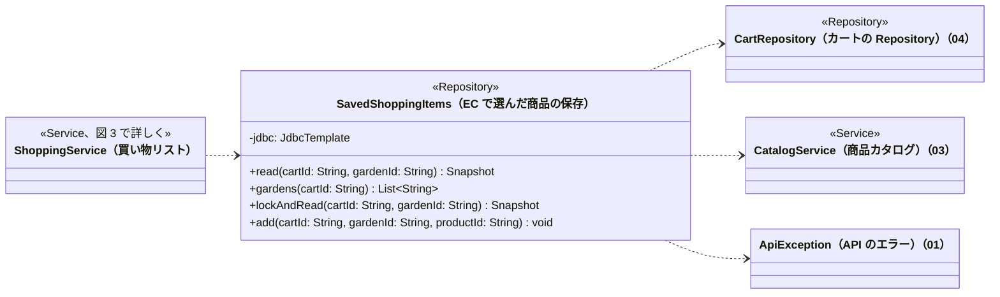
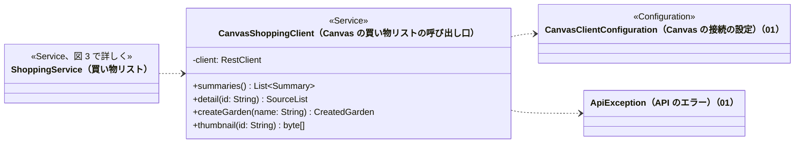
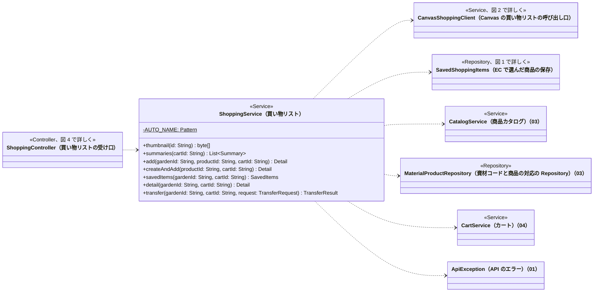
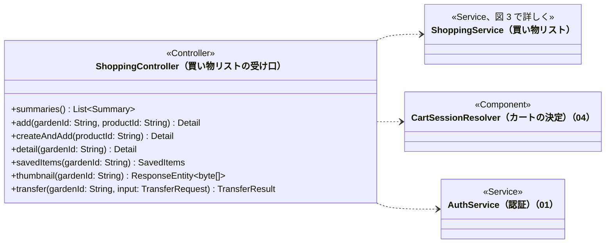
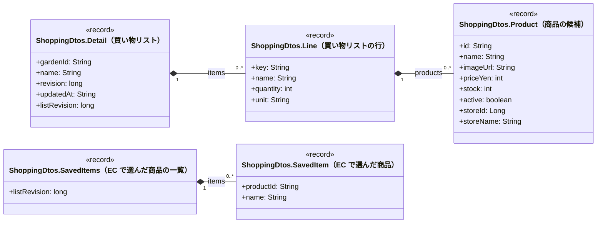
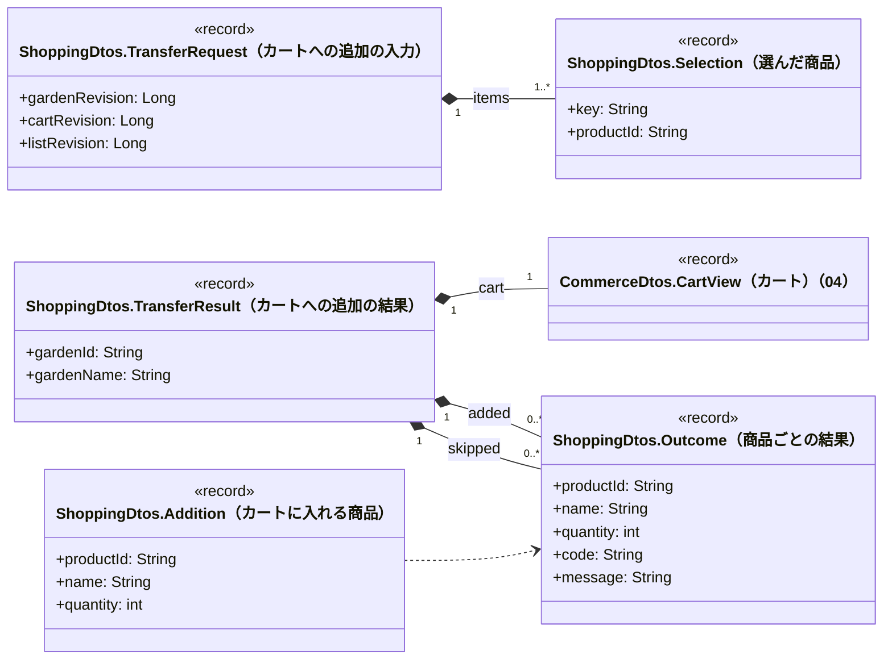
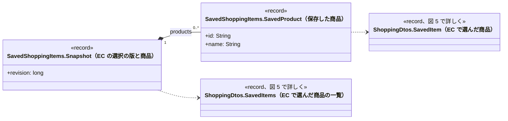
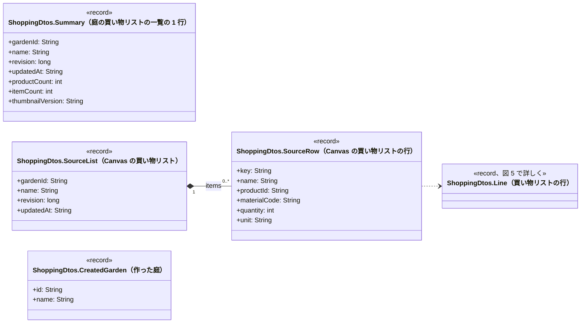

# Kusakari EC クラス図 06 買い物リスト

- 対象のコード: kusakari-ec の main（8892344、2026-11-24 時点）
- 対象のパッケージ: `jp.kusakari.ec.shopping`（[backend/src/main/java/jp/kusakari/ec/shopping](https://github.com/abeouga/kusakari-ec/blob/8892344/backend/src/main/java/jp/kusakari/ec/shopping)）
  - 層のサブパッケージは無く、5 つのファイル（`CanvasShoppingClient.java`、`SavedShoppingItems.java`、`ShoppingController.java`、`ShoppingDtos.java`、`ShoppingService.java`）だけです。
- 全体図とパッケージの対応: [00_全体図](<00_全体図.md>)

shopping パッケージのクラスと record を 8 枚に分けて描きます。図 1〜図 4 はモジュールの図（Repository・Service・Controller）、図 5〜図 8 はデータの図（record）です。呼び出しの順番は [EC-B24](<../../シーケンス図/kusakari-ec/EC-B24_買い物リストを確認する(EC).md>) と [EC-B25](<../../シーケンス図/kusakari-ec/EC-B25_買い物リストから商品をカートに追加する.md>) にあります。

## パッケージの役割

shopping パッケージは、Kusakari Canvas の庭ごとの買い物リストを EC の商品につなぎ、選んだ商品をカートに入れます。

- 必要数は Canvas の配置から決まります。EC は Canvas の API（`CanvasShoppingClient`）で庭の一覧と、庭ごとの行（商品 ID か資材コード、必要数、単位）を読みます。写真や 3D の構成は受け取りません。
- EC で商品カードから庭に追加した商品（EC の選択）は、EC の MySQL（`garden_shopping_lists`、`garden_shopping_items`）に保存します（`SavedShoppingItems`）。表示するときに Canvas の行と合わせます。Canvas の配置は変えません。
- 行ごとの商品の候補・価格・在庫・受取店舗は、EC の商品（catalog パッケージの `CatalogService`、`MaterialProductRepository`、[03_商品カタログ](<03_商品カタログ.md>)）から決めます。資材コードから選ぶ候補には、もう戻らない理由（削除・閉店・停止）で買えない商品を出しません。
- カートへの追加は commerce パッケージの `CartService.addShoppingItems()`（[04_カートと注文](<04_カートと注文.md>)）が行います。

## 図の読み方

- 箱の名前は「英語名（日本語名）」です。英語名はコードのクラス名です。`ShoppingDtos` と `SavedShoppingItems` の中の record は、`ShoppingDtos.Summary` のように入れ物のクラスの名前を付けて書いています。ほかのパッケージのクラスは、名前の後ろに詳しく描いた詳細図の番号（（01）・（03）・（04））を付け、名前だけを書きました。この文書のほかの図で詳しく描いたものには `<<図 n で詳しく>>` と書いています。
- ステレオタイプは、`<<record>>` が Java の record、`<<Repository>>`・`<<Service>>`・`<<Controller>>`・`<<Component>>` が Spring の Bean の種類です。
- フィールドとメソッドは `名前: 型`、`メソッド(引数: 型) 戻り値の型` の形で書きました。`$` の付いた下線のものは static です。record の getter とコンストラクターは書いていません。
- 線は 4 種類です。`*--`（黒い菱形）はコンポジションで、record の JSON の入れ子です。`-->` は関連、`<|--` は継承、`..>` は依存（モジュールの図では Spring が注入するフィールドと呼び出し、データの図では詰め替え先）です。この文書では `-->` と `<|--` を使っていません。
- 線の両端の数字は多重度です。`1` はちょうど 1 つ、`0..*` は 0 個以上、`1..*` は 1 個以上です。コードの上限は図では `*` と書き、各図の下の表に書きました。
- 線のラベルは関連の名前（フィールド名）です。依存の線にはラベルを付けず、注入するフィールドの名前と使っているメソッドは、各図の下の「線とコードの対応」に書きました。
- 関連の線で描いたフィールド（`items`、`products` など）は、箱の中に重ねて書いていません。
- モジュールの図では record の箱を描かず、引数・戻り値の型として書きました。どのクラスがどの record を使うかは「データの図との関係」の表にあります。
- `ShoppingController` のメソッドは `HttpServletRequest` と `HttpServletResponse` も引数に取ります（`thumbnail()` を除く）。どちらも `CartSessionResolver.resolve()` に渡すだけなので、図では省きました。Service の引数の `cartId` は、このときに決まる会員のカートの ID です。EC の選択はカートの ID ごとに保存します。

## 図 1 EC の選択の保存

モジュールの図です。`SavedShoppingItems` は `garden_shopping_lists` と `garden_shopping_items` を SQL（`JdbcTemplate`）で直接読み書きします。この 2 つのテーブルに Entity はありません。戻り値の record（`Snapshot`、`SavedProduct`）は図 7 にあります。

### テーブル

| テーブル | 主キー | 列 | 外部キー |
| --- | --- | --- | --- |
| `garden_shopping_lists` | `cart_id`、`garden_id` | `cart_id`、`garden_id`、`revision`（既定 0） | `fk_garden_lists_cart`（`cart_id` → `carts`、`ON DELETE CASCADE`） |
| `garden_shopping_items` | `cart_id`、`garden_id`、`product_id` | `cart_id`、`garden_id`、`product_id` | `fk_garden_items_list`（`cart_id`、`garden_id` → `garden_shopping_lists`、`ON DELETE CASCADE`）、`fk_garden_items_product`（`product_id` → `products`） |

`garden_id` は Canvas の庭の ID で、外部キーではありません。列の MySQL の型は [テーブル設計図 04_カートと買い物リスト](<../../テーブル設計図/kusakari-ec/04_カートと買い物リスト.md>) を見てください。

### 線とコードの対応

| 線 | フィールド | コード |
| --- | --- | --- |
| ShoppingService → SavedShoppingItems | `saved` | `read()`、`gardens()`、`lockAndRead()`、`add()` |
| SavedShoppingItems → CartRepository | `carts` | `add()` と `lockAndRead()` が `findLocked()` でカートの行をロックする |
| SavedShoppingItems → CatalogService | `catalog` | `add()` が `listing()` で商品を今買えるか確かめる |
| SavedShoppingItems → ApiException | （throw） | 下の「エラー」の表 |

### 部品の決まり

| メソッド | 決まり |
| --- | --- |
| `read()` | `@Transactional(readOnly = true)`。カートと庭の組の EC の選択を、商品 ID の順に返す。`revision` は `garden_shopping_lists.revision`（行が無ければ 0）、商品は `garden_shopping_items` を `products` と結合した商品 ID と名前 |
| `gardens()` | `@Transactional(readOnly = true)`。EC の選択がある（`revision` が 0 より大きい）庭の ID の一覧 |
| `lockAndRead()` | 自身はトランザクションを持たない。`ShoppingService.transfer()` のトランザクションの中で呼ばれ、カートへの追加が終わるまでカートの行のロックを持つ |
| `add()` | `@Transactional`。商品を 1 つ保存して `revision` を 1 増やす。同じ商品がすでにあれば何もしない（数量は持たず、増やさない） |

### エラー

| 状態 | コード | 起きるとき |
| --- | --- | --- |
| 404 | `CART_NOT_FOUND` | カートの行が無い（`add()`、`lockAndRead()`） |
| 409 | `PRODUCT_ARCHIVED` | `add()` で、商品が今買えない（`Listing.purchasable()` が false） |
| 400 | `SHOPPING_LIST_LIMIT` | `add()` で、庭ごとの商品がすでに 200 種類ある |

## 図 2 Canvas の API の呼び出し

モジュールの図です。`CanvasShoppingClient` は Canvas の API を呼びます。受け取る record（`Summary`、`SourceList`、`CreatedGarden`）は図 8 にあります。

### 呼ぶ Canvas の API

| メソッド | Canvas の API | 受け取るもの |
| --- | --- | --- |
| `summaries()` | `GET /api/shopping-lists` | `List<ShoppingDtos.Summary>` |
| `detail()` | `GET /api/gardens/{id}/shopping-list` | `ShoppingDtos.SourceList` |
| `createGarden()` | `POST /api/gardens`（本文は `name` だけ） | `ShoppingDtos.CreatedGarden`（応答の庭の文書から `id` と `name` だけ） |
| `thumbnail()` | `GET /api/gardens/{id}/thumbnail` | PNG の `byte[]` |

### 線とコードの対応

| 線 | フィールド | コード |
| --- | --- | --- |
| ShoppingService → CanvasShoppingClient | `canvas` | `summaries()`、`detail()`、`createGarden()`、`thumbnail()` |
| CanvasShoppingClient → CanvasClientConfiguration | `client` | コンストラクターで `@Qualifier("canvasClient")` の `RestClient` を受け取る |
| CanvasShoppingClient → ApiException | （throw） | 下の「エラー」の表 |

### 部品の決まり

- `canvasClient` の接続先は `kusakari.ec.canvas-api-url`（環境変数 `KUSAKARI_CANVAS_API_URL`）で、ブラウザーから届いた `KUSAKARI_SESSION` の Cookie と `X-CSRF-TOKEN` ヘッダーを、そのまま Canvas に送ります（[01_共通と認証と会員](<01_共通と認証と会員.md>)）。庭の存在と所有者は Canvas が確かめます。

### エラー

| 状態 | コード | 起きるとき |
| --- | --- | --- |
| 404 | `GARDEN_NOT_FOUND` | `detail()`・`thumbnail()` で、Canvas が 404 を返した |
| 503 | `SHOPPING_LIST_UNAVAILABLE` | Canvas につながらない、ほかのエラー、空の応答（`createGarden()` では `id` が無い応答も） |

## 図 3 買い物リストの Service

モジュールの図です。`ShoppingService` は、Canvas の行と EC の選択を合わせ、行ごとに EC の商品の候補を付けます。カートへの追加では、選んだ商品と必要数を確かめて `CartService` に渡します。

### 線とコードの対応

| 線 | フィールド | コード |
| --- | --- | --- |
| ShoppingController → ShoppingService | `shopping` | 受け口ごとに同じ名前のメソッドを呼ぶ（図 4 の表） |
| ShoppingService → CanvasShoppingClient | `canvas` | `summaries()`、`detail()`、`createGarden()`、`thumbnail()` |
| ShoppingService → SavedShoppingItems | `saved` | `gardens()`、`read()`、`add()`、`lockAndRead()` |
| ShoppingService → CatalogService | `catalog` | `listingsByIds()` で候補の商品の価格・在庫・受取店舗と、買えるか（`Listing.purchasable()`、`unavailableReason()`）を読む。`CatalogService.REMOVED_REASONS` で、もう戻らない買えない理由かを見る |
| ShoppingService → MaterialProductRepository | `materials` | `findAllForCodes()` で資材コードから商品 ID を探す |
| ShoppingService → CartService | `carts` | `transfer()` が `addShoppingItems()` |
| ShoppingService → ApiException | （throw） | 下の「エラー」の表 |

### データの図との関係

| メソッド | 受ける record | 返す record |
| --- | --- | --- |
| `summaries()` | `Summary`（Canvas から、図 8）、`Snapshot`（図 7） | `List
`（図 8） |
| `detail()`、`add()`、`createAndAdd()` | `SourceList`・`SourceRow`・`CreatedGarden`（図 8）、`Snapshot`（図 7） | `Detail`（図 5） |
| `savedItems()` | `Snapshot`（図 7） | `SavedItems`（図 5） |
| `transfer()` | `TransferRequest`（図 6）、`SourceList`（図 8）、`Snapshot`（図 7） | `TransferResult`（図 6）。途中で `Addition`（図 6）を作る |

### 部品の決まり

| メソッド | 決まり |
| --- | --- |
| `summaries()` | Canvas の庭の一覧を返す。EC の選択がある庭（`gardens()`）だけは、Canvas の行と EC の選択を合わせた行の数と必要数の合計で、`productCount` と `itemCount` を置き換える |
| `detail()` | Canvas の行（`CanvasShoppingClient.detail()`）と EC の選択（`read()`）を合わせ、行ごとの商品の候補を付けて `Detail` を返す |
| 合わせ方（`private` の `supplement()`） | EC の選択の商品は、キー `product:{商品 ID}` の行が Canvas に無いときだけ、必要数 1、単位 `piece` の行として足す。Canvas に配置があれば、その配置数のまま |
| 候補の決め方（`private` の `resolve()`） | 行に商品 ID があればその商品、無ければ資材コードから `findAllForCodes()` で探した商品。価格・在庫・受取店舗は `listingsByIds()` の商品のもの |
| 資材コードの候補から外す商品（`private` の `removed()`） | 資材コードから探した候補のうち、買えず、買えない理由が `CatalogService.REMOVED_REASONS`（`DELETED`、`STORE_CLOSED`、`STORE_SUSPENDED`、`ORGANIZATION_SUSPENDED`）のものは出さない。商品 ID を指定した行は、買えない理由を出すため残す（`active` が false の候補になる） |
| `add()` | 先に `CanvasShoppingClient.detail()` で庭が自分のものかを確かめてから、`SavedShoppingItems.add()` で保存する |
| `createAndAdd()` | Canvas の庭の名前のうち `AUTO_NAME`（`買い物リスト` と 1〜6 桁の数字）に合う数字の最大値に 1 を足して、「買い物リストN」の庭を `createGarden()` で作り、`add()` を呼ぶ |
| `savedItems()` | EC の選択だけを返し、Canvas を呼ばない。Canvas の編集画面が、まだ保存していない配置と合わせて表示するのに使う |
| `transfer()` | `@Transactional(isolation = READ_COMMITTED)`（このクラスで 1 つだけ）。Canvas を呼び終えてから `lockAndRead()` でカートの行をロックする。同じ商品の必要数は足し合わせて `addShoppingItems()` に渡す |

### エラー

| 状態 | コード | 起きるとき |
| --- | --- | --- |
| 409 | `GARDEN_CHANGED` | `transfer()` で、庭の版（`gardenRevision`）が Canvas の今の版と違う |
| 409 | `SHOPPING_LIST_CHANGED` | `transfer()` で、EC の選択の版（`listRevision`、無ければ 0）が今の版と違う |
| 400 | `INVALID_SELECTION` | `transfer()` で、選んだキーが重複している、行に無い、行の候補に無い商品 |

## 図 4 受け口

モジュールの図です。`ShoppingController` は、EC と Canvas の画面からの買い物リストの API を受けます。

### API と受け口

| API | Controller のメソッド | Service のメソッド | 呼ぶ画面とシーケンス図 |
| --- | --- | --- | --- |
| `GET /api/shopping-lists` | `summaries()` | `ShoppingService.summaries()` | EC のカート画面（[EC-B24](<../../シーケンス図/kusakari-ec/EC-B24_買い物リストを確認する(EC).md>)） |
| `GET /api/shopping-lists/{gardenId}` | `detail()` | `ShoppingService.detail()` | EC のカート画面（[EC-B24](<../../シーケンス図/kusakari-ec/EC-B24_買い物リストを確認する(EC).md>)、[EC-B25](<../../シーケンス図/kusakari-ec/EC-B25_買い物リストから商品をカートに追加する.md>)） |
| `GET /api/shopping-lists/{gardenId}/thumbnail` | `thumbnail()` | `ShoppingService.thumbnail()` | EC のカート画面（[EC-B24](<../../シーケンス図/kusakari-ec/EC-B24_買い物リストを確認する(EC).md>)） |
| `POST /api/cart/shopping-lists/{gardenId}/items` | `transfer()` | `ShoppingService.transfer()` | EC のカート画面（[EC-B25](<../../シーケンス図/kusakari-ec/EC-B25_買い物リストから商品をカートに追加する.md>)） |
| `GET /api/shopping-lists/{gardenId}/saved-items` | `savedItems()` | `ShoppingService.savedItems()` | Canvas の編集画面（[UC-09](<../../シーケンス図/kusakari-canvas/UC-09_買い物リストを表示する.md>)、[UC-01](<../../シーケンス図/kusakari-canvas/UC-01_庭プロジェクトを新規作成する.md>)、[UC-01-1](<../../シーケンス図/kusakari-canvas/UC-01-1_庭プロジェクトを開く.md>)、[UC-05](<../../シーケンス図/kusakari-canvas/UC-05_庭オブジェクトを配置・編集する.md>)） |
| `PUT /api/shopping-lists/{gardenId}/items/{productId}` | `add()` | `ShoppingService.add()` | なし（下の注を参照） |
| `POST /api/shopping-lists/items/{productId}` | `createAndAdd()` | `ShoppingService.createAndAdd()` | なし（下の注を参照） |

- どれもログインが必要で、購入者（と運営）だけが使えます。`thumbnail()` は `AuthService.requireBuyer()` を直接呼び、ほかは `CartSessionResolver.resolve()` の中で確かめます。
- `thumbnail()` は、Canvas の `GET /api/gardens/{id}/thumbnail` の応答を、`image/png`・`Cache-Control: private, no-cache` でそのまま返します。
- `transfer()` の本文は `@Valid` で検証します（図 6 の「値の制約」）。
- `add()` と `createAndAdd()` を呼ぶ画面は、EC の商品カードの追加先ダイアログ（`frontend/src/components/AddToShoppingList.jsx`）です。8892344 の main でも、`frontend/src/components/Catalog.jsx` がそのダイアログの呼び出しをコメントにしているので、画面からは呼ばれません。受け口とサーバーの処理は残っています。

### 線とコードの対応

| 線 | フィールド | コード |
| --- | --- | --- |
| ShoppingController → ShoppingService | `shopping` | 上の表の Service のメソッド |
| ShoppingController → CartSessionResolver | `sessions` | `thumbnail()` 以外が `resolve()` でカートの ID を決める |
| ShoppingController → AuthService | `auth` | `thumbnail()` が `requireBuyer()` |

## 図 5 画面に返す DTO

データの図です。`Detail` は EC のカート画面が表示する買い物リスト、`SavedItems` は Canvas の編集画面が読む EC の選択です。

### フィールドの意味

| フィールド | 意味 |
| --- | --- |
| `Detail.revision` | Canvas の庭の版 |
| `Detail.listRevision`、`SavedItems.listRevision` | EC の選択の版（`garden_shopping_lists.revision`） |
| `Line` | `SourceRow`（図 8）に商品の候補（`products`）を付けたもの。候補が 2 つ以上ある行は、購入者が 1 つを選ぶ |
| `Product.active` | 今カートに入れられるか（`CatalogService.Listing.purchasable()`）。資材コードの行には、もう戻らない理由で買えない商品は候補に入らないので、`active` が false になるのは一時的な理由（在庫切れ、非公開など）か、商品 ID を指定した行 |
| `Product.stock` | 在庫数。在庫が足りるかは、画面が必要数と比べて表示し、カートに入れるときに `CartService.addShoppingItems()` も確かめる（足りなければ `OUT_OF_STOCK`） |
| `Product.storeId`、`storeName` | 商品の店舗（在庫を持ち、受け渡す店舗）。`ProductView.sellerStoreId`・`sellerStoreName` |

### 関連の上限

| 関連 | 上限 | 根拠 |
| --- | --- | --- |
| `Detail.items` | 制約なし | Canvas の行の数と EC の選択（庭ごとに 200 種類まで）による |
| `SavedItems.items` | 200 | `SavedShoppingItems.add()` が 200 種類を超えると `SHOPPING_LIST_LIMIT` |

## 図 6 カートへの追加の DTO

データの図です。`TransferRequest` が `POST /api/cart/shopping-lists/{gardenId}/items` の本文、`TransferResult` がその応答です。`Addition` は `ShoppingService.transfer()` が作って `CartService.addShoppingItems()` に渡す、サーバーの中だけの record です。

### 値の制約

| record | 検証 |
| --- | --- |
| `TransferRequest` | `gardenRevision` と `cartRevision` は必須で 0 以上（`@NotNull`、`@PositiveOrZero`）、`items` は 1〜200 件（`@NotEmpty`、`@Size(max = 200)`、要素は `@NotNull @Valid`）、`listRevision` は 0 以上（無ければ 0 として比べる） |
| `Selection` | `key` は空でなく 100 文字まで、`productId` は空でなく 40 文字まで |

### 関連の上限と線の意味

| 線 | 意味 |
| --- | --- |
| `TransferRequest.items` | 1〜200 件 |
| `TransferResult.cart` | 追加した後のカート。`CartView` のフィールドは [04_カートと注文](<04_カートと注文.md>) にある |
| `TransferResult.added`、`skipped` | `CartService.addShoppingItems()`（commerce）が `Addition` ごとに `Outcome` を作り、どちらかに入れる。`code` は `added` では空、`skipped` では `PRODUCT_ARCHIVED`・`QUANTITY_LIMIT`・`OUT_OF_STOCK`・`CART_LIMIT` |
| `Addition` → `Outcome`（依存） | 詰め替え先。`Outcome` の `productId`・`name`・`quantity` は `Addition` の値 |

- 画面は数量を送りません。必要数はサーバーが Canvas から読み直します。

## 図 7 EC の選択の record

データの図です。`SavedShoppingItems` が返す record です。前の版の図 1 に `SavedShoppingItems` と一緒に描いていたものを、データの図とモジュールの図を分けるために、この図に移しました。

| もの | 意味 |
| --- | --- |
| `Snapshot.revision` | `garden_shopping_lists.revision`（行が無ければ 0） |
| `Snapshot.products` | `garden_shopping_items` を `products` と結合した商品 ID と名前。商品 ID の順。上限は 200（図 5 の「関連の上限」） |
| `Snapshot` → `SavedItems`、`SavedProduct` → `SavedItem`（依存） | 詰め替え先。`ShoppingService.savedItems()` が `revision` を `listRevision` に、`id` を `productId` に入れる |

## 図 8 Canvas から受け取る DTO

データの図です。`CanvasShoppingClient` が Canvas の API の応答から作る record です。前の版の図 2 に `CanvasShoppingClient` と一緒に描いていたものを、データの図とモジュールの図を分けるために、この図に移しました。

| もの | 意味 |
| --- | --- |
| Canvas の型との対応 | `Summary` と `SourceList`・`SourceRow` は、Canvas の `ShoppingSummary` と `ShoppingList`・`ShoppingRow`（[backend/kusakari_canvas_api/shopping.py](https://github.com/abeouga/kusakari-canvas/blob/2c043a4/backend/kusakari_canvas_api/shopping.py)）と同じ名前のフィールドを持つ。`updatedAt` は Canvas では `datetime` で、EC では JSON の文字列のまま受け取る |
| `Summary` | `GET /api/shopping-lists` の応答として、そのまま画面にも返す（EC の選択がある庭は `productCount`・`itemCount` を置き換える） |
| `SourceRow.key` | `product:{商品 ID}` か `asset:{アセット ID}` |
| `SourceRow.productId` | Canvas で null 可。無い行は `materialCode` で商品を探す |
| `CreatedGarden` | Canvas の `POST /api/gardens` の応答（庭の文書）から `id` と `name` だけを受け取る |
| `SourceList.items` | 上限は Canvas の行の数による（EC では制約なし） |
| `SourceRow` → `Line`（依存） | 詰め替え先。`ShoppingService` の `resolve()` が `key`・`name`・`quantity`・`unit` を写し、候補の商品を付ける |

## クラスとコードの対応

| クラス | ファイル | 図 |
| --- | --- | --- |
| `CanvasShoppingClient` | [CanvasShoppingClient.java](https://github.com/abeouga/kusakari-ec/blob/8892344/backend/src/main/java/jp/kusakari/ec/shopping/CanvasShoppingClient.java) | 図 2 |
| `SavedShoppingItems`、`SavedShoppingItems.Snapshot`、`SavedShoppingItems.SavedProduct` | [SavedShoppingItems.java](https://github.com/abeouga/kusakari-ec/blob/8892344/backend/src/main/java/jp/kusakari/ec/shopping/SavedShoppingItems.java) | 図 1、図 7 |
| `ShoppingController` | [ShoppingController.java](https://github.com/abeouga/kusakari-ec/blob/8892344/backend/src/main/java/jp/kusakari/ec/shopping/ShoppingController.java) | 図 4 |
| `ShoppingDtos` の 14 個の record | [ShoppingDtos.java](https://github.com/abeouga/kusakari-ec/blob/8892344/backend/src/main/java/jp/kusakari/ec/shopping/ShoppingDtos.java) | 図 5、図 6、図 8 |
| `ShoppingService` | [ShoppingService.java](https://github.com/abeouga/kusakari-ec/blob/8892344/backend/src/main/java/jp/kusakari/ec/shopping/ShoppingService.java) | 図 3 |

## 載せなかったもの

| もの | 理由 | 載せた図 |
| --- | --- | --- |
| `ShoppingDtos` そのもの | record を入れるためだけの `final` のクラスで、`private` のコンストラクターしか持たないため。中の 14 個の record（`Summary`、`SourceRow`、`SourceList`、`CreatedGarden`、`SavedItem`、`SavedItems`、`Product`、`Line`、`Detail`、`Selection`、`TransferRequest`、`Addition`、`Outcome`、`TransferResult`）は `ShoppingDtos.〜` の名前で載せた | 図 5、図 6、図 8 |
| `garden_shopping_lists`、`garden_shopping_items` | Entity が無く、`SavedShoppingItems` が `JdbcTemplate` で直接読み書きするため | 図 1 の「テーブル」の表 |
| `ShoppingService` の `private` のメソッド（`supplement()`、`resolve()`、`removed()`、`invalidSelection()`）と `SavedShoppingItems.lock()` | 業務の操作の中だけで使う部品のため | 図 3・図 1 の「部品の決まり」の表 |
| ライブラリのクラス（`RestClient`、`JdbcTemplate`、`Pattern`、`HttpServletRequest`、`HttpServletResponse`、`ResponseEntity` など） | 業務のクラスではないため。フィールドや引数の型として書いた | 図 1〜図 4 の箱の中 |
| 前の版の図の note と線のラベル（`作る`、`受け取る`、`throw` など） | 図の中で note と関数名を使わない決まりのため | 各図の表 |

## 確かめられなかったこと

- GitHub と Obsidian での表示は確かめていません。PNG は mermaid-snap（Mermaid 11.4.1）で書き出したものです。
- Canvas の `GET /api/shopping-lists` と `GET /api/gardens/{id}/shopping-list` が、EC から送った Cookie で会員を決めて庭を絞ることは、Canvas の受け口が `Owner` の依存を取ることまで確かめました。EC と Canvas をつないで動かしては確かめていません。
- Canvas の型との対応は、kusakari-canvas の 2c043a4 の `shopping.py` で確かめました。EC の 8892344 と同じ時点の Canvas がどのコミットかは確かめていません。
- ほかのパッケージのクラスの日本語名（`CartSessionResolver`、`MaterialProductRepository` など）は、この文書で付けたもので、01・03・04 の詳細図の名前と合わせていません（同じ時間に直されているため）。
