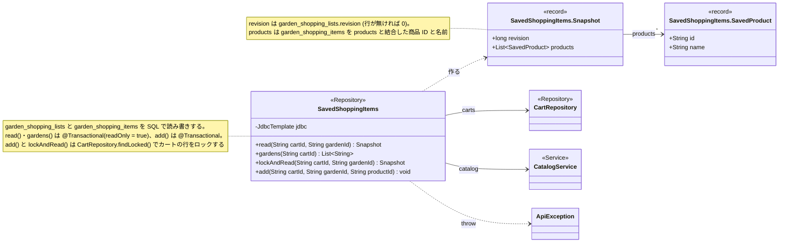
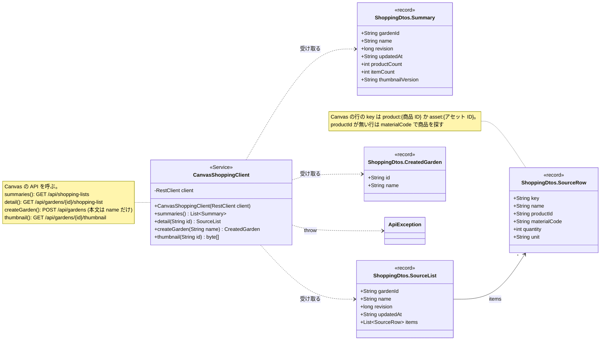
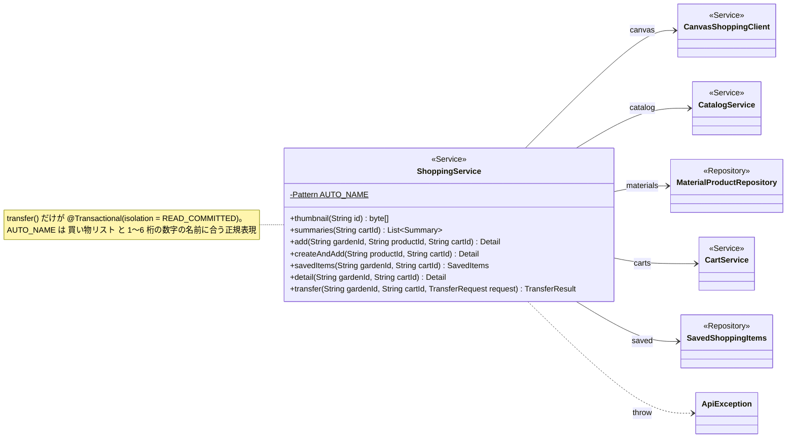
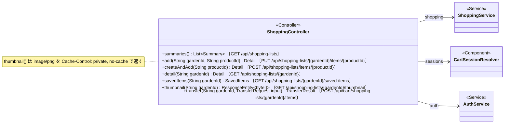
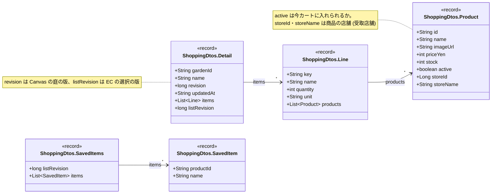
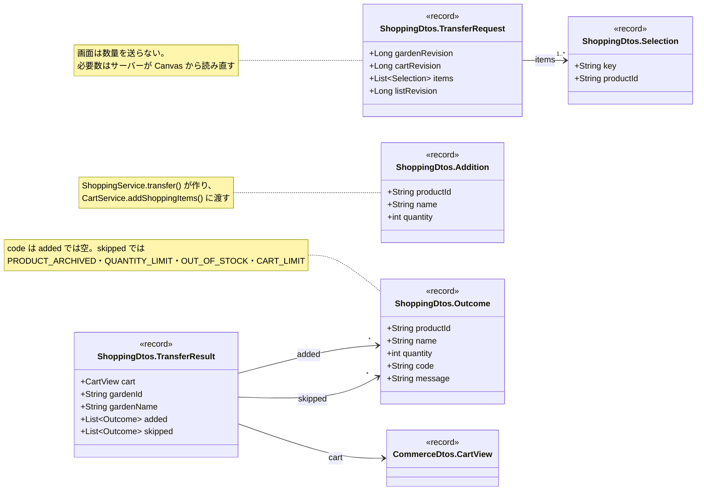

# kusakari-ec 買い物リスト（shopping パッケージ）のクラス図

- 対象のコード: kusakari-ec の main（19a2be3、2026-11-20 時点）
- 対象のパッケージ: `jp.kusakari.ec.shopping`（[backend/src/main/java/jp/kusakari/ec/shopping](https://github.com/abeouga/kusakari-ec/tree/19a2be307ee71a2cd87e538236c3c8c42929c5b3/backend/src/main/java/jp/kusakari/ec/shopping)）
  - 層のサブパッケージは無く、5 つのファイル（`CanvasShoppingClient.java`、`SavedShoppingItems.java`、`ShoppingController.java`、`ShoppingDtos.java`、`ShoppingService.java`）だけです。

## パッケージの役割

shopping パッケージは、Kusakari Canvas の庭ごとの買い物リストを EC の商品につなぎ、選んだ商品をカートに入れます。

- 必要数は Canvas の配置から決まります。EC は Canvas の API（`CanvasShoppingClient`）で庭の一覧と、庭ごとの行（商品 ID か資材コード、必要数、単位）を読みます。写真や 3D の構成は受け取りません。
- EC で商品カードから庭に追加した商品（EC の選択）は、EC の MySQL（`garden_shopping_lists`、`garden_shopping_items`）に保存します（`SavedShoppingItems`）。表示するときに Canvas の行と合わせます。Canvas の配置は変えません。
- 行ごとの商品の候補・価格・在庫・受取店舗は、EC の商品（catalog パッケージの `CatalogService`、`MaterialProductRepository`）から決めます。
- カートへの追加は commerce パッケージの `CartService.addShoppingItems()`（[04_カートと注文](<04_カートと注文.md>)）が行います。

## 読み方の要点

- 図の書き方は [04_カートと注文](<04_カートと注文.md>) と同じです。Spring が注入するフィールドは関連（`-->`）にフィールド名を付け、呼ぶだけ・作るだけのものは依存（`..>`）で書きます。ほかのパッケージのクラスは名前だけを書きます。
- `ShoppingDtos` と `SavedShoppingItems` の中の record は、`ShoppingDtos.Summary` のように入れ物のクラスの名前を付けて書いています。
- `ShoppingController` のメソッドは `HttpServletRequest` と `HttpServletResponse` も引数に取ります（`thumbnail()` を除く）。どちらも `CartSessionResolver.resolve()` に渡すだけなので、図では省きました。`cartId` は、このときに決まる会員のカートの ID です。EC の選択はカートの ID ごとに保存します。
- `garden_shopping_lists` と `garden_shopping_items` に Entity はありません。`SavedShoppingItems` が SQL を `JdbcTemplate` で直接実行します。列と制約の詳しいことは [テーブル設計図](<../../テーブル設計図/kusakari-ec/>) を見てください。

| テーブル | 主キー | 読み書きするクラス |
| --- | --- | --- |
| `garden_shopping_lists`（`cart_id`、`garden_id`、`revision`） | `cart_id`、`garden_id` | `SavedShoppingItems` |
| `garden_shopping_items`（`cart_id`、`garden_id`、`product_id`） | `cart_id`、`garden_id`、`product_id` | `SavedShoppingItems` |

| API | Controller のメソッド | Service のメソッド | 呼ぶ画面とシーケンス図 |
| --- | --- | --- | --- |
| `GET /api/shopping-lists` | `summaries()` | `ShoppingService.summaries()` | EC のカート画面（[EC-B24](<../../シーケンス図/kusakari-ec/EC-B24_買い物リストを確認する(EC).md>)） |
| `GET /api/shopping-lists/{gardenId}` | `detail()` | `ShoppingService.detail()` | EC のカート画面（[EC-B24](<../../シーケンス図/kusakari-ec/EC-B24_買い物リストを確認する(EC).md>)、[EC-B25](<../../シーケンス図/kusakari-ec/EC-B25_買い物リストから商品をカートに追加する.md>)） |
| `GET /api/shopping-lists/{gardenId}/thumbnail` | `thumbnail()` | `ShoppingService.thumbnail()` | EC のカート画面（[EC-B24](<../../シーケンス図/kusakari-ec/EC-B24_買い物リストを確認する(EC).md>)） |
| `POST /api/cart/shopping-lists/{gardenId}/items` | `transfer()` | `ShoppingService.transfer()` | EC のカート画面（[EC-B25](<../../シーケンス図/kusakari-ec/EC-B25_買い物リストから商品をカートに追加する.md>)） |
| `GET /api/shopping-lists/{gardenId}/saved-items` | `savedItems()` | `ShoppingService.savedItems()` | Canvas の編集画面（[UC-09](<../../シーケンス図/kusakari-canvas/UC-09_買い物リストを表示する.md>)、[UC-01](<../../シーケンス図/kusakari-canvas/UC-01_庭プロジェクトを新規作成する.md>)、[UC-01-1](<../../シーケンス図/kusakari-canvas/UC-01-1_庭プロジェクトを開く.md>)、[UC-05](<../../シーケンス図/kusakari-canvas/UC-05_庭オブジェクトを配置・編集する.md>)） |
| `PUT /api/shopping-lists/{gardenId}/items/{productId}` | `add()` | `ShoppingService.add()` | なし（下の注を参照） |
| `POST /api/shopping-lists/items/{productId}` | `createAndAdd()` | `ShoppingService.createAndAdd()` | なし（下の注を参照） |

どれもログインが必要で、購入者（と運営）だけが使えます。`thumbnail()` は `AuthService.requireBuyer()` を直接呼び、ほかは `CartSessionResolver.resolve()` の中で確かめます。

`add()` と `createAndAdd()` を呼ぶ画面は、EC の商品カードの追加先ダイアログ（`frontend/src/components/AddToShoppingList.jsx`）です。この時点の main では、`frontend/src/components/Catalog.jsx` がそのダイアログの呼び出しをコメントにしているので、画面からは呼ばれません。受け口とサーバーの処理は残っています。

## 図 1 EC の選択の保存

- `read()` は、カートと庭の組の EC の選択を、商品 ID の順に返します。`gardens()` は、EC の選択がある（`revision` が 0 より大きい）庭の ID の一覧です。
- `add()` は、商品を 1 つ保存して `revision` を 1 増やします。同じ商品がすでにあれば何もしません（数量は持たず、増やしません）。買えない商品は 409 `PRODUCT_ARCHIVED`、庭ごとに 200 種類を超えると 400 `SHOPPING_LIST_LIMIT` です。
- `lockAndRead()` 自身はトランザクションを持ちません。`ShoppingService.transfer()` のトランザクションの中で呼ばれ、カートへの追加が終わるまでカートの行のロックを持ちます。
- カートの行が無ければ 404 `CART_NOT_FOUND` です。
- `CartRepository`（commerce）、`CatalogService`（catalog）、`ApiException`（common.web）は名前だけを書いています。

## 図 2 Canvas の API の呼び出し

- `client` は、common パッケージの `CanvasClientConfiguration` が作る `canvasClient` という名前の `RestClient` です。接続先は `kusakari.ec.canvas-api-url`（環境変数 `KUSAKARI_CANVAS_API_URL`）で、ブラウザーから届いた `KUSAKARI_SESSION` の Cookie と `X-CSRF-TOKEN` ヘッダーを、そのまま Canvas に送ります。庭の存在と所有者は Canvas が確かめます。
- Canvas が 404 を返すと 404 `GARDEN_NOT_FOUND`（`detail()`、`thumbnail()`）、つながらない・ほかのエラー・空の応答は 503 `SHOPPING_LIST_UNAVAILABLE` の `ApiException` です。
- `Summary` と `SourceList`・`SourceRow` は、Canvas の `ShoppingSummary` と `ShoppingList`・`ShoppingRow`（[backend/kusakari_canvas_api/shopping.py](https://github.com/abeouga/kusakari-canvas/blob/c19d497dfef15b119f9bce8ecb5c886a36da6b7d/backend/kusakari_canvas_api/shopping.py)）と同じ名前のフィールドを持ちます。`CreatedGarden` は、Canvas の `POST /api/gardens` の応答（庭の文書）から `id` と `name` だけを受け取ります。
- `Summary` は、`GET /api/shopping-lists` の応答として画面にも返します。
- `ApiException`（common.web）は名前だけを書いています。

## 図 3 買い物リストの Service

- `summaries()` は Canvas の庭の一覧を返します。EC の選択がある庭（`SavedShoppingItems.gardens()`）だけは、Canvas の行と EC の選択を合わせた行の数と必要数の合計で、`productCount` と `itemCount` を置き換えます。
- `detail()` は、Canvas の行（`CanvasShoppingClient.detail()`）と EC の選択（`SavedShoppingItems.read()`）を合わせ、行ごとの商品の候補を付けて `Detail` を返します。
  - 合わせ方（`private` の `supplement()`）: EC の選択の商品は、キー `product:{商品 ID}` の行が Canvas に無いときだけ、必要数 1、単位 `piece` の行として足します。Canvas に配置があれば、その配置数のままです。
  - 候補の決め方（`private` の `resolve()`）: 行に商品 ID があればその商品、無ければ資材コードから `MaterialProductRepository.findAllForCodes()` で探した商品です。価格・在庫・受取店舗は `CatalogService.listingsByIds()` の商品のものです。
- `add()` は、先に `CanvasShoppingClient.detail()` で庭が自分のものかを確かめてから、`SavedShoppingItems.add()` で保存します。
- `createAndAdd()` は、Canvas の庭の名前のうち `AUTO_NAME` に合う数字の最大値に 1 を足して、「買い物リストN」の庭を `CanvasShoppingClient.createGarden()` で作り、`add()` を呼びます。
- `savedItems()` は EC の選択だけを返し、Canvas を呼びません。Canvas の編集画面が、まだ保存していない配置と合わせて表示するのに使います。
- `transfer()` は、Canvas を呼び終えてから `SavedShoppingItems.lockAndRead()` でカートの行をロックします。庭の版が違えば 409 `GARDEN_CHANGED`、EC の選択の版が違えば 409 `SHOPPING_LIST_CHANGED` です。選んだキーが重複している、行に無い、行の候補に無い商品のときは 400 `INVALID_SELECTION` です。同じ商品の必要数は足し合わせて、`CartService.addShoppingItems()` に渡します。
- `CatalogService`・`MaterialProductRepository`（catalog）、`CartService`（commerce）、`ApiException`（common.web）は名前だけを書いています。

## 図 4 受け口

- `thumbnail()` の画像は、Canvas の `GET /api/gardens/{id}/thumbnail` の応答をそのまま返します。
- `CartSessionResolver`（commerce）、`AuthService`（auth）は名前だけを書いています。

## 図 5 画面に返す DTO

- `Line` は、`SourceRow` に商品の候補（`products`）を付けたものです。候補が 2 つ以上ある行は、購入者が 1 つを選びます。
- `Product.active` は `CatalogService.Listing.purchasable()` です。在庫数は `stock` で返します。在庫が足りるかは、画面が必要数と比べて表示し、カートに入れるときに `CartService.addShoppingItems()` も確かめます（足りなければ `OUT_OF_STOCK`）。

## 図 6 カートへの追加の DTO

- `Outcome` は `CartService.addShoppingItems()`（commerce）が作ります。見送った商品は、カートに入れずに理由と知らせの文を返します。
- `CartView` のフィールドは [04_カートと注文](<04_カートと注文.md>) の図 9 にあります。
- 要求の record の入力の検証は次のとおりです。

| record | 検証 |
| --- | --- |
| `TransferRequest` | `gardenRevision` と `cartRevision` は必須で 0 以上、`items` は 1〜200 件（`@NotEmpty`、`@Size(max = 200)`）、`listRevision` は 0 以上（無ければ 0 として比べる） |
| `Selection` | `key` は空でなく 100 文字まで、`productId` は空でなく 40 文字まで |

## 図に載せなかったクラス

- `ShoppingDtos`: record を入れるためだけの `final` のクラスで、`private` のコンストラクターしか持ちません。中の 14 個の record（`Summary`、`SourceRow`、`SourceList`、`CreatedGarden`、`SavedItem`、`SavedItems`、`Product`、`Line`、`Detail`、`Selection`、`TransferRequest`、`Addition`、`Outcome`、`TransferResult`）は、図 2・図 5・図 6 に `ShoppingDtos.〜` の名前で載せています。
- `RestClient`、`JdbcTemplate`、`Pattern`、`HttpServletRequest`、`HttpServletResponse`、`ResponseEntity` などのフレームワークと Java のクラスは、図に箱を作らず、フィールドや引数の型として書いています。

## 確かめられなかったこと

- Canvas の `GET /api/shopping-lists` と `GET /api/gardens/{id}/shopping-list` が、EC から送った Cookie で会員を決めて庭を絞ることは、Canvas の受け口が `Owner` の依存を取ることまで確かめました。EC と Canvas をつないで動かしては確かめていません。
