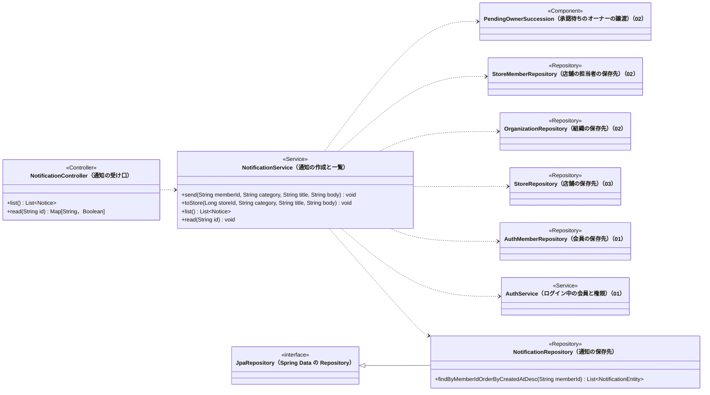
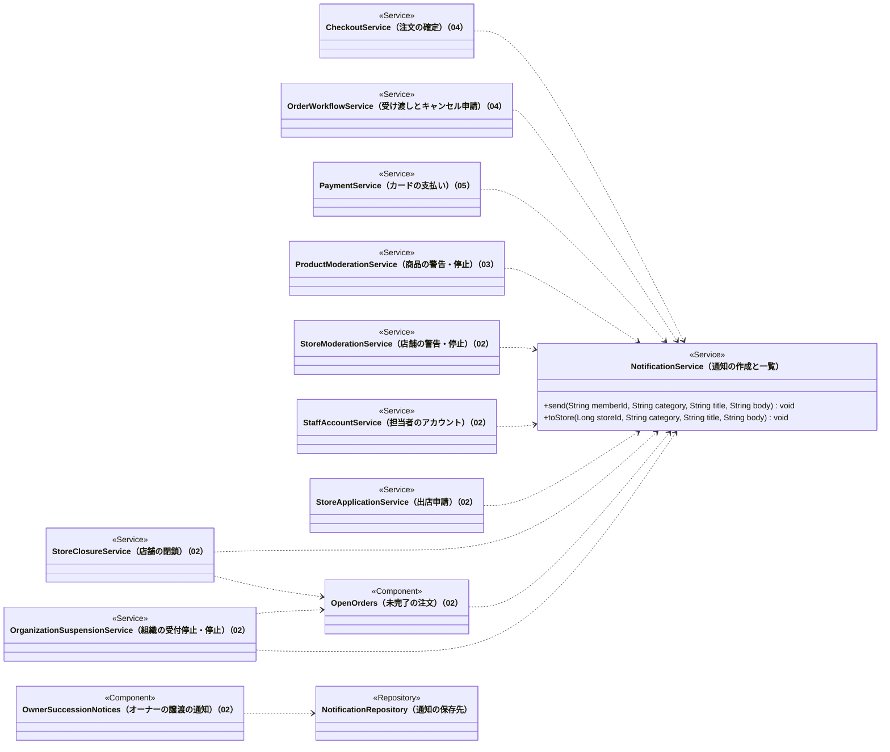
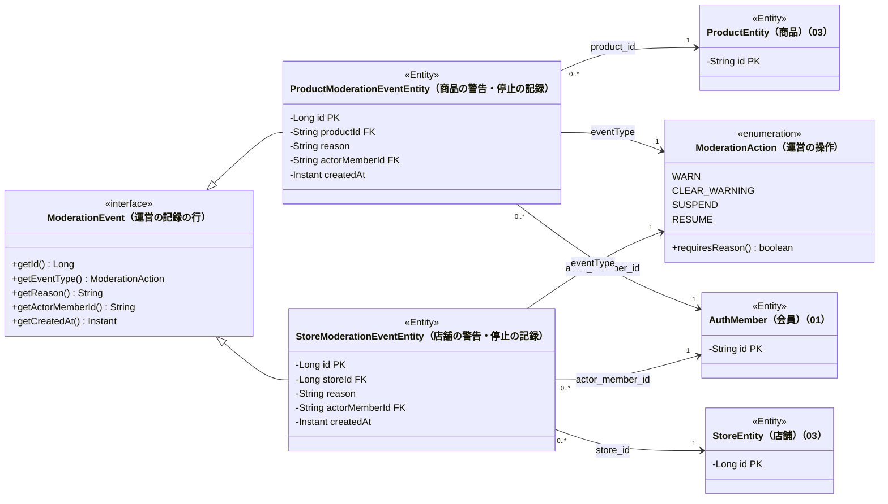
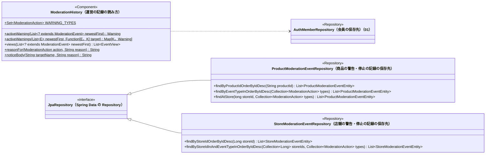
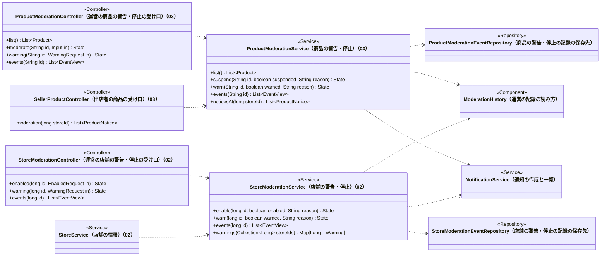
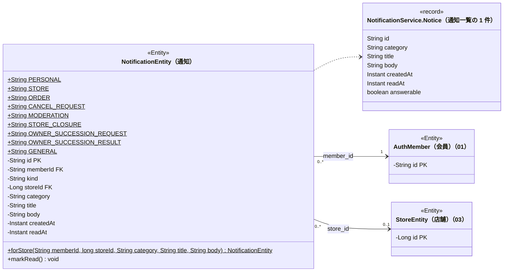
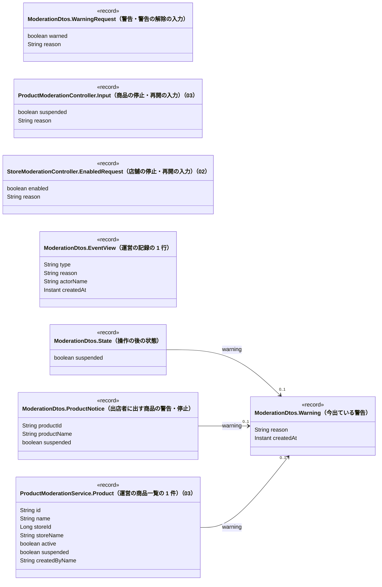

# Kusakari EC クラス図 07 通知と運営の記録

- 対象のコード: kusakari-ec の main（8892344、2026-11-24 時点）
- 対象のパッケージ: [notification](https://github.com/abeouga/kusakari-ec/blob/8892344/backend/src/main/java/jp/kusakari/ec/notification)（会員あての通知）、[moderation](https://github.com/abeouga/kusakari-ec/blob/8892344/backend/src/main/java/jp/kusakari/ec/moderation)（運営による商品・店舗の警告・停止の履歴）
- 全体図とパッケージの対応は [00_全体図](<00_全体図.md>) にあります。

会員あての通知と、運営による商品・店舗の警告・停止の履歴のクラスを 7 枚に分けて描きます。図 3・図 6・図 7 はデータの図（Entity・DTO・enum）、図 1・図 2・図 4・図 5 はモジュールの図（Controller・Service・Repository・部品）です。呼び出しの順番は、次のシーケンス図に書いています。

- 通知: [EC-B15 利用者通知を確認する](<../../シーケンス図/kusakari-ec/EC-B15_利用者通知を確認する.md>)、[EC-S11 イベント通知を確認する](<../../シーケンス図/kusakari-ec/EC-S11_イベント通知を確認する.md>)
- 運営の記録: [EC-A10 商品の公開を停止・再開する](<../../シーケンス図/kusakari-ec/EC-A10_商品の公開を停止・再開する.md>)、[EC-A11 店舗の利用を停止・再開する](<../../シーケンス図/kusakari-ec/EC-A11_店舗の利用を停止・再開する.md>)、[EC-A05 店舗情報を確認する](<../../シーケンス図/kusakari-ec/EC-A05_店舗情報を確認する.md>)、[EC-A06 商品情報を確認する](<../../シーケンス図/kusakari-ec/EC-A06_商品情報を確認する.md>)

## 図の読み方

- 箱の名前は「英語名（日本語名）」です。英語名はコードのクラス名です。入れ子の record は「外側のクラス.名前」で書きます。ほかのパッケージのクラスには、詳しく描いた詳細図の番号を（01）・（02）・（03）・（04）・（05）のように付け、メンバーは省くか、このファイルにかかわるものだけを書きます。
- ステレオタイプは、`<<Entity>>` が JPA の Entity、`<<record>>` が Java の record（DTO）、`<<enumeration>>` が enum、`<<interface>>` が interface、`<<Controller>>`・`<<Service>>`・`<<Repository>>`・`<<Component>>` が Spring の Bean の種類です。
- 可視性は `+` が public、`-` が private です。下線（`$`）は static です。データの図のフィールドの `PK` は主キー、`FK` は DB の外部キーの列です。
- 線は 4 種類です。`-->` は関連、`*--`（黒い菱形）はコンポジション、`<|--` は継承（interface の実装も含む）、`..>` は依存です。モジュールの図の `..>` は「フィールドに持って呼ぶ」、データの図の `..>` は「詰め替え先」です。この 2 つのパッケージには、コンポジションにあたる持ち方はありません。
- 線の両端の数字は多重度です。`1` はちょうど 1 つ、`0..1` は無いか 1 つ、`0..*` は 0 個以上です。enum への関連は相手側の多重度だけを書きます。
- 関連の線のラベルは関連の名前（フィールド名か外部キーの列名）です。依存の線にはラベルを付けず、使っているフィールドとメソッドは各図の下の「線とコードの対応」に書きました。
- 関連の線で描いたフィールド（`eventType`、`warning`）は、箱の中に重ねて書いていません。外部キーの列（`memberId`、`storeId` など）は、列として箱にも書き、線のラベルには列名を書いています。
- 型の引数が 2 つある型は、図では `Map[String，Boolean]` のように角かっこと全角の「，」で書いています（Mermaid 11.4.1 で `~…~` の引数が消えるため）。

## パッケージの役割

| パッケージ | 役割 |
| --- | --- |
| `notification` | 会員あての通知を保存し、一覧と既読の API を出します。ほかのパッケージの Service が `NotificationService` で通知を作ります（図 2）。メールは送りません。 |
| `moderation` | 運営による商品・店舗の警告・警告の解除・停止・再開の履歴の Entity と Repository、履歴から「今出ている警告」を求める共通の部品（`ModerationHistory`）、その DTO です。 |

`moderation` パッケージには Controller も Service もありません。警告・停止の API は、商品は `catalog` の `ProductModerationController` と `ProductModerationService`（[03_商品カタログ](<03_商品カタログ.md>)）、店舗は `store` の `StoreModerationController` と `StoreModerationService`（[02_店舗と組織](<02_店舗と組織.md>)）にあります（図 5）。組織の受付停止・停止の履歴（`OrganizationModerationEventEntity`）も `store` にあり、`ModerationEvent` を実装していません。

## クラスとテーブルと API

| クラス | テーブル | API |
| --- | --- | --- |
| `NotificationEntity`、`NotificationRepository` | `notifications` | `GET /api/notifications`、`PUT /api/notifications/{id}/read`（`NotificationController`） |
| `ProductModerationEventEntity`、`ProductModerationEventRepository` | `product_moderation_events` | `/api/operator/products/...`、`GET /api/seller/products/moderation`（`catalog` の Controller） |
| `StoreModerationEventEntity`、`StoreModerationEventRepository` | `store_moderation_events` | `/api/operator/stores/{id}/...`（`store` の `StoreModerationController`） |

テーブルの列と制約は、`notifications` が [テーブル設計図 01 会員と通知](<../../テーブル設計図/kusakari-ec/01_会員と通知.md>)、履歴の 2 つのテーブルが [テーブル設計図 06 運営と組織の操作の記録](<../../テーブル設計図/kusakari-ec/06_運営と組織の操作の記録.md>) にあります。

## 図 1 通知の Controller・Service

モジュールの図です。通知の一覧と既読の受け口と、通知を作る・読む Service です。`Notice` と `NotificationEntity` は図 6 にあります。

### API と受け口

| HTTP | パス | 受け口 | Request | Response | 呼ぶ Service |
| --- | --- | --- | --- | --- | --- |
| GET | `/api/notifications` | `NotificationController.list()` | なし | `List<NotificationService.Notice>` | `NotificationService.list()` |
| PUT | `/api/notifications/{id}/read` | `NotificationController.read()` | パスの `id` | `{"read": true}`（`Map<String, Boolean>`） | `NotificationService.read()`。見つからなければ 404 `NOTICE_NOT_FOUND` |

### 線とコードの対応

| 線 | フィールド | コード |
| --- | --- | --- |
| NotificationController → NotificationService | `service` | `list()` と `read()` をそのまま呼ぶ |
| NotificationService → NotificationRepository | `notices` | `send()`・`toStore()` が `save()`、`list()` が `findByMemberIdOrderByCreatedAtDesc()`、`read()` が `findById()` |
| NotificationService → AuthService | `auth` | `list()`・`read()` が `current()` でログイン中の会員を読む |
| NotificationService → AuthMemberRepository | `members` | `toStore()` が `findAllById()` で送り先の会員を読み、`AuthMember.isEnabled()` で使える会員だけに絞る |
| NotificationService → StoreRepository | `stores` | `toStore()` が `findById()` で店舗の組織を読む |
| NotificationService → OrganizationRepository | `organizations` | `toStore()` が `findById()` で組織のオーナー（`getOwnerMemberId()`）を読む。`answerableRequest()` が `existsByPendingOwnerMemberIdAndPendingOwnerExpiresAtAfter()` で、自分あての期限内の譲渡の申し出があるかを確かめる |
| NotificationService → StoreMemberRepository | `storeMembers` | `toStore()` が `findAssignedAtStore()` でロールが割り振られた担当者を、`visibility()` が `findAllForMember()` で担当者の所属店舗を読む |
| NotificationService → PendingOwnerSuccession | `pendingOwnerSuccession` | `list()` が最初に `expireIfDueFor()` で、期限の過ぎたオーナーの譲渡の申し出を無効にする |
| JpaRepository ← NotificationRepository | なし | `JpaRepository<NotificationEntity, String>` を継承する |

### 決まり

| メソッド | 決まり |
| --- | --- |
| `send()` | 1 人の会員に本人あての通知を 1 件作ります（`new NotificationEntity(...)`）。`memberId` が `null` なら何もしません。 |
| `toStore()` | 店舗の組織のオーナーと、その店舗でロールが割り振られた担当者のうち、使える会員に、店舗あての通知を 1 件ずつ作ります（`NotificationEntity.forStore()`）。店舗が見つからなければ何もしません。 |
| `list()` | ログイン中の会員の通知を新しい順に返します。担当者（`SHOP_STAFF`）には、本人あての通知と、今所属している店舗あての通知だけを見せます（非公開の `visibility()`。店舗を持たない V5 より前の店舗あての通知は、どこかの店舗に所属している間だけ）。オーナー・購入者・運営は自分あての通知をすべて見られます。`Notice.answerable` は、承認・断りができるオーナーの譲渡の申し出の通知（いちばん新しい `OWNER_SUCCESSION_REQUEST`）だけが `true` です（非公開の `answerableRequest()`）。 |
| `read()` | 自分あてで見える通知だけを既読にします（`NotificationEntity.markRead()`）。見つからなければ 404 `NOTICE_NOT_FOUND` です。 |
| トランザクション | `NotificationService` はクラスに `@Transactional` が付いていて、通知を作る側の Service のトランザクションの中で保存されます。 |

## 図 2 通知を作るクラス

モジュールの図です。ほかのパッケージの Service と部品が、どこから通知を作るかを示します。ほかのパッケージのクラスはメンバーを省きます。どのメソッドで作るかと通知の種類は、図の下の表にあります。

### 線とコードの対応

どのクラスも、`NotificationService` を `notices` というフィールドに持ちます（`OwnerSuccessionNotices` は `NotificationRepository` を `notices` に持ちます）。`OpenOrders` は `openOrders` に持ちます。

| 線 | パッケージ | メソッド | `category` | 通知の例 |
| --- | --- | --- | --- | --- |
| CheckoutService → NotificationService | `commerce` | `send()`、`toStore()` | `ORDER` | 店頭払いの注文を受け付けたとき。購入者に「ご注文を受け付けました」、店舗に「新しい注文が届きました」 |
| PaymentService → NotificationService | `payment` | `send()`、`toStore()` | `ORDER` | カードの支払いが成功・失敗・期限切れになったとき |
| OrderWorkflowService → NotificationService | `commerce` | `send()` | `ORDER` | 受取準備の完了、引き渡し、キャンセル申請の結果を購入者に |
| OrderWorkflowService → NotificationService | `commerce` | `toStore()` | `CANCEL_REQUEST` | 店舗に「キャンセル申請が届きました」 |
| ProductModerationService → NotificationService | `catalog` | `toStore()` | `MODERATION` | 商品の警告・警告の解除・公開停止・再開 |
| StoreModerationService → NotificationService | `store` | `toStore()` | `MODERATION` | 店舗の警告・警告の解除・利用停止・再開 |
| StoreClosureService → NotificationService | `store` | `toStore()` | `STORE_CLOSURE` | 店舗の閉鎖を始めた・取り消した・完了した |
| StoreClosureService → OpenOrders | `store` | `notifyBuyers()`、`cancelAll()` | `STORE_CLOSURE`（`notifyBuyers()` に渡す） | 閉鎖を始めたときに未完了の注文の購入者へ。注文のまとめてのキャンセル |
| OrganizationSuspensionService → NotificationService | `store` | `send()` | `MODERATION` | 組織の受付停止・再開・停止をオーナーに |
| OrganizationSuspensionService → OpenOrders | `store` | `notifyBuyers()`、`cancelAll()` | `MODERATION`（`notifyBuyers()` に渡す） | 受付停止のときに未完了の注文の購入者へ。注文のまとめてのキャンセル |
| OpenOrders → NotificationService | `store` | `send()` | 呼ぶ側が決める | `notifyBuyers()` で、未完了の注文の購入者に |
| OpenOrders → NotificationService | `store` | `send()`、`toStore()` | `ORDER` | `cancelAll()` で、運営が注文をまとめてキャンセルしたとき |
| StaffAccountService → NotificationService | `store` | `send()` | `GENERAL` | 担当者が店舗の担当から外れたとき |
| StoreApplicationService → NotificationService | `store` | `send()` | `GENERAL` | 出店申請の受け付け、承認・却下 |
| OwnerSuccessionNotices → NotificationRepository | `store` | `save(new NotificationEntity(...))` | `OWNER_SUCCESSION_REQUEST`、`OWNER_SUCCESSION_RESULT` | オーナーの譲渡の申し出と、その結果（承認・断り・取り消し・自動で無効） |

- `OwnerSuccessionNotices` だけは、`NotificationService` を使わず、`NotificationRepository` に直接保存します。`NotificationService.list()` が `PendingOwnerSuccession` を使い、`PendingOwnerSuccession` が `OwnerSuccessionNotices` を使うので、`NotificationService` を使うと依存が循環するためです（`OwnerSuccessionNotices` のコメントにあります）。
- `NotificationService` から `NotificationRepository` への線は図 1 にあります。この図では、`OwnerSuccessionNotices` が `NotificationService` を通らずに保存することを見やすくするために省きました。
- `category` の値は `NotificationEntity` の定数と、V6 の `ck_notifications_category` の CHECK 制約の値がそろっています。

## 図 3 運営の記録の Entity

データの図です。商品と店舗の警告・停止の履歴の Entity と、その共通の interface・enum です。Entity に JPA の関連（`@ManyToOne` など）はなく、商品・店舗・会員は ID の列で持ちます。線は DB の外部キーから描いています。

### Entity とテーブル

| Entity | テーブル | 列の補足 |
| --- | --- | --- |
| `ProductModerationEventEntity` | `product_moderation_events` | `productId` は `VARCHAR(40)`、`eventType` は `@Enumerated(EnumType.STRING)` で `ModerationAction` の名前を `VARCHAR(16)` に保存、`reason` は 1000 文字（DB の既定は空文字）、`actorMemberId` は `CHAR(36)`。索引 `idx_product_moderation_target`（`product_id`, `id`） |
| `StoreModerationEventEntity` | `store_moderation_events` | 列の形は商品の履歴とそろえてあり、違うのは対象の列（`storeId`、`BIGINT`）だけ。索引 `idx_store_moderation_target`（`store_id`, `id`） |

- 履歴の行は書き換えず、削除もしません。`id` 以外の列は `updatable = false` で、Entity に変更のメソッドはありません。`id` は DB の自動採番（`GenerationType.IDENTITY`）、`createdAt` は作ったときの日時（`Instant.now()`）です。作るのはコンストラクター（`productId` か `storeId`、`eventType`、`reason`、`actorMemberId`）だけです。
- `WARN` と `SUSPEND` は理由が必須です（`ModerationAction.requiresReason()`）。DB の CHECK 制約（`ck_product_moderation_reason`、`ck_store_moderation_reason`）も同じ条件で、`event_type` の値も CHECK 制約（`ck_product_moderation_type`、`ck_store_moderation_type`）で 4 つに限ります。
- 2 つの Entity は `ModerationEvent` を実装します（getter は Lombok の `@Getter` が作ります）。履歴の表示と「警告中か」の判定（図 4 の `ModerationHistory`）を、商品と店舗で同じ処理にするためです。

### 関連と外部キー

| 関連 | 外部キーの名前 | 削除のとき | 多重度の根拠 |
| --- | --- | --- | --- |
| `ProductModerationEventEntity` 0..* — 1 `ProductEntity` | `fk_product_moderation_product` | 指定なし（商品は行を消さない） | `product_id` は NULL 不可、主キーではない |
| `StoreModerationEventEntity` 0..* — 1 `StoreEntity` | `fk_store_moderation_store` | 指定なし | `store_id` は NULL 不可、主キーではない |
| `ProductModerationEventEntity` 0..* — 1 `AuthMember` | `fk_product_moderation_actor` | 指定なし | `actor_member_id` は NULL 不可。操作した運営の会員 |
| `StoreModerationEventEntity` 0..* — 1 `AuthMember` | `fk_store_moderation_actor` | 指定なし | `actor_member_id` は NULL 不可。操作した運営の会員 |
| `eventType` — 1 `ModerationAction` | なし（列の値） | なし | `event_type` は NULL 不可 |

## 図 4 ModerationHistory と Repository

モジュールの図です。`moderation` パッケージの Repository と、履歴の読み方の共通の部品 `ModerationHistory` です。`ModerationEvent`・`ModerationAction` は図 3、`Warning`・`EventView` は図 7 にあります。

### 線とコードの対応

| 線 | フィールド | コード |
| --- | --- | --- |
| ModerationHistory → AuthMemberRepository | `members` | `views()` が `findAllById()` で、操作した運営の会員をまとめて読む |
| JpaRepository ← ProductModerationEventRepository | なし | `JpaRepository<ProductModerationEventEntity, Long>` を継承する |
| JpaRepository ← StoreModerationEventRepository | なし | `JpaRepository<StoreModerationEventEntity, Long>` を継承する |

`ModerationHistory` は Repository を持たず、Service（図 5）が Repository で読んだ新しい順の履歴を引数で受け取ります。

### メソッドの決まり

| メソッド | 決まり |
| --- | --- |
| `WARNING_TYPES` | `WARN` と `CLEAR_WARNING`。「警告中か」を求めるのに読む種別です。 |
| `activeWarning()` | 1 つの対象の履歴のうち `WARNING_TYPES` だけを新しい順に見て、いちばん新しい行が `WARN` なら、その理由と日時を `Warning` にします。警告していない・解除した対象は `null` です。「今、警告中か」は対象の行に列として持ちません。 |
| `activeWarnings()` | 型引数は `E extends ModerationEvent` と `K`。複数の対象の履歴から、`target` で取り出した対象の ID ごとに `activeWarning()` と同じ判定をし、警告中の対象だけを `Map` に入れます。 |
| `views()` | 履歴の行を `EventView` にします。`type` は `ModerationAction` の名前、`actorName` は操作した運営の表示名（空ならメールアドレス。非公開の `nameOf()`）です。 |
| `reasonFor()` | 理由の前後の空白を除きます。理由が必須の操作で空なら 400 `REASON_REQUIRED` を投げます。 |
| `noticeBody()` | 出店者への通知の本文（対象の名前と、理由があれば「 / 理由」）を作ります。 |
| `findAtStore()` | `@Query` で、店舗の商品（`ProductEntity.storeId`）の履歴のうち、指定した種別の行を新しい順に読みます。 |
| `findByEventTypeInOrderByIdDesc()` | 運営の商品一覧で、各商品が警告中かを求めるために使います。 |
| `findByStoreIdInAndEventTypeInOrderByIdDesc()` | 店舗の一覧で、各店舗が警告中かを求めるために使います。 |

## 図 5 運営の記録を使うクラス

モジュールの図です。運営の記録を使う、ほかのパッケージの Controller と Service です。このファイルにかかわるメンバーだけを載せます。引数・戻り値の `Product`・`Input`・`EnabledRequest`・`State`・`EventView`・`WarningRequest`・`ProductNotice`・`Warning` は図 7 にあります。

### API と受け口

| HTTP | パス | 受け口 | Request | Response | 呼ぶ Service |
| --- | --- | --- | --- | --- | --- |
| GET | `/api/operator/products` | `ProductModerationController.list()` | なし | `List<ProductModerationService.Product>` | `ProductModerationService.list()` |
| PUT | `/api/operator/products/{id}/moderation` | `ProductModerationController.moderate()` | `ProductModerationController.Input` | `ModerationDtos.State` | `ProductModerationService.suspend()` |
| PUT | `/api/operator/products/{id}/warning` | `ProductModerationController.warning()` | `ModerationDtos.WarningRequest` | `ModerationDtos.State` | `ProductModerationService.warn()` |
| GET | `/api/operator/products/{id}/moderation-events` | `ProductModerationController.events()` | なし | `List<ModerationDtos.EventView>` | `ProductModerationService.events()` |
| GET | `/api/seller/products/moderation` | `SellerProductController.moderation()` | クエリ `storeId` | `List<ModerationDtos.ProductNotice>` | `ProductModerationService.noticesAt()` |
| PUT | `/api/operator/stores/{id}/enabled` | `StoreModerationController.enabled()` | `StoreModerationController.EnabledRequest` | `ModerationDtos.State` | `StoreModerationService.enable()` |
| PUT | `/api/operator/stores/{id}/warning` | `StoreModerationController.warning()` | `ModerationDtos.WarningRequest` | `ModerationDtos.State` | `StoreModerationService.warn()` |
| GET | `/api/operator/stores/{id}/moderation-events` | `StoreModerationController.events()` | なし | `List<ModerationDtos.EventView>` | `StoreModerationService.events()` |

### 線とコードの対応

| 線 | フィールド | コード |
| --- | --- | --- |
| ProductModerationController → ProductModerationService | `service` | `list()`、`suspend()`、`warn()`、`events()` |
| SellerProductController → ProductModerationService | `moderation` | `noticesAt()` |
| StoreModerationController → StoreModerationService | `service` | `enable()`、`warn()`、`events()` |
| StoreService → StoreModerationService | `moderation` | `warnings()` で、店舗の一覧と店舗のページに出す警告を読む |
| ProductModerationService → ProductModerationEventRepository | `events` | `save()` で 1 行足す。`findByProductIdOrderByIdDesc()`、`findByEventTypeInOrderByIdDesc()`（`list()`）、`findAtStore()`（`noticesAt()`） |
| ProductModerationService → ModerationHistory | `history` | `views()`（`events()`）。static の `activeWarning()`、`activeWarnings()`、`reasonFor()`、`noticeBody()`、`WARNING_TYPES` |
| ProductModerationService → NotificationService | `notices` | `toStore()` で店舗の出店者に `MODERATION` の通知を送る |
| StoreModerationService → StoreModerationEventRepository | `events` | `save()` で 1 行足す。`findByStoreIdOrderByIdDesc()`、`findByStoreIdInAndEventTypeInOrderByIdDesc()`（`warnings()`） |
| StoreModerationService → ModerationHistory | `history` | `views()`（`events()`）。static の `activeWarning()`、`activeWarnings()`、`reasonFor()`、`noticeBody()`、`WARNING_TYPES` |
| StoreModerationService → NotificationService | `notices` | `toStore()` で店舗の出店者に `MODERATION` の通知を送る |

### 決まり

- 警告・停止の操作（`suspend()`、`enable()`、`warn()`）は、どれも対象の行（商品か店舗）をロックしてから、履歴に 1 行足し（`ProductModerationEventEntity` か `StoreModerationEventEntity` を作る）、`NotificationService.toStore()` で店舗の出店者に `MODERATION` の通知を送ります。停止・再開は、すでにその状態なら履歴も通知も足しません。警告は、警告中でももう一度足せます。警告していない対象の警告の解除は、何も足しません。
- 見つからなければ 404（`PRODUCT_NOT_FOUND`、`STORE_NOT_FOUND`）、閉鎖済みの店舗の操作は 409 `STORE_CLOSED` です。
- `list()`、`events()` と、警告・停止の操作は、運営だけが使えます（`AuthService.requireAdmin()`）。`noticesAt()` は、その店舗の情報を見られる会員が使えます（`AuthService.requireStoreViewer()`）。`StoreModerationService.warnings()` は権限を確かめず、呼ぶ側の `StoreService` が確かめます。
- 8892344 で、`ProductModerationService.list()` は `ProductRepository.findAllCreatorNames()` で商品を追加した会員の表示名も読み、`Product.createdByName` に入れるようになりました（図 7）。

## 図 6 通知の Entity と DTO

データの図です。通知の Entity と、一覧の API で返す DTO です。`NotificationEntity` に JPA の関連はなく、会員と店舗は ID の列で持ちます。線は DB の外部キーから描いています。

### Entity とテーブル

| クラス | テーブル | 列の補足 |
| --- | --- | --- |
| `NotificationEntity` | `notifications` | `id` は `CHAR(36)` の UUID（コンストラクターで作る）。`kind` は本人あて（`PERSONAL`、既定）か店舗あて（`STORE`）。`category` は通知の種類で、`ORDER`・`CANCEL_REQUEST`・`MODERATION`・`STORE_CLOSURE`・`OWNER_SUCCESSION_REQUEST`・`OWNER_SUCCESSION_RESULT`・`GENERAL` のどれか。`kind`・`storeId`・`category` は作った後は変えない（`updatable = false`）。`storeId` と `readAt` は NULL 可。索引 `idx_notifications_member`（`member_id`, `read_at`, `created_at`）、`idx_notifications_store`（`store_id`） |
| `NotificationService.Notice` | なし（API の Response） | `NotificationEntity` から `id`・`category`・`title`・`body`・`createdAt`・`readAt` を写し、`answerable` を足したもの。`memberId`・`kind`・`storeId` は返さない |

- 重要な通知かどうかは DB に持たず、画面が `category` から決めます（`NotificationEntity` のコメントでは、対応表は画面の `Notices.jsx`）。
- 作るのは、本人あてがコンストラクター `NotificationEntity(memberId, category, title, body)`、店舗あてが `forStore()` です。`markRead()` は、まだ既読でなければ `readAt` に今の日時を入れます。
- 列の値は CHECK 制約で限っています。`ck_notifications_kind`（`kind` は 2 つ、V5）、`ck_notifications_store`（`STORE` でなければ `store_id` は NULL、V5）、`ck_notifications_category`（`category` は 7 つ、V6）。
- Entity の `length` と DB の列の長さが違うところがあります。`NotificationEntity.body` は 1000 ですが、V1 の `notifications.body` は `VARCHAR(2000)` です。

### 関連と外部キー

| 関連 | 外部キーの名前 | 削除のとき | 多重度の根拠 |
| --- | --- | --- | --- |
| `NotificationEntity` 0..* — 1 `AuthMember` | `fk_notifications_member`（V1） | 指定なし | `member_id` は NULL 不可、主キーではない |
| `NotificationEntity` 0..* — 0..1 `StoreEntity` | `fk_notifications_store`（V5） | 指定なし | `store_id` は NULL 可。店舗あての通知だけが持つ（V5 より前の店舗あての通知は空） |

### 線とコードの対応

| 線 | コード |
| --- | --- |
| NotificationEntity → Notice | `NotificationService.list()` が `new Notice(...)` で詰め替える |

## 図 7 運営の記録の DTO

データの図です。`ModerationDtos` の入れ子の record（商品と店舗で共通の Request と Response）と、運営の記録の API で使う、ほかのパッケージの record です。`ModerationDtos` は入れ子の record を入れるだけの `final` のクラス（コンストラクターは private）なので、箱にしていません。

### 使うところと値の制約

| record | 使うところ | 値の制約・補足 |
| --- | --- | --- |
| `WarningRequest` | 商品・店舗の `PUT .../warning` の Request | `warned` が `true` で警告（理由は必須）、`false` で警告の解除（理由は任意）。`reason` は 500 文字まで（`@Size(max = 500)`） |
| `Input` | `PUT /api/operator/products/{id}/moderation` の Request | `suspended` が `true` で公開停止（理由は必須）。`reason` は 500 文字まで |
| `EnabledRequest` | `PUT /api/operator/stores/{id}/enabled` の Request | `enabled` が `false` で利用停止（理由は必須）。`reason` は 500 文字まで |
| `EventView` | `GET .../moderation-events` の Response の 1 行 | `type` は `WARN`・`CLEAR_WARNING`・`SUSPEND`・`RESUME`。`actorName` は操作した運営の表示名（空ならメールアドレス） |
| `State` | 警告・停止の操作の Response | `suspended` は運営が停止しているか |
| `ProductNotice` | `GET /api/seller/products/moderation` の Response の 1 行 | 警告中か停止中で、出店者が削除していない商品だけ。`productId` の順 |
| `Product` | `GET /api/operator/products` の Response の 1 行 | `active` は出店者が削除していない商品か。`createdByName` は商品を追加した会員の表示名で、初期データの商品は `null`（8892344 で足された） |
| `Warning` | `State`・`ProductNotice`・`Product` の `warning`、`StoreModerationService.warnings()` の値 | 最新の警告の理由と日時 |

### 関連の多重度の根拠

| 関連 | 多重度の根拠 |
| --- | --- |
| `State` — 0..1 `Warning` | 警告していない・解除した対象は `null`（`ModerationHistory.activeWarning()`） |
| `ProductNotice` — 0..1 `Warning` | 停止中で警告していない商品は `null` |
| `Product` — 0..1 `Warning` | 警告中でない商品は `null`（`activeWarnings()` の `Map` に無い） |

## クラスとコードの対応

| クラス | ファイル | 図 |
| --- | --- | --- |
| `NotificationController` | [NotificationController.java](https://github.com/abeouga/kusakari-ec/blob/8892344/backend/src/main/java/jp/kusakari/ec/notification/controller/NotificationController.java) | 図 1 |
| `NotificationService`、`NotificationService.Notice` | [NotificationService.java](https://github.com/abeouga/kusakari-ec/blob/8892344/backend/src/main/java/jp/kusakari/ec/notification/service/NotificationService.java) | 図 1、図 2、図 5、図 6 |
| `NotificationEntity` | [NotificationEntity.java](https://github.com/abeouga/kusakari-ec/blob/8892344/backend/src/main/java/jp/kusakari/ec/notification/persistence/entity/NotificationEntity.java) | 図 6 |
| `NotificationRepository` | [NotificationRepository.java](https://github.com/abeouga/kusakari-ec/blob/8892344/backend/src/main/java/jp/kusakari/ec/notification/persistence/repository/NotificationRepository.java) | 図 1、図 2 |
| `ModerationAction` | [ModerationAction.java](https://github.com/abeouga/kusakari-ec/blob/8892344/backend/src/main/java/jp/kusakari/ec/moderation/persistence/entity/ModerationAction.java) | 図 3 |
| `ModerationEvent` | [ModerationEvent.java](https://github.com/abeouga/kusakari-ec/blob/8892344/backend/src/main/java/jp/kusakari/ec/moderation/persistence/entity/ModerationEvent.java) | 図 3 |
| `ProductModerationEventEntity` | [ProductModerationEventEntity.java](https://github.com/abeouga/kusakari-ec/blob/8892344/backend/src/main/java/jp/kusakari/ec/moderation/persistence/entity/ProductModerationEventEntity.java) | 図 3 |
| `StoreModerationEventEntity` | [StoreModerationEventEntity.java](https://github.com/abeouga/kusakari-ec/blob/8892344/backend/src/main/java/jp/kusakari/ec/moderation/persistence/entity/StoreModerationEventEntity.java) | 図 3 |
| `ProductModerationEventRepository` | [ProductModerationEventRepository.java](https://github.com/abeouga/kusakari-ec/blob/8892344/backend/src/main/java/jp/kusakari/ec/moderation/persistence/repository/ProductModerationEventRepository.java) | 図 4、図 5 |
| `StoreModerationEventRepository` | [StoreModerationEventRepository.java](https://github.com/abeouga/kusakari-ec/blob/8892344/backend/src/main/java/jp/kusakari/ec/moderation/persistence/repository/StoreModerationEventRepository.java) | 図 4、図 5 |
| `ModerationHistory` | [ModerationHistory.java](https://github.com/abeouga/kusakari-ec/blob/8892344/backend/src/main/java/jp/kusakari/ec/moderation/service/ModerationHistory.java) | 図 4、図 5 |
| `ModerationDtos` と入れ子の `Warning`、`EventView`、`State`、`WarningRequest`、`ProductNotice` | [ModerationDtos.java](https://github.com/abeouga/kusakari-ec/blob/8892344/backend/src/main/java/jp/kusakari/ec/moderation/dto/ModerationDtos.java) | 図 7 |

担当の 2 つのパッケージの 18 の型（ファイル 12、入れ子の record 6）を、すべてどれかの図に載せました。ほかのパッケージのクラスは、それぞれの詳細図（01〜05）で詳しく描いています。

## 載せなかったもの

| もの | 理由 | 載せた図 |
| --- | --- | --- |
| `ModerationDtos` の箱 | 入れ子の record を入れるだけの `final` のクラスで、業務のデータを持たないため | 図 7 の本文 |
| モジュールの図での `NotificationEntity`・`Notice`・`ModerationDtos` の record の箱 | データの図とモジュールの図を混ぜないため。引数・戻り値の型名としてだけ書いた | 図 3、図 6、図 7 |
| Service の依存のフィールド（`notices`、`members` など） | モジュールの図では依存の線で描き、フィールドに重ねないため | 各図の「線とコードの対応」 |
| `NotificationService` の非公開の `answerableRequest()`、`visibility()` | `list()`・`read()` の中だけで使う部品のため | 図 1 の「決まり」の表 |
| `ModerationHistory` の非公開の `nameOf()` | `views()` の中だけで使う部品のため | 図 4 の「メソッドの決まり」の表 |
| Entity のコンストラクター | 作り方は表に書き、図には業務の操作（`forStore()`、`markRead()`、`requiresReason()`）だけを書いたため | 図 3、図 6 の表 |
| `JpaRepository` の型引数 | Mermaid 11.4.1 で型の引数が 2 つあると消えるため | 図 1、図 4 の「線とコードの対応」 |
| `OrganizationModerationEventEntity`（組織の受付停止・停止の履歴） | `store` パッケージのクラスで、`ModerationEvent` を実装していないため | [02_店舗と組織](<02_店舗と組織.md>) |

## 確かめられなかったこと

- GitHub と Obsidian での表示は確かめていません。PNG は mermaid-snap（Mermaid 11.4.1）で書き出したものです。
- 画面が `category` から重要な通知を決める対応表は、`NotificationEntity` のコメントでは `Notices.jsx` にあるとされています。画面のコンポーネントはクラス図の対象外なので、確かめていません。
- 図 2・図 5 のほかのパッケージのクラスの日本語名は、このファイルで付けたものです。01〜05 の詳細図の日本語名とそろっているかは、それぞれの書き直しの後に確かめる必要があります。
