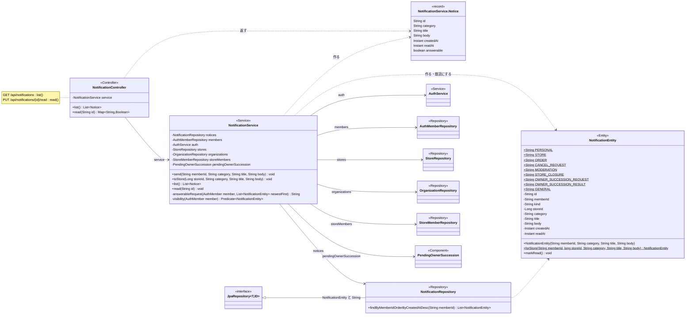
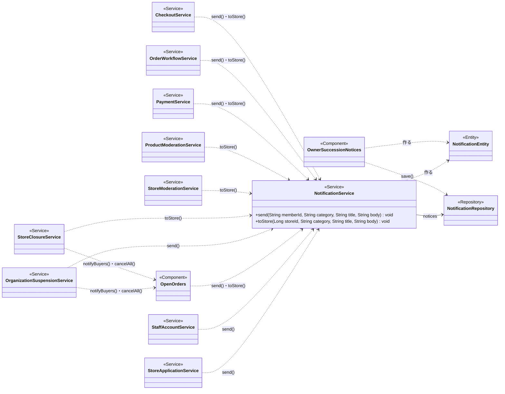
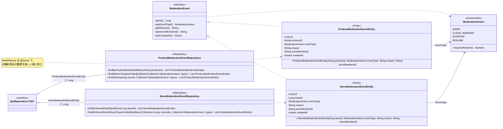
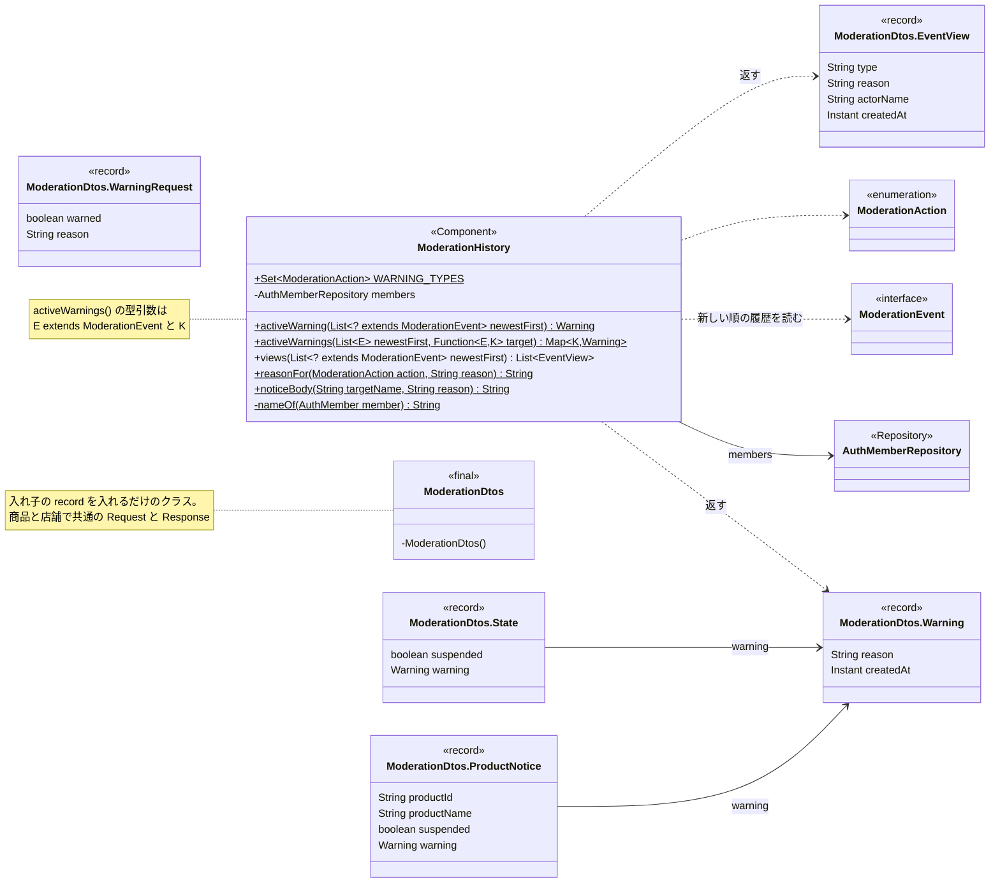
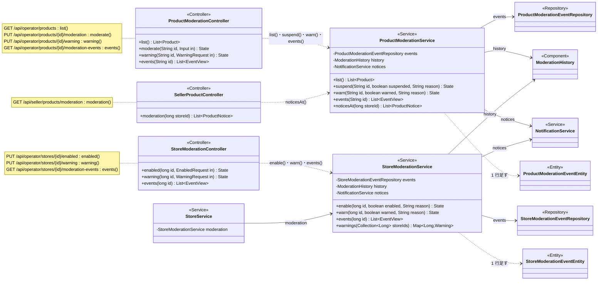

# EC のクラス図 07 通知と運営の記録

会員あての通知（`notification`）と、運営による商品・店舗の警告・停止の履歴（`moderation`）のクラスです。

## 対象のコード

- kusakari-ec の main、コミット 19a2be3（2026-11-20 時点）です。
- 対象のパッケージとソースのフォルダー
  - `notification`: [backend/src/main/java/jp/kusakari/ec/notification](https://github.com/abeouga/kusakari-ec/blob/19a2be307ee71a2cd87e538236c3c8c42929c5b3/backend/src/main/java/jp/kusakari/ec/notification)
  - `moderation`: [backend/src/main/java/jp/kusakari/ec/moderation](https://github.com/abeouga/kusakari-ec/blob/19a2be307ee71a2cd87e538236c3c8c42929c5b3/backend/src/main/java/jp/kusakari/ec/moderation)
- パッケージ全体の構成は [00_パッケージ構成](<00_パッケージ構成.md>) を見てください。

## パッケージの役割

| パッケージ | 役割 |
| --- | --- |
| `notification` | 会員あての通知を保存し、一覧と既読の API を出します。ほかのパッケージの Service が `NotificationService` で通知を作ります。メールは送りません。 |
| `moderation` | 運営による商品・店舗の警告・警告の解除・停止・再開の履歴の Entity と、履歴から「今出ている警告」を求める共通の処理（`ModerationHistory`）、その DTO です。 |

`moderation` パッケージには Controller がありません。警告・停止の API は、商品は `catalog` の `ProductModerationController` と `ProductModerationService`（[03_商品カタログ](<03_商品カタログ.md>)）、店舗は `store` の `StoreModerationController` と `StoreModerationService`（[02_店舗と組織](<02_店舗と組織.md>)）にあります。組織の受付停止・停止の履歴（`OrganizationModerationEventEntity`）も `store` にあり、`ModerationEvent` を実装していません。

## 読み方の要点

| クラス | テーブル | API |
| --- | --- | --- |
| `NotificationEntity`、`NotificationRepository` | `notifications` | `GET /api/notifications`、`PUT /api/notifications/{id}/read`（`NotificationController`） |
| `ProductModerationEventEntity`、`ProductModerationEventRepository` | `product_moderation_events` | `/api/operator/products/...`、`GET /api/seller/products/moderation`（`catalog` の Controller） |
| `StoreModerationEventEntity`、`StoreModerationEventRepository` | `store_moderation_events` | `/api/operator/stores/{id}/...`（`store` の `StoreModerationController`） |

- Entity には JPA の関連（`@ManyToOne` など）はありません。会員・店舗・商品は ID の列（`memberId`、`storeId`、`productId`、`actorMemberId`）で持ちます。DB には外部キー（`fk_notifications_member`、`fk_notifications_store`、`fk_product_moderation_product`、`fk_product_moderation_actor`、`fk_store_moderation_store`、`fk_store_moderation_actor`）があります。テーブルの詳細は、`notifications` が [テーブル設計図 01 会員と通知](<../../テーブル設計図/kusakari-ec/01_会員と通知.md>)、履歴の 2 つのテーブルが [テーブル設計図 06 運営と組織の操作の記録](<../../テーブル設計図/kusakari-ec/06_運営と組織の操作の記録.md>) にあります。
- 処理の流れは、次のシーケンス図を見てください。
  - 通知: [EC-B15 利用者通知を確認する](<../../シーケンス図/kusakari-ec/EC-B15_利用者通知を確認する.md>)、[EC-S11 イベント通知を確認する](<../../シーケンス図/kusakari-ec/EC-S11_イベント通知を確認する.md>)
  - 運営の記録: [EC-A10 商品の公開を停止・再開する](<../../シーケンス図/kusakari-ec/EC-A10_商品の公開を停止・再開する.md>)、[EC-A11 店舗の利用を停止・再開する](<../../シーケンス図/kusakari-ec/EC-A11_店舗の利用を停止・再開する.md>)、[EC-A05 店舗情報を確認する](<../../シーケンス図/kusakari-ec/EC-A05_店舗情報を確認する.md>)、[EC-A06 商品情報を確認する](<../../シーケンス図/kusakari-ec/EC-A06_商品情報を確認する.md>)

### 図の書き方

- 入れ子の record は、「外側のクラス.名前」の表示名で載せます。
- ほかのパッケージのクラスと、Spring などのライブラリのクラスは、メンバーを省くか、このファイルにかかわるメンバーだけを載せます。
- 可視性は `+` が public、`-` が private です。下線（`$`）は static です。
- `-->` はフィールドで持つクラス（ラベルはフィールド名）、`..>` は呼ぶか引数・戻り値で使うクラスです。

## 図1 通知の Controller・Service・Entity

- `NotificationEntity` は `notifications` テーブルの Entity です。`kind` は本人あて（`PERSONAL`）か店舗あて（`STORE`）か、`category` は通知の種類です。どちらも作った後は変えません（`updatable = false`）。重要な通知かどうかは DB に持たず、画面が `category` から決めます。
- `send()` は、1 人の会員に本人あての通知を 1 件作ります。`memberId` が `null` なら何もしません。
- `toStore()` は、店舗の組織のオーナーと、その店舗でロールが割り振られた担当者（`StoreMemberRepository.findAssignedAtStore()`）のうち、使える会員（`AuthMember.isEnabled()`）に、店舗あての通知を 1 件ずつ作ります（`NotificationEntity.forStore()`）。
- `list()` は、ログイン中の会員の通知を新しい順に返します。読む前に `PendingOwnerSuccession.expireIfDueFor()` で、期限の過ぎたオーナーの譲渡の申し出を無効にします。担当者（`SHOP_STAFF`）には、本人あての通知と、今所属している店舗あての通知だけを見せます（`visibility()`）。`answerable` は、承認・断りができるオーナーの譲渡の申し出の通知（いちばん新しい `OWNER_SUCCESSION_REQUEST`）だけが `true` です。
- `read()` は、自分あてで見える通知だけを既読にします（`markRead()`）。見つからなければ 404 `NOTICE_NOT_FOUND` です。
- `NotificationService` はクラスに `@Transactional` が付いていて、通知を作る側の Service のトランザクションの中で保存されます。
- Entity の `length` と DB の列の長さが違うところがあります。`NotificationEntity.body` は 1000 ですが、V1 の `notifications.body` は 2000 です。

## 図2 通知を作るクラス

ほかのパッケージの Service が、どのメソッドで通知を作るかを示します。ほかのパッケージのクラスは、メンバーを省きます。

| 作るクラス | パッケージ | メソッド | `category` | 通知の例 |
| --- | --- | --- | --- | --- |
| `CheckoutService` | `commerce` | `send()`、`toStore()` | `ORDER` | 店頭払いの注文を受け付けたとき。購入者に「ご注文を受け付けました」、店舗に「新しい注文が届きました」 |
| `PaymentService` | `payment` | `send()`、`toStore()` | `ORDER` | カードの支払いが成功・失敗・期限切れになったとき |
| `OrderWorkflowService` | `commerce` | `send()` | `ORDER` | 受取準備の完了、引き渡し、キャンセル申請の結果を購入者に |
| `OrderWorkflowService` | `commerce` | `toStore()` | `CANCEL_REQUEST` | 店舗に「キャンセル申請が届きました」 |
| `ProductModerationService` | `catalog` | `toStore()` | `MODERATION` | 商品の警告・警告の解除・公開停止・再開 |
| `StoreModerationService` | `store` | `toStore()` | `MODERATION` | 店舗の警告・警告の解除・利用停止・再開 |
| `StoreClosureService` | `store` | `toStore()` | `STORE_CLOSURE` | 店舗の閉鎖を始めた・取り消した・完了した |
| `OrganizationSuspensionService` | `store` | `send()` | `MODERATION` | 組織の受付停止・再開・停止をオーナーに |
| `OpenOrders` | `store` | `send()` | 呼ぶ側が決める | `notifyBuyers()` で、未完了の注文の購入者に。店舗の閉鎖では `STORE_CLOSURE`、組織の受付停止では `MODERATION` |
| `OpenOrders` | `store` | `send()`、`toStore()` | `ORDER` | `cancelAll()` で、運営が注文をまとめてキャンセルしたとき |
| `StaffAccountService` | `store` | `send()` | `GENERAL` | 担当者が店舗の担当から外れたとき |
| `StoreApplicationService` | `store` | `send()` | `GENERAL` | 出店申請の受け付け、承認・却下 |
| `OwnerSuccessionNotices` | `store` | `NotificationRepository.save()` | `OWNER_SUCCESSION_REQUEST`、`OWNER_SUCCESSION_RESULT` | オーナーの譲渡の申し出と、その結果（承認・断り・取り消し・自動で無効） |

- `OwnerSuccessionNotices` だけは、`NotificationService` を使わず、`NotificationRepository` に直接保存します。`NotificationService.list()` が `PendingOwnerSuccession` を使い、`PendingOwnerSuccession` が `OwnerSuccessionNotices` を使うので、`NotificationService` を使うと依存が循環するためです（`OwnerSuccessionNotices` のコメントにあります）。
- `category` の値は `NotificationEntity` の定数と、V6 の `ck_notifications_category` の CHECK 制約の値がそろっています。

## 図3 運営の記録の Entity と Repository

- `ProductModerationEventEntity` は `product_moderation_events`、`StoreModerationEventEntity` は `store_moderation_events` の Entity です。列の形はそろえてあり、違うのは対象の列（`productId` と `storeId`）だけです。
- 履歴の行は書き換えず、削除もしません。`id` 以外の列は `updatable = false` で、Entity に変更のメソッドはありません。`id` は DB の自動採番（`GenerationType.IDENTITY`）、`createdAt` は作ったときの日時です。
- `eventType` は `@Enumerated(EnumType.STRING)` で、`ModerationAction` の名前を文字列で保存します。`WARN` と `SUSPEND` は理由が必須です（`requiresReason()`）。DB の CHECK 制約（`ck_product_moderation_reason`、`ck_store_moderation_reason`）も同じ条件です。
- 2 つの Entity は `ModerationEvent` を実装します。履歴の表示と「警告中か」の判定（図4）を、商品と店舗で同じ処理にするためです。

## 図4 ModerationHistory と DTO

- 「今、警告中か」は、対象の行に列として持ちません。`ModerationHistory` が、履歴のうち `WARN` と `CLEAR_WARNING`（`WARNING_TYPES`）だけを新しい順に見て、いちばん新しい行が `WARN` なら、その理由と日時を `Warning` にします。`activeWarning()` は 1 つの対象、`activeWarnings()` は複数の対象（`target` で対象の ID を取り出す）を求めます。
- `views()` は、履歴の行を `EventView` にします。`type` は `ModerationAction` の名前、`actorName` は操作した運営の表示名（空ならメールアドレス）で、`AuthMemberRepository.findAllById()` でまとめて読みます。
- `reasonFor()` は、理由の前後の空白を除きます。理由が必須の操作で空なら 400 `REASON_REQUIRED` を投げます。`noticeBody()` は、出店者への通知の本文（対象の名前と、あれば「 / 理由」）を作ります。
- `WarningRequest` は警告・警告の解除の入力で、`reason` は 500 文字までです（`@Size(max = 500)`）。`State` は操作の後の状態、`ProductNotice` は出店者の商品一覧に出す警告・停止です。

## 図5 運営の記録を使うクラス

ほかのパッケージの Controller と Service です。このファイルにかかわるメンバーだけを載せます。

- 警告・停止の操作（`suspend()`、`enable()`、`warn()`）は、どれも対象の行（商品か店舗）をロックしてから、履歴に 1 行足し、`NotificationService.toStore()` で店舗の出店者に `MODERATION` の通知を送ります。停止・再開は、すでにその状態なら履歴も通知も足しません。警告は、警告中でももう一度足せます。警告していない対象の警告の解除は、何も足しません。閉鎖済みの店舗の操作は 409 `STORE_CLOSED` です。
- 図の `Product` は `ProductModerationService.Product`、`Input` は `ProductModerationController.Input`、`EnabledRequest` は `StoreModerationController.EnabledRequest` で、どれも `catalog` か `store` のクラスです。`State`、`EventView`、`WarningRequest`、`ProductNotice`、`Warning` は `ModerationDtos` の record です。
- `StoreService` は、店舗の一覧と店舗のページに出す警告を `StoreModerationService.warnings()` で読みます。
- `list()`、`events()` と、警告・停止の操作は、運営だけが使えます（`AuthService.requireAdmin()`）。`noticesAt()` は、その店舗の情報を見られる会員が使えます（`AuthService.requireStoreViewer()`）。`StoreModerationService.warnings()` は権限を確かめず、呼ぶ側の `StoreService` が確かめます。

## 図に載せなかったクラス

ありません。担当のパッケージの 18 の型（ファイル 12、入れ子の record 6）を、すべてどれかの図に載せました。

| パッケージ | ファイル | 入れ子の型 |
| --- | --- | --- |
| `notification` | `NotificationController`、`NotificationService`、`NotificationEntity`、`NotificationRepository` | `NotificationService.Notice` |
| `moderation` | `ModerationDtos`、`ModerationHistory`、`ModerationAction`、`ModerationEvent`、`ProductModerationEventEntity`、`StoreModerationEventEntity`、`ProductModerationEventRepository`、`StoreModerationEventRepository` | `ModerationDtos.Warning`、`ModerationDtos.EventView`、`ModerationDtos.State`、`ModerationDtos.WarningRequest`、`ModerationDtos.ProductNotice` |

## 確かめられなかったこと

- 画面が `category` から重要な通知を決める対応表は、`NotificationEntity` のコメントでは `Notices.jsx` にあるとされています。画面のコンポーネントはクラス図の対象外なので、この図には載せていません。
