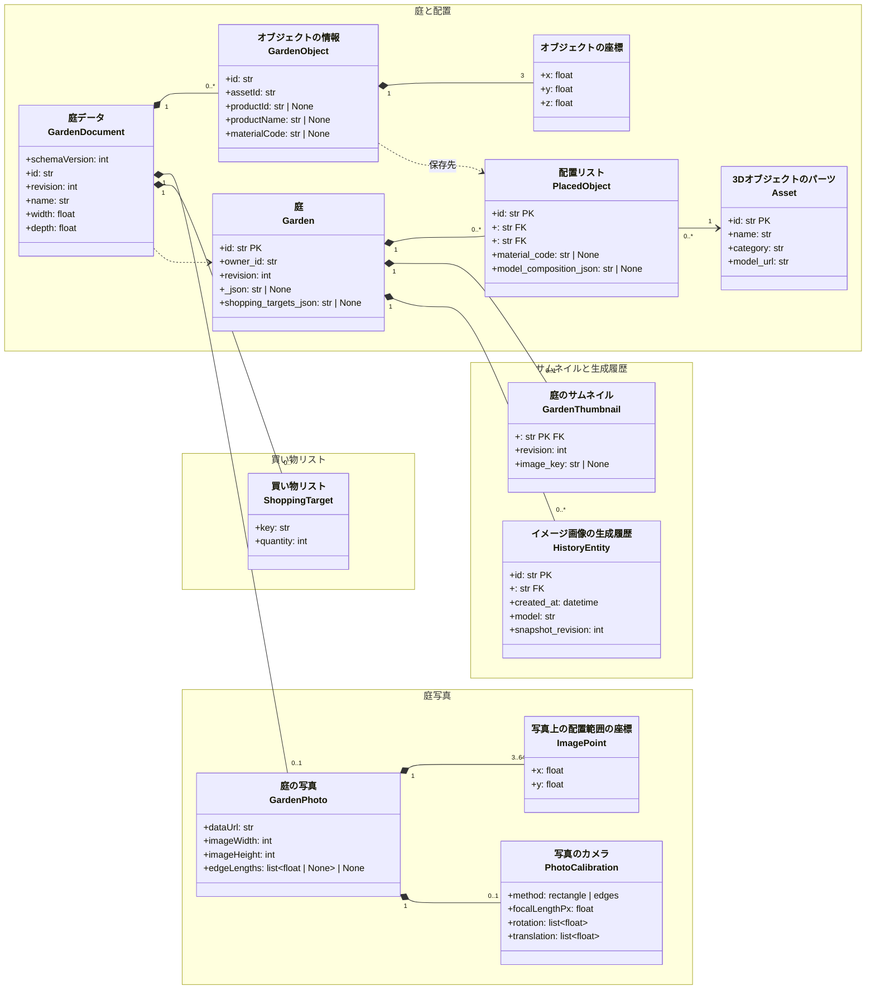
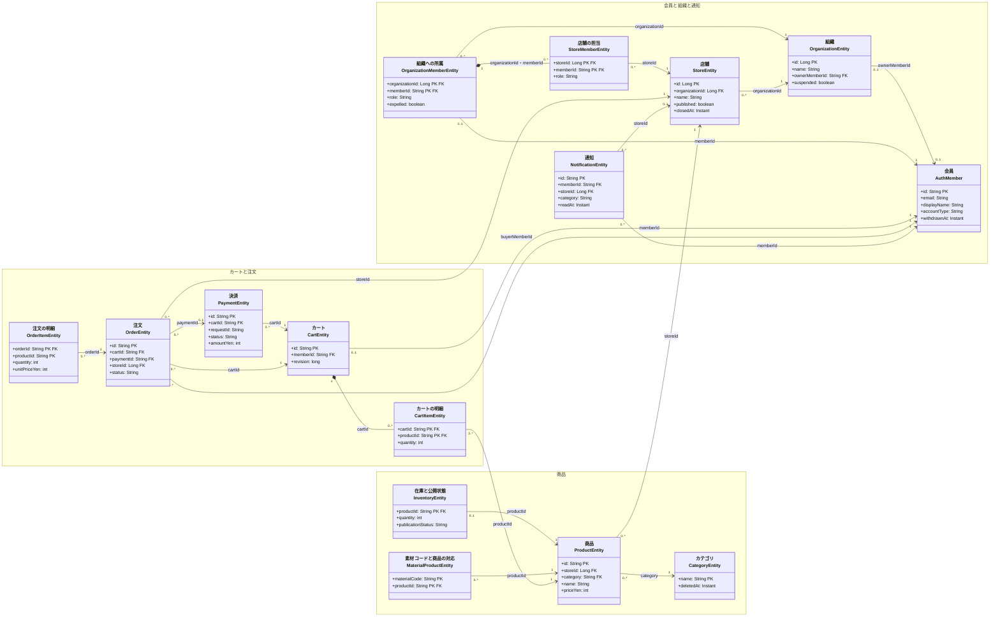

# クラス図

Kusakari Canvas と Kusakari EC が扱うデータの構造を、システムごとに 1 枚ずつ描いたクラス図です。

- 対象のコード: kusakari-canvas の main（2c043a4）、kusakari-ec の main（8892344）。どちらも 2026-11-24 時点です。
- 処理の流れは [シーケンス図](<../シーケンス図>)、テーブルの列は [テーブル設計図](<../テーブル設計図>) にあります。

## 図の読み方

- 箱の名前は、上の行が日本語名（論理名）、下の行が英語名（コードのクラス名）です。
- `*--`（黒い菱形）は、親が消えると一緒に消える持ち方です（JSON の入れ子、`ON DELETE CASCADE` の外部キー）。`-->` は関連（外部キー）、`..>` は保存先です。
- 線の両端の数字は多重度です。`1` は 1 つ、`0..1` は無いか 1 つ、`0..*` は 0 個以上です。
- 線のラベルは、関連を持つフィールド名か外部キーの列名です。関連の線で描いたフィールドは、箱の中に重ねて書いていません。

## Kusakari Canvas

庭と配置、買い物リスト、庭写真、サムネイルと生成履歴の 4 つのまとまりで分けました。どの枠にも、画面と API がやり取りする庭のデータ（GardenDocument などの DTO）と、MySQL に保存する Entity が入ります。GardenDocument は、庭 1 行（`Garden`）と配置ごとの行（`PlacedObject`）に分けて保存し（「保存先」の線）、写真と買い物リストの必要数は `Garden` の JSON の列に入れます。

- 図の `*` の上限: 配置（`objects`）と買い物リストの必要数（`shoppingTargets`）は 200 個まで、写真の輪郭（`boundary`）は 3〜64 点です。
- GardenDocument の側は API の DTO（`schemas.py`）を描きました。画面の型（`types/garden.d.ts`）も同じ形です。

## Kusakari EC

会員と組織と通知、商品、カートと注文の 3 つのまとまりで分けた、主な Entity です。通知は会員と店舗に付くので、会員と組織の枠に入れました。Entity の間に JPA の関連の注釈はなく、線はすべて MySQL の外部キーです。

- 会員（`AuthMember`）を指す外部キーのうち、記録のための 4 つ（オーナーの譲渡の相手、商品を追加した人、決済した人、注文をキャンセルした人）は、線が集まって読めなくなるので描いていません。
- 注文の明細（`OrderItemEntity`）は、注文したときの商品番号・名前・単価を写して持つので、商品への外部キーがありません。
- 1 回のお会計（カートとお会計の番号）から、受け取る店舗ごとに 1 件の注文を作ります。
