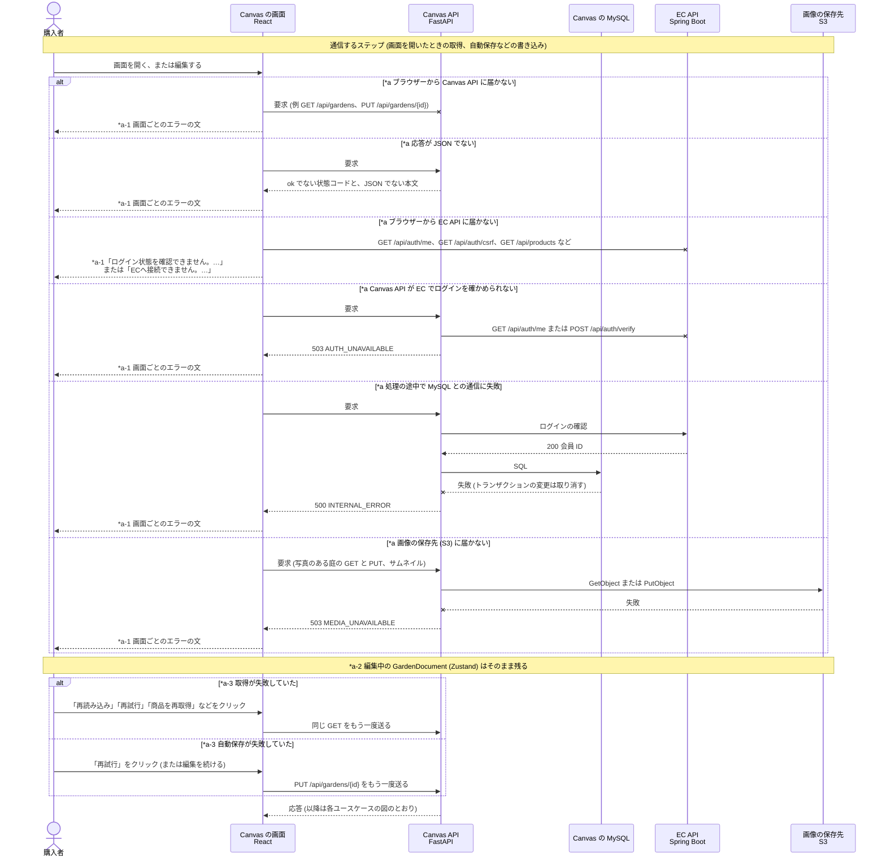
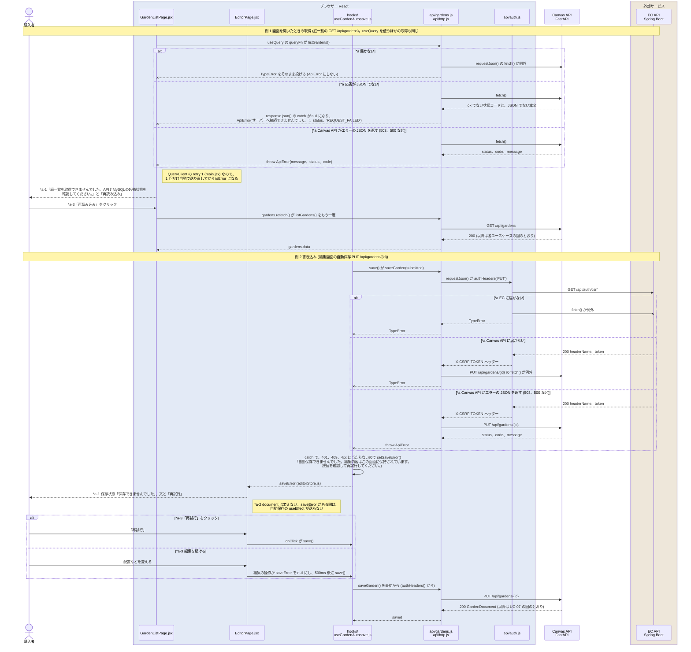
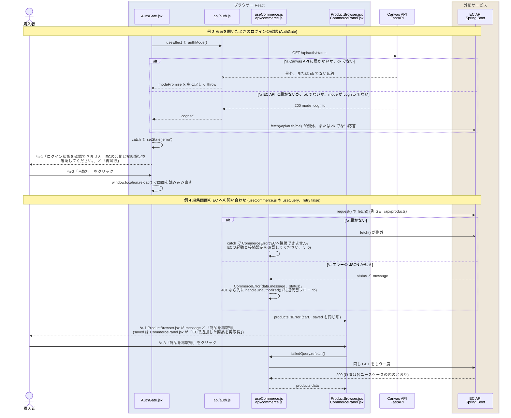
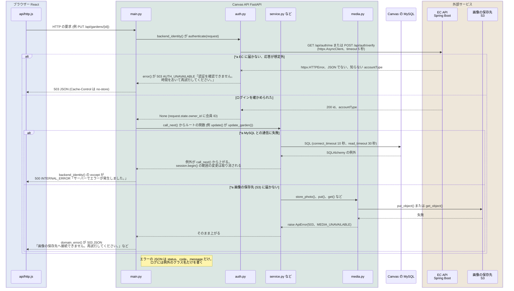
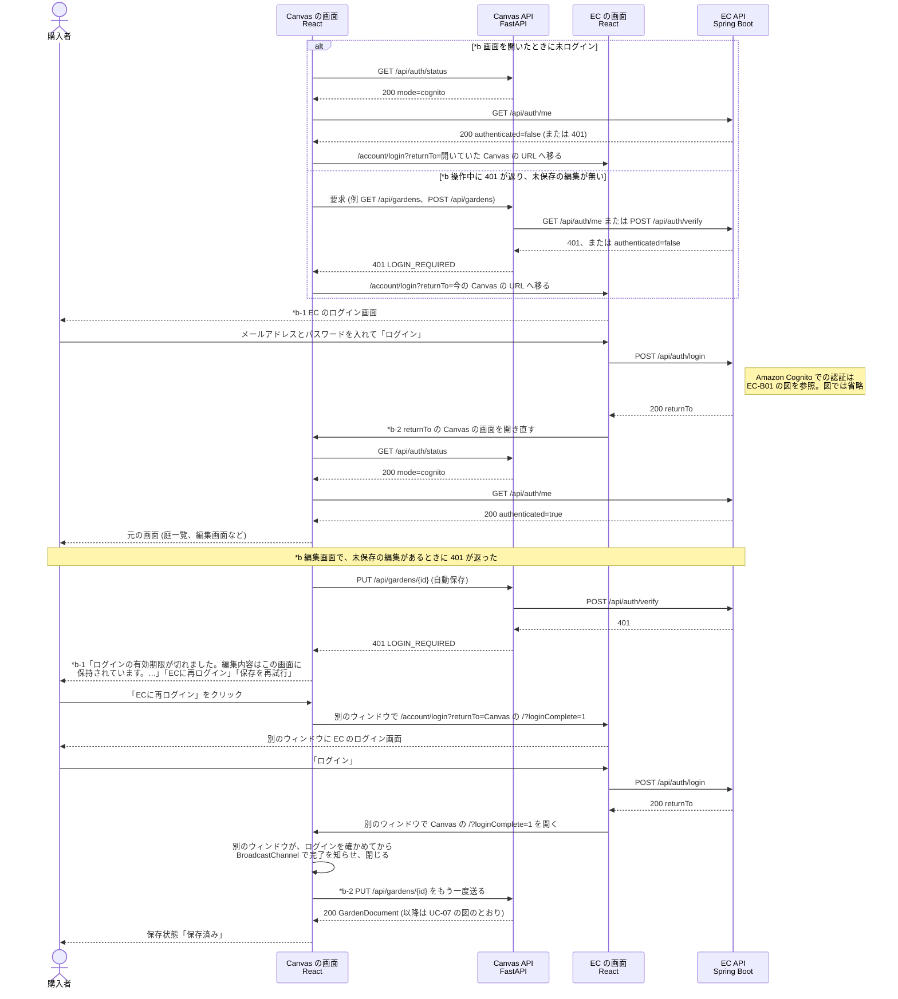
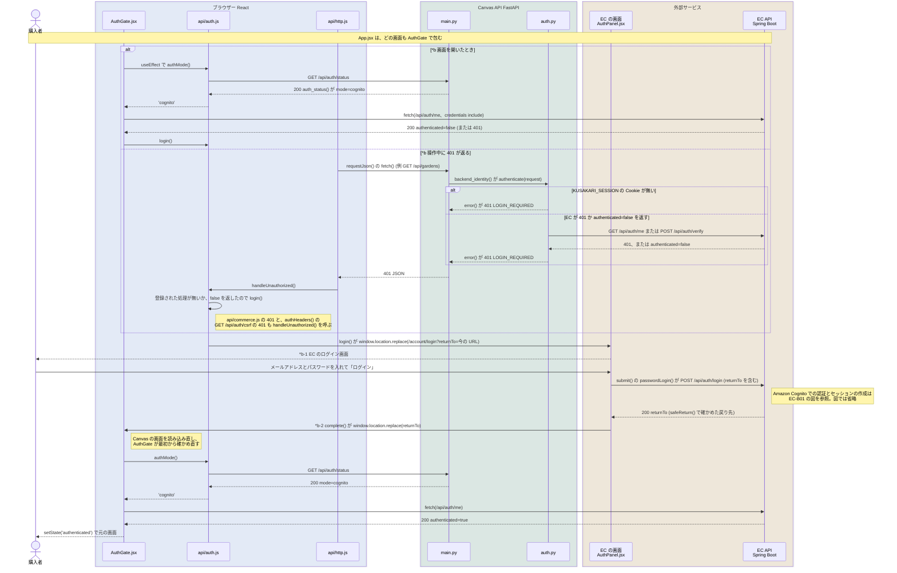
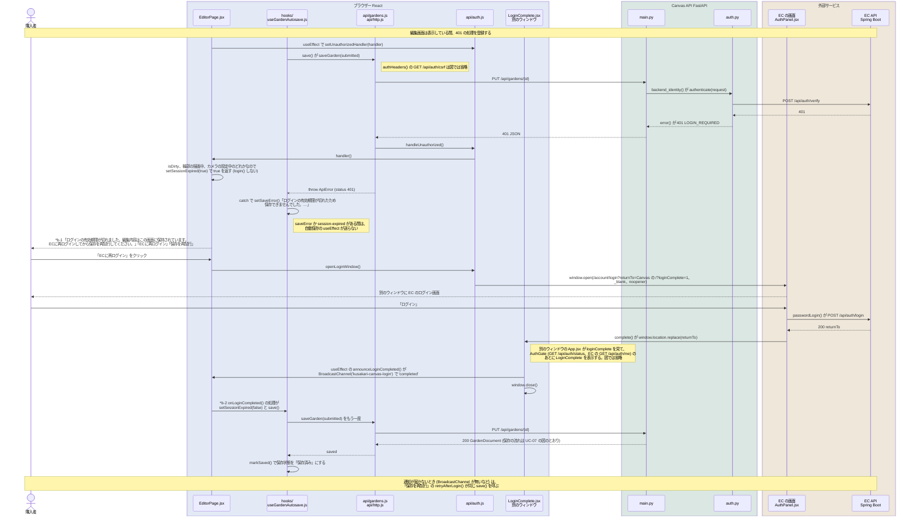

# 00 全ユースケース共通の代替フロー

- ユースケース記述: [00_全ユースケース共通の代替フロー](<../../アーカイブ/ユースケース/kusakari-canvas/00_全ユースケース共通の代替フロー.md>)
- 対象のコード: kusakari-canvas の main（c19d497、2026-11-20 時点）

Canvas の画面の通信は、3 つの経路に分かれます。

- Canvas API へ: `api/http.js` の `requestJson()`。庭、アセット、サムネイル、AI などです。書き込みの前に `api/auth.js` の `authHeaders()` が EC の `GET /api/auth/csrf` で CSRF トークンを取ります。
- EC API へ直接: `api/commerce.js` の `request()`（カート、商品、買い物リスト）と、`AuthGate.jsx` のログインの確認（`GET /api/auth/me`）です。宛先は `VITE_KUSAKARI_EC_URL` で決まります。
- Canvas API から EC API へ: `auth.py` の `AuthBoundary.authenticate()` が、要求ごとに EC のセッションの Cookie（`KUSAKARI_SESSION`）を EC に渡して、ログインを確かめます。読み取りは `GET /api/auth/me`、書き込みは `POST /api/auth/verify` です。Canvas は Amazon Cognito を直接呼びません。

失敗したときの表示は、画面ごとに決まっています。下の図は、庭一覧の取得（`GardenListPage.jsx`）と、編集画面の自動保存（`useGardenAutosave.js`）を例にしています。パスはローカルで起動したときのものです。`KUSAKARI_CANVAS_API_PREFIX=/canvas` の環境では、Canvas API のパスの前に `/canvas` が付きます。

## \*a 通信に失敗した場合

### 概要図

### 詳細図 1 画面が Canvas API の失敗を受け取る

### 詳細図 2 画面から EC API への通信が失敗する

### 詳細図 3 Canvas API の中で失敗する

## \*b 未ログインの場合

### 概要図

### 詳細図 1 未保存の編集が無いとき

### 詳細図 2 編集画面に未保存の編集があるとき

## ユースケース記述との差

- \*a-1 の表示は共通の部品ではなく、画面ごとに文が違います。例として、庭一覧の取得は「庭一覧を取得できませんでした。APIとMySQLの起動状態を確認してください。」、編集画面の読み込みは「庭を取得できませんでした。庭ID、API、MySQLの状態を確認してください。」、自動保存は「自動保存できませんでした。編集内容はこの画面に保持されています。接続を確認して再試行してください。」、EC への問い合わせは「ECへ接続できません。ECの起動と接続設定を確認してください。」です。
- \*a-3 の再実行のボタンも画面ごとに違います（「再読み込み」「再試行」「商品を再取得」「ECで追加した商品を再取得」「複製を再試行」など）。庭の作成は、同じ「新しい庭をつくる」をもう一度押します。ログインの確認（`AuthGate`）の「再試行」は、画面全体を読み込み直します。
- 記述に無い処理として、次のものがあります。
  - Canvas API への取得（`useQuery`）は、失敗すると 1 回だけ自動で送り直してからエラーを出します（`main.jsx` の `retry: 1`）。EC への問い合わせは送り直しません（`retry: false`）。
  - 自動保存が失敗したあと、利用者が編集を続けると `saveError` が消え、自動保存がまた送ります。「再試行」を押さなくても再実行されます。
  - サムネイルの保存（`useGardenThumbnail.js`）は、失敗しても画面に出さず、3 回までやり直します。
- \*a で、Canvas API に届かないとき（`TypeError`）と、エラーの応答（`ApiError`）とで、画面の文が変わる画面があります。庭の作成と複製は、`ApiError` なら API の `message` を付け、そうでなければ「接続を確認して再試行してください。」を付けます。
- EC への問い合わせで、応答の本文が JSON でないときは、`api/commerce.js` の `request()` が `response.json()` の例外をそのまま投げます。`CommerceError` にならないので、画面にはブラウザーの例外の文が出ます。
- \*b-1 で、Canvas には自分のログイン画面がありません。EC の `/account/login` に移ります。
- \*b-2 の「元のステップへ戻る」は、EC が `returnTo` の URL へ戻すことで行います。画面を読み込み直すので、未保存の編集が無い画面だけがこの形です。未保存の編集がある編集画面は、画面を移らず、別のウィンドウでログインしてから保存をやり直します（Canvas の `docs/session-expiry-edits.md`）。
- 403（CSRF トークンの不足、店舗側のアカウント）と 503（認証先の障害）は \*b に入れず、エラーを表示します。

## 確かめられなかったこと

- Canvas API が止まっているときに、開発用の Vite の proxy（`frontend/vite.config.js`）がどの状態コードを返すかは、動かして確かめていません。`fetch()` が例外になるか、JSON でない応答になるかで、\*a の「届かない」と「応答が JSON でない」のどちらかの枝に入ります。
- EC API の中で、ログインの確認のときに Amazon Cognito でトークンを更新する処理は、EC の図に任せました。Canvas のコードからは、EC が何を返すか（状態コードと JSON）だけを確かめています。

## 参照したコード

- [frontend/src/main.jsx](https://github.com/abeouga/kusakari-canvas/blob/c19d497dfef15b119f9bce8ecb5c886a36da6b7d/frontend/src/main.jsx): `QueryClient` の `retry`
- [frontend/src/pages/App.jsx](https://github.com/abeouga/kusakari-canvas/blob/c19d497dfef15b119f9bce8ecb5c886a36da6b7d/frontend/src/pages/App.jsx): `App()`、`loginCompleteParam` の分岐
- [frontend/src/components/AuthGate.jsx](https://github.com/abeouga/kusakari-canvas/blob/c19d497dfef15b119f9bce8ecb5c886a36da6b7d/frontend/src/components/AuthGate.jsx): `AuthGate()`、「ログイン状態を確認できません。…」
- [frontend/src/components/LoginComplete.jsx](https://github.com/abeouga/kusakari-canvas/blob/c19d497dfef15b119f9bce8ecb5c886a36da6b7d/frontend/src/components/LoginComplete.jsx): `LoginComplete()`
- [frontend/src/api/auth.js](https://github.com/abeouga/kusakari-canvas/blob/c19d497dfef15b119f9bce8ecb5c886a36da6b7d/frontend/src/api/auth.js): `authMode()`、`authHeaders()`、`login()`、`setUnauthorizedHandler()`、`handleUnauthorized()`、`openLoginWindow()`、`onLoginCompleted()`、`announceLoginCompleted()`
- [frontend/src/api/http.js](https://github.com/abeouga/kusakari-canvas/blob/c19d497dfef15b119f9bce8ecb5c886a36da6b7d/frontend/src/api/http.js): `requestJson()`、`ApiError`
- [frontend/src/api/gardens.js](https://github.com/abeouga/kusakari-canvas/blob/c19d497dfef15b119f9bce8ecb5c886a36da6b7d/frontend/src/api/gardens.js): `listGardens`、`saveGarden`
- [frontend/src/api/commerce.js](https://github.com/abeouga/kusakari-canvas/blob/c19d497dfef15b119f9bce8ecb5c886a36da6b7d/frontend/src/api/commerce.js): `request()`、`CommerceError`
- [frontend/src/hooks/useCommerce.js](https://github.com/abeouga/kusakari-canvas/blob/c19d497dfef15b119f9bce8ecb5c886a36da6b7d/frontend/src/hooks/useCommerce.js): `useCommerce()` の `retry: false`
- [frontend/src/hooks/useGardenAutosave.js](https://github.com/abeouga/kusakari-canvas/blob/c19d497dfef15b119f9bce8ecb5c886a36da6b7d/frontend/src/hooks/useGardenAutosave.js): `save()` の catch、自動保存の `useEffect`
- [frontend/src/hooks/useGardenThumbnail.js](https://github.com/abeouga/kusakari-canvas/blob/c19d497dfef15b119f9bce8ecb5c886a36da6b7d/frontend/src/hooks/useGardenThumbnail.js): 失敗したときのやり直し
- [frontend/src/pages/GardenListPage.jsx](https://github.com/abeouga/kusakari-canvas/blob/c19d497dfef15b119f9bce8ecb5c886a36da6b7d/frontend/src/pages/GardenListPage.jsx): `gardens.isError` の表示と「再読み込み」、`createGarden` の `onError`、`copyGarden()`
- [frontend/src/pages/EditorPage.jsx](https://github.com/abeouga/kusakari-canvas/blob/c19d497dfef15b119f9bce8ecb5c886a36da6b7d/frontend/src/pages/EditorPage.jsx): `saveError` と「再試行」、`setUnauthorizedHandler()` の登録、`sessionExpired` の表示、`retryAfterLogin()`、`onLoginCompleted()` の登録
- [frontend/src/components/ProductBrowser.jsx](https://github.com/abeouga/kusakari-canvas/blob/c19d497dfef15b119f9bce8ecb5c886a36da6b7d/frontend/src/components/ProductBrowser.jsx): `failedQuery` と「商品を再取得」
- [frontend/src/components/CommercePanel.jsx](https://github.com/abeouga/kusakari-canvas/blob/c19d497dfef15b119f9bce8ecb5c886a36da6b7d/frontend/src/components/CommercePanel.jsx): 「ECで追加した商品を再取得」
- [frontend/vite.config.js](https://github.com/abeouga/kusakari-canvas/blob/c19d497dfef15b119f9bce8ecb5c886a36da6b7d/frontend/vite.config.js): `/api` の proxy
- [backend/kusakari_canvas_api/main.py](https://github.com/abeouga/kusakari-canvas/blob/c19d497dfef15b119f9bce8ecb5c886a36da6b7d/backend/kusakari_canvas_api/main.py): `backend_identity()`、`error_response()`、`domain_error()`、`auth_status()`
- [backend/kusakari_canvas_api/auth.py](https://github.com/abeouga/kusakari-canvas/blob/c19d497dfef15b119f9bce8ecb5c886a36da6b7d/backend/kusakari_canvas_api/auth.py): `AuthBoundary.authenticate()`、`error()`
- [backend/kusakari_canvas_api/database.py](https://github.com/abeouga/kusakari-canvas/blob/c19d497dfef15b119f9bce8ecb5c886a36da6b7d/backend/kusakari_canvas_api/database.py): `create_database_engine()` の接続のタイムアウト
- [backend/kusakari_canvas_api/media.py](https://github.com/abeouga/kusakari-canvas/blob/c19d497dfef15b119f9bce8ecb5c886a36da6b7d/backend/kusakari_canvas_api/media.py): `MediaStore.put()`、`get()`、`store_photo()`
- [frontend/src/components/AuthPanel.jsx（kusakari-ec）](https://github.com/abeouga/kusakari-ec/blob/19a2be307ee71a2cd87e538236c3c8c42929c5b3/frontend/src/components/AuthPanel.jsx): `submit()`、`complete()`
- [frontend/src/auth.js（kusakari-ec）](https://github.com/abeouga/kusakari-ec/blob/19a2be307ee71a2cd87e538236c3c8c42929c5b3/frontend/src/auth.js): `passwordLogin()`
- [backend/src/main/java/jp/kusakari/ec/auth/AuthController.java（kusakari-ec）](https://github.com/abeouga/kusakari-ec/blob/19a2be307ee71a2cd87e538236c3c8c42929c5b3/backend/src/main/java/jp/kusakari/ec/auth/AuthController.java): `me()`、`verify()`、`csrf()`
- [backend/src/main/java/jp/kusakari/ec/auth/PasswordLoginController.java（kusakari-ec）](https://github.com/abeouga/kusakari-ec/blob/19a2be307ee71a2cd87e538236c3c8c42929c5b3/backend/src/main/java/jp/kusakari/ec/auth/PasswordLoginController.java): `login()` の `safeReturn()`

EC 側のログインの流れは [EC-B01 ログインする](<../kusakari-ec/EC-B01_ログインする.md>) にあります。
