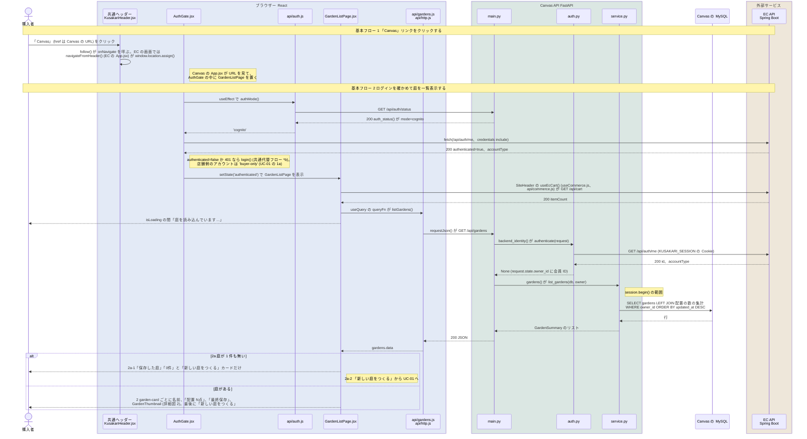
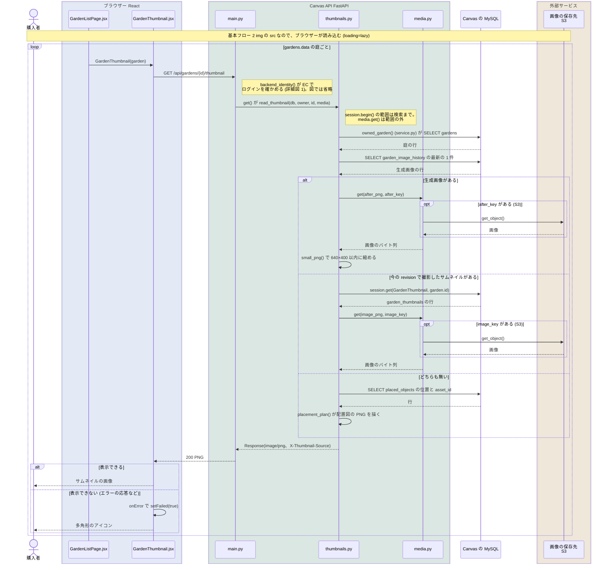
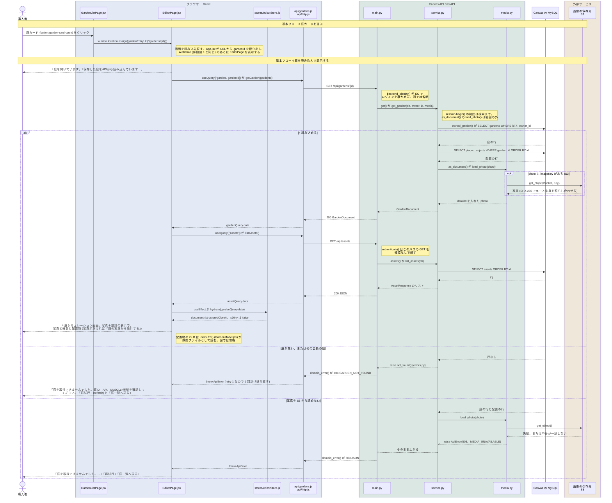
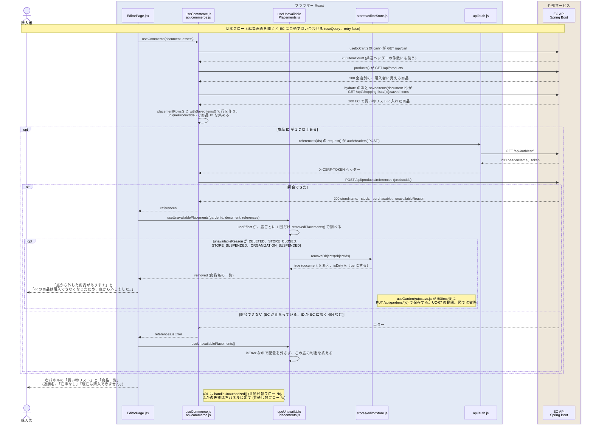
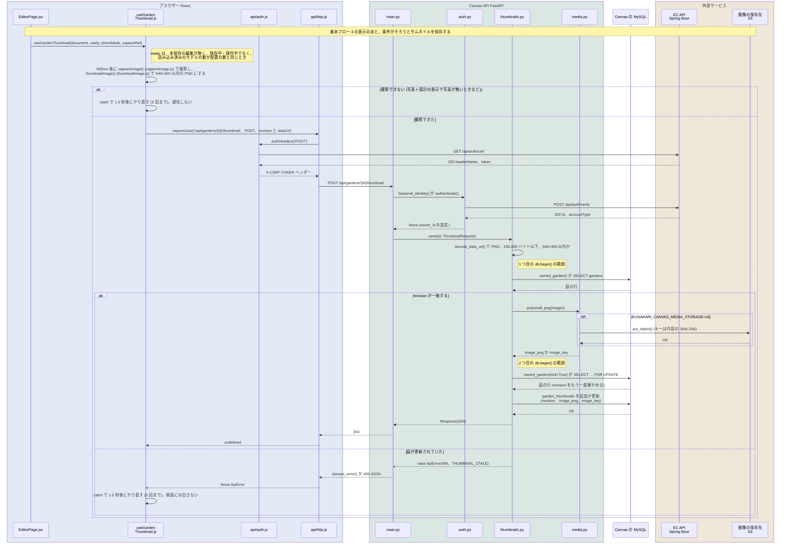

# UC-01-1 庭プロジェクトを開く

- ユースケース記述: [UC-01-1_庭プロジェクトを開く](<../../アーカイブ/ユースケース/kusakari-canvas/UC-01-1_庭プロジェクトを開く.md>)
- 対象のコード: kusakari-canvas の main（c19d497、2026-11-20 時点）

庭一覧では、庭カードごとにサムネイルを読みます。庭を開くと、画面は Canvas API から庭とアセットを読み、EC API へ商品などを問い合わせ、条件がそろうとサムネイルを保存します。どれも利用者の操作なしで送ります（`useQuery`、`useEffect`、img の読み込み）。写真やサムネイルの画像は、既定では Canvas の MySQL に入ります。環境変数 `KUSAKARI_CANVAS_MEDIA_STORAGE=s3` の環境では、画像を S3 に置き、MySQL にはキーだけを入れます（`media.py`）。

## 概要図

```mermaid
sequenceDiagram
    actor User as 購入者
    participant EcPage as EC の画面<br/>React
    participant Page as Canvas の画面<br/>React
    participant Api as Canvas API<br/>FastAPI
    participant Db as Canvas の MySQL
    participant Ec as EC API<br/>Spring Boot
    participant S3 as 画像の保存先<br/>S3

    Note over User,S3: 基本フロー 1〜2 「Canvas」リンクから庭一覧を開く
    User->>EcPage: 共通ヘッダーの「Canvas」をクリック
    EcPage->>Page: Canvas の URL へ移動する
    Page->>Api: GET /api/auth/status
    Api-->>Page: 200 mode=cognito
    Page->>Ec: GET /api/auth/me
    Ec-->>Page: 200 authenticated=true、accountType
    Note over Page,Ec: 未ログインは共通代替フロー *b。店舗側のアカウントは<br/>UC-01 の 1a と同じ案内で終わる
    Page->>Ec: GET /api/cart (ヘッダーのカートの件数)
    Ec-->>Page: 200 カート
    Page->>Api: GET /api/gardens
    Api->>Ec: GET /api/auth/me (Cookie を渡してログインを確かめる)
    Ec-->>Api: 200 会員 ID
    Note right of Api: 以降も Canvas API は要求ごとに EC で確かめる<br/>(読み取りは GET /api/auth/me、<br/>書き込みは POST /api/auth/verify)。図では省略
    Api->>Db: 会員の庭と配置の数を、更新の新しい順に検索
    Db-->>Api: 庭の行
    Api-->>Page: 200 庭の概要の配列
    alt 2a 庭が 1 件も無い
        Page-->>User: 2a-1「0件」と「新しい庭をつくる」カードだけ
        Note over User,S3: 2a-2 UC-01 で新しい庭を作る
    else 庭がある
        Page-->>User: 2 庭カード (名前、配置の数、最終保存、サムネイル)
        loop 庭カードごと (img の読み込み)
            Page->>Api: GET /api/gardens/{id}/thumbnail
            Api->>Db: 会員の庭と、最新の生成画像を検索
            Db-->>Api: 行
            alt 生成画像がある
                opt 画像が S3 にある
                    Api->>S3: GetObject
                    S3-->>Api: 画像
                end
            else 今の revision で撮影したサムネイルがある
                Api->>Db: サムネイルを検索
                Db-->>Api: 行
                opt 画像が S3 にある
                    Api->>S3: GetObject
                    S3-->>Api: 画像
                end
            else どちらも無い
                Api->>Db: 配置を検索
                Db-->>Api: 行
                Api->>Api: 配置図の PNG を描く
            end
            Api-->>Page: 200 PNG
            alt 表示できる
                Page-->>User: サムネイルの画像
            else 表示できない
                Page-->>User: 多角形のアイコン
            end
        end
    end

    Note over User,S3: 基本フロー 3〜4 庭を読み込んで編集画面を表示する
    User->>Page: 庭カードをクリック
    Page->>Page: /gardens/{id} へ移動 (画面を読み込み直す)
    Note over Page,Ec: AuthGate がもう一度 GET /api/auth/status と<br/>EC の GET /api/auth/me で確かめる。図では省略
    Page->>Api: GET /api/gardens/{id}
    Api->>Db: 会員の庭を id で検索し、配置を検索
    alt 4 読み込める
        Db-->>Api: 庭と配置の行
        opt 写真が S3 にある
            Api->>S3: GetObject
            S3-->>Api: 写真
        end
        Api-->>Page: 200 GardenDocument
        Page->>Api: GET /api/assets
        Api->>Db: アセットを検索
        Db-->>Api: 行
        Api-->>Page: 200 アセットの一覧
        Page-->>User: 4 庭シミュレーション画面 (写真＋設計の表示)
        Page->>Ec: GET /api/cart、GET /api/products、<br/>GET /api/shopping-lists/{id}/saved-items
        Ec-->>Page: 200 カート、商品の一覧、EC で買い物リストに入れた商品
        opt 商品の配置か、EC で買い物リストに入れた商品がある
            Page->>Ec: GET /api/auth/csrf
            Ec-->>Page: 200 CSRF トークン
            Page->>Ec: POST /api/products/references
            alt 照会できた
                Ec-->>Page: 200 店舗名、在庫、買えるか、買えない理由
                opt 削除・店舗の閉鎖などで買えない商品の配置がある
                    Page-->>User: 「庭から外した商品があります」
                    Note over Page,Api: 配置を外し、自動保存 (PUT /api/gardens/{id}) で<br/>保存する。UC-07 の範囲。図では省略
                end
            else 照会できない
                Ec--xPage: エラー
                Page->>Page: 配置を外さず、この庭の判定を終える
            end
        end
        Note over Page,Api: 未保存の編集が無く、配置物のモデルを読み込み終えると、<br/>サムネイルを撮影する
        alt 撮影できない (写真＋設計の表示で写真が無いときなど)
            Page->>Page: 1.5 秒後にやり直す (3 回まで)。通信しない
        else 撮影できた
            Page->>Ec: GET /api/auth/csrf
            Ec-->>Page: 200 CSRF トークン
            Page->>Api: POST /api/gardens/{id}/thumbnail (撮影した PNG)
            Api->>Db: 庭の revision を確かめる
            Db-->>Api: 庭の行
            alt revision が一致する
                opt 画像の保存先が S3
                    Api->>S3: PutObject
                    S3-->>Api: OK
                end
                Api->>Db: 庭の行をロックし、サムネイルを追加か更新
                Db-->>Api: OK
                Api-->>Page: 204
            else 庭が更新されていた
                Api-->>Page: 409 THUMBNAIL_STALE
                Page->>Page: 1.5 秒後にやり直す (3 回まで)。画面には出さない
            end
        end
    else 庭が無い、または他の会員の庭
        Db-->>Api: 行なし
        Api-->>Page: 404 GARDEN_NOT_FOUND
        Page-->>User: 「庭を取得できませんでした。庭ID、API、MySQLの状態を<br/>確認してください。」「再試行」「庭一覧へ戻る」
    else 写真を S3 から読めない
        Db-->>Api: 庭と配置の行
        Api->>S3: GetObject
        S3--xApi: 失敗
        Api-->>Page: 503 MEDIA_UNAVAILABLE
        Page-->>User: 「庭を取得できませんでした。…」「再試行」「庭一覧へ戻る」
    end
```

## 詳細図 1 基本フロー 1〜2 ログインを確かめて庭一覧を表示する

## 詳細図 2 基本フロー 2 庭カードのサムネイルを読む

## 詳細図 3 基本フロー 3〜4 庭を読み込んで表示する

## 詳細図 4 基本フロー 4 EC に商品を問い合わせる

## 詳細図 5 基本フロー 4 サムネイルを自動で保存する

## ユースケース記述との差

- 2a の「保存した庭はまだありません。上のフォームから最初の庭を作成できます。」という文は、コードにありません。庭が 0 件のときは、「保存した庭」の見出しの横に「0件」が出て、「新しい庭をつくる」カードだけが並びます。作成の入口はフォームではなくカードです。
- 基本フロー 2 の一覧は、更新の新しい順です（`ORDER BY updated_at DESC`）。カードには名前、「配置 N点」、「最終保存」の日時、サムネイルが出ます。サムネイルはカードごとに `GET /api/gardens/{id}/thumbnail` で読みます。生成画像、今の revision で撮影したサムネイル、配置図の順に選びます。
- 記述に無い処理として、次のものがあります。
  - 基本フロー 4 で庭を読めなかったとき（庭が無い、他の会員の庭、S3 から写真を読めない）は、「庭を取得できませんでした。庭ID、API、MySQLの状態を確認してください。」と「再試行」「庭一覧へ戻る」を出します。他の会員の庭も 404 で、存在するかどうかを区別しません。
  - 編集画面は、写真の有無にかかわらず、毎回「写真＋設計」の表示で開きます。
  - 編集画面を開くと、EC へカート・商品の一覧・EC で買い物リストに入れた商品を問い合わせます。商品の配置があれば `POST /api/products/references` で照会します。削除・店舗の閉鎖・店舗の停止・組織の停止で買えなくなった商品の配置は外し、「庭から外した商品があります」で知らせ、自動保存で保存します（[UC-07 庭プロジェクトを保存する](<UC-07_庭プロジェクトを保存する.md>)）。
  - 写真があり、配置物のモデルを読み込み終えると、サムネイルを撮影して `POST /api/gardens/{id}/thumbnail` で保存します。失敗は画面に出さず、3 回までやり直します。
  - EC の商品詳細から `?productId=...` 付きで開いた場合は、その URL を庭の URL に引き継ぎ、編集画面でその商品のモデルを選んだ状態にします（`gardenEntryUrl()`、`EditorPage.jsx` の `useEffect`）。

## 確かめられなかったこと

- どの環境で `KUSAKARI_CANVAS_MEDIA_STORAGE=s3` にしているかは、環境変数で決まるため、このリポジトリのコードでは確かめられません。図では S3 の呼び出しを opt にしました。
- 画面を開いたときの `useQuery` は、それぞれ同時に送られます。実際の送信と応答の順は、ブラウザーで確かめていません。図はコードに書かれた順に並べています。サムネイルの img は `loading="lazy"` なので、画面の外のカードは表示されるまで読まないことがあります。

## 参照したコード

- [frontend/src/pages/App.jsx](https://github.com/abeouga/kusakari-canvas/blob/c19d497dfef15b119f9bce8ecb5c886a36da6b7d/frontend/src/pages/App.jsx): `App()`
- [frontend/src/main.jsx](https://github.com/abeouga/kusakari-canvas/blob/c19d497dfef15b119f9bce8ecb5c886a36da6b7d/frontend/src/main.jsx): `QueryClient` の `retry: 1`
- [frontend/src/components/AuthGate.jsx](https://github.com/abeouga/kusakari-canvas/blob/c19d497dfef15b119f9bce8ecb5c886a36da6b7d/frontend/src/components/AuthGate.jsx): `AuthGate()`
- [frontend/src/api/auth.js](https://github.com/abeouga/kusakari-canvas/blob/c19d497dfef15b119f9bce8ecb5c886a36da6b7d/frontend/src/api/auth.js): `authMode()`、`authHeaders()`
- [frontend/src/api/http.js](https://github.com/abeouga/kusakari-canvas/blob/c19d497dfef15b119f9bce8ecb5c886a36da6b7d/frontend/src/api/http.js): `requestJson()`
- [frontend/src/api/gardens.js](https://github.com/abeouga/kusakari-canvas/blob/c19d497dfef15b119f9bce8ecb5c886a36da6b7d/frontend/src/api/gardens.js): `listGardens`、`getGarden`、`listAssets`
- [frontend/src/api/commerce.js](https://github.com/abeouga/kusakari-canvas/blob/c19d497dfef15b119f9bce8ecb5c886a36da6b7d/frontend/src/api/commerce.js): `request()`、`cart`、`products`、`references`、`savedItems`
- [frontend/src/pages/GardenListPage.jsx](https://github.com/abeouga/kusakari-canvas/blob/c19d497dfef15b119f9bce8ecb5c886a36da6b7d/frontend/src/pages/GardenListPage.jsx): `GardenListPage()`、`garden-card-open` の `onClick`
- [frontend/src/components/GardenThumbnail.jsx](https://github.com/abeouga/kusakari-canvas/blob/c19d497dfef15b119f9bce8ecb5c886a36da6b7d/frontend/src/components/GardenThumbnail.jsx): `GardenThumbnail()`
- [frontend/src/pages/EditorPage.jsx](https://github.com/abeouga/kusakari-canvas/blob/c19d497dfef15b119f9bce8ecb5c886a36da6b7d/frontend/src/pages/EditorPage.jsx): `gardenQuery`、`assetQuery`、`hydrate` を呼ぶ `useEffect`、読み込み失敗の表示、「庭から外した商品があります」
- [frontend/src/stores/editorStore.js](https://github.com/abeouga/kusakari-canvas/blob/c19d497dfef15b119f9bce8ecb5c886a36da6b7d/frontend/src/stores/editorStore.js): `hydrate()`、`removeObjects()`
- [frontend/src/hooks/useCommerce.js](https://github.com/abeouga/kusakari-canvas/blob/c19d497dfef15b119f9bce8ecb5c886a36da6b7d/frontend/src/hooks/useCommerce.js): `useEcCart()`、`useCommerce()`
- [frontend/src/domain/shopping.js](https://github.com/abeouga/kusakari-canvas/blob/c19d497dfef15b119f9bce8ecb5c886a36da6b7d/frontend/src/domain/shopping.js): `placementRows()`、`withSavedItems()`
- [frontend/src/hooks/useUnavailablePlacements.js](https://github.com/abeouga/kusakari-canvas/blob/c19d497dfef15b119f9bce8ecb5c886a36da6b7d/frontend/src/hooks/useUnavailablePlacements.js): `useUnavailablePlacements()`
- [frontend/src/domain/productAvailability.js](https://github.com/abeouga/kusakari-canvas/blob/c19d497dfef15b119f9bce8ecb5c886a36da6b7d/frontend/src/domain/productAvailability.js): `REMOVED_REASONS`、`removedPlacements()`、`uniqueProductIds()`
- [frontend/src/hooks/useGardenThumbnail.js](https://github.com/abeouga/kusakari-canvas/blob/c19d497dfef15b119f9bce8ecb5c886a36da6b7d/frontend/src/hooks/useGardenThumbnail.js): `useGardenThumbnail()`
- [frontend/src/capture/captureImage.js](https://github.com/abeouga/kusakari-canvas/blob/c19d497dfef15b119f9bce8ecb5c886a36da6b7d/frontend/src/capture/captureImage.js): `captureImage()`
- [frontend/src/capture/thumbnailImage.js](https://github.com/abeouga/kusakari-canvas/blob/c19d497dfef15b119f9bce8ecb5c886a36da6b7d/frontend/src/capture/thumbnailImage.js): `thumbnailImage()`
- [frontend/src/three/GardenModel.jsx](https://github.com/abeouga/kusakari-canvas/blob/c19d497dfef15b119f9bce8ecb5c886a36da6b7d/frontend/src/three/GardenModel.jsx): `useGLTF()` によるモデルの読み込み
- [backend/kusakari_canvas_api/main.py](https://github.com/abeouga/kusakari-canvas/blob/c19d497dfef15b119f9bce8ecb5c886a36da6b7d/backend/kusakari_canvas_api/main.py): `backend_identity()`、`auth_status()`、`gardens()`、`get()`、`assets()`、`domain_error()`
- [backend/kusakari_canvas_api/auth.py](https://github.com/abeouga/kusakari-canvas/blob/c19d497dfef15b119f9bce8ecb5c886a36da6b7d/backend/kusakari_canvas_api/auth.py): `AuthBoundary.authenticate()`
- [backend/kusakari_canvas_api/service.py](https://github.com/abeouga/kusakari-canvas/blob/c19d497dfef15b119f9bce8ecb5c886a36da6b7d/backend/kusakari_canvas_api/service.py): `list_gardens()`、`get_garden()`、`list_assets()`、`owned_garden()`、`as_document()`
- [backend/kusakari_canvas_api/errors.py](https://github.com/abeouga/kusakari-canvas/blob/c19d497dfef15b119f9bce8ecb5c886a36da6b7d/backend/kusakari_canvas_api/errors.py): `not_found()`
- [backend/kusakari_canvas_api/media.py](https://github.com/abeouga/kusakari-canvas/blob/c19d497dfef15b119f9bce8ecb5c886a36da6b7d/backend/kusakari_canvas_api/media.py): `MediaStore.get()`、`put()`、`load_photo()`
- [backend/kusakari_canvas_api/thumbnails.py](https://github.com/abeouga/kusakari-canvas/blob/c19d497dfef15b119f9bce8ecb5c886a36da6b7d/backend/kusakari_canvas_api/thumbnails.py): `read_thumbnail()`、`placement_plan()`、`thumbnail_router()` の `get()` と `save()`
- [backend/src/main/java/jp/kusakari/ec/auth/AuthController.java（kusakari-ec）](https://github.com/abeouga/kusakari-ec/blob/19a2be307ee71a2cd87e538236c3c8c42929c5b3/backend/src/main/java/jp/kusakari/ec/auth/AuthController.java): `me()`、`verify()`、`csrf()`
