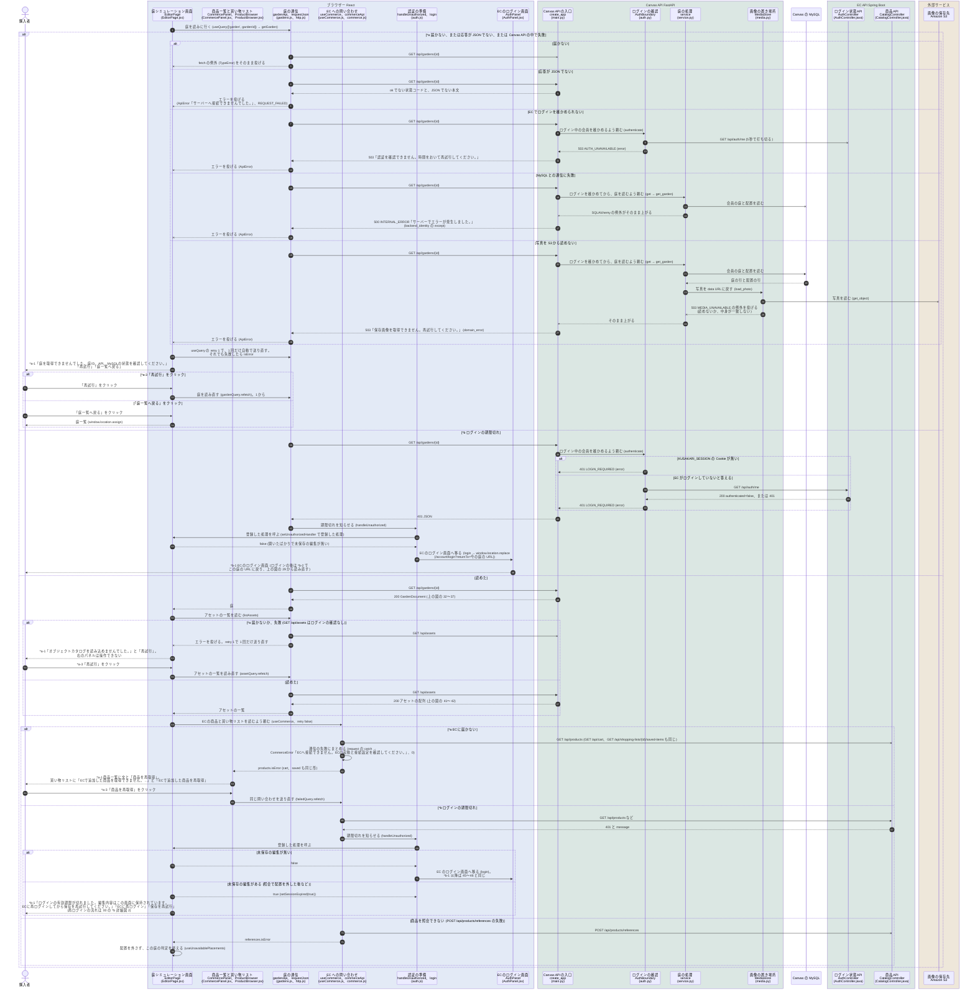

# UC-01-1 庭プロジェクトを開く

- ユースケース記述: [UC-01-1_庭プロジェクトを開く](<../../アーカイブ/ユースケース/kusakari-canvas/UC-01-1_庭プロジェクトを開く.md>)
- 共通代替フロー: [00_全ユースケース共通の代替フロー](<00_全ユースケース共通の代替フロー.md>)
- 対象のコード: kusakari-canvas の main（7e9a8dd、2026-11-24 時点）、Canvas から呼ぶ kusakari-ec の main（6bad7e3、2026-11-24 時点）

## シーケンス図

参加者は、上から「画面や役割の名前」「コンポーネント・クラスの名前」「ファイル名（かっこ付き）」の順に書いています。
庭一覧のサムネイル、編集画面の庭・アセット・EC への問い合わせ、サムネイルの保存は、利用者の操作なしで送ります（img の読み込み、`useQuery`、`useEffect`）。写真やサムネイルの画像は、既定では Canvas の MySQL に入ります。環境変数 `KUSAKARI_CANVAS_MEDIA_STORAGE=s3` の環境だけ、画像を S3 に置き、MySQL にはキーだけを入れます（`media.py`）。そのため S3 の呼び出しは `opt` にしています。
共通代替フローの中身は、00 の図か、下の「共通代替フローを直接書いた図」を見てください。
代替フローのうち、2a と記述にない分岐（庭が無いか他の会員の庭）は分かれる所だけを描き、結果と画面は矢印の文か Note に書いています。条件つきの処理（S3 の写真の読み込み、商品の照会、サムネイルの保存）は `opt` の中を頼む矢印 1 本にし、中で何を読み書きするかは Note に書いています。

```mermaid
sequenceDiagram
    autonumber
    actor User as 購入者
    box rgba(47,111,219,0.10) ブラウザー React
        participant EcHeader as EC の画面の共通ヘッダー<br/>KusakariHeader<br/>(KusakariHeader.jsx)
        participant Gate as ログインの確認<br/>AuthGate<br/>(AuthGate.jsx)
        participant AuthJs as 認証の準備<br/>authMode<br/>(auth.js)
        participant List as 庭プロジェクト一覧画面<br/>GardenListPage<br/>(GardenListPage.jsx)
        participant Card as 庭カードのサムネイル<br/>GardenThumbnail<br/>(GardenThumbnail.jsx)
        participant Editor as 庭シミュレーション画面<br/>EditorPage<br/>(EditorPage.jsx)
        participant Store as 編集中の庭<br/>useEditorStore<br/>(editorStore.js)
        participant Http as 庭の通信<br/>gardenApi、requestJson<br/>(gardens.js、http.js)
        participant Commerce as EC への問い合わせ<br/>useCommerce、commerceApi<br/>(useCommerce.js、commerce.js)
    end
    box rgba(27,127,92,0.12) Canvas API FastAPI
        participant Main as Canvas API の入口<br/>create_app<br/>(main.py)
        participant AuthPy as ログインの確認<br/>AuthBoundary<br/>(auth.py)
        participant Svc as 庭の処理<br/>service<br/>(service.py)
        participant ThumbPy as サムネイルの処理<br/>thumbnail_router<br/>(thumbnails.py)
        participant Media as 画像の置き場所<br/>MediaStore<br/>(media.py)
    end
    participant Db as Canvas の MySQL
    box rgba(27,127,92,0.12) EC API Spring Boot
        participant EcAuth as ログイン状態API<br/>AuthController<br/>(AuthController.java)
        participant Cart as カートAPI<br/>CartController<br/>(CartController.java)
        participant Catalog as 商品API<br/>CatalogController<br/>(CatalogController.java)
        participant Shopping as 買い物リストAPI<br/>ShoppingController<br/>(ShoppingController.java)
    end
    box rgba(180,120,20,0.12) 外部サービス
        participant S3 as 画像の保存先<br/>Amazon S3
    end

    Note over User,S3: 共通代替フロー<br/>*b 未ログインの場合: 6 (画面を開いたときのログインの確認)、11、29 (庭を開いたときのログインの確認)、32、45、46、47、48 に適用<br/>*a 通信に失敗した場合: 4、6、11、29、32、41、45、46、47、48 に適用

    User->>EcHeader: EC の画面の共通ヘッダーの「Canvas」をクリック
    EcHeader->>Gate: Canvas の URL を開く (follow → EC の App.jsx の navigateFromHeader が<br/>window.location.assign)。App.jsx が AuthGate の中に GardenListPage を置く
    Gate->>AuthJs: 認証の方式を確かめるよう頼む (authMode)
    AuthJs->>Main: GET /api/auth/status
    Main-->>AuthJs: 200 mode=cognito (auth_status。ログインの確認なしで通す)
    Gate->>EcAuth: GET /api/auth/me (EC のセッションの Cookie 付き)
    EcAuth-->>Gate: 200 ログイン中で、会員の種類が USER か ADMIN (me)
    Gate->>List: ログイン中の会員を渡して、庭一覧画面を表示<br/>(setState('authenticated')、AuthContext)
    List->>Cart: 共通ヘッダーのカートの件数を読む<br/>(SiteHeader の useEcCart → GET /api/cart)
    List->>Http: 庭の一覧を取りに行く (useQuery → listGardens → requestJson)
    Http->>Main: GET /api/gardens
    Main->>AuthPy: ログイン中の会員を確かめるよう頼む<br/>(backend_identity → authenticate)
    AuthPy->>EcAuth: GET /api/auth/me (KUSAKARI_SESSION の Cookie を渡す)
    EcAuth-->>AuthPy: 200 会員 ID と accountType (request.state.owner_id に会員 ID を入れる)
    Main->>Svc: 会員の庭の一覧を作るよう頼む (gardens → list_gardens)。<br/>会員の庭と配置の数を、更新の新しい順に読む<br/>(SELECT gardens LEFT JOIN 配置の数 WHERE owner_id ORDER BY updated_at DESC)
    Svc-->>Main: 庭の概要の一覧 (GardenSummary)
    Main-->>Http: 200 庭の概要の配列
    Http-->>List: 庭の一覧 (gardens.data)
    break 2a 庭が 1 件も無い
        List-->>User: 2a-1「保存した庭」「0件」と「新しい庭をつくる」カードだけ
        User->>List: 2a-2「新しい庭をつくる」をクリック (UC-01 の基本フロー 3 へ)
    end
    List-->>User: 2「保存した庭」「N件」と、庭カード (名前、「配置 N点」、<br/>「最終保存」の日時)。最後に「新しい庭をつくる」カード
    loop 庭カードごと (img の読み込み。loading=lazy なので、画面の外のカードは表示されるまで読まない)
        List->>Card: 庭カードのサムネイルを表示 (GardenThumbnail)
        Card->>Main: GET /api/gardens/{id}/thumbnail<br/>(ログインの確認は 12〜14 と同じ)
        Main->>ThumbPy: サムネイルを読むよう頼む (get → read_thumbnail)。<br/>最新の生成画像 (garden_image_history) を 640×400 以内に縮めたもの (small_png)、<br/>無ければ今の revision で撮影したサムネイル (garden_thumbnails)、<br/>それも無ければ配置の位置 (placed_objects) から描いた配置図 (placement_plan)。<br/>画像のキーがあれば S3 から読む (MediaStore.get → get_object)
        Main-->>Card: 200 PNG (X-Thumbnail-Source に generated、scene、layout)
        Card-->>User: サムネイルの画像。表示できない (エラーの応答など) ときは<br/>多角形のアイコン (onError → setFailed(true))
    end

    User->>List: 3 開きたい庭のカードをクリック
    List->>Gate: 庭の URL /gardens/{id} を開く (window.location.assign(gardenEntryUrl))。<br/>App.jsx が URL から庭の ID を取り出し、AuthGate の中に EditorPage を置く
    Gate->>Gate: ログインを確かめ直す (流れは 3〜7 と同じ)
    Gate->>Editor: 庭シミュレーション画面を表示。読み込みの間は<br/>「庭を開いています」「保存した庭をAPIから読み込んでいます…」
    Editor->>Http: 庭を読みに行く (useQuery(['garden', gardenId]) → getGarden)
    Http->>Main: GET /api/gardens/{id} (ログインの確認は 12〜14 と同じ)
    Main->>Svc: 庭を読むよう頼む (get → get_garden)。会員の庭と配置を読む<br/>(owned_garden の SELECT gardens WHERE id と owner_id、SELECT placed_objects ORDER BY id)
    break 庭が無いか、他の会員の庭 (記述なし)
        Note over Editor,Svc: 結果: 404 GARDEN_NOT_FOUND「庭が見つかりません。」を返す (not_found)。<br/>画面: useQuery の retry で 1 回だけ送り直した後、「庭を取得できませんでした。庭ID、API、MySQLの状態を確認してください。」「再試行」「庭一覧へ戻る」
    end
    Svc->>Media: 写真を data URL に戻す (as_document → load_photo)。写真が無ければ null
    opt 写真が S3 にある (imageKey)
        Media->>S3: 写真を読む (get_object)
        Note over Media,S3: 結果: SHA-256 でキーと中身を照らし合わせ、写真の dataUrl にする。
    end
    Svc-->>Main: 庭 (GardenDocument)
    Main-->>Http: 200 GardenDocument
    Http-->>Editor: 庭 (gardenQuery.data)
    Editor->>Store: 読んだ庭を編集中の庭に入れる (hydrate)。isDirty は false
    Editor->>Http: アセットの一覧を読む (useQuery(['assets']) → listAssets)
    Http->>Main: GET /api/assets (ログインの確認なしで通す)
    Main-->>Http: 200 アセットの配列 (assets → list_assets、SELECT assets ORDER BY id)
    Editor-->>User: 4 庭シミュレーション画面 (写真＋設計の表示)。写真があれば写真と輪郭と配置物、<br/>無ければ「庭の写真をアップロードする」
    Editor->>Commerce: EC の商品と買い物リストを読むよう頼む (useCommerce)
    Commerce->>Cart: GET /api/cart (useEcCart)。カートが返る
    Commerce->>Catalog: GET /api/products (products)。公開中の全店舗の商品の一覧が返る
    Commerce->>Shopping: GET /api/shopping-lists/{id}/saved-items (savedItems)。<br/>EC で買い物リストに入れた商品が返る
    opt 商品の配置か、EC で買い物リストに入れた商品がある (uniqueProductIds)
        Commerce->>Catalog: 商品を照会する (references)。GET /api/auth/csrf で CSRF トークンを取ってから<br/>POST /api/products/references (productIds)
        Note over Editor,Catalog: 結果: 店舗名、在庫、買えるかと理由が返る。庭ごとに 1 回、削除・店舗の閉鎖・店舗の停止・組織の停止で<br/>買えない商品の配置を外し (useUnavailablePlacements → removeObjects)、自動保存で保存する (UC-07)。<br/>画面: 外したときは「庭から外した商品があります」と「○○の商品は購入できなくなったため、庭から外しました。」
    end
    Editor-->>User: 右のパネルに買い物リストと商品一覧 (CommercePanel)
    opt 未保存の編集が無く、配置物のモデルを読み終えた (useGardenThumbnail)
        Editor->>Main: 600ms 後に撮影した 640×400 以内の PNG (captureImage、thumbnailImage) を、<br/>CSRF トークンを付けて送る (requestJson)。POST /api/gardens/{id}/thumbnail (本文は revision と dataUrl)
        Note over Editor,Db: 結果: 形式と大きさを確かめ、revision が同じなら画像を置き (S3 の設定なら put_object)、<br/>garden_thumbnails を追加か更新して 204。revision が違えば 409 THUMBNAIL_STALE で、1.5 秒後にやり直す (3 回まで)。<br/>画面: 何も出さない。撮影できない (写真が無いなど) ときは通信せず、1.5 秒後にやり直す (3 回まで)。
    end
```

## 共通代替フローを直接書いた図

上の図の、庭を開いたときの通信（`GET /api/gardens/{id}`、`GET /api/assets`、EC への問い合わせ）に、この画面で起こる共通代替フロー（\*a、\*b）を書き込んだ図です。画面を開いたときのログインの確認（3〜7 と 29）と庭一覧の取得（10〜18）の \*a・\*b は、[UC-01](<UC-01_庭プロジェクトを新規作成する.md>) の「共通代替フローを直接書いた図」と同じなので省いています。サムネイルの読み込みと保存は、失敗しても画面に出さないので（上の図の 22〜26 と 50）、省いています。

## ユースケース記述との差

- 2a の「保存した庭はまだありません。上のフォームから最初の庭を作成できます。」という文は、コードにありません。庭が 0 件のときは、「保存した庭」の見出しの横に「0件」が出て、「新しい庭をつくる」カードだけが並びます。作成の入口はフォームではなくカードです。
- 基本フロー 2 の一覧は、更新の新しい順です（`ORDER BY updated_at DESC`）。カードには名前、「配置 N点」、「最終保存」の日時、サムネイルが出ます。サムネイルはカードごとに `GET /api/gardens/{id}/thumbnail` で読みます。生成画像、今の revision で撮影したサムネイル、配置図の順に選びます。読めないときは多角形のアイコンに替え、エラーの文は出しません。
- 基本フロー 4 で、庭が無いときと他の会員の庭のときは、どちらも 404 `GARDEN_NOT_FOUND` を返し、存在するかどうかを区別しません。画面は「庭を取得できませんでした。庭ID、API、MySQLの状態を確認してください。」と「再試行」「庭一覧へ戻る」を出します。記述にない分岐です。
- 記述に無い処理として、次のものがあります。
  - 編集画面は、写真の有無にかかわらず、毎回「写真＋設計」の表示で開きます。
  - 編集画面を開くと、EC へカート・商品の一覧・EC で買い物リストに入れた商品を問い合わせます。商品の配置か、EC で買い物リストに入れた商品があれば `POST /api/products/references` で照会します。削除・店舗の閉鎖・店舗の停止・組織の停止で買えなくなった商品の配置は外し、「庭から外した商品があります」で知らせ、自動保存で保存します（[UC-07 庭プロジェクトを保存する](<UC-07_庭プロジェクトを保存する.md>)）。照会に失敗したときは、買えるかどうかが分からないので外しません。
  - 未保存の編集が無く、配置物のモデルを読み終えると、サムネイルを撮影して `POST /api/gardens/{id}/thumbnail` で保存します。写真＋設計の表示で写真が無いときは撮影できないので、通信しません。失敗は画面に出さず、3 回までやり直します。
  - EC の商品詳細から `?productId=...` 付きで開いた場合は、その値を庭の URL に引き継ぎ、編集画面でその商品のモデルを選んだ状態にします（`gardenEntryUrl()`、`EditorPage.jsx` の `useEffect`）。
- 関連情報は共通代替フロー \*b だけですが、コードでは庭・アセット・EC への問い合わせの失敗で \*a も起こります。画面を開いたときに読み込むので、\*b-2 で戻ったあとは、庭を最初から読み直します。
- 共通ヘッダーのカートの件数（9、45）は、失敗しても件数を出さないだけで、エラーの文は出しません（`useEcCart` の `retry: false`）。商品一覧はカートの失敗も「商品を再取得」で知らせます（`ProductBrowser.jsx` の `failedQuery`）。
- 店舗側・出店申請中のアカウントは、3〜7 のあとに「Canvas は購入者のアカウントで使えます。」を出して庭一覧を表示しません（UC-01 の 1a）。事前条件が購入者のログインなので、図には書いていません。

## 参照したコード

- [frontend/src/pages/App.jsx](https://github.com/abeouga/kusakari-canvas/blob/7e9a8dd0a40f2b212ca20b3aa94f2dc984b00b7a/frontend/src/pages/App.jsx): `App()`（URL から庭の ID を取り出す）
- [frontend/src/main.jsx](https://github.com/abeouga/kusakari-canvas/blob/7e9a8dd0a40f2b212ca20b3aa94f2dc984b00b7a/frontend/src/main.jsx): `QueryClient` の `retry: 1`
- [frontend/src/components/AuthGate.jsx](https://github.com/abeouga/kusakari-canvas/blob/7e9a8dd0a40f2b212ca20b3aa94f2dc984b00b7a/frontend/src/components/AuthGate.jsx): `AuthGate()`
- [frontend/src/components/SiteHeader.jsx](https://github.com/abeouga/kusakari-canvas/blob/7e9a8dd0a40f2b212ca20b3aa94f2dc984b00b7a/frontend/src/components/SiteHeader.jsx): `SiteHeader()`（カートの件数）
- [frontend/src/api/auth.js](https://github.com/abeouga/kusakari-canvas/blob/7e9a8dd0a40f2b212ca20b3aa94f2dc984b00b7a/frontend/src/api/auth.js): `authMode()`、`authHeaders()`、`login()`、`setUnauthorizedHandler()`、`handleUnauthorized()`
- [frontend/src/api/http.js](https://github.com/abeouga/kusakari-canvas/blob/7e9a8dd0a40f2b212ca20b3aa94f2dc984b00b7a/frontend/src/api/http.js): `requestJson()`、`ApiError`
- [frontend/src/api/gardens.js](https://github.com/abeouga/kusakari-canvas/blob/7e9a8dd0a40f2b212ca20b3aa94f2dc984b00b7a/frontend/src/api/gardens.js): `listGardens`、`getGarden`、`listAssets`
- [frontend/src/api/commerce.js](https://github.com/abeouga/kusakari-canvas/blob/7e9a8dd0a40f2b212ca20b3aa94f2dc984b00b7a/frontend/src/api/commerce.js): `request()`、`CommerceError`、`cart`、`products`、`references`、`savedItems`
- [frontend/src/pages/GardenListPage.jsx](https://github.com/abeouga/kusakari-canvas/blob/7e9a8dd0a40f2b212ca20b3aa94f2dc984b00b7a/frontend/src/pages/GardenListPage.jsx): `GardenListPage()`、`garden-card-open` の `onClick`
- [frontend/src/components/GardenThumbnail.jsx](https://github.com/abeouga/kusakari-canvas/blob/7e9a8dd0a40f2b212ca20b3aa94f2dc984b00b7a/frontend/src/components/GardenThumbnail.jsx): `GardenThumbnail()`
- [frontend/src/domain/urls.js](https://github.com/abeouga/kusakari-canvas/blob/7e9a8dd0a40f2b212ca20b3aa94f2dc984b00b7a/frontend/src/domain/urls.js): `gardenEntryUrl()`
- [frontend/src/pages/EditorPage.jsx](https://github.com/abeouga/kusakari-canvas/blob/7e9a8dd0a40f2b212ca20b3aa94f2dc984b00b7a/frontend/src/pages/EditorPage.jsx): `gardenQuery`、`assetQuery`、`hydrate` を呼ぶ `useEffect`、`setUnauthorizedHandler()` の登録、読み込み失敗の表示、「オブジェクトカタログを読み込めませんでした。」、「庭から外した商品があります」
- [frontend/src/stores/editorStore.js](https://github.com/abeouga/kusakari-canvas/blob/7e9a8dd0a40f2b212ca20b3aa94f2dc984b00b7a/frontend/src/stores/editorStore.js): `hydrate()`、`removeObjects()`
- [frontend/src/hooks/useCommerce.js](https://github.com/abeouga/kusakari-canvas/blob/7e9a8dd0a40f2b212ca20b3aa94f2dc984b00b7a/frontend/src/hooks/useCommerce.js): `useEcCart()`、`useCommerce()`
- [frontend/src/hooks/useUnavailablePlacements.js](https://github.com/abeouga/kusakari-canvas/blob/7e9a8dd0a40f2b212ca20b3aa94f2dc984b00b7a/frontend/src/hooks/useUnavailablePlacements.js): `useUnavailablePlacements()`
- [frontend/src/domain/productAvailability.js](https://github.com/abeouga/kusakari-canvas/blob/7e9a8dd0a40f2b212ca20b3aa94f2dc984b00b7a/frontend/src/domain/productAvailability.js): `removedPlacements()`、`uniqueProductIds()`
- [frontend/src/components/CommercePanel.jsx](https://github.com/abeouga/kusakari-canvas/blob/7e9a8dd0a40f2b212ca20b3aa94f2dc984b00b7a/frontend/src/components/CommercePanel.jsx): 「ECで追加した商品を再取得」
- [frontend/src/components/ProductBrowser.jsx](https://github.com/abeouga/kusakari-canvas/blob/7e9a8dd0a40f2b212ca20b3aa94f2dc984b00b7a/frontend/src/components/ProductBrowser.jsx): `failedQuery` と「商品を再取得」
- [frontend/src/hooks/useGardenThumbnail.js](https://github.com/abeouga/kusakari-canvas/blob/7e9a8dd0a40f2b212ca20b3aa94f2dc984b00b7a/frontend/src/hooks/useGardenThumbnail.js): `useGardenThumbnail()`
- [frontend/src/capture/captureImage.js](https://github.com/abeouga/kusakari-canvas/blob/7e9a8dd0a40f2b212ca20b3aa94f2dc984b00b7a/frontend/src/capture/captureImage.js): `captureImage()`（写真が無いと撮影しない）
- [frontend/src/capture/thumbnailImage.js](https://github.com/abeouga/kusakari-canvas/blob/7e9a8dd0a40f2b212ca20b3aa94f2dc984b00b7a/frontend/src/capture/thumbnailImage.js): `thumbnailImage()`
- [backend/kusakari_canvas_api/main.py](https://github.com/abeouga/kusakari-canvas/blob/7e9a8dd0a40f2b212ca20b3aa94f2dc984b00b7a/backend/kusakari_canvas_api/main.py): `backend_identity()`、`auth_status()`、`gardens()`、`get()`、`assets()`、`domain_error()`
- [backend/kusakari_canvas_api/auth.py](https://github.com/abeouga/kusakari-canvas/blob/7e9a8dd0a40f2b212ca20b3aa94f2dc984b00b7a/backend/kusakari_canvas_api/auth.py): `AuthBoundary.authenticate()`、`error()`
- [backend/kusakari_canvas_api/service.py](https://github.com/abeouga/kusakari-canvas/blob/7e9a8dd0a40f2b212ca20b3aa94f2dc984b00b7a/backend/kusakari_canvas_api/service.py): `list_gardens()`、`get_garden()`、`list_assets()`、`owned_garden()`、`as_document()`
- [backend/kusakari_canvas_api/errors.py](https://github.com/abeouga/kusakari-canvas/blob/7e9a8dd0a40f2b212ca20b3aa94f2dc984b00b7a/backend/kusakari_canvas_api/errors.py): `not_found()`
- [backend/kusakari_canvas_api/media.py](https://github.com/abeouga/kusakari-canvas/blob/7e9a8dd0a40f2b212ca20b3aa94f2dc984b00b7a/backend/kusakari_canvas_api/media.py): `MediaStore.get()`、`put()`、`load_photo()`
- [backend/kusakari_canvas_api/thumbnails.py](https://github.com/abeouga/kusakari-canvas/blob/7e9a8dd0a40f2b212ca20b3aa94f2dc984b00b7a/backend/kusakari_canvas_api/thumbnails.py): `read_thumbnail()`、`placement_plan()`、`small_png()`、`thumbnail_router()` の `get()` と `save()`
- [packages/site-header/KusakariHeader.jsx（kusakari-ec）](https://github.com/abeouga/kusakari-ec/blob/6bad7e37c4135034fbe97e30309772fbe872e675/packages/site-header/KusakariHeader.jsx): `KusakariHeader()`、`follow()`
- [frontend/src/App.jsx（kusakari-ec）](https://github.com/abeouga/kusakari-ec/blob/6bad7e37c4135034fbe97e30309772fbe872e675/frontend/src/App.jsx): `navigateFromHeader()`
- [frontend/src/components/AuthPanel.jsx（kusakari-ec）](https://github.com/abeouga/kusakari-ec/blob/6bad7e37c4135034fbe97e30309772fbe872e675/frontend/src/components/AuthPanel.jsx): ログイン画面
- [backend/src/main/java/jp/kusakari/ec/auth/AuthController.java（kusakari-ec）](https://github.com/abeouga/kusakari-ec/blob/6bad7e37c4135034fbe97e30309772fbe872e675/backend/src/main/java/jp/kusakari/ec/auth/AuthController.java): `me()`、`verify()`、`csrf()`
- [backend/src/main/java/jp/kusakari/ec/commerce/controller/CartController.java（kusakari-ec）](https://github.com/abeouga/kusakari-ec/blob/6bad7e37c4135034fbe97e30309772fbe872e675/backend/src/main/java/jp/kusakari/ec/commerce/controller/CartController.java): `get()`
- [backend/src/main/java/jp/kusakari/ec/catalog/controller/CatalogController.java（kusakari-ec）](https://github.com/abeouga/kusakari-ec/blob/6bad7e37c4135034fbe97e30309772fbe872e675/backend/src/main/java/jp/kusakari/ec/catalog/controller/CatalogController.java): `products()`、`references()`
- [backend/src/main/java/jp/kusakari/ec/shopping/ShoppingController.java（kusakari-ec）](https://github.com/abeouga/kusakari-ec/blob/6bad7e37c4135034fbe97e30309772fbe872e675/backend/src/main/java/jp/kusakari/ec/shopping/ShoppingController.java): `savedItems()`
