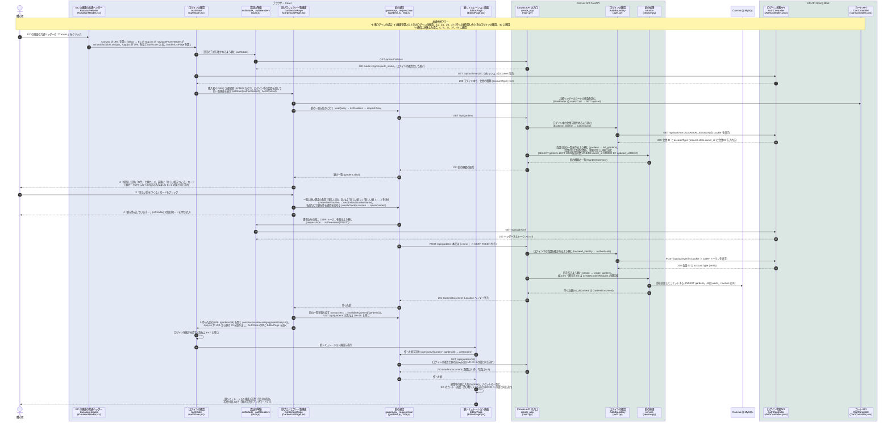
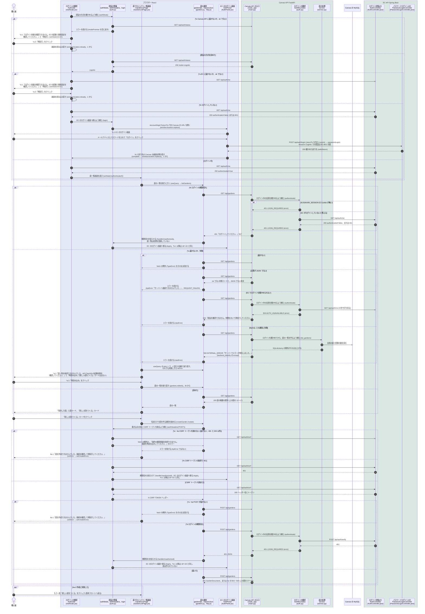

# UC-01 庭プロジェクトを新規作成する

- ユースケース記述: [UC-01_庭プロジェクトを新規作成する](<../../アーカイブ/ユースケース/kusakari-canvas/UC-01_庭プロジェクトを新規作成する.md>)
- 共通代替フロー: [00_全ユースケース共通の代替フロー](<00_全ユースケース共通の代替フロー.md>)
- 対象のコード: kusakari-canvas の main（7e9a8dd、2026-11-24 時点）、Canvas から呼ぶ kusakari-ec の main（6bad7e3、2026-11-24 時点）

## シーケンス図

参加者は、上から「画面や役割の名前」「コンポーネント・クラスの名前」「ファイル名（かっこ付き）」の順に書いています。
Canvas の画面は、Canvas API のほかに EC API へも直接通信します（ログインの確認、CSRF トークン、カート）。Canvas API は Amazon Cognito を直接呼ばず、要求ごとにブラウザーから届いた EC のセッションの Cookie（`KUSAKARI_SESSION`）を EC API に渡して、ログインを確かめます。読み取りは `GET /api/auth/me`、書き込みは `POST /api/auth/verify` です。
共通代替フローの中身は、00 の図か、下の「共通代替フローを直接書いた図」を見てください。
エラーで終わる代替フロー（1a・4a）は図に描かず、図の下に並べています。

図に描いていない代替フロー：1a（店舗側か出店申請中のアカウント）、4a（作成できない）

## 共通代替フローを直接書いた図

上の図の、画面を開いたときのログインの確認（3〜7）、庭一覧の取得（10〜18）、作成の通信（CSRF トークンの取得と `POST /api/gardens`）に、この画面で起こる共通代替フロー（\*a、\*b）を書き込んだ図です。作った庭を開いたあとの \*a・\*b（上の図の 37〜44）は、[UC-01-1](<UC-01-1_庭プロジェクトを開く.md>) の「共通代替フローを直接書いた図」と同じなので省いています。作成の通信の失敗は、画面の文が 4a-1 の「庭を作成できませんでした。」で始まるので、4a としても書いています。

## ユースケース記述との差

- 基本フロー 4 の既定の名前は、コードでは「新しい庭」「新しい庭 2」「新しい庭 3」…です（半角の空白と半角の数字。`nextDefaultGardenName()`）。記述は「新しい庭２」です。
- 既定の名前は、画面が読み込んだ一覧から画面の中で決めます。サーバーは同じ名前があるかを確かめません。2 つのウィンドウで同時に作ると、同じ名前の庭ができることがあります。
- 関連情報の「「庭の名前」欄は60文字まで」は、庭一覧の作成の操作には当てはまりません。作成の画面に名前の入力欄は無く、既定の名前だけで作ります。60 文字の制限は、編集画面の「庭の名前を変更」（`GardenTitle.jsx`、`MAX_GARDEN_NAME_LENGTH`）にあります。API は UTF-16 で 120 単位まで受け付けます（`schemas.py` の `NamedRequest`）。
- 4a-1 のエラーは、「新しい庭をつくる」カードの中ではなく、「保存した庭」の欄の、庭カードの上に出ます。文は「庭を作成できませんでした。」に API の `message` を続けたものです。届かないとき（`ApiError` でないとき）は「庭を作成できませんでした。接続を確認して再試行してください。」です。作成の通信の失敗は、共通代替フロー \*a の形ですが、画面の文は 4a-1 です。
- `POST /api/gardens` で EC が 403 を返したとき（CSRF トークンが合わないなど）は、403 `FORBIDDEN`「ログインまたは操作の確認情報を確認してください。」になり、4a-1 の文に続けて出ます。図には書いていません。
- 1a の対象は、出店者と出店申請者だけでなく、店舗の担当者（`SHOP_STAFF`）も含みます。運営者（`ADMIN`）は購入者と同じように使えます（`AuthGate.jsx`、`auth.py`）。リンクの文は「EC のトップへ戻る」です。
- 関連情報は共通代替フロー \*b だけですが、コードでは画面を開いたとき・庭一覧の取得・作った庭の読み込みで \*a も起こります。庭一覧の取得に失敗している間は「新しい庭をつくる」カードが出ないので、作成もできません。
- 記述に無い処理として、次のものがあります。
  - 作成のとき、API が幅 10m・奥行き 8m を入れます（`CreateGardenRequest` の既定値）。
  - 作成に成功したあと、移動の前に庭一覧を取り直します（`invalidateQueries(['gardens'])`）。
  - EC の商品詳細から `?productId=...` 付きで Canvas を開いた場合、作った庭の URL にも `productId` を引き継ぎます（`gardenEntryUrl()`）。
  - 作った庭を開くと、EC へカート・商品の一覧・EC で買い物リストに入れた商品を自動で問い合わせます（[UC-01-1](<UC-01-1_庭プロジェクトを開く.md>) の図と同じ流れ）。新しい庭は配置も写真も無いので、`POST /api/products/references` とサムネイルの保存は送りません。
- 共通ヘッダーのカートの件数（9）は、失敗しても件数を出さないだけで、エラーの文は出しません（`useEcCart` の `retry: false`）。
- `POST /api/gardens` の 400 `INVALID_REQUEST`（名前が空白だけ、120 単位を超えるなど）と 403 `BUYER_ACCOUNT_REQUIRED` は、この画面の操作では起きません。既定の名前は条件を満たし、店舗側のアカウントは `AuthGate` が一覧の前で止めるためです。

## 参照したコード

- [frontend/src/pages/App.jsx](https://github.com/abeouga/kusakari-canvas/blob/7e9a8dd0a40f2b212ca20b3aa94f2dc984b00b7a/frontend/src/pages/App.jsx): `App()`
- [frontend/src/main.jsx](https://github.com/abeouga/kusakari-canvas/blob/7e9a8dd0a40f2b212ca20b3aa94f2dc984b00b7a/frontend/src/main.jsx): `QueryClient` の `retry`
- [frontend/src/components/AuthGate.jsx](https://github.com/abeouga/kusakari-canvas/blob/7e9a8dd0a40f2b212ca20b3aa94f2dc984b00b7a/frontend/src/components/AuthGate.jsx): `AuthGate()`、`shopAccountTypes`、「ログイン状態を確認できません。…」
- [frontend/src/components/SiteHeader.jsx](https://github.com/abeouga/kusakari-canvas/blob/7e9a8dd0a40f2b212ca20b3aa94f2dc984b00b7a/frontend/src/components/SiteHeader.jsx): `SiteHeader()`
- [frontend/src/api/auth.js](https://github.com/abeouga/kusakari-canvas/blob/7e9a8dd0a40f2b212ca20b3aa94f2dc984b00b7a/frontend/src/api/auth.js): `authMode()`、`authHeaders()`、`login()`、`handleUnauthorized()`
- [frontend/src/api/http.js](https://github.com/abeouga/kusakari-canvas/blob/7e9a8dd0a40f2b212ca20b3aa94f2dc984b00b7a/frontend/src/api/http.js): `requestJson()`、`ApiError`
- [frontend/src/api/gardens.js](https://github.com/abeouga/kusakari-canvas/blob/7e9a8dd0a40f2b212ca20b3aa94f2dc984b00b7a/frontend/src/api/gardens.js): `listGardens`、`createGarden`、`getGarden`
- [frontend/src/hooks/useCommerce.js](https://github.com/abeouga/kusakari-canvas/blob/7e9a8dd0a40f2b212ca20b3aa94f2dc984b00b7a/frontend/src/hooks/useCommerce.js): `useEcCart()`
- [frontend/src/pages/GardenListPage.jsx](https://github.com/abeouga/kusakari-canvas/blob/7e9a8dd0a40f2b212ca20b3aa94f2dc984b00b7a/frontend/src/pages/GardenListPage.jsx): `GardenListPage()`、`createNewGarden()`、`createGarden`（`useMutation` の `onSuccess`・`onError`）、「庭一覧を取得できませんでした。…」と「再読み込み」
- [frontend/src/domain/gardenNames.js](https://github.com/abeouga/kusakari-canvas/blob/7e9a8dd0a40f2b212ca20b3aa94f2dc984b00b7a/frontend/src/domain/gardenNames.js): `nextDefaultGardenName()`
- [frontend/src/domain/urls.js](https://github.com/abeouga/kusakari-canvas/blob/7e9a8dd0a40f2b212ca20b3aa94f2dc984b00b7a/frontend/src/domain/urls.js): `gardenEntryUrl()`
- [frontend/src/pages/EditorPage.jsx](https://github.com/abeouga/kusakari-canvas/blob/7e9a8dd0a40f2b212ca20b3aa94f2dc984b00b7a/frontend/src/pages/EditorPage.jsx): `gardenQuery`、`hydrate` を呼ぶ `useEffect`
- [frontend/src/components/PhotoOverlay.jsx](https://github.com/abeouga/kusakari-canvas/blob/7e9a8dd0a40f2b212ca20b3aa94f2dc984b00b7a/frontend/src/components/PhotoOverlay.jsx): 「庭の写真をアップロードする」
- [frontend/src/components/GardenTitle.jsx](https://github.com/abeouga/kusakari-canvas/blob/7e9a8dd0a40f2b212ca20b3aa94f2dc984b00b7a/frontend/src/components/GardenTitle.jsx): 庭の名前の変更
- [frontend/src/domain/limits.js](https://github.com/abeouga/kusakari-canvas/blob/7e9a8dd0a40f2b212ca20b3aa94f2dc984b00b7a/frontend/src/domain/limits.js): `MAX_GARDEN_NAME_LENGTH`
- [backend/kusakari_canvas_api/main.py](https://github.com/abeouga/kusakari-canvas/blob/7e9a8dd0a40f2b212ca20b3aa94f2dc984b00b7a/backend/kusakari_canvas_api/main.py): `backend_identity()`、`auth_status()`、`gardens()`、`create()`、`get()`、`domain_error()`
- [backend/kusakari_canvas_api/auth.py](https://github.com/abeouga/kusakari-canvas/blob/7e9a8dd0a40f2b212ca20b3aa94f2dc984b00b7a/backend/kusakari_canvas_api/auth.py): `AuthBoundary.authenticate()`、`error()`、`BUYER_ACCOUNT_TYPES`、`SHOP_ACCOUNT_TYPES`
- [backend/kusakari_canvas_api/service.py](https://github.com/abeouga/kusakari-canvas/blob/7e9a8dd0a40f2b212ca20b3aa94f2dc984b00b7a/backend/kusakari_canvas_api/service.py): `list_gardens()`、`create_garden()`、`get_garden()`、`owned_garden()`、`as_document()`
- [backend/kusakari_canvas_api/schemas.py](https://github.com/abeouga/kusakari-canvas/blob/7e9a8dd0a40f2b212ca20b3aa94f2dc984b00b7a/backend/kusakari_canvas_api/schemas.py): `NamedRequest`、`CreateGardenRequest`
- [packages/site-header/KusakariHeader.jsx（kusakari-ec）](https://github.com/abeouga/kusakari-ec/blob/6bad7e37c4135034fbe97e30309772fbe872e675/packages/site-header/KusakariHeader.jsx): `KusakariHeader()`、`follow()`。Canvas は同じ版（0.1.13）を `vendor/kusakari-site-header-0.1.13.tgz` で使います
- [frontend/src/App.jsx（kusakari-ec）](https://github.com/abeouga/kusakari-ec/blob/6bad7e37c4135034fbe97e30309772fbe872e675/frontend/src/App.jsx): `navigateFromHeader()`
- [frontend/src/components/AuthPanel.jsx（kusakari-ec）](https://github.com/abeouga/kusakari-ec/blob/6bad7e37c4135034fbe97e30309772fbe872e675/frontend/src/components/AuthPanel.jsx): `submit()`、`complete()`
- [frontend/src/auth.js（kusakari-ec）](https://github.com/abeouga/kusakari-ec/blob/6bad7e37c4135034fbe97e30309772fbe872e675/frontend/src/auth.js): `passwordLogin()`
- [backend/src/main/java/jp/kusakari/ec/auth/AuthController.java（kusakari-ec）](https://github.com/abeouga/kusakari-ec/blob/6bad7e37c4135034fbe97e30309772fbe872e675/backend/src/main/java/jp/kusakari/ec/auth/AuthController.java): `me()`、`verify()`、`csrf()`
- [backend/src/main/java/jp/kusakari/ec/auth/PasswordLoginController.java（kusakari-ec）](https://github.com/abeouga/kusakari-ec/blob/6bad7e37c4135034fbe97e30309772fbe872e675/backend/src/main/java/jp/kusakari/ec/auth/PasswordLoginController.java): `POST /api/auth/login` の `safeReturn()`
- [backend/src/main/java/jp/kusakari/ec/commerce/controller/CartController.java（kusakari-ec）](https://github.com/abeouga/kusakari-ec/blob/6bad7e37c4135034fbe97e30309772fbe872e675/backend/src/main/java/jp/kusakari/ec/commerce/controller/CartController.java): `get()`
