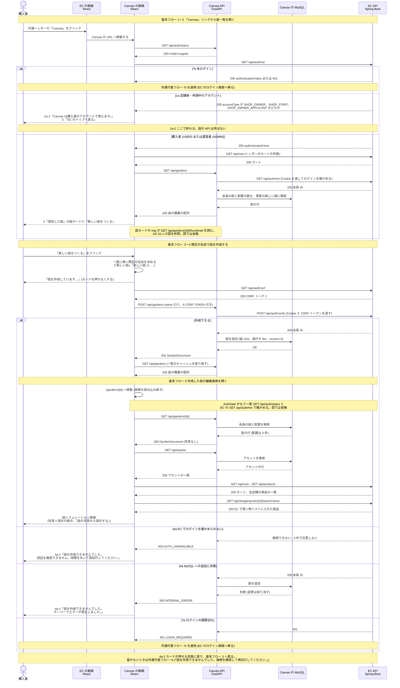
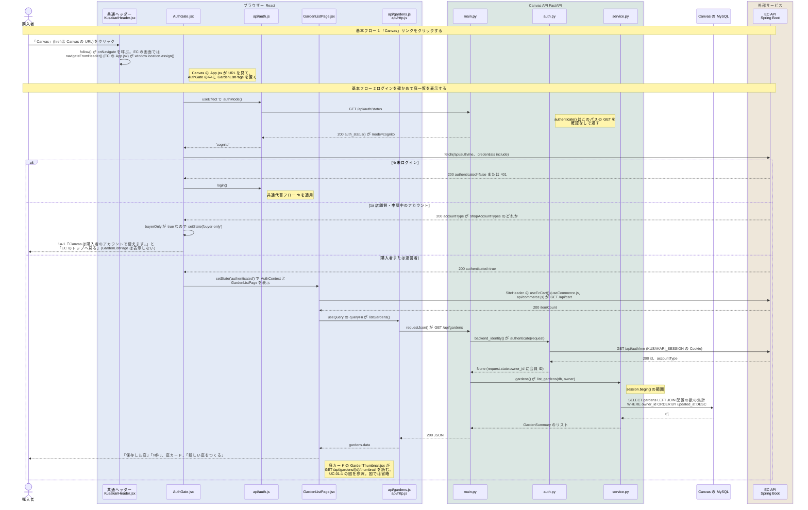
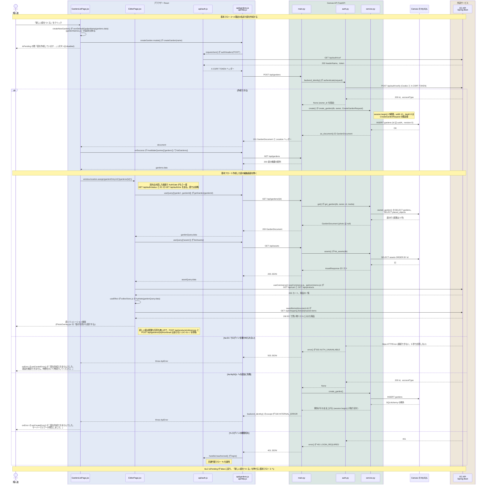

# UC-01 庭プロジェクトを新規作成する

- ユースケース記述: [UC-01_庭プロジェクトを新規作成する](<../../アーカイブ/ユースケース/kusakari-canvas/UC-01_庭プロジェクトを新規作成する.md>)
- 対象のコード: kusakari-canvas の main（c19d497、2026-11-20 時点）

Canvas の画面は、Canvas API のほかに EC API へも直接通信します（ログインの確認、CSRF トークン、カート、商品）。Canvas API は Amazon Cognito を直接呼びません。要求ごとに、ブラウザーから届いた EC のセッションの Cookie（`KUSAKARI_SESSION`）を EC API に渡して、ログインを確かめます。読み取りは `GET /api/auth/me`、書き込みは `POST /api/auth/verify` です。

## 概要図

## 詳細図 1 基本フロー 1〜2 ログインを確かめて庭一覧を表示する

## 詳細図 2 基本フロー 3〜5 庭を作成して編集画面を開く

## ユースケース記述との差

- 基本フロー 4 の既定の名前は、コードでは「新しい庭」「新しい庭 2」「新しい庭 3」…です（半角の空白と半角の数字。`nextDefaultGardenName()`）。記述は「新しい庭２」です。
- 既定の名前は、画面が読み込んだ一覧から画面の中で決めます。サーバーは同じ名前があるかを確かめません。2 つのウィンドウで同時に作ると、同じ名前の庭ができることがあります。
- 関連情報の「「庭の名前」欄は60文字まで」は、庭一覧の作成の操作には当てはまりません。作成の画面に名前の入力欄は無く、既定の名前だけで作ります。60 文字の制限は、編集画面の「庭の名前を変更」（`GardenTitle.jsx`、`MAX_GARDEN_NAME_LENGTH`）にあります。API は UTF-16 で 120 単位まで受け付けます（`schemas.py` の `NamedRequest`）。
- 4a のエラーは、「新しい庭をつくる」カードではなく、「保存した庭」の欄の上に出ます。文は「庭を作成できませんでした。」に API の `message` を続けたものです。届かないとき（`ApiError` でないとき）は「庭を作成できませんでした。接続を確認して再試行してください。」です。
- 1a の対象は、出店者と出店申請者だけでなく、店舗の担当者（`SHOP_STAFF`）も含みます。運営者（`ADMIN`）は購入者と同じように使えます（`AuthGate.jsx`、`auth.py`）。リンクの文は「EC のトップへ戻る」です。
- 記述に無い処理として、次のものがあります。
  - 作成のとき、API が幅 10m・奥行き 8m を入れます（`CreateGardenRequest` の既定値）。
  - 作成に成功したあと、移動の前に庭一覧を取り直します（`invalidateQueries(['gardens'])`）。
  - EC の商品詳細から `?productId=...` 付きで Canvas を開いた場合、作成した庭の URL にも `productId` を引き継ぎます（`gardenEntryUrl()`）。
  - 編集画面を開くと、EC へカート・商品の一覧・EC で買い物リストに入れた商品を自動で問い合わせます（`useCommerce.js`）。
- `POST /api/gardens` の 400 `INVALID_REQUEST`（名前が空白だけ、120 単位を超えるなど）と 403 `BUYER_ACCOUNT_REQUIRED` は、この画面の操作では起きません。既定の名前は条件を満たし、店舗側のアカウントは `AuthGate` が一覧の前で止めるためです。

## 確かめられなかったこと

- 画面を開いたときの `useQuery` は、それぞれ同時に送られます。実際にどの順で送られ、どの順で応答が返るかは、ブラウザーで確かめていません。図はコードに書かれた順に並べています。
- EC API の `/api/auth/me`、`/api/auth/verify`、`/api/auth/csrf` の中の処理（Amazon Cognito でのトークンの更新など）は、EC の図に任せ、この図では EC API を 1 本のライフラインにしました。

## 参照したコード

- [frontend/src/pages/App.jsx](https://github.com/abeouga/kusakari-canvas/blob/c19d497dfef15b119f9bce8ecb5c886a36da6b7d/frontend/src/pages/App.jsx): `App()`
- [frontend/src/components/AuthGate.jsx](https://github.com/abeouga/kusakari-canvas/blob/c19d497dfef15b119f9bce8ecb5c886a36da6b7d/frontend/src/components/AuthGate.jsx): `AuthGate()`、`shopAccountTypes`
- [frontend/src/components/SiteHeader.jsx](https://github.com/abeouga/kusakari-canvas/blob/c19d497dfef15b119f9bce8ecb5c886a36da6b7d/frontend/src/components/SiteHeader.jsx): `SiteHeader()`
- [frontend/src/api/auth.js](https://github.com/abeouga/kusakari-canvas/blob/c19d497dfef15b119f9bce8ecb5c886a36da6b7d/frontend/src/api/auth.js): `authMode()`、`authHeaders()`、`login()`、`handleUnauthorized()`
- [frontend/src/api/http.js](https://github.com/abeouga/kusakari-canvas/blob/c19d497dfef15b119f9bce8ecb5c886a36da6b7d/frontend/src/api/http.js): `requestJson()`、`ApiError`
- [frontend/src/api/gardens.js](https://github.com/abeouga/kusakari-canvas/blob/c19d497dfef15b119f9bce8ecb5c886a36da6b7d/frontend/src/api/gardens.js): `listGardens`、`createGarden`、`getGarden`、`listAssets`
- [frontend/src/api/commerce.js](https://github.com/abeouga/kusakari-canvas/blob/c19d497dfef15b119f9bce8ecb5c886a36da6b7d/frontend/src/api/commerce.js): `request()`、`cart`、`products`、`savedItems`
- [frontend/src/hooks/useCommerce.js](https://github.com/abeouga/kusakari-canvas/blob/c19d497dfef15b119f9bce8ecb5c886a36da6b7d/frontend/src/hooks/useCommerce.js): `useEcCart()`、`useCommerce()`
- [frontend/src/pages/GardenListPage.jsx](https://github.com/abeouga/kusakari-canvas/blob/c19d497dfef15b119f9bce8ecb5c886a36da6b7d/frontend/src/pages/GardenListPage.jsx): `GardenListPage()`、`createNewGarden()`、`createGarden`（`useMutation`）
- [frontend/src/domain/gardenNames.js](https://github.com/abeouga/kusakari-canvas/blob/c19d497dfef15b119f9bce8ecb5c886a36da6b7d/frontend/src/domain/gardenNames.js): `nextDefaultGardenName()`
- [frontend/src/domain/urls.js](https://github.com/abeouga/kusakari-canvas/blob/c19d497dfef15b119f9bce8ecb5c886a36da6b7d/frontend/src/domain/urls.js): `gardenEntryUrl()`
- [frontend/src/pages/EditorPage.jsx](https://github.com/abeouga/kusakari-canvas/blob/c19d497dfef15b119f9bce8ecb5c886a36da6b7d/frontend/src/pages/EditorPage.jsx): `gardenQuery`、`assetQuery`、`hydrate` を呼ぶ `useEffect`
- [frontend/src/domain/limits.js](https://github.com/abeouga/kusakari-canvas/blob/c19d497dfef15b119f9bce8ecb5c886a36da6b7d/frontend/src/domain/limits.js): `MAX_GARDEN_NAME_LENGTH`
- [backend/kusakari_canvas_api/main.py](https://github.com/abeouga/kusakari-canvas/blob/c19d497dfef15b119f9bce8ecb5c886a36da6b7d/backend/kusakari_canvas_api/main.py): `backend_identity()`、`auth_status()`、`gardens()`、`create()`、`get()`、`assets()`、`domain_error()`
- [backend/kusakari_canvas_api/auth.py](https://github.com/abeouga/kusakari-canvas/blob/c19d497dfef15b119f9bce8ecb5c886a36da6b7d/backend/kusakari_canvas_api/auth.py): `AuthBoundary.authenticate()`、`error()`
- [backend/kusakari_canvas_api/service.py](https://github.com/abeouga/kusakari-canvas/blob/c19d497dfef15b119f9bce8ecb5c886a36da6b7d/backend/kusakari_canvas_api/service.py): `list_gardens()`、`create_garden()`、`get_garden()`、`list_assets()`、`owned_garden()`
- [backend/kusakari_canvas_api/schemas.py](https://github.com/abeouga/kusakari-canvas/blob/c19d497dfef15b119f9bce8ecb5c886a36da6b7d/backend/kusakari_canvas_api/schemas.py): `NamedRequest`、`CreateGardenRequest`
- [packages/site-header/KusakariHeader.jsx（kusakari-ec）](https://github.com/abeouga/kusakari-ec/blob/19a2be307ee71a2cd87e538236c3c8c42929c5b3/packages/site-header/KusakariHeader.jsx): `KusakariHeader()`、`follow()`。Canvas は同じ版（0.1.13）を `vendor/kusakari-site-header-0.1.13.tgz` で使います
- [frontend/src/App.jsx（kusakari-ec）](https://github.com/abeouga/kusakari-ec/blob/19a2be307ee71a2cd87e538236c3c8c42929c5b3/frontend/src/App.jsx): `navigateFromHeader()`
- [backend/src/main/java/jp/kusakari/ec/auth/AuthController.java（kusakari-ec）](https://github.com/abeouga/kusakari-ec/blob/19a2be307ee71a2cd87e538236c3c8c42929c5b3/backend/src/main/java/jp/kusakari/ec/auth/AuthController.java): `me()`、`verify()`、`csrf()`
