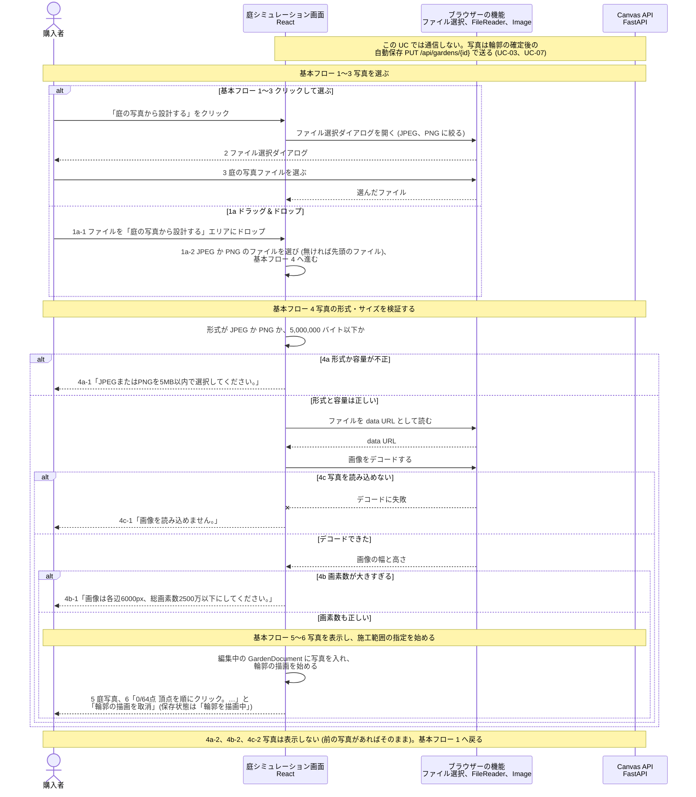
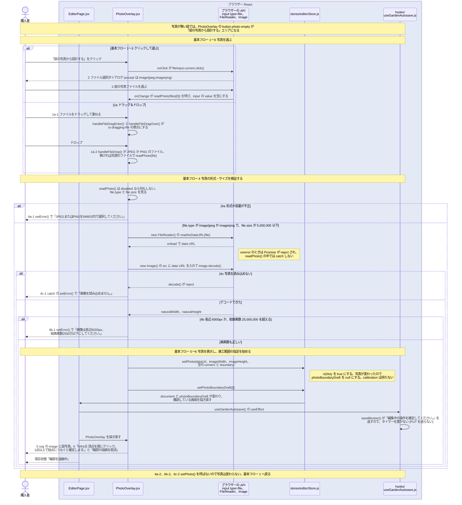

# UC-02 庭の写真をアップロードする

- ユースケース記述: [UC-02_庭の写真をアップロードする](<../../アーカイブ/ユースケース/kusakari-canvas/UC-02_庭の写真をアップロードする.md>)
- 対象のコード: kusakari-canvas の main（c19d497、2026-11-20 時点）

写真の選択、検査、表示は、すべてブラウザーの中で行います。このユースケースの間、Canvas API にも EC API にも通信しません。写真は編集中の `GardenDocument`（Zustand の `editorStore.js`）に data URL で入るだけです。サーバーへ送るのは、施工範囲（庭の輪郭）を確定したあとの自動保存 `PUT /api/gardens/{id}` です（[UC-03 施工範囲を指定・修正する](<UC-03_施工範囲を指定・修正する.md>)、[UC-07 庭プロジェクトを保存する](<UC-07_庭プロジェクトを保存する.md>)）。

## 概要図

## 詳細図

## ユースケース記述との差

- 検証の順番が記述と少し違います。コードは、4a（形式と容量）、ファイルの読み込み、4c（デコード）、4b（画素数）の順に調べます。画素数はデコードのあとでないと分からないためです。
- 4a の形式は、ファイルの中身ではなく、ブラウザーがファイルに付ける `file.type` で判断します。中身が JPEG・PNG でないファイルは、4c（デコードの失敗）になります。5MB は 5,000,000 バイトです。
- `FileReader` の読み込みに失敗したとき（`onerror`）は、`readPhoto()` の Promise が reject され、どこでも catch されません。エラーの文は出ず、写真も変わりません。記述の 4c（「画像を読み込めません。」）は、`image.decode()` の失敗だけです。
- 1a で複数のファイルをドロップしたときは、最初の JPEG・PNG のファイルを使います。どちらも無ければ先頭のファイルを検査し、4a になります。
- 基本フロー 6 の「施工範囲の指定を開始する」は、`setPhotoBoundaryDraft([])` で輪郭の描画モードにすることです。保存状態は「輪郭を描画中」になり、描いている間は自動保存しません（`saveBlocker()`）。
- 関連情報の「写真を変更」は、同じ `readPhoto()` を通ります。新しい写真は四隅（`corners`）・輪郭（`boundary`）が空で、カメラ設定（`calibration`）と辺の長さ（`edgeLengths`）を引き継ぎません。配置物は残ります。新しい輪郭を確定するまでは、地面の範囲（`groundOutline()`）が空なので、配置物はすべて範囲外として数えます。
- 関連情報の「写真を外す」（`setPhoto(null)`）は、写真を外すだけでなく、500ms 後に自動保存で `photo: null` を保存します（範囲外の配置があるときを除く）。記述には保存のことが書かれていません。
- 保存のとき、サーバーは写真をもう一度検査します（`validation.py` の `validate_photo()`。JPEG・PNG、5,000,000 バイト以下、各辺 6000px と総画素数 25,000,000 以下、寸法の一致）。UC-03・UC-07 の範囲なので、図では省略しました。

## 確かめられなかったこと

- ドラッグ＆ドロップしたファイルの `file.type` がブラウザーや OS によってどう付くかは、コードでは確かめられません。
- `FileReader` が失敗したときに、実際のブラウザーで何が表示されるか（コンソールのエラーだけか）は、動かして確かめていません。

## 参照したコード

- [frontend/src/components/PhotoOverlay.jsx](https://github.com/abeouga/kusakari-canvas/blob/c19d497dfef15b119f9bce8ecb5c886a36da6b7d/frontend/src/components/PhotoOverlay.jsx): `readPhoto()`、`handleFileDragEnter()`、`handleFileDragOver()`、`handleFileDrop()`、`button.photo-empty`、「写真を変更」「写真を外す」のボタン
- [frontend/src/stores/editorStore.js](https://github.com/abeouga/kusakari-canvas/blob/c19d497dfef15b119f9bce8ecb5c886a36da6b7d/frontend/src/stores/editorStore.js): `setPhoto()`、`setPhotoBoundaryDraft()`
- [frontend/src/hooks/useGardenAutosave.js](https://github.com/abeouga/kusakari-canvas/blob/c19d497dfef15b119f9bce8ecb5c886a36da6b7d/frontend/src/hooks/useGardenAutosave.js): `saveBlocker()`、自動保存の `useEffect`
- [frontend/src/pages/EditorPage.jsx](https://github.com/abeouga/kusakari-canvas/blob/c19d497dfef15b119f9bce8ecb5c886a36da6b7d/frontend/src/pages/EditorPage.jsx): `PhotoOverlay` への `disabled`、保存状態の `statusText`
- [frontend/src/domain/placementBounds.js](https://github.com/abeouga/kusakari-canvas/blob/c19d497dfef15b119f9bce8ecb5c886a36da6b7d/frontend/src/domain/placementBounds.js): `groundOutline()`、`outsideObjects()`
- [backend/kusakari_canvas_api/validation.py](https://github.com/abeouga/kusakari-canvas/blob/c19d497dfef15b119f9bce8ecb5c886a36da6b7d/backend/kusakari_canvas_api/validation.py): `validate_photo()`（保存のときの検査）
