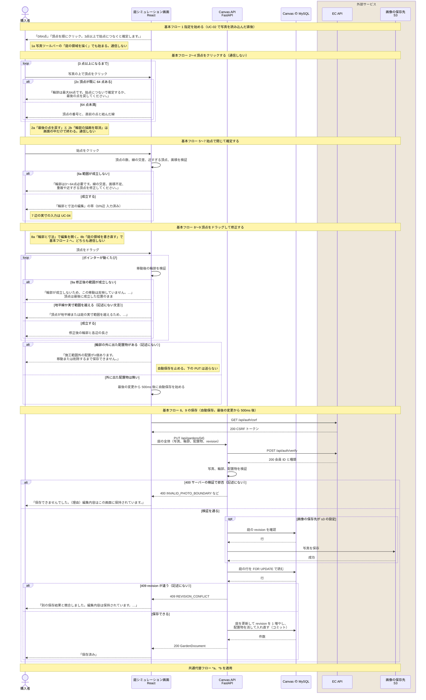
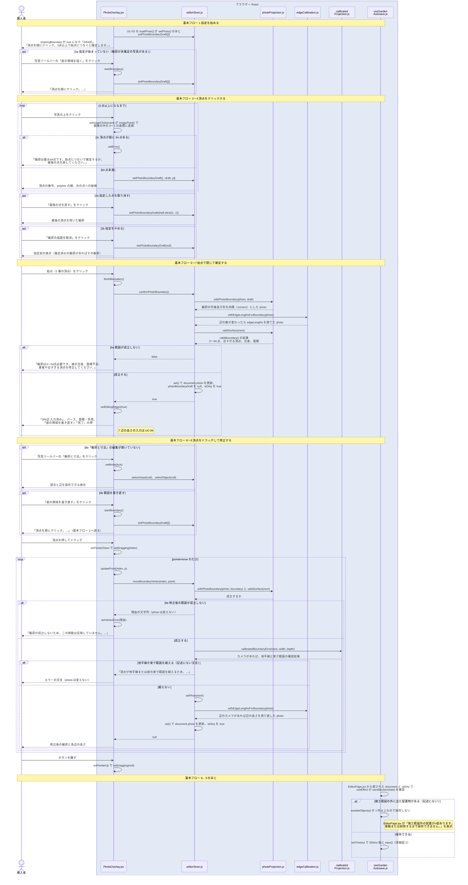
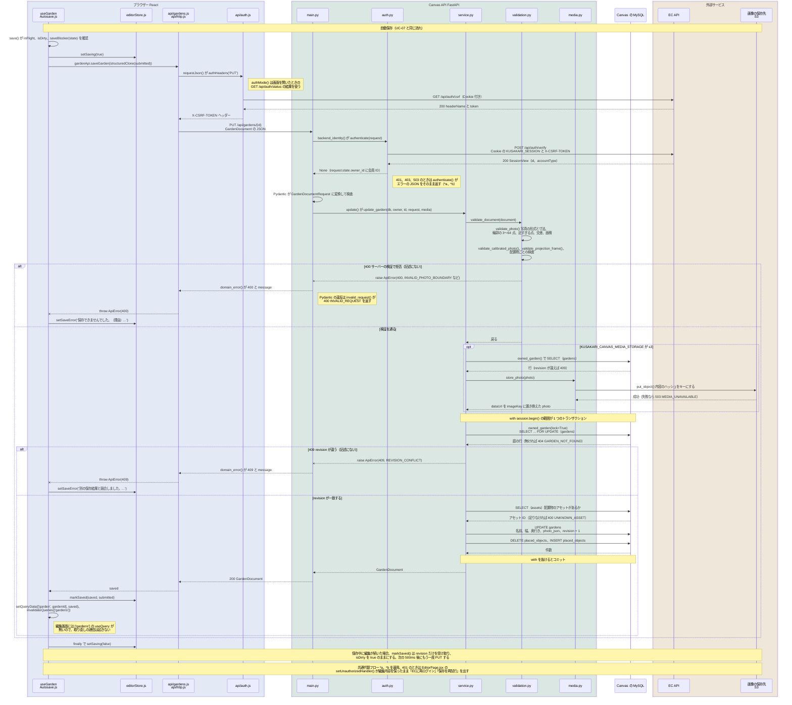

# UC-03 施工範囲を指定・修正する

- ユースケース記述: [UC-03_施工範囲を指定・修正する](<../../アーカイブ/ユースケース/kusakari-canvas/UC-03_施工範囲を指定・修正する.md>)
- 対象のコード: kusakari-canvas の main（c19d497、2026-11-20 時点）

施工範囲（庭の輪郭）の指定と修正は、すべてブラウザーの中で行います。頂点を置くたび、動かすたびにはサーバーへ問い合わせません。輪郭が確定して庭（`GardenDocument`）が変わると、`useGardenAutosave.js` が最後の変更から 500ms 後に庭の全体を `PUT /api/gardens/{id}` で保存します。UC-02 で読み込んだ写真も、この PUT で初めてサーバーへ送ります。詳細図 1 は画面の中の処理、詳細図 2 は自動保存の処理です。保存のあとのサムネイルの更新（`POST /api/gardens/{id}/thumbnail`）とログインの期限切れの流れは、[UC-07 庭プロジェクトを保存する](<UC-07_庭プロジェクトを保存する.md>) にあります。

## 概要図

## 詳細図 1 基本フロー 1〜9（画面の中の処理）

`editorStore.js` の set 系の関数は値を返さないので、戻りの矢印を省きます。

## 詳細図 2 基本フロー 6、9 の自動保存

## ユースケース記述との差

- 基本フロー 6 の「施工範囲として保存する」は、ブラウザーの中の確定（`confirmPhotoBoundary()`）と、500ms 後の自動保存（`PUT /api/gardens/{id}`）の 2 段です。UC-02 で読み込んだ写真は、輪郭を描いている間は保存されません（`saveBlocker()` が `photoBoundaryDraft` を見て止めます）。写真も、この PUT で初めてサーバーへ送ります。
- 基本フロー 9 と 9a は、ドラッグを離したときではなく、ポインターが動くたびに検証します。成立しない位置へ動かすと、その移動だけを反映しません。頂点は最後に成立した位置に残ります。記述の「直前の範囲に戻す」は、この「最後に成立した位置」のことです。
- 記述にない 9a の文言があります。カメラを設定済みの写真では、頂点が地平線か庭の実寸範囲を越えると「頂点が地平線または庭の実寸範囲を越えるため、この移動は反映していません。」と出し、移動を反映しません（`moveBoundaryVertex()`）。
- 記述にない処理です。頂点の移動や書き直しで、配置物の基準点が新しい輪郭の外に出ることがあります。このとき輪郭は変わりますが、自動保存は止まり、「施工範囲外の配置がn個あります。移動または削除するまで保存できません。」と保存の状態「施工範囲の修正が必要」を出します（`saveBlocker()`、`EditorPage.jsx`）。
- 記述にない処理です。輪郭を確定・修正すると `withEdgeLengthsForBoundary()` が辺の長さ（UC-04 の入力値）を変えます。辺の実寸から求めたカメラがあれば、新しい輪郭の辺の長さを測り直します。カメラが無く辺の数が変わった場合は、入力値を捨てます。
- 記述にない処理です。輪郭の外接長方形を四隅（`corners`）にして、庭の幅×奥行きに当てはめます（`withPhotoBoundary()`）。UC-04 の 2a で書かれている対応付けは、この確定のときに行われます。
- 2b で最初の描画をやめた場合、写真は画面の庭に残りますが、輪郭が無いので保存されません。この状態で庭一覧などへ移ろうとすると、「庭写真を保存せずに戻りますか？」を出します（`EditorPage.jsx` の `requestNavigation()`）。
- 2c の文言が少し違います。記述は「始点に繋いで確定するか」、コードは「始点につないで確定するか」です。
- 6a の「点が3つ未満」は、始点を囲む大きい円が 3 点以上で出るため、通常は起きません。1 番の頂点を直接クリックすると `finishBoundary()` が呼ばれ、6a の文言が出ます。
- 記述にない分岐です。サーバーも `validate_photo()` で同じ規則（3〜64 点、近すぎる点、交差、面積）を検査し、違反すると 400 `INVALID_PHOTO_BOUNDARY` を返します。ブラウザーの検証を通った輪郭では通常起きません。別の画面や端末で先に保存されていると、409 `REVISION_CONFLICT` になります。

## 確かめられなかったこと

- 画像の保存先（`KUSAKARI_CANVAS_MEDIA_STORAGE`）が、公開している環境で `database` と `s3` のどちらかは、コードからは分かりません。既定は `database` で、このとき写真は `gardens.photo_json` に data URL のまま入ります。
- EC の `GET /api/auth/csrf` と `POST /api/auth/verify` の中の処理（Amazon Cognito でのトークンの更新など）は、EC の図の範囲として追っていません。

## 参照したコード

- [frontend/src/components/PhotoOverlay.jsx](https://github.com/abeouga/kusakari-canvas/blob/c19d497dfef15b119f9bce8ecb5c886a36da6b7d/frontend/src/components/PhotoOverlay.jsx): `startBoundary()`、`onImageClick()`、`imagePoint()`、`finishBoundary()`、`updatePoint()`、`setMode()`、「最後の点を戻す」「輪郭の描画を取消」「庭の領域を描く」「庭の領域を書き直す」
- [frontend/src/stores/editorStore.js](https://github.com/abeouga/kusakari-canvas/blob/c19d497dfef15b119f9bce8ecb5c886a36da6b7d/frontend/src/stores/editorStore.js): `setPhotoBoundaryDraft()`、`confirmPhotoBoundary()`、`moveBoundaryVertex()`、`setPhoto()`、`markSaved()`
- [frontend/src/domain/photoProjection.js](https://github.com/abeouga/kusakari-canvas/blob/c19d497dfef15b119f9bce8ecb5c886a36da6b7d/frontend/src/domain/photoProjection.js): `withPhotoBoundary()`、`validSurface()`、`validBoundary()`
- [frontend/src/domain/edgeCalibration.js](https://github.com/abeouga/kusakari-canvas/blob/c19d497dfef15b119f9bce8ecb5c886a36da6b7d/frontend/src/domain/edgeCalibration.js): `withEdgeLengthsForBoundary()`
- [frontend/src/domain/calibratedProjection.js](https://github.com/abeouga/kusakari-canvas/blob/c19d497dfef15b119f9bce8ecb5c886a36da6b7d/frontend/src/domain/calibratedProjection.js): `calibratedBoundaryError()`
- [frontend/src/domain/placementBounds.js](https://github.com/abeouga/kusakari-canvas/blob/c19d497dfef15b119f9bce8ecb5c886a36da6b7d/frontend/src/domain/placementBounds.js): `outsideObjects()`
- [frontend/src/hooks/useGardenAutosave.js](https://github.com/abeouga/kusakari-canvas/blob/c19d497dfef15b119f9bce8ecb5c886a36da6b7d/frontend/src/hooks/useGardenAutosave.js): `saveBlocker()`、`save()`、500ms の `useEffect`、エラーの文言
- [frontend/src/pages/EditorPage.jsx](https://github.com/abeouga/kusakari-canvas/blob/c19d497dfef15b119f9bce8ecb5c886a36da6b7d/frontend/src/pages/EditorPage.jsx): `useGardenAutosave()` の呼び出し、`setUnauthorizedHandler()`、`requestNavigation()`、保存の状態と施工範囲外の表示
- [frontend/src/api/gardens.js](https://github.com/abeouga/kusakari-canvas/blob/c19d497dfef15b119f9bce8ecb5c886a36da6b7d/frontend/src/api/gardens.js): `saveGarden()`
- [frontend/src/api/http.js](https://github.com/abeouga/kusakari-canvas/blob/c19d497dfef15b119f9bce8ecb5c886a36da6b7d/frontend/src/api/http.js): `requestJson()`、`ApiError`
- [frontend/src/api/auth.js](https://github.com/abeouga/kusakari-canvas/blob/c19d497dfef15b119f9bce8ecb5c886a36da6b7d/frontend/src/api/auth.js): `authHeaders()`、`authMode()`、`handleUnauthorized()`
- [backend/kusakari_canvas_api/main.py](https://github.com/abeouga/kusakari-canvas/blob/c19d497dfef15b119f9bce8ecb5c886a36da6b7d/backend/kusakari_canvas_api/main.py): `backend_identity()`、`update()`、`domain_error()`、`invalid_request()`
- [backend/kusakari_canvas_api/auth.py](https://github.com/abeouga/kusakari-canvas/blob/c19d497dfef15b119f9bce8ecb5c886a36da6b7d/backend/kusakari_canvas_api/auth.py): `AuthBoundary.authenticate()`
- [backend/kusakari_canvas_api/service.py](https://github.com/abeouga/kusakari-canvas/blob/c19d497dfef15b119f9bce8ecb5c886a36da6b7d/backend/kusakari_canvas_api/service.py): `update_garden()`、`owned_garden()`
- [backend/kusakari_canvas_api/validation.py](https://github.com/abeouga/kusakari-canvas/blob/c19d497dfef15b119f9bce8ecb5c886a36da6b7d/backend/kusakari_canvas_api/validation.py): `validate_document()`、`validate_photo()`、`validate_projection_frame()`
- [backend/kusakari_canvas_api/media.py](https://github.com/abeouga/kusakari-canvas/blob/c19d497dfef15b119f9bce8ecb5c886a36da6b7d/backend/kusakari_canvas_api/media.py): `MediaStore.store_photo()`、`put()`
- [backend/kusakari_canvas_api/errors.py](https://github.com/abeouga/kusakari-canvas/blob/c19d497dfef15b119f9bce8ecb5c886a36da6b7d/backend/kusakari_canvas_api/errors.py): `ApiError`、`bad_request()`、`not_found()`
- [backend/src/main/java/jp/kusakari/ec/auth/AuthController.java](https://github.com/abeouga/kusakari-ec/blob/19a2be307ee71a2cd87e538236c3c8c42929c5b3/backend/src/main/java/jp/kusakari/ec/auth/AuthController.java)（EC）: `csrf()`、`verify()`
