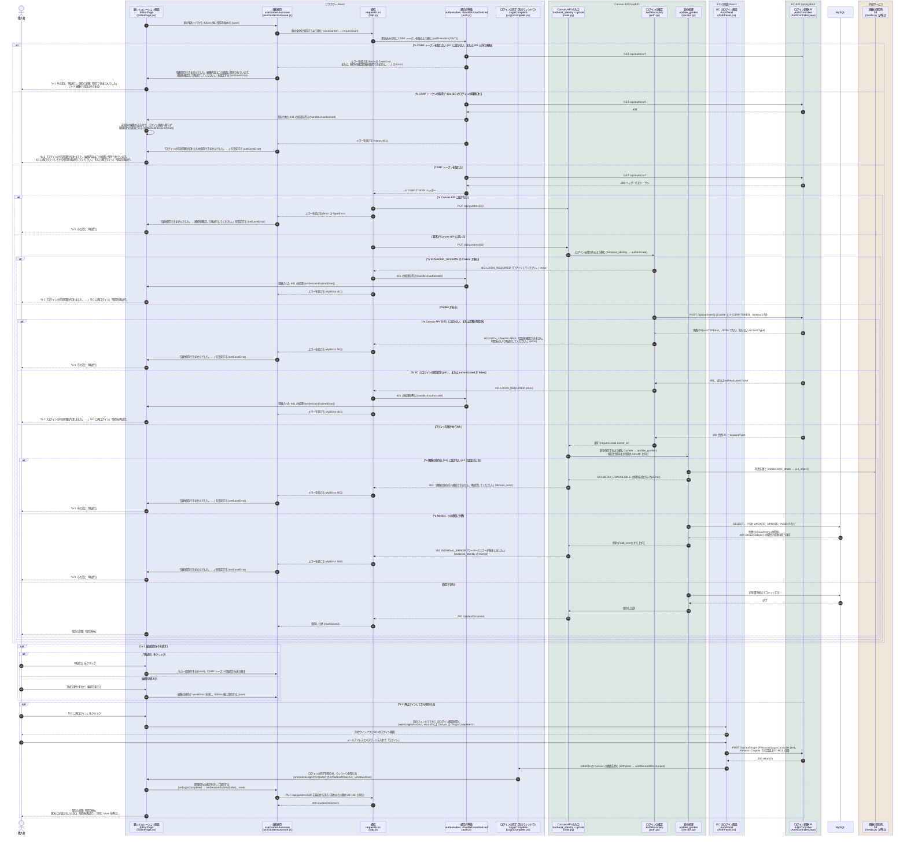

# UC-03 施工範囲を指定・修正する

- ユースケース記述: [UC-03_施工範囲を指定・修正する](<../../アーカイブ/ユースケース/kusakari-canvas/UC-03_施工範囲を指定・修正する.md>)
- 共通代替フロー: [00_全ユースケース共通の代替フロー](<00_全ユースケース共通の代替フロー.md>)
- 対象のコード: kusakari-canvas の main（7e9a8dd、2026-11-24 時点）。EC の API は kusakari-ec の main（6bad7e3、2026-11-24 時点）

## シーケンス図

参加者は、上から「画面や役割の名前」「コンポーネント・関数の名前」「ファイル名（かっこ付き）」の順に書いています。
施工範囲（庭の輪郭）を描く・直す処理はブラウザーの中だけで行い、頂点を置くたび、動かすたびにはサーバーへ問い合わせません。庭（`GardenDocument`）が変わると、最後の変更から 500ms 後に自動保存が庭の全体を `PUT /api/gardens/{id}` で送ります。UC-02 で読み込んだ写真も、この PUT で初めてサーバーへ送ります。
共通代替フローの中身は、00 の図か、下の「共通代替フローを直接書いた図」を見てください。
エラーは最重要の 6a（範囲が成立しない）だけを描き、ほかの代替フローは図の下に並べています。画面の中だけで終わるもの（2a・8a・8b）は、`opt` の中を操作の矢印 1 本と Note にしています。

```mermaid
sequenceDiagram
    autonumber
    actor User as 購入者
    box rgba(47,111,219,0.10) ブラウザー React
        participant Editor as 庭シミュレーション画面<br/>EditorPage<br/>(EditorPage.jsx)
        participant Overlay as 写真の編集<br/>PhotoOverlay<br/>(PhotoOverlay.jsx)
        participant Store as 編集中の庭<br/>useEditorStore<br/>(editorStore.js)
        participant Proj as 写真と地面の対応<br/>photoProjection<br/>(photoProjection.js)
        participant Edge as 辺の長さ<br/>edgeCalibration<br/>(edgeCalibration.js)
        participant Calib as 地平線と実寸範囲<br/>calibratedProjection<br/>(calibratedProjection.js)
        participant Auto as 自動保存<br/>useGardenAutosave<br/>(useGardenAutosave.js)
        participant Http as 庭の通信<br/>gardenApi、requestJson<br/>(gardens.js、http.js)
        participant AuthJs as 通信の準備<br/>authHeaders<br/>(auth.js)
    end
    box rgba(27,127,92,0.12) Canvas API FastAPI
        participant Main as Canvas API の入口<br/>backend_identity・update<br/>(main.py)
        participant AuthPy as ログインの確認<br/>AuthBoundary<br/>(auth.py)
        participant Svc as 庭の処理<br/>update_garden<br/>(service.py)
        participant Valid as 庭の検証<br/>validate_document<br/>(validation.py)
    end
    box rgba(27,127,92,0.12) EC API Spring Boot
        participant EcAuth as ログイン状態API<br/>AuthController<br/>(AuthController.java)
    end
    participant Db as MySQL

    Note over User,Db: 共通代替フロー<br/>*b 未ログインの場合: 28、30 に適用<br/>*a 通信に失敗した場合: 28、30、32、36、37、38 に適用

    alt 基本フロー 1 写真をアップロードした直後
        User->>Overlay: 庭の写真を選ぶ (UC-02。readPhoto → setPhoto)
    else 1a 描画が始まっていない (輪郭が未確定の写真がある)
        User->>Overlay: 1a-1 写真ツールバーの「庭の領域を描く」をクリック (startBoundary)
    end
    Overlay->>Store: 輪郭の描画を空で始める (setPhotoBoundaryDraft([]))
    Overlay-->>User: ツールバーに説明の i「頂点を順にクリックします。3点以上置いて<br/>始点をクリックすると輪郭が確定します（最大64点）。」、「0/64」、「戻す」「取消」

    loop 基本フロー 2〜4 3 点以上になるまで
        User->>Overlay: 2 写真の上で頂点の位置をクリック (onImageClick → imagePoint で画像の中の 0〜1 の座標にする)
        Overlay->>Store: 頂点を足す (setPhotoBoundaryDraft([...draft, p]))
        Overlay-->>User: 3 頂点の番号、直前の点と結んだ線、ポインターまでの破線、「n/64」
        opt 2a 指定した点を取り消す
            User->>Overlay: 2a-1「戻す」(最後の点を戻す) をクリック
            Note over User,Store: 結果: 2a-2 最後の点を除く (setPhotoBoundaryDraft(draft.slice(0, -1)))。<br/>画面: 最後の頂点を除いた線。2a-3 基本フロー 2 へ戻る
        end
    end

    User->>Overlay: 5 始点 (1 番の頂点) をクリック
    Overlay->>Store: 輪郭を確定するよう頼む (finishBoundary → confirmPhotoBoundary)
    Store->>Proj: 輪郭を囲む長方形を、庭の幅×奥行きに当てる四隅 (corners) にする (withPhotoBoundary)
    Store->>Edge: 辺の長さ (UC-04 の入力値) を新しい輪郭に合わせる (withEdgeLengthsForBoundary)。<br/>辺から求めたカメラがあれば測り直し、無くて辺の数が変わっていれば捨てる
    Store->>Proj: 6 輪郭が成り立つかを確かめる (validSurface → validBoundary)<br/>3〜64 点、近すぎる頂点、線の交差、面積
    break 6a 範囲が成立しない
        Note over Overlay,Proj: 結果: 輪郭を確定しない (confirmPhotoBoundary が false)。<br/>画面: 「輪郭は3〜64点必要です。線の交差、面積不足、重複や近すぎる頂点を修正してください。」。6a-2 基本フロー 2 へ戻る。
    end
    Store->>Store: 庭の写真を書き換え、描画を終え、未保存にする<br/>(set で document.photo、photoBoundaryDraft を null、isDirty を true)
    Overlay-->>User: 7「輪郭と寸法」の編集を開く (setEditingEdges(true))。「0/N辺入力済み」、「パース：概算」、<br/>面積・外周、各辺の長さ、「庭の領域を書き直す」「完了」(辺の長さの入力は UC-04)

    opt 8b 範囲を書き直す
        User->>Overlay: 8b-1「庭の領域を書き直す」をクリック
        Note over User,Store: 結果: 8b-2 輪郭の描画を空で始める (startBoundary → setPhotoBoundaryDraft([]))。<br/>画面: 「0/64」の描画の表示。8b-3 基本フロー 2 へ戻る
    end
    opt 8a「輪郭と寸法」の編集が開いていない
        User->>Overlay: 8a-1 写真ツールバーの「輪郭と寸法」をクリック
        Note over User,Store: 結果: 8a-2 選んでいる商品と配置物を外す (setMode(true) → selectAsset(null)、selectObject(null))。<br/>画面: 頂点と辺を操作できる表示。8a-3 基本フロー 8 へ戻る
    end
    User->>Overlay: 8 頂点を押してドラッグ (onPointerDown → setDragging(index))
    loop ポインターが動くたび (ボタンを離すと onPointerUp → setDragging(null) で終わる)
        Overlay->>Store: 頂点を動かすよう頼む (onPointerMove → updatePoint → moveBoundaryVertex)
        Store->>Proj: 動かした輪郭で四隅を作り直し、成り立つかを確かめる (withPhotoBoundary、validSurface)
        Store->>Calib: カメラのある写真で、頂点が地平線か庭の実寸範囲を<br/>新しく越えたかを確かめる (calibratedBoundaryError)。カメラが無ければ越えない
        Store->>Edge: 辺の長さを新しい輪郭に合わせ (setPhoto → withEdgeLengthsForBoundary)、<br/>庭の写真を書き換えて未保存にする (document.photo、isDirty を true、saveError を null)
        Overlay-->>User: 9 修正した輪郭と各辺の長さ
    end

    Editor->>Auto: 基本フロー 6・9 で変わった庭と未保存の印を渡す (useGardenAutosave の useEffect)。<br/>送ってよいかを確かめる (saveBlocker。描画中でない、範囲外の配置物が無い、輪郭が成り立つ)
    Auto->>Store: 最後の変更から 500ms 待って保存を始め (setTimeout → save)、<br/>保存中にする (setSaving(true))。保存の状態は「保存中…」
    Auto->>Http: 庭の全体を保存するよう頼む (saveGarden(structuredClone(submitted)) → requestJson)
    Http->>AuthJs: 書き込みの前に CSRF トークンを取るよう頼む (authHeaders('PUT'))
    AuthJs->>EcAuth: GET /api/auth/csrf (Cookie 付き)
    EcAuth-->>AuthJs: 200 ヘッダー名とトークン (csrf)
    Http->>Main: PUT /api/gardens/{id} (X-CSRF-TOKEN 付き)<br/>庭の全体 (写真、輪郭、四隅、辺の長さ、配置物、revision)
    Main->>AuthPy: ログインを確かめるよう頼む (backend_identity → authenticate)
    AuthPy->>EcAuth: POST /api/auth/verify<br/>(KUSAKARI_SESSION の Cookie と X-CSRF-TOKEN)
    EcAuth-->>AuthPy: 200 会員 ID と accountType (verify)。購入者なので通す (request.state.owner_id)
    Main->>Svc: 本文の形と値の範囲を確かめ (GardenDocumentRequest)、<br/>庭を保存するよう頼む (update → update_garden)
    Svc->>Valid: 庭の中身を確かめるよう頼む (validate_document → validate_photo)<br/>画像の形式と寸法、四隅、3〜64 点、近すぎる点、交差、面積
    opt 画像の保存先が s3 の設定 (KUSAKARI_CANVAS_MEDIA_STORAGE)
        Svc->>Svc: 写真を画像の保存先に置く (media.store_photo)
        Note over Svc,Db: 結果: 先に庭の版を確かめ (owned_garden、SELECT gardens。違えば 409)、<br/>写真を S3 に置いて、data URL を imageKey に置き換える。
    end
    Svc->>Db: 庭の行をロックして読む<br/>(owned_garden(lock=True)、SELECT ... FOR UPDATE gardens)
    Svc->>Db: 配置物のアセットがカタログにあるかを読み (SELECT assets。足りなければ 400 UNKNOWN_ASSET)、<br/>庭を書き換え、配置物を入れ直してコミットする (UPDATE gardens の photo_json と revision + 1、<br/>DELETE と INSERT placed_objects。with session.begin() の 1 トランザクション)
    Svc-->>Main: 保存した庭 (GardenDocument)
    Main-->>Http: 200 GardenDocument
    Http-->>Auto: 保存した庭
    Auto->>Store: 保存済みにする (markSaved)。保存中に編集が続いていれば<br/>revision だけを受け取り、未保存のまま次の 500ms 後にまた送る
    Editor-->>User: 保存の状態「保存済み」
```

図に描いていない代替フロー：2b（範囲の指定をやめる）、2c（頂点が 64 点ある）、9a（修正後の範囲が成立しない）、（記述なし）の分岐（地平線か実寸範囲を越えた、施工範囲の外に出た配置物がある、サーバーの検証で拒否、revision が違う）

## 共通代替フローを直接書いた図

上の図の自動保存（CSRF トークンの取得と `PUT /api/gardens/{id}`）に、この画面で起こる共通代替フロー（\*a、\*b）を書き込んだ図です。輪郭を描く・直す操作はブラウザーの中だけで終わるので、共通代替フローは起こりません。図では省いています。
自動保存のときは必ず未保存の編集（`isDirty`）があるので、\*b はログイン画面へ移らず、編集画面のまま別のウィンドウで再ログインする形になります（00 の \*b の「詳細図 2」の形）。

## ユースケース記述との差

- 基本フロー 1、1a-2、8b-2 の「頂点を順にクリック。3点以上で始点につなぐと確定します。」は、コードでは画面に出し続ける文ではありません。描いている間は、写真ツールバーの説明の i のツールチップ「頂点を順にクリックします。3点以上置いて始点をクリックすると輪郭が確定します（最大64点）。」と、点の数「n/64」を出します（`PhotoOverlay.jsx` の `drawingTools`）。
- 2a・2b のボタンの表示は「戻す」「取消」です。「最後の点を戻す」「輪郭の描画を取消」はボタンの読み上げの名前（`aria-label`）とツールチップです。
- 2c の文言が少し違います。記述は「始点に繋いで確定するか」、コードは「始点につないで確定するか」です。
- 基本フロー 6 の「施工範囲として保存する」は、ブラウザーの中の確定（`confirmPhotoBoundary()`）と、500ms 後の自動保存（`PUT /api/gardens/{id}`）の 2 段です。輪郭を描いている間は、`saveBlocker()` が `photoBoundaryDraft` を見て保存を止めます。UC-02 で読み込んだ写真も、この PUT で初めてサーバーへ送ります。
- 6a の「点が3つ未満」は、始点を囲む大きい円が 3 点以上のときだけ出るので、通常は起きません。1 番の頂点を直接クリックしたときだけ `finishBoundary()` が呼ばれ、6a の文言が出ます。
- 基本フロー 9 と 9a は、ドラッグを離したときではなく、ポインターが動くたびに検証します。成り立たない位置へ動かすと、その移動だけを反映せず、頂点は最後に成り立った位置に残ります。記述の「直前の範囲に戻す」は、この「最後に成り立った位置」のことです。
- 記述にない 9a の文言があります。カメラを求めた写真（UC-04）で、頂点が地平線か庭の実寸範囲を新しく越えると「頂点が地平線または庭の実寸範囲を越えるため、この移動は反映していません。」を出し、移動を反映しません（`moveBoundaryVertex()`）。
- 記述にない処理です。輪郭を確定・修正すると、`withPhotoBoundary()` が輪郭の外接長方形を四隅（`corners`）にして庭の幅×奥行きに当てはめます。UC-04 の 2a に書かれた対応付けは、このときに行われます。
- 記述にない処理です。輪郭を確定・修正すると、`withEdgeLengthsForBoundary()` が辺の長さ（UC-04 の入力値）を変えます。辺の実寸から求めたカメラがあれば、新しい輪郭の辺の長さを測り直します。カメラが無く、辺の数が変わった場合は、入力値を捨てます。
- 記述にない処理です。頂点の移動や書き直しで、配置物の基準点が新しい輪郭の外に出ることがあります。このとき輪郭は変わりますが、自動保存は止まり、「施工範囲外の配置がn個あります。移動または削除するまで保存できません。」と保存の状態「施工範囲の修正が必要」を出します（`saveBlocker()`、`EditorPage.jsx`）。
- 2b で最初の描画をやめた場合、写真は画面の庭に残りますが、輪郭が無いので保存されません。この状態で庭一覧などへ移ろうとすると、「庭写真を保存せずに戻りますか？」を出します（`EditorPage.jsx` の `requestNavigation()`）。
- 記述にない分岐です。サーバーも `validate_photo()` で同じ規則（3〜64 点、近すぎる点、交差、面積）を確かめ、違反すると 400 `INVALID_PHOTO_BOUNDARY` を返します。ブラウザーの検証を通った輪郭では通常起きません。別の画面や端末で先に保存されていると、409 `REVISION_CONFLICT` になります。
- 共通代替フローで、Canvas API や EC が 403（`CSRF_REQUIRED`、`FORBIDDEN`）を返したときは、\*a・\*b に入らず、4xx として「保存できませんでした。（理由） 編集内容はこの画面に保持されています。」を出します。

## 参照したコード

- [frontend/src/components/PhotoOverlay.jsx](https://github.com/abeouga/kusakari-canvas/blob/7e9a8dd0a40f2b212ca20b3aa94f2dc984b00b7a/frontend/src/components/PhotoOverlay.jsx): `readPhoto()`、`startBoundary()`、`onImageClick()`、`imagePoint()`、`finishBoundary()`、`updatePoint()`、`setMode()`、`drawingTools`（説明の i、「戻す」「取消」）、「庭の領域を描く」「庭の領域を書き直す」「完了」
- [frontend/src/stores/editorStore.js](https://github.com/abeouga/kusakari-canvas/blob/7e9a8dd0a40f2b212ca20b3aa94f2dc984b00b7a/frontend/src/stores/editorStore.js): `setPhoto()`、`setPhotoBoundaryDraft()`、`confirmPhotoBoundary()`、`moveBoundaryVertex()`、`selectAsset()`、`selectObject()`、`setSaving()`、`setSaveError()`、`markSaved()`
- [frontend/src/domain/photoProjection.js](https://github.com/abeouga/kusakari-canvas/blob/7e9a8dd0a40f2b212ca20b3aa94f2dc984b00b7a/frontend/src/domain/photoProjection.js): `withPhotoBoundary()`、`validSurface()`、`validBoundary()`
- [frontend/src/domain/edgeCalibration.js](https://github.com/abeouga/kusakari-canvas/blob/7e9a8dd0a40f2b212ca20b3aa94f2dc984b00b7a/frontend/src/domain/edgeCalibration.js): `withEdgeLengthsForBoundary()`
- [frontend/src/domain/calibratedProjection.js](https://github.com/abeouga/kusakari-canvas/blob/7e9a8dd0a40f2b212ca20b3aa94f2dc984b00b7a/frontend/src/domain/calibratedProjection.js): `calibratedBoundaryError()`
- [frontend/src/domain/placementBounds.js](https://github.com/abeouga/kusakari-canvas/blob/7e9a8dd0a40f2b212ca20b3aa94f2dc984b00b7a/frontend/src/domain/placementBounds.js): `outsideObjects()`
- [frontend/src/hooks/useGardenAutosave.js](https://github.com/abeouga/kusakari-canvas/blob/7e9a8dd0a40f2b212ca20b3aa94f2dc984b00b7a/frontend/src/hooks/useGardenAutosave.js): `saveBlocker()`、`save()`、500ms の `useEffect`、エラーの文言
- [frontend/src/pages/EditorPage.jsx](https://github.com/abeouga/kusakari-canvas/blob/7e9a8dd0a40f2b212ca20b3aa94f2dc984b00b7a/frontend/src/pages/EditorPage.jsx): `useGardenAutosave()` の呼び出し、`setUnauthorizedHandler()`、`sessionExpired`、`retryAfterLogin()`、`onLoginCompleted()`、`requestNavigation()`、保存の状態と施工範囲外の表示
- [frontend/src/components/LoginComplete.jsx](https://github.com/abeouga/kusakari-canvas/blob/7e9a8dd0a40f2b212ca20b3aa94f2dc984b00b7a/frontend/src/components/LoginComplete.jsx): `LoginComplete()`
- [frontend/src/api/gardens.js](https://github.com/abeouga/kusakari-canvas/blob/7e9a8dd0a40f2b212ca20b3aa94f2dc984b00b7a/frontend/src/api/gardens.js): `saveGarden()`
- [frontend/src/api/http.js](https://github.com/abeouga/kusakari-canvas/blob/7e9a8dd0a40f2b212ca20b3aa94f2dc984b00b7a/frontend/src/api/http.js): `requestJson()`、`ApiError`
- [frontend/src/api/auth.js](https://github.com/abeouga/kusakari-canvas/blob/7e9a8dd0a40f2b212ca20b3aa94f2dc984b00b7a/frontend/src/api/auth.js): `authHeaders()`、`handleUnauthorized()`、`openLoginWindow()`、`onLoginCompleted()`、`announceLoginCompleted()`
- [backend/kusakari_canvas_api/main.py](https://github.com/abeouga/kusakari-canvas/blob/7e9a8dd0a40f2b212ca20b3aa94f2dc984b00b7a/backend/kusakari_canvas_api/main.py): `backend_identity()`、`update()`、`domain_error()`、`invalid_request()`
- [backend/kusakari_canvas_api/auth.py](https://github.com/abeouga/kusakari-canvas/blob/7e9a8dd0a40f2b212ca20b3aa94f2dc984b00b7a/backend/kusakari_canvas_api/auth.py): `AuthBoundary.authenticate()`、`error()`
- [backend/kusakari_canvas_api/service.py](https://github.com/abeouga/kusakari-canvas/blob/7e9a8dd0a40f2b212ca20b3aa94f2dc984b00b7a/backend/kusakari_canvas_api/service.py): `update_garden()`、`owned_garden()`
- [backend/kusakari_canvas_api/validation.py](https://github.com/abeouga/kusakari-canvas/blob/7e9a8dd0a40f2b212ca20b3aa94f2dc984b00b7a/backend/kusakari_canvas_api/validation.py): `validate_document()`、`validate_photo()`
- [backend/kusakari_canvas_api/media.py](https://github.com/abeouga/kusakari-canvas/blob/7e9a8dd0a40f2b212ca20b3aa94f2dc984b00b7a/backend/kusakari_canvas_api/media.py): `MediaStore.store_photo()`、`put()`（503 `MEDIA_UNAVAILABLE`）
- [backend/kusakari_canvas_api/errors.py](https://github.com/abeouga/kusakari-canvas/blob/7e9a8dd0a40f2b212ca20b3aa94f2dc984b00b7a/backend/kusakari_canvas_api/errors.py): `ApiError`、`bad_request()`
- [backend/src/main/java/jp/kusakari/ec/auth/AuthController.java（kusakari-ec）](https://github.com/abeouga/kusakari-ec/blob/6bad7e37c4135034fbe97e30309772fbe872e675/backend/src/main/java/jp/kusakari/ec/auth/AuthController.java): `csrf()`、`verify()`
- [backend/src/main/java/jp/kusakari/ec/auth/PasswordLoginController.java（kusakari-ec）](https://github.com/abeouga/kusakari-ec/blob/6bad7e37c4135034fbe97e30309772fbe872e675/backend/src/main/java/jp/kusakari/ec/auth/PasswordLoginController.java): `POST /api/auth/login`
- [frontend/src/components/AuthPanel.jsx（kusakari-ec）](https://github.com/abeouga/kusakari-ec/blob/6bad7e37c4135034fbe97e30309772fbe872e675/frontend/src/components/AuthPanel.jsx): `submit()`、`complete()`
