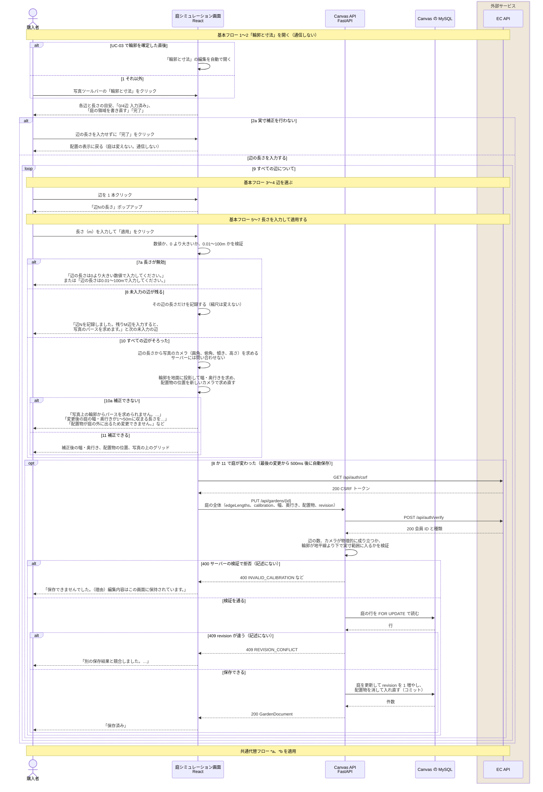
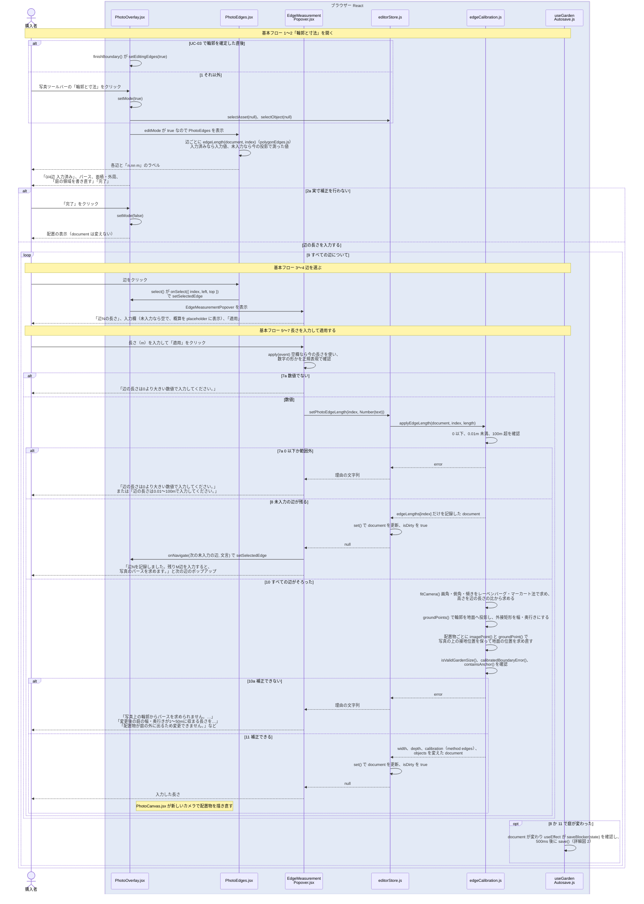
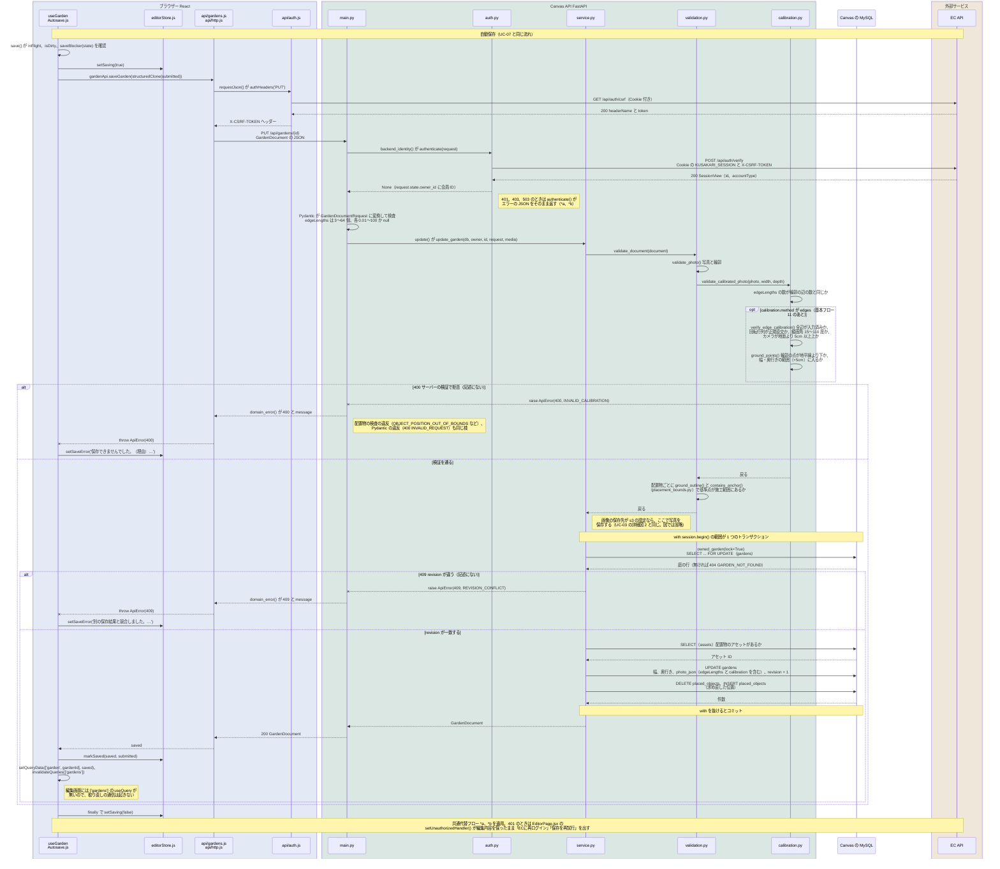

# UC-04 施工範囲の実寸を定義する

- ユースケース記述: [UC-04_施工範囲の実寸を定義する](<../../アーカイブ/ユースケース/kusakari-canvas/UC-04_施工範囲の実寸を定義する.md>)
- 対象のコード: kusakari-canvas の main（c19d497、2026-11-20 時点）

辺の長さの検証と、全辺の長さから写真のカメラ（撮影位置と向き）を求める計算は、すべてブラウザーの `edgeCalibration.js` で行います。サーバーにカメラを求めさせる API（`POST /api/photo-calibration`）は、この流れでは呼びません。辺の長さを記録するたび、またはカメラを求めるたびに庭（`GardenDocument`）が変わり、`useGardenAutosave.js` が最後の変更から 500ms 後に `PUT /api/gardens/{id}` で庭の全体を保存します。サーバーは保存のときに、求めたカメラが物理的に成り立つかだけを検証します。保存のあとのサムネイルの更新とログインの期限切れの流れは、[UC-07 庭プロジェクトを保存する](<UC-07_庭プロジェクトを保存する.md>) にあります。

## 概要図

## 詳細図 1 基本フロー 1〜11（画面の中の処理）

`editorStore.js` の set 系の関数は値を返さないので、戻りの矢印を省きます。

## 詳細図 2 基本フロー 8、11 の自動保存

## ユースケース記述との差

- 基本フロー 10 のカメラの計算は、ブラウザーの `edgeCalibration.js` だけで行います。サーバーの `POST /api/photo-calibration` は使いません。サーバーは保存（PUT）のときに `verify_edge_calibration()` で、カメラが物理的に成り立つか（回転行列、縦画角 15〜110 度、カメラが地面より上）だけを検証します。
- 10a の「長さの組み合わせが写真の形と合わない」は、コードでは補正できない理由になりません。全辺の長さに 1% 以内で合うカメラが無いときも拒否せず、入力値にいちばん近いカメラを使います（`fitCamera()`）。この場合、3D 上の辺の長さは入力値と一致しません。範囲の中にカメラを 1 つも求められないときだけ、「写真上の輪郭からパースを求められません。輪郭を確認してください。」を出します。
- 10a には記述にない理由もあります。「配置物の位置を新しいパースへ変換できません。」「庭の輪郭が地平線を越えています。地面上に描き直してください。」「庭の輪郭が庭の実寸範囲を超えています。…」です。
- 2a の「施工範囲を囲む長方形を庭の幅×奥行き（土台寸法）に当てはめて写真と庭を対応付ける」処理は、「完了」をクリックしたときではなく、UC-03 で輪郭を確定したとき（`withPhotoBoundary()`）に行われます。「完了」は `setMode(false)` で表示を戻すだけです。
- 2a の「実寸補正の情報を保存せず」について、カメラ（`calibration`）は保存しません。ただし「完了」の前に一部の辺の長さを入力していれば、その入力値（`edgeLengths`、未入力は `null`）は基本フロー 8 の時点で自動保存されています。
- 記述にない処理です。入力欄が空のまま「適用」をクリックすると、今表示している概算の長さを入力値として記録します（`apply()`）。
- 記述にない処理です。前と同じ長さを適用すると「長さは変更されていません。」を出し、庭を変えません。
- 記述にない処理です。すべての辺がそろったあとに 1 辺を入力し直すと、そのたびにカメラを求め直します。ほかの辺の入力値と写真の上の輪郭は変えません。
- 記述にない処理です。カメラ設定中、配置物のドラッグ中、輪郭の描画中は「カメラ設定・輪郭編集・配置物の移動が終わってから変更してください。」を出し、適用しません。辺を地面上で測れないときは「この辺を計測できません。写真のカメラ設定を確認してください。」を出します。
- 基本フロー 8 で、残りの辺が無いときはポップアップを次の辺へ切り替えません。
- 記述にない分岐です。サーバーの検証に通らないと 400 `INVALID_CALIBRATION` などになり、「保存できませんでした。（理由）…」を出します。別の画面や端末で先に保存されていると、409 `REVISION_CONFLICT` になります。
- 記述にない操作です。実寸を決める方法には、写真ツールバーの「写真のカメラを設定」（基準の長方形と寸法を指定し、`POST /api/photo-calibration` でカメラを求める）もあります。この方法でカメラを設定し直すと、辺の入力値は捨てられます（`editorStore.js` の `setPhoto()`）。

## 確かめられなかったこと

- `fitCamera()` が実際の写真でどの程度の入力の組み合わせに解を返すか（10a がどのくらい起きるか）は、数値の計算に左右されるため、コードを読むだけでは確かめられませんでした。
- EC の `GET /api/auth/csrf` と `POST /api/auth/verify` の中の処理は、EC の図の範囲として追っていません。

## 参照したコード

- [frontend/src/components/PhotoOverlay.jsx](https://github.com/abeouga/kusakari-canvas/blob/c19d497dfef15b119f9bce8ecb5c886a36da6b7d/frontend/src/components/PhotoOverlay.jsx): `setMode()`、`finishBoundary()`、`editMode`、「輪郭と寸法」「完了」、入力済みの辺の数
- [frontend/src/components/PhotoEdges.jsx](https://github.com/abeouga/kusakari-canvas/blob/c19d497dfef15b119f9bce8ecb5c886a36da6b7d/frontend/src/components/PhotoEdges.jsx): `select()`、`onSelect`、辺のラベル
- [frontend/src/components/EdgeMeasurementPopover.jsx](https://github.com/abeouga/kusakari-canvas/blob/c19d497dfef15b119f9bce8ecb5c886a36da6b7d/frontend/src/components/EdgeMeasurementPopover.jsx): `apply()`、`onNavigate`、「辺Nを記録しました。…」
- [frontend/src/stores/editorStore.js](https://github.com/abeouga/kusakari-canvas/blob/c19d497dfef15b119f9bce8ecb5c886a36da6b7d/frontend/src/stores/editorStore.js): `setPhotoEdgeLength()`、`setPhoto()`、`markSaved()`
- [frontend/src/domain/edgeCalibration.js](https://github.com/abeouga/kusakari-canvas/blob/c19d497dfef15b119f9bce8ecb5c886a36da6b7d/frontend/src/domain/edgeCalibration.js): `applyEdgeLength()`、`fitCamera()`、`refine()`、`groundPoints()`、`imagePoint()`
- [frontend/src/domain/polygonEdges.js](https://github.com/abeouga/kusakari-canvas/blob/c19d497dfef15b119f9bce8ecb5c886a36da6b7d/frontend/src/domain/polygonEdges.js): `edgeLength()`、`photoGroundPoint()`
- [frontend/src/domain/calibratedProjection.js](https://github.com/abeouga/kusakari-canvas/blob/c19d497dfef15b119f9bce8ecb5c886a36da6b7d/frontend/src/domain/calibratedProjection.js): `groundPoint()`、`calibratedBoundaryError()`
- [frontend/src/domain/placementBounds.js](https://github.com/abeouga/kusakari-canvas/blob/c19d497dfef15b119f9bce8ecb5c886a36da6b7d/frontend/src/domain/placementBounds.js): `containsAnchor()`
- [frontend/src/domain/limits.js](https://github.com/abeouga/kusakari-canvas/blob/c19d497dfef15b119f9bce8ecb5c886a36da6b7d/frontend/src/domain/limits.js): `isValidGardenSize()`
- [frontend/src/three/PhotoCanvas.jsx](https://github.com/abeouga/kusakari-canvas/blob/c19d497dfef15b119f9bce8ecb5c886a36da6b7d/frontend/src/three/PhotoCanvas.jsx): `cameraKey` と `createPhotoCamera()`
- [frontend/src/hooks/useGardenAutosave.js](https://github.com/abeouga/kusakari-canvas/blob/c19d497dfef15b119f9bce8ecb5c886a36da6b7d/frontend/src/hooks/useGardenAutosave.js): `saveBlocker()`、`save()`、500ms の `useEffect`、エラーの文言
- [frontend/src/api/gardens.js](https://github.com/abeouga/kusakari-canvas/blob/c19d497dfef15b119f9bce8ecb5c886a36da6b7d/frontend/src/api/gardens.js): `saveGarden()`
- [frontend/src/api/http.js](https://github.com/abeouga/kusakari-canvas/blob/c19d497dfef15b119f9bce8ecb5c886a36da6b7d/frontend/src/api/http.js): `requestJson()`、`ApiError`
- [frontend/src/api/auth.js](https://github.com/abeouga/kusakari-canvas/blob/c19d497dfef15b119f9bce8ecb5c886a36da6b7d/frontend/src/api/auth.js): `authHeaders()`
- [backend/kusakari_canvas_api/main.py](https://github.com/abeouga/kusakari-canvas/blob/c19d497dfef15b119f9bce8ecb5c886a36da6b7d/backend/kusakari_canvas_api/main.py): `backend_identity()`、`update()`、`domain_error()`
- [backend/kusakari_canvas_api/auth.py](https://github.com/abeouga/kusakari-canvas/blob/c19d497dfef15b119f9bce8ecb5c886a36da6b7d/backend/kusakari_canvas_api/auth.py): `AuthBoundary.authenticate()`
- [backend/kusakari_canvas_api/schemas.py](https://github.com/abeouga/kusakari-canvas/blob/c19d497dfef15b119f9bce8ecb5c886a36da6b7d/backend/kusakari_canvas_api/schemas.py): `GardenPhoto.edgeLengths`、`PhotoCalibration`、`GardenDocumentRequest`
- [backend/kusakari_canvas_api/service.py](https://github.com/abeouga/kusakari-canvas/blob/c19d497dfef15b119f9bce8ecb5c886a36da6b7d/backend/kusakari_canvas_api/service.py): `update_garden()`、`owned_garden()`
- [backend/kusakari_canvas_api/validation.py](https://github.com/abeouga/kusakari-canvas/blob/c19d497dfef15b119f9bce8ecb5c886a36da6b7d/backend/kusakari_canvas_api/validation.py): `validate_document()`、`validate_photo()`
- [backend/kusakari_canvas_api/calibration.py](https://github.com/abeouga/kusakari-canvas/blob/c19d497dfef15b119f9bce8ecb5c886a36da6b7d/backend/kusakari_canvas_api/calibration.py): `validate_calibrated_photo()`、`verify_edge_calibration()`、`ground_points()`
- [backend/kusakari_canvas_api/placement_bounds.py](https://github.com/abeouga/kusakari-canvas/blob/c19d497dfef15b119f9bce8ecb5c886a36da6b7d/backend/kusakari_canvas_api/placement_bounds.py): `ground_outline()`、`contains_anchor()`
- [backend/src/main/java/jp/kusakari/ec/auth/AuthController.java](https://github.com/abeouga/kusakari-ec/blob/19a2be307ee71a2cd87e538236c3c8c42929c5b3/backend/src/main/java/jp/kusakari/ec/auth/AuthController.java)（EC）: `csrf()`、`verify()`
