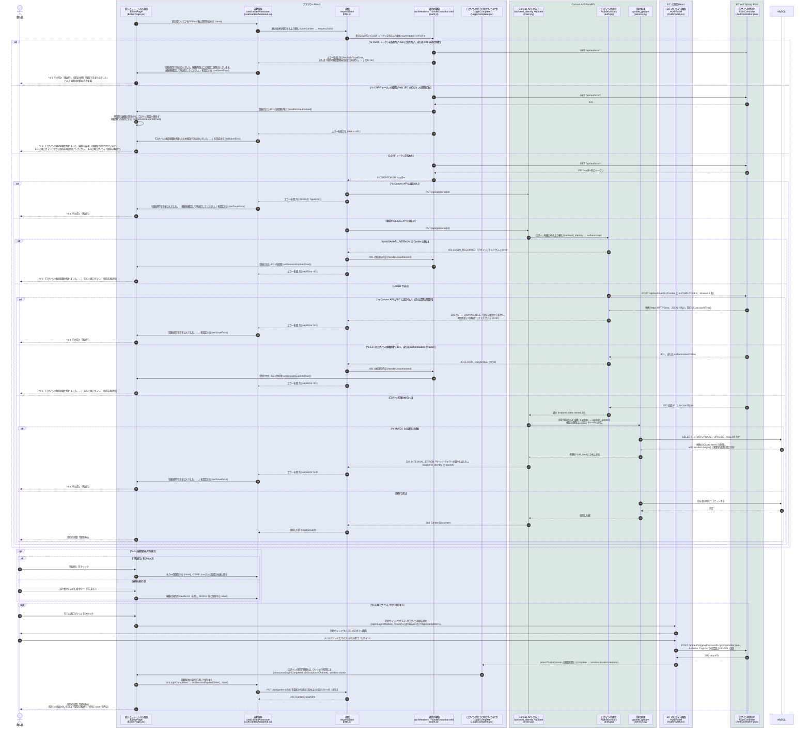

# UC-04 施工範囲の実寸を定義する

- ユースケース記述: [UC-04_施工範囲の実寸を定義する](<../../アーカイブ/ユースケース/kusakari-canvas/UC-04_施工範囲の実寸を定義する.md>)
- 共通代替フロー: [00_全ユースケース共通の代替フロー](<00_全ユースケース共通の代替フロー.md>)
- 対象のコード: kusakari-canvas の main（7e9a8dd、2026-11-24 時点）。EC の API は kusakari-ec の main（6bad7e3、2026-11-24 時点）

## シーケンス図

参加者は、上から「画面や役割の名前」「コンポーネント・関数の名前」「ファイル名（かっこ付き）」の順に書いています。
辺の長さの検証と、全辺の長さから写真のカメラ（撮影位置と向き）を求める計算は、すべてブラウザーの `edgeCalibration.js` で行い、サーバーには問い合わせません。辺の長さを記録するたび、カメラを求めるたびに庭（`GardenDocument`）が変わり、最後の変更から 500ms 後に自動保存が庭の全体を `PUT /api/gardens/{id}` で送ります。サーバーは保存のときに、求めたカメラが物理的に成り立つかを確かめます。画像の保存先が s3 の設定のときの写真の保存は、[UC-03](<UC-03_施工範囲を指定・修正する.md>) の図と同じ流れなので省いています。
共通代替フローの中身は、00 の図か、下の「共通代替フローを直接書いた図」を見てください。
代替フローのうち、エラーで終わるもの（7a・10a）と 2a は分かれる所だけを描き、結果と画面は矢印の文か Note に書いています。記述にない分岐（前と同じ長さ、サーバーの検証で拒否、revision が違う）は Note だけにしています。エラーのときの画面の後処理（`requestJson` が `ApiError` を投げる → `setSaveError` → 「再試行」を出す）は、どれも同じです。

```mermaid
sequenceDiagram
    autonumber
    actor User as 購入者
    box rgba(47,111,219,0.10) ブラウザー React
        participant Editor as 庭シミュレーション画面<br/>EditorPage<br/>(EditorPage.jsx)
        participant Overlay as 写真の編集<br/>PhotoOverlay<br/>(PhotoOverlay.jsx)
        participant Edges as 輪郭の辺<br/>PhotoEdges<br/>(PhotoEdges.jsx)
        participant Pop as 辺の長さのポップアップ<br/>EdgeMeasurementPopover<br/>(EdgeMeasurementPopover.jsx)
        participant Store as 編集中の庭<br/>useEditorStore<br/>(editorStore.js)
        participant Calib as 辺の長さとカメラ<br/>applyEdgeLength<br/>(edgeCalibration.js)
        participant Auto as 自動保存<br/>useGardenAutosave<br/>(useGardenAutosave.js)
        participant Http as 庭の通信<br/>gardenApi、requestJson<br/>(gardens.js、http.js)
        participant AuthJs as 通信の準備<br/>authHeaders<br/>(auth.js)
    end
    box rgba(27,127,92,0.12) Canvas API FastAPI
        participant Main as Canvas API の入口<br/>backend_identity・update<br/>(main.py)
        participant AuthPy as ログインの確認<br/>AuthBoundary<br/>(auth.py)
        participant Svc as 庭の処理<br/>update_garden<br/>(service.py)
        participant Valid as 庭の検証<br/>validate_document<br/>(validation.py)
        participant CalPy as カメラの検証<br/>validate_calibrated_photo<br/>(calibration.py)
    end
    box rgba(27,127,92,0.12) EC API Spring Boot
        participant EcAuth as ログイン状態API<br/>AuthController<br/>(AuthController.java)
    end
    participant Db as MySQL

    Note over User,Db: 共通代替フロー<br/>*b 未ログインの場合: 28、30 に適用<br/>*a 通信に失敗した場合: 28、30、32、39、40 に適用

    alt UC-03 で輪郭を確定した直後 (基本フロー 1 は不要)
        User->>Overlay: 始点をクリックして輪郭を確定する (UC-03 の基本フロー 5)。<br/>「輪郭と寸法」の編集は開いたまま (finishBoundary → setEditingEdges(true))
    else 基本フロー 1 それ以外
        User->>Overlay: 1 写真ツールバーの「輪郭と寸法」(入力済みの辺の数のバッジ付き) をクリック。<br/>選んでいる商品と配置物を外す (setMode(true) → selectAsset(null)、selectObject(null))
    end
    Overlay->>Edges: 輪郭の辺を表示する (editMode のとき PhotoEdges)。辺ごとに長さの目安を求める<br/>(edgeLength、polygonEdges.js。入力済みなら入力値、未入力なら今の投影で測った値)
    Edges-->>User: 2 各辺と「n.nn m」のラベル
    Overlay-->>User: 2「0/4辺入力済み」、「パース：概算」、面積・外周、<br/>「庭の領域を書き直す」「完了」
    break 2a 実寸補正を行わない
        User->>Overlay: 2a-1 辺の長さを入力せずに「完了」をクリック
        Note over User,Overlay: 結果: 2a-2「輪郭と寸法」の編集を閉じる (setMode(false))。庭は変えない。<br/>画面: 配置の表示に戻る。2a-3 ユースケースを終える
    end

    loop 基本フロー 9 未入力の辺が残る間、辺ごとに
        User->>Edges: 3 辺を 1 本クリック
        Edges->>Overlay: 選んだ辺と表示する位置を伝える (select → onSelect = setSelectedEdge)
        Overlay->>Pop: 辺の長さのポップアップを表示する (EdgeMeasurementPopover)
        Pop-->>User: 4「辺Nの長さ」、「n/N辺 入力済み」、入力欄 (未入力なら空で、<br/>概算を placeholder に出す)、「適用」、「現在の概算 n.nn m」
        User->>Pop: 5〜6 長さ (m) を入力して「適用」をクリック
        Pop->>Store: 7 空欄なら今の長さを使い、数字の形かを確かめて (apply)、<br/>辺の長さを記録するよう頼む (setPhotoEdgeLength(index, Number(text)))
        Store->>Calib: 長さを当てはめる (applyEdgeLength(document, index, length))。<br/>0 以下か、0.01m 未満か 100m 超かを確かめる
        break 7a 長さが無効 (数字の形でない、0 以下、0.01m 未満か 100m 超)
            Pop-->>User: 7a-1「辺の長さは0より大きい数値で入力してください。」<br/>または「辺の長さは0.01〜100mで入力してください。」。7a-2 基本フロー 5 へ戻る
        end
        break 前と同じ長さ (記述なし)
            Note over Pop,Calib: 結果: 庭は書き換えない。<br/>画面: 「長さは変更されていません。」
        end
        Store->>Store: 8 edgeLengths にその辺の長さだけを記録し (縮尺は変えない)、<br/>未保存にする (set で document、isDirty を true)
        Pop->>Overlay: 次の未入力の辺と文を渡す (onNavigate → setSelectedEdge)
        Overlay-->>User: 8 次の辺のポップアップに「辺Nを記録しました。残りM辺を入力すると、<br/>写真のパースを求めます。」
    end

    User->>Pop: 最後の未入力の辺の長さを入力して「適用」をクリック (流れは 7〜13 と同じ)
    Calib->>Calib: 10 画角・俯角・傾きと高さを求める (fitCamera → refine)。<br/>全辺に 1% 以内で合うカメラ、なければいちばん近いカメラ
    Calib->>Calib: 輪郭を地面に投影して外接長方形を幅・奥行きにし (groundPoints)、<br/>配置物の写真の上の接地位置を保って地面の位置を求め直す (imagePoint → groundPoint)。<br/>幅・奥行きが 1〜50m か (isValidGardenSize)、輪郭が地平線より下で実寸範囲に入るか<br/>(calibratedBoundaryError)、配置物の基準点が施工範囲にあるか (containsAnchor) を確かめる
    break 10a 補正できない
        Note over Pop,Calib: 結果: 縮尺を変えない。<br/>画面: 10a-1「写真上の輪郭からパースを求められません。…」「変更後の庭の幅・奥行きが1〜50mに収まる長さを指定してください。」<br/>「配置物の位置を新しいパースへ変換できません。」「庭の輪郭が地平線を越えています。…」「庭の輪郭が庭の実寸範囲を超えています。…」<br/>「配置物が庭の外に出るため変更できません。」のどれか。10a-2 基本フロー 3 へ戻る
    end
    Calib-->>Store: 11 幅・奥行き、カメラ (calibration、method は edges)、配置物の位置を変えた庭
    Store->>Store: 庭を書き換え、未保存にする (set で document、isDirty を true)
    Overlay-->>User: 11「パース：辺の実寸から推定」、補正後の面積・外周、<br/>新しいカメラで描き直したグリッドと配置物 (PhotoCanvas.jsx)。ポップアップは開いたまま

    Editor->>Auto: 基本フロー 8・11 で変わった庭と未保存の印を渡す (useGardenAutosave の useEffect)。<br/>送ってよいかを確かめる (saveBlocker。ドラッグ中・描画中でない、範囲外の配置物が無い、輪郭が成り立つ)
    Auto->>Store: 最後の変更から 500ms 待って保存を始め (setTimeout → save)、<br/>保存中にする (setSaving(true))。保存の状態は「保存中…」
    Auto->>Http: 庭の全体を保存するよう頼む (saveGarden(structuredClone(submitted)) → requestJson)
    Http->>AuthJs: 書き込みの前に CSRF トークンを取るよう頼む (authHeaders('PUT'))
    AuthJs->>EcAuth: GET /api/auth/csrf (Cookie 付き)
    EcAuth-->>AuthJs: 200 ヘッダー名とトークン (csrf)
    Http->>Main: PUT /api/gardens/{id} (X-CSRF-TOKEN 付き)<br/>庭の全体 (edgeLengths、calibration、幅、奥行き、配置物、revision)
    Main->>AuthPy: ログインを確かめるよう頼む (backend_identity → authenticate)
    AuthPy->>EcAuth: POST /api/auth/verify<br/>(KUSAKARI_SESSION の Cookie と X-CSRF-TOKEN)
    EcAuth-->>AuthPy: 200 会員 ID と accountType (verify)。購入者なので通す (request.state.owner_id)
    Main->>Svc: 本文の形と値の範囲を確かめ (GardenDocumentRequest。edgeLengths は 3〜64 個で、<br/>それぞれ 0.01〜100 か null)、庭を保存するよう頼む (update → update_garden)
    Svc->>Valid: 庭の中身を確かめるよう頼む (validate_document)。写真と輪郭を確かめる (validate_photo)
    Valid->>CalPy: 辺の長さとカメラを確かめるよう頼む (validate_calibrated_photo)。<br/>edgeLengths の数が輪郭の辺の数と同じか
    opt calibration の method が edges (基本フロー 11 のあと)
        CalPy->>CalPy: カメラが物理的に成り立つかを確かめる (verify_edge_calibration)
        Note over Valid,CalPy: 結果: 全辺が入力済み、回転行列が正規直交、縦画角 15〜110 度、カメラが地面より 5cm 以上上かを確かめ、<br/>輪郭の点が地平線より下で、幅・奥行き (+5cm) に入るかを確かめる (ground_points)。
    end
    Valid->>Valid: 配置物ごとに、基準点が施工範囲の中で Y=0 か<br/>(ground_outline、contains_anchor、placement_bounds.py)、回転と倍率を確かめる
    break サーバーの検証で拒否 (記述なし)
        Note over Http,CalPy: 結果: 400 INVALID_CALIBRATION などと理由を返す (bad_request、domain_error)。<br/>画面: 「保存できませんでした。(理由) 編集内容はこの画面に保持されています。」と「再試行」、保存の状態「保存できませんでした」
    end
    Svc->>Db: 庭の行をロックして読む<br/>(owned_garden(lock=True)、SELECT ... FOR UPDATE gardens)
    break revision が違う (記述なし)
        Note over Http,Db: 結果: 409 REVISION_CONFLICT を返し、保存しない。<br/>画面: 「別の保存結果と競合しました。編集内容は保持されています。再読み込み前に変更内容を確認してください。」と「再試行」
    end
    Svc->>Db: 配置物のアセットがカタログにあるかを読み (SELECT assets。足りなければ 400 UNKNOWN_ASSET)、<br/>庭を書き換え、配置物を入れ直してコミットする (UPDATE gardens の幅・奥行き・<br/>photo_json (edgeLengths と calibration)・revision + 1、DELETE と INSERT placed_objects (求め直した位置)。1 トランザクション)
    Svc-->>Main: 保存した庭 (GardenDocument)
    Main-->>Http: 200 GardenDocument
    Http-->>Auto: 保存した庭
    Auto->>Store: 保存済みにする (markSaved)。保存中に編集が続いていれば<br/>revision だけを受け取り、未保存のまま次の 500ms 後にまた送る
    Editor-->>User: 保存の状態「保存済み」
```

## 共通代替フローを直接書いた図

上の図の自動保存（CSRF トークンの取得と `PUT /api/gardens/{id}`）に、この画面で起こる共通代替フロー（\*a、\*b）を書き込んだ図です。辺の長さの入力とカメラの計算はブラウザーの中だけで終わるので、共通代替フローは起こりません。図では省いています。
自動保存のときは必ず未保存の編集（`isDirty`）があるので、\*b はログイン画面へ移らず、編集画面のまま別のウィンドウで再ログインする形になります（00 の \*b の「詳細図 2」の形）。
画像の保存先（S3）が s3 の設定のときの写真の保存と、その失敗（503 `MEDIA_UNAVAILABLE`）は、[UC-03](<UC-03_施工範囲を指定・修正する.md>) の「共通代替フローを直接書いた図」と同じなので省いています。

## ユースケース記述との差

- 基本フロー 10 のカメラの計算は、ブラウザーの `edgeCalibration.js` だけで行います。サーバーは保存（PUT）のときに `verify_edge_calibration()` で、カメラが物理的に成り立つか（全辺が入力済み、回転行列、縦画角 15〜110 度、カメラが地面より上）を確かめ、`ground_points()` で輪郭が地平線より下で実寸範囲に入るかを確かめます。違反すると 400 `INVALID_CALIBRATION` です。
- 10a の「長さの組み合わせが写真の形と合わない」は、コードでは補正できない理由になりません。全辺の長さに 1% 以内で合うカメラが無いときも拒否せず、入力値にいちばん近いカメラを使います（`fitCamera()`）。この場合、3D 上の辺の長さは入力値と一致しません。範囲の中にカメラを 1 つも求められないときだけ、「写真上の輪郭からパースを求められません。輪郭を確認してください。」を出します。
- 10a には記述にない理由もあります。「配置物の位置を新しいパースへ変換できません。」「庭の輪郭が地平線を越えています。地面上に描き直してください。」「庭の輪郭が庭の実寸範囲を超えています。輪郭を描き直すか、カメラの基準点を調整してください。」です。最後の文の「カメラの基準点」は、7e9a8dd までに取り除かれた「写真のカメラ設定」の画面のことで、今の画面からは操作できません。
- 10a のあとの戻り先は、記述では基本フロー 3 です。コードではポップアップは開いたままで、その辺の長さを入力し直すこともできます。
- 2a の「施工範囲を囲む長方形を庭の幅×奥行き（土台寸法）に当てはめて写真と庭を対応付ける」処理は、「完了」をクリックしたときではなく、UC-03 で輪郭を確定したとき（`withPhotoBoundary()`）に行われます。「完了」は `setMode(false)` で表示を戻すだけです。
- 2a の「実寸補正の情報を保存せず」について、カメラ（`calibration`）は保存しません。ただし「完了」の前に一部の辺の長さを入力していれば、その入力値（`edgeLengths`、未入力は `null`）は基本フロー 8 の時点で自動保存されています。
- 記述にない処理です。入力欄が空のまま「適用」をクリックすると、今表示している概算の長さを入力値として記録します（`apply()`）。
- 記述にない処理です。前と同じ長さを適用すると「長さは変更されていません。」を出し、庭を変えません。
- 記述にない処理です。すべての辺がそろったあとに 1 辺を入力し直すと、そのたびに今のカメラから始めてカメラを求め直します。ほかの辺の入力値と写真の上の輪郭は変えません。
- 記述にない処理です。配置物のドラッグ中と輪郭の描画中は、入力欄と「適用」を使えなくします（`EdgeMeasurementPopover.jsx` の `locked`）。`setPhotoEdgeLength()` も「輪郭編集・配置物の移動が終わってから変更してください。」を返して適用しません。辺を地面上で測れないときは、入力欄を使えなくし、「地面上の位置を求められません。写真上の輪郭を確認してください。」を出します。
- 基本フロー 8 で、最後の未入力の辺を記録したとき（基本フロー 10 に進むとき）は、ポップアップを次の辺へ切り替えず、「辺Nを記録しました。…」も出しません。ポップアップの「前の辺」「次の辺」で、入力済みの辺へも移れます。
- 記述にない分岐です。別の画面や端末で先に保存されていると、409 `REVISION_CONFLICT` になります。
- 共通代替フローで、Canvas API や EC が 403（`CSRF_REQUIRED`、`FORBIDDEN`）を返したときは、\*a・\*b に入らず、4xx として「保存できませんでした。（理由） 編集内容はこの画面に保持されています。」を出します。

## 確かめられなかったこと

- `fitCamera()` が実際の写真でどの程度の入力の組み合わせに解を返すか（10a がどのくらい起きるか）は、数値の計算に左右されるため、コードを読むだけでは確かめられませんでした。

## 参照したコード

- [frontend/src/components/PhotoOverlay.jsx](https://github.com/abeouga/kusakari-canvas/blob/7e9a8dd0a40f2b212ca20b3aa94f2dc984b00b7a/frontend/src/components/PhotoOverlay.jsx): `setMode()`、`finishBoundary()`、`editMode`、「輪郭と寸法」のバッジ、`edge-progress`（入力済みの辺の数）、「パース：…」、「完了」
- [frontend/src/components/PhotoEdges.jsx](https://github.com/abeouga/kusakari-canvas/blob/7e9a8dd0a40f2b212ca20b3aa94f2dc984b00b7a/frontend/src/components/PhotoEdges.jsx): `select()`、`onSelect`、辺のラベル
- [frontend/src/components/EdgeMeasurementPopover.jsx](https://github.com/abeouga/kusakari-canvas/blob/7e9a8dd0a40f2b212ca20b3aa94f2dc984b00b7a/frontend/src/components/EdgeMeasurementPopover.jsx): `apply()`、`onNavigate`、`locked`、「辺Nを記録しました。…」「長さは変更されていません。」
- [frontend/src/stores/editorStore.js](https://github.com/abeouga/kusakari-canvas/blob/7e9a8dd0a40f2b212ca20b3aa94f2dc984b00b7a/frontend/src/stores/editorStore.js): `setPhotoEdgeLength()`、`selectAsset()`、`selectObject()`、`setSaving()`、`setSaveError()`、`markSaved()`
- [frontend/src/domain/edgeCalibration.js](https://github.com/abeouga/kusakari-canvas/blob/7e9a8dd0a40f2b212ca20b3aa94f2dc984b00b7a/frontend/src/domain/edgeCalibration.js): `applyEdgeLength()`、`fitCamera()`、`refine()`、`groundPoints()`、`imagePoint()`
- [frontend/src/domain/polygonEdges.js](https://github.com/abeouga/kusakari-canvas/blob/7e9a8dd0a40f2b212ca20b3aa94f2dc984b00b7a/frontend/src/domain/polygonEdges.js): `edgeLength()`、`photoGroundPoint()`
- [frontend/src/domain/calibratedProjection.js](https://github.com/abeouga/kusakari-canvas/blob/7e9a8dd0a40f2b212ca20b3aa94f2dc984b00b7a/frontend/src/domain/calibratedProjection.js): `groundPoint()`、`calibratedBoundaryError()`
- [frontend/src/domain/placementBounds.js](https://github.com/abeouga/kusakari-canvas/blob/7e9a8dd0a40f2b212ca20b3aa94f2dc984b00b7a/frontend/src/domain/placementBounds.js): `containsAnchor()`、`outsideObjects()`
- [frontend/src/domain/limits.js](https://github.com/abeouga/kusakari-canvas/blob/7e9a8dd0a40f2b212ca20b3aa94f2dc984b00b7a/frontend/src/domain/limits.js): `isValidGardenSize()`
- [frontend/src/three/PhotoCanvas.jsx](https://github.com/abeouga/kusakari-canvas/blob/7e9a8dd0a40f2b212ca20b3aa94f2dc984b00b7a/frontend/src/three/PhotoCanvas.jsx): `cameraKey` と `createPhotoCamera()`
- [frontend/src/hooks/useGardenAutosave.js](https://github.com/abeouga/kusakari-canvas/blob/7e9a8dd0a40f2b212ca20b3aa94f2dc984b00b7a/frontend/src/hooks/useGardenAutosave.js): `saveBlocker()`、`save()`、500ms の `useEffect`、エラーの文言
- [frontend/src/pages/EditorPage.jsx](https://github.com/abeouga/kusakari-canvas/blob/7e9a8dd0a40f2b212ca20b3aa94f2dc984b00b7a/frontend/src/pages/EditorPage.jsx): `useGardenAutosave()` の呼び出し、`setUnauthorizedHandler()`、`sessionExpired`、`retryAfterLogin()`、`onLoginCompleted()`、保存の状態
- [frontend/src/components/LoginComplete.jsx](https://github.com/abeouga/kusakari-canvas/blob/7e9a8dd0a40f2b212ca20b3aa94f2dc984b00b7a/frontend/src/components/LoginComplete.jsx): `LoginComplete()`
- [frontend/src/api/gardens.js](https://github.com/abeouga/kusakari-canvas/blob/7e9a8dd0a40f2b212ca20b3aa94f2dc984b00b7a/frontend/src/api/gardens.js): `saveGarden()`
- [frontend/src/api/http.js](https://github.com/abeouga/kusakari-canvas/blob/7e9a8dd0a40f2b212ca20b3aa94f2dc984b00b7a/frontend/src/api/http.js): `requestJson()`、`ApiError`
- [frontend/src/api/auth.js](https://github.com/abeouga/kusakari-canvas/blob/7e9a8dd0a40f2b212ca20b3aa94f2dc984b00b7a/frontend/src/api/auth.js): `authHeaders()`、`handleUnauthorized()`、`openLoginWindow()`、`onLoginCompleted()`、`announceLoginCompleted()`
- [backend/kusakari_canvas_api/main.py](https://github.com/abeouga/kusakari-canvas/blob/7e9a8dd0a40f2b212ca20b3aa94f2dc984b00b7a/backend/kusakari_canvas_api/main.py): `backend_identity()`、`update()`、`domain_error()`、`invalid_request()`
- [backend/kusakari_canvas_api/auth.py](https://github.com/abeouga/kusakari-canvas/blob/7e9a8dd0a40f2b212ca20b3aa94f2dc984b00b7a/backend/kusakari_canvas_api/auth.py): `AuthBoundary.authenticate()`、`error()`
- [backend/kusakari_canvas_api/schemas.py](https://github.com/abeouga/kusakari-canvas/blob/7e9a8dd0a40f2b212ca20b3aa94f2dc984b00b7a/backend/kusakari_canvas_api/schemas.py): `GardenPhoto.edgeLengths`、`PhotoCalibration`、`GardenDocumentRequest`
- [backend/kusakari_canvas_api/service.py](https://github.com/abeouga/kusakari-canvas/blob/7e9a8dd0a40f2b212ca20b3aa94f2dc984b00b7a/backend/kusakari_canvas_api/service.py): `update_garden()`、`owned_garden()`
- [backend/kusakari_canvas_api/validation.py](https://github.com/abeouga/kusakari-canvas/blob/7e9a8dd0a40f2b212ca20b3aa94f2dc984b00b7a/backend/kusakari_canvas_api/validation.py): `validate_document()`、`validate_photo()`
- [backend/kusakari_canvas_api/calibration.py](https://github.com/abeouga/kusakari-canvas/blob/7e9a8dd0a40f2b212ca20b3aa94f2dc984b00b7a/backend/kusakari_canvas_api/calibration.py): `validate_calibrated_photo()`、`verify_edge_calibration()`、`ground_points()`
- [backend/kusakari_canvas_api/placement_bounds.py](https://github.com/abeouga/kusakari-canvas/blob/7e9a8dd0a40f2b212ca20b3aa94f2dc984b00b7a/backend/kusakari_canvas_api/placement_bounds.py): `ground_outline()`、`contains_anchor()`
- [backend/src/main/java/jp/kusakari/ec/auth/AuthController.java（kusakari-ec）](https://github.com/abeouga/kusakari-ec/blob/6bad7e37c4135034fbe97e30309772fbe872e675/backend/src/main/java/jp/kusakari/ec/auth/AuthController.java): `csrf()`、`verify()`
- [backend/src/main/java/jp/kusakari/ec/auth/PasswordLoginController.java（kusakari-ec）](https://github.com/abeouga/kusakari-ec/blob/6bad7e37c4135034fbe97e30309772fbe872e675/backend/src/main/java/jp/kusakari/ec/auth/PasswordLoginController.java): `POST /api/auth/login`
- [frontend/src/components/AuthPanel.jsx（kusakari-ec）](https://github.com/abeouga/kusakari-ec/blob/6bad7e37c4135034fbe97e30309772fbe872e675/frontend/src/components/AuthPanel.jsx): `submit()`、`complete()`
