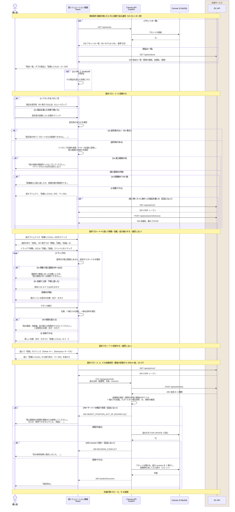
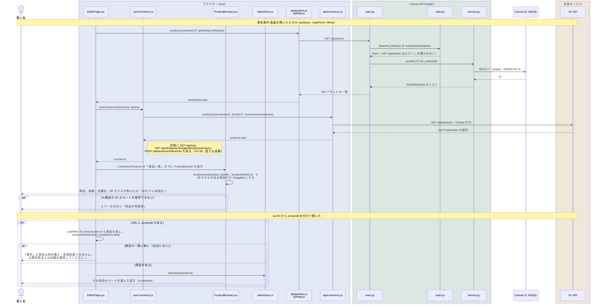
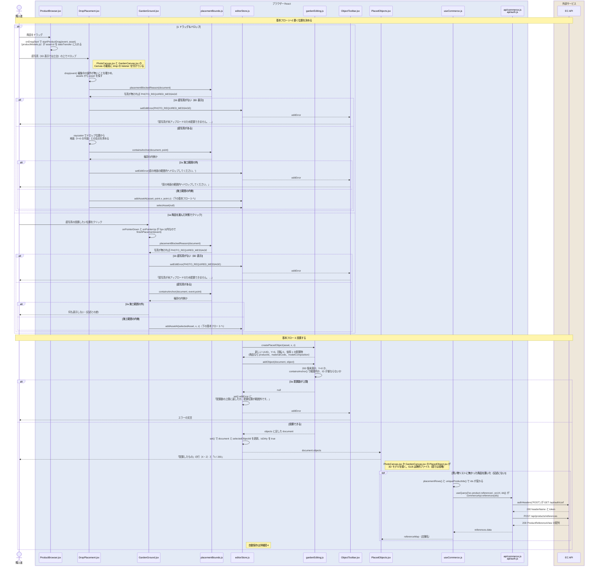
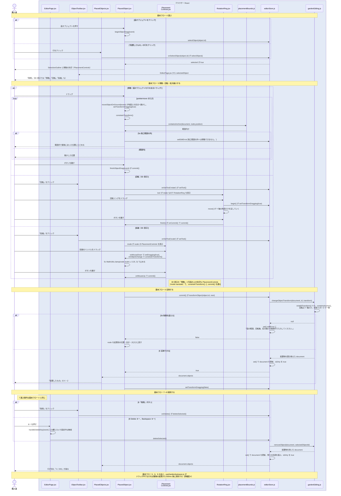
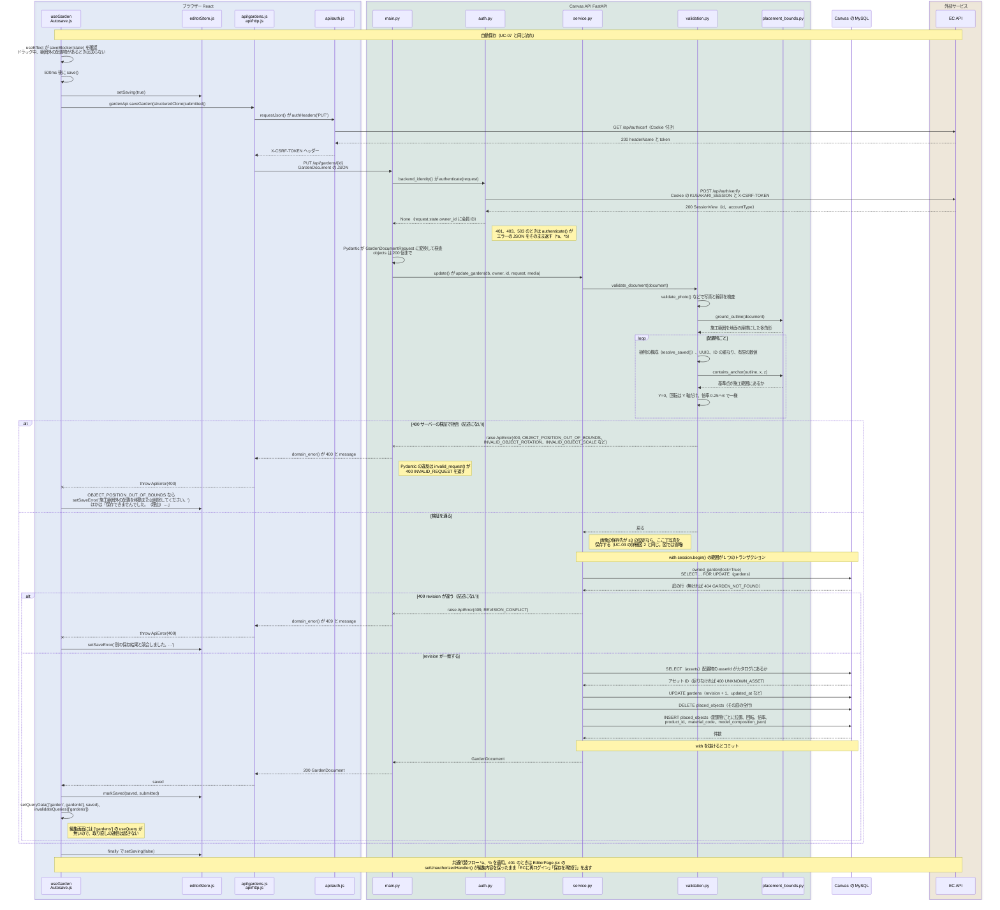

# UC-05 庭オブジェクトを配置・編集する

- ユースケース記述: [UC-05_庭オブジェクトを配置・編集する](<../../アーカイブ/ユースケース/kusakari-canvas/UC-05_庭オブジェクトを配置・編集する.md>)
- 対象のコード: kusakari-canvas の main（c19d497、2026-11-20 時点）

「商品一覧」タブの商品は、画面を開いたときに EC API の `GET /api/products` から取ります。設置・移動・回転・拡大縮小・削除の検証は、すべてブラウザーの `editorStore.js` と `gardenEditing.js` で行い、操作のたびにはサーバーへ問い合わせません。庭（`GardenDocument`）が変わると、`useGardenAutosave.js` が最後の変更から 500ms 後に庭の全体を `PUT /api/gardens/{id}` で保存します。ドラッグ中は保存しません。詳細図は、画面を開いたとき（詳細図 1）、設置（詳細図 2）、選択・変形・削除（詳細図 3）、自動保存（詳細図 4）に分けます。画面を開いたときの通信の全体は [UC-01-1 庭プロジェクトを開く](<UC-01-1_庭プロジェクトを開く.md>)、保存のあとのサムネイルの更新とログインの期限切れの流れは [UC-07 庭プロジェクトを保存する](<UC-07_庭プロジェクトを保存する.md>) にあります。

## 概要図

## 詳細図 1 画面を開いたときの通信と 1a

## 詳細図 2 基本フロー 1〜3 設置する

`editorStore.js` の set 系の関数は値を返さないので、戻りの矢印を省きます。`editorStore.js` から画面への破線は、zustand の購読で画面が描き直されることを表します。

## 詳細図 3 基本フロー 4〜9 選ぶ・変形する・削除する

`editorStore.js` の set 系の関数は値を返さないので、戻りの矢印を省きます。`editorStore.js` から画面への破線は、zustand の購読で画面が描き直されることを表します。

## 詳細図 4 基本フロー 3、6、9 の自動保存

## ユースケース記述との差

- 1b は 3D 表示のときだけ起きます。写真表示で庭写真が無いときは、ドロップを受ける 3D の Canvas が無く（「庭の写真から設計する」のボタンだけを出します）、ドロップしても何も起きず、文言も出ません。3D 表示では、上の帯にも同じ文言と「写真をアップロード」を出します。
- 2a で、1a のクリックで施工範囲の外を選んだときは、何も表示しません（`GardenGround.jsx` の `finishPlacement()`）。ドロップのときだけ「庭の地面の範囲内へドロップしてください。」を出します。
- 3a の文言「配置数の上限に達したか、配置位置が範囲外です。」は `addObject()` が `null` を返したときに出ます。範囲外は先に `containsAnchor()` で止めるので、この文言が出るのは実際には 200 個の上限のときです。
- 記述にない処理です。1a で `productId` の商品が EC の商品一覧に無いときは、「選択した商品は現在購入・新規配置できません。公開状態または店舗を確認してください。」を出し、何も選びません。商品に 3D モデルが無いときは、文言を出さずに何も選びません。
- 記述にない処理です。サイドバーは「買い物リスト」タブで開きます。基本フロー 1 の前に「商品一覧」タブへ切り替えます。「買い物リスト」タブの商品も、同じようにドラッグして設置できます（`CommercePanel.jsx`）。3D モデルが無い商品は「3Dモデル未設定」と表示し、ドラッグできません。
- 記述にない処理です。設置すると、その庭オブジェクトを選んだ状態にします。削除すると、残りの先頭の庭オブジェクトを選んだ状態にします。
- 記述にない処理です。買い物リストに無かった商品を初めて置くと、`useCommerce.js` が EC API の `POST /api/products/references` で、店舗名と今購入できるかを取ります（「配置したもの」の店舗名に使います）。
- 記述にない処理です。ドラッグ中に Esc キーを押すか、ウィンドウからフォーカスが外れると、変更前の位置・向き・大きさに戻します（`PlacedObject.jsx` の `cancelTransform()`、`RotationRing.jsx` の `cancel()`）。
- 写真表示では「移動」「回転」「拡縮」のボタンを出さず、移動だけができます（`PlacedObject.jsx` は `photoMode` のとき `tool` を `move` にします）。記述の「3D表示では「回転」「拡縮」ボタン」と合っています。
- 記述にない分岐です。サーバーも `validate_document()` で配置物を検査し、違反すると 400（`OBJECT_POSITION_OUT_OF_BOUNDS`、`INVALID_OBJECT_ROTATION`、`INVALID_OBJECT_SCALE`、`INVALID_PLANT_MODEL` など）を返します。別の画面や端末で先に保存されていると、409 `REVISION_CONFLICT` になります。
- 記述の基本フロー 3 の「(UC-07)。。」は句点が 2 つあります。

## 確かめられなかったこと

- 3D 表示の移動・拡縮のハンドルは、ライブラリー（`@react-three/drei` の `TransformControls`）の中でポインターを扱います。ライブラリーの中の処理は追っていません。
- EC の `GET /api/products`、`POST /api/products/references`、`GET /api/auth/csrf`、`POST /api/auth/verify` の中の処理は、EC の図の範囲として追っていません。

## 参照したコード

- [frontend/src/pages/EditorPage.jsx](https://github.com/abeouga/kusakari-canvas/blob/c19d497dfef15b119f9bce8ecb5c886a36da6b7d/frontend/src/pages/EditorPage.jsx): `useQuery(['assets'])`、`entryProductId` の `useEffect`、`handleDeleteKey()`、`renderOverlay`、`useGardenAutosave()`、`setUnauthorizedHandler()`
- [frontend/src/hooks/useCommerce.js](https://github.com/abeouga/kusakari-canvas/blob/c19d497dfef15b119f9bce8ecb5c886a36da6b7d/frontend/src/hooks/useCommerce.js): `useCommerce()` の `products` と `references` の `useQuery`
- [frontend/src/api/commerce.js](https://github.com/abeouga/kusakari-canvas/blob/c19d497dfef15b119f9bce8ecb5c886a36da6b7d/frontend/src/api/commerce.js): `commerceApi.products()`、`references()`、`request()`
- [frontend/src/components/CommercePanel.jsx](https://github.com/abeouga/kusakari-canvas/blob/c19d497dfef15b119f9bce8ecb5c886a36da6b7d/frontend/src/components/CommercePanel.jsx): 「買い物リスト」「商品一覧」タブ、買い物リストの行のドラッグ
- [frontend/src/components/ProductBrowser.jsx](https://github.com/abeouga/kusakari-canvas/blob/c19d497dfef15b119f9bce8ecb5c886a36da6b7d/frontend/src/components/ProductBrowser.jsx): `draggable`、`onDragStart`、「商品を再取得」、「3Dモデル未設定」
- [frontend/src/domain/productModels.js](https://github.com/abeouga/kusakari-canvas/blob/c19d497dfef15b119f9bce8ecb5c886a36da6b7d/frontend/src/domain/productModels.js): `productAsset()`、`startProductDrag()`、`productDragType`
- [frontend/src/three/DropPlacement.jsx](https://github.com/abeouga/kusakari-canvas/blob/c19d497dfef15b119f9bce8ecb5c886a36da6b7d/frontend/src/three/DropPlacement.jsx): `drop()`、「庭の地面の範囲内へドロップしてください。」
- [frontend/src/three/GardenGround.jsx](https://github.com/abeouga/kusakari-canvas/blob/c19d497dfef15b119f9bce8ecb5c886a36da6b7d/frontend/src/three/GardenGround.jsx): `finishPlacement()`
- [frontend/src/three/PhotoCanvas.jsx](https://github.com/abeouga/kusakari-canvas/blob/c19d497dfef15b119f9bce8ecb5c886a36da6b7d/frontend/src/three/PhotoCanvas.jsx) と [frontend/src/three/GardenCanvas.jsx](https://github.com/abeouga/kusakari-canvas/blob/c19d497dfef15b119f9bce8ecb5c886a36da6b7d/frontend/src/three/GardenCanvas.jsx): `DropPlacement`、`GardenGround`、`PlacedObject` の配置
- [frontend/src/three/PlacedObject.jsx](https://github.com/abeouga/kusakari-canvas/blob/c19d497dfef15b119f9bce8ecb5c886a36da6b7d/frontend/src/three/PlacedObject.jsx): `beginObjectDrag()`、`moveObjectOnGround()`、`finishObjectDrag()`、`constrainTransform()`、`commit()`、`cancelTransform()`
- [frontend/src/three/PlacementControls.jsx](https://github.com/abeouga/kusakari-canvas/blob/c19d497dfef15b119f9bce8ecb5c886a36da6b7d/frontend/src/three/PlacementControls.jsx): `PlacementControls`、`handleOwnsPointer()`
- [frontend/src/three/RotationRing.jsx](https://github.com/abeouga/kusakari-canvas/blob/c19d497dfef15b119f9bce8ecb5c886a36da6b7d/frontend/src/three/RotationRing.jsx): `begin()`、`move()`、`finish()`、`cancel()`
- [frontend/src/components/ObjectToolbar.jsx](https://github.com/abeouga/kusakari-canvas/blob/c19d497dfef15b119f9bce8ecb5c886a36da6b7d/frontend/src/components/ObjectToolbar.jsx): 「移動」「回転」「拡縮」「削除」、`editError` の表示
- [frontend/src/components/PlacedObjects.jsx](https://github.com/abeouga/kusakari-canvas/blob/c19d497dfef15b119f9bce8ecb5c886a36da6b7d/frontend/src/components/PlacedObjects.jsx): 「配置したもの」、「n / 200」、X・Z、`onSelectObject`
- [frontend/src/stores/editorStore.js](https://github.com/abeouga/kusakari-canvas/blob/c19d497dfef15b119f9bce8ecb5c886a36da6b7d/frontend/src/stores/editorStore.js): `addAssetAt()`、`selectObject()`、`selectAsset()`、`setTool()`、`transformObject()`、`deleteSelected()`、`setEditError()`、`markSaved()`
- [frontend/src/domain/gardenEditing.js](https://github.com/abeouga/kusakari-canvas/blob/c19d497dfef15b119f9bce8ecb5c886a36da6b7d/frontend/src/domain/gardenEditing.js): `createPlacedObject()`、`addObject()`、`changeObjectTransform()`、`isValidTransform()`、`removeObject()`
- [frontend/src/domain/placementBounds.js](https://github.com/abeouga/kusakari-canvas/blob/c19d497dfef15b119f9bce8ecb5c886a36da6b7d/frontend/src/domain/placementBounds.js): `placementBlockedReason()`、`PHOTO_REQUIRED_MESSAGE`、`containsAnchor()`、`outsideObjects()`
- [frontend/src/domain/limits.js](https://github.com/abeouga/kusakari-canvas/blob/c19d497dfef15b119f9bce8ecb5c886a36da6b7d/frontend/src/domain/limits.js): `MAX_PLACED_OBJECTS`、`MIN_OBJECT_SCALE`、`MAX_OBJECT_SCALE`
- [frontend/src/hooks/useGardenAutosave.js](https://github.com/abeouga/kusakari-canvas/blob/c19d497dfef15b119f9bce8ecb5c886a36da6b7d/frontend/src/hooks/useGardenAutosave.js): `saveBlocker()`、`save()`、500ms の `useEffect`、エラーの文言
- [frontend/src/api/gardens.js](https://github.com/abeouga/kusakari-canvas/blob/c19d497dfef15b119f9bce8ecb5c886a36da6b7d/frontend/src/api/gardens.js): `listAssets()`、`saveGarden()`
- [frontend/src/api/http.js](https://github.com/abeouga/kusakari-canvas/blob/c19d497dfef15b119f9bce8ecb5c886a36da6b7d/frontend/src/api/http.js): `requestJson()`、`ApiError`
- [frontend/src/api/auth.js](https://github.com/abeouga/kusakari-canvas/blob/c19d497dfef15b119f9bce8ecb5c886a36da6b7d/frontend/src/api/auth.js): `authHeaders()`
- [backend/kusakari_canvas_api/main.py](https://github.com/abeouga/kusakari-canvas/blob/c19d497dfef15b119f9bce8ecb5c886a36da6b7d/backend/kusakari_canvas_api/main.py): `backend_identity()`、`assets()`、`update()`、`domain_error()`、`invalid_request()`
- [backend/kusakari_canvas_api/auth.py](https://github.com/abeouga/kusakari-canvas/blob/c19d497dfef15b119f9bce8ecb5c886a36da6b7d/backend/kusakari_canvas_api/auth.py): `AuthBoundary.authenticate()`（GET `/api/assets` の扱い）
- [backend/kusakari_canvas_api/service.py](https://github.com/abeouga/kusakari-canvas/blob/c19d497dfef15b119f9bce8ecb5c886a36da6b7d/backend/kusakari_canvas_api/service.py): `list_assets()`、`update_garden()`、`owned_garden()`
- [backend/kusakari_canvas_api/validation.py](https://github.com/abeouga/kusakari-canvas/blob/c19d497dfef15b119f9bce8ecb5c886a36da6b7d/backend/kusakari_canvas_api/validation.py): `validate_document()` の配置物の検査
- [backend/kusakari_canvas_api/placement_bounds.py](https://github.com/abeouga/kusakari-canvas/blob/c19d497dfef15b119f9bce8ecb5c886a36da6b7d/backend/kusakari_canvas_api/placement_bounds.py): `ground_outline()`、`contains_anchor()`
- [backend/kusakari_canvas_api/models.py](https://github.com/abeouga/kusakari-canvas/blob/c19d497dfef15b119f9bce8ecb5c886a36da6b7d/backend/kusakari_canvas_api/models.py): `Garden`、`PlacedObject`、`Asset`
- [backend/src/main/java/jp/kusakari/ec/catalog/controller/CatalogController.java](https://github.com/abeouga/kusakari-ec/blob/19a2be307ee71a2cd87e538236c3c8c42929c5b3/backend/src/main/java/jp/kusakari/ec/catalog/controller/CatalogController.java)（EC）: `products()`、`references()`
- [backend/src/main/java/jp/kusakari/ec/auth/AuthController.java](https://github.com/abeouga/kusakari-ec/blob/19a2be307ee71a2cd87e538236c3c8c42929c5b3/backend/src/main/java/jp/kusakari/ec/auth/AuthController.java)（EC）: `csrf()`、`verify()`
