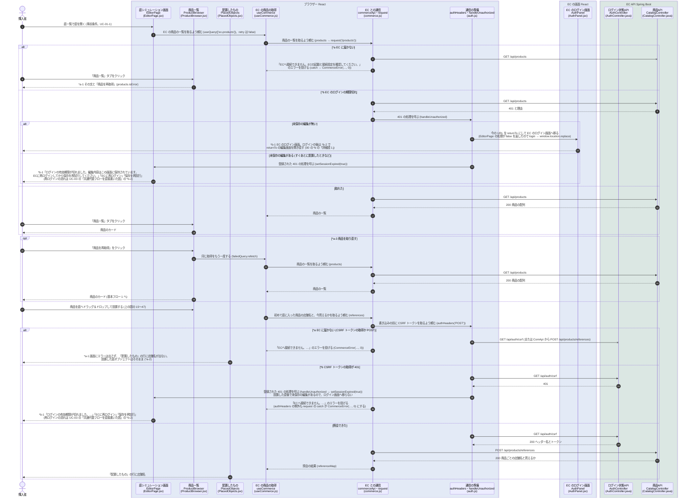

# UC-05 庭オブジェクトを配置・編集する

- ユースケース記述: [UC-05_庭オブジェクトを配置・編集する](<../../アーカイブ/ユースケース/kusakari-canvas/UC-05_庭オブジェクトを配置・編集する.md>)
- 共通代替フロー: [00_全ユースケース共通の代替フロー](<00_全ユースケース共通の代替フロー.md>)
- 対象のコード: kusakari-canvas の main（7e9a8dd、2026-11-24 時点）。EC の API は kusakari-ec の main（6bad7e3、2026-11-24 時点）

## シーケンス図

参加者は、上から「画面や役割の名前」「コンポーネント・関数の名前」「ファイル名（かっこ付き）」の順に書いています。
「商品一覧」タブの商品は、画面を開いたときに EC API の `GET /api/products` から取ります。設置・移動・回転・拡大縮小・削除の検証は、すべてブラウザーの `editorStore.js` と `gardenEditing.js` で行い、操作のたびにはサーバーへ問い合わせません。庭（`GardenDocument`）が変わると、最後の変更から 500ms 後に自動保存が庭の全体を `PUT /api/gardens/{id}` で送ります。ドラッグ中は送りません。画面を開いたときのほかの通信（`GET /api/assets` など）は [UC-01-1 庭プロジェクトを開く](<UC-01-1_庭プロジェクトを開く.md>)、画像の保存先が s3 の設定のときの写真の保存は [UC-03](<UC-03_施工範囲を指定・修正する.md>) の図の 79〜81 にあります。
共通代替フローの中身は、00 の図か、下の「共通代替フローを直接書いた図」を見てください。

```mermaid
sequenceDiagram
    autonumber
    actor User as 購入者
    box rgba(47,111,219,0.10) ブラウザー React
        participant Editor as 庭シミュレーション画面<br/>EditorPage<br/>(EditorPage.jsx)
        participant Panel as サイドバー<br/>CommercePanel<br/>(CommercePanel.jsx)
        participant Browser as 商品一覧<br/>ProductBrowser<br/>(ProductBrowser.jsx)
        participant Commerce as EC の商品の取得<br/>useCommerce<br/>(useCommerce.js)
        participant ComApi as EC との通信<br/>commerceApi・request<br/>(commerce.js)
        participant Drop as ドロップの受け取り<br/>DropPlacement<br/>(DropPlacement.jsx)
        participant Ground as 庭の地面<br/>GardenGround<br/>(GardenGround.jsx)
        participant Placed as 配置した庭オブジェクト<br/>PlacedObject<br/>(PlacedObject.jsx)
        participant Ring as 回転リング<br/>RotationRing<br/>(RotationRing.jsx)
        participant Controls as 移動・拡縮のハンドル<br/>PlacementControls<br/>(PlacementControls.jsx)
        participant Toolbar as 右上のツールバー<br/>ObjectToolbar<br/>(ObjectToolbar.jsx)
        participant List as 配置したもの<br/>PlacedObjects<br/>(PlacedObjects.jsx)
        participant Store as 編集中の庭<br/>useEditorStore<br/>(editorStore.js)
        participant Editing as 配置の編集ルール<br/>gardenEditing<br/>(gardenEditing.js)
        participant Auto as 自動保存<br/>useGardenAutosave<br/>(useGardenAutosave.js)
        participant Gardens as 庭のAPI<br/>gardenApi<br/>(gardens.js)
        participant Http as 通信<br/>requestJson<br/>(http.js)
        participant AuthJs as 通信の準備<br/>authHeaders<br/>(auth.js)
    end
    box rgba(27,127,92,0.12) Canvas API FastAPI
        participant Main as Canvas API の入口<br/>backend_identity・update<br/>(main.py)
        participant AuthPy as ログインの確認<br/>AuthBoundary<br/>(auth.py)
        participant Svc as 庭の処理<br/>update_garden<br/>(service.py)
        participant Valid as 庭の検証<br/>validate_document<br/>(validation.py)
    end
    box rgba(27,127,92,0.12) EC API Spring Boot
        participant EcAuth as ログイン状態API<br/>AuthController<br/>(AuthController.java)
        participant Catalog as 商品API<br/>CatalogController<br/>(CatalogController.java)
    end
    participant Db as MySQL

    Note over User,Db: 共通代替フロー<br/>*b 未ログインの場合: 4、42、44、105、108 に適用<br/>*a 通信に失敗した場合: 4、42、44、105、108、110、124、131、133 に適用

    User->>Editor: 庭一覧で庭を開く (事前条件。UC-01-1)
    Editor->>Commerce: 画面を開いたときに、EC の商品の一覧を取るよう頼む<br/>(useCommerce の useQuery(['ec-products']))
    Commerce->>ComApi: 商品の一覧を取るよう頼む (products → request('/products'))
    ComApi->>Catalog: GET /api/products (Cookie 付き)
    Catalog-->>ComApi: 200 商品の配列 (名前、価格、店舗名、植物の構成)
    ComApi-->>Commerce: 商品の一覧 (products.data)
    opt 1a EC から productId を付けて開いた
        Editor->>Editor: 商品の一覧からその商品を探し、3D モデルを決める<br/>(useEffect → productAsset、productModels.js)
        alt 一覧に無い (記述なし)
            Editor-->>User: 「選択した商品は現在購入・新規配置できません。<br/>公開状態または店舗を確認してください。」(何も選ばない)
        else 1a-1 一覧にある
            Editor->>Store: その商品を選んだ状態にする (selectAsset(asset.id))
        end
    end

    User->>Panel: サイドバーの「商品一覧」タブをクリック
    Panel->>Browser: 商品一覧を表示する (setTab('products') → ProductBrowser)
    Browser->>Browser: 3D モデルがある商品だけをドラッグできるようにする<br/>(productAsset → draggable)
    Browser-->>User: 商品のカード (名前、カテゴリ、店舗名、価格、<br/>3D モデルが無ければ「3Dモデル未設定」。1a の商品は選んだ表示)
    List-->>User: 「配置したもの」と「n / 200」

    alt 基本フロー 1 ドラッグ＆ドロップ
        User->>Browser: 商品を庭写真 (3D 表示では庭の土台) の上へドラッグ＆ドロップ
        Browser->>Drop: 商品の ID を渡す (onDragStart → startProductDrag の dataTransfer、<br/>Canvas の要素の drop の listener)
        Drop->>Drop: 描画中・ドラッグ中でないかを確かめ、商品の 3D モデルを探す (drop)
        Drop->>Drop: 庭写真があるかを確かめる (placementBlockedReason、placementBounds.js)
        alt 1b 庭写真がない (3D 表示)
            Drop->>Store: エラーの文を設定する (setEditError(PHOTO_REQUIRED_MESSAGE))
            Toolbar-->>User: 「庭写真が未アップロードのため配置できません。「写真」で庭写真を<br/>アップロードし、庭の輪郭を確定してください。」(設置しない)
        else 庭写真がある
            Drop->>Drop: 基本フロー 2 ドロップした位置から地面 (Y=0) との交点を求め、<br/>施工範囲の内側かを確かめる (raycaster.ray.intersectPlane、containsAnchor)
            alt 2a 施工範囲の外
                Drop->>Store: エラーの文を設定する (setEditError)
                Toolbar-->>User: 「庭の地面の範囲内へドロップしてください。」(基本フロー 1 へ戻る)
            else 施工範囲の内側
                Drop->>Store: その位置に置くよう頼み、商品の選択を外す<br/>(addAssetAt(asset, x, z)、selectAsset(null))。基本フロー 3 へ
            end
        end
    else 1a-2 商品を選んだ状態で開いた
        User->>Ground: 庭写真の上の設置したい位置をクリック
        Ground->>Ground: 押してから 5px 以内で離したか、庭写真があるか、<br/>施工範囲の内側かを確かめる (finishPlacement → placementBlockedReason、containsAnchor)
        alt 1b 庭写真がない (3D 表示)
            Ground->>Store: エラーの文を設定する (setEditError(PHOTO_REQUIRED_MESSAGE))
            Toolbar-->>User: 「庭写真が未アップロードのため配置できません。…」(設置しない)
        else 2a 施工範囲の外
            Ground-->>User: 何も表示しない (設置しない)
        else 施工範囲の内側
            Ground->>Store: その位置に置くよう頼む (addAssetAt(selectedAsset, x, z))。基本フロー 3 へ
        end
    end

    opt 基本フロー 3 addAssetAt が呼ばれた
        Store->>Editing: 新しい配置物を作る (createPlacedObject)<br/>新しい UUID、Y=0、回転 0、倍率 1、商品なら productId・materialCode・modelComposition
        Editing-->>Store: 配置物
        Store->>Editing: 庭に足すよう頼む (addObject)<br/>200 個未満、Y=0、施工範囲の内側、ID が重ならない
        alt 3a 配置数が上限に達している
            Editing-->>Store: 足せない (null)
            Store->>Store: エラーの文を設定する (set で editError)
            Toolbar-->>User: 「配置数の上限に達したか、配置位置が範囲外です。」(設置しない。基本フロー 4 へ)
        else 設置できる
            Editing-->>Store: 配置物を足した庭
            Store->>Store: 庭を書き換え、足したものを選び、未保存にする<br/>(set で document、selectedObjectId、isDirty を true)
            List-->>User: 庭オブジェクト (PlacedObject.jsx が 3D モデルを描く)、<br/>「配置したもの」の行 (X・Z) と「n / 200」
            opt その商品が初めて庭に入った (記述なし)
                Commerce->>ComApi: 店舗名と今買えるかを取るよう頼む<br/>(useQuery(['ec-product-references']) → references)
                ComApi->>AuthJs: 書き込みの前に CSRF トークンを取るよう頼む (authHeaders('POST'))
                AuthJs->>EcAuth: GET /api/auth/csrf
                EcAuth-->>AuthJs: 200 ヘッダー名とトークン (csrf)
                ComApi->>Catalog: POST /api/products/references (庭に置いた商品の ID)
                Catalog-->>ComApi: 200 商品ごとの店舗名と買えるか (references)
                ComApi-->>Commerce: 照会の結果 (referenceMap)
                List-->>User: 「配置したもの」の行に店舗名
            end
        end
    end

    alt 基本フロー 4 庭オブジェクトをクリック
        User->>Placed: 設置した庭オブジェクトを押す
        Placed->>Store: その庭オブジェクトを選ぶ (beginObjectDrag → selectObject(object.id))
    else 「配置したもの」の行をクリック
        User->>List: 「配置したもの」の行をクリック
        List->>Store: その庭オブジェクトを選ぶ (onSelectObject → selectObject)
    end
    Placed-->>User: 選択の枠 (SelectionOutline) と移動の矢印 (PlacementControls)
    Toolbar-->>User: 「削除」(3D 表示では「移動」「回転」「拡縮」も)

    alt 基本フロー 5 移動する
        User->>Placed: 庭オブジェクトをドラッグ
        loop ポインターが動くたび (5px を超えてから)
            Placed->>Store: ドラッグ中にする (moveObjectOnGround → setTransformDragging(true))
            Placed->>Placed: 地面との交点へ動かし、基準点が施工範囲の内側かを確かめる<br/>(constrainTransform → containsAnchor)
            alt 5a 施工範囲の外へ出る
                Placed->>Store: エラーの文を設定する (setEditError('施工範囲の外へは移動できません。'))
                Placed-->>User: 範囲内で最後にあった位置にとどめ、<br/>「施工範囲の外へは移動できません。」(基本フロー 5 へ戻る)
            else 範囲内
                Placed-->>User: 動かした位置
            end
        end
        User->>Placed: ボタンを離す
        Placed->>Placed: 動かした結果を確定する (finishObjectDrag → commit)
    else 回転する (3D 表示)
        User->>Toolbar: 「回転」をクリック
        Toolbar->>Store: 回転の道具にする (onSetTool → setTool('rotate'))
        Placed-->>User: 回転リング (RotationRing)
        User->>Ring: 回転リングをドラッグ
        Ring->>Store: ドラッグ中にする (begin → setTransformDragging(true))
        Ring->>Ring: Y 軸の角度だけを足していく (move)
        User->>Ring: ボタンを離す
        Ring->>Placed: 回転した結果を確定するよう頼む (finish → onCommit = commit)
    else 拡大縮小する (3D 表示)
        User->>Toolbar: 「拡縮」をクリック
        Toolbar->>Store: 拡縮の道具にする (onSetTool → setTool('scale'))
        Placed-->>User: 拡縮のハンドル (PlacementControls の mode scale)
        User->>Controls: 拡縮のハンドルをドラッグ
        Controls->>Placed: ドラッグ中にし、動くたびに大きさを整えるよう頼む<br/>(onMouseDown → setDragging(true)、onObjectChange → constrainTransform)
        Placed->>Placed: 5c 倍率を 0.25〜3 で止め、3 軸をそろえる (MathUtils.clamp)
        User->>Controls: ボタンを離す
        Controls->>Placed: 拡縮した結果を確定するよう頼む (onMouseUp → commit)
    end

    Placed->>Store: 位置・向き・大きさを変えるよう頼む (commit → transformObject(object.id, next))<br/>変わっていなければ頼まない
    Store->>Editing: 制限の内側かを確かめて置き換える (changeObjectTransform → isValidTransform)<br/>Y=0、施工範囲の内側、回転は Y 軸だけ、倍率 0.25〜3 で一様
    alt 5b 制限を超える
        Editing-->>Store: 置き換えられない (null)
        Store->>Store: エラーの文を設定する (set で editError)
        Store-->>Placed: 失敗 (false)
        Placed-->>User: 変更前の位置・向き・大きさに戻し、「庭の範囲、回転軸、<br/>拡大縮小の制限内で入力してください。」(基本フロー 5 へ戻る)
    else 基本フロー 6 反映できる
        Editing-->>Store: 配置物を置き換えた庭
        Store->>Store: 庭を書き換え、未保存にする (set で document、isDirty を true)
        Store-->>Placed: 成功 (true)
        List-->>User: 新しい位置・向き・大きさと、「配置したもの」の X・Z
    end
    Placed->>Store: ドラッグを終える (setTransformDragging(false))

    User->>Placed: 基本フロー 7 不要な庭オブジェクトをクリックして選ぶ<br/>(基本フロー 4 と同じ selectObject)
    alt 基本フロー 8「削除」ボタン
        User->>Toolbar: 「削除」をクリック
        Toolbar->>Store: 選んでいる庭オブジェクトを消すよう頼む (onDelete → deleteSelected)
    else Delete キー、Backspace キー
        User->>Editor: Delete キーか Backspace キーを押す
        Editor->>Store: 入力欄の中やドラッグ中でなければ、消すよう頼む<br/>(handleDeleteKey → deleteSelected)
    end
    Store->>Editing: 庭から取り除く (removeObject)
    Editing-->>Store: 配置物を除いた庭
    Store->>Store: 庭を書き換え、残りの先頭を選び、未保存にする<br/>(set で document、selectedObjectId、isDirty を true)
    List-->>User: 基本フロー 9 庭と「配置したもの」から取り除き、「n / 200」を減らす

    Editor->>Auto: 基本フロー 3・6・9 で変わった庭と未保存の印を渡す<br/>(useGardenAutosave の useEffect)
    Auto->>Auto: 送ってよいかを確かめる (saveBlocker)<br/>ドラッグ中・描画中でない、範囲外の配置物が無い、輪郭が成り立つ
    Auto->>Auto: 最後の変更から 500ms 待って保存を始める (setTimeout → save)
    Auto->>Store: 保存中にする (setSaving(true))。保存の状態は「保存中…」
    Auto->>Gardens: 庭の全体を保存するよう頼む (saveGarden(structuredClone(submitted)))
    Gardens->>Http: PUT の通信を送るよう頼む (requestJson)
    Http->>AuthJs: 書き込みの前に CSRF トークンを取るよう頼む (authHeaders('PUT'))
    AuthJs->>EcAuth: GET /api/auth/csrf (Cookie 付き)
    EcAuth-->>AuthJs: 200 ヘッダー名とトークン (csrf)
    AuthJs-->>Http: X-CSRF-TOKEN ヘッダー
    Http->>Main: PUT /api/gardens/{id}<br/>庭の全体 (配置物、写真、revision)
    Main->>AuthPy: ログインを確かめるよう頼む (backend_identity → authenticate)
    AuthPy->>EcAuth: POST /api/auth/verify<br/>(KUSAKARI_SESSION の Cookie と X-CSRF-TOKEN)
    EcAuth-->>AuthPy: 200 会員 ID と accountType (verify)
    AuthPy-->>Main: 購入者なので通す (request.state.owner_id に会員 ID)
    Main->>Main: 本文の形と値の範囲を確かめる (GardenDocumentRequest)<br/>objects は 200 個まで
    Main->>Svc: 庭を保存するよう頼む (update → update_garden)
    Svc->>Valid: 庭の中身を確かめるよう頼む (validate_document)
    Valid->>Valid: 写真と輪郭を確かめ、施工範囲を地面の座標の多角形にする<br/>(validate_photo など、ground_outline、placement_bounds.py)
    loop 配置物ごと
        Valid->>Valid: 植物の構成 (resolve_saved)、UUID、ID の重なり、有限の数値、<br/>基準点が施工範囲の中で Y=0 (contains_anchor)、回転は Y 軸だけ、<br/>倍率 0.25〜3 で一様かを確かめる
    end
    alt サーバーの検証で拒否 (記述なし)
        Valid--xMain: 400 OBJECT_POSITION_OUT_OF_BOUNDS、INVALID_OBJECT_ROTATION、<br/>INVALID_OBJECT_SCALE、INVALID_PLANT_MODEL などの例外を投げる (bad_request)
        Main-->>Http: 400 と理由 (domain_error)
        Http--xAuto: エラーを投げる (ApiError)
        Auto->>Store: OBJECT_POSITION_OUT_OF_BOUNDS なら「施工範囲外の配置を移動または<br/>削除してください。」、ほかは「保存できませんでした。(理由) …」を設定する (setSaveError)
        Editor-->>User: その文と「再試行」、保存の状態「保存できませんでした」
    else 検証を通る
        Valid-->>Svc: 問題なし
        Svc->>Db: 庭の行をロックして読む<br/>(owned_garden(lock=True)、SELECT ... FOR UPDATE gardens)
        Db-->>Svc: 庭の行
        alt revision が違う (記述なし)
            Svc--xMain: 409 REVISION_CONFLICT の例外を投げる (ApiError)
            Main-->>Http: 409 と理由 (domain_error)
            Http--xAuto: エラーを投げる (ApiError)
            Auto->>Store: 「別の保存結果と競合しました。編集内容は保持されています。<br/>再読み込み前に変更内容を確認してください。」を設定する (setSaveError)
            Editor-->>User: その文と「再試行」、保存の状態「保存できませんでした」
        else revision が一致する
            Svc->>Db: 配置物の assetId がカタログにあるかを読む (SELECT assets)
            Db-->>Svc: アセット ID (足りなければ 400 UNKNOWN_ASSET)
            Svc->>Db: 庭を書き換え、配置物を入れ直してコミットする<br/>(UPDATE gardens の revision + 1、DELETE placed_objects、<br/>配置物ごとに INSERT placed_objects。1 トランザクション)
            Db-->>Svc: 完了
            Svc-->>Main: 保存した庭 (GardenDocument)
            Main-->>Http: 200 GardenDocument
            Http-->>Auto: 保存した庭
            Auto->>Store: 保存済みにする (markSaved)。保存中に編集が続いていれば<br/>revision だけを受け取り、未保存のまま次の 500ms 後にまた送る
            Editor-->>User: 保存の状態「保存済み」
        end
    end
```

## 共通代替フローを直接書いた図

上の図の EC への通信（商品の一覧の `GET /api/products` と、店舗名の照会の `POST /api/products/references`）に、この画面で起こる共通代替フロー（\*a、\*b）を書き込んだ図です。設置・変形・削除の操作はブラウザーの中だけで終わるので、共通代替フローは起こりません。
自動保存（CSRF トークンの取得と `PUT /api/gardens/{id}`）の \*a・\*b は、[UC-03](<UC-03_施工範囲を指定・修正する.md>) の「共通代替フローを直接書いた図」と同じなので省いています。

## ユースケース記述との差

- 記述にない処理です。サイドバーは「買い物リスト」タブで開きます。基本フロー 1 の前に「商品一覧」タブへ切り替えます。「買い物リスト」タブの商品も、同じようにドラッグして設置できます（`CommercePanel.jsx`）。3D モデルが無い商品は「3Dモデル未設定」と表示し、ドラッグできません。
- 1b は 3D 表示のときだけ起きます。写真表示で庭写真が無いときは、ドロップを受ける 3D の Canvas が無く（「庭の写真をアップロードする」の枠だけを出します）、ドロップしても何も起きず、文言も出ません。3D 表示では、上の帯にも同じ文言と「写真をアップロード」を出します。
- 2a で、1a のクリックで施工範囲の外を選んだときは、何も表示しません（`GardenGround.jsx` の `finishPlacement()`）。ドロップのときだけ「庭の地面の範囲内へドロップしてください。」を出します。
- 3a の文言「配置数の上限に達したか、配置位置が範囲外です。」は `addObject()` が `null` を返したときに出ます。範囲外は先に `containsAnchor()` で止めるので、この文言が出るのは実際には 200 個の上限のときです。
- 記述にない処理です。1a で `productId` の商品が EC の商品一覧に無いときは、「選択した商品は現在購入・新規配置できません。公開状態または店舗を確認してください。」を出し、何も選びません。商品に 3D モデルが無いときは、文言を出さずに何も選びません。
- 記述にない処理です。設置すると、その庭オブジェクトを選んだ状態にします。削除すると、残りの先頭の庭オブジェクトを選んだ状態にします。
- 記述にない処理です。初めて庭に入った商品があると、`useCommerce.js` が EC API の `POST /api/products/references` で、店舗名と今購入できるかを取ります（「配置したもの」の店舗名に使います）。この照会が失敗しても、画面にエラーは出ません。
- 記述にない処理です。ドラッグ中に Esc キーを押すか、ウィンドウからフォーカスが外れると、変更前の位置・向き・大きさに戻します（`PlacedObject.jsx` の `cancelTransform()`、`RotationRing.jsx` の `cancel()`）。
- 写真表示では「移動」「回転」「拡縮」のボタンを出さず、移動だけができます（`PlacedObject.jsx` は `photoMode` のとき `tool` を `move` にします）。記述の「3D表示では「回転」「拡縮」ボタン」と合っています。3D 表示の「移動」の矢印も `PlacementControls` で、拡縮と同じく `constrainTransform()` と `commit()` を通ります。
- 写真表示で「輪郭と寸法」の編集を開いている間は、写真の上の 3D の操作を止めるので、設置も移動もできません（`PhotoOverlay.jsx` が `PhotoCanvas` に `disabled` を渡します）。
- 記述にない分岐です。サーバーも `validate_document()` で配置物を確かめ、違反すると 400（`OBJECT_POSITION_OUT_OF_BOUNDS`、`INVALID_OBJECT_ROTATION`、`INVALID_OBJECT_SCALE`、`INVALID_PLANT_MODEL` など）を返します。別の画面や端末で先に保存されていると、409 `REVISION_CONFLICT` になります。
- 記述の基本フロー 3 の「(UC-07)。。」は句点が 2 つあります。

## 確かめられなかったこと

- 3D 表示の移動・拡縮のハンドルは、ライブラリー（`@react-three/drei` の `TransformControls`）の中でポインターを扱います。ライブラリーの中の処理は追っていません。

## 参照したコード

- [frontend/src/pages/EditorPage.jsx](https://github.com/abeouga/kusakari-canvas/blob/7e9a8dd0a40f2b212ca20b3aa94f2dc984b00b7a/frontend/src/pages/EditorPage.jsx): `entryProductId` の `useEffect`、「選択した商品は現在購入・新規配置できません。…」、`handleDeleteKey()`、`renderOverlay`、`useGardenAutosave()`、`setUnauthorizedHandler()`
- [frontend/src/hooks/useCommerce.js](https://github.com/abeouga/kusakari-canvas/blob/7e9a8dd0a40f2b212ca20b3aa94f2dc984b00b7a/frontend/src/hooks/useCommerce.js): `useCommerce()` の `products` と `references` の `useQuery`
- [frontend/src/api/commerce.js](https://github.com/abeouga/kusakari-canvas/blob/7e9a8dd0a40f2b212ca20b3aa94f2dc984b00b7a/frontend/src/api/commerce.js): `commerceApi.products()`、`references()`、`request()`、`CommerceError`
- [frontend/src/components/CommercePanel.jsx](https://github.com/abeouga/kusakari-canvas/blob/7e9a8dd0a40f2b212ca20b3aa94f2dc984b00b7a/frontend/src/components/CommercePanel.jsx): 「買い物リスト」「商品一覧」タブ（`setTab`）、買い物リストの行のドラッグ
- [frontend/src/components/ProductBrowser.jsx](https://github.com/abeouga/kusakari-canvas/blob/7e9a8dd0a40f2b212ca20b3aa94f2dc984b00b7a/frontend/src/components/ProductBrowser.jsx): `draggable`、`onDragStart`、`failedQuery` と「商品を再取得」、「3Dモデル未設定」
- [frontend/src/domain/productModels.js](https://github.com/abeouga/kusakari-canvas/blob/7e9a8dd0a40f2b212ca20b3aa94f2dc984b00b7a/frontend/src/domain/productModels.js): `productAsset()`、`startProductDrag()`、`productDragType`
- [frontend/src/three/DropPlacement.jsx](https://github.com/abeouga/kusakari-canvas/blob/7e9a8dd0a40f2b212ca20b3aa94f2dc984b00b7a/frontend/src/three/DropPlacement.jsx): `drop()`、「庭の地面の範囲内へドロップしてください。」
- [frontend/src/three/GardenGround.jsx](https://github.com/abeouga/kusakari-canvas/blob/7e9a8dd0a40f2b212ca20b3aa94f2dc984b00b7a/frontend/src/three/GardenGround.jsx): `finishPlacement()`
- [frontend/src/three/PhotoCanvas.jsx](https://github.com/abeouga/kusakari-canvas/blob/7e9a8dd0a40f2b212ca20b3aa94f2dc984b00b7a/frontend/src/three/PhotoCanvas.jsx) と [frontend/src/three/GardenCanvas.jsx](https://github.com/abeouga/kusakari-canvas/blob/7e9a8dd0a40f2b212ca20b3aa94f2dc984b00b7a/frontend/src/three/GardenCanvas.jsx): `DropPlacement`、`GardenGround`、`PlacedObject` の配置
- [frontend/src/three/PlacedObject.jsx](https://github.com/abeouga/kusakari-canvas/blob/7e9a8dd0a40f2b212ca20b3aa94f2dc984b00b7a/frontend/src/three/PlacedObject.jsx): `beginObjectDrag()`、`moveObjectOnGround()`、`finishObjectDrag()`、`constrainTransform()`、`commit()`、`cancelTransform()`
- [frontend/src/three/PlacementControls.jsx](https://github.com/abeouga/kusakari-canvas/blob/7e9a8dd0a40f2b212ca20b3aa94f2dc984b00b7a/frontend/src/three/PlacementControls.jsx): `PlacementControls`、`handleOwnsPointer()`
- [frontend/src/three/RotationRing.jsx](https://github.com/abeouga/kusakari-canvas/blob/7e9a8dd0a40f2b212ca20b3aa94f2dc984b00b7a/frontend/src/three/RotationRing.jsx): `begin()`、`move()`、`finish()`、`cancel()`
- [frontend/src/components/ObjectToolbar.jsx](https://github.com/abeouga/kusakari-canvas/blob/7e9a8dd0a40f2b212ca20b3aa94f2dc984b00b7a/frontend/src/components/ObjectToolbar.jsx): 「移動」「回転」「拡縮」「削除」、`editError` の表示
- [frontend/src/components/PlacedObjects.jsx](https://github.com/abeouga/kusakari-canvas/blob/7e9a8dd0a40f2b212ca20b3aa94f2dc984b00b7a/frontend/src/components/PlacedObjects.jsx): 「配置したもの」、「n / 200」、X・Z、店舗名、`onSelectObject`
- [frontend/src/stores/editorStore.js](https://github.com/abeouga/kusakari-canvas/blob/7e9a8dd0a40f2b212ca20b3aa94f2dc984b00b7a/frontend/src/stores/editorStore.js): `addAssetAt()`、`selectObject()`、`selectAsset()`、`setTool()`、`transformObject()`、`deleteSelected()`、`setEditError()`、`setTransformDragging()`、`markSaved()`
- [frontend/src/domain/gardenEditing.js](https://github.com/abeouga/kusakari-canvas/blob/7e9a8dd0a40f2b212ca20b3aa94f2dc984b00b7a/frontend/src/domain/gardenEditing.js): `createPlacedObject()`、`addObject()`、`changeObjectTransform()`、`isValidTransform()`、`removeObject()`
- [frontend/src/domain/placementBounds.js](https://github.com/abeouga/kusakari-canvas/blob/7e9a8dd0a40f2b212ca20b3aa94f2dc984b00b7a/frontend/src/domain/placementBounds.js): `placementBlockedReason()`、`PHOTO_REQUIRED_MESSAGE`、`containsAnchor()`、`outsideObjects()`
- [frontend/src/domain/limits.js](https://github.com/abeouga/kusakari-canvas/blob/7e9a8dd0a40f2b212ca20b3aa94f2dc984b00b7a/frontend/src/domain/limits.js): `MAX_PLACED_OBJECTS`、`MIN_OBJECT_SCALE`、`MAX_OBJECT_SCALE`
- [frontend/src/hooks/useGardenAutosave.js](https://github.com/abeouga/kusakari-canvas/blob/7e9a8dd0a40f2b212ca20b3aa94f2dc984b00b7a/frontend/src/hooks/useGardenAutosave.js): `saveBlocker()`、`save()`、500ms の `useEffect`、エラーの文言
- [frontend/src/api/gardens.js](https://github.com/abeouga/kusakari-canvas/blob/7e9a8dd0a40f2b212ca20b3aa94f2dc984b00b7a/frontend/src/api/gardens.js): `saveGarden()`
- [frontend/src/api/http.js](https://github.com/abeouga/kusakari-canvas/blob/7e9a8dd0a40f2b212ca20b3aa94f2dc984b00b7a/frontend/src/api/http.js): `requestJson()`、`ApiError`
- [frontend/src/api/auth.js](https://github.com/abeouga/kusakari-canvas/blob/7e9a8dd0a40f2b212ca20b3aa94f2dc984b00b7a/frontend/src/api/auth.js): `authHeaders()`、`handleUnauthorized()`、`login()`
- [backend/kusakari_canvas_api/main.py](https://github.com/abeouga/kusakari-canvas/blob/7e9a8dd0a40f2b212ca20b3aa94f2dc984b00b7a/backend/kusakari_canvas_api/main.py): `backend_identity()`、`update()`、`domain_error()`、`invalid_request()`
- [backend/kusakari_canvas_api/auth.py](https://github.com/abeouga/kusakari-canvas/blob/7e9a8dd0a40f2b212ca20b3aa94f2dc984b00b7a/backend/kusakari_canvas_api/auth.py): `AuthBoundary.authenticate()`
- [backend/kusakari_canvas_api/service.py](https://github.com/abeouga/kusakari-canvas/blob/7e9a8dd0a40f2b212ca20b3aa94f2dc984b00b7a/backend/kusakari_canvas_api/service.py): `update_garden()`、`owned_garden()`
- [backend/kusakari_canvas_api/validation.py](https://github.com/abeouga/kusakari-canvas/blob/7e9a8dd0a40f2b212ca20b3aa94f2dc984b00b7a/backend/kusakari_canvas_api/validation.py): `validate_document()` の配置物の検査
- [backend/kusakari_canvas_api/placement_bounds.py](https://github.com/abeouga/kusakari-canvas/blob/7e9a8dd0a40f2b212ca20b3aa94f2dc984b00b7a/backend/kusakari_canvas_api/placement_bounds.py): `ground_outline()`、`contains_anchor()`
- [backend/kusakari_canvas_api/models.py](https://github.com/abeouga/kusakari-canvas/blob/7e9a8dd0a40f2b212ca20b3aa94f2dc984b00b7a/backend/kusakari_canvas_api/models.py): `Garden`、`PlacedObject`、`Asset`
- [backend/src/main/java/jp/kusakari/ec/catalog/controller/CatalogController.java（kusakari-ec）](https://github.com/abeouga/kusakari-ec/blob/6bad7e37c4135034fbe97e30309772fbe872e675/backend/src/main/java/jp/kusakari/ec/catalog/controller/CatalogController.java): `products()`、`references()`
- [backend/src/main/java/jp/kusakari/ec/auth/AuthController.java（kusakari-ec）](https://github.com/abeouga/kusakari-ec/blob/6bad7e37c4135034fbe97e30309772fbe872e675/backend/src/main/java/jp/kusakari/ec/auth/AuthController.java): `csrf()`、`verify()`
- [frontend/src/components/AuthPanel.jsx（kusakari-ec）](https://github.com/abeouga/kusakari-ec/blob/6bad7e37c4135034fbe97e30309772fbe872e675/frontend/src/components/AuthPanel.jsx): ログイン画面
