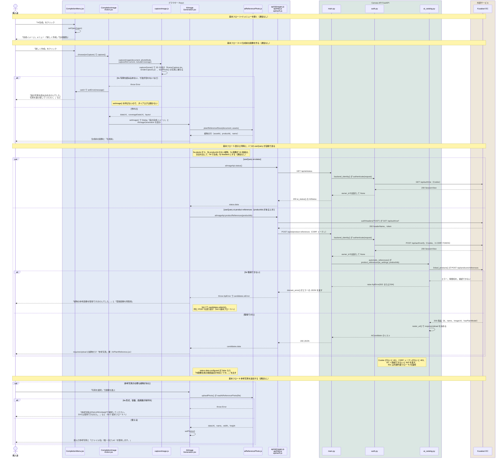
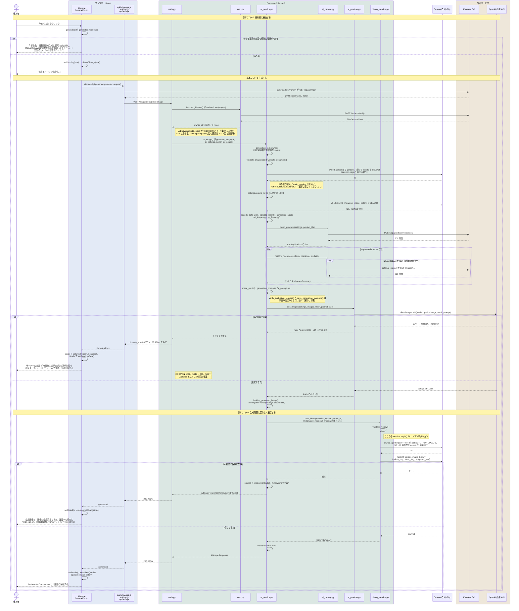
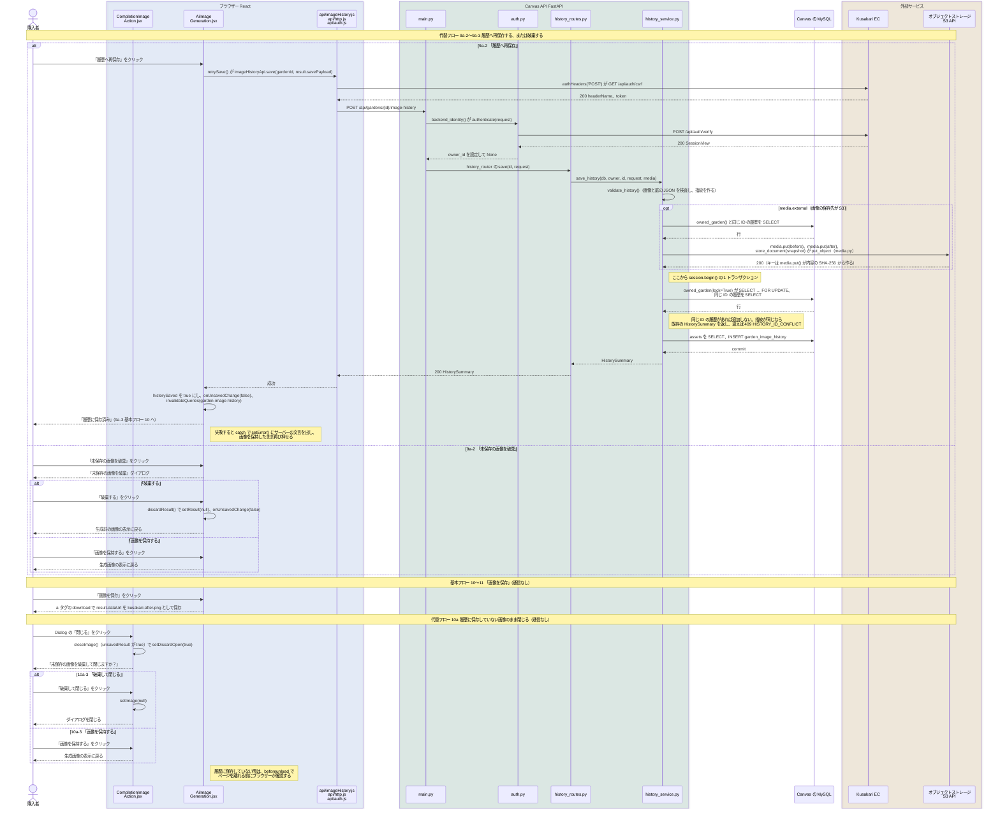

# UC-06 完成イメージ画像を生成・保存する

- ユースケース記述: [UC-06_完成イメージ画像を生成・保存する](<../../アーカイブ/ユースケース/kusakari-canvas/UC-06_完成イメージ画像を生成・保存する.md>)
- 対象のコード: kusakari-canvas の main（c19d497、2026-11-20 時点）

Canvas から見た外部サービスは、Kusakari EC（ログインの確認、商品の登録情報と登録画像）、OpenAI の画像 API、画像の保存先（S3 API のオブジェクトストレージ）の 3 つです。Canvas は Amazon Cognito を直接呼びません。ログインは EC のセッションで確かめ、ID トークンの更新は EC が行います（EC の `SessionValidityFilter`）。EC の中の流れは EC 側の図で扱い、ここでは 1 本のライフラインにします。

画像の保存先は環境変数 `KUSAKARI_CANVAS_MEDIA_STORAGE` で決まります。既定の `database` では画像を MySQL に入れ（生成履歴の画像は `garden_image_history` の `before_png`・`after_png`）、`s3` のときだけオブジェクトストレージに入れます。図では `s3` のときの処理を `opt` で示します。

詳細図は、ダイアログを開くまで（詳細図 1）、生成（詳細図 2）、生成のあとの操作（詳細図 3）に分けました。

## 概要図

```mermaid
sequenceDiagram
    actor User as 購入者
    box rgba(47,111,219,0.10) ブラウザー React
        participant Page as 庭シミュレーション画面
    end
    box rgba(27,127,92,0.12) Canvas API FastAPI
        participant Api as Canvas API
    end
    participant Db as Canvas の MySQL
    box rgba(180,120,20,0.12) 外部サービス
        participant Ec as Kusakari EC<br/>API と商品画像
        participant OpenAi as OpenAI 画像 API
        participant S3 as オブジェクトストレージ<br/>S3 API
    end

    Note over User,S3: 基本フロー 1〜4 生成前の画像を作る（通信なし）
    User->>Page: 「AI生成」をクリック
    Page-->>User: 「完成イメージ」メニュー<br/>（「新しく作成」「生成履歴」）
    User->>Page: 「新しく作成」をクリック
    Page->>Page: 庭写真に 3D の庭オブジェクトを重ねた PNG（生成前）と、<br/>配置物の写る範囲の画像、配置の位置（layout）を作る
    alt 4a 画像を作れない
        Page-->>User: 「庭の写真を読み込めませんでした。<br/>写真を選び直してください。」など（ダイアログを開かない）
    else 作れた
        Page-->>User: 「庭の完成イメージ」ダイアログ（生成前）
    end

    Note over User,S3: 基本フロー 5 ダイアログの表示と同時に、自動で 2 つ取得する
    Note right of Page: 5a 5b 5c は画面で判定し、文言を出して<br/>「AIで生成」を押せなくする（通信なし）
    par 接続設定の確認
        Page->>Api: GET /api/ai/status
        Api->>Ec: GET /api/auth/me（ログインの確認）
        Ec-->>Api: 200 会員
        Api-->>Page: 200 configured、model、quality
    and 商品の登録情報（商品に紐づく植物があるとき）
        Page->>Ec: GET /api/auth/csrf
        Ec-->>Page: 200 CSRF トークン
        Page->>Api: POST /api/ai/product-references
        Api->>Ec: POST /api/auth/verify（ログインの確認）
        Ec-->>Api: 200 会員
        Api->>Ec: POST /api/products/references
        alt 5d 取得できない
            Ec--xApi: エラー、時間切れ、接続できない
            Api-->>Page: 502、504 または 400
            Page-->>User: 「植物の参考画像を取得できませんでした。」と<br/>「登録画像を再取得」（5d-2 で同じ POST を送り直す）
        else 取得できた
            Ec-->>Api: 200 商品（名前、imageUrl）
            Api-->>Page: 200 商品ごとの requiresUpload
            Page-->>User: 登録画像を使えない植物だけ「参考写真」欄
        end
    end
    Note right of Api: ログインを確かめられないと 401 を返す。<br/>共通代替フロー *b を適用

    Note over User,S3: 基本フロー 6 参考写真を追加する（通信なし）
    opt 参考写真が必要な植物がある
        User->>Page: 「写真を選択」で画像を選ぶ
        Page->>Page: 形式、容量、画素数を検査する
        alt 6a 条件外
            Page-->>User: 「参考写真はPNG/JPEG/WebPで選択してください。<br/>SVGは使用できません。」など（6a-2 基本フロー 6 へ）
        else 使える
            Page-->>User: 選んだ参考写真
        end
    end

    Note over User,S3: 基本フロー 7〜8 生成する
    User->>Page: 「AIで生成」をクリック
    Page->>Page: 送る前に検査する
    alt 7a 参考写真が必要な植物に写真がない
        Page-->>User: 「(植物名)：登録画像を生成に使用できません。…」<br/>（送らない。7a-2 基本フロー 6 へ）
    else 送れる
        Page-->>User: 「完成イメージを生成中…」
        Page->>Ec: GET /api/auth/csrf
        Ec-->>Page: 200 CSRF トークン
        Page->>Api: POST /api/gardens/{id}/ai-image<br/>（庭の JSON、生成前の画像、配置物の範囲の画像、layout、参考写真）
        Api->>Ec: POST /api/auth/verify
        Ec-->>Api: 200 会員
        Api->>Db: 庭の持ち主と revision、アセットを読む
        Db-->>Api: 行
        Api->>Db: 同じ生成 ID の履歴がないか読む
        Db-->>Api: 行なし
        Api->>Ec: POST /api/products/references
        Ec-->>Api: 200 商品（imageUrl）
        loop 参考にする植物ごと
            opt 参考写真を追加していない
                Api->>Ec: GET /images/…（登録画像）
                Ec-->>Api: 200 画像
            end
        end
        Api->>OpenAi: images.edit<br/>（生成前の画像、参考画像、マスク、指示文）
        alt 8a 生成に失敗
            OpenAi--xApi: エラー、時間切れ、利用上限
            Api-->>Page: 502、504 または 429（エラーの JSON）
            Page-->>User: サーバーの文言。「AIで生成」を再び押せる<br/>（8a-2 基本フロー 7 へ）
            Note right of Api: revision の不一致（409）、API キーの未設定（503）、<br/>EC の失敗（502、504）も同じ形で返る
        else 生成できた
            OpenAi-->>Api: 生成画像（b64_json）
            Note over User,S3: 基本フロー 9 生成履歴に保存して表示する
            Api->>Db: 庭の行をロックし（SELECT … FOR UPDATE）、生成履歴を追加<br/>（生成前と生成後の PNG、庭の JSON）
            alt 9a 履歴の保存に失敗
                Db--xApi: エラー（ロールバック）
                Api-->>Page: 200 生成画像、historySaved=false
                Page-->>User: 生成画像と「画像は生成済みですが、履歴への<br/>保存に失敗しました。画像は保持しています。」<br/>（9a-2 の「画像を保存」は基本フロー 11 と同じ）
                alt 9a-2 「履歴へ再保存」
                    User->>Page: 「履歴へ再保存」をクリック
                    Page->>Ec: GET /api/auth/csrf
                    Ec-->>Page: 200 CSRF トークン
                    Page->>Api: POST /api/gardens/{id}/image-history<br/>（生成前と生成後の画像、庭の JSON）
                    Api->>Ec: POST /api/auth/verify
                    Ec-->>Api: 200 会員
                    opt 画像の保存先が S3 のとき
                        Api->>S3: 生成前、生成後、庭写真を保存
                        S3-->>Api: 200
                    end
                    Api->>Db: 庭の行をロックし、生成履歴を追加
                    Db-->>Api: commit
                    Api-->>Page: 200 履歴の要約
                    Page-->>User: 「履歴に保存済み」（9a-3 基本フロー 10 へ）
                else 9a-2 「未保存の画像を破棄」
                    User->>Page: 「未保存の画像を破棄」をクリック
                    Page-->>User: 「未保存の画像を破棄」ダイアログ
                    alt 「破棄する」
                        User->>Page: 「破棄する」をクリック
                        Page-->>User: 生成前の画像の表示に戻る（通信なし）
                    else 「画像を保持する」
                        User->>Page: 「画像を保持する」をクリック
                        Page-->>User: 生成画像の表示に戻る（通信なし）
                    end
                end
            else 保存できた
                Db-->>Api: commit
                Api-->>Page: 200 生成画像、historySaved=true
                Page-->>User: 生成前と生成後の比較と「履歴に保存済み」
            end
        end
    end

    Note over User,S3: 基本フロー 10〜11 「画像を保存」（通信なし）
    User->>Page: 「画像を保存」をクリック
    Page-->>User: 生成後の画像を kusakari-after.png として保存
    opt 10a 履歴に保存していない画像のまま閉じる
        User->>Page: ダイアログの「閉じる」をクリック
        Page-->>User: 「未保存の画像を破棄して閉じますか？」
        alt 10a-3 「破棄して閉じる」
            User->>Page: 「破棄して閉じる」をクリック
            Page-->>User: ダイアログを閉じる（通信なし）
        else 10a-3 「画像を保持する」
            User->>Page: 「画像を保持する」をクリック
            Page-->>User: 生成画像の表示に戻る（通信なし）
        end
    end
```

## 詳細図 1 基本フロー 1〜6 ダイアログを開き、参考写真を用意する

## 詳細図 2 基本フロー 7〜9 生成して生成履歴に保存する

## 詳細図 3 代替フロー 9a・10a と基本フロー 10〜11 生成のあとの操作

## ユースケース記述との差

- 基本フロー 5 は「登録画像を参考画像として取得する」と書いています。ダイアログを開いたときに画面が取るのは、商品ごとの登録情報（`imageUrl` と `requiresUpload`）だけです。登録画像そのものは、基本フロー 8 で Canvas API が EC の `/images/…` から取得します（`ai_catalog.py` の `catalog_image()`）。
- 基本フロー 8 は「生成前の画像・施工範囲・植物の参考画像をもとに」生成すると書いています。画面が送るのは、生成前の画像、配置物の写る範囲の画像（`coverageDataUrl`）、配置の位置（`layout`）、参考写真、庭の JSON です。マスクは `coverageDataUrl` から作ります（`editable_mask()`）。施工範囲（`photo.boundary`）は庭の JSON に入っていますが、`validate_document()` の検査に使うだけで、マスクと指示文には使っていません。
- 代替フロー 8a の「AI画像を生成できませんでした。接続状態を確認し、手動で再試行してください。」は、受け取った例外が `Error` でないときだけ出ます。サーバーのエラーではサーバーの文言（「AI画像生成が180秒の通信制限を超えました。…」など）を出し、`fetch` 自体が失敗したときはブラウザーの例外の文言を出します。
- コードにあって記述にない分岐があります。
  - ダイアログを開くと `GET /api/ai/status` も送ります。API キーが未設定なら「AI画像生成の接続設定が未完了です。」、取得に失敗すると「接続設定を確認できませんでした。」と出します。どちらの場合も「AIで生成」は押せ、押すと 503 `AI_NOT_CONFIGURED` などが返ります。
  - 撮影のあとで自動保存（UC-07）が走って revision が変わると、生成は 409 `REVISION_CONFLICT`「庭が別の版で更新されています。撮影し直してください。」になります。同じ利用者の生成が実行中のときは 409 `AI_GENERATION_IN_PROGRESS` です。
- 代替フロー 9a の表示は画面の固定の文言です。サーバーが返す `historyError` の文言は表示していません。
- 生成の中で保存する履歴（`ai_service.py` の `save_history()` の呼び出し）は `media` を渡していません。そのため画像の保存先が S3 の環境でも、生成前と生成後の PNG は MySQL の `before_png`・`after_png` に入ります。「履歴へ再保存」（`history_routes.py`）は `media` を渡すので、S3 の環境では S3 に入ります。

## 確かめられなかったこと

- OpenAI 側の URL のパスは、このリポジトリのコードに書かれていません。コードにあるのは `base_url="https://api.openai.com/v1"` と SDK の `client.images.edit()` の呼び出しだけなので、図には関数名だけを書きました。
- どの環境で `KUSAKARI_CANVAS_MEDIA_STORAGE=s3` を使うかは、このリポジトリにありません（`.env.example` にも書かれていません）。
- EC の `POST /api/auth/verify` と `GET /api/auth/me` の中で、Cognito へ ID トークンの更新を問い合わせるかどうかは、セッションの状態によって変わります。図では EC を 1 本のライフラインにし、Cognito を書いていません。
- 登録画像（`/images/…`）を返すのは、`KUSAKARI_CANVAS_EC_IMAGE_ORIGIN`（既定は `KUSAKARI_CANVAS_EC_URL`）が指す EC の配信先です。EC のどのサーバーが返すかは環境の設定によるため、図では EC にまとめました。

## 参照したコード

- [frontend/src/pages/EditorPage.jsx](https://github.com/abeouga/kusakari-canvas/blob/c19d497dfef15b119f9bce8ecb5c886a36da6b7d/frontend/src/pages/EditorPage.jsx): `CompletionImageAction` の表示、`viewMode`、`setUnauthorizedHandler()`
- [frontend/src/components/CompletionMenu.jsx](https://github.com/abeouga/kusakari-canvas/blob/c19d497dfef15b119f9bce8ecb5c886a36da6b7d/frontend/src/components/CompletionMenu.jsx): 「AI生成」、`setOpen()`、`choose()`
- [frontend/src/components/CompletionImageAction.jsx](https://github.com/abeouga/kusakari-canvas/blob/c19d497dfef15b119f9bce8ecb5c886a36da6b7d/frontend/src/components/CompletionImageAction.jsx): `capture()`、`closeImage()`、破棄の確認ダイアログ
- [frontend/src/capture/captureImage.js](https://github.com/abeouga/kusakari-canvas/blob/c19d497dfef15b119f9bce8ecb5c886a36da6b7d/frontend/src/capture/captureImage.js): `captureImage()`、`loadPhoto()`
- [frontend/src/three/SceneCapture.jsx](https://github.com/abeouga/kusakari-canvas/blob/c19d497dfef15b119f9bce8ecb5c886a36da6b7d/frontend/src/three/SceneCapture.jsx): `captureRef.current` に入る `capture()`
- [frontend/src/components/AiImageGeneration.jsx](https://github.com/abeouga/kusakari-canvas/blob/c19d497dfef15b119f9bce8ecb5c886a36da6b7d/frontend/src/components/AiImageGeneration.jsx): `useQuery`（`ai-status`、`ai-product-references`）、`uploadPhoto()`、`generationRequest()`、`generate()`、`retrySave()`、`discardResult()`
- [frontend/src/components/AiPlantReference.jsx](https://github.com/abeouga/kusakari-canvas/blob/c19d497dfef15b119f9bce8ecb5c886a36da6b7d/frontend/src/components/AiPlantReference.jsx): 「参考写真」欄、「写真を選択」
- [frontend/src/domain/aiReferencePhoto.js](https://github.com/abeouga/kusakari-canvas/blob/c19d497dfef15b119f9bce8ecb5c886a36da6b7d/frontend/src/domain/aiReferencePhoto.js): `plantReferenceRows()`、`readAiReferencePhoto()`、`requiredReferencePhotoMessage()`
- [frontend/src/api/aiImages.js](https://github.com/abeouga/kusakari-canvas/blob/c19d497dfef15b119f9bce8ecb5c886a36da6b7d/frontend/src/api/aiImages.js): `status()`、`productReferences()`、`generate()`
- [frontend/src/api/imageHistory.js](https://github.com/abeouga/kusakari-canvas/blob/c19d497dfef15b119f9bce8ecb5c886a36da6b7d/frontend/src/api/imageHistory.js): `save()`
- [frontend/src/api/http.js](https://github.com/abeouga/kusakari-canvas/blob/c19d497dfef15b119f9bce8ecb5c886a36da6b7d/frontend/src/api/http.js): `requestJson()`、`ApiError`
- [frontend/src/api/auth.js](https://github.com/abeouga/kusakari-canvas/blob/c19d497dfef15b119f9bce8ecb5c886a36da6b7d/frontend/src/api/auth.js): `authHeaders()`、`handleUnauthorized()`
- [backend/kusakari_canvas_api/main.py](https://github.com/abeouga/kusakari-canvas/blob/c19d497dfef15b119f9bce8ecb5c886a36da6b7d/backend/kusakari_canvas_api/main.py): `backend_identity()`、`domain_error()`、`ai_status()`、`automatic_references()`、`ai_image()`
- [backend/kusakari_canvas_api/auth.py](https://github.com/abeouga/kusakari-canvas/blob/c19d497dfef15b119f9bce8ecb5c886a36da6b7d/backend/kusakari_canvas_api/auth.py): `AuthBoundary.authenticate()`
- [backend/kusakari_canvas_api/ai_body.py](https://github.com/abeouga/kusakari-canvas/blob/c19d497dfef15b119f9bce8ecb5c886a36da6b7d/backend/kusakari_canvas_api/ai_body.py): `AiBodyLimitMiddleware`
- [backend/kusakari_canvas_api/ai_catalog.py](https://github.com/abeouga/kusakari-canvas/blob/c19d497dfef15b119f9bce8ecb5c886a36da6b7d/backend/kusakari_canvas_api/ai_catalog.py): `product_references()`、`linked_products()`、`raster_url()`、`resolve_reference()`、`catalog_image()`
- [backend/kusakari_canvas_api/ai_service.py](https://github.com/abeouga/kusakari-canvas/blob/c19d497dfef15b119f9bce8ecb5c886a36da6b7d/backend/kusakari_canvas_api/ai_service.py): `generate_image()`、`generation_lock()`、`validate_snapshot()`
- [backend/kusakari_canvas_api/ai_provider.py](https://github.com/abeouga/kusakari-canvas/blob/c19d497dfef15b119f9bce8ecb5c886a36da6b7d/backend/kusakari_canvas_api/ai_provider.py): `edit_images()`
- [backend/kusakari_canvas_api/ai_images.py](https://github.com/abeouga/kusakari-canvas/blob/c19d497dfef15b119f9bce8ecb5c886a36da6b7d/backend/kusakari_canvas_api/ai_images.py): `decode_data_url()`、`editable_mask()`
- [backend/kusakari_canvas_api/ai_config.py](https://github.com/abeouga/kusakari-canvas/blob/c19d497dfef15b119f9bce8ecb5c886a36da6b7d/backend/kusakari_canvas_api/ai_config.py): `AiSettings.from_profile()`、`require_key()`、`MAX_BODY_BYTES`
- [backend/kusakari_canvas_api/history_routes.py](https://github.com/abeouga/kusakari-canvas/blob/c19d497dfef15b119f9bce8ecb5c886a36da6b7d/backend/kusakari_canvas_api/history_routes.py): `history_router()` の `save()`
- [backend/kusakari_canvas_api/history_service.py](https://github.com/abeouga/kusakari-canvas/blob/c19d497dfef15b119f9bce8ecb5c886a36da6b7d/backend/kusakari_canvas_api/history_service.py): `save_history()`、`validate_history()`
- [backend/kusakari_canvas_api/media.py](https://github.com/abeouga/kusakari-canvas/blob/c19d497dfef15b119f9bce8ecb5c886a36da6b7d/backend/kusakari_canvas_api/media.py): `MediaStore.put()`、`store_document()`
- [backend/kusakari_canvas_api/service.py](https://github.com/abeouga/kusakari-canvas/blob/c19d497dfef15b119f9bce8ecb5c886a36da6b7d/backend/kusakari_canvas_api/service.py): `owned_garden()`
- [backend/src/main/java/jp/kusakari/ec/auth/AuthController.java](https://github.com/abeouga/kusakari-ec/blob/19a2be307ee71a2cd87e538236c3c8c42929c5b3/backend/src/main/java/jp/kusakari/ec/auth/AuthController.java)（EC）: `GET /api/auth/me`、`POST /api/auth/verify`、`GET /api/auth/csrf`
- [backend/src/main/java/jp/kusakari/ec/auth/SessionValidityFilter.java](https://github.com/abeouga/kusakari-ec/blob/19a2be307ee71a2cd87e538236c3c8c42929c5b3/backend/src/main/java/jp/kusakari/ec/auth/SessionValidityFilter.java)（EC）: ID トークンの更新
- [backend/src/main/java/jp/kusakari/ec/catalog/controller/CatalogController.java](https://github.com/abeouga/kusakari-ec/blob/19a2be307ee71a2cd87e538236c3c8c42929c5b3/backend/src/main/java/jp/kusakari/ec/catalog/controller/CatalogController.java)（EC）: `POST /api/products/references`
