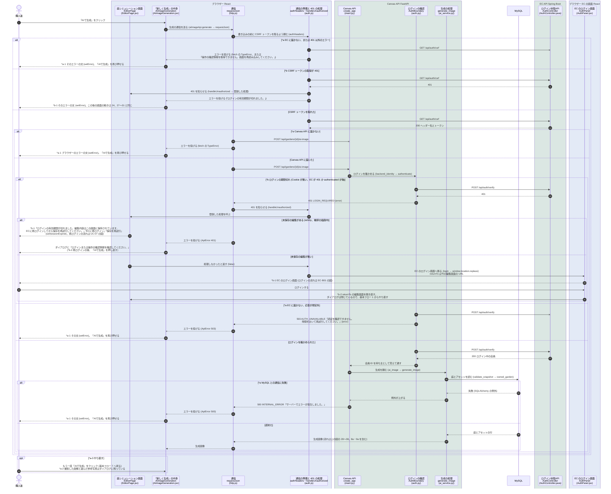

# UC-06 完成イメージ画像を生成・保存する

- ユースケース記述: [UC-06_完成イメージ画像を生成・保存する](<../../アーカイブ/ユースケース/kusakari-canvas/UC-06_完成イメージ画像を生成・保存する.md>)
- 共通代替フロー: [00_全ユースケース共通の代替フロー](<00_全ユースケース共通の代替フロー.md>)
- 対象のコード: kusakari-canvas の main（7e9a8dd、2026-11-24 時点）、kusakari-ec の main（6bad7e3、2026-11-24 時点）

## シーケンス図

参加者は、上から「画面や役割の名前」「コンポーネント・クラス・関数の名前」「ファイル名（かっこ付き）」の順に書いています。
共通代替フローの中身は、00 の図か、下の「共通代替フローを直接書いた図」を見てください。
エラーは最重要の 8a（生成に失敗）だけを描き、ほかの代替フローは図の下に並べています。CSRF トークンの取得と、Canvas API が EC でログインを確かめる往復は、矢印の文にまとめています。

```mermaid
sequenceDiagram
    autonumber
    actor User as 購入者
    box rgba(47,111,219,0.10) ブラウザー React
        participant Menu as 完成イメージのメニュー<br/>CompletionMenu<br/>(CompletionMenu.jsx)
        participant Action as 完成イメージの操作<br/>CompletionImageAction<br/>(CompletionImageAction.jsx)
        participant Capture as 画像の作成<br/>captureImage<br/>(captureImage.js)
        participant Gen as 「新しく生成」の中身<br/>AiImageGeneration<br/>(AiImageGeneration.jsx)
        participant Ref as 参考写真の確認<br/>readAiReferencePhoto<br/>(aiReferencePhoto.js)
        participant Http as 通信<br/>requestJson<br/>(http.js)
    end
    box rgba(27,127,92,0.12) Canvas API FastAPI
        participant Main as Canvas API<br/>create_app<br/>(main.py)
        participant Catalog as 商品の登録情報と画像<br/>linked_products ほか<br/>(ai_catalog.py)
        participant AiSvc as 生成の処理<br/>generate_image<br/>(ai_service.py)
        participant Provider as 画像 API の呼び出し<br/>edit_images<br/>(ai_provider.py)
        participant History as 生成履歴の保存<br/>save_history<br/>(history_service.py)
    end
    participant Db as MySQL
    box rgba(27,127,92,0.12) EC API Spring Boot
        participant EcCat as 商品API<br/>CatalogController<br/>(CatalogController.java)
        participant EcImg as 商品の登録画像<br/>imageUrl の配信先<br/>(/images/…)
    end
    box rgba(180,120,20,0.12) 外部サービス
        participant OpenAi as OpenAI の画像 API<br/>images.edit<br/>(OpenAI SDK)
    end

    Note over User,OpenAi: 共通代替フロー<br/>*b 未ログインの場合: 10、13、25 (13・25 は CSRF トークンの取得と EC でのログインの確認を含む) に適用<br/>*a 通信に失敗した場合: 10、13、25 と、MySQL を読み書きする 27、35 に適用

    User->>Menu: 庭シミュレーション画面の右下の「完成イメージ」をクリック
    Menu-->>User: 「完成イメージ」メニューを開く (setOpen)<br/>「新しく作成」「生成履歴」
    User->>Menu: 「新しく作成」をクリック
    Menu->>Action: メニューを閉じ、画像を作るよう頼む<br/>(choose → onCapture → capture)
    Action->>Capture: 庭の写真に 3D の配置物を重ねた画像を作るよう頼む (captureImage、includeCoverage)<br/>写真を読み、3D を描いて重ね、配置物の写る範囲の画像と配置の位置も作る (loadPhoto、captureScene)
    Capture-->>Action: 生成前の画像、配置物の範囲の画像、配置の位置<br/>(dataUrl、coverageDataUrl、layout)
    Action->>Gen: 「新しく生成」ダイアログを開き、中身を表示する<br/>(setImage → Dialog → AiImageGeneration)。配置から植物の行を作る (plantReferenceRows)
    Gen-->>User: 生成前の画像と「Before」のラベル

    Gen->>Http: 表示と同時に、AI 生成の接続設定を取りに行く<br/>(useQuery ai-status → aiImageApi.status → requestJson)
    Http->>Main: GET /api/ai/status
    Main-->>Http: 200 設定の有無、モデル、品質 (EC の GET /api/auth/me でログインを確かめてから。ai_status)<br/>未設定 (記述なし) なら画面に「AI画像生成の接続設定が未完了です。」
    Gen->>Http: 5 表示と同時に、植物の商品の登録情報を取りに行く<br/>(useQuery ai-product-references → aiImageApi.productReferences → requestJson)
    Http->>Main: POST /api/ai/product-references (商品 ID の一覧)<br/>先に EC の GET /api/auth/csrf で CSRF トークンを取り (authHeaders)、<br/>Canvas API は EC の POST /api/auth/verify でログインを確かめる (backend_identity → authenticate)
    Main->>Catalog: 商品ごとに登録画像を生成に使えるかを調べるよう頼む<br/>(automatic_references → product_references)
    Catalog->>EcCat: POST /api/products/references (linked_products)
    EcCat-->>Catalog: 200 商品 (id、name、imageUrl、hasPlantModel)
    Main-->>Http: 200 AiCandidate の配列<br/>(imageUrl が PNG・JPEG・WebP でなければ requiresUpload が真。raster_url)
    Gen-->>User: 登録画像を使えない植物だけ「(植物名)の参考写真」欄と「写真を選択」

    User->>Gen: 6「写真を選択」で画像のファイルを選ぶ (参考写真が必要な植物がなければ省く)
    Gen->>Ref: 形式・容量・画素数を確かめるよう頼む (uploadPhoto → readAiReferencePhoto)
    Gen-->>User: 選んだ写真と「(ファイル名)（幅 × 高さ px）を使用します。」(setPhotos)

    User->>Gen: 7「AIで生成」をクリック
    Gen->>Gen: 送る内容を作り、足りないものが無いかを確かめる<br/>(generate → generationRequest)
    Gen->>Http: 8「完成イメージを生成中…」を出し (setPending。生成中はダイアログを閉じられない)、<br/>完成イメージの生成を頼む (aiImageApi.generate → requestJson)
    Http->>Main: POST /api/gardens/{id}/ai-image<br/>(生成 ID、撮影時の庭の JSON、生成前の画像、範囲の画像、layout、参考写真)<br/>CSRF トークンの取得とログインの確認は 13 と同じ
    Main->>AiSvc: 生成を頼む (ai_image → generate_image)。同じ利用者の生成が実行中でないかを確かめ<br/>(generation_lock)、撮影時の庭の JSON を検査し (validate_snapshot → validate_document)、<br/>API キーがあるかを確かめる (require_key)
    AiSvc->>Db: 庭を持ち主と ID で読み、配置のアセットと、同じ生成 ID の履歴が無いかを読む<br/>(owned_garden、SELECT gardens・assets・garden_image_history)
    AiSvc->>Catalog: 画像を読み、書き換えてよい範囲と大きさを決め (decode_data_url、editable_mask、generation_size)、<br/>植物の商品の登録情報を読み (linked_products、EC の POST /api/products/references)、<br/>植物ごとに参考画像を用意するよう頼む (resolve_reference)
    opt 参考写真を追加していない植物がある (登録画像を使う)
        Catalog->>EcImg: 登録画像を取る (catalog_image が GET imageUrl)
        Note over Catalog,EcImg: 結果: 植物ごとに PNG・JPEG・WebP の画像を取り、参考画像の PNG にする。
    end
    Catalog-->>AiSvc: 参考画像の PNG と、どの画像を使ったか (ReferenceSummary)
    AiSvc->>Provider: マスクと指示文を作り (scene_mask、generation_prompt)、画像の生成を頼む (edit_images)
    Provider->>OpenAi: 生成前の画像、参考画像、マスク、指示文を送る<br/>(client.images.edit、180 秒で時間切れ)
    break 8a 生成に失敗 (エラー、時間切れ、利用上限)
        Note over Gen,OpenAi: 結果: 502、504 か 429 を返す (ApiError、domain_error)。<br/>画面: 8a-1 サーバーの文 (「AI画像生成が180秒の通信制限を超えました。…」など)。「AIで生成」を再び押せる (8a-2 基本フロー 7 へ戻る)
    end
    OpenAi-->>Provider: 生成画像 (b64_json)
    AiSvc->>History: 生成画像を元の大きさに戻し (finalize_generated_image)、<br/>9 生成履歴に保存するよう頼む (save_history。media は渡さない)
    History->>Db: 画像と庭の JSON を検査し (validate_history)、庭の行をロックして読み (owned_garden(lock=True))、<br/>生成履歴を追加してコミットする (INSERT garden_image_history の before_png・after_png・snapshot_json)
    Main-->>Http: 200 生成画像 (保存できれば historySaved が真)
    Http-->>Gen: 生成画像
    Gen-->>User: 生成前と生成後の比較 (BeforeAfterComparison)、「履歴に保存済み」、「画像を保存」

    User->>Gen: 10「画像を保存」をクリック
    Gen-->>User: 11 生成後の画像を kusakari-after.png として端末に保存する<br/>(a 要素の download。通信しない)
    opt 10a 履歴に保存していない画像のまま閉じる
        User->>Action: 10a-1 ダイアログの「閉じる」(×) をクリック
        Note over User,Action: 結果: 10a-2「未保存の画像を破棄して閉じますか？」ダイアログを出す (closeImage → setDiscardOpen)。<br/>画面: 10a-3「破棄して閉じる」でダイアログを閉じ (setImage(null))、「画像を保持する」で生成画像の表示に戻る
    end
```

図に描いていない代替フロー：4a（画像を作れない）、5a（植物が無い）、5b（商品に紐づいていない植物）、5c（入力画像が 16 枚を超える）、5d（参考画像を取得できない）、6a（使えない写真）、7a（参考写真が無い）、9a（履歴の保存に失敗）

## 共通代替フローを直接書いた図

上の図の「AIで生成」の通信（CSRF トークンの取得と `POST /api/gardens/{id}/ai-image`）に、この画面で起こる共通代替フロー（\*a、\*b）を書き込んだ図です。ほかの通信は、次のように同じ形で失敗します。

- 接続設定の取得（`GET /api/ai/status`）: \*a では「接続設定を確認できませんでした。」を出し、「AIで生成」は押せたままです。
- 植物の商品の登録情報（`POST /api/ai/product-references`）: \*a では、記述の 5d と同じ表示（「植物の参考画像を取得できませんでした。」と「登録画像を再取得」）になります。この API は MySQL を読みません。
- 「履歴へ再保存」（`POST /api/gardens/{id}/image-history`）: \*a では、ダイアログにエラーの文を出し、画像を保持したまま「履歴へ再保存」を押し直せます。
- どの通信も、\*b の 401 は下の図と同じく編集画面の処理（`setUnauthorizedHandler()` で登録したもの）に渡ります。

## ユースケース記述との差

- 基本フロー 1: ボタンの名前は「AI生成」ではなく「完成イメージ」です。写真の表示でも 3D の表示でも同じ名前で、アイコンだけが変わります。「ツールを最小化」にしている間は、文字の無いアイコンだけのボタンになります（`CompletionMenu.jsx` の `toolsMinimized`）。関連情報の「表示モードが「写真」でない場合、ボタンは「完成イメージ」になる」も、今はどちらも「完成イメージ」です。
- 基本フロー 4 と 10a-1: 写真の表示で開くダイアログの名前は「庭の完成イメージ」ではなく「新しく生成」です（3D の表示で開く 3D プレビューだけが「庭の完成イメージ」です）。生成前の画像のラベルは「生成前」ではなく「Before」です。
- 4a: エラーの文は、ダイアログではなく「完成イメージ」ボタンの上（メニューを開いているときはメニューの中）に出ます。輪郭を描いている間は「完成イメージ」ボタンそのものを出しません。
- 5b: 文は記述の「商品に紐づいていない旧モデル（植物名）があります。…」ではなく、「「(植物名)」は Canvasに対応していません」です（`unsupportedMessage()`）。
- 5a・5b・5c は同時に当てはまることがあり、当てはまるものをすべて出します。どれかに当たると「AIで生成」を押せません。植物が無いときは商品の登録情報も取りに行きません。
- 基本フロー 5: ダイアログを開いたときに画面が取るのは、商品ごとの登録情報（`imageUrl` と `requiresUpload`）だけです。登録画像そのものは、基本フロー 8 で Canvas API が EC の配信先から取ります（`ai_catalog.py` の `catalog_image()`）。
- 基本フロー 8: 画面が送るのは、生成前の画像、配置物の写る範囲の画像（`coverageDataUrl`）、配置の位置（`layout`）、参考写真、撮影時の庭の JSON です。マスクは `coverageDataUrl` から作ります。施工範囲（`photo.boundary`）は庭の JSON に入っていますが、`validate_document()` の検査に使うだけで、マスクと指示文には使っていません。
- 8a: 記述の「AI画像を生成できませんでした。接続状態を確認し、手動で再試行してください。」は、受け取った例外が `Error` でないときだけ出ます。ふつうはサーバーの文（`ApiError` の `message`）か、ブラウザーの例外の文が出ます。
- 8a に入るのは OpenAI の失敗だけではありません。同じ流れで次のエラーも返り、画面は同じようにその文を出して「AIで生成」を押せる状態に戻します。どれも記述にありません。
  - 撮影のあとで自動保存（UC-07）が走って revision が変わった: 409 `REVISION_CONFLICT`「庭が別の版で更新されています。撮影し直してください。」。ダイアログを閉じて撮影し直す必要があります。
  - 同じ利用者の生成が実行中: 409 `AI_GENERATION_IN_PROGRESS`。
  - API キーが未設定: 503 `AI_NOT_CONFIGURED`。接続設定の取得で「AI画像生成の接続設定が未完了です。」が出ていても「AIで生成」は押せ、押すとこれが返ります。
  - EC の商品の登録情報や登録画像を取れない: 502・504（`AI_CATALOG_*`、`AI_REFERENCE_*`）。
  - 本文が 48,000,000 バイトを超える: 画面が送る前に止めます。サーバーも `AiBodyLimitMiddleware` で 413 を返します。
- 9a: 表示は画面の固定の文です。サーバーが返す `historyError` の文は出しません。
- 生成の中で保存する履歴（`ai_service.py` の `save_history()` の呼び出し）は `media` を渡しません。そのため画像の保存先が S3 の環境でも、生成前と生成後の PNG は MySQL の `before_png`・`after_png` に入ります。「履歴へ再保存」（`history_routes.py`）は `media` を渡すので、S3 の環境では S3 に入ります。
- 関連情報の「「詳細」の「Before画像をPNGで保存」」は、今のダイアログにありません。生成前の画像は、「生成履歴」の比較の画面で保存します（`GenerationHistory.jsx`）。

## 確かめられなかったこと

- 「履歴へ再保存」が 401 になり、編集画面に未保存の編集が無いときは、`login()` が EC のログイン画面へ移ろうとします。このとき、保存していない生成画像があるので `beforeunload` の確認が出るはずですが、動かして確かめていません。
- 登録画像（`imageUrl`）を返すのは、`KUSAKARI_CANVAS_EC_IMAGE_ORIGIN`（既定は `KUSAKARI_CANVAS_EC_URL`）が指す配信先です。EC のどのサーバーが返すかは環境によるので、図では「商品の登録画像」の 1 本にしました。
- OpenAI 側の URL のパスはコードに無く、SDK の `client.images.edit()` の呼び出しだけがあります。
- EC の `POST /api/auth/verify` と `GET /api/auth/me` の中で Cognito へ ID トークンの更新を問い合わせるかどうかは、セッションの状態で変わります。EC の中の流れは EC の図に任せ、ここでは書いていません。

## 参照したコード

kusakari-canvas

- [frontend/src/pages/EditorPage.jsx](https://github.com/abeouga/kusakari-canvas/blob/7e9a8dd0a40f2b212ca20b3aa94f2dc984b00b7a/frontend/src/pages/EditorPage.jsx): `CompletionImageAction` の表示、`setUnauthorizedHandler()` の登録、`sessionExpired` の帯
- [frontend/src/components/CompletionMenu.jsx](https://github.com/abeouga/kusakari-canvas/blob/7e9a8dd0a40f2b212ca20b3aa94f2dc984b00b7a/frontend/src/components/CompletionMenu.jsx): 「完成イメージ」、`setOpen()`、`choose()`、`toolsMinimized`
- [frontend/src/components/CompletionImageAction.jsx](https://github.com/abeouga/kusakari-canvas/blob/7e9a8dd0a40f2b212ca20b3aa94f2dc984b00b7a/frontend/src/components/CompletionImageAction.jsx): `capture()`、ダイアログの名前（「新しく生成」）、`closeImage()`、破棄の確認ダイアログ
- [frontend/src/components/Dialog.jsx](https://github.com/abeouga/kusakari-canvas/blob/7e9a8dd0a40f2b212ca20b3aa94f2dc984b00b7a/frontend/src/components/Dialog.jsx): 「閉じる」のボタン、`busy` の間は閉じない
- [frontend/src/capture/captureImage.js](https://github.com/abeouga/kusakari-canvas/blob/7e9a8dd0a40f2b212ca20b3aa94f2dc984b00b7a/frontend/src/capture/captureImage.js): `captureImage()`、`loadPhoto()`、エラーの文
- [frontend/src/components/AiImageGeneration.jsx](https://github.com/abeouga/kusakari-canvas/blob/7e9a8dd0a40f2b212ca20b3aa94f2dc984b00b7a/frontend/src/components/AiImageGeneration.jsx): `useQuery`（`ai-status`、`ai-product-references`）、`unsupportedMessage()`、`uploadPhoto()`、`generationRequest()`、`generate()`、`retrySave()`、`discardResult()`
- [frontend/src/components/AiPlantReference.jsx](https://github.com/abeouga/kusakari-canvas/blob/7e9a8dd0a40f2b212ca20b3aa94f2dc984b00b7a/frontend/src/components/AiPlantReference.jsx): 「(植物名)の参考写真」、「写真を選択」、「…を使用します。」
- [frontend/src/components/GenerationHistory.jsx](https://github.com/abeouga/kusakari-canvas/blob/7e9a8dd0a40f2b212ca20b3aa94f2dc984b00b7a/frontend/src/components/GenerationHistory.jsx): 生成履歴の比較の画面
- [frontend/src/domain/aiReferencePhoto.js](https://github.com/abeouga/kusakari-canvas/blob/7e9a8dd0a40f2b212ca20b3aa94f2dc984b00b7a/frontend/src/domain/aiReferencePhoto.js): `plantReferenceRows()`、`readAiReferencePhoto()`、`requiredReferencePhotoMessage()`
- [frontend/src/api/aiImages.js](https://github.com/abeouga/kusakari-canvas/blob/7e9a8dd0a40f2b212ca20b3aa94f2dc984b00b7a/frontend/src/api/aiImages.js): `status`、`productReferences`、`generate`
- [frontend/src/api/imageHistory.js](https://github.com/abeouga/kusakari-canvas/blob/7e9a8dd0a40f2b212ca20b3aa94f2dc984b00b7a/frontend/src/api/imageHistory.js): `save`
- [frontend/src/api/http.js](https://github.com/abeouga/kusakari-canvas/blob/7e9a8dd0a40f2b212ca20b3aa94f2dc984b00b7a/frontend/src/api/http.js): `requestJson()`、`ApiError`
- [frontend/src/api/auth.js](https://github.com/abeouga/kusakari-canvas/blob/7e9a8dd0a40f2b212ca20b3aa94f2dc984b00b7a/frontend/src/api/auth.js): `authHeaders()`、`handleUnauthorized()`、`login()`、`setUnauthorizedHandler()`
- [backend/kusakari_canvas_api/main.py](https://github.com/abeouga/kusakari-canvas/blob/7e9a8dd0a40f2b212ca20b3aa94f2dc984b00b7a/backend/kusakari_canvas_api/main.py): `backend_identity()`、`domain_error()`、`ai_status()`、`automatic_references()`、`ai_image()`
- [backend/kusakari_canvas_api/auth.py](https://github.com/abeouga/kusakari-canvas/blob/7e9a8dd0a40f2b212ca20b3aa94f2dc984b00b7a/backend/kusakari_canvas_api/auth.py): `AuthBoundary.authenticate()`、`error()`
- [backend/kusakari_canvas_api/ai_body.py](https://github.com/abeouga/kusakari-canvas/blob/7e9a8dd0a40f2b212ca20b3aa94f2dc984b00b7a/backend/kusakari_canvas_api/ai_body.py): `AiBodyLimitMiddleware`
- [backend/kusakari_canvas_api/ai_config.py](https://github.com/abeouga/kusakari-canvas/blob/7e9a8dd0a40f2b212ca20b3aa94f2dc984b00b7a/backend/kusakari_canvas_api/ai_config.py): `require_key()`、`catalog_image_origin`
- [backend/kusakari_canvas_api/ai_catalog.py](https://github.com/abeouga/kusakari-canvas/blob/7e9a8dd0a40f2b212ca20b3aa94f2dc984b00b7a/backend/kusakari_canvas_api/ai_catalog.py): `product_references()`、`linked_products()`、`raster_url()`、`resolve_reference()`、`catalog_image()`
- [backend/kusakari_canvas_api/ai_service.py](https://github.com/abeouga/kusakari-canvas/blob/7e9a8dd0a40f2b212ca20b3aa94f2dc984b00b7a/backend/kusakari_canvas_api/ai_service.py): `generation_lock()`、`validate_snapshot()`、`generate_image()`
- [backend/kusakari_canvas_api/ai_provider.py](https://github.com/abeouga/kusakari-canvas/blob/7e9a8dd0a40f2b212ca20b3aa94f2dc984b00b7a/backend/kusakari_canvas_api/ai_provider.py): `edit_images()`
- [backend/kusakari_canvas_api/history_routes.py](https://github.com/abeouga/kusakari-canvas/blob/7e9a8dd0a40f2b212ca20b3aa94f2dc984b00b7a/backend/kusakari_canvas_api/history_routes.py): `history_router()` の `save()`
- [backend/kusakari_canvas_api/history_service.py](https://github.com/abeouga/kusakari-canvas/blob/7e9a8dd0a40f2b212ca20b3aa94f2dc984b00b7a/backend/kusakari_canvas_api/history_service.py): `validate_history()`、`save_history()`
- [backend/kusakari_canvas_api/media.py](https://github.com/abeouga/kusakari-canvas/blob/7e9a8dd0a40f2b212ca20b3aa94f2dc984b00b7a/backend/kusakari_canvas_api/media.py): `MediaStore.put()`、`store_document()`
- [backend/kusakari_canvas_api/service.py](https://github.com/abeouga/kusakari-canvas/blob/7e9a8dd0a40f2b212ca20b3aa94f2dc984b00b7a/backend/kusakari_canvas_api/service.py): `owned_garden()`

kusakari-ec

- [backend/src/main/java/jp/kusakari/ec/auth/AuthController.java](https://github.com/abeouga/kusakari-ec/blob/6bad7e37c4135034fbe97e30309772fbe872e675/backend/src/main/java/jp/kusakari/ec/auth/AuthController.java): `me`、`verify`、`csrf`
- [backend/src/main/java/jp/kusakari/ec/catalog/controller/CatalogController.java](https://github.com/abeouga/kusakari-ec/blob/6bad7e37c4135034fbe97e30309772fbe872e675/backend/src/main/java/jp/kusakari/ec/catalog/controller/CatalogController.java): `references`（`POST /api/products/references`）
- [frontend/src/components/AuthPanel.jsx](https://github.com/abeouga/kusakari-ec/blob/6bad7e37c4135034fbe97e30309772fbe872e675/frontend/src/components/AuthPanel.jsx): ログイン画面と `returnTo` への戻り
