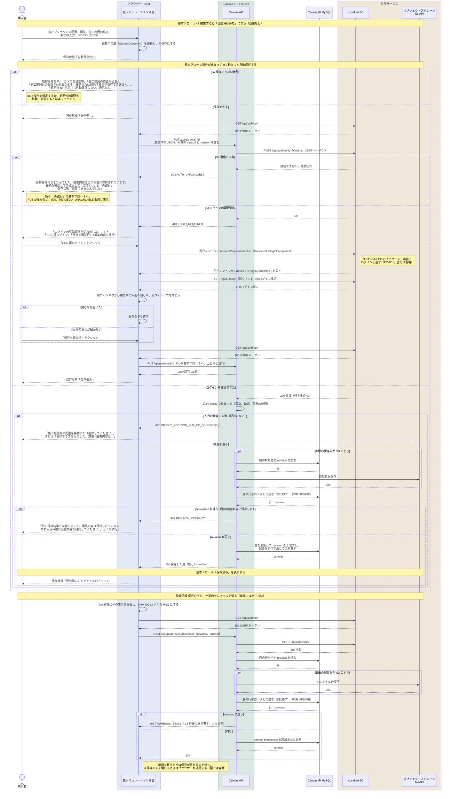
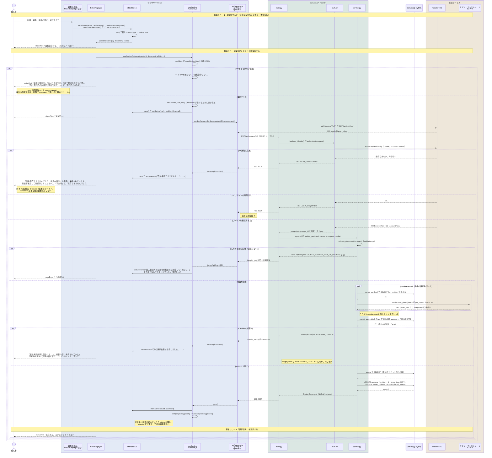
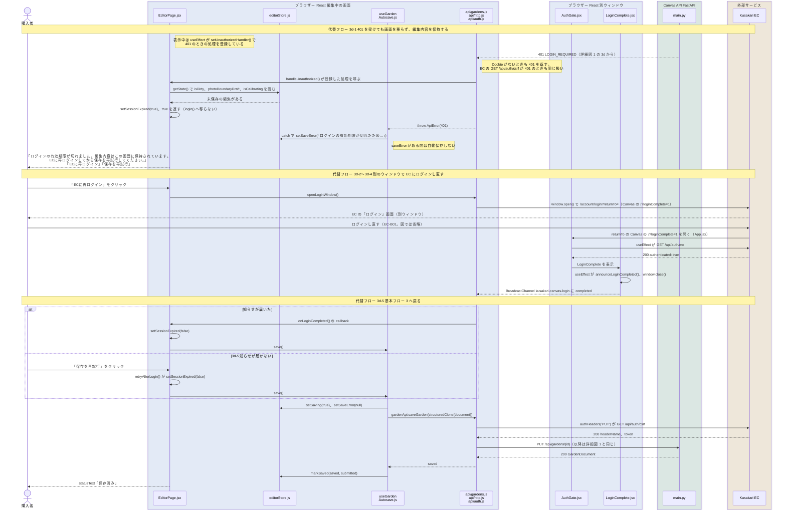
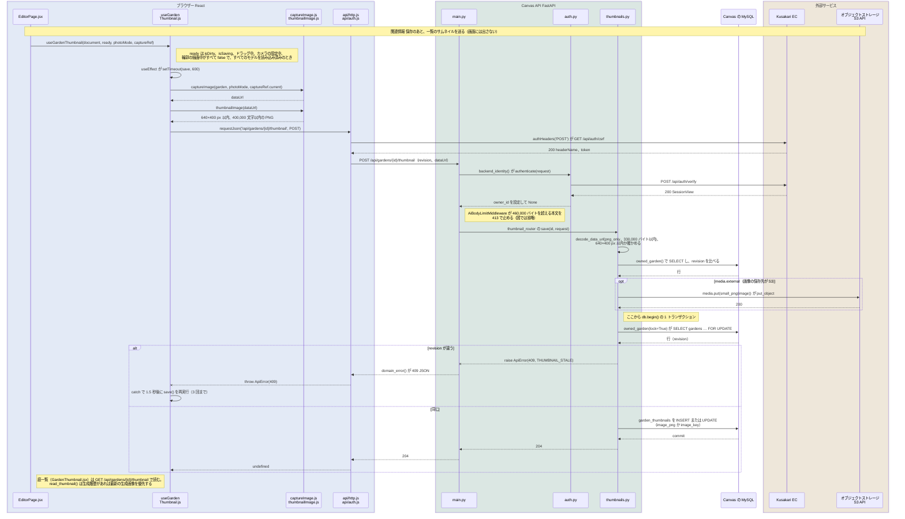

# UC-07 庭プロジェクトを保存する

- ユースケース記述: [UC-07_庭プロジェクトを保存する](<../../アーカイブ/ユースケース/kusakari-canvas/UC-07_庭プロジェクトを保存する.md>)
- 対象のコード: kusakari-canvas の main（c19d497、2026-11-20 時点）

庭の保存は、庭全体のスナップショット（GardenDocument）を `PUT /api/gardens/{id}` で送り、サーバーが MySQL のトランザクションの中で revision を比べて上書きする形です。編集のたびには送らず、編集が止まって 0.5 秒たったときに自動で送ります。

Canvas から見た外部サービスは、Kusakari EC（ログインの確認、再ログインの画面）と、画像の保存先（S3 API のオブジェクトストレージ）です。Canvas は Amazon Cognito を直接呼びません。ログインは EC のセッションで確かめます。画像の保存先は環境変数 `KUSAKARI_CANVAS_MEDIA_STORAGE` で決まり、既定の `database` では庭写真を `gardens.photo_json` の dataUrl として MySQL に入れます。`s3` のときだけオブジェクトストレージに入れるので、図では `opt` で示します。

詳細図は、自動保存の本体（詳細図 1）、ログインの期限切れと再ログイン（詳細図 2）、保存のあとのサムネイルの更新（詳細図 3）に分けました。

## 概要図

## 詳細図 1 基本フロー 1〜4 と代替フロー 3a〜3c 自動保存

## 詳細図 2 代替フロー 3d ログインの期限切れと再ログイン

## 詳細図 3 関連情報 保存のあとにサムネイルを更新する

## ユースケース記述との差

- 代替フロー 3a-1 の「写真上の庭の輪郭と実寸範囲が確定すると自動保存されます。」は、コードでは「写真上の庭の輪郭と実寸範囲が確定すると自動保存され、3D庭を表示できます。」です。
- 代替フロー 3c は、変更内容の確認を促してユースケースを終えると書いています。コードは 3b と同じ帯に競合の文言と「再試行」ボタンを出します。「再試行」は同じ revision の PUT を送り直すので、再び 409 になります。最新の庭を読み直す操作や、変更内容を比べる画面はありません。
- コードにあって記述にない分岐があります。サーバーの入力検査（`validate_document()` など）で 400 になると、`OBJECT_POSITION_OUT_OF_BOUNDS` のときは「施工範囲外の配置を移動または削除してください。」、ほかの 400 と 403 では「保存できませんでした。(サーバーの理由) 編集内容はこの画面に保持されています。」を出します。
- 代替フロー 3d の 401 は、Canvas API が返す場合（Cookie がない、EC の `POST /api/auth/verify` が 401）のほかに、PUT を送る前の EC の `GET /api/auth/csrf` が 401 を返す場合もあります。どちらも同じ表示になります。
- 関連情報の「サムネイルも更新する」は、PUT とは別の `POST /api/gardens/{id}/thumbnail` で行います。失敗しても画面に何も出さず、1.5 秒後に送り直します（3 回まで）。また、庭一覧のサムネイル（`GET /api/gardens/{id}/thumbnail`）は、生成履歴がある庭では最新の生成画像（After）を優先して返します。そのため、生成履歴がある庭では保存しても一覧のサムネイルは変わりません。

## 確かめられなかったこと

- どの環境で `KUSAKARI_CANVAS_MEDIA_STORAGE=s3` を使うかは、このリポジトリにありません（`.env.example` にも書かれていません）。
- 3d-3〜3d-4 で、EC の「ログイン」画面がログインのあと `returnTo` の Canvas の画面を開くところは、EC 側の処理です（EC の `AuthUrls.safeReturn()` と画面の `AuthPanel.jsx`）。図では EC-B01 として省略しました。
- EC の `POST /api/auth/verify` と `GET /api/auth/me` の中で、Cognito へ ID トークンの更新を問い合わせるかどうかは、セッションの状態によって変わります。図では EC を 1 本のライフラインにし、Cognito を書いていません。

## 参照したコード

- [frontend/src/pages/EditorPage.jsx](https://github.com/abeouga/kusakari-canvas/blob/c19d497dfef15b119f9bce8ecb5c886a36da6b7d/frontend/src/pages/EditorPage.jsx): `statusText`、`setUnauthorizedHandler()`、`onLoginCompleted()`、`retryAfterLogin()`、`requestNavigation()`、範囲外の帯と期限切れの帯
- [frontend/src/stores/editorStore.js](https://github.com/abeouga/kusakari-canvas/blob/c19d497dfef15b119f9bce8ecb5c886a36da6b7d/frontend/src/stores/editorStore.js): `transformObject()`、`addAssetAt()`、`confirmPhotoBoundary()`、`setPhotoEdgeLength()`、`setSaving()`、`setSaveError()`、`markSaved()`
- [frontend/src/three/PlacedObject.jsx](https://github.com/abeouga/kusakari-canvas/blob/c19d497dfef15b119f9bce8ecb5c886a36da6b7d/frontend/src/three/PlacedObject.jsx): `transformObject()` の呼び出し
- [frontend/src/components/PhotoOverlay.jsx](https://github.com/abeouga/kusakari-canvas/blob/c19d497dfef15b119f9bce8ecb5c886a36da6b7d/frontend/src/components/PhotoOverlay.jsx): `confirmPhotoBoundary()`、`moveBoundaryVertex()` の呼び出し
- [frontend/src/components/EdgeMeasurementPopover.jsx](https://github.com/abeouga/kusakari-canvas/blob/c19d497dfef15b119f9bce8ecb5c886a36da6b7d/frontend/src/components/EdgeMeasurementPopover.jsx): `setPhotoEdgeLength()` の呼び出し
- [frontend/src/hooks/useGardenAutosave.js](https://github.com/abeouga/kusakari-canvas/blob/c19d497dfef15b119f9bce8ecb5c886a36da6b7d/frontend/src/hooks/useGardenAutosave.js): `saveBlocker()`、`save()`、`useEffect` の `setTimeout(…, 500)`、`flush()`、エラーの文言
- [frontend/src/hooks/useGardenThumbnail.js](https://github.com/abeouga/kusakari-canvas/blob/c19d497dfef15b119f9bce8ecb5c886a36da6b7d/frontend/src/hooks/useGardenThumbnail.js): `useGardenThumbnail()`
- [frontend/src/capture/captureImage.js](https://github.com/abeouga/kusakari-canvas/blob/c19d497dfef15b119f9bce8ecb5c886a36da6b7d/frontend/src/capture/captureImage.js): `captureImage()`
- [frontend/src/capture/thumbnailImage.js](https://github.com/abeouga/kusakari-canvas/blob/c19d497dfef15b119f9bce8ecb5c886a36da6b7d/frontend/src/capture/thumbnailImage.js): `thumbnailImage()`
- [frontend/src/api/gardens.js](https://github.com/abeouga/kusakari-canvas/blob/c19d497dfef15b119f9bce8ecb5c886a36da6b7d/frontend/src/api/gardens.js): `saveGarden()`
- [frontend/src/api/http.js](https://github.com/abeouga/kusakari-canvas/blob/c19d497dfef15b119f9bce8ecb5c886a36da6b7d/frontend/src/api/http.js): `requestJson()`、`ApiError`
- [frontend/src/api/auth.js](https://github.com/abeouga/kusakari-canvas/blob/c19d497dfef15b119f9bce8ecb5c886a36da6b7d/frontend/src/api/auth.js): `authHeaders()`、`handleUnauthorized()`、`setUnauthorizedHandler()`、`openLoginWindow()`、`onLoginCompleted()`、`announceLoginCompleted()`
- [frontend/src/pages/App.jsx](https://github.com/abeouga/kusakari-canvas/blob/c19d497dfef15b119f9bce8ecb5c886a36da6b7d/frontend/src/pages/App.jsx): `loginComplete` の戻り先
- [frontend/src/components/AuthGate.jsx](https://github.com/abeouga/kusakari-canvas/blob/c19d497dfef15b119f9bce8ecb5c886a36da6b7d/frontend/src/components/AuthGate.jsx): `GET /api/auth/me`
- [frontend/src/components/LoginComplete.jsx](https://github.com/abeouga/kusakari-canvas/blob/c19d497dfef15b119f9bce8ecb5c886a36da6b7d/frontend/src/components/LoginComplete.jsx): `announceLoginCompleted()`、`window.close()`
- [frontend/src/components/GardenThumbnail.jsx](https://github.com/abeouga/kusakari-canvas/blob/c19d497dfef15b119f9bce8ecb5c886a36da6b7d/frontend/src/components/GardenThumbnail.jsx): 一覧のサムネイルの URL
- [backend/kusakari_canvas_api/main.py](https://github.com/abeouga/kusakari-canvas/blob/c19d497dfef15b119f9bce8ecb5c886a36da6b7d/backend/kusakari_canvas_api/main.py): `backend_identity()`、`domain_error()`、`storage_conflict()`、`update()`
- [backend/kusakari_canvas_api/auth.py](https://github.com/abeouga/kusakari-canvas/blob/c19d497dfef15b119f9bce8ecb5c886a36da6b7d/backend/kusakari_canvas_api/auth.py): `AuthBoundary.authenticate()`
- [backend/kusakari_canvas_api/service.py](https://github.com/abeouga/kusakari-canvas/blob/c19d497dfef15b119f9bce8ecb5c886a36da6b7d/backend/kusakari_canvas_api/service.py): `update_garden()`、`owned_garden()`
- [backend/kusakari_canvas_api/validation.py](https://github.com/abeouga/kusakari-canvas/blob/c19d497dfef15b119f9bce8ecb5c886a36da6b7d/backend/kusakari_canvas_api/validation.py): `validate_document()`
- [backend/kusakari_canvas_api/media.py](https://github.com/abeouga/kusakari-canvas/blob/c19d497dfef15b119f9bce8ecb5c886a36da6b7d/backend/kusakari_canvas_api/media.py): `MediaStore.store_photo()`、`put()`
- [backend/kusakari_canvas_api/thumbnails.py](https://github.com/abeouga/kusakari-canvas/blob/c19d497dfef15b119f9bce8ecb5c886a36da6b7d/backend/kusakari_canvas_api/thumbnails.py): `thumbnail_router()` の `save()`、`read_thumbnail()`
- [backend/kusakari_canvas_api/ai_body.py](https://github.com/abeouga/kusakari-canvas/blob/c19d497dfef15b119f9bce8ecb5c886a36da6b7d/backend/kusakari_canvas_api/ai_body.py): `AiBodyLimitMiddleware`（サムネイルの本文の上限）
- [backend/kusakari_canvas_api/models.py](https://github.com/abeouga/kusakari-canvas/blob/c19d497dfef15b119f9bce8ecb5c886a36da6b7d/backend/kusakari_canvas_api/models.py): `Garden`、`PlacedObject`、`GardenThumbnail`
- [backend/src/main/java/jp/kusakari/ec/auth/AuthController.java](https://github.com/abeouga/kusakari-ec/blob/19a2be307ee71a2cd87e538236c3c8c42929c5b3/backend/src/main/java/jp/kusakari/ec/auth/AuthController.java)（EC）: `GET /api/auth/me`、`POST /api/auth/verify`、`GET /api/auth/csrf`
- [backend/src/main/java/jp/kusakari/ec/auth/AuthUrls.java](https://github.com/abeouga/kusakari-ec/blob/19a2be307ee71a2cd87e538236c3c8c42929c5b3/backend/src/main/java/jp/kusakari/ec/auth/AuthUrls.java)（EC）: `safeReturn()`
