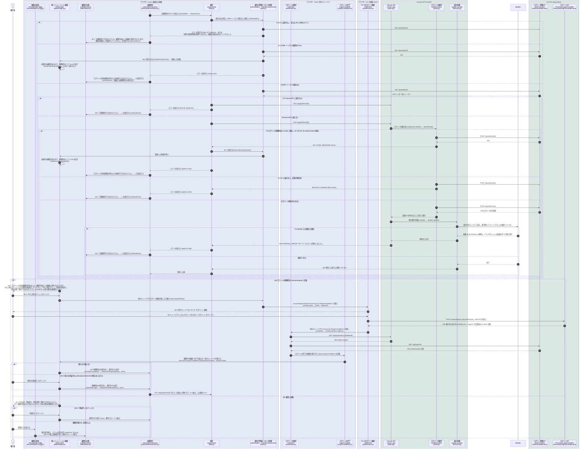

# UC-07 庭プロジェクトを保存する

```mermaid
sequenceDiagram
    autonumber
    actor User as 購入者
    box rgba(47,111,219,0.10) ブラウザー React
        participant Parts as 編集の部品<br/>PlacedObject ほか<br/>(PlacedObject.jsx ほか)
        participant Store as 編集中の庭<br/>useEditorStore<br/>(editorStore.js)
        participant Page as 庭シミュレーション画面<br/>EditorPage<br/>(EditorPage.jsx)
        participant Save as 自動保存<br/>useGardenAutosave<br/>(useGardenAutosave.js)
        participant Thumb as サムネイルの送信<br/>useGardenThumbnail<br/>(useGardenThumbnail.js)
        participant Http as 通信<br/>requestJson<br/>(http.js)
    end
    box rgba(27,127,92,0.12) Canvas API FastAPI
        participant Main as Canvas API<br/>create_app<br/>(main.py)
        participant Svc as 庭の処理<br/>update_garden<br/>(service.py)
        participant Media as 画像の保存先の読み書き<br/>MediaStore<br/>(media.py)
    end
    participant Db as MySQL
    box rgba(27,127,92,0.12) EC API Spring Boot
        participant EcAuth as ログイン状態API<br/>AuthController<br/>(AuthController.java)
    end

    Note over User,EcAuth: 共通代替フロー<br/>*b 未ログインの場合: 10、12、サムネイルの送信の 23 に適用 (10 と 12 は代替フロー 3d)<br/>*a 通信に失敗した場合: 10、12、サムネイルの送信の 23 と、MySQL を読み書きする 17、18、画像の保存先 (S3) に置く 16 に適用 (23 以外は代替フロー 3b)

    User->>Parts: 庭オブジェクトの配置・編集、輪郭の修正、辺の実寸の入力をする<br/>(UC-03〜UC-05)
    Parts->>Store: 編集中の庭を書き換えるよう頼む (transformObject、addAssetAt、<br/>confirmPhotoBoundary、setPhotoEdgeLength など)。<br/>新しい庭 (GardenDocument) にし、未保存にする (set、isDirty を真)
    Store-->>Page: 新しい庭と未保存の印 (useEditorStore)
    Page-->>User: 保存状態「自動保存待ち」(時計のアイコン)
    Page->>Save: 庭が変わったことを渡す (useGardenAutosave)
    Save->>Save: 保存できる状態かを確かめる (useEffect → saveBlocker)
    Save->>Store: 操作が止まって 500 ms たったら保存中にする<br/>(setTimeout → save → setSaving(true)、setSaveError(null)。庭が変わるたびにタイマーを置き直す)
    Page-->>User: 保存状態「保存中…」
    Save->>Http: 庭全体を保存するよう頼む (saveGarden(structuredClone(document)) → requestJson)
    Http->>EcAuth: 書き込みの前に CSRF トークンを取る GET /api/auth/csrf (authHeaders)
    EcAuth-->>Http: 200 ヘッダー名とトークン
    Http->>Main: PUT /api/gardens/{id}<br/>(庭全体の JSON。写真の dataUrl、輪郭、実寸、配置、revision を含む)
    Main->>EcAuth: ログインを確かめる POST /api/auth/verify<br/>(backend_identity → AuthBoundary.authenticate。Cookie の KUSAKARI_SESSION、X-CSRF-TOKEN)
    EcAuth-->>Main: 200 ログイン中の会員 (id、accountType)。会員 ID を持ち主として覚える (request.state.owner_id)
    Main->>Svc: 庭の保存を頼む (update → update_garden)<br/>庭の JSON を検査し、URL と本文の庭 ID を比べる (validate_document)
    opt 画像の保存先が S3 (media.external)
        Svc->>Media: 庭の写真を保存先に置くよう頼む (store_photo)
        Note over Svc,Media: 結果: 先に庭を持ち主と ID で読んで revision を比べ (owned_garden。違えば 409)、S3 に put_object し (キーは内容の SHA-256 から作る)、dataUrl の代わりに imageKey を入れた写真にする。
    end
    Svc->>Db: 庭の行をロックして読む<br/>(owned_garden(lock=True)、SELECT gardens … FOR UPDATE。持ち主が違えば 404)
    break 3c revision が違う (別の画面が先に保存した)
        Note over Page,Db: 結果: 409 REVISION_CONFLICT「庭が別の版で更新されています。最新データを取得してください。」を返す (setSaveError)。<br/>画面: 3c-1「別の保存結果と競合しました。編集内容は保持されています。再読み込み前に変更内容を確認してください。」と「再試行」、保存状態「保存できませんでした」(3c-2 編集内容は残る。3c-3 ユースケースを終える)
    end
    Svc->>Db: 配置のアセットがカタログにあるかを読み (SELECT assets。無ければ 400 UNKNOWN_ASSET)、<br/>庭を書き換えて revision を 1 増やし、配置を消して入れ直し、コミットする<br/>(UPDATE gardens、DELETE placed_objects、INSERT placed_objects)
    Main-->>Http: 200 GardenDocument (保存した庭。新しい revision)
    Http-->>Save: 保存した庭
    Save->>Store: 保存済みにする (markSaved(saved, submitted))。送信中に編集が続いていたら、<br/>未保存のまま revision だけ新しくする。庭のキャッシュを置き換え、庭一覧を取り直させる<br/>(setQueryData、invalidateQueries)
    Page-->>User: 保存状態「保存済み」とチェックのアイコン

    opt 関連情報 保存のあと、一覧のサムネイルを送る (画面には何も出さない)
        Thumb->>Main: 保存済みで、操作中でも輪郭の描画中でもなく、すべてのモデルを読み込んだら (ready)、<br/>600 ms 後に今の表示を 640×400 px 以内の PNG にして送る (captureImage、thumbnailImage)<br/>POST /api/gardens/{id}/thumbnail (revision、dataUrl)
        Note over Thumb,Db: 結果: CSRF トークンの取得とログインの確認は 10〜14 と同じ。thumbnails.py の save が PNG で 330,000 バイト以内かを確かめ、revision が同じなら撮影画像を追加か更新してコミットし (garden_thumbnails。S3 のときは put_object)、204 を返す。revision が違えば 409 THUMBNAIL_STALE を返す。<br/>画面: 何も出さない。409 なら 1.5 秒後に撮り直して送る (3 回まで)
    end
```

- ユースケース記述: [UC-07_庭プロジェクトを保存する](<../../アーカイブ/ユースケース/kusakari-canvas/UC-07_庭プロジェクトを保存する.md>)
- 共通代替フロー: [00_全ユースケース共通の代替フロー](<00_全ユースケース共通の代替フロー.md>)
- 対象のコード: kusakari-canvas の main（7e9a8dd、2026-11-24 時点）、kusakari-ec の main（6bad7e3、2026-11-24 時点）

## シーケンス図

参加者は、上から「画面や役割の名前」「コンポーネント・クラス・関数の名前」「ファイル名（かっこ付き）」の順に書いています。
庭の保存は、庭全体のスナップショット（GardenDocument）を `PUT /api/gardens/{id}` で送り、Canvas API が MySQL のトランザクションの中で revision を比べて上書きする形です。代替フロー 3b（通信に失敗）は共通代替フロー \*a、3d（ログインの期限切れ）は \*b のこの画面での形なので、下の「共通代替フローを直接書いた図」に書いています。
画像の保存先は環境変数 `KUSAKARI_CANVAS_MEDIA_STORAGE` で決まります。既定の `database` では庭写真を `gardens.photo_json` の dataUrl として MySQL に入れ、`s3` のときだけオブジェクトストレージに入れるので、その処理は `opt` で書いています。
エラーは最重要の 3c（revision が違う）だけを描き、ほかの代替フローは図の下に並べています。条件つきの処理（画像の保存先が S3 のときの写真の保存、保存のあとのサムネイルの送信）は、`opt` の中に頼む矢印 1 本と Note で書いています。

図に描いていない代替フロー：3a（保存できない状態）、（記述なし）の分岐

## 共通代替フローを直接書いた図

上の図の自動保存の通信（CSRF トークンの取得と `PUT /api/gardens/{id}`）に、この画面で起こる共通代替フロー（\*a は代替フロー 3b、\*b は代替フロー 3d）を書き込んだ図です。自動保存は未保存の編集があるときだけ送るので、401 を受けても EC のログイン画面へは移らず、別のウィンドウでログインし直します。サムネイルの送信（上の図の 23）は、失敗しても画面に出さず 1.5 秒後に送り直します。保存済みのときに送るので、401 なら `login()` で EC のログイン画面へ移ります。

## ユースケース記述との差

- 3a-1 の保存状態「カメラを設定中」は、今はありません。写真のカメラ設定の画面を取り除いたためです。保存できない状態は、操作中（移動・回転・拡縮のドラッグ）、輪郭の描画中、施工範囲外の配置がある、輪郭か実寸の範囲が確定していない、の 4 つです（`saveBlocker()`）。
- 3a-1 の「写真上の庭の輪郭と実寸範囲が確定すると自動保存されます。」は、コードでは「写真上の庭の輪郭と実寸範囲が確定すると自動保存され、3D庭を表示できます。」です。
- 3a のとき、画面は自動保存を送らないだけで、エラーの文は出しません。「再試行」や画面の移動で `save()` を呼んだときだけ、`saveBlocker()` の理由（「施工範囲外の配置を移動または削除すると自動保存されます。」など）を `saveError` に入れます。
- 保存状態の出し方には順番があります。保存中なら「保存中…」、輪郭の描画中なら「輪郭を描画中」、施工範囲外の配置があれば「施工範囲の修正が必要」が、保存のエラーより先に出ます。
- 3c は、変更内容の確認を促してユースケースを終えると書いています。コードは 3b と同じ帯に競合の文と「再試行」を出します。「再試行」は同じ revision で PUT を送り直すので、また 409 になります。最新の庭を読み直す操作や、変更内容を比べる画面はありません。`IntegrityError`（409 `STORAGE_CONFLICT`）も同じ文になります。
- コードにあって記述にない分岐があります。サーバーの入力検査（`validate_document()` など）で 400 になると、`OBJECT_POSITION_OUT_OF_BOUNDS` のときは「施工範囲外の配置を移動または削除してください。」、ほかの 400 と 403 では「保存できませんでした。(サーバーの理由) 編集内容はこの画面に保持されています。」を出します。
- 3b は、PUT が届かないときのほか、PUT の前の EC の `GET /api/auth/csrf` が失敗したとき、EC でログインを確かめられないとき（503 `AUTH_UNAVAILABLE`）、MySQL の失敗（500 `INTERNAL_ERROR`）、S3 の失敗（503 `MEDIA_UNAVAILABLE`）でも同じ文になります。
- 3b のあと、利用者が編集を続けると `saveError` が消え、自動保存がまた送ります。「再試行」を押さなくても再実行されます。
- 3d の 401 は、Canvas API が返す場合（Cookie が無い、EC の `POST /api/auth/verify` が 401 か `authenticated` が偽）のほかに、PUT を送る前の EC の `GET /api/auth/csrf` が 401 を返す場合もあります。どちらも同じ表示になります。
- 関連情報の「サムネイルも更新する」は、PUT とは別の `POST /api/gardens/{id}/thumbnail` で行います。失敗しても画面に何も出さず、1.5 秒後に送り直します（3 回まで）。庭一覧のサムネイル（`GET /api/gardens/{id}/thumbnail`）は、生成履歴がある庭では最新の生成画像（After）を優先して返すので、保存しても一覧のサムネイルは変わりません。
- 関連情報の「ほかの画面へ移動するときは、保存が終わるのを待ってから移動する」は、`requestNavigation()` が `flush()` で保存を待つ形です。輪郭が確定していない写真があるときは、保存せずに「庭写真を保存せずに戻りますか？」を出します。ブラウザーの確認（`beforeunload`）は、未保存の編集か輪郭の描画中があるときに出ます。図には書いていません。

## 確かめられなかったこと

- どの環境で `KUSAKARI_CANVAS_MEDIA_STORAGE=s3` を使うかは、このリポジトリにありません。
- 3d-3〜3d-4 で、EC のログイン画面がログインのあと `returnTo` の Canvas の画面を開くところは、EC の画面の処理です。EC の中で Cognito に問い合わせる流れは EC-B01 の図に任せました。
- 別のウィンドウからの知らせ（`BroadcastChannel`）が届かない場面は、動かして確かめていません。

## 参照したコード

kusakari-canvas

- [frontend/src/pages/EditorPage.jsx](https://github.com/abeouga/kusakari-canvas/blob/7e9a8dd0a40f2b212ca20b3aa94f2dc984b00b7a/frontend/src/pages/EditorPage.jsx): `statusText`、範囲外の帯、`setUnauthorizedHandler()`、期限切れの帯、`retryAfterLogin()`、`onLoginCompleted()`、`requestNavigation()`、`useGardenThumbnail()` の `ready`
- [frontend/src/stores/editorStore.js](https://github.com/abeouga/kusakari-canvas/blob/7e9a8dd0a40f2b212ca20b3aa94f2dc984b00b7a/frontend/src/stores/editorStore.js): `transformObject()`、`addAssetAt()`、`confirmPhotoBoundary()`、`setPhotoEdgeLength()`、`selectObject()`、`setSaving()`、`setSaveError()`、`markSaved()`
- [frontend/src/three/PlacedObject.jsx](https://github.com/abeouga/kusakari-canvas/blob/7e9a8dd0a40f2b212ca20b3aa94f2dc984b00b7a/frontend/src/three/PlacedObject.jsx): `transformObject()` の呼び出し
- [frontend/src/components/PhotoOverlay.jsx](https://github.com/abeouga/kusakari-canvas/blob/7e9a8dd0a40f2b212ca20b3aa94f2dc984b00b7a/frontend/src/components/PhotoOverlay.jsx): 輪郭の確定と修正の呼び出し
- [frontend/src/components/EdgeMeasurementPopover.jsx](https://github.com/abeouga/kusakari-canvas/blob/7e9a8dd0a40f2b212ca20b3aa94f2dc984b00b7a/frontend/src/components/EdgeMeasurementPopover.jsx): `setPhotoEdgeLength()` の呼び出し
- [frontend/src/hooks/useGardenAutosave.js](https://github.com/abeouga/kusakari-canvas/blob/7e9a8dd0a40f2b212ca20b3aa94f2dc984b00b7a/frontend/src/hooks/useGardenAutosave.js): `saveBlocker()`、`save()`、`useEffect` の 500 ms のタイマー、`flush()`、エラーの文
- [frontend/src/hooks/useGardenThumbnail.js](https://github.com/abeouga/kusakari-canvas/blob/7e9a8dd0a40f2b212ca20b3aa94f2dc984b00b7a/frontend/src/hooks/useGardenThumbnail.js): `useGardenThumbnail()`（600 ms、1.5 秒、3 回）
- [frontend/src/capture/captureImage.js](https://github.com/abeouga/kusakari-canvas/blob/7e9a8dd0a40f2b212ca20b3aa94f2dc984b00b7a/frontend/src/capture/captureImage.js): `captureImage()`
- [frontend/src/capture/thumbnailImage.js](https://github.com/abeouga/kusakari-canvas/blob/7e9a8dd0a40f2b212ca20b3aa94f2dc984b00b7a/frontend/src/capture/thumbnailImage.js): `thumbnailImage()`
- [frontend/src/api/gardens.js](https://github.com/abeouga/kusakari-canvas/blob/7e9a8dd0a40f2b212ca20b3aa94f2dc984b00b7a/frontend/src/api/gardens.js): `saveGarden`
- [frontend/src/api/http.js](https://github.com/abeouga/kusakari-canvas/blob/7e9a8dd0a40f2b212ca20b3aa94f2dc984b00b7a/frontend/src/api/http.js): `requestJson()`、`ApiError`
- [frontend/src/api/auth.js](https://github.com/abeouga/kusakari-canvas/blob/7e9a8dd0a40f2b212ca20b3aa94f2dc984b00b7a/frontend/src/api/auth.js): `authMode()`、`authHeaders()`、`login()`、`setUnauthorizedHandler()`、`handleUnauthorized()`、`openLoginWindow()`、`onLoginCompleted()`、`announceLoginCompleted()`
- [frontend/src/pages/App.jsx](https://github.com/abeouga/kusakari-canvas/blob/7e9a8dd0a40f2b212ca20b3aa94f2dc984b00b7a/frontend/src/pages/App.jsx): `loginComplete` の分岐
- [frontend/src/components/AuthGate.jsx](https://github.com/abeouga/kusakari-canvas/blob/7e9a8dd0a40f2b212ca20b3aa94f2dc984b00b7a/frontend/src/components/AuthGate.jsx): `AuthGate`（`GET /api/auth/me`）
- [frontend/src/components/LoginComplete.jsx](https://github.com/abeouga/kusakari-canvas/blob/7e9a8dd0a40f2b212ca20b3aa94f2dc984b00b7a/frontend/src/components/LoginComplete.jsx): `announceLoginCompleted()`、`window.close()`
- [backend/kusakari_canvas_api/main.py](https://github.com/abeouga/kusakari-canvas/blob/7e9a8dd0a40f2b212ca20b3aa94f2dc984b00b7a/backend/kusakari_canvas_api/main.py): `backend_identity()`、`domain_error()`、`storage_conflict()`、`auth_status()`、`update()`
- [backend/kusakari_canvas_api/auth.py](https://github.com/abeouga/kusakari-canvas/blob/7e9a8dd0a40f2b212ca20b3aa94f2dc984b00b7a/backend/kusakari_canvas_api/auth.py): `AuthBoundary.authenticate()`、`error()`
- [backend/kusakari_canvas_api/service.py](https://github.com/abeouga/kusakari-canvas/blob/7e9a8dd0a40f2b212ca20b3aa94f2dc984b00b7a/backend/kusakari_canvas_api/service.py): `update_garden()`、`owned_garden()`
- [backend/kusakari_canvas_api/validation.py](https://github.com/abeouga/kusakari-canvas/blob/7e9a8dd0a40f2b212ca20b3aa94f2dc984b00b7a/backend/kusakari_canvas_api/validation.py): `validate_document()`
- [backend/kusakari_canvas_api/media.py](https://github.com/abeouga/kusakari-canvas/blob/7e9a8dd0a40f2b212ca20b3aa94f2dc984b00b7a/backend/kusakari_canvas_api/media.py): `MediaStore.store_photo()`、`put()`
- [backend/kusakari_canvas_api/thumbnails.py](https://github.com/abeouga/kusakari-canvas/blob/7e9a8dd0a40f2b212ca20b3aa94f2dc984b00b7a/backend/kusakari_canvas_api/thumbnails.py): `thumbnail_router()` の `save()`、`read_thumbnail()`

kusakari-ec

- [backend/src/main/java/jp/kusakari/ec/auth/AuthController.java](https://github.com/abeouga/kusakari-ec/blob/6bad7e37c4135034fbe97e30309772fbe872e675/backend/src/main/java/jp/kusakari/ec/auth/AuthController.java): `me`、`verify`、`csrf`
- [backend/src/main/java/jp/kusakari/ec/auth/PasswordLoginController.java](https://github.com/abeouga/kusakari-ec/blob/6bad7e37c4135034fbe97e30309772fbe872e675/backend/src/main/java/jp/kusakari/ec/auth/PasswordLoginController.java): `POST /api/auth/login`、`safeReturn`
- [frontend/src/components/AuthPanel.jsx](https://github.com/abeouga/kusakari-ec/blob/6bad7e37c4135034fbe97e30309772fbe872e675/frontend/src/components/AuthPanel.jsx): `submit`、`complete`
- [frontend/src/auth.js](https://github.com/abeouga/kusakari-ec/blob/6bad7e37c4135034fbe97e30309772fbe872e675/frontend/src/auth.js): `passwordLogin`
