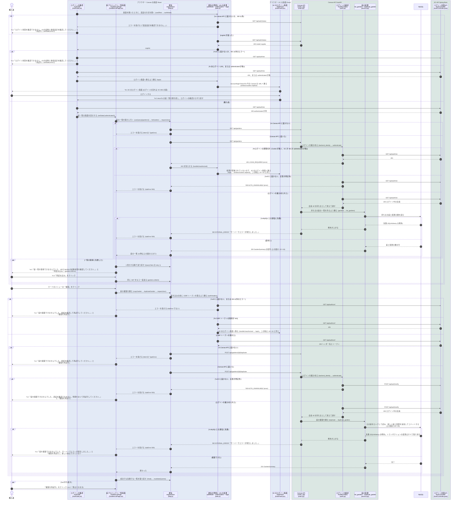

# UC-08 庭プロジェクトを管理する

- ユースケース記述: [UC-08_庭プロジェクトを管理する](<../../アーカイブ/ユースケース/kusakari-canvas/UC-08_庭プロジェクトを管理する.md>)
- 共通代替フロー: [00_全ユースケース共通の代替フロー](<00_全ユースケース共通の代替フロー.md>)
- 対象のコード: kusakari-canvas の main（7e9a8dd、2026-11-24 時点）、kusakari-ec の main（6bad7e3、2026-11-24 時点）

## シーケンス図

参加者は、上から「画面や役割の名前」「コンポーネント・クラス・関数の名前」「ファイル名（かっこ付き）」の順に書いています。
共通代替フローの中身は、00 の図か、下の「共通代替フローを直接書いた図」を見てください。
「庭プロジェクト一覧」画面は Canvas の `/` です。Canvas はログインの画面を持たず、画面は EC の `GET /api/auth/me` を直接呼び、Canvas API は要求のたびに EC へ持ち主を問い合わせます（読み取りは `GET /api/auth/me`、書き込みは `POST /api/auth/verify`）。図の最初は、EC の画面の共通ヘッダーから開く場合です。
代替フローのうち、庭がないもの（2a）、エラーで終わるもの（6a）、画面の中だけで終わるもの（8a）、記述にない分岐（店舗側のアカウント、削除する庭が見つからない）は、分かれる所だけを描き、結果と画面は Note に文で書いています。CSRF トークンの取得と、Canvas API が EC でログインを確かめる往復は、矢印の文にまとめています。

```mermaid
sequenceDiagram
    autonumber
    actor User as 購入者
    box rgba(47,111,219,0.10) ブラウザー EC の画面 React
        participant Header as 共通ヘッダー<br/>KusakariHeader<br/>(KusakariHeader.jsx)
        participant EcApp as EC の画面の枠<br/>App<br/>(App.jsx)
    end
    box rgba(47,111,219,0.10) ブラウザー Canvas の画面 React
        participant App as Canvas の画面の振り分け<br/>App<br/>(App.jsx)
        participant Gate as ログインの確認<br/>AuthGate<br/>(AuthGate.jsx)
        participant List as 庭プロジェクト一覧画面<br/>GardenListPage<br/>(GardenListPage.jsx)
        participant Card as カードのメニュー<br/>GardenCardMenu<br/>(GardenCardMenu.jsx)
        participant Thumb as カードのサムネイル<br/>GardenThumbnail<br/>(GardenThumbnail.jsx)
        participant Http as 通信<br/>requestJson<br/>(http.js)
        participant AuthJs as 通信の準備<br/>authMode・authHeaders<br/>(auth.js)
    end
    box rgba(27,127,92,0.12) Canvas API FastAPI
        participant Main as Canvas API<br/>create_app<br/>(main.py)
        participant Svc as 庭の処理<br/>list_gardens ほか<br/>(service.py)
    end
    participant Db as MySQL
    box rgba(27,127,92,0.12) EC API Spring Boot
        participant EcAuth as ログイン状態API<br/>AuthController<br/>(AuthController.java)
    end

    Note over User,EcAuth: 共通代替フロー<br/>*b 未ログインの場合: 8、12、26、39 と、一覧の取り直しの 32、45 に適用<br/>*a 通信に失敗した場合: 6、8、12、17、26、39 と、一覧の取り直しの 32、45 と、MySQL を読み書きする 14、28、29、41、42 に適用

    User->>Header: 共通ヘッダーの「Canvas」をクリック
    Header->>EcApp: 押したリンクの URL を渡す (follow → onNavigate)
    EcApp->>App: Canvas の URL なので、ページごと Canvas の / を開く<br/>(navigateFromHeader → window.location.assign)
    App->>Gate: パスが / なので、ログインの確認の中に庭一覧を置く<br/>(canvasPathname → AuthGate → GardenListPage)
    Gate->>AuthJs: 画面を開いたときに、認証の方式を聞く (useEffect → authMode)
    AuthJs->>Main: GET /api/auth/status
    Main-->>AuthJs: 200 mode=cognito (ログインを確かめずに返す。auth_status)
    Gate->>EcAuth: GET /api/auth/me (credentials include)
    EcAuth-->>Gate: 200 ログイン中の会員 (mode、authenticated、accountType)
    break 店舗側のアカウント (記述なし)
        Note over Gate,EcAuth: 結果: 一覧は取りに行かない (setState('buyer-only'))。<br/>画面: 「Canvas は購入者のアカウントで使えます。」と「EC のトップへ戻る」
    end
    Gate->>List: 庭一覧の画面を表示する (setState('authenticated'))
    List->>Http: 庭の一覧を取りに行く (useQuery(['gardens']) → listGardens → requestJson)
    Http->>Main: GET /api/gardens
    Main->>Svc: EC の GET /api/auth/me でログインを確かめ (backend_identity → AuthBoundary.authenticate)、<br/>持ち主の庭の一覧を作るよう頼む (gardens → list_gardens)
    Svc->>Db: 持ち主の庭を、配置の数と一緒に更新の新しい順に読む<br/>(SELECT gardens LEFT OUTER JOIN 配置の COUNT、ORDER BY updated_at DESC)
    Main-->>Http: 200 GardenSummary の配列
    Http-->>List: 庭の一覧 (gardens.data)
    break 2a 庭がない
        Note over List,Http: 結果: カードを出さない。<br/>画面: 2a-1「保存した庭」の「0件」と、「新しい庭をつくる」のカードだけ (2a-2 庭を作るなら UC-01 へ)
    end
    loop 庭のカードごと
        Thumb->>Main: GET /api/gardens/{id}/thumbnail (img 要素の src)<br/>ログインを確かめてから、庭と最新の生成画像と今の版の撮影画像を読む<br/>(backend_identity → thumbnails.py の get → read_thumbnail)
        Main-->>Thumb: 200 image/png (どちらも無ければ配置から配置図を描く。placement_plan)<br/>読めなければ onError でアイコンにする
    end
    List-->>User: 2「保存した庭」と件数、更新の新しい順のカード<br/>(名前、「配置 n点」、「最終保存 日時」、サムネイル) と「新しい庭をつくる」

    User->>Card: 3 対象の庭のカードの「…」(「(庭の名前)のオプション」) をクリック
    Card->>List: メニューを開くよう頼む (onToggle → setOpenMenuId)
    List-->>User: 4「複製」「削除」のメニュー
    User->>Card: 5「複製」または「削除」をクリック (select → onClose でメニューを閉じる)
    alt 複製 (基本フロー 6)
        Card->>List: 複製を頼む (onCopy → copyGarden)。「庭を複製しています…」(setCopying(true))
        List->>Http: 庭の複製を頼む (duplicateGarden → requestJson)
        Http->>Main: POST /api/gardens/{id}/duplicate<br/>先に EC の GET /api/auth/csrf で CSRF トークンを取り (authHeaders)、<br/>Canvas API は EC の POST /api/auth/verify でログインを確かめる
        Main->>Svc: 庭の複製を頼む (duplicate → duplicate_garden)<br/>duplicate_garden 全体が 1 つのトランザクション
        Svc->>Db: 元の庭の行をロックして読む<br/>(owned_garden(lock=True)、SELECT gardens … FOR UPDATE)
        break 6a 複製に失敗 (例 ほかの会員の庭、削除済みの庭)
            Note over List,Db: 結果: 404 GARDEN_NOT_FOUND を返し (not_found、domain_error)、新しい庭は作らない。失敗でも一覧を取り直す (finally)。<br/>画面: 6a-1「庭を複製できませんでした。(サーバーの理由)」と「複製を再試行」(6a-2 押すと同じ庭の複製をもう一度送る (copyGarden(copyRetryId))。カードの「…」から選び直すと基本フロー 3 へ)
        end
        Svc->>Db: 新しい庭を追加し (INSERT gardens。名前は「元の名前（複製）」(duplicate_name)、revision は 0、<br/>写真と shopping_targets_json はそのまま)、配置を読んで新しい ID で追加し (SELECT・INSERT placed_objects)、<br/>今の版の撮影画像を写して (INSERT garden_thumbnails)、コミットする
        Main-->>Http: 201 GardenSummary (新しい庭の要約)
        Http-->>List: 終わった
        List->>Http: 成功でも失敗でも一覧を取り直す (finally → invalidateQueries(['gardens']) → listGardens)<br/>GET /api/gardens。流れは 12〜16 と同じ
        List-->>User: 6 一覧の先頭に「元の名前（複製）」のカード。<br/>「庭を複製しています…」を消す (setCopying(false))
    else 削除 (基本フロー 7〜9)
        Card->>List: 削除の確認を頼む (onDelete → removeGarden.reset、setDeleteTarget)
        List-->>User: 7「この庭を削除しますか？」ダイアログ<br/>「削除すると元に戻せません。」、庭の名前、<br/>「庭の写真、輪郭、配置したすべての素材と生成履歴を削除します。」、「取消」「庭を削除」
        break 8a 削除を取り消した
            User->>List: 8a-1「取消」をクリック (Esc キー、×の「閉じる」も同じ)
            Note over User,List: 結果: 通信しない (setDeleteTarget(null))。<br/>画面: 8a-2 ダイアログを閉じる (8a-3 基本フロー 3 へ戻る)
        end
        User->>List: 8「庭を削除」をクリック
        List->>Http: 庭の削除を頼む (removeGarden.mutate → deleteGarden → requestJson)
        Http->>Main: DELETE /api/gardens/{id}<br/>CSRF トークンの取得とログインの確認は 26 と同じ
        Main->>Svc: 庭の削除を頼む (delete → delete_garden)
        Svc->>Db: 庭の行をロックして読む<br/>(owned_garden(lock=True)、SELECT gardens … FOR UPDATE)
        break 庭が見つからない (記述なし)
            Note over List,Db: 結果: 404 GARDEN_NOT_FOUND を返し、何も消さない (removeGarden.isError が真)。<br/>画面: ダイアログの中に「削除できませんでした。接続を確認して再試行してください。」
        end
        Svc->>Db: 庭を消してコミットする (session.delete → DELETE gardens)<br/>配置、生成履歴、撮影画像は外部キーの ON DELETE CASCADE で消える
        Main-->>Http: 204
        Http-->>List: 終わった
        List->>Http: ダイアログを閉じ (onSuccess → setDeleteTarget(null))、一覧を取り直す<br/>(invalidateQueries(['gardens']) → listGardens)。GET /api/gardens。流れは 12〜16 と同じ
        List-->>User: 9 一覧から庭が消える
    end
```

## 共通代替フローを直接書いた図

上の図の、画面を開いたときのログインの確認（`GET /api/auth/me`）、庭の一覧の取得（`GET /api/gardens`）、複製（`POST /api/gardens/{id}/duplicate`）に、この画面で起こる共通代替フロー（\*a、\*b）を書き込んだ図です。この画面は 401 のときの処理を登録しない（未保存の編集が無い）ので、どの通信の 401 でも EC のログイン画面へ移ります。削除（`DELETE /api/gardens/{id}`）は、401 なら同じくログイン画面へ移り、それ以外の失敗はどれも、ダイアログの中の「削除できませんでした。接続を確認して再試行してください。」になります。複製の POST が 401 のときも、一覧の取得と同じくログイン画面へ移ります。サムネイルの取得（上の図の 17）に失敗したときは、カードにアイコンを出すだけです。

## ユースケース記述との差

- 基本フロー 1: 共通ヘッダーの「Canvas」は、EC の画面ではページごと Canvas の `/` を開きます（EC の `navigateFromHeader()` が `window.location.assign()`）。Canvas の画面の共通ヘッダーから開くときは、そのリンクへそのまま移ります。編集画面からは、保存が終わるのを待ってから移ります（UC-07）。
- 基本フロー 1〜2: 店舗側のアカウント（`SHOP_OWNER`、`SHOP_STAFF`、`SHOP_OWNER_APPLICANT`）は、一覧を出さずに「Canvas は購入者のアカウントで使えます。」で止まります（`AuthGate`）。Canvas API も 403 `BUYER_ACCOUNT_REQUIRED` を返します。記述にはありません。
- 2a: 記述の「保存した庭はまだありません。上のフォームから最初の庭を作成できます。」はコードにありません。庭が無いときは「保存した庭」の件数が「0件」になり、「新しい庭をつくる」のカードだけが出ます。一覧の上に作成のフォームはありません。
- 基本フロー 2: カードには名前のほかに「配置 n点」「最終保存」とサムネイルが出ます。サムネイルは、最新の生成画像、今の版の撮影画像、配置図の順に選びます。画像を S3 に置く設定では、生成画像と撮影画像を S3 から読みます（`MediaStore.get()`）。
- 基本フロー 6: 複製するのは、名前、幅、奥行き、写真（`photo_json`）、`shopping_targets_json`、すべての配置、元の庭の今の版の撮影画像です。AI の生成履歴と、EC で買い物リストに追加した商品は複製しません。記述の「選択したプロジェクトの内容を複製して」には、この範囲が書かれていません。
- 6a: 「複製を再試行」は、メニューを開き直さずに、同じ庭の複製をもう一度送ります。複製に失敗したときも、`finally` で一覧を取り直します。サーバーのエラー（`ApiError`）ならサーバーの文を付け、それ以外は「接続を確認して再試行してください。」を付けます。
- 基本フロー 8〜9: 削除の失敗には記述の代替フローがありません。コードはダイアログを閉じずに「削除できませんでした。接続を確認して再試行してください。」を出します。庭が見つからない 404 でも同じ文です。
- 関連情報の「削除したプロジェクトの復元はしない」: DB の行は消えますが、画像を S3 に置く設定では、S3 の画像は消しません。複製した庭が同じ画像のキーを使うためです（`duplicate_garden()` の注記）。
- 関連情報の「複製の名前が長い場合は、元の名前を短くしてから「（複製）」を付ける」: 元の名前を UTF-16 で 54 単位までにしてから「（複製）」を付けます（`duplicate_name()`）。

## 確かめられなかったこと

- EC の画面の共通ヘッダーの「Canvas」のリンク先（`VITE_KUSAKARI_CANVAS_URL`）は環境で決まります。図はローカルで起動したときのパス（`/`）で書いています。

## 参照したコード

kusakari-canvas

- [frontend/src/pages/App.jsx](https://github.com/abeouga/kusakari-canvas/blob/7e9a8dd0a40f2b212ca20b3aa94f2dc984b00b7a/frontend/src/pages/App.jsx): `App`（パスと画面の対応）
- [frontend/src/main.jsx](https://github.com/abeouga/kusakari-canvas/blob/7e9a8dd0a40f2b212ca20b3aa94f2dc984b00b7a/frontend/src/main.jsx): `QueryClient` の `retry: 1`
- [frontend/src/components/AuthGate.jsx](https://github.com/abeouga/kusakari-canvas/blob/7e9a8dd0a40f2b212ca20b3aa94f2dc984b00b7a/frontend/src/components/AuthGate.jsx): `AuthGate`（`GET /api/auth/me`、`buyer-only`、`error`）
- [frontend/src/api/auth.js](https://github.com/abeouga/kusakari-canvas/blob/7e9a8dd0a40f2b212ca20b3aa94f2dc984b00b7a/frontend/src/api/auth.js): `authMode`、`authHeaders`、`login`、`handleUnauthorized`
- [frontend/src/pages/GardenListPage.jsx](https://github.com/abeouga/kusakari-canvas/blob/7e9a8dd0a40f2b212ca20b3aa94f2dc984b00b7a/frontend/src/pages/GardenListPage.jsx): `useQuery(['gardens'])`、`copyGarden`、`removeGarden`、削除のダイアログ、エラーの文
- [frontend/src/components/GardenCardMenu.jsx](https://github.com/abeouga/kusakari-canvas/blob/7e9a8dd0a40f2b212ca20b3aa94f2dc984b00b7a/frontend/src/components/GardenCardMenu.jsx): `onToggle`、`select`、「複製」「削除」
- [frontend/src/components/GardenThumbnail.jsx](https://github.com/abeouga/kusakari-canvas/blob/7e9a8dd0a40f2b212ca20b3aa94f2dc984b00b7a/frontend/src/components/GardenThumbnail.jsx): `GardenThumbnail`（img の `onError`）
- [frontend/src/components/Dialog.jsx](https://github.com/abeouga/kusakari-canvas/blob/7e9a8dd0a40f2b212ca20b3aa94f2dc984b00b7a/frontend/src/components/Dialog.jsx): 「閉じる」と Esc キー
- [frontend/src/api/gardens.js](https://github.com/abeouga/kusakari-canvas/blob/7e9a8dd0a40f2b212ca20b3aa94f2dc984b00b7a/frontend/src/api/gardens.js): `listGardens`、`duplicateGarden`、`deleteGarden`
- [frontend/src/api/http.js](https://github.com/abeouga/kusakari-canvas/blob/7e9a8dd0a40f2b212ca20b3aa94f2dc984b00b7a/frontend/src/api/http.js): `requestJson`、`ApiError`
- [backend/kusakari_canvas_api/main.py](https://github.com/abeouga/kusakari-canvas/blob/7e9a8dd0a40f2b212ca20b3aa94f2dc984b00b7a/backend/kusakari_canvas_api/main.py): `backend_identity`、`domain_error`、`auth_status`、`gardens`、`duplicate`、`delete`
- [backend/kusakari_canvas_api/auth.py](https://github.com/abeouga/kusakari-canvas/blob/7e9a8dd0a40f2b212ca20b3aa94f2dc984b00b7a/backend/kusakari_canvas_api/auth.py): `AuthBoundary.authenticate`、`error`
- [backend/kusakari_canvas_api/service.py](https://github.com/abeouga/kusakari-canvas/blob/7e9a8dd0a40f2b212ca20b3aa94f2dc984b00b7a/backend/kusakari_canvas_api/service.py): `owned_garden`、`list_gardens`、`duplicate_garden`、`duplicate_name`、`delete_garden`
- [backend/kusakari_canvas_api/thumbnails.py](https://github.com/abeouga/kusakari-canvas/blob/7e9a8dd0a40f2b212ca20b3aa94f2dc984b00b7a/backend/kusakari_canvas_api/thumbnails.py): `thumbnail_router` の `get`、`read_thumbnail`、`placement_plan`
- [backend/kusakari_canvas_api/errors.py](https://github.com/abeouga/kusakari-canvas/blob/7e9a8dd0a40f2b212ca20b3aa94f2dc984b00b7a/backend/kusakari_canvas_api/errors.py): `not_found`
- [backend/kusakari_canvas_api/models.py](https://github.com/abeouga/kusakari-canvas/blob/7e9a8dd0a40f2b212ca20b3aa94f2dc984b00b7a/backend/kusakari_canvas_api/models.py): 外部キーの `ondelete="CASCADE"`
- [backend/kusakari_canvas_api/history_models.py](https://github.com/abeouga/kusakari-canvas/blob/7e9a8dd0a40f2b212ca20b3aa94f2dc984b00b7a/backend/kusakari_canvas_api/history_models.py): 生成履歴の外部キーの `ondelete="CASCADE"`

kusakari-ec

- [packages/site-header/KusakariHeader.jsx](https://github.com/abeouga/kusakari-ec/blob/6bad7e37c4135034fbe97e30309772fbe872e675/packages/site-header/KusakariHeader.jsx): 「Canvas」のリンクと `follow`
- [frontend/src/App.jsx](https://github.com/abeouga/kusakari-ec/blob/6bad7e37c4135034fbe97e30309772fbe872e675/frontend/src/App.jsx): `navigateFromHeader`
- [backend/src/main/java/jp/kusakari/ec/auth/AuthController.java](https://github.com/abeouga/kusakari-ec/blob/6bad7e37c4135034fbe97e30309772fbe872e675/backend/src/main/java/jp/kusakari/ec/auth/AuthController.java): `me`、`verify`、`csrf`
- [frontend/src/components/AuthPanel.jsx](https://github.com/abeouga/kusakari-ec/blob/6bad7e37c4135034fbe97e30309772fbe872e675/frontend/src/components/AuthPanel.jsx): ログイン画面と `returnTo` への戻り
