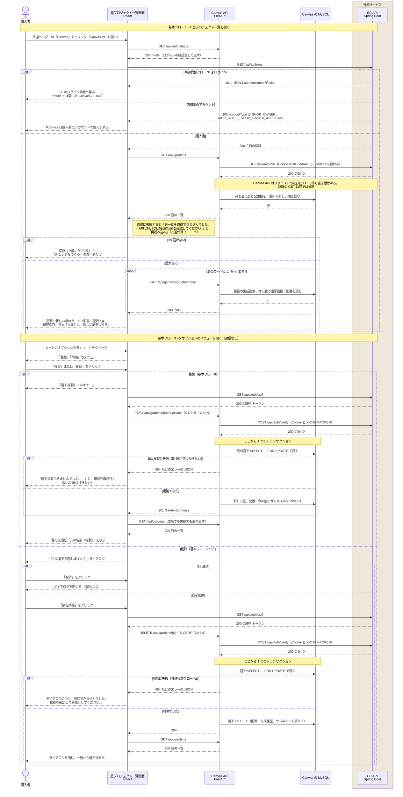
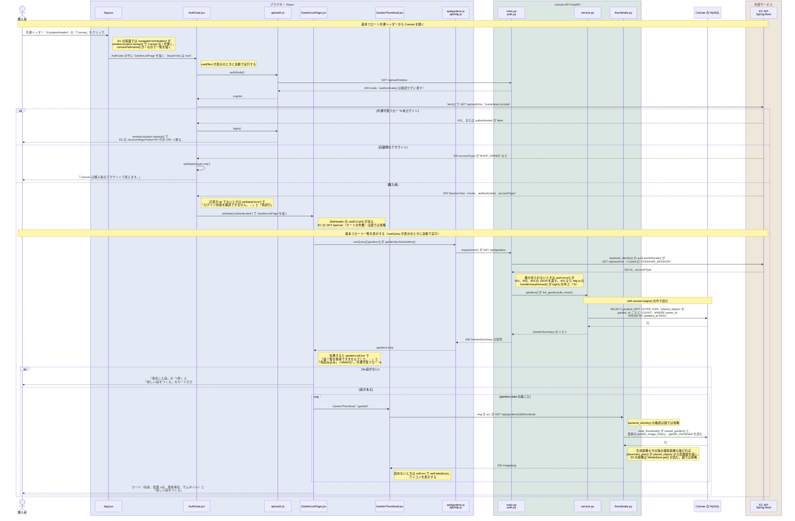
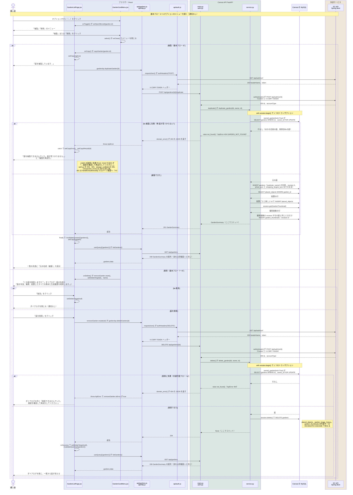

# UC-08 庭プロジェクトを管理する

- ユースケース記述: [UC-08_庭プロジェクトを管理する](<../../アーカイブ/ユースケース/kusakari-canvas/UC-08_庭プロジェクトを管理する.md>)
- 対象のコード: kusakari-canvas の main（c19d497、2026-11-20 時点）

「庭プロジェクト一覧」画面は Canvas の `/` です。Canvas はログインの画面を持たず、ログインの確認を EC API に任せます。画面は EC の `GET /api/auth/me` を直接呼び、Canvas API はリクエストのたびに EC へ持ち主を問い合わせます（読み取りは `GET /api/auth/me`、更新は `POST /api/auth/verify`）。Canvas から見ると EC API は外部システムなので、図では外部サービスとして書きます。詳細図は、一覧を開くところ（詳細図 1）と、複製・削除（詳細図 2）に分けました。

## 概要図

## 詳細図 1 基本フロー 1〜2 一覧を開く

## 詳細図 2 基本フロー 3〜9 複製・削除

## ユースケース記述との差

- 2a：記述の「保存した庭はまだありません。上のフォームから最初の庭を作成できます。」はコードにありません。庭が無いときは「保存した庭」の件数が「0件」になり、「新しい庭をつくる」のカードだけが出ます。一覧の上に作成のフォームはありません。
- 基本フロー 1〜2：店舗側のアカウント（`SHOP_OWNER`、`SHOP_STAFF`、`SHOP_OWNER_APPLICANT`）は、一覧を出さずに「Canvas は購入者のアカウントで使えます。」で止まります（`AuthGate`）。Canvas API も 403 `BUYER_ACCOUNT_REQUIRED` を返します。記述にはありません。
- 基本フロー 2：カードには名前のほかに「配置 n点」「最終保存」とサムネイルが出ます。サムネイルは、最新の生成画像、今の版の撮影画像、配置図の順に選びます。
- 基本フロー 6：複製するのは、名前、幅、奥行き、写真（`photo_json`）、`shopping_targets_json`、すべての配置、元の庭の今の版のサムネイルです。AI の生成履歴と、EC で買い物リストに追加した商品は複製しません。記述の「選択したプロジェクトの内容を複製して」には、この範囲が書かれていません。
- 6a：「複製を再試行」は、メニューを開き直さずに、同じ庭の複製をもう一度送ります。複製に失敗したときも、`finally` で一覧を取り直します。
- 基本フロー 8〜9：削除の失敗には個別の代替フローがありません。コードはダイアログを閉じずに「削除できませんでした。接続を確認して再試行してください。」を出します。庭が見つからない 404 でも同じ文です。ダイアログには「削除すると元に戻せません。」の説明も出ます。
- 関連情報の「削除したプロジェクトの復元はしない」：DB の行は消えますが、画像を S3 に置く設定では、S3 の画像は消しません（`media.py` の方針。複製した庭と同じ画像を参照しているため）。

## 参照したコード

kusakari-canvas

- [frontend/src/pages/App.jsx](https://github.com/abeouga/kusakari-canvas/blob/c19d497dfef15b119f9bce8ecb5c886a36da6b7d/frontend/src/pages/App.jsx): `App`（パスと画面の対応）
- [frontend/src/components/AuthGate.jsx](https://github.com/abeouga/kusakari-canvas/blob/c19d497dfef15b119f9bce8ecb5c886a36da6b7d/frontend/src/components/AuthGate.jsx): `AuthGate`（`GET /api/auth/me`、`buyer-only`、`error`）
- [frontend/src/api/auth.js](https://github.com/abeouga/kusakari-canvas/blob/c19d497dfef15b119f9bce8ecb5c886a36da6b7d/frontend/src/api/auth.js): `authMode`、`authHeaders`、`login`、`handleUnauthorized`
- [frontend/src/pages/GardenListPage.jsx](https://github.com/abeouga/kusakari-canvas/blob/c19d497dfef15b119f9bce8ecb5c886a36da6b7d/frontend/src/pages/GardenListPage.jsx): `useQuery(['gardens'])`、`copyGarden`、`removeGarden`、削除のダイアログ
- [frontend/src/components/GardenCardMenu.jsx](https://github.com/abeouga/kusakari-canvas/blob/c19d497dfef15b119f9bce8ecb5c886a36da6b7d/frontend/src/components/GardenCardMenu.jsx): `select`、「複製」「削除」
- [frontend/src/components/GardenThumbnail.jsx](https://github.com/abeouga/kusakari-canvas/blob/c19d497dfef15b119f9bce8ecb5c886a36da6b7d/frontend/src/components/GardenThumbnail.jsx): `GardenThumbnail`（img の `onError`）
- [frontend/src/components/SiteHeader.jsx](https://github.com/abeouga/kusakari-canvas/blob/c19d497dfef15b119f9bce8ecb5c886a36da6b7d/frontend/src/components/SiteHeader.jsx): `SiteHeader`（`useEcCart`）
- [frontend/src/api/gardens.js](https://github.com/abeouga/kusakari-canvas/blob/c19d497dfef15b119f9bce8ecb5c886a36da6b7d/frontend/src/api/gardens.js): `listGardens`、`duplicateGarden`、`deleteGarden`
- [frontend/src/api/http.js](https://github.com/abeouga/kusakari-canvas/blob/c19d497dfef15b119f9bce8ecb5c886a36da6b7d/frontend/src/api/http.js): `requestJson`、`ApiError`
- [vendor/kusakari-site-header-0.1.13.tgz](https://github.com/abeouga/kusakari-canvas/blob/c19d497dfef15b119f9bce8ecb5c886a36da6b7d/vendor/kusakari-site-header-0.1.13.tgz): `KusakariHeader.jsx` の「Canvas」の a 要素と `follow`
- [backend/kusakari_canvas_api/main.py](https://github.com/abeouga/kusakari-canvas/blob/c19d497dfef15b119f9bce8ecb5c886a36da6b7d/backend/kusakari_canvas_api/main.py): `backend_identity`、`domain_error`、`storage_conflict`、`unexpected_error`、`auth_status`、`gardens`、`duplicate`、`delete`
- [backend/kusakari_canvas_api/auth.py](https://github.com/abeouga/kusakari-canvas/blob/c19d497dfef15b119f9bce8ecb5c886a36da6b7d/backend/kusakari_canvas_api/auth.py): `AuthBoundary.authenticate`、`error`
- [backend/kusakari_canvas_api/service.py](https://github.com/abeouga/kusakari-canvas/blob/c19d497dfef15b119f9bce8ecb5c886a36da6b7d/backend/kusakari_canvas_api/service.py): `owned_garden`、`list_gardens`、`duplicate_garden`、`duplicate_name`、`delete_garden`
- [backend/kusakari_canvas_api/thumbnails.py](https://github.com/abeouga/kusakari-canvas/blob/c19d497dfef15b119f9bce8ecb5c886a36da6b7d/backend/kusakari_canvas_api/thumbnails.py): `thumbnail_router` の `get`、`read_thumbnail`、`placement_plan`
- [backend/kusakari_canvas_api/media.py](https://github.com/abeouga/kusakari-canvas/blob/c19d497dfef15b119f9bce8ecb5c886a36da6b7d/backend/kusakari_canvas_api/media.py): `MediaStore.get`（DB の行を消しても画像は消さない方針）
- [backend/kusakari_canvas_api/errors.py](https://github.com/abeouga/kusakari-canvas/blob/c19d497dfef15b119f9bce8ecb5c886a36da6b7d/backend/kusakari_canvas_api/errors.py): `ApiError`、`not_found`
- [backend/kusakari_canvas_api/models.py](https://github.com/abeouga/kusakari-canvas/blob/c19d497dfef15b119f9bce8ecb5c886a36da6b7d/backend/kusakari_canvas_api/models.py): `Garden`、`PlacedObject`、`GardenThumbnail`（外部キーの `ondelete="CASCADE"`）
- [backend/kusakari_canvas_api/history_models.py](https://github.com/abeouga/kusakari-canvas/blob/c19d497dfef15b119f9bce8ecb5c886a36da6b7d/backend/kusakari_canvas_api/history_models.py): `HistoryEntity`（外部キーの `ondelete="CASCADE"`）
- [docs/garden-duplication.md](https://github.com/abeouga/kusakari-canvas/blob/c19d497dfef15b119f9bce8ecb5c886a36da6b7d/docs/garden-duplication.md): 複製の範囲（生成履歴と EC の追加分を複製しない）

kusakari-ec

- [frontend/src/App.jsx](https://github.com/abeouga/kusakari-ec/blob/19a2be307ee71a2cd87e538236c3c8c42929c5b3/frontend/src/App.jsx): `navigateFromHeader`（共通ヘッダーから Canvas を開く）
- [backend/src/main/java/jp/kusakari/ec/auth/AuthController.java](https://github.com/abeouga/kusakari-ec/blob/19a2be307ee71a2cd87e538236c3c8c42929c5b3/backend/src/main/java/jp/kusakari/ec/auth/AuthController.java): `me`、`verify`、`csrf`
