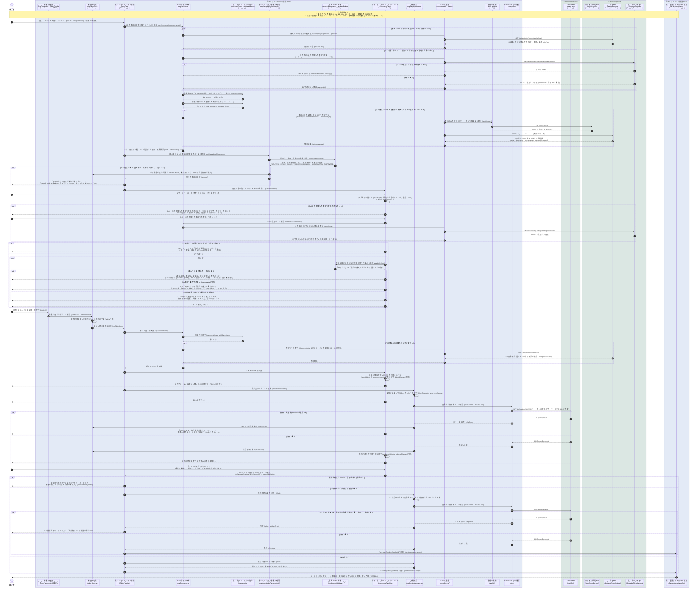
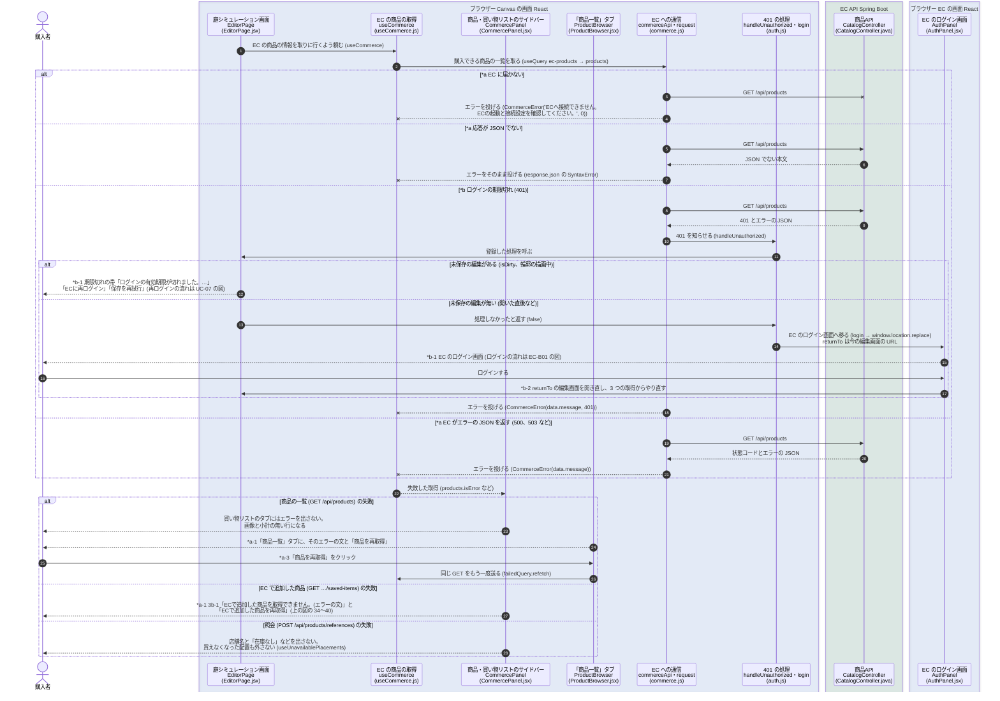

# UC-09 買い物リストを表示する

- ユースケース記述: [UC-09_買い物リストを表示する](<../../アーカイブ/ユースケース/kusakari-canvas/UC-09_買い物リストを表示する.md>)
- 共通代替フロー: [00_全ユースケース共通の代替フロー](<00_全ユースケース共通の代替フロー.md>)
- 対象のコード: kusakari-canvas の main（7e9a8dd、2026-11-24 時点）、kusakari-ec の main（6bad7e3、2026-11-24 時点）

## シーケンス図

参加者は、上から「画面や役割の名前」「コンポーネント・クラス・関数の名前」「ファイル名（かっこ付き）」の順に書いています。
共通代替フローの中身は、00 の図か、下の「共通代替フローを直接書いた図」を見てください。
買い物リストは Canvas の DB に保存しません。画面が、編集中の GardenDocument の配置を数え、EC から取った商品の情報と合わせて作ります。EC の情報は、ブラウザーが EC API を直接呼んで取ります（Canvas API を通しません）。Canvas API を呼ぶのは、配置を変えたあとの自動保存（`PUT /api/gardens/{id}`）だけで、その中の流れは [UC-07 の図](<UC-07_庭プロジェクトを保存する.md>) にあります。

## 共通代替フローを直接書いた図

上の図の、庭を開いたときの EC への 3 つの取得（`GET /api/products`、`GET /api/shopping-lists/{gardenId}/saved-items`、`POST /api/products/references`）に、この画面で起こる共通代替フロー（\*a、\*b）を書き込んだ図です。どれも `useCommerce.js` の `useQuery`（`retry: false`）で、失敗しても自動では送り直しません。図は `GET /api/products` を例にし、ほかの 2 つの違いは最後の `alt` に書いています。自動保存（`PUT /api/gardens/{id}`）の \*a・\*b は、[UC-07 の「共通代替フローを直接書いた図」](<UC-07_庭プロジェクトを保存する.md>) と同じです。

## ユースケース記述との差

- 基本フロー 1〜3: EC からの取得は、タブのクリックではなく、庭シミュレーション画面を開いたとき（`useCommerce` の `useQuery`）に行います。「買い物リスト（N）」のタブは最初から選ばれていて、タブを切り替えても通信しません。画面に戻ったとき（`refetchOnWindowFocus`）にも、10 秒より古ければ取り直します。
- 基本フロー 3: 「各庭オブジェクトに紐づく商品」の情報は 2 つの通信から作ります。`GET /api/products` は購入できる商品だけを返し（EC の `CatalogService.products()` の `purchasable` の絞り込み）、画像、名前、価格に使います。`POST /api/products/references` は削除された商品も返し、店舗名、購入できるか、できない理由に使います。
- 基本フロー 4: 「(庭の名前)の買い物リスト」という見出しは出しません。必要数は数字として表示せず、庭に設置した数をバッジで出します。EC で追加しただけの行には数を出さずに「ECで追加（庭に未配置）」と出します。小計の目安は `priceYen × quantity` で、未配置の行は 1 点として計算します。店舗名も記述にありません。リスト全体の合計はありません。
- 反映の状態（「ECへ未反映」「ECへ反映中…」「ECへ未反映：保存を再試行してください。」）は記述にありません。最後に保存が済んだあとに配置が変わり、保存が済んでいないときだけ出します。反映済みの表示はありません。写真の読み込み、輪郭の描画や確定、庭の名前・寸法の変更だけでは出しません。
- 4a: 記述の「庭に商品を配置するか、ECで買い物リストに追加すると、このリストに表示されます。」は今の画面にありません。i のアイコンと「植物が設置されていません」だけを出し、「リストを確認」も出しません。EC で追加しただけの商品も行になるので、庭に何も置いていなくても、その行があれば 4a になりません。
- 3a: 記述の「この店舗の販売対象ではないため購入できません。保存済みの配置は維持されます。」はコードにありません。照会で購入できない商品は「在庫なし」か「現在は購入できません」と出します。照会結果が無く、商品の一覧にも無い商品は「現在は販売されていないため購入できません。保存済みの配置は維持されます。」と出します。Canvas には「選択中の店舗」がありません。
- 記述にない処理: 庭を開いたとき、削除、店舗の閉鎖、店舗の停止、組織の停止で買えなくなった商品の配置を外し、「庭から外した商品があります」ダイアログを出します（`useUnavailablePlacements`）。外した結果は自動保存されます。この理由の商品には、3a の「保存済みの配置は維持されます」が当てはまりません。照会に失敗したときは配置を外しません。
- 3b: エラーの文は「ECで追加した商品を取得できません。」のあとに、EC かブラウザーのエラーの文が続きます。取得できない間も、配置した商品の行は表示します。
- 基本フロー 6: 必要数と小計は画面の中で数え直します。商品の組み合わせが変わると照会を送り直し、最後の変更から 500 ms 後に庭全体を `PUT /api/gardens/{id}` で自動保存します。どちらも記述にありません。
- 7a: 輪郭が確定していない写真があるときは、保存も EC への移動もせず、「庭写真を保存せずに戻りますか？」を出します。施工範囲外の配置があるときは、PUT を送らずにエラーを出し、EC の画面を開きません。輪郭の描画中と操作中は「リストを確認」を押せません。どれも記述にありません。
- 共通代替フロー \*a: 商品の一覧や照会に失敗しても、買い物リストのタブにはエラーを出しません。エラーと「商品を再取得」は「商品一覧」のタブ（`ProductBrowser`）だけに出ます。

## 確かめられなかったこと

- EC の応答の本文が JSON でないときに、画面にどの文が出るか（ブラウザーごとの `SyntaxError` の文）は、動かして確かめていません。

## 参照したコード

kusakari-canvas

- [frontend/src/pages/EditorPage.jsx](https://github.com/abeouga/kusakari-canvas/blob/7e9a8dd0a40f2b212ca20b3aa94f2dc984b00b7a/frontend/src/pages/EditorPage.jsx): `useCommerce` と `useUnavailablePlacements` の呼び出し、`requestNavigation`、「庭から外した商品があります」と「庭写真を保存せずに戻りますか？」のダイアログ、`setUnauthorizedHandler`
- [frontend/src/components/CommercePanel.jsx](https://github.com/abeouga/kusakari-canvas/blob/7e9a8dd0a40f2b212ca20b3aa94f2dc984b00b7a/frontend/src/components/CommercePanel.jsx): タブ、反映の状態（`savedObjects`、`objectsChanged`）、空のときの表示（`empty`）、行の表示、「ECで追加した商品を再取得」、「リストを確認」
- [frontend/src/components/ProductBrowser.jsx](https://github.com/abeouga/kusakari-canvas/blob/7e9a8dd0a40f2b212ca20b3aa94f2dc984b00b7a/frontend/src/components/ProductBrowser.jsx): `failedQuery` と「商品を再取得」
- [frontend/src/hooks/useCommerce.js](https://github.com/abeouga/kusakari-canvas/blob/7e9a8dd0a40f2b212ca20b3aa94f2dc984b00b7a/frontend/src/hooks/useCommerce.js): `useCommerce`（`products`、`saved`、`references` の `useQuery`）
- [frontend/src/api/commerce.js](https://github.com/abeouga/kusakari-canvas/blob/7e9a8dd0a40f2b212ca20b3aa94f2dc984b00b7a/frontend/src/api/commerce.js): `request`、`CommerceError`、`commerceApi.products`、`savedItems`、`references`
- [frontend/src/api/auth.js](https://github.com/abeouga/kusakari-canvas/blob/7e9a8dd0a40f2b212ca20b3aa94f2dc984b00b7a/frontend/src/api/auth.js): `authHeaders`、`handleUnauthorized`、`login`
- [frontend/src/api/http.js](https://github.com/abeouga/kusakari-canvas/blob/7e9a8dd0a40f2b212ca20b3aa94f2dc984b00b7a/frontend/src/api/http.js): `requestJson`
- [frontend/src/domain/shopping.js](https://github.com/abeouga/kusakari-canvas/blob/7e9a8dd0a40f2b212ca20b3aa94f2dc984b00b7a/frontend/src/domain/shopping.js): `placementRows`、`withSavedItems`、`ecUrl`
- [frontend/src/domain/productAvailability.js](https://github.com/abeouga/kusakari-canvas/blob/7e9a8dd0a40f2b212ca20b3aa94f2dc984b00b7a/frontend/src/domain/productAvailability.js): `REMOVED_REASONS`、`removedPlacements`、`availabilityNote`
- [frontend/src/hooks/useUnavailablePlacements.js](https://github.com/abeouga/kusakari-canvas/blob/7e9a8dd0a40f2b212ca20b3aa94f2dc984b00b7a/frontend/src/hooks/useUnavailablePlacements.js): `useUnavailablePlacements`
- [frontend/src/stores/editorStore.js](https://github.com/abeouga/kusakari-canvas/blob/7e9a8dd0a40f2b212ca20b3aa94f2dc984b00b7a/frontend/src/stores/editorStore.js): `addAssetAt`、`deleteSelected`、`removeObjects`、`markSaved`、`setSaveError`
- [frontend/src/three/DropPlacement.jsx](https://github.com/abeouga/kusakari-canvas/blob/7e9a8dd0a40f2b212ca20b3aa94f2dc984b00b7a/frontend/src/three/DropPlacement.jsx): `addAssetAt` の呼び出し
- [frontend/src/components/ObjectToolbar.jsx](https://github.com/abeouga/kusakari-canvas/blob/7e9a8dd0a40f2b212ca20b3aa94f2dc984b00b7a/frontend/src/components/ObjectToolbar.jsx): 「削除」の `onDelete`
- [frontend/src/hooks/useGardenAutosave.js](https://github.com/abeouga/kusakari-canvas/blob/7e9a8dd0a40f2b212ca20b3aa94f2dc984b00b7a/frontend/src/hooks/useGardenAutosave.js): `saveBlocker`、`save`、500 ms の `useEffect`、`flush`
- [backend/kusakari_canvas_api/main.py](https://github.com/abeouga/kusakari-canvas/blob/7e9a8dd0a40f2b212ca20b3aa94f2dc984b00b7a/backend/kusakari_canvas_api/main.py): `update`

kusakari-ec

- [backend/src/main/java/jp/kusakari/ec/catalog/controller/CatalogController.java](https://github.com/abeouga/kusakari-ec/blob/6bad7e37c4135034fbe97e30309772fbe872e675/backend/src/main/java/jp/kusakari/ec/catalog/controller/CatalogController.java): `products`、`references`
- [backend/src/main/java/jp/kusakari/ec/catalog/service/CatalogService.java](https://github.com/abeouga/kusakari-ec/blob/6bad7e37c4135034fbe97e30309772fbe872e675/backend/src/main/java/jp/kusakari/ec/catalog/service/CatalogService.java): `products`（購入できる商品だけを返す）
- [backend/src/main/java/jp/kusakari/ec/shopping/ShoppingController.java](https://github.com/abeouga/kusakari-ec/blob/6bad7e37c4135034fbe97e30309772fbe872e675/backend/src/main/java/jp/kusakari/ec/shopping/ShoppingController.java): `savedItems`
- [backend/src/main/java/jp/kusakari/ec/auth/AuthController.java](https://github.com/abeouga/kusakari-ec/blob/6bad7e37c4135034fbe97e30309772fbe872e675/backend/src/main/java/jp/kusakari/ec/auth/AuthController.java): `csrf`
- [frontend/src/components/GardenItemsDialog.jsx](https://github.com/abeouga/kusakari-ec/blob/6bad7e37c4135034fbe97e30309772fbe872e675/frontend/src/components/GardenItemsDialog.jsx): `/cart?garden={gardenId}` で開く「庭に設置したものから追加」
- [frontend/src/components/AuthPanel.jsx](https://github.com/abeouga/kusakari-ec/blob/6bad7e37c4135034fbe97e30309772fbe872e675/frontend/src/components/AuthPanel.jsx): ログイン画面と `returnTo` への戻り
