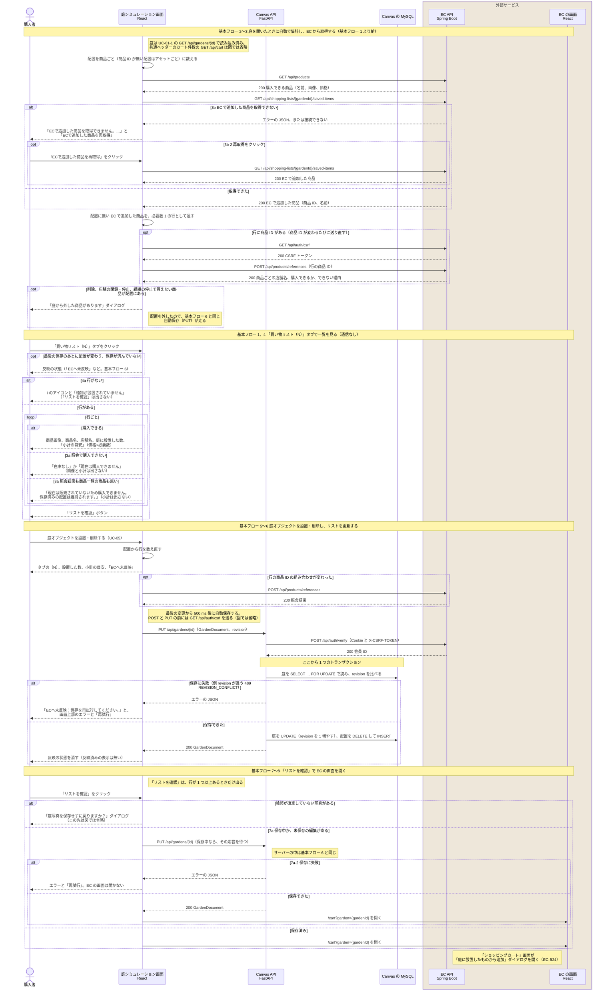
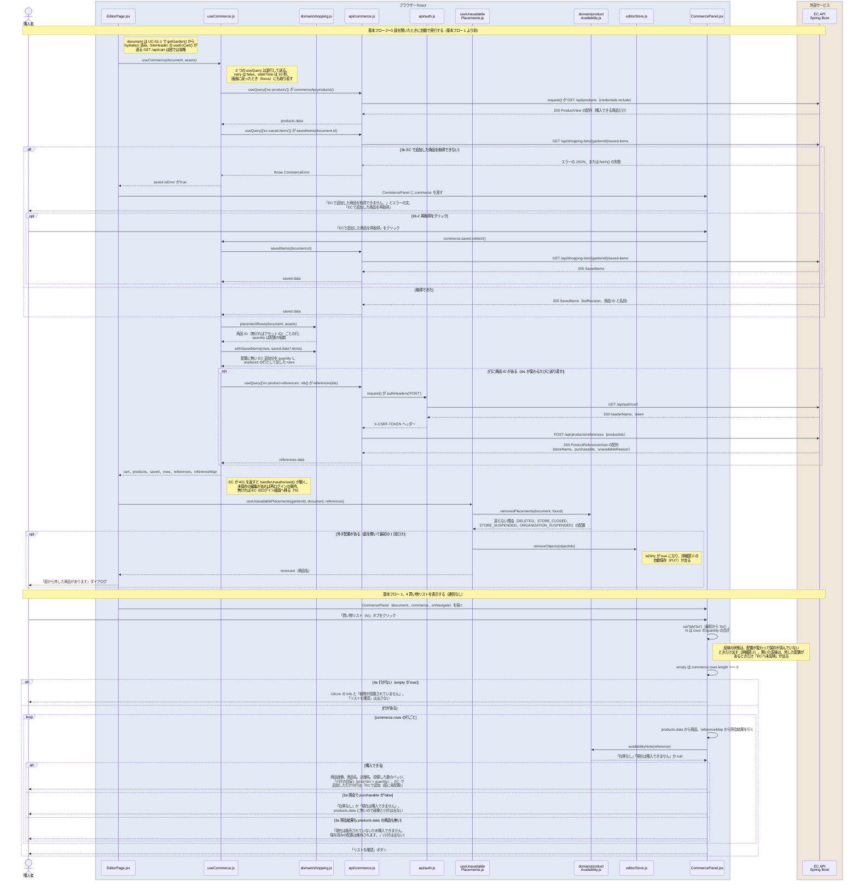
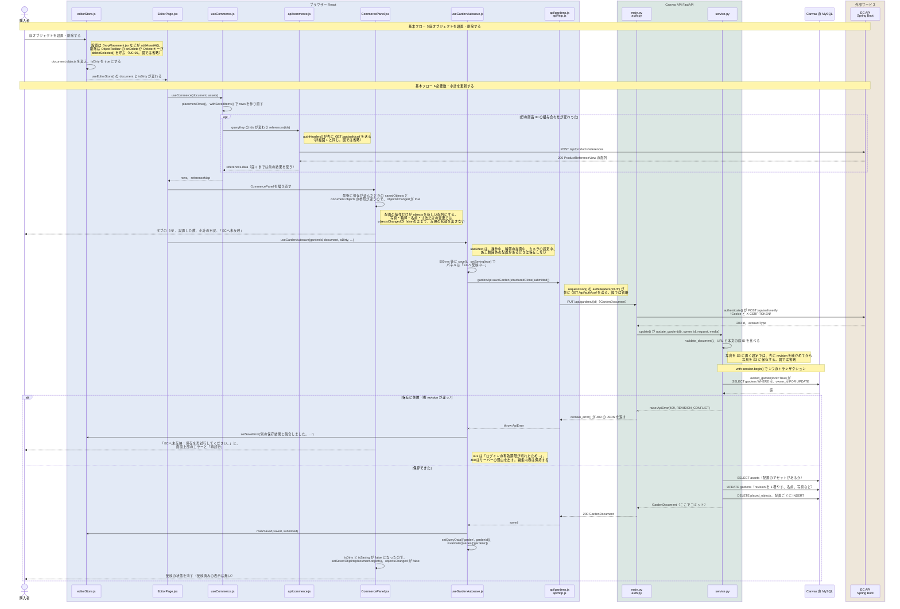
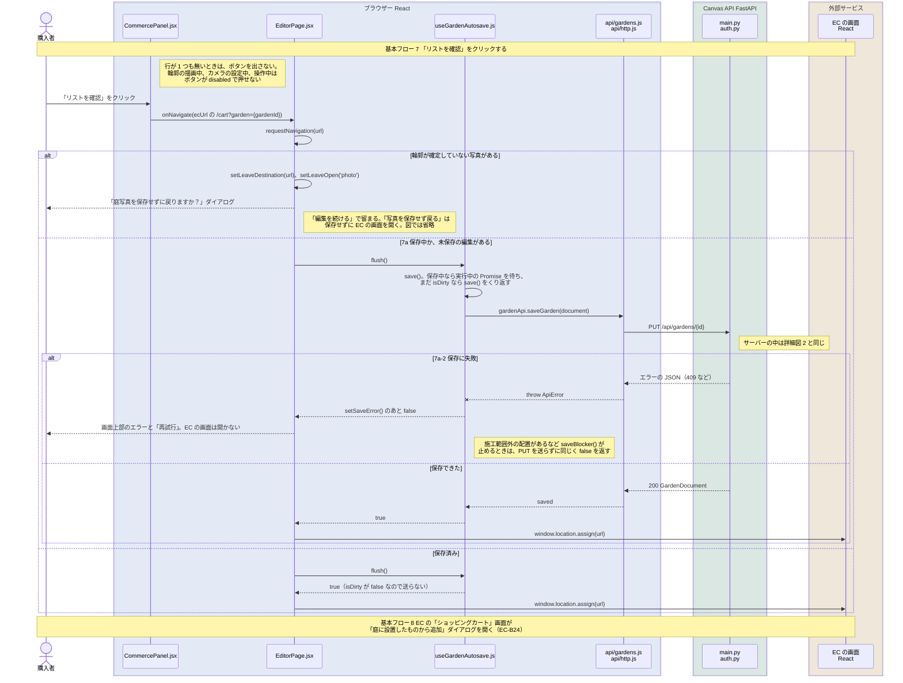

# UC-09 買い物リストを表示する

- ユースケース記述: [UC-09_買い物リストを表示する](<../../アーカイブ/ユースケース/kusakari-canvas/UC-09_買い物リストを表示する.md>)
- 対象のコード: kusakari-canvas の main（046c5fa、2026-11-20 時点）

買い物リストは Canvas の DB に保存しません。画面が、編集中の GardenDocument の配置を数え、EC から取った商品の情報と合わせて作ります。EC の情報は、ブラウザーが EC API を直接呼んで取ります（Canvas API を通しません）。Canvas API を呼ぶのは、配置を変えたあとの自動保存（`PUT /api/gardens/{id}`）だけです。Canvas から見ると EC API と EC の画面は外部システムなので、図では外部サービスとして書きます。詳細図は、表示まで（詳細図 1）、設置・削除のあと（詳細図 2）、「リストを確認」（詳細図 3）に分けました。

## 概要図

## 詳細図 1 基本フロー 1〜4 EC から取得して表示する

## 詳細図 2 基本フロー 5〜6 設置・削除のあとに更新する

## 詳細図 3 基本フロー 7〜8 「リストを確認」で EC の画面を開く

## ユースケース記述との差

- 基本フロー 1〜3：EC からの取得は、タブのクリックではなく、庭シミュレーション画面を開いたとき（`useCommerce` の `useQuery`）に行います。「買い物リスト（N）」のタブは最初から選ばれていて、タブを切り替えても通信しません。続きは [EC-B24 の図](<../kusakari-ec/EC-B24_買い物リストを確認する(EC).md>) です。
- 基本フロー 3：「各庭オブジェクトに紐づく商品」の情報は 2 つの通信から作ります。`GET /api/products` は購入できる商品だけを返し、画像、名前、価格に使います。`POST /api/products/references` は削除された商品も返し、店舗名、購入できるか、できない理由に使います。
- 基本フロー 4：「(庭の名前)の買い物リスト」という見出しは出しません。必要数は数字として表示しません。庭に設置した数をバッジで出し、EC で追加しただけの行には数を出さずに「ECで追加（庭に未配置）」と出します。小計の目安は `priceYen × quantity` で、未配置の行は 1 点として計算します。店舗名も記述にありません。
- 反映の状態（「ECへ未反映」「ECへ反映中…」「ECへ未反映：保存を再試行してください。」）は記述にありません。最後に保存が済んだあとに配置が変わり、保存が済んでいないときだけ出します。反映済みの表示はありません。写真の読み込み、輪郭の描画や確定、庭の名前・寸法の変更だけでは、EC に渡る内容が変わらないので出しません。
- 4a：記述の「庭に商品を配置するか、ECで買い物リストに追加すると、このリストに表示されます。」は今の画面にありません。i のアイコンと「植物が設置されていません」だけを出し、「リストを確認」も出しません。EC で追加しただけの商品も行になるので、庭に何も置いていなくても、その行があれば 4a になりません。
- 3a：記述の「この店舗の販売対象ではないため購入できません。保存済みの配置は維持されます。」はコードにありません。照会で購入できない商品は「在庫なし」か「現在は購入できません」と出します。照会結果が無く、商品一覧にも無い商品は「現在は販売されていないため購入できません。保存済みの配置は維持されます。」と出します。Canvas には「選択中の店舗」がありません。リスト全体の合計も無く、小計は行ごとです。購入できない行は商品一覧に無いので、小計を出しません。
- 記述にない処理：庭を開いたとき、削除、店舗の閉鎖、店舗の停止、組織の停止で買えなくなった商品の配置を外し、「庭から外した商品があります」ダイアログを出します（`useUnavailablePlacements`）。外した結果は自動保存されます。この理由の商品については、3a の「保存済みの配置は維持されます」が当てはまりません。照会に失敗したときは配置を外しません。
- 3b：エラーの文は「ECで追加した商品を取得できません。」のあとに、EC かブラウザーのエラーの文が続きます。取得できない間も、配置した商品の行は表示します。
- 基本フロー 6：必要数と小計は画面の中で数え直します。商品の組み合わせが変わると照会を送り直し、最後の変更から 500 ms 後に庭全体を `PUT /api/gardens/{id}` で自動保存します。どちらも記述にありません。
- 7a：輪郭が確定していない写真があるときは、保存も EC への移動もせず、「庭写真を保存せずに戻りますか？」を出します。施工範囲外の配置があるときは、保存せずにエラーを出し、EC の画面を開きません。輪郭の描画中とカメラの設定中は「リストを確認」を押せません。行が 1 つも無いときは「リストを確認」を出しません。どれも記述にありません。
- 共通代替フロー *a：商品一覧（`GET /api/products`）や照会（`POST /api/products/references`）に失敗しても、買い物リストのタブにはエラーを出しません。エラーと「商品を再取得」は「商品一覧」のタブ（`ProductBrowser`）だけに出ます。

## 参照したコード

kusakari-canvas

- [frontend/src/pages/EditorPage.jsx](https://github.com/abeouga/kusakari-canvas/blob/046c5faaa8dcc4a788a989d5149b2be335bf8724/frontend/src/pages/EditorPage.jsx): `useCommerce` と `useUnavailablePlacements` の呼び出し、`requestNavigation`、「庭から外した商品があります」と「庭写真を保存せずに戻りますか？」のダイアログ、`setUnauthorizedHandler`
- [frontend/src/components/CommercePanel.jsx](https://github.com/abeouga/kusakari-canvas/blob/046c5faaa8dcc4a788a989d5149b2be335bf8724/frontend/src/components/CommercePanel.jsx): タブ、反映の状態（`savedObjects`、`objectsChanged`）、空のときの表示（`empty`）、行の表示、「ECで追加した商品を再取得」、「リストを確認」
- [frontend/src/hooks/useCommerce.js](https://github.com/abeouga/kusakari-canvas/blob/046c5faaa8dcc4a788a989d5149b2be335bf8724/frontend/src/hooks/useCommerce.js): `useEcCart`、`useCommerce`（`products`、`saved`、`references` の `useQuery`）
- [frontend/src/api/commerce.js](https://github.com/abeouga/kusakari-canvas/blob/046c5faaa8dcc4a788a989d5149b2be335bf8724/frontend/src/api/commerce.js): `request`、`CommerceError`、`commerceApi.products`、`savedItems`、`references`
- [frontend/src/api/auth.js](https://github.com/abeouga/kusakari-canvas/blob/046c5faaa8dcc4a788a989d5149b2be335bf8724/frontend/src/api/auth.js): `authHeaders`、`handleUnauthorized`
- [frontend/src/domain/shopping.js](https://github.com/abeouga/kusakari-canvas/blob/046c5faaa8dcc4a788a989d5149b2be335bf8724/frontend/src/domain/shopping.js): `placementRows`、`withSavedItems`、`ecUrl`
- [frontend/src/domain/productAvailability.js](https://github.com/abeouga/kusakari-canvas/blob/046c5faaa8dcc4a788a989d5149b2be335bf8724/frontend/src/domain/productAvailability.js): `REMOVED_REASONS`、`removedPlacements`、`availabilityNote`
- [frontend/src/hooks/useUnavailablePlacements.js](https://github.com/abeouga/kusakari-canvas/blob/046c5faaa8dcc4a788a989d5149b2be335bf8724/frontend/src/hooks/useUnavailablePlacements.js): `useUnavailablePlacements`
- [frontend/src/stores/editorStore.js](https://github.com/abeouga/kusakari-canvas/blob/046c5faaa8dcc4a788a989d5149b2be335bf8724/frontend/src/stores/editorStore.js): `addAssetAt`、`deleteSelected`、`removeObjects`、`markSaved`、`setSaveError`
- [frontend/src/hooks/useGardenAutosave.js](https://github.com/abeouga/kusakari-canvas/blob/046c5faaa8dcc4a788a989d5149b2be335bf8724/frontend/src/hooks/useGardenAutosave.js): `saveBlocker`、`save`、500 ms の `useEffect`、`flush`
- [frontend/src/api/gardens.js](https://github.com/abeouga/kusakari-canvas/blob/046c5faaa8dcc4a788a989d5149b2be335bf8724/frontend/src/api/gardens.js): `saveGarden`
- [frontend/src/api/http.js](https://github.com/abeouga/kusakari-canvas/blob/046c5faaa8dcc4a788a989d5149b2be335bf8724/frontend/src/api/http.js): `requestJson`、`ApiError`
- [frontend/src/components/ProductBrowser.jsx](https://github.com/abeouga/kusakari-canvas/blob/046c5faaa8dcc4a788a989d5149b2be335bf8724/frontend/src/components/ProductBrowser.jsx): 商品一覧のタブのエラーと「商品を再取得」
- [backend/kusakari_canvas_api/main.py](https://github.com/abeouga/kusakari-canvas/blob/046c5faaa8dcc4a788a989d5149b2be335bf8724/backend/kusakari_canvas_api/main.py): `backend_identity`、`update`、`domain_error`
- [backend/kusakari_canvas_api/auth.py](https://github.com/abeouga/kusakari-canvas/blob/046c5faaa8dcc4a788a989d5149b2be335bf8724/backend/kusakari_canvas_api/auth.py): `AuthBoundary.authenticate`（更新は EC の `POST /api/auth/verify`）
- [backend/kusakari_canvas_api/service.py](https://github.com/abeouga/kusakari-canvas/blob/046c5faaa8dcc4a788a989d5149b2be335bf8724/backend/kusakari_canvas_api/service.py): `update_garden`、`owned_garden`
- [docs/garden-shopping-lists.md](https://github.com/abeouga/kusakari-canvas/blob/046c5faaa8dcc4a788a989d5149b2be335bf8724/docs/garden-shopping-lists.md): 買い物リストを配置から集計すること、EC で追加した商品の合成、反映の状態を出す条件、空のときの表示、「リストを確認」の前の保存

kusakari-ec

- [backend/src/main/java/jp/kusakari/ec/catalog/controller/CatalogController.java](https://github.com/abeouga/kusakari-ec/blob/19a2be307ee71a2cd87e538236c3c8c42929c5b3/backend/src/main/java/jp/kusakari/ec/catalog/controller/CatalogController.java): `products`、`references`
- [backend/src/main/java/jp/kusakari/ec/catalog/service/CatalogService.java](https://github.com/abeouga/kusakari-ec/blob/19a2be307ee71a2cd87e538236c3c8c42929c5b3/backend/src/main/java/jp/kusakari/ec/catalog/service/CatalogService.java): `products`（購入できる商品だけを返す）
- [backend/src/main/java/jp/kusakari/ec/catalog/dto/CatalogDtos.java](https://github.com/abeouga/kusakari-ec/blob/19a2be307ee71a2cd87e538236c3c8c42929c5b3/backend/src/main/java/jp/kusakari/ec/catalog/dto/CatalogDtos.java): `ProductReferenceView`
- [backend/src/main/java/jp/kusakari/ec/shopping/ShoppingController.java](https://github.com/abeouga/kusakari-ec/blob/19a2be307ee71a2cd87e538236c3c8c42929c5b3/backend/src/main/java/jp/kusakari/ec/shopping/ShoppingController.java): `savedItems`
- [backend/src/main/java/jp/kusakari/ec/shopping/ShoppingService.java](https://github.com/abeouga/kusakari-ec/blob/19a2be307ee71a2cd87e538236c3c8c42929c5b3/backend/src/main/java/jp/kusakari/ec/shopping/ShoppingService.java): `savedItems`
- [backend/src/main/java/jp/kusakari/ec/auth/AuthController.java](https://github.com/abeouga/kusakari-ec/blob/19a2be307ee71a2cd87e538236c3c8c42929c5b3/backend/src/main/java/jp/kusakari/ec/auth/AuthController.java): `verify`、`csrf`
