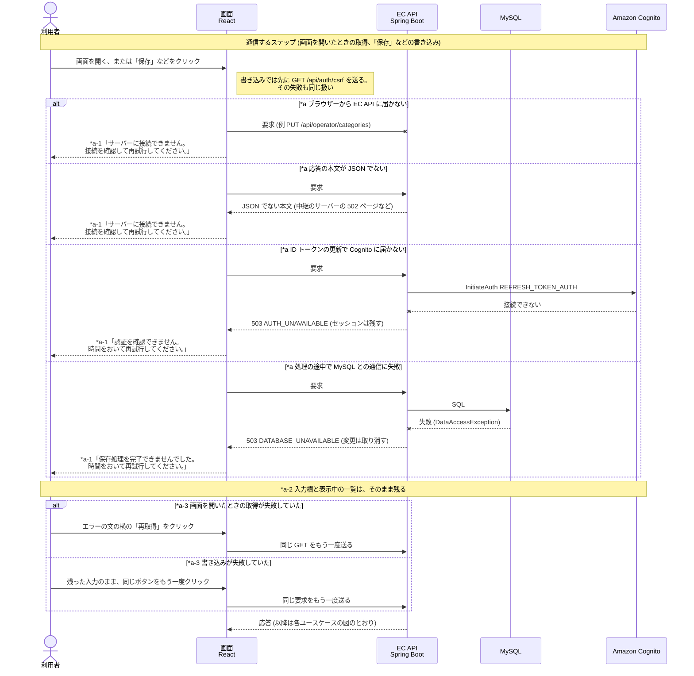
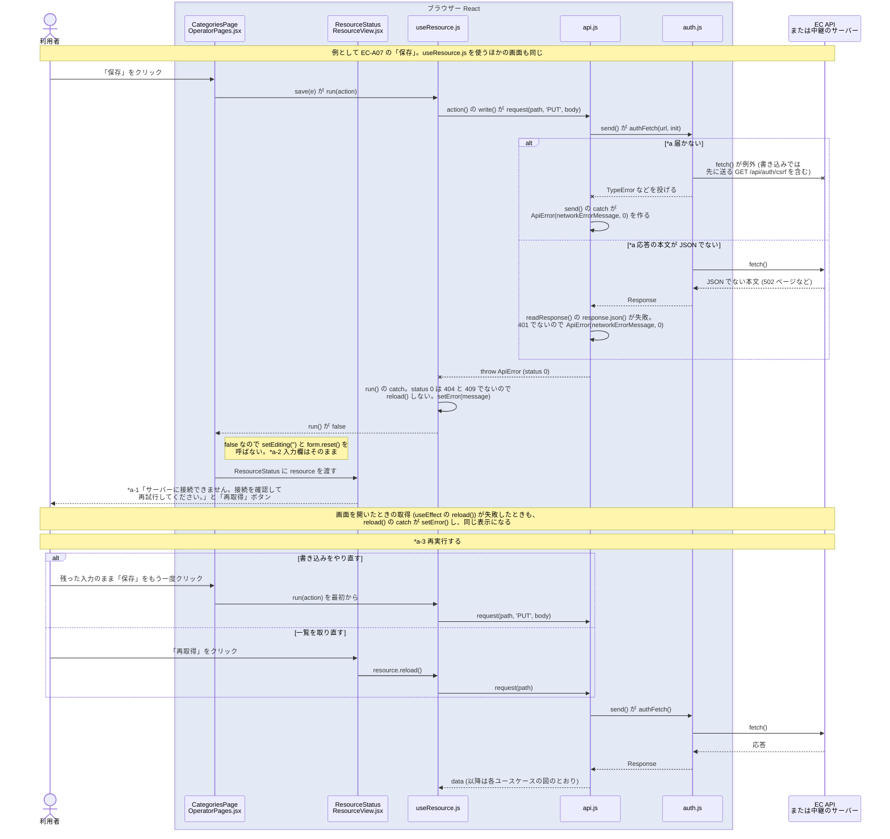
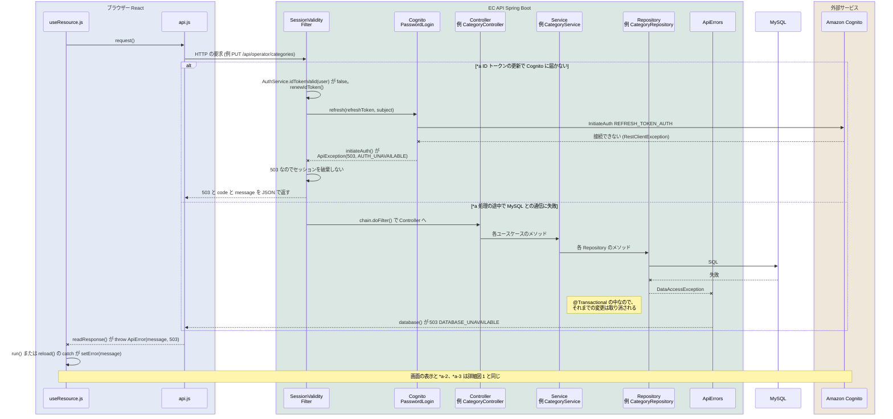
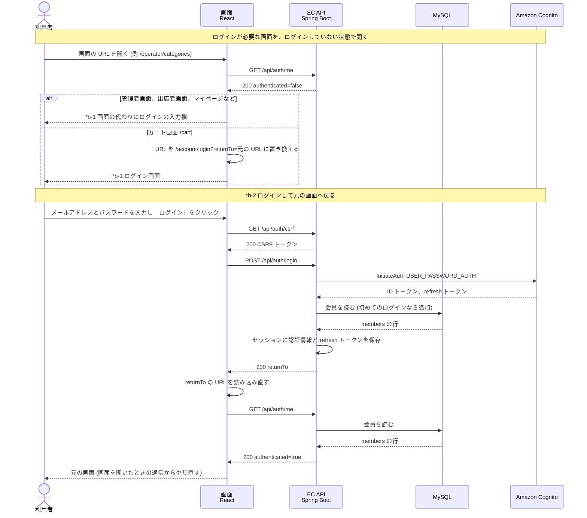
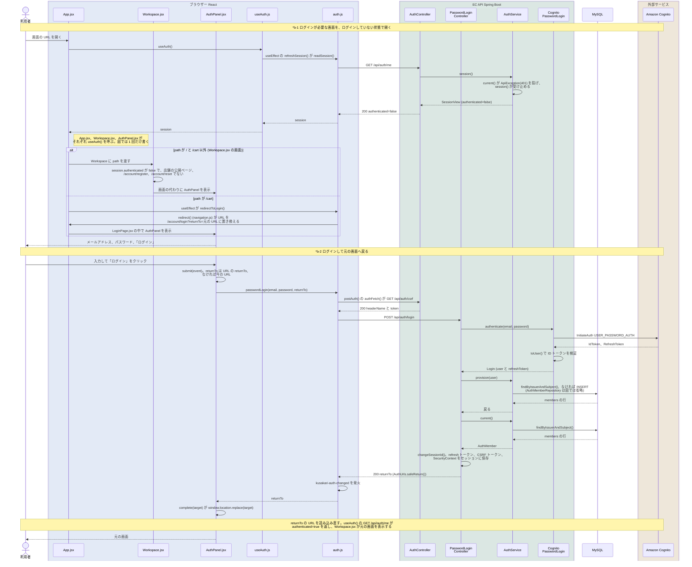
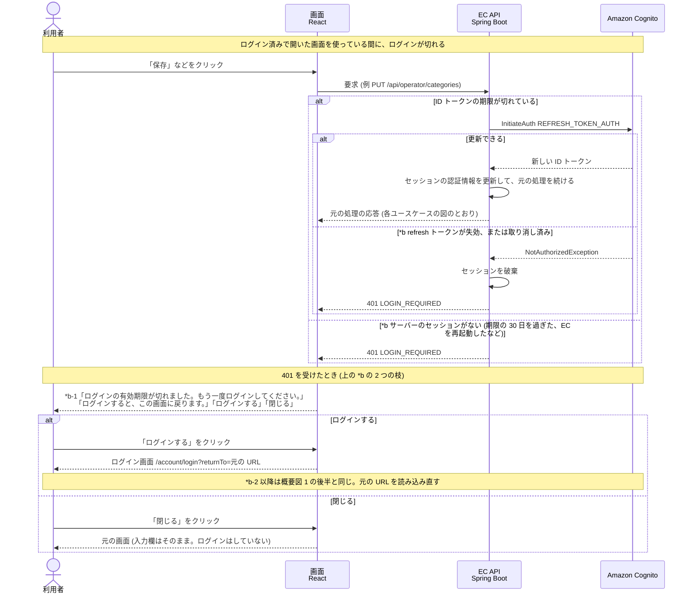
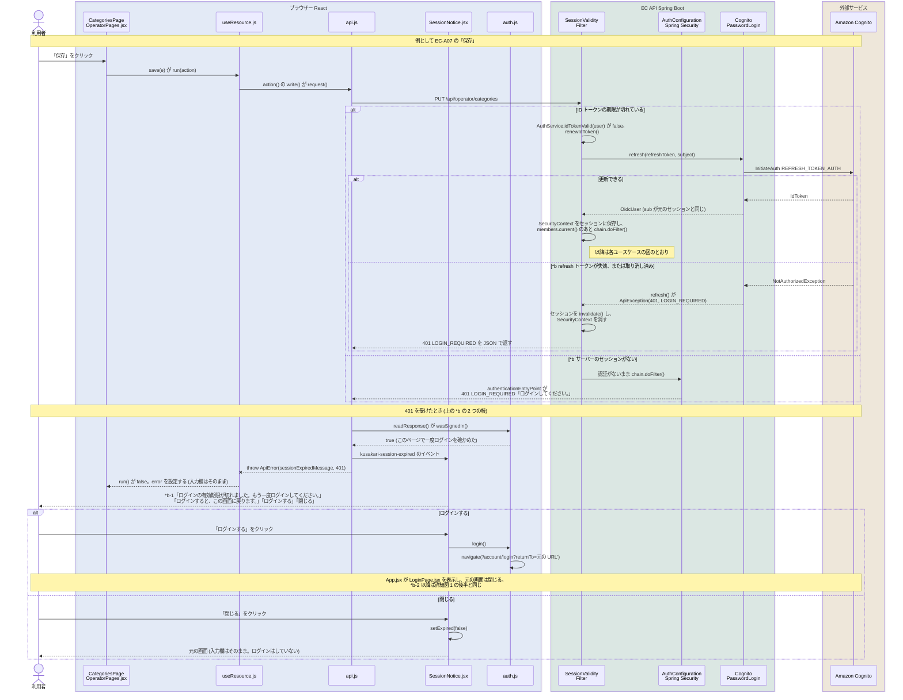

# 00 全ユースケース共通の代替フロー

- ユースケース記述: [00_全ユースケース共通の代替フロー](<../../アーカイブ/ユースケース/kusakari-ec/00_全ユースケース共通の代替フロー.md>)
- 対象のコード: kusakari-ec の main（19a2be3、2026-11-20 時点）

画面から EC API への通信は、ほとんどが `api.js` の `request()`、`send()`、`readResponse()` を通ります。例外は `auth.js` の 3 つの関数で、ログインの状態を読む `readSession()`、ログイン・新規登録の `postAuth()`、ログアウトの `logout()` です。管理者画面・出店者画面・マイページの多くの画面は、`useResource.js` で通信の結果を受けます。下の図は、`useResource.js` を使う画面の例として、[EC-A07 商品カテゴリを追加する](<EC-A07_商品カテゴリを追加する.md>) の `CategoriesPage` を使います。`useShop.js` などほかのフックの受け方は、各ユースケースの図に書きます。

## \*a 通信に失敗した場合

### 概要図

### 詳細図 1 ブラウザーで失敗を受け取る

### 詳細図 2 EC API で失敗する

## \*b 未ログインの場合

ログインしていないときの入口は 2 つあります。ログインが必要な画面をログインせずに開いたときと、画面を使っている間にログインが切れたときです。ログインに失敗したとき（パスワードの違い、メールアドレスの確認など）は [EC-B01 ログインする](<EC-B01_ログインする.md>) で扱います。

### 概要図 1 ログインせずに画面を開く

### 詳細図 1 ログインせずに画面を開く

### 概要図 2 画面を使っている間にログインが切れる

### 詳細図 2 画面を使っている間にログインが切れる

## ユースケース記述との差

- \*a-1、\*a-2、\*a-3 は、`api.js` と `useResource.js` を通る通信では記述どおりです。ただし「再取得」ボタンは `reload()` で画面の GET を送り直すだけで、失敗した書き込みは送り直しません。書き込みの再実行は、残った入力のまま同じボタンをもう一度押す操作です。
- 記述にない処理として、\*a はブラウザーと EC API の間だけでなく、EC API と Amazon Cognito の間（ID トークンの更新、503 `AUTH_UNAVAILABLE`）と、EC API と MySQL の間（`ApiErrors.database()` の 503 `DATABASE_UNAVAILABLE`）にもあります。画面にはそれぞれのメッセージが出ます。
- 画面を開いたときのログイン状態の確認（`auth.js` の `readSession()` の `GET /api/auth/me`）は `api.js` を通りません。この通信に失敗すると、`useAuth.js` が `fetch()` の例外の文（ブラウザーが作る文）をそのまま `Workspace.jsx` に渡し、画面はその文だけを表示します。「再取得」のボタンは無く、\*a-2 と \*a-3 に当たる操作はブラウザーの再読み込みだけです。
- ログインの「ログイン」（`auth.js` の `postAuth()`）も `api.js` を通りません。通信に失敗すると、`fetch()` の例外の文がそのまま `AuthPanel.jsx` に出ます。\*a-1 の共通のメッセージ（「サーバーに接続できません。…」）にはなりません。
- \*b-1 の「ログイン画面を表示する」は、入口によって形が違います。
  - 管理者画面・出店者画面・マイページなど（`Workspace.jsx` の画面）は、URL を変えずに、画面の代わりにログインの入力欄（`AuthPanel`）を出します。
  - カート画面（`/cart`）は、`/account/login` のログイン画面へ移ります。
  - 使っている間にログインが切れたときは、まず `SessionNotice` のお知らせを画面の上に出し、「ログインする」を押したときにログイン画面へ移ります。
- \*b-2 の「元のステップへ戻る」は、ログインのあと `returnTo` の URL を読み込み直して行います。画面は最初から表示し直すので、使っている間にログインが切れた場合は、入力の途中だった内容は戻りません。お知らせの「閉じる」を選ぶと入力は残りますが、ログインしていない状態のままです。
- 公開の画面（トップ、商品詳細など）でログインせずにログインが必要な API を呼ぶと、`readResponse()` は `wasSignedIn()` が false なので、お知らせを出さずに「ログインしてください。」の `ApiError` を投げます。その扱いは各ユースケースの図に書きます。

## 確かめられなかったこと

- MySQL にまったく接続できないときの応答は、動かして確かめていません。ログイン中の要求は、`SessionValidityFilter` の `members.current()` で最初に DB を読みます。このときの例外や、トランザクションを始めるときの例外（`CannotCreateTransactionException` など）は `DataAccessException` ではないか、`@RestControllerAdvice` の外で起きるため、`ApiErrors.database()` を通らない可能性があります。その場合に画面にどの文が出るかは分かりません。
- 「JSON でない本文」を返す中継のサーバーが、どの環境で何を返すかは確かめていません。図は `readResponse()` の扱いだけを書いています。
- 通信に失敗したときに入力が残るかは、画面ごとの作りによります。図の `CategoriesPage` は残ります。ほかの画面は各ユースケースの図で確かめます。

## 参照したコード

- [frontend/src/api.js](https://github.com/abeouga/kusakari-ec/blob/19a2be307ee71a2cd87e538236c3c8c42929c5b3/frontend/src/api.js): `networkErrorMessage`、`sessionExpiredMessage`、`sessionExpiredEvent`、`ApiError`、`readResponse()`、`send()`、`request()`
- [frontend/src/auth.js](https://github.com/abeouga/kusakari-ec/blob/19a2be307ee71a2cd87e538236c3c8c42929c5b3/frontend/src/auth.js): `wasSignedIn()`、`readSession()`、`authFetch()`、`login()`、`redirectToLogin()`、`postAuth()`、`passwordLogin()`
- [frontend/src/useAuth.js](https://github.com/abeouga/kusakari-ec/blob/19a2be307ee71a2cd87e538236c3c8c42929c5b3/frontend/src/useAuth.js): `useAuth()` の `refreshSession()`
- [frontend/src/workspace/useResource.js](https://github.com/abeouga/kusakari-ec/blob/19a2be307ee71a2cd87e538236c3c8c42929c5b3/frontend/src/workspace/useResource.js): `reload()`、`run()`
- [frontend/src/workspace/ResourceView.jsx](https://github.com/abeouga/kusakari-ec/blob/19a2be307ee71a2cd87e538236c3c8c42929c5b3/frontend/src/workspace/ResourceView.jsx): `ResourceStatus`（「再取得」）
- [frontend/src/workspace/OperatorPages.jsx](https://github.com/abeouga/kusakari-ec/blob/19a2be307ee71a2cd87e538236c3c8c42929c5b3/frontend/src/workspace/OperatorPages.jsx): `CategoriesPage` の `save()`
- [frontend/src/components/SessionNotice.jsx](https://github.com/abeouga/kusakari-ec/blob/19a2be307ee71a2cd87e538236c3c8c42929c5b3/frontend/src/components/SessionNotice.jsx): `SessionNotice`
- [frontend/src/components/AuthPanel.jsx](https://github.com/abeouga/kusakari-ec/blob/19a2be307ee71a2cd87e538236c3c8c42929c5b3/frontend/src/components/AuthPanel.jsx): `AuthPanel` の `submit()`、`complete()`、`returnTo`
- [frontend/src/components/LoginPage.jsx](https://github.com/abeouga/kusakari-ec/blob/19a2be307ee71a2cd87e538236c3c8c42929c5b3/frontend/src/components/LoginPage.jsx): `LoginPage`
- [frontend/src/App.jsx](https://github.com/abeouga/kusakari-ec/blob/19a2be307ee71a2cd87e538236c3c8c42929c5b3/frontend/src/App.jsx): `App`（`cartLoginRequired`、`LoginPage` と `Workspace` の切り替え）
- [frontend/src/workspace/Workspace.jsx](https://github.com/abeouga/kusakari-ec/blob/19a2be307ee71a2cd87e538236c3c8c42929c5b3/frontend/src/workspace/Workspace.jsx): `Workspace`（`error` の表示、未ログインの `AuthPanel`）
- [frontend/src/workspace/navigation.js](https://github.com/abeouga/kusakari-ec/blob/19a2be307ee71a2cd87e538236c3c8c42929c5b3/frontend/src/workspace/navigation.js): `navigate()`、`redirect()`
- [backend/src/main/java/jp/kusakari/ec/auth/AuthConfiguration.java](https://github.com/abeouga/kusakari-ec/blob/19a2be307ee71a2cd87e538236c3c8c42929c5b3/backend/src/main/java/jp/kusakari/ec/auth/AuthConfiguration.java): `cognitoSecurity()` の `authorizeHttpRequests`、`authenticationEntryPoint`
- [backend/src/main/java/jp/kusakari/ec/auth/SessionValidityFilter.java](https://github.com/abeouga/kusakari-ec/blob/19a2be307ee71a2cd87e538236c3c8c42929c5b3/backend/src/main/java/jp/kusakari/ec/auth/SessionValidityFilter.java): `doFilterInternal()`、`renewIdToken()`
- [backend/src/main/java/jp/kusakari/ec/auth/CognitoPasswordLogin.java](https://github.com/abeouga/kusakari-ec/blob/19a2be307ee71a2cd87e538236c3c8c42929c5b3/backend/src/main/java/jp/kusakari/ec/auth/CognitoPasswordLogin.java): `authenticate()`、`refresh()`、`initiateAuth()`、`toUser()`
- [backend/src/main/java/jp/kusakari/ec/auth/PasswordLoginController.java](https://github.com/abeouga/kusakari-ec/blob/19a2be307ee71a2cd87e538236c3c8c42929c5b3/backend/src/main/java/jp/kusakari/ec/auth/PasswordLoginController.java): `login()`
- [backend/src/main/java/jp/kusakari/ec/auth/AuthController.java](https://github.com/abeouga/kusakari-ec/blob/19a2be307ee71a2cd87e538236c3c8c42929c5b3/backend/src/main/java/jp/kusakari/ec/auth/AuthController.java): `me()`、`csrf()`
- [backend/src/main/java/jp/kusakari/ec/auth/AuthService.java](https://github.com/abeouga/kusakari-ec/blob/19a2be307ee71a2cd87e538236c3c8c42929c5b3/backend/src/main/java/jp/kusakari/ec/auth/AuthService.java): `provision()`、`current()`、`idTokenValid()`、`session()`
- [backend/src/main/java/jp/kusakari/ec/auth/AuthUrls.java](https://github.com/abeouga/kusakari-ec/blob/19a2be307ee71a2cd87e538236c3c8c42929c5b3/backend/src/main/java/jp/kusakari/ec/auth/AuthUrls.java): `safeReturn()`
- [backend/src/main/java/jp/kusakari/ec/common/web/ApiErrors.java](https://github.com/abeouga/kusakari-ec/blob/19a2be307ee71a2cd87e538236c3c8c42929c5b3/backend/src/main/java/jp/kusakari/ec/common/web/ApiErrors.java): `database()`
- [backend/src/main/resources/application-cognito.properties](https://github.com/abeouga/kusakari-ec/blob/19a2be307ee71a2cd87e538236c3c8c42929c5b3/backend/src/main/resources/application-cognito.properties): `server.servlet.session.timeout`
